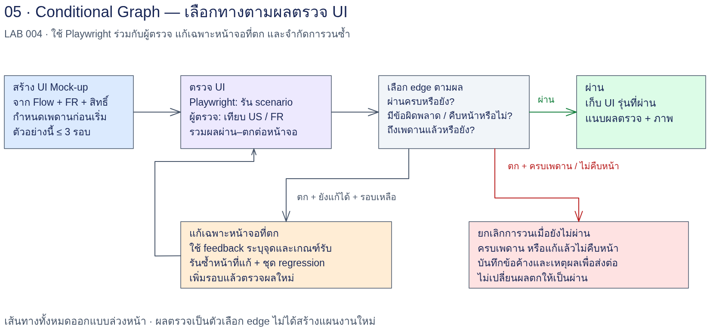
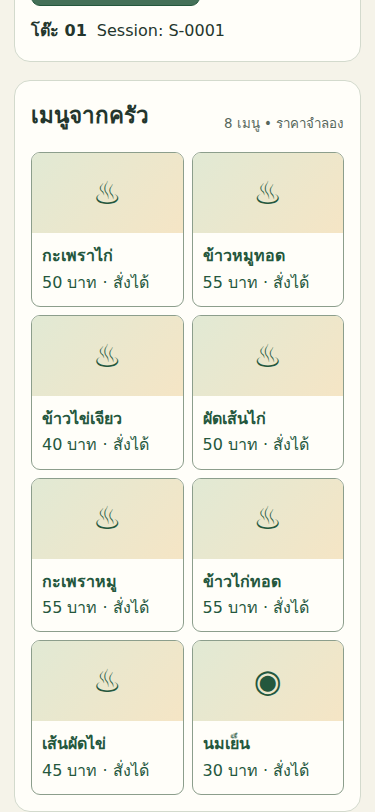
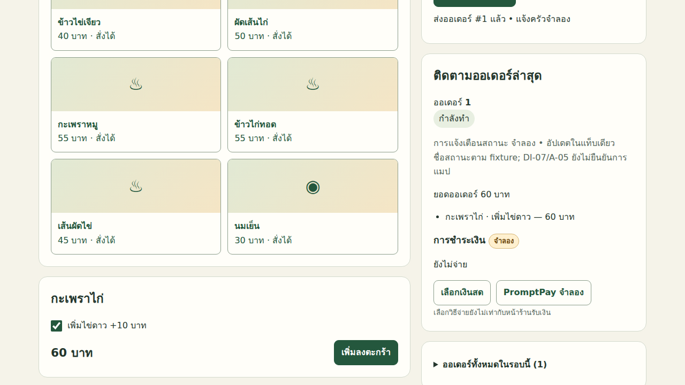
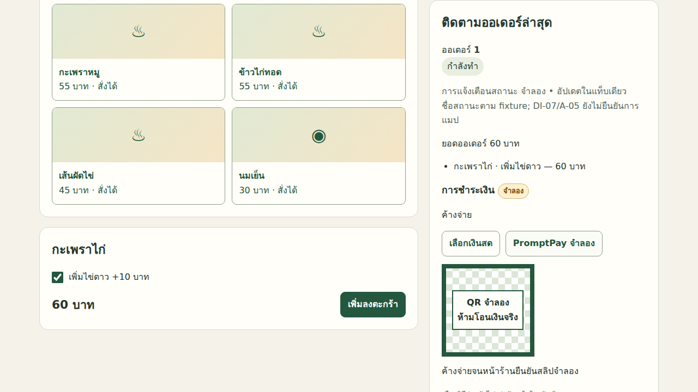
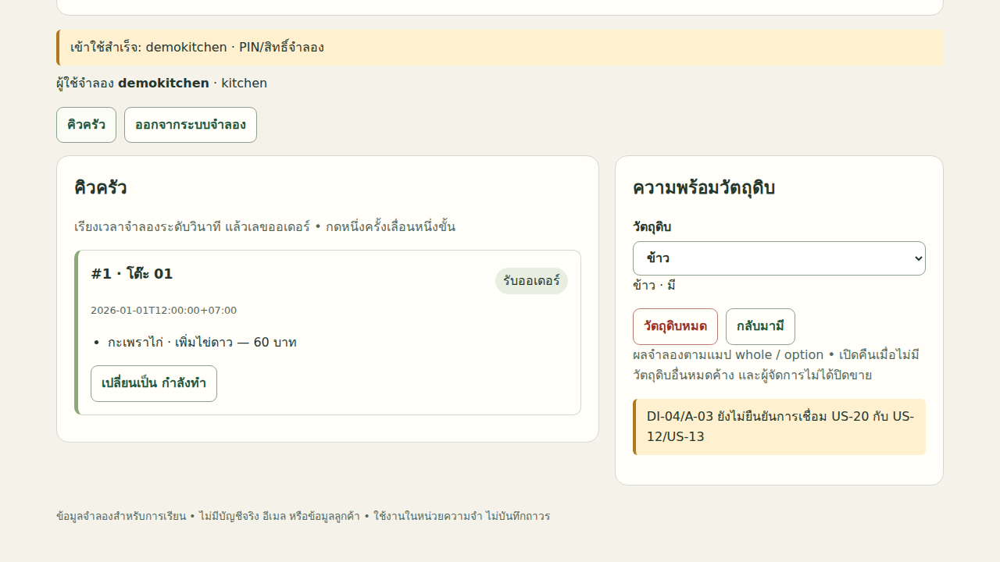
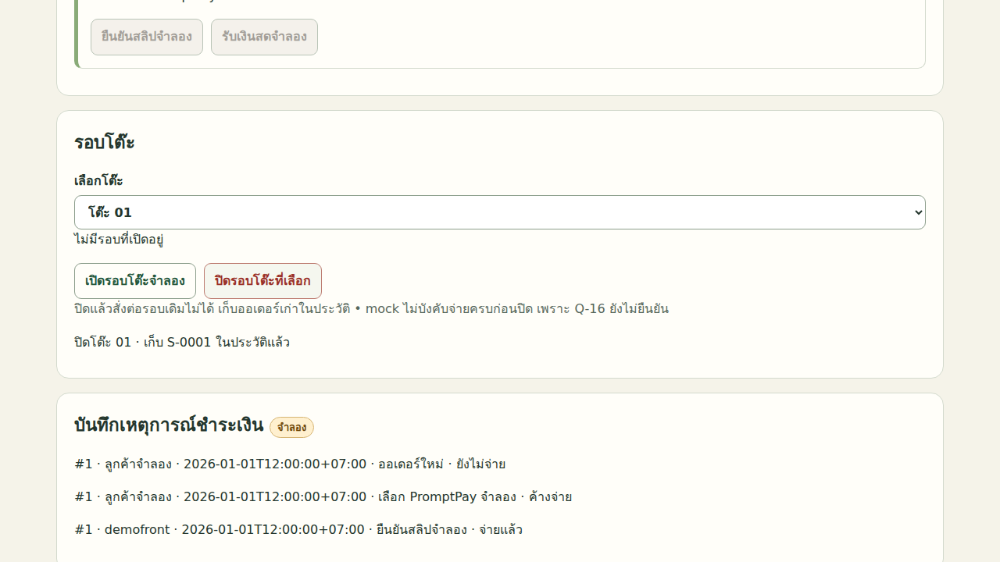
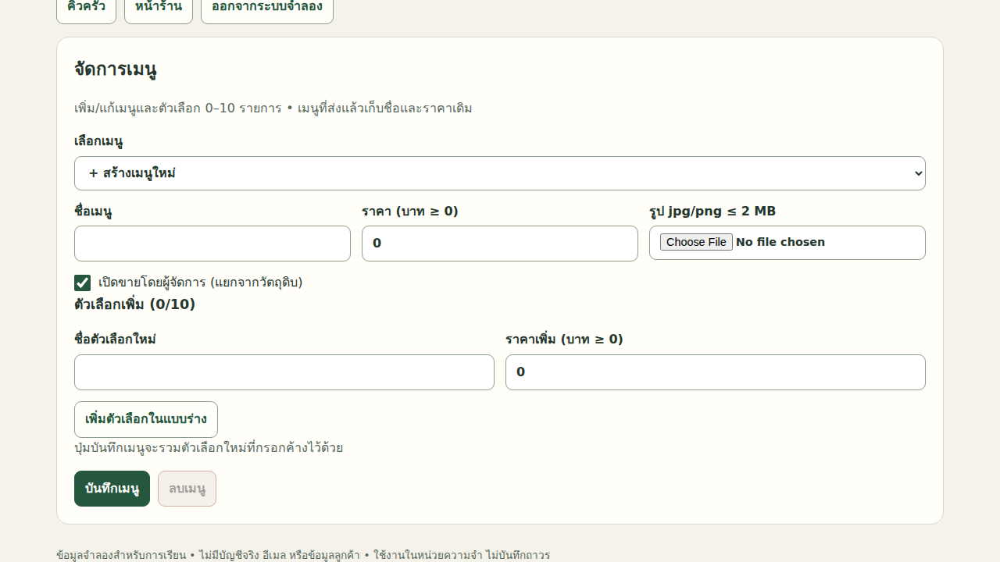

# LAB 004 — Conditional Graph: สร้าง UI Mock-up ที่เล่นได้จริงจาก Flow

## โจทย์

นำ Flow, State Machine และ Structure ที่ตรวจแล้วจาก LAB 003 ของ “ครัวคุณยาย” มาสร้าง UI HTML ไฟล์เดียว
ผู้เรียนรับบท SA กำหนด Input/สัญญา ตรวจผลจริง และตัดสินว่าจะจบ แก้เฉพาะหน้าจอ หรือยกเลิกพร้อมรายงาน
ความสำเร็จคือเส้นทางที่เล่นได้ตามข้อกำหนดพร้อมหลักฐาน ไม่ใช่เพียงหน้าเว็บสวยหรือคำตอบว่า “เสร็จแล้ว”

## เป้าหมาย

- อธิบาย Conditional Graph และ edge ที่เลือกจากผลตรวจได้
- สร้าง UI จาก Flow/Structure โดยเชื่อม US/FR ที่มีจริงกับหน้าจอและ check ID
- ใช้ผู้ตรวจอัตโนมัติ Playwright คู่กับผู้ตรวจ AI โดยไม่ให้ความคิดเห็นแทนผลทดสอบ
- แก้เฉพาะจุดและตรวจ regression ทั้งชุดภายใต้เพดานแก้สูงสุด 3 รอบ
- หยุดเมื่อผ่าน ไม่คืบหน้า หรือครบเพดาน และเก็บข้อค้างที่นำไปวางแผนต่อได้
- แยกพฤติกรรมจำลองออกจาก NFR และเกณฑ์จำนวนตัวอย่างที่ต้องตรวจในระบบจริง

## ความรู้ก่อนเรียน

ผ่าน [LAB 003](../003_LAB_Static_Graph_Flow_Structure/README.md) และอ่าน FR/NFR, Flow, State และสิทธิ์ได้
ใช้ Terminal, JSON, HTML และคำสั่ง CLI พื้นฐานได้; ใช้บัญชีฝึกที่ลงชื่อเข้าใช้แล้ว แทนชื่อในบันทึกด้วย `<ACCOUNT>`
ต้องมี `/opt/venv/bin/python3`, Playwright Python และ Chromium หรือ browser ที่เปิด CDP ตามที่เครื่องเรียนจัดไว้
อ่าน [ต้นฉบับกรณีศึกษา](../docs/case-study-source.md) และ [ข้อมูลขาด/สมมติฐาน](../docs/data-issues.md)
ไม่ต้องใช้บริการจ่ายเงินจริงหรือเครือข่ายภายนอกในการเล่น UI

## เวลาโดยประมาณ

ยังไม่มีข้อมูลเวลาเรียนที่วัดจากการรัน LAB ชุดนี้ จึงไม่ระบุจำนวนนาทีแทนผลจริง
แบ่งเวลาเป็นเตรียม Input → สร้าง → ตรวจ/แก้ → ทดลองคลิก → ปรับ Prompt และอภิปราย
ก่อนเริ่มผู้เรียนกำหนดเพดานเวลาและงบตามคาบจริงใน `work/session-plan.md`
เวลา wall, จำนวนเรียก, รอบที่ใช้จริง, โทเคน และต้นทุนในตัวอย่างล่วงหน้า: **ไม่มีข้อมูล**
เพดานแก้ 3 รอบเป็นกฎของแบบฝึก ไม่ใช่จำนวนรอบที่ได้จากการทดลองแล้ว

## User Story ที่ใช้: 16 ข้อ

| บทบาท | US ในขอบเขต | สิ่งที่สังเกตใน Mock-up |
|---|---|---|
| ลูกค้า | US-01, US-02 | เลือกโต๊ะแทนสแกน QR เปิดเมนูโดยไม่ login และผูก table_id |
| ลูกค้า | US-03, US-04 | กลับบ้าน/ช่วงรับอาหาร และตัวเลือกเพิ่มรวมราคา |
| ลูกค้า | US-05, US-06 | สถานะออเดอร์และปฏิเสธเมนู/ตัวเลือกที่หมด |
| ลูกค้า | US-08 | เงินสด/PromptPay ค้างจ่าย ยืนยันสลิป ปิดบริการ และ timeout |
| ครัว/หน้าร้าน | US-10, US-11 | ลำดับคิวและปุ่มเปลี่ยนสถานะ |
| ครัว/หน้าร้าน | US-12, US-13 | วัตถุดิบหมด/กลับมามีตามแมป |
| ครัว/หน้าร้าน | US-15, US-16 | โต๊ะ/หมายเลขกลับบ้าน สถานะจ่าย และ session ใหม่ |
| ผู้จัดการ | US-19, US-20, US-25 | เมนู แมปวัตถุดิบ และบัญชี/PIN/สิทธิ์ |

รายการนี้ย่อเพื่อเลือกขอบเขต ไม่ทดแทนข้อความและเกณฑ์รับต้นฉบับ
ต้นทางมีขอบเขตกว้างกว่า LAB นี้ได้ แต่ห้ามนำมาขยาย UI โดยไม่บันทึก
US-20 อ้างกฎปิด/เปิดเป็นรหัสอื่นในต้นฉบับ; คง DI-04 และข้อเสนอ A-03 ที่ยังไม่ยืนยัน
หมายเหตุ ก./ค./ช. ยังไม่มีนิยาม; ไม่แต่งรายละเอียดเพิ่มตาม A-02
ชื่อสถานะต่างระดับต้องแยกกันตาม DI-07/A-05 และบันทึกการแมปชื่อที่ยังรอยืนยัน

## แผนภาพ Workflow



คำอธิบายแทนภาพ: Input → Build UI → Check → {Pass: จบ, Fix: แก้เฉพาะหน้าจอ → Check, Cancel: รายงานข้อค้าง}
ตรวจเพดานรอบ/เวลา/งบก่อนเข้า Fix ทุกครั้ง และใช้ผล AI ประกอบการตรวจรับเชิงความหมาย

## สิ่งส่งมอบของนักศึกษา

| ตำแหน่งใน work/ | สิ่งที่ต้องมี |
|---|---|
| `upstream/`, `input-source.md`, `input-audit.md`, `session-plan.md` | snapshot, แหล่งที่มา, hash, ข้อค้างและเพดาน |
| `ui-mockup.html`, `build-notes.md` | UI ไฟล์เดียวและตาราง Flow/FR/US → หน้าจอ |
| `current-round.txt`, `ui-check-round-N.json`, `ui-check-round-N.md` | รอบล่าสุด ผลดิบ และการตัดสิน workflow |
| `ui-before-round-N.html`, `fix-prompt-round-N.md`, `fix-report-round-N.md` | หลักฐานก่อนแก้ Prompt จริง และเหตุผล |
| `shots/round-N/`, `manual-shots/round-N/` | ภาพจาก check และภาพคลิกตามบทบาท |
| `ai-review-round-N.md`, `click-review-round-N.md` | การตรวจเชิงความหมายและผลทดลองคลิก |
| `logs/`, `prompt-variant.md`, `prompt-experiment-plan.md`, `report.md` | log, การทดลอง Prompt และบทสรุปการเรียน |

ชื่อเหล่านี้เป็นผลที่ผู้เรียนจะสร้าง ไม่ใช่ไฟล์ผลรันที่มีอยู่แล้ว
เก็บผลนักศึกษาใน work/; ไม่เขียน reference/ และ img/; ไม่ลบหลักฐานเดิมเมื่อเริ่มรุ่นใหม่

## ทฤษฎี Conditional Graph

### ข้อจำกัดของ Static Graph ใน LAB 003

Static Graph กำหนด node และ dependency ล่วงหน้า เช่น Flow บทบาท → State/Structure → Merge
ช่วยให้รู้ว่าไฟล์ใดต้องรอไฟล์ใด แต่ยังไม่กำหนดว่าผลตรวจ UI แต่ละแบบควรเดินไปงานไหน
ถ้ารันทุก node ซ้ำเมื่อมีปุ่มหน้าครัวเสียเพียงจุดเดียว จะใช้ทรัพยากรเพิ่มและเสี่ยงทำส่วนที่ผ่านเสีย
Conditional Graph เพิ่มเงื่อนไขบน edge เพื่อเลือกเส้นทางตามหลักฐานปัจจุบัน
node และเส้นทางที่เป็นไปได้ยังถูกกำหนดไว้ก่อน ไม่ได้สร้างแผนใหม่ขณะรัน

### Node, Edge และ State ของ workflow

Build รับ Input และสร้าง HTML; Check รับ HTML แล้วส่ง JSON; Fix รับเฉพาะข้อที่ตกและแก้จุดที่เกี่ยวข้อง
Edge คือเงื่อนไขส่งงานจาก Check ไป Pass, Fix หรือ Cancel ไม่ใช่ชื่อสถานะของออเดอร์ใน UI
State ของ workflow ได้แก่ รุ่น Input/HTML, หมายเลขรอบ, checks, ชุด failed IDs, รายงานก่อนหน้า และข้อค้าง
State ของร้าน ได้แก่ตะกร้า ออเดอร์ การจ่าย วัตถุดิบ และ session โต๊ะ ซึ่งเป็นข้อมูลภายใน Mock-up
ห้ามสับสนการเปลี่ยนออเดอร์เป็น “กำลังทำ” กับการเปลี่ยนเส้นทางงาน AI เป็น Fix
กราฟนี้มีวง Check → Fix → Check จึงไม่ใช่ DAG ทั้งกราฟ แม้เส้นทางสร้างครั้งแรกจะเป็นลำดับตรง

### ผู้ตรวจสองชนิด

Playwright คลิก controls จริง อ่านสถานะ/ยอด/คิว และบันทึก check ที่ล้มเหลวแทนการเดาจากโค้ด
ผู้ตรวจ AI อ่าน Flow/Structure กับหลักฐาน UI เพื่อตรวจความหมาย การตกหล่น และ traceability
AI อาจเห็น flow ที่ผิดแต่ไม่มี test ครอบคลุม ขณะที่ test อาจพบรายละเอียดที่ AI มองข้าม
หากผลขัดกัน SA ต้องเก็บหลักฐานทั้งสองด้าน ไม่ให้ AI แก้ JSON เพื่อให้ผ่าน
raw edge เป็นคำตอบจากสคริปต์; การตรวจรับทั้ง LAB ยังต้องมีการทดลองคลิกและข้อค้างเชิงความหมายที่ยอมรับได้
เมื่อจำเป็นต้องเปลี่ยนแผนหรือ contract ให้ยกเลิกชุดเดิมพร้อมรายงาน แล้วส่งประเด็นไป LAB ถัดไป

### การหยุดและกันวนไม่คืบหน้า

รอบ 0 คือผลหลังสร้างครั้งแรก ยังไม่ใช้สิทธิ์แก้
รอบ 1, 2, 3 คือรอบแก้ ไม่ใช่การรัน check เพิ่มฟรีเพื่อรีเซ็ตประวัติ
ชุดข้อที่ตกเหมือนกันสองรอบติดต่อกันถือว่าไม่คืบหน้า แม้ detail จะเปลี่ยนหรือ UI ดูดีขึ้น
กฎนี้เป็น heuristic ของการเรียน อาจหยุดงานที่แก้ภายในไปบางส่วนแล้ว จึงต้องเก็บ fix-report ประกอบ
ชุดที่เล็กลงถือว่าคืบหน้า; ชุดที่เปลี่ยนแต่จำนวนเท่าเดิมยังเป็น Fix ตามกฎนี้และถูกจำกัดด้วยเพดาน
วน A → B → A อาจไม่ถูกจับด้วยเทียบรอบเดียว แต่เพดาน 3 รอบยังบังคับหยุด
ห้ามลบ --prev, เปลี่ยน check ID, หรือเริ่มนับรอบ 0 ใหม่เพื่อหลบ Cancel

## ตารางกฎตัดสิน Edge ที่ตรงกับ tests/ui-check.py

ให้ F เป็นเซต id ที่ passed=false ในรอบปัจจุบัน และ P เป็นเซตดังกล่าวจาก --prev
passed และ failed ใน JSON เป็นจำนวนเต็ม; passed ใน checks แต่ละตัวเป็น boolean
ลำดับกฎต้องตรวจผ่านทั้งหมดก่อนเทียบเซตเสมอ

| เงื่อนไขตามลำดับ | raw edge | งานถัดไป |
|---|---|---|
| failed == 0 หรือ F ว่าง | pass | หยุดแก้ เก็บภาพ/ตรวจ AI และทดลองคลิก |
| มี --prev, F ไม่ว่าง, F ⊆ P และ F == P | cancel | หยุด เพราะตกชุดเดิมสองรอบติด พร้อมรายงาน |
| ไม่มี --prev และมีข้อที่ตก | fix | แก้เฉพาะหน้าจอที่ตกถ้ายังมีโควตารอบ |
| F เป็น subset ที่เล็กลงจริงของ P | fix | แก้ข้อที่ยังตกต่อและตรวจ regression |
| F เปลี่ยนชุด/มีข้อใหม่ แม้จำนวนเท่าเดิมหรือเพิ่ม | fix | วิเคราะห์ regression และตรวจเพดานก่อนแก้ |
| raw edge=fix แต่รอบปัจจุบัน N=3 แล้วยังตก | fix (คงผล JSON) | workflow ยกเลิกเพราะครบเพดาน ไม่แก้ JSON |
| เวลา/งบเกินค่าที่ตั้งไว้หรือ Input ขัดแย้งปิดกั้นงาน | คงผล JSON ถ้ามี | workflow ยกเลิกพร้อมเหตุและรายการค้าง |

สคริปต์ไม่มีตัวนับรอบ จึงไม่อ้างว่า raw edge จะเป็น cancel ทุกกรณีที่ครบเพดาน
--prev ต้องเป็นรายงานรอบก่อนของชุดเดียวกันและมี check IDs ครบชุด ไม่ใช้จากคนละ seed/contract/variant
JSON เก่าที่เสียหรือมี counts ไม่ตรงจะถูกปฏิเสธด้วย exit 2 ก่อนตรวจ UI; ต้องแก้สาเหตุและเก็บไฟล์เดิมไว้
ตัวตรวจคืน exit 0 เมื่อผ่านทั้งหมด, exit 1 เมื่อข้อพฤติกรรมตก, exit 2 เมื่อ setup/runtime ใช้งานไม่ได้
หาก browser เปิดไม่ได้จะมีรายละเอียด Infrastructure ในทุก check ที่ยังไม่ได้ทำ; ไม่ตีความเป็นบั๊กหน้าจอทันที
รายงานเดิมหรือโฟลเดอร์ภาพที่ไม่ว่างจะไม่ถูกเขียนทับ; เลือกชื่อชุดใหม่เมื่อทดสอบเครื่องมือซ้ำ

ตัวอย่างประกอบ — ยังไม่ได้รันจริง: ตารางต่อไปเป็นการอธิบายกฎ ไม่ใช่ผล UI

| รอบก่อน → รอบนี้ | คำตอบที่กฎต้องให้ |
|---|---|
| ไม่มี → {stock-whole} | fix |
| {stock-whole, stock-option} → {stock-whole} | fix |
| {stock-whole} → {stock-whole} | cancel |
| {stock-whole} → {status-sync} | fix |
| {status-sync} → {} | pass |

## วิธีใช้ขั้นปฏิบัติ

ทุกขั้นใช้ working directory เดียวกันตามคำสั่งด้านล่าง และเริ่ม AI session ใหม่ ไม่ resume บทสนทนาผู้สร้าง
ไฟล์ Prompt ที่ลิงก์ไว้ตรงกับ code block เต็มในแต่ละขั้น; คำสั่ง shell อยู่อีก block หนึ่ง
เลือกใช้ Codex หรือ Claude อย่างใดอย่างหนึ่งต่อขั้น ไม่จำเป็นต้องรันทั้งคู่
คำสั่งต่อไปนี้ให้ผู้เรียนสร้างผลของตนใน `work/` ซึ่งเป็นคนละชุดกับผลรันล่วงหน้าของผู้จัดทำใน `reference/`; ห้ามใช้ผลอ้างอิงแทนหลักฐานว่าตนรันแล้ว
หากมี work/ จากชุดเดิม ให้เก็บสำเนาทั้งชุดไปตำแหน่งรุ่นใหม่ก่อนเริ่ม ห้ามเขียนทับหลักฐาน

```bash
cd <PROJECT_ROOT>/AI_Workflow_Engineering_for_SA/004_LAB_Conditional_Graph_UI_Mockup
mkdir -p work/logs
/opt/venv/bin/python3 tests/ui-check.py --help
```

หาก path โครงการในเครื่องต่างกัน ให้เปลี่ยนเฉพาะส่วนก่อนชื่อโฟลเดอร์ LAB ในคำสั่ง cd
ตัวตรวจลอง p.chromium.launch() ก่อน ถ้าไม่ได้จึง connect_over_cdp('http://127.0.0.1:9222')
เมื่อใช้ CDP ตัวตรวจสร้าง context ของตนเองและปิดเฉพาะ context นั้น ไม่ปิด browser ที่ผู้เรียนเปิดไว้

## ขั้น 4.0 — เตรียม Input

### 1. เป้าหมายและ Input

ตรวจชุดส่งต่อจาก LAB 003 ด้วย [คู่มือ Input](input/README.md) แล้วทำ snapshot ที่ตรวจย้อนกลับได้
Input คือ flow/state/structure และ manifest; cwd คือโฟลเดอร์ LAB 004; ใช้ session ใหม่
ถ้าใช้ reference ต้องบันทึกว่าใช้ผลอ้างอิง ไม่ใช่ผลที่ตนเองรันสำเร็จ

### 2. Prompt พร้อมคัดลอก

ไฟล์ [prompts/00-prepare-input.md](prompts/00-prepare-input.md)

```text
# ขั้น 4.0 — เตรียม Input

## บริบท
คุณเป็น SA ของครัวคุณยาย ทำงานจากโฟลเดอร์ LAB 004 ใน session ใหม่
อ่าน input/README.md, input/mock-data.json, input/ui-contract.md และ ../docs/case-study-source.md
## งาน
สำรวจ ../003_LAB_Static_Graph_Flow_Structure/work/ และ lab004-handoff.md ก่อน
หากไม่มีผลของนักศึกษา ใช้ชุดที่มี manifest ครบใน ../003_LAB_Static_Graph_Flow_Structure/reference/ พร้อมบันทึกว่าใช้ผลอ้างอิง
เลือก snapshot เดียว ตรวจ flow-customer.md, flow-kitchen-front.md, flow-manager.md, state-machine.md, structure.md, flow-merge.md
อ่าน JSON คู่กันและ merge-report.md เมื่อมี; เปรียบเทียบฉบับรวมกับ state/structure และข้อค้าง
คัดลอกชุดที่ตรวจแล้วไป work/upstream/ และคำนวณ SHA-256 จากไฟล์จริง
## ข้อจำกัด
ไม่แก้ต้นทาง ไม่เขียน reference/ หรือ img/ ไม่สร้าง flow แทนไฟล์ที่ขาด ไม่อ้างผลอ้างอิงเป็นผลตนเอง
คงข้อสงสัย A-02, DI-04/A-03 และ DI-07/A-05; ถ้าขาด Input หรือขัดแย้งจนสร้าง UI ไม่ได้ ให้บันทึก MISSING/BLOCKED และหยุด
ไม่ใส่บัญชีจริง ข้อมูลบุคคล token หรือ PIN จริง; ขอบเขต UI มีเฉพาะ 16 US ใน README
## Output และตำแหน่งบันทึก
เขียน work/input-source.md ตารางต้นทาง/รุ่น/hash/SELF หรือ REFERENCE และ work/input-audit.md สถานะ READY/MISSING/BLOCKED พร้อมเหตุ
เขียน work/session-plan.md ระบุเงื่อนไขหยุด: baseline รอบ 0 แล้วแก้ได้รอบ 1–3, ชุดข้อที่ตกซ้ำสองรอบติดให้ยกเลิก
ช่องเพดานเวลา/งบให้ผู้เรียนกำหนดก่อนรันจริง; ข้อมูลที่ไม่ได้วัดใช้ ไม่มีข้อมูล
หากปลายทางมีหลักฐานเดิมให้หยุดและรายงาน path ที่ต้องเก็บเป็นชุดใหม่ ห้ามทับ
```

### 3. วิธีรันและเปิดผล

```bash
codex exec -o work/logs/prepare-response.md "$(cat prompts/00-prepare-input.md)"
# ทางเลือกแทนคำสั่งข้างบน
# claude -p "$(cat prompts/00-prepare-input.md)" > work/logs/prepare-response.md
sed -n '1,180p' work/input-source.md
sed -n '1,180p' work/input-audit.md
```

### 4. ตัวอย่างผลรันล่วงหน้า

**เกณฑ์ที่คาดหวัง:** ระบุแหล่ง Input, รุ่น, SHA-256 และเงื่อนไขความพร้อมก่อนสร้าง UI

**ผลรันล่วงหน้า:** เตรียม snapshot จากผลอ้างอิง LAB 003 จำนวน 16 ไฟล์ด้วยการคัดลอกจริง โดยไม่ได้เรียก Prompt 00 เพิ่ม ดู [provenance และ hash](reference/step-00-input/provenance.md), [ผลตรวจ Input](reference/step-00-input/input-audit.md) และ [แผนรอบ](reference/step-00-input/session-plan.md)
ต้นทาง handoff ยังคง `BLOCKED` เพราะ MC-01–MC-03; การทดลองนี้พร้อมเฉพาะ mock ตาม `input/ui-contract.md` และ seed ของ LAB 004 ไม่ได้ยืนยันกฎธุรกิจที่ค้างหรือเปลี่ยนสถานะต้นทาง
ใช้ผลอ้างอิง ไม่ใช่ผลที่นักศึกษารันเอง; ขั้นเตรียม Input ไม่มีการเรียกโมเดล จึงไม่มี usage ของขั้นนี้

**ผลของนักศึกษา:** กรอก SELF/REFERENCE, hash ชุดที่ใช้ และ READY/MISSING/BLOCKED พร้อมเหตุผลของตนเอง

### 5. เปรียบเทียบและตรวจผ่าน

ตรวจว่าไฟล์ทั้งหกมาจากชุดเดียวกันและ hash ตรง ไม่ใช้เพียงชื่อไฟล์ตัดสิน
ส่วนที่ยืดหยุ่นได้คือรูปแบบคำอธิบาย; ที่ต้องตรงคือที่มา ขอบเขต US และข้อค้าง
ถ้า MISSING/BLOCKED ยังไม่ผ่าน ห้ามให้ผู้สร้าง UI เติม flow เอง

### 6. แก้ไขและส่งต่อ

ใช้ [Prompt แก้ปัญหาทั่วไป](prompts/04-fix-common.md) อธิบาย Input ที่ขาดและหลักฐาน
ส่ง work/upstream/, input-source.md, input-audit.md และ session-plan.md ไปขั้น 4.1 เมื่อ READY เท่านั้น

## ขั้น 4.1 — สร้าง UI

### 1. เป้าหมายและ Input

สร้าง UI HTML ไฟล์เดียวจาก snapshot, [ข้อมูลจำลอง](input/mock-data.json) และ [สัญญา UI](input/ui-contract.md)
Input ต้อง READY; cwd เดิม; เริ่ม session ใหม่ให้ผู้สร้างอ่านไฟล์แทนการจำบทสนทนา
ตรวจเพดานเวลา/งบใน session-plan ก่อนเริ่ม และอย่าใช้ข้อมูลบุคคลหรือบัญชีจริง

### 2. Prompt พร้อมคัดลอก

ไฟล์ [prompts/01-build-ui.md](prompts/01-build-ui.md)

```text
# ขั้น 4.1 — สร้าง UI Mock-up ที่เล่นได้

## บริบทและ Input
คุณเป็นผู้พัฒนา Mock-up ให้ SA ของครัวคุณยาย เริ่ม session ใหม่จากโฟลเดอร์ LAB 004
อ่าน work/input-source.md, work/input-audit.md, work/session-plan.md และ work/upstream/ ทุกไฟล์ตาม manifest
อ่าน flow-customer.md, flow-kitchen-front.md, flow-manager.md, state-machine.md, structure.md, flow-merge.md จาก snapshot
อ่าน input/mock-data.json, input/ui-contract.md, tests/ui-check.py และ ../docs/case-study-source.md
ถ้า Input ไม่ READY หรือมีข้อขัดแย้งที่ปิดกั้นงาน ให้รายงาน BLOCKED ไม่สร้าง flow/FR ขึ้นเอง
## งาน
สร้าง work/ui-mockup.html ไฟล์เดียว มี HTML/CSS/JavaScript และข้อมูลจำลองจาก input/mock-data.json ฝังในไฟล์
เปิดด้วย file:// ได้โดยไม่ใช้ server, fetch JSON, CDN, web font, รูปหรือทรัพยากรออนไลน์ทุกชนิด
ใช้แถบสลับบทบาท 3 บทบาท: ลูกค้า / ครัวและหน้าร้าน / ผู้จัดการ; แยกสิทธิ์ kitchen กับ front ด้วยฟอร์มชื่อผู้ใช้และ PIN จำลอง
แสดงป้าย “จำลอง” ให้ชัดสำหรับ PromptPay, QR โต๊ะ, การแจ้งเตือน, เวลา, PIN/สิทธิ์ และการสลับบทบาท
ลูกค้าเลือกโต๊ะหรือกลับบ้าน → เมนู → ตัวเลือก → ตะกร้า → ส่งออเดอร์ → ติดตามสถานะ → เงินสด/PromptPay
ครัวเห็นคิวเรียง timestamp วินาที/เลขออเดอร์และเปลี่ยนสถานะทีละขั้น; วัตถุดิบหมด/กลับมามีมีผลตามแมป
หน้าร้านแสดงโต๊ะ/T-001, ยอด snapshot, สถานะจ่าย; ยืนยันสลิป/รับเงินสดพร้อม log ชื่อผู้ใช้สมมติและเวลา; ปิดโต๊ะเริ่ม session ใหม่
ผู้จัดการแยกหน้าจัดการเมนูออกจากแมปวัตถุดิบ มีบัญชี/PIN และตั้งค่า PromptPay
เพิ่ม/แก้/ลบเมนู ราคา รูป jpg/png <=2 MB และตัวเลือก 0–10; ลบเมนูที่แมปแล้วต้องเตือนและลบแมป; ยอดออเดอร์เก่าห้ามเปลี่ยน
หน้าแมปเลือกได้เฉพาะเมนู/ตัวเลือกที่สร้างแล้ว แยกทั้งจานกับเฉพาะตัวเลือกและมีผลต่อการปิด/เปิดจริง
ตรวจ stock ซ้ำตอนส่ง ปฏิเสธตะกร้าที่เพิ่มไว้ก่อนวัตถุดิบหมด; ห้ามเพิ่มใบครัวเมื่อปฏิเสธ
PromptPay ค้างจ่ายจนหน้าร้านยืนยัน; เมื่อปิดบริการหรือไม่ยืนยันถึง 10 นาทีแสดงเงินสด; กดเลือกเงินสดไม่เท่ากับรับเงิน
กลับบ้านเลือก slot 15 นาทีเริ่มอย่างน้อย 20 นาทีจากเวลาจำลอง; T-001 เพิ่มต่อเนื่องและเริ่มใหม่เมื่อวันเปลี่ยน
บัญชีใหม่ใช้ชื่อ 3–20 ตัวอักษร/ตัวเลข PIN 4–6 หลัก; ผิด 5 ครั้งติดล็อก 5 นาทีตามนาฬิกาจำลอง; route ผู้จัดการต้องปฏิเสธ kitchen/front
มีปุ่มรีเซ็ตคืน seed/เวลา/บัญชี/แมป/คิวและออกจากระบบ; บอกวิธีใช้บนหน้า; ใช้ CSS รองรับมือถือและคีย์บอร์ด
## สัญญา data-testid ที่ต้องมีครบ
ใช้ชื่อและชนิด controls ต่อไปนี้ตรงกับ input/ui-contract.md; รายการซ้ำต้องอยู่ใน container ตาม contract
| data-testid | ความหมาย/พฤติกรรม |
|---|---|
| `data-testid="role-customer"` | button: แท็บลูกค้า ไม่ต้องล็อกอิน |
| `data-testid="role-staff"` | button: แท็บครัว/หน้าร้าน แสดงฟอร์มเข้าใช้ |
| `data-testid="role-manager"` | button: แท็บผู้จัดการ แสดงฟอร์มเข้าใช้ |
| `data-testid="screen-customer"` | section ลูกค้า |
| `data-testid="screen-staff"` | section พนักงาน |
| `data-testid="screen-manager"` | section ผู้จัดการ แสดงหลังอนุญาตเท่านั้น |
| `data-testid="staff-user"` | select value=demokitchen, demofront, demomanager และบัญชีที่สร้างใหม่ |
| `data-testid="staff-pin"` | input password; PIN จำลอง 0000 |
| `data-testid="btn-login"` | button ยืนยันชื่อผู้ใช้และ PIN |
| `data-testid="auth-message"` | ข้อความปฏิเสธ/ล็อก/ผลเข้าใช้ แสดงให้เห็น |
| `data-testid="nav-kitchen"` | button เปิดครัว เฉพาะ kitchen/manager |
| `data-testid="nav-front"` | button เปิดหน้าร้าน เฉพาะ front/manager |
| `data-testid="nav-menu-admin"` | button/ลิงก์ไป #/manager/menu ตรวจสิทธิ์เมื่อเข้าโดยตรงด้วย |
| `data-testid="nav-mapping"` | button ไปหน้าแมป เฉพาะ manager |
| `data-testid="nav-accounts"` | button ไปหน้าบัญชี เฉพาะ manager |
| `data-testid="menu-admin"` | section จัดการเมนู |
| `data-testid="report-screen"` | section รายงาน #/manager/reports เฉพาะ manager; เป็น placeholder ตรวจสิทธิ์ ไม่มีรายงานนอกขอบเขต |
| `data-testid="table-select"` | select value=01,02,03 แทนสแกน QR ที่มี table_id |
| `data-testid="btn-open-menu"` | button เริ่ม/เปิด session โต๊ะที่เลือก |
| `data-testid="active-table"` | ข้อความโต๊ะที่ active |
| `data-testid="session-id"` | ข้อความ session ID เปลี่ยนเมื่อปิดโต๊ะแล้วเปิดใหม่ |
| `data-testid="menu-list"` | section รายการเมนู |
| `data-testid="menu-item-m01"` | button เมนู m01; แม่แบบ menu-item-<id> ทุกเมนู ปิดด้วย disabled เมื่อทั้งจานหมด |
| `data-testid="menu-item-m02"` | button เมนู m02 ตามแม่แบบเดียวกัน |
| `data-testid="menu-item-m09"` | button เมนูใหม่ที่สร้างในชุดตรวจ ใช้ตัวนับ m09 หลัง reset |
| `data-testid="option-extra-egg"` | checkbox ตัวเลือกไข่ของ m01; แม่แบบ option-<id> ภายในรายละเอียดจานที่เลือก |
| `data-testid="item-total"` | ยอดจานที่เลือก แสดงเลขและหน่วยบาท |
| `data-testid="btn-add-item"` | button เพิ่มจานลงตะกร้า |
| `data-testid="cart-count"` | จำนวนจานในตะกร้า แสดงเลขล้วน |
| `data-testid="cart-total"` | ยอดตะกร้า |
| `data-testid="btn-submit-order"` | button ส่งตะกร้า; ต้องยอมให้กดเพื่อตรวจปฏิเสธตะกร้าที่วัตถุดิบเพิ่งหมด |
| `data-testid="order-message"` | ข้อความส่งแล้วหรือปฏิเสธ มีคำว่า หมด เมื่อวัตถุดิบไม่พอ |
| `data-testid="order-id"` | เลขออเดอร์ล่าสุดของ session ลูกค้า เป็นเลขเพิ่มทีละหนึ่ง |
| `data-testid="customer-order-status"` | สถานะออเดอร์ล่าสุด รับออเดอร์ → กำลังทำ → เสร็จแล้ว |
| `data-testid="kitchen-queue"` | container ใบครัว เรียง timestamp วินาที แล้วเลขออเดอร์; แสดงตัวเลือกและป้ายกลับบ้าน |
| `data-testid="kitchen-order"` | article ซ้ำได้ใน kitchen-queue; มี data-order-id, data-received-at เป็น ISO พร้อม timezone |
| `data-testid="btn-status-next"` | button ซ้ำได้ใน kitchen-order; คลิกหนึ่งครั้งเปลี่ยนหนึ่งสถานะ |
| `data-testid="ingredient-select"` | select ในครัว value=รหัสวัตถุดิบ |
| `data-testid="btn-out-of-stock"` | button ทำวัตถุดิบที่เลือกหมด |
| `data-testid="btn-restock"` | button ทำวัตถุดิบที่เลือกกลับมามี |
| `data-testid="ingredient-status"` | ข้อความชื่อ/สถานะวัตถุดิบที่เลือก |
| `data-testid="pay-cash"` | button ลูกค้าเลือกเงินสด ยังไม่เปลี่ยนเป็นจ่ายแล้ว |
| `data-testid="pay-promptpay"` | button ลูกค้าเลือก PromptPay แสดง QR จำลองและค้างจ่าย |
| `data-testid="payment-status"` | ข้อความสถานะลูกค้า ยังไม่จ่าย / ค้างจ่าย / จ่ายแล้ว |
| `data-testid="cash-message"` | ข้อความแนะนำ เงินสด เมื่อปิด PromptPay หรือค้างยืนยันถึง 10 นาที |
| `data-testid="toggle-promptpay"` | checkbox ตั้งค่าเปิด/ปิด PromptPay เฉพาะผู้จัดการ |
| `data-testid="btn-advance-10m"` | button ส่วนจำลองเวลา เพิ่ม 10 นาที ไม่ต้องรอจริง |
| `data-testid="sim-clock"` | ข้อความ ISO ของเวลาจำลองพร้อม timezone |
| `data-testid="order-mode"` | select dine-in หรือ takeaway |
| `data-testid="pickup-slot"` | select ค่า HH:MM-HH:MM ช่วง 15 นาที เริ่มอย่างน้อย 20 นาทีจาก sim-clock |
| `data-testid="takeaway-id"` | ข้อความ T-001 ของออเดอร์กลับบ้านแรก |
| `data-testid="front-orders"` | container ใบหน้าร้านมีโต๊ะ/หมายเลขกลับบ้าน/สถานะครัว/ยอด |
| `data-testid="front-order"` | article ซ้ำได้ใน front-orders มี data-order-id และ data-table-id; กลับบ้านใช้ data-table-id=takeaway |
| `data-testid="front-payment-status"` | ข้อความสถานะจ่ายภายใน front-order |
| `data-testid="front-total"` | ยอด snapshot ภายใน front-order |
| `data-testid="btn-confirm-slip"` | button ภายใน front-order ยืนยันสลิปได้เฉพาะ front/manager |
| `data-testid="btn-receive-cash"` | button ภายใน front-order รับเงินสดได้เฉพาะ front/manager |
| `data-testid="payment-log"` | ข้อความรายการเหตุการณ์ชื่อผู้ใช้จำลอง+เวลา ISO+order ID |
| `data-testid="front-table-select"` | select value=01,02,03 |
| `data-testid="btn-close-table"` | button ปิด session โต๊ะ selected; เก็บออเดอร์เก่าในประวัติ ไม่ปน session ใหม่ |
| `data-testid="admin-menu-select"` | select existing menu IDs หรือ new |
| `data-testid="admin-menu-name"` | input ชื่อเมนู |
| `data-testid="admin-menu-price"` | input number ราคา >=0 |
| `data-testid="admin-menu-image"` | input file รับ jpg/png <=2 MB แปลง data URI ไม่มี URL ภายนอก |
| `data-testid="admin-option-name"` | input ชื่อตัวเลือกใหม่; UI เพิ่ม/ลบได้ 0–10 ตัวเลือก |
| `data-testid="admin-option-price"` | input number ราคาเพิ่ม >=0 |
| `data-testid="btn-save-menu"` | button บันทึกเมนู รวมตัวเลือกที่กรอก |
| `data-testid="btn-delete-menu"` | button ลบเมนู พร้อม confirm แจ้งลบแมปถ้ามี |
| `data-testid="admin-message"` | ข้อความผลจัดการเมนู |
| `data-testid="mapping-menu"` | select เฉพาะเมนูที่มีอยู่ |
| `data-testid="mapping-scope"` | select whole หรือ option |
| `data-testid="mapping-option"` | select รหัสตัวเลือกของเมนูที่เลือก ใช้เมื่อ scope=option |
| `data-testid="mapping-ingredient"` | select รหัสวัตถุดิบ |
| `data-testid="btn-save-mapping"` | button เพิ่มความสัมพันธ์ ไม่ลบแมปอื่น |
| `data-testid="mapping-list"` | รายการแมปพร้อมรหัสเมนู วัตถุดิบ scope และ option |
| `data-testid="account-username"` | input ชื่อผู้ใช้ 3–20 ตัวอักษร/ตัวเลข |
| `data-testid="account-pin"` | input password PIN 4–6 หลัก |
| `data-testid="account-role"` | select kitchen/front/manager |
| `data-testid="btn-save-account"` | button สร้างบัญชีจำลอง |
| `data-testid="account-message"` | ข้อความผลสร้างหรือปฏิเสธบัญชี |
| `data-testid="btn-reset"` | button ส่วนกลาง รีเซ็ตข้อมูลทั้งหมดกลับ seed และเวลาเริ่มต้นพร้อมออกจากระบบ |

## ข้อจำกัดและความถูกต้อง
ห้ามลดเกณฑ์ใน tests หรือ input เพื่อให้ผ่าน ห้ามใช้บัญชีจริง อีเมล token ข้อมูลลูกค้าจริง หรือการโอนเงินจริง
เลือกแท็บพนักงาน/ผู้จัดการใหม่ต้อง login ใหม่; ลูกค้าไม่ต้อง login; ห้ามสืบทอดสิทธิ์บัญชีก่อน
ใช้ native disabled สำหรับเมนู/ตัวเลือกที่หมด แต่ปุ่มส่งตะกร้า stale ต้องให้กดเพื่อแสดงปฏิเสธ
ใช้ state กลางในแท็บ ไม่จำลองด้วยแค่ alert; เก็บแยก order/items/payment/table-session ตาม structure
รักษา A-02 และข้อสงสัย DI-04/A-03 ของ US-20; การแมปชื่อสถานะตาม DI-07/A-05 ต้องเปิดเผยว่ายังไม่ยืนยัน
ไม่กล่าวว่า UI ผ่านเกณฑ์ LAN, หลายเครื่อง, load, authentication หรือจำนวนตัวอย่างจริงของ US
ไม่แก้ work/upstream/, tests/, input/, prompts/, reference/ หรือ img/ ไม่เรียก agent เพิ่ม
## Output และตำแหน่งบันทึก
เขียน work/ui-mockup.html และ work/build-notes.md อธิบาย Flow/FR/US → หน้าจอ, สมมติฐาน และส่วนจำลอง
ถ้ามี work/ui-mockup.html เดิมให้หยุดเพื่อเก็บชุดเดิมก่อน ไม่เขียนทับ; ผู้เรียนต้องตรวจและ snapshot ก่อนแก้รอบต่อไป
อย่าเขียนผลผ่านหรือภาพขึ้นเอง ให้ผู้เรียนรัน tests/ui-check.py เพื่อได้ JSON และ screenshot จริง
```

### 3. วิธีรันและเปิดผล

```bash
codex exec -o work/logs/build-response.md "$(cat prompts/01-build-ui.md)"
# ทางเลือก: claude -p "$(cat prompts/01-build-ui.md)" > work/logs/build-response.md
xdg-open "file://$PWD/work/ui-mockup.html"
# ตั้ง baseline เมื่อยังไม่มี current-round.txt เท่านั้น
(set -C; echo 0 > work/current-round.txt)
```

### 4. ตัวอย่างผลรันล่วงหน้า

**เกณฑ์ที่คาดหวัง:** HTML ไฟล์เดียว เปิดด้วย file:// ได้ มีสามแท็บหลักและสิทธิ์ kitchen/front แยกกัน พร้อมป้ายจำลอง

**ผลรันล่วงหน้า:** รันวันที่ 2026-09-14 UTC ด้วย Codex CLI 0.154.0, `gpt-6-astra` ตาม flag (CLI ไม่ยืนยันรุ่นกลับ), effort `high`
สร้าง [HTML รอบแรก](reference/round-1/ui-mockup.html) ขนาด 63,807 ไบต์ และ [build notes](reference/round-1/build-notes.md)
ใช้เวลา 642.275 วินาที; input 829,124 / output 23,170 tokens จาก `turn.completed.usage` ใน [log จริง](reference/round-1/log.jsonl); ไม่มี `turn.failed`
[Prompt ที่ใช้จริง](reference/round-1/prompt-used.md) ตรงกับ Prompt 01 และ [run-meta](reference/round-1/run-meta.json) เก็บเวลา/usage
[เปิด HTML สุดท้ายที่เล่นได้](reference/final/ui-mockup.html) — ดาวน์โหลดไฟล์แล้วเปิดใน browser ผ่าน file:// หากหน้า repository แสดงเป็น source



**ผลของนักศึกษา:** กรอก HTML, build notes, รุ่น/effort และ usage จากการเรียกของตนเอง ห้ามคัดตัวเลขอ้างอิงเป็นผลตนเอง

### 5. เปรียบเทียบและตรวจผ่าน

ทดลองเลือกโต๊ะ 01 แล้วเปิดเมนูโดยไม่ login; เมนู m01 กับเพิ่มไข่ต้องรวม 60 บาท
สีและการจัดวางยืดหยุ่นได้ แต่ controls, data-testid, ค่า select และ state ต้องตรง contract
ตรวจว่าไฟล์ HTML ไม่โหลดทรัพยากรออนไลน์; การเปิดได้ยังไม่เท่ากับผ่าน tests

### 6. แก้ไขและส่งต่อ

หากสร้างไม่เสร็จหรือ Input ผิด ใช้ Prompt แก้ปัญหาทั่วไปและเก็บ log จริง
ส่ง work/ui-mockup.html กับ build-notes.md ไปขั้น 4.2; ไม่แก้ตามความรู้สึกก่อนมีข้อที่ตก

## ขั้น 4.2 — รัน ui-check และตัดสิน Edge

### 1. เป้าหมายและ Input

ใช้ HTML ปัจจุบัน, current-round.txt และผล JSON รอบก่อนถ้ามี
cwd เดิม; Playwright เป็น process ตรวจอัตโนมัติ แล้วเปิด session AI ใหม่ให้อ่านผลจริง
ทุก check เปิด context ใหม่และ reset จึงไม่พึ่งลำดับ check ก่อนหน้า; ภาพเป็นหลักฐานปลายกรณี

### 2. Prompt พร้อมคัดลอก

ไฟล์ [prompts/05-check-edge.md](prompts/05-check-edge.md)

```text
# ขั้น 4.2 — อ่านผลตรวจและตัดสิน Edge

## บริบทและ Input
คุณเป็นผู้ตรวจ workflow ของ LAB 004 ใน session ใหม่
อ่าน work/current-round.txt เป็น N, work/ui-check-round-N.json, input/ui-contract.md และ tests/ui-check.py
ถ้า N > 0 อ่าน work/ui-check-round-(N-1).json ด้วย; อ่าน log/ภาพรอบเดียวกันที่มีจริง
## งาน
ยืนยันจำนวน checks, passed และ failed ตรงกัน แสดงรายการข้อที่ตกพร้อม US/detail/หน้าจอ
อธิบาย edge ตาม JSON: failed=0 คือ pass; ชุด failed IDs เท่าเดิมสองรอบติดคือ cancel; นอกนั้น fix
ถ้าเป็นชุดที่เล็กลงจริงหรือเปลี่ยนชุด ยังเป็น fix; อย่าใช้แค่จำนวนตกที่เท่ากันตัดสินว่า cancel
รอบ 0 คือ baseline; รอบ 1–3 คือรอบแก้; ถ้า N=3 แล้วยังตก ให้ workflow ยกเลิกแม้ raw edge เป็น fix
ถ้า runtime/browser ไม่พร้อม แยก environment ออกจากบั๊กหน้าจอและหยุดแก้ UI จนตรวจสาเหตุได้
## ข้อจำกัด
ห้ามแก้ HTML, tests, JSON ผลตรวจ หรือข้ามเงื่อนไขกันวน/เพดาน; ไม่สร้างผลถ้ารายงานยังไม่มี
AI เป็นผู้อธิบายหลักฐาน ไม่ใช่ผู้เปลี่ยน raw edge; เวลา/โทเคนที่ไม่มี log ใช้ ไม่มีข้อมูล
## Output และตำแหน่งบันทึก
เขียน work/ui-check-round-N.md: ผลตรวจจริง, failed IDs, raw edge, workflow decision, เหตุผลหยุด/ส่งต่อ และหลักฐาน
กรณี cancel ให้ระบุสิ่งที่ยังเสียและงานที่ต้องวางแผนใหม่; ไม่ถือว่ายกเลิกเท่ากับผ่าน
หาก Markdown รอบนี้มีอยู่แล้ว ให้หยุดเพื่อใช้ชื่อชุดใหม่ ไม่เขียนทับ
```

### 3. วิธีรันและเปิดผล

```bash
R=$(cat work/current-round.txt)
PREV=()
if [ "$R" -gt 0 ]; then PREV=(--prev "work/ui-check-round-$((R-1)).json"); fi
# เก็บ exit code โดยไม่ให้ shell ที่ใช้ set -e ตัดก่อนอ่าน JSON
RC=0
/opt/venv/bin/python3 tests/ui-check.py --html work/ui-mockup.html \
  --out "work/ui-check-round-$R.json" --shots "work/shots/round-$R" "${PREV[@]}" || RC=$?
echo "ui-check exit=$RC"
/opt/venv/bin/python3 -m json.tool "work/ui-check-round-$R.json"
codex exec -o "work/logs/check-response-$R.md" "$(cat prompts/05-check-edge.md)"
# ทางเลือก: claude -p "$(cat prompts/05-check-edge.md)" > "work/logs/check-response-$R.md"
sed -n '1,200p' "work/ui-check-round-$R.md"
```

### 4. ตัวอย่างผลรันล่วงหน้า

**เกณฑ์ที่คาดหวัง:** ตรวจทั้ง 19 checks แล้วเลือก edge จาก failed IDs พร้อมภาพจริงรายข้อ

**ผลรันล่วงหน้า:** รอบแรกและรอบสุดท้ายเป็นรอบเดียวกัน ผ่าน 19/19, ตก 0, `edge=pass`, exit code 0 และ browser `launch`
ดู [ui-check.json ฉบับเต็ม](reference/round-1/ui-check.json), [สรุปรายข้อพร้อมภาพ 19 ภาพ](reference/round-1/ui-check-round-1.md) และ [decision-log](reference/decision-log.md)
ตัดตอน JSON รอบแรก/รอบสุดท้ายด้านล่าง (checks แสดงเพียง 2 จาก 19 ข้อ; ค่า summary คัดจากผลจริง):

```json
{
  "passed": 19,
  "failed": 0,
  "edge": "pass",
  "browser": "launch",
  "checks": [
    {
      "id": "roles",
      "us": [
        "US-01",
        "US-25"
      ],
      "passed": true,
      "detail": "Observed all assertions; mock behavior only."
    },
    {
      "id": "table-menu",
      "us": [
        "US-01",
        "US-02"
      ],
      "passed": true,
      "detail": "Observed all assertions; mock behavior only."
    }
  ]
}
```

**ผลของนักศึกษา:** กรอก JSON ทุกครั้ง พร้อม failed IDs, raw edge, workflow decision และเหตุผลของตนเอง

### 5. เปรียบเทียบและตรวจผ่าน

อ่าน checks ที่ passed=false และเทียบเซตกับรอบก่อนเองตามตารางกฎ
ดูข้อความ setup/runtime/offline แยกจากพฤติกรรม UI; ถ้าไม่มี JSON ให้ตรวจ path/--prev/สิทธิ์เขียนก่อน
ผ่านด้านอัตโนมัติเมื่อ exit 0 และ failed=0; AI ต้องไม่เปลี่ยน raw edge
ก่อนส่งต่อให้คำนวณ workflow decision เพิ่มจาก raw edge และเพดาน N=3

### 6. แก้ไขและส่งต่อ

raw pass → ขั้น 4.4; raw fix และ N<3 → ขั้น 4.3; raw cancel หรือ N=3 ยังตก → หยุดแก้และรายงาน
กรณียกเลิกยังทำขั้น 4.4 เพื่อเก็บข้อค้างได้ แต่ต้องระบุผลล้มเหลว ไม่ส่งต่อว่า UI ผ่าน
ส่ง JSON, ภาพ และรายงานรอบปัจจุบัน; ห้ามย้าย/แก้ JSON เพื่อให้ --prev มองว่าคืบหน้า

## ขั้น 4.3 — แก้เฉพาะหน้าจอที่ตก วนสูงสุด 3 รอบ

### 1. เป้าหมายและ Input

อ่าน JSON/ภาพรอบก่อนและ HTML ปัจจุบัน; cwd เดิม; session ใหม่ของผู้แก้
ก่อนแก้ต้องมี raw edge=fix และยังไม่ครบ 3 รอบ พร้อมงบ/เวลาคงเหลือตาม session-plan
แม่แบบ {{FAILED_CHECKS}} ต้องแทนด้วยข้อที่ตกจริงเท่านั้น โดยคงข้อความ Prompt ส่วนอื่น

### 2. Prompt พร้อมคัดลอก

ไฟล์ [prompts/02-fix-screen.md](prompts/02-fix-screen.md)

```text
# ขั้น 4.3 — แก้เฉพาะหน้าจอที่ตก

## บริบทและ Input
คุณเป็นผู้แก้ UI ของครัวคุณยาย เริ่ม session ใหม่จากโฟลเดอร์ LAB 004
อ่าน work/ui-mockup.html, work/current-round.txt, JSON รอบก่อนใน work/, input/ui-contract.md, input/mock-data.json และ work/upstream/
รายการจากตัวตรวจที่ต้องแก้ (แทนช่องนี้ด้วย JSON จริงก่อนรัน):
{{FAILED_CHECKS}}
## งาน
จับคู่ check ID → US → หน้าจอ → สาเหตุจาก detail และ screenshot ของรอบก่อน
แก้เฉพาะหน้าจอ/ฟังก์ชันที่ทำให้ข้อในรายการตก ห้ามแตะส่วนที่ผ่าน ห้ามจัดหน้าใหม่ทั้งไฟล์
หากปัญหาอยู่ใน shared state ให้ระบุผลกระทบต่อหน้าจอที่ผ่านก่อน; ถ้าซ่อมแบบจำกัดขอบเขตไม่ได้ ให้รายงาน BLOCKED แทนขยายงานเอง
เก็บ data-testid, mock seed และกฎธุรกิจเดิมทุกข้อ; ห้าม hardcode ให้ผ่านตาม check โดยไม่ทำพฤติกรรม
## ข้อจำกัด
ห้ามแก้ tests/, input/, prompts/, work/upstream/, reference/ หรือ img/ และห้ามลบหลักฐานก่อนแก้
ไม่แก้ถ้า JSON ก่อนหน้า edge=cancel หรือ pass; ถ้าแก้ครบ 3 รอบแล้วให้หยุดและรายงานยกเลิก
ไม่ข้ามข้อที่เคยผ่านในการตรวจซ้ำ; ห้ามเปลี่ยน failed เป็น passed เองหรือสรุปผลก่อนรัน
## Output และตำแหน่งบันทึก
แก้ work/ui-mockup.html หลังตรวจว่ามี snapshot work/ui-before-round-N.html แล้ว โดย N อ่านจาก work/current-round.txt
เขียน work/fix-report-round-N.md: check ID, หน้าจอ, สาเหตุ, จุดแก้, ส่วนที่คงไว้, regression ที่ต้องตรวจ และข้อค้าง
หาก placeholder ยังไม่แทนหรือไม่มี snapshot ให้หยุดพร้อมเหตุ; ให้ผู้เรียนรัน tests/ui-check.py ทั้งชุดเป็นผู้ตัดสิน
```

### 3. วิธีรันและเปิดผล

```bash
set -e
# เตรียมรอบถัดไปและ snapshot; สคริปต์ปฏิเสธ pass/cancel/เกินเพดาน
/opt/venv/bin/python3 - <<'PYFIX'
from pathlib import Path
import json
w = Path('work')
r = int((w/'current-round.txt').read_text())
d = json.loads((w/f'ui-check-round-{r}.json').read_text())
assert d['edge'] == 'fix' and r < 3, 'หยุดแก้: edge หรือเพดานไม่อนุญาต'
r += 1
snapshot = w/f'ui-before-round-{r}.html'
prompt = w/f'fix-prompt-round-{r}.md'
assert not snapshot.exists() and not prompt.exists(), 'มีหลักฐานเดิม'
snapshot.write_bytes((w/'ui-mockup.html').read_bytes())
failed = json.dumps([c for c in d['checks'] if not c['passed']], ensure_ascii=False, indent=2)
prompt.write_text(Path('prompts/02-fix-screen.md').read_text().replace('{{FAILED_CHECKS}}', failed))
(w/'current-round.txt').write_text(str(r)+'\n')
PYFIX
R=$(cat work/current-round.txt)
codex exec -o "work/logs/fix-response-$R.md" "$(cat "work/fix-prompt-round-$R.md")"
# ทางเลือก: claude -p "$(cat "work/fix-prompt-round-$R.md")" > "work/logs/fix-response-$R.md"
diff -u "work/ui-before-round-$R.html" work/ui-mockup.html || true
# กลับไปใช้คำสั่งขั้น 4.2 จะรันทั้งชุดพร้อม --prev รอบก่อน
```

### 4. ตัวอย่างผลรันล่วงหน้า

**เกณฑ์ที่คาดหวัง:** เมื่อ edge=fix ให้แทน FAILED_CHECKS จริง เก็บ HTML ก่อนแก้ แล้วตรวจ regression ทั้งชุดพร้อม --prev; หยุดเมื่อ pass/cancel หรือครบเพดาน

**ผลรันล่วงหน้าของลูปหลัก:** ไม่เข้ารอบแก้ เพราะรอบแรก `edge=pass` จึงไม่มีการเรียก Prompt 02 หรือภาพก่อน–หลังการแก้ในลูปหลัก การสร้างรอบแก้เพิ่มในลูปนี้จะขัดเงื่อนไขกราฟ
[HTML รอบแรก](reference/round-1/ui-mockup.html) กับ [HTML สุดท้าย](reference/final/ui-mockup.html) เป็นสำเนาเดียวกัน ดู [decision-log](reference/decision-log.md)
ชุดนี้นับรวมไม่เกิน 3 รอบ (สร้าง 1 + แก้ไม่เกิน 2) ต่างจากกิจกรรมผู้เรียนที่เริ่ม baseline 0 แล้วแก้ได้ 3 ครั้ง; ใช้จริงเพียงรอบสร้าง 1 รอบ
ทาง fix/cancel และ --prev ไม่ได้ใช้ในลูปหลัก; ชุดสาธิตแยกด้านล่างแสดง fix และการตรวจ --prev จริง ส่วน cancel ยังเป็นคำอธิบายกฎ ไม่อ้างว่าทดลองครบทุก edge

#### ตัวอย่างผลรันล่วงหน้า — สาธิตเส้นทาง fix

ชุดแยกนี้สาธิต `fix → pass` จากข้อบกพร่องที่ผู้จัดทำจงใจฉีดเพื่อการสอน ไม่ใช่ผลของลูปหลัก
อ่าน [สรุปขั้นตอนและผล checks ก่อน–หลัง](reference/demo-fix-path/summary.md) เพื่อแยกผลสาธิตออกจากผลนักศึกษา
เริ่มจากสำเนา HTML ที่ผ่านของลูปหลัก แล้วฉีดสองข้อบกพร่องใน [seed](reference/demo-fix-path/seed/ui-mockup-broken.html)
[บันทึกข้อบกพร่องและ diff ที่ฉีด](reference/demo-fix-path/seed/injected-defects.md) ระบุว่าการทำให้เสียครั้งนี้ไม่ได้เกิดจาก AI
จุดแรกเป็นหน้าลูกค้า: เลือกไข่ดาวเพิ่ม 10 บาท แต่ยอดจานยังแสดง 50 บาท
จุดที่สองเป็นหน้าร้าน: เลือก PromptPay แล้วค้างจ่าย แต่ปุ่มยืนยันสลิปถูกปิดตลอด
[ผลก่อนแก้](reference/demo-fix-path/round-1/ui-check.json) ผ่าน 17/19 และได้ `edge=fix` จริง
ข้อที่ตกคือ `option-price` (US-04) และ `promptpay-slip` (US-08, US-15); อีก 17 ข้อผ่าน
[Prompt ที่ใช้จริง](reference/demo-fix-path/round-2/prompt-used.md) คงแม่แบบ Prompt 02 และแทน FAILED_CHECKS ด้วย JSON ที่ตกจริงครบทั้ง detail
เพิ่มคำอธิบายแมป path เฉพาะชุดสาธิตไว้ก่อนแม่แบบ เพื่อให้เก็บ seed และเขียนผลในชุดนี้โดยไม่แก้ `work/` ของนักศึกษา
`round-1` เป็น baseline หลังฉีด ส่วน `round-2` คือหลังแก้ครั้งแรก; ตัวนับการแก้เป็น 1 ไม่ใช่ 2
เรียก Codex ซ้อนจริงครั้งเดียวด้วย `gpt-6-astra` ตาม flag และ effort `high`; ไม่ให้ผู้แก้คัดลอก HTML ที่ผ่านจากลูปหลัก
[log การแก้](reference/demo-fix-path/round-2/log.jsonl) มี `turn.completed` 1 ครั้ง และไม่มี `turn.failed`
[ข้อมูลการรัน](reference/demo-fix-path/round-2/run-meta.json) ระบุเวลา 85.839 วินาที; input 270,348 / cached input 225,152 / output 3,895 tokens
[รายงานผู้แก้](reference/demo-fix-path/round-2/fix-report.md) ระบุสาเหตุ ขอบเขต และสถานะรอตรวจซ้ำ ณ จบ session
[diff หลังแก้](reference/demo-fix-path/round-2/fix.diff) เปลี่ยนเพียงสองบรรทัด: รวมราคาตัวเลือก และคืนเงื่อนไขเปิดปุ่มตามสถานะชำระเงิน
รันทั้ง 19 checks กับ [HTML หลังแก้](reference/demo-fix-path/round-2/ui-mockup-fixed.html) พร้อม `--prev` ชี้ JSON ก่อนแก้ของชุดสาธิตเดียวกัน
[ผลหลังแก้](reference/demo-fix-path/round-2/ui-check.json) ผ่าน 19/19 ได้ `edge=pass`; 17 checks ที่เคยผ่านยังผ่านครบ ไม่มี regression
เซตข้อที่ตกกลายเป็นว่างจึงหยุดแก้ทันที ไม่ใช้สิทธิ์แก้ที่เหลือโดยไม่มีเหตุ
ภาพคู่ราคา: [ก่อนแก้ 50 บาท](img/demo-fix-option-before.png) → [หลังแก้ 60 บาท](img/demo-fix-option-after.png)
ภาพคู่สลิปในสถานะค้างจ่ายเดียวกัน: [ก่อนแก้ปุ่มปิด](img/demo-fix-slip-before.png) → [หลังแก้ปุ่มเปิด](img/demo-fix-slip-after.png)
ภาพทั้งสี่ถ่ายใหม่ผ่าน file:// ด้วย Playwright ที่ viewport 1280×900 แบบ full-page และทุกไฟล์เกิน 10 KB
หลังถ่ายภาพได้กดยืนยันสลิปจริง: หน้าร้านและลูกค้าเป็นจ่ายแล้ว พร้อม payment-log ดู [ลำดับคลิกและ hash ภาพ](reference/demo-fix-path/round-2/screenshots.json)
การกันวนยังใช้กฎเดิม: ตกชุดเดิมสองรอบติดให้ cancel และหยุดเมื่อครบเพดาน; ชุดนี้ไม่ได้รันกรณี cancel จริง
UI ส่งต่อยังคงเป็น [reference/final/ui-mockup.html](reference/final/ui-mockup.html); ไม่ใช้ HTML สาธิตแทนผลส่งต่อไป LAB 005

**ผลของนักศึกษา:** หากผลของตนเป็น fix ให้เก็บ prompt ที่แทนค่าแล้ว, snapshot/diff, รายงานและภาพก่อน–หลัง; หาก pass ตั้งแต่ต้นให้ระบุว่าไม่เข้ารอบแก้ตามจริง

### 5. เปรียบเทียบและตรวจผ่าน

อ่าน diff ว่าไม่แตะส่วนที่ผ่าน ไม่แก้ seed/tests และไม่แทนพฤติกรรมด้วยข้อความหลอก
การแก้ shared state ที่กระทบส่วนที่ผ่านต้องแจ้ง BLOCKED เพื่อวางแผนใหม่
ตรวจ regression ด้วย tests/ui-check.py ทั้ง 19 checks ไม่เลือกเฉพาะข้อที่เคยตก
หากชุด failed IDs เท่าเดิมสองรอบติดต้อง cancel แม้ภาพดูดีขึ้น

### 6. แก้ไขและส่งต่อ

กลับขั้น 4.2 หลังแก้แต่ละครั้ง; ไม่รัน AI ซ่อมเพิ่มโดยไม่มี JSON รอบใหม่
ถ้าครบเพดานหรือไม่คืบให้รายงานข้อที่ยังตก สาเหตุ ผลกระทบ และส่วนที่ใช้ซ้ำได้
เก็บ snapshot, Prompt ที่แทนค่าแล้ว, log, fix-report, JSON และภาพครบทุกครั้ง

## ขั้น 4.4 — เก็บภาพและทดลองเล่นตามสคริปต์คลิก

### 1. เป้าหมายและ Input

Input คือ HTML/JSON/ภาพรอบล่าสุดและ flow/state/structure snapshot เดิม; cwd เดิม
เริ่ม session ผู้ตรวจ AI ใหม่และใช้ตารางคลิกด้านล่างทำคู่กับผู้เรียน
ถ้า raw edge=cancel ให้เก็บหลักฐานที่ยังทำงาน/ยังเสียโดยติดสถานะไม่ผ่าน ไม่วนแก้เกินเพดาน

### 2. Prompt พร้อมคัดลอก

ไฟล์ [prompts/03-review-ui.md](prompts/03-review-ui.md)

```text
# ขั้น 4.4 — ผู้ตรวจ AI เทียบ Flow และ Structure

## บริบทและ Input
คุณเป็นผู้ตรวจอิสระ เริ่ม session ใหม่จากโฟลเดอร์ LAB 004 ไม่ใช้ความจำของผู้สร้าง UI
อ่าน work/current-round.txt, work/ui-mockup.html, JSON รอบล่าสุด, screenshots รอบเดียวกัน และ input/ui-contract.md
อ่าน work/upstream/flow-customer.md, flow-kitchen-front.md, flow-manager.md, state-machine.md, structure.md และ flow-merge.md
อ่าน work/input-source.md, work/input-audit.md, ../docs/case-study-source.md และตารางลำดับคลิกใน README.md
## งาน
เทียบ Flow ID/FR ที่มีจริง → US → หน้าจอ/data-testid → event/state → check ID และหลักฐานที่เห็น
ตรวจเส้นทางหลัก ทางเลือก ผิดพลาด การรักษายอดเดิม ปิด session สิทธิ์ และการแยกข้อมูลตาม structure
ลองตามตารางคลิกถ้ามี browser tool; ตรวจมือถือ 390x844 และ desktop 1280x900 พร้อมภาพจริงเมื่อทำได้
รายงานการอ่านโค้ดแยกจากการเห็น UI/คลิกจริง; ถ้าเปิดภาพหรือ browser ไม่ได้ให้ระบุ ยังไม่ได้ตรวจ ห้ามเดาจากชื่อไฟล์
ให้ความเห็นว่าความหมายธุรกิจตรง flow หรือไม่ แม้ tests ผ่าน; ถ้า tests ตก ห้ามใช้ความเห็น AI เปลี่ยน edge เป็น pass
## ข้อจำกัด
ไม่แก้ HTML, JSON ผลตรวจ, ต้นทาง, reference/ หรือ img/ ไม่สร้าง FR ID และไม่อ้างว่า mock ผ่าน NFR จริง
คง A-02, DI-04/A-03, DI-07/A-05 และข้อค้างที่ต้นทางระบุ; screenshots จาก fixture ไม่ใช่หลักฐาน UI นักศึกษา
หากผลผู้ตรวจขัดกับ tests ให้รายงานความขัดแย้งให้ SA ตัดสินและเปิดชุดงานใหม่ ไม่วนเพิ่มเกินเพดาน
## Output และตำแหน่งบันทึก
เขียน work/ai-review-round-N.md ตาม N ใน work/current-round.txt โดยไม่ทับผลเดิม
ตารางต้องมี Flow/FR/US | หน้าจอ | check | หลักฐาน | ผ่าน/ตก/ยังไม่ตรวจ | สาเหตุ | ข้อเสนอ
เขียน work/click-review-round-N.md บันทึกลำดับคลิก ผลที่เห็นจริง และรายการที่ยังไม่ได้ทดสอบ
เก็บภาพใหม่ใน work/manual-shots/round-N/ เฉพาะที่ถ่ายจริง ห้ามใส่ภาพแต่งเป็นผลรัน
```

### 3. วิธีรันและเปิดผล

```bash
R=$(cat work/current-round.txt)
xdg-open "file://$PWD/work/ui-mockup.html"
codex exec -o "work/logs/review-response-$R.md" "$(cat prompts/03-review-ui.md)"
# ทางเลือก: claude -p "$(cat prompts/03-review-ui.md)" > "work/logs/review-response-$R.md"
sed -n '1,220p' "work/ai-review-round-$R.md"
# ภาพอัตโนมัติมาจาก /opt/venv/bin/python3 tests/ui-check.py ในขั้น 4.2
# หากต้องตรวจซ้ำเพื่อวิเคราะห์เครื่องมือ ให้เลือก --out/--shots ชุดใหม่ เก็บชุดเดิมไว้
```

### 4. ตัวอย่างผลรันล่วงหน้า

**เกณฑ์ที่คาดหวัง:** ตรวจ AI หนึ่งครั้งกับ HTML สุดท้าย แยกผลอ่านโค้ดจากผลคลิก และเก็บภาพที่ตรวจย้อนกลับได้

**ผลรันล่วงหน้า:** เก็บภาพจาก Playwright 1.62.0 / Chromium 151.0.7922.34 เปิด `reference/final/ui-mockup.html` ผ่าน file://
ภาพประกอบ 10 ภาพ ขนาด desktop 1280×720 และ mobile 375×812 ทุกไฟล์เกิน 10 KB; [บันทึกลำดับคลิก/ขนาด/hash](reference/final/screenshots.json)
ลูกค้าสั่ง m01+ไข่ยอด 60 → ครัวเปลี่ยนกำลังทำ → ลูกค้าเลือก PromptPay ค้างจ่าย → หน้าร้านยืนยันสลิป → ปิดโต๊ะ และเปิดหน้าจัดการเมนู/แมปจริง
[รายงานผู้ตรวจ AI](reference/review/review.md), [log ผู้ตรวจ](reference/review/log.jsonl) และ [Prompt 03 ที่ใช้จริง](reference/review/prompt-used.md) แยกจากผลของ tests
ผู้ตรวจเรียกครั้งเดียว ใช้เวลา 609.910 วินาที; input 3,252,625 / output 27,473 tokens; ไม่มี event ล้มเหลว
ตรวจ assertions 19 ข้อทั้ง desktop 1280×900 และ mobile 390×844 ผ่าน 38 ครั้ง และถ่ายภาพผู้ตรวจ 59 ภาพใน [บันทึกคลิก](reference/review/click-review-round-1.md) (แยกจากภาพประกอบ 10 ภาพด้านล่าง)

**ข้อค้างจากผู้ตรวจ:** ETA แสดง “ยังประมาณไม่ได้” ซึ่งเป็นช่องว่าง FR-07/US-07 ในบริบทต้นทางนอก 16 US หลัก; เมื่อช่วงรับ 12:30–12:45 เก่าเกินไป UI เปลี่ยนเองเป็น 12:45–13:00 โดยไม่แจ้งให้เลือกใหม่ ผู้ตรวจให้ SA ตัดสิน UX ในชุดงานใหม่
ผลนี้จึงผ่าน smoke checks แต่ไม่รับรองความครบถ้วนธุรกิจ ไม่แก้ HTML เพิ่มหรือเปลี่ยน `edge=pass` ด้วยความเห็น AI

| หน้าจอ | ภาพจากผลจริง |
|---|---|
| ภาพรวมบทบาทและโต๊ะ | [เปิดภาพ](img/screen-customer-overview.png) |
| ลูกค้า: เมนู | [desktop](img/screen-customer-menu.png) / [mobile](img/screen-customer-mobile-menu.png) |
| ลูกค้า: สถานะ | [กำลังทำ](img/screen-customer-status.png) |
| ลูกค้า: ชำระเงิน | [PromptPay ค้างจ่าย](img/screen-customer-payment.png) |
| ครัว: คิว | [คิวพร้อมตัวเลือก](img/screen-kitchen-queue.png) |
| หน้าร้าน: โต๊ะและรับเงิน | [ยอดค้างจ่าย](img/screen-front-tables.png) / [ปิดโต๊ะและ log](img/screen-front-close-table.png) |
| ผู้จัดการ | [จัดการเมนู](img/screen-manager-menu.png) / [แมปวัตถุดิบ](img/screen-manager-mapping.png) |







ภาพก่อน–หลังของเส้นทาง fix เป็นอีกชุดหนึ่ง ดู [ตารางภาพและผลตรวจชุดสาธิต](reference/demo-fix-path/summary.md) และ [ภาพก่อน](reference/demo-fix-path/round-1/screenshots.json) / [ภาพหลัง](reference/demo-fix-path/round-2/screenshots.json)
ภาพสลิปทั้งคู่ถ่ายตอนยังค้างจ่ายเพื่อเปรียบเทียบสถานะปุ่มได้ตรงกัน ส่วนผลกดยืนยันและสถานะจ่ายแล้วตรวจจริงหลังถ่ายภาพ; ชุดสาธิตนี้ไม่มีการเรียกผู้ตรวจ AI เพิ่มและไม่ได้ตรวจ mobile ใหม่

**ผลของนักศึกษา:** กรอกรายงาน AI พร้อมสิ่งที่เห็นจริง ข้อที่ยังไม่ได้ทดสอบ และภาพจาก HTML รุ่นของตนเอง; การผ่าน tests ไม่แทนคำตัดสินทางธุรกิจ

### 5. เปรียบเทียบและตรวจผ่าน

ตรวจความหมายของ flow/main/alternative/error กับ structure ไม่อ่านเพียงป้ายปุ่ม
เทียบภาพ desktop 1280×900 และ mobile 390×844: controls ต้องเข้าถึงได้ ไม่ถูกบังหรือหลุดจอ
สิ่งที่ต้องตรงคือ state ยอด สิทธิ์ และข้อมูล; สี/spacing ยืดหยุ่นได้
บันทึกกิจกรรมที่ตรวจไม่ได้เป็น ยังไม่ตรวจ และอย่าแปลงเป็นผ่าน

### 6. แก้ไขและส่งต่อ

ข้อที่ tests ไม่ครอบคลุมให้เก็บเป็นรายการเพิ่มเกณฑ์ในชุดทดลองใหม่; ไม่แก้ JSON เดิม
เก็บ ai-review, click-review และภาพ; ใช้ข้อค้างออกแบบกิจกรรมขั้น 4.5 และส่งต่อ LAB 005

## ขั้น 4.5 — กิจกรรมปรับ Prompt

### 1. เป้าหมายและ Input

ใช้ Prompt เดิม ผลตรวจจริง และข้อเสนอของผู้ตรวจจากชุดที่เพิ่งจบ; cwd เดิม; session ใหม่
ผู้เรียนเลือกปรับถ้อยคำด้วยตนเองหลังอ่านตัวอย่างขั้นหลักทั้งหมด
ถ้ายังไม่มีผลจริงให้ทำได้เพียงแผนทดลอง พร้อมป้ายว่ายังไม่ได้รัน

### 2. Prompt พร้อมคัดลอก

ไฟล์ [prompts/06-improve-prompt.md](prompts/06-improve-prompt.md)

```text
# ขั้น 4.5 — กิจกรรมปรับ Prompt

## บริบทและ Input
คุณช่วย SA ออกแบบการทดลอง Prompt หลังจบ LAB 004 ใน session ใหม่
อ่าน prompts/01-build-ui.md, input/, work/upstream/, work/input-source.md, ผลตรวจและ ai-review รอบล่าสุดที่มีจริง
## งาน
เลือกปัญหาที่มีหลักฐานหนึ่งเรื่อง เช่น ตรวจ stock ตอน submit หรือแยกสิทธิ์ครัวกับหน้าร้าน
เสนอ Prompt ฉบับเต็มที่เพิ่มข้อกำชับซึ่งวัดได้ โดยคง US, seed, data-testid, Output HTML ไฟล์เดียว และเกณฑ์ตรวจเดิม
ให้ผู้เรียนแก้ถ้อยคำของ variant ด้วยตนเอง และเขียนสมมติฐานก่อนทดลอง
ออกแบบเปรียบเทียบ baseline/variant ด้วย Input snapshot และรุ่นตัวตรวจเดียวกัน เริ่ม context ใหม่และไม่ใช้ --prev ข้ามการทดลอง
## ข้อจำกัด
ไม่แก้ prompts/ ต้นฉบับ ไม่แก้ tests/input หรือหลักฐานเดิม ไม่อ้างว่า variant ดีกว่าหากยังไม่รัน
ไม่เปลี่ยนเพดาน 3 รอบ ไม่ขยาย graph ในชุดเดิม; การเริ่มชุดทดลองใหม่ต้องประกาศวัตถุประสงค์และเก็บผล cancel เดิม
แยกต้นทุนการสร้าง/ตรวจ/แก้; ตัวเลขที่ไม่มี log ให้ใช้ ไม่มีข้อมูล
## Output และตำแหน่งบันทึก
เขียน work/prompt-variant.md และ work/prompt-experiment-plan.md โดยไม่ทับไฟล์เดิม
แผนต้องมีตัวแปรที่เปลี่ยน ตัวแปรควบคุม เกณฑ์เดิม เกณฑ์เพิ่ม ตำแหน่งชุดทดลองใหม่ และช่องผลจริงที่ยังว่าง
Prompt variant ต้องระบุ cwd ของชุดทดลองใหม่และ paths ที่พร้อมใช้งานก่อนรัน; ไม่เขียนผลทับ work/ui-mockup.html ชุดเดิม
ช่องผลที่ยังไม่ได้รันเขียน ตัวอย่างประกอบ — ยังไม่ได้รันจริง
```

### 3. วิธีรันและเปิดผล

```bash
codex exec -o work/logs/experiment-response.md "$(cat prompts/06-improve-prompt.md)"
# ทางเลือก: claude -p "$(cat prompts/06-improve-prompt.md)" > work/logs/experiment-response.md
sed -n '1,220p' work/prompt-variant.md
sed -n '1,220p' work/prompt-experiment-plan.md
# รัน variant ในชุดใหม่ตาม cwd/paths ที่ระบุในแผน หลังผู้เรียนแก้ถ้อยคำแล้ว
# ใช้ /opt/venv/bin/python3 tests/ui-check.py กับ --out/--shots ของชุดใหม่
# ห้ามใช้ --prev ข้าม baseline/variant
```

### 4. ตัวอย่างผลรันล่วงหน้า

**ตัวอย่างประกอบ — ยังไม่ได้รันจริง**

ผลที่คาดหวังคือ Prompt ฉบับเต็มและแผนเปรียบเทียบที่ควบคุม Input/เกณฑ์
อาจกำชับตรวจ stock ซ้ำตอนส่งโดยไม่แก้ contract และไม่ประกาศว่าให้ผลดีกว่าแล้ว
ยังไม่มีผลการทดลอง variant จึงไม่มีค่าเวลา รอบ โทเคน หรือคะแนนเปรียบเทียบ
เวลา/รอบที่ใช้จริง/โทเคน: **ไม่มีข้อมูล**

### 5. เปรียบเทียบและตรวจผ่าน

ให้ผู้เรียนอธิบายว่าแก้ถ้อยคำใดเพื่อแก้ check ใด และสิ่งใดคงเดิม
ตรวจว่าเกณฑ์เดิมยังอยู่ครบและไม่มีการลดขอบเขตเพื่อให้ผ่านง่ายขึ้น
วัดผลด้วย seed, suite, viewport และขอบเขตเดียวกัน; ไม่เอาจำนวน retries มานับเป็นหลายกรณี

### 6. แก้ไขและส่งต่อ

ใช้ Prompt แก้ปัญหาทั่วไปเมื่อแผนไม่ชัด แล้วเก็บ variant แยกชุดก่อนรัน
ส่งรายงานเปรียบเทียบหรือแผนที่ยังไม่รัน พร้อมข้อค้างและชิ้นงานใช้ซ้ำไป LAB 005
การทดลองใหม่ไม่ลบผล cancel ของชุดเดิมและไม่กล่าวว่านับรอบเริ่มใหม่คือการแก้ครั้งเดิม

## จับคู่ข้อที่ตกกับหน้าจอที่จะวิเคราะห์

ใช้ id ใน JSON เป็นกุญแจ ไม่ใช้ข้อความ detail เป็นตัวนับกันวน
แต่ละ check จับ exception และมีผลของตนเอง; ถ้า setup หรือการถ่ายภาพเสียให้ดู detail ก่อนส่งแก้ UI

| check ID | หน้าจอ/ส่วนข้อมูลหลัก | US |
|---|---|---|
| roles | แถบบทบาทและการเข้าใช้ | US-01, US-25 |
| table-menu | ลูกค้า/ผูกโต๊ะหน้าร้าน | US-01, US-02 |
| option-price | รายละเอียดจาน ตะกร้า ใบครัว | US-04 |
| queue-order | คิวครัว/ตัวนับออเดอร์ | US-10 |
| status-sync | ปุ่มครัว/สถานะลูกค้าและหน้าร้าน | US-05, US-11 |
| stock-whole | วัตถุดิบ/เมนูหลัก/submit | US-06, US-12 |
| stock-option | วัตถุดิบ/ตัวเลือก/submit | US-06, US-12 |
| restock | คืนสถานะเมนู/ตัวเลือก | US-13 |
| promptpay-slip | สรุปจ่าย/ใบหน้าร้าน/log | US-08, US-15 |
| promptpay-disabled | ตั้งค่า/ข้อความเงินสด | US-08 |
| promptpay-timeout-cash | เวลา/ข้อความ/รับเงินสด | US-08, US-15 |
| takeaway-slot | กลับบ้าน/คิวครัว/หน้าร้าน | US-03, US-15 |
| close-table | ปิดโต๊ะ/session/ยอดใหม่ | US-16 |
| menu-management | จัดการเมนู/ราคา snapshot | US-19 |
| ingredient-mapping | แมป/ผลปิดเปิดเมนูและตัวเลือก | US-20, US-12, US-13 |
| pin-lock | เข้าใช้/ตัวนับผิด/เวลาล็อก | US-25 |
| permission-denied | route guard หน้าผู้จัดการ | US-25 |
| account-create | สร้างบัญชี/ตรวจสิทธิ์บัญชีใหม่ | US-25 |
| reset | reset กลาง/seed/คิว/เวลา | US-02, US-16, US-25 |

การระบุหลายหน้าจอในตารางคือขอบเขตวิเคราะห์สาเหตุ ไม่ใช่อนุญาตให้แก้ทุกหน้าจอที่ผ่านแล้ว

## สคริปต์คลิกสำหรับผู้เรียนและผู้ตรวจ AI

รีเซ็ตก่อนเริ่มชุดบทบาทหนึ่งชุด แต่ไม่รีเซ็ตระหว่างลูกค้าส่งออเดอร์กับครัว/หน้าร้านรับงานเดียวกัน
ข้อมูลทดสอบทั้งหมดเป็น seed ใน input/mock-data.json; PIN 0000 ใช้กับชื่อสมมติ demokitchen/demofront/demomanager
บัญชี CLI ในบันทึกยังใช้ `<ACCOUNT>` ไม่ใช่ชื่อผู้ใช้จำลองใน UI
ถ้าเลือกแท็บพนักงาน/ผู้จัดการใหม่ ต้องเข้าใช้ใหม่เพื่อไม่สืบทอดสิทธิ์จากบทบาทก่อน

### ลูกค้า: สแกน/เลือกโต๊ะ → เมนู → ตัวเลือก → ส่ง → สถานะ → จ่าย

| ลำดับคลิก | ข้อมูลกรอก | ผลที่ควรเห็น |
|---|---|---|
| 1. รีเซ็ต → ลูกค้า → เลือกโต๊ะ → เปิดเมนู | table_id=01; ปุ่มเลือกโต๊ะแทนสแกน QR จำลอง | เมนูเปิดโดยไม่ login และระบุโต๊ะ 01 |
| 2. เลือกกะเพราไก่ | m01 ราคา 50 | รายละเอียดจานและราคา 50 บาท |
| 3. เลือกเพิ่มไข่ดาว → เพิ่มลงตะกร้า | extra-egg ราคาเพิ่ม 10 | ยอดจาน/ตะกร้า 60 บาท |
| 4. ส่งออเดอร์ | ตะกร้าเดิม | เลขออเดอร์ใหม่ สถานะ รับออเดอร์ ตะกร้าว่าง |
| 5. ไปครัว เปลี่ยนสถานะ แล้วกลับลูกค้า | demokitchen / 0000; กดถัดไปหนึ่งครั้ง | กำลังทำ โดยไม่ reload; ครั้งถัดไป เสร็จแล้ว |
| 6. เลือก PromptPay | ไม่มีบัญชีรับเงินจริงหรือสลิปจริง | แสดงส่วนจำลองและ ค้างจ่าย ไม่เป็นจ่ายแล้วเอง |
| 7. ไปหน้าร้าน → ยืนยันสลิป แล้วกลับลูกค้า | demofront / 0000; ออเดอร์เดียวกัน | จ่ายแล้ว ยอด 60 และ log ผู้ยืนยัน/เวลา |
| 8. รีเซ็ต → สั่ง → PromptPay → เพิ่มเวลา 10 นาที | ใช้นาฬิกาจำลอง | ข้อความให้ชำระเงินสด สถานะยังไม่จ่ายแล้ว |
| 9. ไปผู้จัดการ → ปิด PromptPay → กลับลูกค้า | demomanager / 0000; toggle ปิด | ข้อความเงินสด แม้ยังไม่ครบ 10 นาที |
| 10. รีเซ็ต → ลูกค้า → กลับบ้าน → เลือกช่วง → ส่ง | 12:30-12:45 เมื่อเวลา 12:00 | ช่วงละ 15 นาที เริ่มหลังขั้นต่ำ 20 นาที; ป้าย T-001 |
| 11. ส่งกลับบ้านอีกใบโดยไม่รีเซ็ต | เมนู m02; ช่วงที่ยังเลือกได้ | T-002 ไม่ใช้หมายเลขแรกซ้ำ |

### ครัว: คิว → เปลี่ยนสถานะ → วัตถุดิบหมด/กลับมามี

| ลำดับคลิก | ข้อมูลกรอก | ผลที่ควรเห็น |
|---|---|---|
| 1. ลูกค้าส่งสองใบ → พนักงาน → เข้าใช้ → ครัว | demokitchen / 0000 | คิวเรียง timestamp วินาที แล้วเลขเพิ่มทีละหนึ่ง |
| 2. อ่านใบที่เพิ่มไข่ | ออเดอร์ m01+extra-egg | ตัวเลือกเพิ่มแสดงในใบครัว ไม่หายระหว่างส่ง |
| 3. กดสถานะถัดไปบนใบแรก | หนึ่งคลิกต่อครั้ง | รับออเดอร์ → กำลังทำ → เสร็จแล้ว และสะท้อนลูกค้า/หน้าร้าน |
| 4. ลูกค้าเพิ่ม m01 ในตะกร้าแต่ยังไม่ส่ง → ครัว → เลือกไก่ → หมด | ingredient=chicken | ปิดทั้งจานที่ใช้ไก่ |
| 5. กลับลูกค้า → ส่งตะกร้าเดิม | ตะกร้าที่ค้างก่อนหมด | ปฏิเสธพร้อมข้อความ หมด; ไม่เพิ่มคิว |
| 6. ครัว → ไก่ → กลับมามี → ลูกค้า | ingredient=chicken | ปุ่มสั่งเมนูคืนเมื่อไม่มีวัตถุดิบอื่นหมดค้าง |
| 7. รีเซ็ต → เพิ่ม m01+ไข่ลงตะกร้า → ครัว → ไข่ → หมด | ingredient=egg | m01 ยังเปิด แต่เพิ่มไข่ปิด; m03 ปิดทั้งจาน |
| 8. ส่งตะกร้าที่มีไข่เดิม แล้วกลับไปเติมไข่ | ingredient=egg | ก่อนเติมต้องปฏิเสธ; หลังเติมตัวเลือกกลับมาและสั่งได้ |
| 9. ทำไก่และกะเพราหมด แล้วเติมไก่อย่างเดียว | chicken, basil | m01 ยังปิดเพราะกะเพรายังหมด ไม่เปิดคืนเกินกฎ |
| 10. ทวนกติกาอย่างน้อย 5 วัตถุดิบ | rice, chicken, pork, egg, milk | ทั้งจาน/เฉพาะตัวเลือกตรง mapping; จดรายการที่ยังไม่ได้ตรวจ |

### หน้าร้าน: โต๊ะ/T-001 → รับเงินสด/ยืนยันสลิป → ปิดโต๊ะ

| ลำดับคลิก | ข้อมูลกรอก | ผลที่ควรเห็น |
|---|---|---|
| 1. สร้างออเดอร์โต๊ะ 02 และกลับบ้าน → หน้าร้าน | demofront / 0000 | ใบแยก table_id=02 กับ T-001 พร้อมยอด/สถานะ |
| 2. ลูกค้าเลือกเงินสด → กลับหน้าร้าน | เลือกใบโต๊ะ 02 | ยังไม่จ่าย; การเลือกวิธีจ่ายไม่ยืนยันเงิน |
| 3. รับเงินสด | ใบโต๊ะ 02 | จ่ายแล้ว ทั้งหน้าร้าน/ลูกค้า พร้อมชื่อผู้ใช้สมมติและเวลา |
| 4. ลูกค้ากลับบ้านเลือก PromptPay → หน้าร้านยืนยันสลิป | ใบ T-001 | ค้างจ่าย → จ่ายแล้ว พร้อม log |
| 5. เลือกโต๊ะ 02 → ปิดโต๊ะ → ลูกค้าเลือกโต๊ะ 02 ใหม่ | table_id=02 | session ID ใหม่ ไม่มีออเดอร์/ยอดเดิมใน session ใหม่ |
| 6. ส่งเมนู m02 ใน session ใหม่ | ราคา 55 บาท | เลขออเดอร์ใหม่ ยอด 55 ไม่รวมบิล session เก่า |
| 7. ลองเปิดหน้าจัดการเมนู/รายงานโดยตรง | #/manager/menu และ #/manager/reports | ปฏิเสธ ไม่แสดงข้อมูลที่ป้องกัน |

### ผู้จัดการ: จัดการเมนู → แมปวัตถุดิบ → บัญชี/PIN

| ลำดับคลิก | ข้อมูลกรอก | ผลที่ควรเห็น |
|---|---|---|
| 1. รีเซ็ต → ลูกค้าส่ง m01 → ผู้จัดการเข้าใช้ | demomanager / 0000 | เข้าใช้ได้และเห็นหน้าจัดการ |
| 2. จัดการเมนู → เลือก m01 → แก้ราคา → บันทึก | ราคาใหม่ 65 | เมนูใหม่เป็น 65 แต่ยอดออเดอร์ที่ส่งแล้วคง 50 |
| 3. เพิ่มเมนูใหม่พร้อมตัวเลือก | ชื่อ เมนูทดลอง; 70; เพิ่มพิเศษ 5 | เมนู m09 ปรากฏพร้อมตัวเลือก/ราคาเพิ่ม |
| 4. ทดสอบรูปและจำนวนตัวเลือก | jpg/png ≤2 MB; ลองเกิน 2 MB; 0–10 ตัวเลือก | ยอมรับเฉพาะชนิด/ขนาด/จำนวนตามกฎ มีข้อความเมื่อปฏิเสธ |
| 5. ไปแมปวัตถุดิบ → เลือก m02 → ทั้งจาน → นม → บันทึก | m02, whole, milk | เลือกได้เฉพาะเมนูที่มีอยู่ ไม่แก้ราคาจากหน้าแมป |
| 6. ครัวทำ milk หมด → ลูกค้า | m02 | m02 ปิด; m01 ยังเปิด |
| 7. ผู้จัดการแมปตัวเลือก → ครัวทำหมด | m01, option, extra-egg, milk | ปิดเฉพาะเพิ่มไข่ ไม่ปิด m01 ทั้งจาน |
| 8. ลบเมนูที่แมปไว้ | m02 | เตือนก่อนลบและลบ mapping ของเมนูนั้นด้วย |
| 9. บัญชี → กรอกค่าผิด → บันทึก | ชื่อ ab; PIN 123 | ปฏิเสธตามความยาวที่กำหนด |
| 10. สร้างบัญชีสมมติใหม่ | demonew; PIN 1234; front | เข้าใช้หน้าร้านได้ แต่เข้าหน้าจัดการเมนูไม่ได้ |
| 11. พนักงานกรอก PIN ผิดติดกัน 5 ครั้ง | demokitchen; 9999 | ล็อก 5 นาที; ใส่ 0000 ระหว่างล็อกยังปฏิเสธ |
| 12. เพิ่มเวลาจำลองแล้วลองใหม่ | ปุ่ม +10 นาที; 0000 | เข้าใช้ได้หลังพ้น 5 นาที; ไม่ใช่การทดสอบ security จริง |

## วิธีรีเซ็ต

กดปุ่ม `data-testid="btn-reset"` ส่วนกลาง แล้วกลับไปเริ่มสคริปต์คลิกจากขั้นแรก
การรีเซ็ตต้องคืนเมนู/ราคา/แมป/บัญชี seed, วัตถุดิบมี, PromptPay เปิด, เวลาเริ่ม และล้างคิว/ตะกร้า/การจ่าย/session/บัญชีเพิ่ม
ปุ่มนี้ใช้เฉพาะข้อมูลจำลองของแอป หากใช้ localStorage ให้ลบเฉพาะ key ของแอป ไม่ล้างข้อมูลอื่นของ browser
การ reload อย่างเดียวไม่จำเป็นต้อง reset ถ้า UI เก็บ state ไว้; ใช้ปุ่มรีเซ็ตเป็นขั้นที่ระบุชัดเสมอ
ตัวตรวจใช้ context ใหม่ต่อ check แล้วกดรีเซ็ต จึงแยกหลักฐานแต่ละกรณีออกจากการเล่นด้วยมือ
ก่อนกดรีเซ็ตระหว่างการเก็บหลักฐาน ให้ถ่ายภาพและบันทึกผล session ที่ต้องใช้ก่อน เพราะข้อมูลใน UI จะหาย

## หลักฐานที่ต้องเก็บ

- Prompt ฉบับเต็มที่ใช้จริง รวมฉบับที่แทน FAILED_CHECKS แล้ว และ Input snapshot/hash
- HTML ก่อน/หลังแก้แต่ละรอบ และ diff ที่อธิบายส่วนที่แตะ
- JSON ราย check, exit code, raw edge และ workflow decision พร้อมเหตุเมื่อ cancel
- ภาพจากทุก check ใน work/shots/round-N/ และภาพคลิกจริงตามบทบาทใน work/manual-shots/round-N/
- รายงาน AI พร้อม Flow/FR/US/หน้าจอ/check และแยกการอ่านโค้ดจากการคลิกจริง
- log การเรียก CLI, วันที่ UTC, เครื่องมือ/รุ่น, โมเดลเท่าที่ยืนยันได้, effort และเวลา wall ที่วัดจริง
- usage/โทเคนจาก log จริง; ถ้าไม่มี usage หรือราคาอ้างอิงให้ระบุ ไม่มีข้อมูล ไม่เดาต้นทุน
- ข้อค้าง สมมติฐาน การใช้ผลอ้างอิง และรายการที่ยังไม่ได้ทดสอบ

ภาพของ check เป็นสถานะปลายกรณี ไม่ได้ครอบคลุมทุกหน้าจอหรือทุกก้าว จึงต้องมีภาพจากสคริปต์คลิกประกอบ
ภาพหรือ HTML จำลองที่ใช้ทดสอบตัวตรวจไม่ใช่ผลรัน Prompt นักศึกษา และไม่ใช้แทนผลอ้างอิงของ LAB

## ตัวอย่างผลลัพธ์ที่รันไว้แล้ว

รันจริงวันที่ 2026-09-14 UTC ด้วย Codex CLI 0.154.0, `gpt-6-astra` ตาม flag ที่สั่ง CLI ไม่ยืนยันกลับ, effort `high`
ใช้ผลอ้างอิง LAB 003 พร้อม [provenance](reference/step-00-input/provenance.md); สร้าง UI 1 รอบ ผ่าน 19/19 และจบด้วย `pass` ไม่มีรอบแก้
[เปิด UI สุดท้าย](reference/final/ui-mockup.html) · [JSON รอบแรกและสุดท้าย](reference/round-1/ui-check.json) · [decision-log](reference/decision-log.md) · [หลักฐานทั้งหมด](reference/README.md)
HTML ทั้งสองสำเนามี SHA-256 เดียวกัน; ไม่แต่งภาพก่อน–หลังเมื่อไม่มีการแก้

| เกณฑ์ที่คาดหวัง | ผลรันล่วงหน้า | ผลของนักศึกษา |
|---|---|---|
| Input/manifest/hash ตรวจย้อนกลับได้ | snapshot 16 ไฟล์จาก REFERENCE; ต้นทางธุรกิจยัง BLOCKED | กรอก path/hash และ SELF/REFERENCE หลังทำ |
| UI เปิด file:// และเล่น flow ในขอบเขตได้ | HTML 63,807 ไบต์; ภาพคลิกจริง 10 ภาพ | กรอก HTML รุ่น/ผลคลิก |
| JSON ตัดสิน edge ตาม failed IDs | 19 ผ่าน, 0 ตก, pass; ไม่มี --prev ในรอบแรก | กรอก JSON, edge และเหตุหยุด |
| Fix จำกัดหน้าจอและตรวจ regression | ไม่เข้ารอบแก้เพราะ pass; ทาง fix/cancel ยังไม่ได้ทดลองกับชุดนี้ | กรอก snapshot/diff/ผลหลังแก้หากใช้ |
| ผู้ตรวจ AI เทียบ Flow/Structure | [รายงาน AI](reference/review/review.md) แยกจากผล smoke checks | กรอกรายงานและข้อค้าง |
| เวลา/จำนวนเรียก/โทเคน/ต้นทุน | [metrics.csv](reference/metrics.csv) และ run-meta จาก log; ต้นทุนเงินไม่มีข้อมูล | กรอกจาก log จริงหรือ ไม่มีข้อมูล |

## ตารางบันทึกการเรียน

หมายเลขหลักฐาน `round-1` คือ baseline ครั้งแรก; กิจกรรมผู้เรียนด้านบนใช้ baseline 0 แล้วนับรอบแก้แยกกัน
เพดานผลอ้างอิงชุดนี้ไม่เกิน 3 รอบรวมรอบสร้าง ตาม [session-plan](reference/step-00-input/session-plan.md)

| ขั้น | Prompt | ผลนักศึกษา | ตัวอย่างอ้างอิง | ผลตรวจ | ข้อบกพร่อง | การแก้ไข | ขั้นถัดไป |
|---|---|---|---|---|---|---|---|
| 4.0 | 00-prepare-input.md | รอกรอก | เตรียม snapshot โดยคัดลอก ไม่เรียกโมเดล | READY เฉพาะ mock | handoff ธุรกิจยัง BLOCKED | — | — |
| 4.1 | 01-build-ui.md | รอกรอก | [round-1](reference/round-1/ui-mockup.html) | สร้างจริง | — | — | 4.2 |
| 4.2 | tests/ui-check.py | รอกรอก | [JSON 19/19](reference/round-1/ui-check.json) | pass | — | — | หยุดแก้ → 4.4 |
| 4.3 | 02-fix-screen.md | รอกรอกถ้าใช้ | ไม่เรียก เพราะ pass ตั้งแต่ต้น | ไม่มีรอบแก้ | ไม่มีภาพเปรียบเทียบการแก้ | — | — |
| 4.4 | 03-review-ui.md | รอกรอก | [ผู้ตรวจ AI](reference/review/review.md) | ดูข้อค้างแยกจาก tests | — | — | ส่งข้อมูลไปวางแผนใหม่ตามรายงาน |
| 4.5 | 06-improve-prompt.md | รอกรอก | ไม่ได้เรียกในชุดนี้ | ไม่มีผลรัน | — | — | เป็นกิจกรรมผู้เรียน |

| รอบ/การเรียก | wall (วินาที) | input tokens | output tokens | ผล |
|---|---:|---:|---:|---|
| round-1 สร้าง UI | 642.275 | 829,124 | 23,170 | tests 19/19, pass |
| ผู้ตรวจ AI (ไม่นับเป็นรอบแก้) | 609.910 | 3,252,625 | 27,473 | 19 checks × 2 viewport ผ่าน 38 ครั้ง; มีข้อค้าง |
| รวม CLI 2 ครั้ง | 1252.185 | 4,081,749 | 50,643 | สร้าง 1 + ตรวจ 1 |

แหล่งตัวเลข: [log รอบ 1](reference/round-1/log.jsonl), [run-meta รอบ 1](reference/round-1/run-meta.json), [metrics.csv](reference/metrics.csv), [log ผู้ตรวจ](reference/review/log.jsonl), [run-meta ผู้ตรวจ](reference/review/run-meta.json)
เวลา wall วัดครอบการเรียก CLI ไม่รวมเวลาตรวจภายนอกหรือถ่ายภาพ; tokens มาจาก `turn.completed.usage` โดย input รวมส่วน cached จึงห้ามบวก cached ซ้ำ
ไม่ได้คำนวณต้นทุนเงินเพราะไม่มีราคาอ้างอิงในชุดนี้

## Prompt แก้ปัญหาที่พบบ่อย พร้อมคัดลอก

ใช้ [04-fix-common.md](prompts/04-fix-common.md) เมื่อได้ error จริงและต้องวิเคราะห์สาเหตุก่อนเลือก edge
สร้าง work/problem.md ระบุขั้น, path, error และสิ่งที่คาดหวังก่อนเรียก ไม่ใส่ข้อมูลลับ

```text
# แก้ปัญหาที่พบบ่อย

## บริบทและ Input
คุณเป็นผู้ช่วยวิเคราะห์ข้อขัดข้องของ LAB 004 ใน session ใหม่
อ่าน work/problem.md ซึ่งผู้เรียนระบุขั้น path ของ Input/Output/log, ข้อความ error จริง และสิ่งที่คาดหวัง
อ่าน input/README.md, input/ui-contract.md และ Prompt ของขั้นที่มีปัญหา
## งาน
แยกว่าเป็น Input หาย, runtime/browser, contract ไม่ตรง, UI ผิด, screenshot ไม่สำเร็จ หรือผลผู้ตรวจขัดกัน
เสนอการแก้ที่เล็กที่สุดพร้อมเหตุจากหลักฐาน: file:// ห้าม fetch seed, disabled ต้องใช้ native control, selector ซ้ำต้อง scope ใบออเดอร์
ถ้า launch ไม่ได้ ตัวตรวจจะลอง CDP ที่ 127.0.0.1:9222; ถ้าทั้งคู่ไม่ได้ให้รายงาน environment และวิธีตรวจ ไม่กล่าวว่า UI ผิด
หาก --prev ผิดชุดหรือ JSON เสียให้ใช้รายงานรอบก่อนของชุดเดียวกัน ไม่ลบ --prev เพื่อหลบกฎกันวน
## ข้อจำกัด
ห้ามแก้เกณฑ์/ผล JSON เพื่อให้ผ่าน ไม่ขยายขอบเขต UI ไม่เขียนทับหลักฐาน ไม่รีเซ็ตตัวนับรอบเพื่อแก้เกิน 3 รอบ
ไม่แก้ reference/, img/, tests/, input/ หรือ work/upstream/ และไม่เรียกเครือข่ายจาก UI
หากต้องเปลี่ยน contract หรือ shared state จนกระทบส่วนที่ผ่าน ให้รายงาน BLOCKED และยกเลิกชุดนี้เพื่อวางแผนใหม่
## Output และตำแหน่งบันทึก
เขียน work/common-fix-advice.md เป็นสาเหตุ หลักฐาน วิธีแก้ วิธีตรวจซ้ำ และข้อค้าง; ถ้ามีไฟล์เดิมให้หยุดเพื่อใช้ชื่อชุดใหม่
การแก้ HTML จริงต้องกลับผ่าน 02-fix-screen.md พร้อมรายการข้อที่ตกและนับรอบตามเดิม
ข้อมูลเวลาหรือโทเคนที่ไม่มี log ให้ระบุ ไม่มีข้อมูล
```

```bash
codex exec -o work/logs/common-fix-response.md "$(cat prompts/04-fix-common.md)"
# ทางเลือก: claude -p "$(cat prompts/04-fix-common.md)" > work/logs/common-fix-response.md
sed -n '1,180p' work/common-fix-advice.md
```

## สรุปและผลประเมิน

ผู้เรียนต้องอธิบายได้ว่าแต่ละ edge ถูกเลือกจากข้อมูลใด และเหตุใดการผ่าน test ไม่ใช่คำรับรองทุก US/NFR
ใช้ [Rubric](../docs/rubric.md) ประเมินร่วมกับ traceability, regression, หลักฐาน และการเปิดเผยข้อค้าง
กรอกคะแนนตามหลักฐานจริง ไม่ให้คะแนนผลล่วงหน้าที่ยังไม่มี
Conditional Graph ลดงานแก้ซ้ำที่ไม่จำเป็นได้ในบางกรณี แต่เพิ่มภาระ contract, ตัวตรวจ, snapshot และการตัดสินเมื่อผู้ตรวจขัดกัน
การเปรียบเทียบกับ Static Graph ต้องควบคุมขอบเขต/Input/เกณฑ์และเก็บเวลา/ต้นทุนก่อนสรุปว่าดีกว่า

## คำถามอภิปราย

1. ทำไมการส่งออเดอร์สำเร็จเพียงครั้งเดียวจึงไม่พิสูจน์เกณฑ์ US-10 บน LAN หลายอุปกรณ์?
2. ถ้าชุดข้อที่ตกเท่าเดิมแต่ detail เปลี่ยน เราควรเก็บอะไรเพื่ออธิบายการยกเลิกอย่างเป็นธรรม?
3. ถ้า tests ผ่าน แต่ผู้ตรวจ AI พบ Flow ที่หายไป ควรปรับแผนหรือเพิ่มเกณฑ์ในชุดใหม่อย่างไร?
4. การปิดปุ่มเลือกเมนูเพียงอย่างเดียวป้องกันตะกร้าที่สร้างก่อนวัตถุดิบหมดได้หรือไม่?
5. ทำไม PIN/สิทธิ์ใน JavaScript และข้อมูลฝังไฟล์จึงเป็นเพียงการจำลอง ไม่ใช่ระบบรักษาความปลอดภัย?
6. ถ้าแก้ shared state แล้วกระทบหลายหน้าจอ ข้อจำกัด “แก้เฉพาะส่วนที่ตก” ยังเหมาะหรือไม่?
7. ค่า edge=fix รอบ 3 ต่างจาก workflow decision=cancel อย่างไร และเหตุใดไม่ควรแก้ JSON ให้เหมือนกัน?

## ข้อจำกัดและส่งต่อ LAB 005

19 checks เป็น smoke suite ไม่ใช่การครอบคลุม AC ทั้งหมดของ 16 US
ผลอ้างอิงครั้งนี้ยังค้าง ETA และนโยบายเปลี่ยนช่วงรับโดยไม่แจ้ง ตาม [รายงานผู้ตรวจ](reference/review/review.md)
เกณฑ์หลายโต๊ะ จำนวนตัวอย่าง สัดส่วนผ่าน เกณฑ์วินาทีบน LAN คิวพร้อมกัน และชื่อ/เวลา log server ต้องตรวจในระบบจริง
รายการรูป/ขนาดไฟล์/ตัวเลือกหลายรายการ การลบแมป วันเปลี่ยน และหลายวัตถุดิบค้างหมดมีสคริปต์คลิกให้ตรวจเพิ่ม
PIN จำลองไม่ได้พิสูจน์การล็อกฝั่ง server หรือกันแก้ JavaScript; การจ่ายเงินจริง การส่งแจ้งเตือนจริง และ load ยังไม่ได้ตรวจ
นาฬิกาจำลองหยุดคงที่ช่วยให้เทียบลำดับได้ แต่ไม่ใช้เป็นผล performance หรือเวลา wall
หากต้นทางขัดแย้งให้คงรายการ unresolved; ผลผ่าน UI ไม่ได้ปิด A-02, A-03 หรือ A-05 อัตโนมัติ

ใน [LAB 005](../005_LAB_Dynamic_Workflow_Replanning/README.md) จะใช้ Planner–Executor–Evaluator เพื่อปรับแผนตามข้อมูลที่เปิดเผยเพิ่ม
Conditional Graph ชุดนี้เลือกได้เฉพาะ edge ที่วางไว้ล่วงหน้า จึงยังเพิ่ม/แยก node และ dependency ใหม่ระหว่างรันไม่ได้
ส่ง Input manifest, HTML รุ่นล่าสุด, checks/ภาพ, รายงาน cancel หรือ pass, ข้อค้าง และส่วนที่ใช้ซ้ำได้ไปด้วย
การวางแผนใหม่ต้องแสดงแผนเดิม → ข้อมูลเพิ่มเติม → งานที่กระทบ → ส่วนใช้ซ้ำ/ตรวจใหม่ โดยเก็บหลักฐาน LAB นี้ครบ

[กลับภาพรวมบทเรียน](../README.md)
