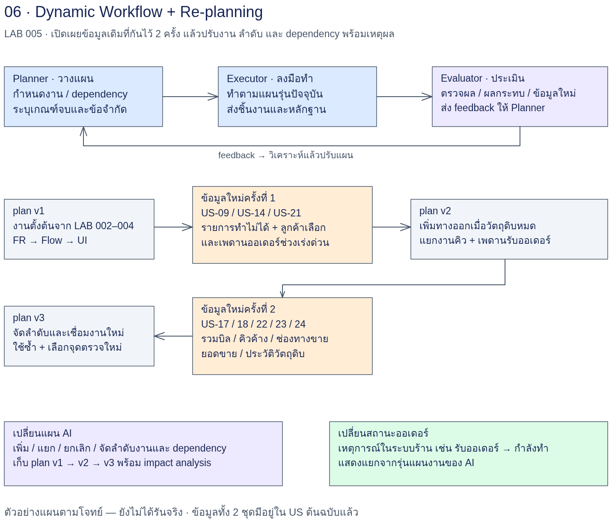
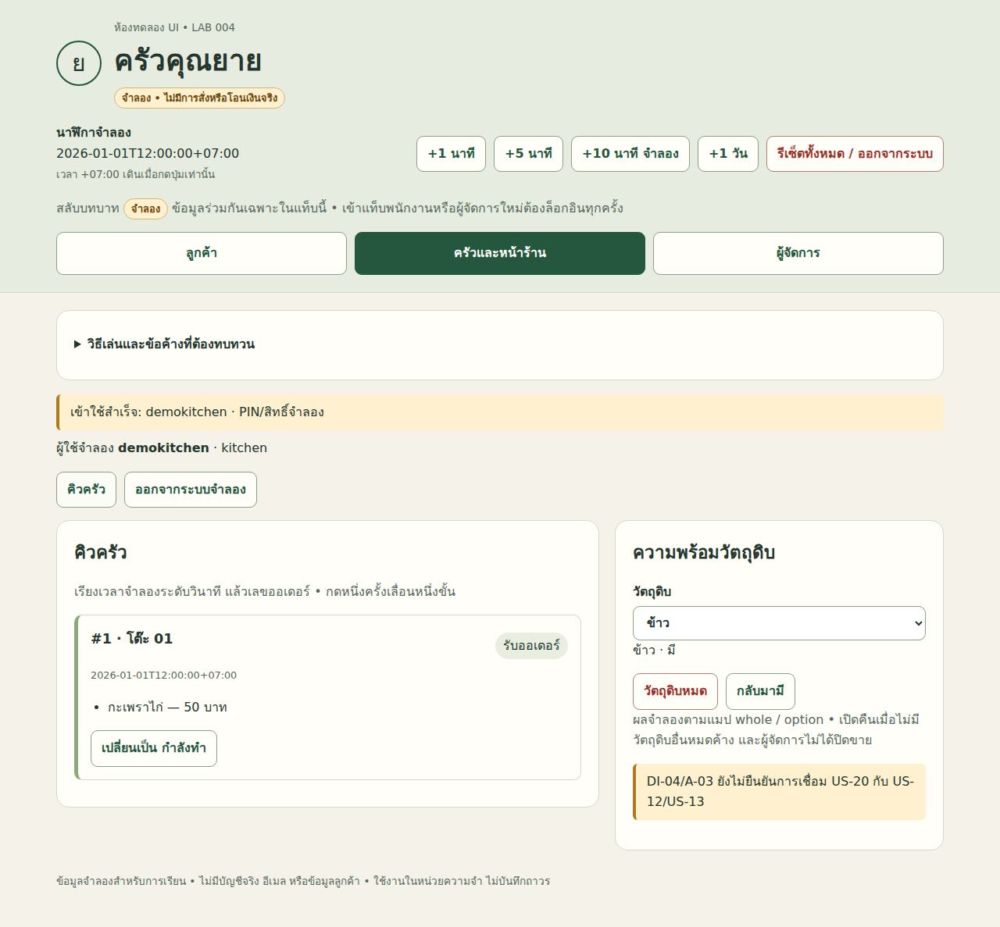
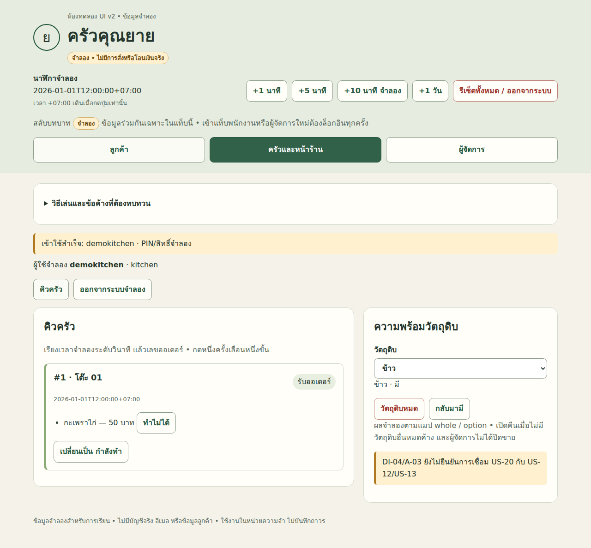
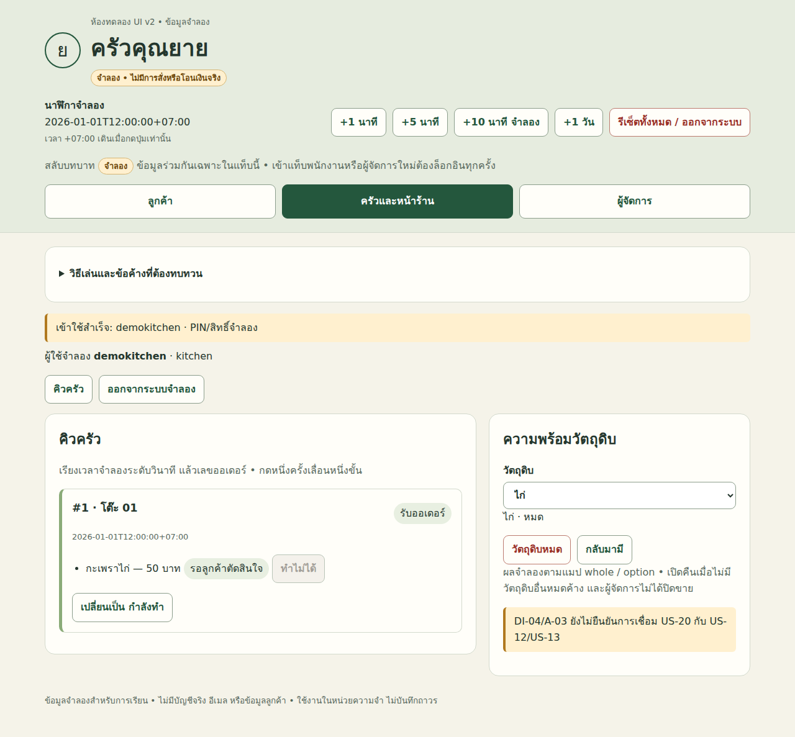
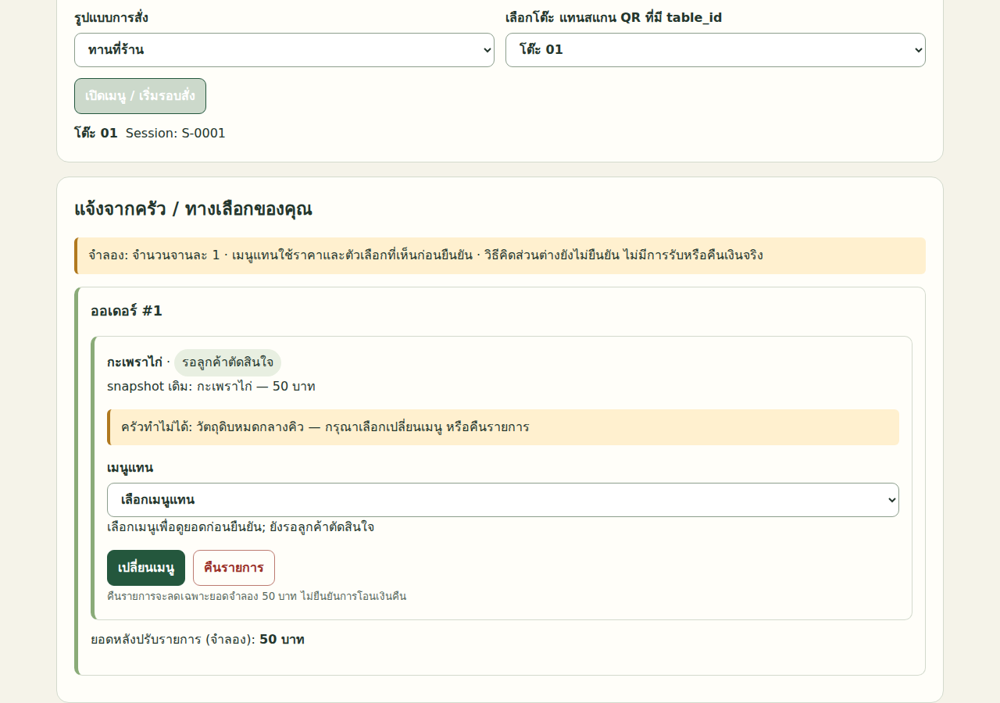
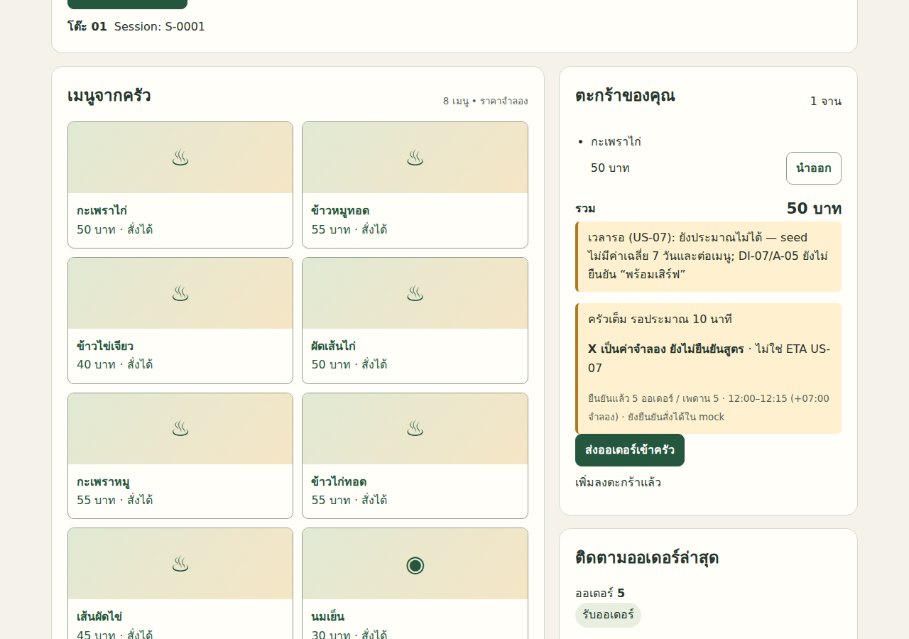
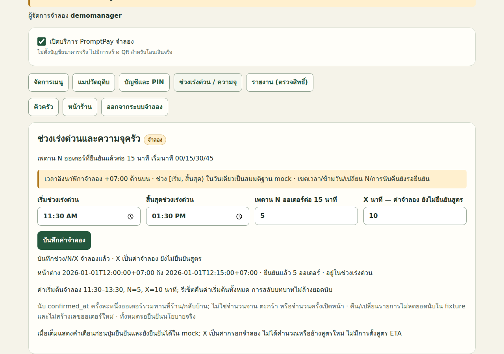
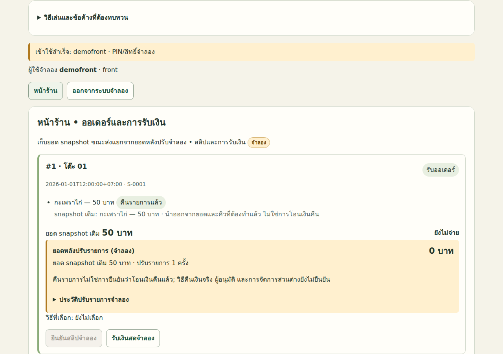
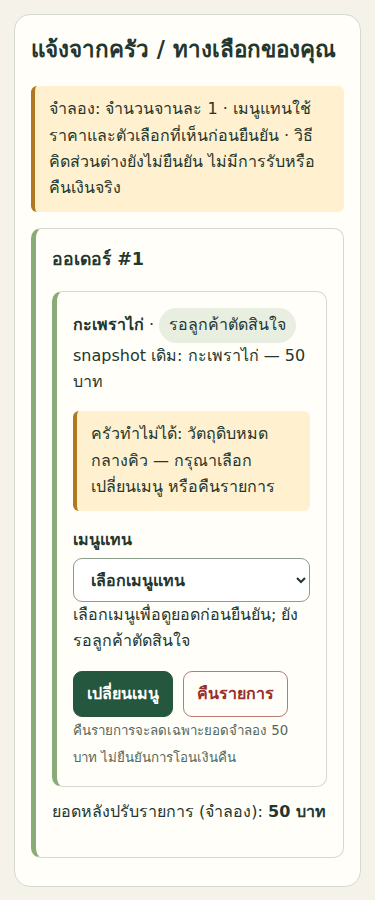

# LAB 005 — Dynamic Workflow + Re-planning: Planner–Executor–Evaluator รับข้อมูลเพิ่มระหว่างงาน

`<LAB_ROOT>` หมายถึงโฟลเดอร์ LAB นี้บนเครื่องที่รัน; path ในสำเนาข้อความอ่านเทียบกับโฟลเดอร์นี้

## โจทย์

ระบบครัวคุณยายมี FR/NFR, Flow และ UI Mock-up จาก LAB 002–004 แล้ว
ระหว่างทำงาน ผู้เรียนจะได้รับข้อมูลจากต้นฉบับเพิ่มสองชุด
เป้าหมายคือให้ AI เปลี่ยนแผนงานอย่างมีเหตุผลและรักษาผลงานที่ยังใช้ได้
ต้องมองเห็นว่าข้อมูลแต่ละข้อทำให้งานใดเพิ่ม แยก ยกเลิก หรือเปลี่ยน dependency
ไม่ถือว่าการเปลี่ยนสถานะออเดอร์ใน UI เพียงอย่างเดียวเป็นการ Re-planning

## เป้าหมาย

- อธิบายบทบาท Planner, Executor และ Evaluator และหลักฐานที่ส่งต่อกันได้
- สร้างแผนหลายเวอร์ชันที่ตรวจด้วย schema และตามรอยเหตุผลได้
- วิเคราะห์ผลกระทบโดยตรงและต่อเนื่องจาก US ถึง FR/NFR, Flow, UI และงานตรวจ
- ตัดสินการใช้ซ้ำกับการตรวจใหม่จากหลักฐาน ไม่ใช่จากการมีไฟล์อยู่แล้ว
- แยกการจัดงานที่ AI ทำเองได้จากนโยบายธุรกิจที่ต้องถามมนุษย์
- บันทึกข้อจำกัดและส่งรายการทดสอบต่อไป LAB 006 โดยไม่อ้างผลเกินหลักฐาน

## ความรู้ก่อนเรียน

ผ่าน [LAB 002](../002_LAB_Loop_FR_NFR/README.md), [LAB 003](../003_LAB_Static_Graph_Flow_Structure/README.md) และ [LAB 004](../004_LAB_Conditional_Graph_UI_Mockup/README.md)
อ่าน US/AC, FR/NFR, dependency, state machine และผลตรวจ UI ได้
ใช้ Bash, Python 3, JSON และ Markdown ได้ และมี CLI ที่ตั้งค่าไว้แล้ว
หากไม่มีผลงานตนเอง ใช้ผลอ้างอิงที่มีจริงตาม [วิธีเตรียม Input](input/README.md) พร้อมบันทึกว่า **ใช้ผลอ้างอิง**

## เวลาโดยประมาณ

จัดเวลาเรียนประมาณ 150–180 นาที เป็นประมาณการกิจกรรม ไม่ใช่เวลาที่วัดจากการรัน
ขั้น 5.0–5.2 ใช้ประมาณ 45–60 นาที; ขั้น 5.3–5.4 ประมาณ 60 นาที; ขั้น 5.5–5.6 ประมาณ 45–60 นาที
เวลาและโทเคนที่วัดได้อยู่ใน [ผลรันล่วงหน้า](reference/README.md) และ [metrics.csv](reference/metrics.csv); ต้นทุนเงินไม่มีข้อมูล.

## User Story ที่ใช้ (14 ข้อ)

| กลุ่ม | User Story | บทบาทในการเรียน |
|---|---|---|
| เปิดเผยชุดแรก | US-09, US-14, US-21 | รายการทำไม่ได้ ทางเลือกของลูกค้า และเพดานช่วงเร่งด่วน |
| เปิดเผยชุดที่สอง | US-17, US-18, US-22, US-23, US-24 | รวมบิล คิวค้าง ปิดกลับบ้าน รายงาน และประวัติวัตถุดิบ |
| ผลงานเดิมที่ต้องวิเคราะห์ผลกระทบ | US-05, US-07, US-08, US-12, US-15, US-19 | สถานะ ETA การจ่าย วัตถุดิบ หน้าร้าน และข้อมูลเมนู |

ดู [แหล่งข้อมูลกรณีศึกษา](../docs/case-study-source.md) และ [ความครอบคลุม US](../docs/us-coverage.md)
หัวตารางข้างต้นเป็นแผนการสอน ไม่ส่งเนื้อหา reveal ทั้งหมดเข้า session ของ plan-v1
**reveal-1/reveal-2 เป็นการเปิดเผยข้อมูลที่มีในต้นฉบับอยู่แล้ว ไม่ใช่ข้อกำหนดใหม่**
กันแปด US ออกจากบริบทเริ่มต้นของ LAB 002–004 เพื่อฝึกการรับข้อมูลเพิ่ม แม้ LAB 001 เคยเห็นครบแล้ว
ใช้ session ใหม่และ input ที่จำกัดตามขั้น เพื่อไม่ให้ความรู้จากรอบก่อนทำให้กิจกรรมเสียความหมาย

## แผนภาพ Workflow



ลำดับหลัก: เตรียม Input → plan-v1 → ทำงาน/ตรวจ → reveal-1 → plan-v2/impact → ปรับชิ้นงาน/ตรวจ → reveal-2 → plan-v3/impact
ลูกศรกลับไป Planner หมายถึงปรับแผนงาน AI ไม่ใช่เปลี่ยนสถานะในระบบร้าน

## สิ่งส่งมอบ

| ชิ้นงานใน work/ | เนื้อหาและเงื่อนไข |
|---|---|
| `input-source.md`, `input-audit.md`, `baseline/` | ที่มา รุ่น hash ผลตรวจ และสถานะความพร้อมของ Input |
| `plan-v1.json` และ `plan-v1.md` | แผนจากข้อมูลตั้งต้น พร้อมเหตุผล/ข้อจำกัด |
| `plan-v2.json` และ `plan-v2.md` | แผนหลัง reveal-1 พร้อม diff งานและ dependency |
| `plan-v3.json` และ `plan-v3.md` | แผนหลัง reveal-2 อย่างน้อยครบการวิเคราะห์ผลกระทบ |
| `impact-analysis.md` | บันทึกรวมเพิ่มท้ายตามรุ่น ห้ามแก้เนื้อหาประวัติเดิม |
| `impact-analysis-v2.md`, `impact-analysis-v3.md` | ผลวิเคราะห์รายรุ่นที่ไม่เขียนทับ |
| `fr-nfr-v2.md`, `flow-v2.md`, `ui-mockup-v2.html` | ชิ้นงานที่ปรับตามแผนหลัง reveal-1 |
| `execution/`, `evaluations/`, `runs/` | ผลทำงาน ผลตรวจ Prompt ที่ใช้จริง และ log แยกรอบ |
| `prompt-experiments/` | Prompt ที่ผู้เรียนปรับและตารางเปรียบเทียบ |

ชื่อ v1–v3 เป็นลำดับหลักเมื่อไม่มีรอบแก้แผนแทรก; ถ้ามีให้เพิ่มหมายเลขต่อเนื่องและบันทึก mapping เหตุการณ์กับรุ่นจริง
ห้ามเขียนทับแผนหรือชิ้นงานเก่าเพื่อให้หมายเลขตรงคู่มือ

## ทฤษฎี Planner–Executor–Evaluator

Planner ตอบว่า “ต้องทำงานอะไร ด้วยลำดับและเงื่อนไขใด”
ผลของ Planner คือแผนที่ระบุ inputs, outputs, depends_on, เหตุผล และข้อจำกัด
Executor รับ task id เดียวจากแผนล่าสุด ตรวจความพร้อมของ dependency แล้วสร้างชิ้นงาน
Executor ไม่เปลี่ยนขอบเขตหรือแผนเองเมื่อพบข้อมูลขัดกัน แต่ส่งหลักฐานกลับ Planner
Evaluator ตรวจแผนและชิ้นงานใน session แยกโดยเทียบกับต้นฉบับและเกณฑ์ที่กำหนด
การที่ Executor บอกว่าทำเสร็จยังไม่ใช่ผล PASS ของ Evaluator

| บทบาท | Input สำคัญ | Output | สิ่งที่ต้องส่งกลับเมื่อมีปัญหา |
|---|---|---|---|
| Planner | baseline, reveal ที่เปิดแล้ว, ผลตรวจ | JSON + Markdown ของแผนรุ่นใหม่ | คำถามธุรกิจและงานที่รอคำตอบ |
| Executor | task จากแผนล่าสุด, ผล upstream | ชิ้นงานใหม่ + execution report | ข้อมูลขาด/งานที่แผนไม่ได้ครอบคลุม |
| Evaluator | แผน, ชิ้นงาน, AC, หลักฐาน | PLAN_READY หรือผลตรวจรายข้อ | ข้อบกพร่องและผลกระทบต่อ downstream |

ใน LAB นี้ “Dynamic” หมายถึงกราฟงานเปลี่ยนระหว่างการทำงานได้
ไม่จำเป็นต้องใช้ระบบ orchestration อัตโนมัติ; ผู้เรียนเรียก CLI ทีละบทบาทและตรวจจุดส่งต่อ
ต้องบันทึกสิ่งที่เปลี่ยนจริง มิใช่สร้างแผนชื่อใหม่ที่มีงานและ dependency เท่าเดิมโดยไม่มีคำอธิบาย

## ขอบเขตการตัดสินใจของ Planner

| เรื่อง | AI ตัดสินได้เองภายในงานที่อนุญาต | ต้องถามมนุษย์ก่อนใช้เป็นกฎจริง |
|---|---|---|
| แบ่งงาน | แยก FR, Flow, UI, งานตรวจ และตั้ง task id | เปลี่ยนขอบเขตสิ่งส่งมอบที่ตกลงไว้ |
| dependency | เพิ่มงานตรวจ upstream ก่อนงานผลิต downstream | ข้ามเกณฑ์รับหรือใช้ข้อมูลที่ยังไม่รับรอง |
| การใช้ซ้ำ | เสนอ reuse/recheck ตามหลักฐานรุ่น/hash | รับรองความเสี่ยงธุรกิจที่ต้นฉบับไม่อธิบาย |
| คืนรายการ | จำลองยอดลดตามข้อความ US | วิธีคืนเงินจริง ค่าธรรมเนียม หรือคืนบางส่วนอย่างไร |
| เวลาเร่งด่วน | แยกตัวแปรและงานตรวจตาม US แต่ละข้อ | กำหนดความสัมพันธ์ช่วง ETA กับช่วงเพดาน และสูตร X ที่ไม่ชัด |
| สถานะ | แยก entity และเสนอ mapping พร้อมหลักฐาน | ยืนยันว่า “เสร็จแล้ว” กับ “พร้อมเสิร์ฟ” เป็นเหตุการณ์เดียวกัน |
| การยกเลิกงาน | ยกเลิกงานซ้ำที่ถูกแทนด้วยงานใหม่พร้อมเหตุผล | ยกเลิกข้อกำหนดธุรกิจเพราะทำยากหรือเวลาไม่พอ |

การถามต้องเป็นคำถามเฉพาะพร้อมทางเลือก ผลกระทบ และ task ที่ต้องรอ
เก็บใน decisions ด้วย authority=human-required และ limits ที่ blocking=true สำหรับ affected_tasks
งานอิสระที่ไม่พึ่งคำตอบยังเดินต่อได้ แต่ห้ามสมมติว่าการไม่ตอบคือการอนุมัติ
เมื่อได้คำตอบให้บันทึกคำตอบ แหล่งที่มา เวลา และออกแผนรุ่นใหม่; ไม่แก้ประวัติคำถามเดิม

## การเพิ่ม แยก ยกเลิก และจัดลำดับงานใหม่

เพิ่มงานเมื่อข้อมูล reveal ทำให้เกิด output หรือจุดตรวจที่แผนเดิมไม่มี
แยกงานเมื่อ task กว้างเกินไปและแต่ละส่วนมี dependency หรือเงื่อนไขผ่านต่างกัน
ยกเลิกงานเมื่อซ้ำหรือถูกแทน พร้อมคง task เดิมเป็น kind=cancel/status=cancelled และบอกงานทดแทน
จัดลำดับใหม่โดยแก้ depends_on ให้สะท้อนข้อมูลที่ต้องใช้จริง ไม่ใช่เพียงย้ายแถวในตาราง
การเพิ่ม edge จากผลตรวจ FR ไป Flow ทำให้แก้ Flow ก่อน FR ผ่านไม่ได้
การตรวจวงจรต้องครอบคลุม dependency ทุกเส้น และงานที่ active ห้ามรอผลจากงาน cancelled
ไม่จำเป็นต้องใช้ทุกวิธีในทุก reveal; ถ้าไม่เปลี่ยนบางชนิดให้บอกเหตุผล

## การวิเคราะห์ผลกระทบและการใช้ซ้ำ

เริ่มจากข้อความใหม่ → ข้อกำหนดที่เกี่ยว → ข้อมูล/Flow/state → UI → งานตรวจเดิมที่อาจหมดอายุ
ตรวจทั้งผลตรง เช่น เพิ่มปุ่มคืนรายการ และผลต่อเนื่อง เช่น ยอดหน้าร้านและยอดรายงาน
US-05 ต้องพิจารณาการแสดงสถานะที่สัมพันธ์กับรายการทำไม่ได้
US-07 ต้องตรวจ ETA กับช่วงเร่งด่วนแยกจากการตั้งค่าเพดานใน US-21
US-08 และ US-15 ต้องตรวจยอดและเหตุการณ์ยืนยันการจ่าย ไม่ให้การคืนรายการกลายเป็นยืนยันคืนเงินจริง
US-12 ต้องแยกปิดเมนูสำหรับการสั่งใหม่จากการจัดการรายการที่ค้างในคิว
US-19 ต้องรักษาราคาที่ผูกกับออเดอร์เดิมและผลการแก้ข้อมูลเมนูที่เกี่ยวข้อง

| disposition | เมื่อใช้ | หลักฐานขั้นต่ำ |
|---|---|---|
| reuse | ข้อมูลต้นทางและสมมติฐานที่ชิ้นส่วนนั้นใช้ไม่เปลี่ยน | รุ่น hash ขอบเขตส่วนที่ใช้ และผลตรวจเดิม |
| recheck | ยังใช้โครงเดิมได้ แต่ upstream หรือบริบทเปลี่ยน | จุดกระทบและงานตรวจใหม่ก่อนส่งต่อ |
| replace | เนื้อหาเดิมไม่ครอบคลุมหรือขัดข้อมูลที่เปิด | diff และ output รุ่นใหม่พร้อมผลตรวจ |

ตัวอย่างโครง CSS อาจใช้ซ้ำได้ แต่ความถูกต้องของยอดรวมต้องตรวจใหม่เมื่อเพิ่มการคืนรายการ
“เคยผ่าน” เป็นข้อเท็จจริงเกี่ยวกับ input รุ่นหนึ่ง ไม่ใช่หลักฐานผ่านทุกเวอร์ชัน
หากไม่มีหลักฐาน reuse ให้ตั้ง needs_recheck และอธิบาย ไม่เลือก reused เพื่อประหยัดงาน

## ประวัติแผนและ schema

ใช้ [plan.schema.json](input/plan.schema.json) แบบ JSON Schema draft-07
ดู [plan-v0.example.json](input/plan-v0.example.json) เป็นตัวอย่างสั้นที่ตรวจ schema ได้ ไม่ใช่ผลรัน plan-v1
ฟิลด์ระดับแผนคือ version, trigger, created_at, tasks, decisions, reuse, limits
แต่ละ task มี id, title, kind, inputs, outputs, depends_on, status, reason, us_refs
kind ใช้ create/revise/verify/cancel; status ใช้ planned/running/done/reused/needs_recheck/cancelled
JSON ใช้ตรวจเครื่อง; Markdown ใช้อ่าน diff เหตุผล และข้อจำกัด ทั้งสองต้องตรงกัน
schema ไม่ตรวจวงจรหรือหลักฐานเอง จึงต้องมี Evaluator ตรวจความหมายเพิ่ม
แผน snapshot ไม่เปลี่ยนตามทุกคลิกของ Executor; เก็บความคืบหน้าใน execution report แยกรอบ
เมื่อ Planner ออกแผนใหม่จึงรวมสถานะจากหลักฐานจริงและระบุสิ่งที่หมดอายุ
หากมีแผนเลขใหม่ค้างหรือไม่ผ่าน ให้หยุด ไม่ถอยไปทำตามแผนเก่าโดยไม่แจ้ง

## ข้อจำกัดของ Conditional Graph ใน LAB 004

LAB 004 กำหนด node และทางเลือกไว้ก่อน เช่น ผ่าน → ส่งต่อ, ตก → แก้หน้าที่ตก, ไม่คืบ → หยุด
การเลือก edge ที่เตรียมไว้ยังไม่ใช่การคิดชุดงานใหม่
เมื่อ reveal ต้องเพิ่มงานด้านยอดรวม รายการรอคำตอบ หรือข้อมูลรายงาน กราฟเดิมอาจไม่มี node เหล่านั้น
การวนแก้ UI ตามกราฟเดิมจึงอาจทำให้ต้องย้อนแก้ FR และ Flow ซ้ำโดยไม่เห็น dependency
LAB 005 เพิ่ม Planner เพื่อเปลี่ยนชุดงานและจุดตรวจ พร้อมบันทึกผลกระทบ
ยังใช้ Conditional Graph ภายในงานตรวจ/แก้ได้ โดยอยู่ใต้ขอบเขตและเพดานรอบของแผนล่าสุด
การปรับแผนมีต้นทุนและอาจผิดเอง จึงต้องตรวจทั้งแผนและผลที่ผลิต

## แยกการเปลี่ยนแผน AI จากการเปลี่ยนสถานะออเดอร์

ตารางนี้กรอกจาก [plan-v2](reference/step-04-plan-v2/plan-v2.json) และ [ผลคลิก UI v2](reference/step-05-execute-v2/ui-feature-check-v2.json).

| เหตุการณ์ที่รันจริง | การเปลี่ยนแผน AI | การเปลี่ยนสถานะออเดอร์ / รายการ / เงิน |
|---|---|---|
| เปิด US-09/14/21 หลัง v1 | เพิ่ม revise-fr/revise-flow/revise-ui และ recheck ผู้ตรวจ; 8 → 11 tasks | การเปิด reveal เองไม่เปลี่ยนข้อมูลออเดอร์ใน UI |
| F-01 ใน Flow v1 | ต้อง revise-flow → verify-flow PASS ก่อน outline/UI; v2 ปิดข้อบกพร่อง | F-01 เป็นข้อบกพร่องเอกสาร ไม่ใช่สถานะอาหาร |
| ครัวกด “ทำไม่ได้” ใน v2 | ไม่มีการเรียก Planner จากปุ่ม; เป็นการทดสอบชิ้นงานของ revise-ui | รายการเป็น “รอลูกค้าตัดสินใจ”; ออเดอร์ยัง “รับออเดอร์” ในกรณีที่ทดสอบ |
| ลูกค้าเปลี่ยนเมนู / คืนรายการ | ผลทดสอบส่งเป็นหลักฐานให้ verify-ui | เปลี่ยน m01 → m02 แล้วเข้าครัวใหม่ หรือคืนแล้วลบจากคิว; snapshot 50 คงอยู่และยอดปรับเป็น 0 เมื่อคืน |
| คืนรายการหลัง mock ชำระเงิน | ไม่เปลี่ยน task เป็น cancelled | สถานะจ่ายแล้วยังคงเดิม; UI ระบุว่ายังไม่ยืนยันโอนเงินคืนจริง |
| ตั้ง N=5 แล้วถึงเพดาน | เป็นกรณีตรวจของ verify-ui; ไม่เกิด replan ระหว่างคลิก | แสดง “ครัวเต็ม รอประมาณ X นาที” ก่อนยืนยัน; fixture อนุญาตยืนยันต่อ ไม่ยกเลิกออเดอร์ |
| ไม่มีงานยกเลิกใน plan-v2 | Planner ให้เหตุผลว่าหน้าที่เดิมยังจำเป็น | task cancelled กับการยกเลิกออเดอร์เป็นคนละเรื่อง; รอบนี้ไม่ใช้แทนกัน |

### ตัวอย่าง diff ของแผน

**ตัวอย่างประกอบ — ยังไม่ได้รันจริง**: ตารางนี้สาธิตโครงงาน ไม่ใช่แผนที่รันหรือ AC ใหม่

| task id | plan-v1 | plan-v2 | เหตุผล |
|---|---|---|---|
| revise-flow | รอ verify-fr | รอ verify-fr และ verify-item-resolution | ทางเลือกลูกค้ากระทบ Flow ที่ UI จะใช้ |
| verify-ui | ตรวจพฤติกรรมเดิม | แยกตรวจ behavior เดิมกับยอด/รายการใหม่ | รักษา regression และตามรอยผลกระทบ |
| draft-summary | สรุปก่อนแก้ UI | cancelled; ถูกแทนด้วยสรุปหลัง verify-ui | งานเดิมสรุปก่อนตรวจผลกระทบครบ |

ชื่อ task ในตารางเป็นตัวอย่างเท่านั้น; ให้ใช้ id จาก plan ล่าสุดของตนเอง

## วิธีรันร่วมทุกขั้น

working directory ของทุกขั้นคือ `AI_Workflow_Engineering_for_SA/005_LAB_Dynamic_Workflow_Replanning/`
ขั้น 5.0 ต้องคัด Input ตาม input/README.md ก่อนเริ่ม และตรวจว่ามีไฟล์จริงครบ
เปิด shell จากโฟลเดอร์ LAB แล้วประกาศฟังก์ชันต่อไปนี้ครั้งเดียว
ทุกการเรียกเป็น session ใหม่ เลือกเครื่องมือหนึ่งตัวต่อการรัน ไม่รันทั้งสองทับ output เดียวกัน
หากเปรียบเทียบสองเครื่องมือให้ใช้สำเนา LAB แยกชุดและบันทึก Input เดียวกัน
Prompt ใน code block ด้านล่างตรงกับไฟล์ .md ทุกตัวอักษร; คำสั่ง terminal แยกอยู่ในหัวข้อวิธีรัน

```bash
run_prompt() {
  local engine="$1" template="$2" run_id="$3"
  export RUN_ID="$run_id"
  mkdir -p work/runs
  mkdir "work/runs/$RUN_ID" || return 1
  export PROMPT_TEMPLATE="$template"
  python3 - <<'PYCODE' || return 1
import os, re
from pathlib import Path
s=Path(os.environ['PROMPT_TEMPLATE']).read_text()
def value(m):
    v=os.environ.get(m.group(1),'')
    if not v or '<' in v or '>' in v: raise ValueError('ต้องระบุ '+m.group(1)+' เป็นค่าจริงก่อนรัน')
    return v
s=re.sub(r'\{\{([A-Z_]+)\}\}', value, s)
with Path('work/runs',os.environ['RUN_ID'],'prompt.md').open('x') as f: f.write(s)
PYCODE
  date -u +%Y-%m-%dT%H:%M:%SZ > "work/runs/$RUN_ID/start-utc.txt"
  case "$engine" in
    codex)
      codex exec --json -o "work/runs/$RUN_ID/response.md" \
        "$(< "work/runs/$RUN_ID/prompt.md")" < /dev/null \
        > "work/runs/$RUN_ID/log.jsonl" 2> "work/runs/$RUN_ID/stderr.txt"
      ;;
    claude)
      claude -p --output-format json "$(< "work/runs/$RUN_ID/prompt.md")" < /dev/null \
        > "work/runs/$RUN_ID/result.json" 2> "work/runs/$RUN_ID/stderr.txt"
      ;;
    *) return 1 ;;
  esac
  local result=$?
  date -u +%Y-%m-%dT%H:%M:%SZ > "work/runs/$RUN_ID/end-utc.txt"
  return "$result"
}
```

เปลี่ยน `codex` เป็น `claude` ในคำสั่ง run_prompt ถ้าเลือกอีกเครื่องมือ; ฟังก์ชันเรียก `codex exec` หรือ `claude -p` ตามนั้น
RUN_ID ต้องไม่ซ้ำและใช้ตัวอักษร/ตัวเลข/ขีดกลางเท่านั้น เช่น s51-plan-r1
TASK_ID คัดจาก JSON จริง; REVIEW_MODE เลือก plan หรือ artifacts; PREV_PLAN/CURRENT_PLAN/REVEAL_FILE ใช้ path ตามขั้น
`response.md` เป็นคำตอบสรุป CLI; ชิ้นงานจริงต้องอยู่ตาม path ที่ Prompt กำหนด ไม่ถือว่าสรุปแทนไฟล์ได้
ตรวจ exit code และ stderr; สำหรับ Codex ต้องไม่มี turn.failed และต้องพบ turn.completed ก่อนอ้างผลสำเร็จ
บันทึก run-meta.json ของตนเองข้าง log: วันเวลา UTC, เครื่องมือ/รุ่นที่อ่านจริง, โมเดลตามหลักฐาน, effort, wall time, usage, input/output hash
หากอ่านค่าใดไม่ได้ให้ใช้ null และคำอธิบาย “ไม่มีข้อมูล”; ไม่คาดเดาโทเคนหรือต้นทุน

### คำสั่งตรวจ schema ของแผน

```bash
export PLAN_FILE='work/plan-v1.json'
python3 - <<'PYCODE'
import json, os
from pathlib import Path
s=json.loads(Path('input/plan.schema.json').read_text())
p=json.loads(Path(os.environ['PLAN_FILE']).read_text())
try:
    import jsonschema
except ImportError:
    raise SystemExit('ไม่มี jsonschema: ตรวจ required/enum/type ทุกฟิลด์ด้วยมือก่อนส่งต่อ ห้ามอ้าง schema ผ่านอัตโนมัติ')
jsonschema.Draft7Validator.check_schema(s)
jsonschema.Draft7Validator(s,format_checker=jsonschema.FormatChecker()).validate(p)
tasks={t['id']:t for t in p['tasks']}
assert len(tasks)==len(p['tasks']), 'id ซ้ำ'
visiting,done=set(),set()
def visit(k):
    assert k not in visiting, 'dependency วน'
    if k in done: return
    visiting.add(k)
    t=tasks[k]
    assert (t['kind']=='cancel')==(t['status']=='cancelled'), 'cancel ไม่สอดคล้อง'
    for dep in t['depends_on']:
        assert dep in tasks and dep!=k, 'dependency ไม่ถูกต้อง'
        if t['status']!='cancelled': assert tasks[dep]['status']!='cancelled'
        visit(dep)
    visiting.remove(k); done.add(k)
for k in tasks: visit(k)
print('schema และ dependency ผ่าน; ยังต้องตรวจเหตุผล/หลักฐานโดย Evaluator')
PYCODE
```

เปลี่ยน PLAN_FILE ตามรุ่นจริงก่อนตรวจ; การผ่าน schema ไม่ได้ยืนยันว่า AC หรือผลระบบผ่าน

## ขั้น 5.0 — เตรียมและตรวจ Input

### เป้าหมายและ Input

รหัสขั้น 5.0; working directory = โฟลเดอร์ LAB 005; เริ่ม session ใหม่ทุกบทบาทและทุกการรัน
คัด FR/NFR จาก LAB 002, Flow พร้อมเอกสารที่อ้างจาก LAB 003 และ UI จาก LAB 004 ตาม [input/README.md](input/README.md)
ทางเลือก UI อ้างอิงคือ `../004_LAB_Conditional_Graph_UI_Mockup/reference/final/ui-mockup.html`
ใช้ baseline, บันทึกที่มา และผลตรวจ upstream; ยังไม่เปิด reveal ใด ๆ

### Prompt พร้อมคัดลอก

ไฟล์ [00-prepare-input.md](prompts/00-prepare-input.md)

```markdown
# ขั้น 5.0 — ตรวจ Input ก่อนเปิด reveal

## บริบทและเป้าหมาย
คุณเป็นผู้ตรวจความพร้อมของงานวิเคราะห์ระบบครัวคุณยาย
ตรวจไฟล์ตั้งต้นที่นักศึกษาคัดลอกตาม input/README.md แล้ว ห้ามสร้าง FR หรือ Flow ทดแทน
## Input
- input/README.md เฉพาะวิธีเตรียม input และสัญญาแผน
- work/input-source.md
- work/baseline/fr-nfr.md
- work/baseline/flow.md และเอกสารประกอบที่ระบุใน input-source.md
- work/baseline/ui-mockup.html และ work/baseline/ui-contract.md
- work/baseline/us-initial.md พร้อมผลตรวจ upstream ที่คัดไว้
## งาน
ตรวจความครบ ที่มา รุ่น SHA-256 และหลักฐานการตรวจของทั้งสามชิ้นงาน
บันทึกคำว่า ใช้ผลอ้างอิง ตามที่มาจริง; ไม่ถือว่ารุ่นเลขสูงสุดคือรุ่นที่ผ่าน
หากผลตรวจ upstream ไม่มี ให้ระบุยังไม่ตรวจและหยุดส่งต่อการผลิตงาน
ตรวจว่า baseline ไม่ครอบคลุมเนื้อหา US ที่กันไว้; ถ้าหลุดให้บันทึกจุดที่พบและหยุดก่อน plan-v1
อ่านเฉพาะ US ตั้งต้น 18 แถว; รหัสที่ถูกอ้างในเซลล์ไม่ขยายขอบเขต
ตรวจ FR/Flow/UI ว่าใช้รุ่นสอดคล้องกัน พร้อมระบุ UI ส่วนที่ยังไม่มีจาก LAB ก่อน
แยกข้อค้างด้านธุรกิจจากไฟล์หาย ไม่แก้ข้อกำหนดเอง
## รูปแบบ Output และตำแหน่งบันทึก
สร้าง work/input-audit.md เป็นตาราง ชิ้นงาน | ที่มา | hash | ผลตรวจ | ข้อค้าง | พร้อมส่งต่อ
สรุป INPUT_READY หรือ BLOCKED พร้อมเหตุผลและรายการหลักฐานที่ใช้
ห้ามเขียนว่า INPUT_READY หากหลักฐานจำเป็นขาดหรือข้อมูลที่กันไว้หลุด
ส่งต่อเฉพาะ input-audit และ baseline ที่พร้อมให้ Planner

## กติกาสำหรับทุกบทบาท
working directory = AI_Workflow_Engineering_for_SA/005_LAB_Dynamic_Workflow_Replanning/
เริ่ม session ใหม่ ไม่ใช้ resume/continue ไม่เรียก agent เพิ่ม และไม่พึ่งประวัติสนทนา
อ่านเฉพาะไฟล์ Input ที่อนุญาตในขั้นนี้ ไม่ค้นทั้ง repository หรืออ่าน reveal ล่วงหน้า
รักษาข้อความ US/AC ตัวเลข หน่วย และสัดส่วนทดสอบ ห้ามแต่งข้อกำหนดหรือผลตรวจ
แยกแผนงาน AI จาก state machine ของรายการ/ออเดอร์/ชำระเงิน/โต๊ะ
ใช้ชื่อบัญชีและข้อมูลจำลองเท่านั้น ไม่ใช้บัญชีจริงหรือบริการชำระเงินจริง
เขียนเฉพาะ work/; ห้ามแก้ input/, prompts/, reference/, img/ หรือต้นทาง LAB อื่น
ห้ามเขียนทับเวอร์ชันเดิมหรือหลักฐานเดิม; ถ้าเป้าหมายมีแล้ว ให้หยุดและรายงาน path
แผนเป็น snapshot; สถานะการทำงานใหม่เก็บใน execution/evaluations แล้วรวมในแผนรุ่นถัดไป
ถ้า Input ขาดหรือมี blocking limit ที่เกี่ยวกับงาน ให้ตอบ BLOCKED พร้อมสิ่งที่ขาด ไม่สร้างข้อมูลแทน
ข้อเสนอที่ต้นฉบับไม่ระบุให้ติดป้ายสมมติฐาน/ยังไม่ยืนยัน ไม่แปลงเป็น AC
ไม่อ่านเว็บเพื่อเติมกฎร้าน; หมายเหตุ ก./ค./ช. ที่หายให้คงเป็นข้อค้าง
ผลสรุปต้องบอกไฟล์ที่สร้างจริง ข้อค้าง และสิ่งที่ยังไม่ทดสอบ
```

### วิธีรันและเปิดผล

ประกาศ run_prompt ตามวิธีรันร่วมแล้วใช้คำสั่งนี้; อ่าน output และผลตรวจก่อนส่งต่อ

```bash
run_prompt codex prompts/00-prepare-input.md s50-audit-r1
less work/input-audit.md
less work/input-source.md
```

### ตัวอย่างผลรันล่วงหน้า

**ผลรันล่วงหน้า — รันจริง 14 กันยายน 2026 (UTC)**

ใช้ผลอ้างอิงจาก LAB 002–004 ตาม [provenance](reference/step-00-input/provenance.md) และ hash ของไฟล์จริง รวม UI จาก LAB 004 `reference/final/ui-mockup.html`.
การตรวจ Input ครั้งแรกพบข้อความของ US ที่ต้องเปิดภายหลังในคำอธิบาย Flow จึง BLOCKED; เก็บสำเนาต้นฉบับและ projection สองรุ่นแยกกัน ไม่แก้ต้นทาง.
[รอบที่สาม](reference/step-00-input/round-3/summary.md) ให้ INPUT_READY เฉพาะเอกสาร/offline mock หลังกรอง โดยตรวจ hash 10/10 และ US เริ่มต้น 18 ข้อ.
[Baseline ที่ใช้จริง](reference/step-00-input/baseline-filtered-v2/provenance.md) มีบันทึก diff และขอบเขตข้อมูลที่กรอง; [ตรวจ UI baseline ใหม่](reference/step-00-input/baseline-ui-run/meta.json) ผ่าน 19/19.

การรันนี้วางพื้นที่ทำงานไว้ใน `reference/session/` เพื่อเก็บผลแต่ละรุ่นและไม่แตะพื้นที่ `work/` ของผู้เรียน.
เวลาและโทเคนดู [metrics.csv](reference/metrics.csv); ต้นทุนเงินไม่มีข้อมูล. **ผลของนักศึกษา:** ยังไม่มีข้อมูล ให้บันทึกผลจากชุดของตนเอง.

### เปรียบเทียบและตรวจผ่าน

- [ ] มี FR/NFR, Flow, UI จริง ไม่ใช้ placeholder แทน
- [ ] รุ่นและผลตรวจสอดคล้องกัน; ถ้าใช้ reference ระบุ “ใช้ผลอ้างอิง”
- [ ] baseline ไม่หลุดเนื้อหาแปด US ที่กันไว้
- [ ] สัญญา data-testid ตรงรุ่น UI และข้อค้างเดิมยังอยู่
การตั้งชื่อ task และถ้อยคำอธิบายยืดหยุ่นได้; ข้อความ US/AC, dependency ที่จำเป็น และการไม่เขียนทับต้องตรงกติกา

### แก้ไขและส่งต่อ

ถ้าขาดไฟล์ให้ย้อนรับผลงานต้นทาง; ถ้ารุ่นปะปนให้เลือกชุดที่ตรวจแล้วพร้อม mapping
ส่ง work/input-source.md, work/input-audit.md และ baseline ให้ขั้น 5.1 เมื่อ INPUT_READY เท่านั้น
ใช้ [Prompt แก้ปัญหาร่วม](prompts/07-fix-common.md) เมื่อมีผลตรวจและคำขอแก้ที่ระบุ path รุ่นใหม่
หยุดงานที่ติด Input/คำตอบธุรกิจ; ถ้าแก้ไม่คืบหรือครบ 2 รอบให้บันทึกเหตุแล้วส่งมนุษย์ตรวจ

## ขั้น 5.1 — Planner ออก plan-v1

### เป้าหมายและ Input

รหัสขั้น 5.1; working directory = โฟลเดอร์ LAB 005; เริ่ม session ใหม่ทุกบทบาทและทุกการรัน
ใช้ผลขั้น 5.0, baseline 18 US, schema และตัวอย่าง v0
Planner วางแผนจากข้อมูลตั้งต้น แล้วให้ Evaluator ตรวจแผนใน session ใหม่

### Prompt พร้อมคัดลอก

ไฟล์ [01-planner-v1.md](prompts/01-planner-v1.md)

```markdown
# ขั้น 5.1 — Planner ออก plan-v1

## บริบทและเป้าหมาย
คุณเป็น Planner วางแผนผลิตเอกสารและ UI จาก baseline โดยยังไม่รู้ reveal
## Input
- work/input-source.md และ work/input-audit.md ที่ระบุ INPUT_READY
- work/baseline/fr-nfr.md, work/baseline/flow.md และเอกสารประกอบที่ระบุ
- work/baseline/ui-mockup.html, work/baseline/ui-contract.md, work/baseline/us-initial.md
- input/plan.schema.json และ input/plan-v0.example.json (ดูรูปแบบเท่านั้น)
## งาน
สร้างงาน create/revise/verify ที่จำเป็นจากช่องว่างจริง และงานตรวจของ Evaluator ก่อนส่งต่อ
ใช้ task id ที่คงเดิมข้ามรุ่นเมื่อหน้าที่เดิม เช่น verify-fr, revise-flow, verify-ui
ระบุ inputs/outputs เป็น path ที่เจาะจง; outputs ใหม่อยู่ work/ และไม่ชนไฟล์เดิม
ถ้าแก้ baseline ให้ใช้ work/fr-nfr-v1.md, work/flow-v1.md, work/ui-mockup-v1.html ตามความจำเป็น
ถ้าใช้ baseline ตรง ๆ ให้ระบุ reuse พร้อมเหตุผล ขอบเขตและหลักฐานตรวจเดิม
งาน downstream ต้องรอทั้ง upstream และผลตรวจที่จำเป็น; อธิบาย dependency ทุกเส้น
ระบุ priority ผ่านลำดับทำงานที่เคารพ dependency ไม่ใช่แค่เรียงรายการ tasks
ห้ามเปิด reveal-1.md หรือ reveal-2.md และห้ามนำข้อความ US ที่ยังไม่เปิดเข้ามาในแผน
แยกสิ่งที่ AI ตัดสินได้จาก human-required; ผูกคำถามที่ต้องตอบกับ blocking limits และ affected_tasks
ตรวจ schema ด้วย draft-07 และ format date-time; ตรวจ unique id, dependency target และ DAG เพิ่ม
ไม่อ้างว่างาน done/reused หากไม่มีหลักฐานรองรับ
## รูปแบบ Output และตำแหน่งบันทึก
สร้าง work/plan-v1.json ตาม input/plan.schema.json ทุกฟิลด์ required
version=plan-v1; trigger ระบุ baseline; created_at ใช้เวลา UTC จริง ณ ตอนสร้าง
สร้าง work/plan-v1.md ให้ตรง JSON: เป้าหมาย, งาน/dependency, ลำดับทำ, การตัดสินใจ, ใช้ซ้ำ, ข้อจำกัด
มีหัวข้อ Diff จากเวอร์ชันก่อน ระบุว่าเป็นแผนแรก ไม่ใช่ผลต่อจากตัวอย่าง v0
มีหัวข้อ เหตุผล และ ข้อจำกัด รวมคำถามรอยืนยันกับ path หลักฐาน
ส่งทั้ง JSON/Markdown ให้ Evaluator ตรวจแผนก่อน Executor เริ่ม

## กติกาสำหรับทุกบทบาท
working directory = AI_Workflow_Engineering_for_SA/005_LAB_Dynamic_Workflow_Replanning/
เริ่ม session ใหม่ ไม่ใช้ resume/continue ไม่เรียก agent เพิ่ม และไม่พึ่งประวัติสนทนา
อ่านเฉพาะไฟล์ Input ที่อนุญาตในขั้นนี้ ไม่ค้นทั้ง repository หรืออ่าน reveal ล่วงหน้า
รักษาข้อความ US/AC ตัวเลข หน่วย และสัดส่วนทดสอบ ห้ามแต่งข้อกำหนดหรือผลตรวจ
แยกแผนงาน AI จาก state machine ของรายการ/ออเดอร์/ชำระเงิน/โต๊ะ
ใช้ชื่อบัญชีและข้อมูลจำลองเท่านั้น ไม่ใช้บัญชีจริงหรือบริการชำระเงินจริง
เขียนเฉพาะ work/; ห้ามแก้ input/, prompts/, reference/, img/ หรือต้นทาง LAB อื่น
ห้ามเขียนทับเวอร์ชันเดิมหรือหลักฐานเดิม; ถ้าเป้าหมายมีแล้ว ให้หยุดและรายงาน path
แผนเป็น snapshot; สถานะการทำงานใหม่เก็บใน execution/evaluations แล้วรวมในแผนรุ่นถัดไป
ถ้า Input ขาดหรือมี blocking limit ที่เกี่ยวกับงาน ให้ตอบ BLOCKED พร้อมสิ่งที่ขาด ไม่สร้างข้อมูลแทน
ข้อเสนอที่ต้นฉบับไม่ระบุให้ติดป้ายสมมติฐาน/ยังไม่ยืนยัน ไม่แปลงเป็น AC
ไม่อ่านเว็บเพื่อเติมกฎร้าน; หมายเหตุ ก./ค./ช. ที่หายให้คงเป็นข้อค้าง
ผลสรุปต้องบอกไฟล์ที่สร้างจริง ข้อค้าง และสิ่งที่ยังไม่ทดสอบ
```

### วิธีรันและเปิดผล

ประกาศ run_prompt ตามวิธีรันร่วมแล้วใช้คำสั่งนี้; อ่าน output และผลตรวจก่อนส่งต่อ

```bash
run_prompt codex prompts/01-planner-v1.md s51-plan-r1
less work/plan-v1.md
export PLAN_FILE='work/plan-v1.json'
# รันบล็อกตรวจ schema ด้านบนด้วย PLAN_FILE นี้
export REVIEW_MODE=plan TASK_ID=all
run_prompt codex prompts/03-evaluator.md s51-eval-plan-r1
less work/evaluations/plan-v1/s51-eval-plan-r1.md
```

### ตัวอย่างผลรันล่วงหน้า

**ผลรันล่วงหน้า — Planner และ Evaluator รันจริง**

[plan-v1.json](reference/step-01-plan-v1/plan-v1.json) / [plan-v1.md](reference/step-01-plan-v1/plan-v1.md) มี 8 งาน.
[ตรวจ schema/DAG](reference/step-01-plan-v1/schema-check.json) ผ่าน และ [Evaluator](reference/step-01-plan-v1/evaluation/summary.md) ให้ PLAN_READY สำหรับเอกสารและ mock.
เริ่มจาก baseline ที่ตรวจแล้วก่อนเปิด reveal-1; ลำดับมี audit-fr-baseline, verify-fr, verify-flow และ draft-test-outline พร้อมจุดตรวจส่งต่อ.
สถานะใน JSON เป็น snapshot ณ เวลาวางแผน ผลทำงานภายหลังอยู่ใน execution/evaluations จึงไม่แก้ JSON ด้วยมือ.

<details>
<summary>ตัดตอน plan-v1 จากไฟล์จริง 30 บรรทัด (เริ่มบรรทัด 1)</summary>

```text
# plan-v1 — แผนเอกสารและ offline mock

เวอร์ชัน: `plan-v1`
created_at (UTC จริง): `2026-09-14T12:35:53.783903Z`

## เป้าหมาย

baseline: baseline-filtered-v2 / INPUT_READY เฉพาะเอกสารและ offline mock ตาม <LAB_ROOT>/reference/step-00-input/baseline-filtered-v2/input-audit.md และ <LAB_ROOT>/reference/step-00-input/baseline-filtered-v2/provenance.md; แผนแรกจากช่องว่างหลักฐานตรวจ ไม่ใช่ต่อจากตัวอย่าง plan-v0

วางแผนแรกเพื่อผลิตรายงานตรวจเทียบ FR และโครงร่างทดสอบ พร้อมตรวจเอกสารและ offline mock จาก baseline-filtered-v2 ที่ INPUT_READY เท่านั้น. ใช้ 18 แถว US ที่เปิดแล้ว; รหัสอ้างภายใน US-20 ไม่เพิ่มขอบเขต และไม่กู้ข้อความที่ปิดใน US-12 หรือเอกสารอื่น. อ่าน plan-v0.example.json เพื่อรูปแบบเท่านั้น ไม่ใช้เป็นเวอร์ชันก่อน. ไม่เปิด reveal, README, baseline อื่น, diff, audit เก่า, logs หรือเว็บ.

## Diff จากเวอร์ชันก่อน

เป็นแผนแรกของการรันนี้ ไม่ใช่ผลต่อจากตัวอย่าง v0; ตัวอย่างใช้ดูรูปแบบเท่านั้น ไม่มีสถานะงานจากตัวอย่างที่ยกมาใช้. ทุก task ใน snapshot เป็น planned.

## ลำดับทำและ priority

P0: verify-plan ต้อง PASS ก่อน Executor. P1: audit-fr-baseline → verify-fr. P2: หลัง verify-fr PASS งาน verify-flow และ draft-test-outline พร้อมทำได้อิสระ; หากมีผู้ทำคนเดียวให้ verify-flow ก่อนเพื่อลดความเสี่ยงการส่งต่อ แล้ว draft-test-outline. P3: verify-test-outline รอทั้ง draft-test-outline และผลตรวจ verify-fr/verify-flow. P4: verify-ui รอ outline และผลตรวจที่จำเป็นครบ. P5: evaluate-handoff รอทุก upstream และ PASS ที่จำเป็น. ลำดับปฏิบัติแบบคนเดียวคือ verify-plan → audit-fr-baseline → verify-fr → verify-flow → draft-test-outline → verify-test-outline → verify-ui → evaluate-handoff. นี่เป็นลำดับตาม gate ไม่ใช่ตำแหน่ง tasks ใน JSON; ไม่เรียก agent เพิ่มในรอบ Planner นี้.

## งาน/dependency

### verify-plan — Evaluator ตรวจ plan-v1 ทั้ง JSON/Markdown ก่อน Executor เริ่ม

kind: `verify`; status: `planned`
US refs: US-01, US-02, US-03, US-04, US-05, US-06, US-07, US-08, US-10, US-11, US-12, US-13, US-15, US-16, US-19, US-20, US-25, US-26
depends_on: ไม่มี

Inputs:

- `<LAB_ROOT>/reference/session/plan-v1.json`
```

</details>

**เกณฑ์ที่คาดหวัง:** schema ผ่านและทุก dependency มีจริง. **ผลของนักศึกษา:** ไม่มีข้อมูล.

### เปรียบเทียบและตรวจผ่าน

- [ ] JSON ผ่าน schema และไม่มี dependency วน/ชี้งานหาย
- [ ] Markdown มี Diff จากเวอร์ชันก่อน เหตุผล และข้อจำกัด
- [ ] ยังไม่มีเนื้อหา reveal ในแผน
- [ ] มี PLAN_READY และระบุงานที่ทำได้/งานที่ต้องรอชัดเจน
การตั้งชื่อ task และถ้อยคำอธิบายยืดหยุ่นได้; ข้อความ US/AC, dependency ที่จำเป็น และการไม่เขียนทับต้องตรงกติกา

### แก้ไขและส่งต่อ

ถ้าขาด dependency ให้กลับ Planner แก้เป็นรุ่นใหม่; ถ้า reused ไม่มีหลักฐานให้ขอตรวจใหม่
ส่งแผนคู่และผลตรวจให้ Executor โดยใช้เลขรุ่นล่าสุดจริง
ใช้ [Prompt แก้ปัญหาร่วม](prompts/07-fix-common.md) เมื่อมีผลตรวจและคำขอแก้ที่ระบุ path รุ่นใหม่
หยุดงานที่ติด Input/คำตอบธุรกิจ; ถ้าแก้ไม่คืบหรือครบ 2 รอบให้บันทึกเหตุแล้วส่งมนุษย์ตรวจ

## ขั้น 5.2 — Executor ทำงานตามแผน และ Evaluator ตรวจ

### เป้าหมายและ Input

รหัสขั้น 5.2; working directory = โฟลเดอร์ LAB 005; เริ่ม session ใหม่ทุกบทบาทและทุกการรัน
ใช้ task จากแผนล่าสุดที่ผ่าน PLAN_READY และ input/output ตาม task นั้น
เรียกงานที่ dependency พร้อมทีละงาน; งาน kind=verify ใช้ Evaluator โดยตรง
รายงาน execution และผลตรวจต้องอ้าง hash ของแผนและชิ้นงาน

### Prompt พร้อมคัดลอก

ไฟล์ [02-executor.md](prompts/02-executor.md)

```markdown
# ขั้น 5.2/5.4 — Executor ทำงานตามแผนล่าสุด

## บริบทและเป้าหมาย
คุณเป็น Executor รับงานเดียวจากแผนล่าสุด ไม่วางแผนธุรกิจใหม่เอง
TASK_ID = {{TASK_ID}}
RUN_ID = {{RUN_ID}}
## Input
- work/plan-v*.json และ Markdown คู่กัน; เลือกเลข version สูงสุดตาม input/README.md
- work/input-source.md, work/input-audit.md และ input/plan.schema.json
- ผล Evaluator ของแผนล่าสุด และ work/execution/ ของรุ่นนั้นที่เกี่ยวกับ dependency
- เฉพาะ inputs ที่งาน TASK_ID ระบุ และ reveal ที่ trigger ของแผนอนุญาตแล้ว
## งาน
ตรวจว่าไม่มีแผนรุ่นใหม่ที่ค้าง/ผิด และแผนล่าสุดได้รับ PLAN_READY สำหรับงานนี้
ค้น TASK_ID ให้พบหนึ่งรายการ; ห้ามเดางานหรือใช้แผนรุ่นเก่าแทน
ถ้า kind=cancel หรือ status=cancelled ห้ามผลิตชิ้นงาน และบันทึกว่าไม่ต้องทำ
ถ้า kind=verify ใช้บทบาท Evaluator ใน prompts/03-evaluator.md ตรวจชิ้นงาน ห้ามรับรองตนเอง
ถ้างาน reused ตรวจ hash/หลักฐานและขอบเขต reuse ก่อนอ้างใช้ซ้ำ
ตรวจทุก depends_on: ต้องมีผลเสร็จและผลตรวจที่ยังใช้ได้กับ input hash ปัจจุบัน
ถ้ายังรอ upstream หรือ approval ที่ผูกงาน ให้หยุดเฉพาะงานนี้พร้อมเหตุ
ทำเฉพาะงาน create/revise ที่เลือก และ outputs ที่แผนกำหนด ไม่เพิ่ม scope เอง
รุ่น v2 ต้องใช้ชื่อ work/fr-nfr-v2.md หรือ work/flow-v2.md ตามประเภทงาน
งาน UI v2 ให้ใช้ prompts/06-executor-ui-v2.md พร้อม TASK_ID และ RUN_ID เดียวกัน
ถ้าพบต้องเปลี่ยน dependency/ขอบเขต ให้รายงานกลับ Planner ไม่แก้ plan JSON เดิม
เก็บ mapping US → FR → Flow → UI ตามชิ้นงานจริงและรายการใช้ซ้ำ/ต้องตรวจใหม่
## รูปแบบ Output และตำแหน่งบันทึก
บันทึกผลตาม outputs ของ TASK_ID ภายใน work/ ด้วยชื่อรุ่นใหม่เท่านั้น
บันทึก work/execution/plan-vN/{{RUN_ID}}/{{TASK_ID}}.md โดยแทน N จากแผนล่าสุด
รายงาน task id, plan hash, input/output hash, งานที่ทำ, ผลตรวจเบื้องต้น, ข้อค้าง, downstream ที่ต้องตรวจ
สถานะ EXECUTED หมายถึงทำเสร็จรอ Evaluator ไม่ใช่การรับรอง PASS
ส่ง outputs และรายงานให้ Evaluator; ห้ามเปลี่ยน status ใน plan snapshot

## กติกาสำหรับทุกบทบาท
working directory = AI_Workflow_Engineering_for_SA/005_LAB_Dynamic_Workflow_Replanning/
เริ่ม session ใหม่ ไม่ใช้ resume/continue ไม่เรียก agent เพิ่ม และไม่พึ่งประวัติสนทนา
อ่านเฉพาะไฟล์ Input ที่อนุญาตในขั้นนี้ ไม่ค้นทั้ง repository หรืออ่าน reveal ล่วงหน้า
รักษาข้อความ US/AC ตัวเลข หน่วย และสัดส่วนทดสอบ ห้ามแต่งข้อกำหนดหรือผลตรวจ
แยกแผนงาน AI จาก state machine ของรายการ/ออเดอร์/ชำระเงิน/โต๊ะ
ใช้ชื่อบัญชีและข้อมูลจำลองเท่านั้น ไม่ใช้บัญชีจริงหรือบริการชำระเงินจริง
เขียนเฉพาะ work/; ห้ามแก้ input/, prompts/, reference/, img/ หรือต้นทาง LAB อื่น
ห้ามเขียนทับเวอร์ชันเดิมหรือหลักฐานเดิม; ถ้าเป้าหมายมีแล้ว ให้หยุดและรายงาน path
แผนเป็น snapshot; สถานะการทำงานใหม่เก็บใน execution/evaluations แล้วรวมในแผนรุ่นถัดไป
ถ้า Input ขาดหรือมี blocking limit ที่เกี่ยวกับงาน ให้ตอบ BLOCKED พร้อมสิ่งที่ขาด ไม่สร้างข้อมูลแทน
ข้อเสนอที่ต้นฉบับไม่ระบุให้ติดป้ายสมมติฐาน/ยังไม่ยืนยัน ไม่แปลงเป็น AC
ไม่อ่านเว็บเพื่อเติมกฎร้าน; หมายเหตุ ก./ค./ช. ที่หายให้คงเป็นข้อค้าง
ผลสรุปต้องบอกไฟล์ที่สร้างจริง ข้อค้าง และสิ่งที่ยังไม่ทดสอบ
```

ไฟล์ [03-evaluator.md](prompts/03-evaluator.md)

```markdown
# Evaluator — ตรวจแผนและผลตามหลักฐาน

## บริบทและเป้าหมาย
คุณเป็น Evaluator เริ่ม session ใหม่แยกจากผู้สร้าง ตรวจจากหลักฐานแทนความมั่นใจของผู้สร้าง
REVIEW_MODE = {{REVIEW_MODE}} (plan หรือ artifacts)
TASK_ID = {{TASK_ID}} (all สำหรับตรวจแผน; task id จริงสำหรับตรวจผล)
RUN_ID = {{RUN_ID}}
## Input
- แผนเลข version ล่าสุดใน work/ พร้อม Markdown และ input/plan.schema.json
- work/input-audit.md, work/input-source.md และ baseline ที่แผนระบุ
- outputs และ execution report ของ TASK_ID เมื่อ REVIEW_MODE=artifacts
- ผลตรวจ dependency และเฉพาะ reveal ที่แผนรุ่นนี้เปิดแล้ว
## งานตรวจแผน
ตรวจ JSON Schema draft-07, UTC, unique id, อ้าง dependency มีจริง ไม่ชี้ตนเองและไม่มีวงจร
ตรวจ diff เหตุผล ข้อจำกัด JSON/Markdown ตรงกัน และหลักฐาน reuse ไม่หมดอายุ
ตรวจงานเพิ่ม/แยก/ยกเลิก/จัดลำดับว่าเกิดจากข้อมูลที่เปิดแล้วจริง
ตรวจงาน kind=cancel/status=cancelled ตรงกัน และไม่มีงานที่ยัง active รอ task ที่ cancelled
ตรวจ human-required ทุกข้อมี blocking limit ของงานที่ได้รับผล ไม่มีการตัดสินกฎร้านแทนมนุษย์
สรุป PLAN_READY เฉพาะขอบเขตงานที่ไม่ติดข้อค้าง หรือ PLAN_NOT_READY พร้อมรายการต้องแก้
## งานตรวจชิ้นงาน
เทียบ US/AC ทุกคอลัมน์และค่าเดิมกับ FR/Flow/UI พร้อม locator; ห้ามสร้างเกณฑ์ธุรกิจใหม่
ตรวจผลกระทบตรงและต่อเนื่อง รวม US-05/07/08/12/15/19 เฉพาะที่เกี่ยวจริง
ตรวจแยกสถานะรายการ ออเดอร์ ชำระเงิน โต๊ะ และ task status ของ AI
ตรวจการรักษา data-testid เดิมและพฤติกรรมเดิมตามสัญญาเมื่อมีงาน UI
ผลตรวจ UI ต้องระบุวิธีตรวจจริง; การอ่าน HTML อย่างเดียวไม่ใช่หลักฐานการคลิกผ่าน
หากไม่ได้รัน browser หรือระบบ LAN ให้ระบุ NOT_TESTED ไม่สรุปผ่าน AC ระบบจริง
สรุป PASS / FAIL / BLOCKED / NOT_TESTED รายข้อ แยกผลระดับเอกสาร/Mock-up จากระบบจริง
## รูปแบบ Output และตำแหน่งบันทึก
สร้าง work/evaluations/plan-vN/{{RUN_ID}}.md โดย N มาจากแผนที่ตรวจ
รายงาน REVIEW_MODE, TASK_ID, plan/input/output hash, วิธีตรวจ, หลักฐาน, ข้อบกพร่อง, downstream
ถ้าเป็น verify task ให้สร้างรายงานที่ outputs ของงานระบุด้วย โดยห้ามทับไฟล์เดิม
FAIL ต้องมีคำแนะนำแก้เฉพาะจุด; ส่งกลับ Planner ถ้าขอบเขตหรือ dependency เปลี่ยน
จำกัดการแก้ไม่เกิน 2 รอบต่อปัญหาในกิจกรรมนี้; ไม่คืบให้หยุดพร้อมหลักฐาน ไม่วนซ้ำเงียบ ๆ
เพดานรอบนี้เป็นข้อตกลงการเรียน ไม่ใช่ AC ของร้าน

## กติกาสำหรับทุกบทบาท
working directory = AI_Workflow_Engineering_for_SA/005_LAB_Dynamic_Workflow_Replanning/
เริ่ม session ใหม่ ไม่ใช้ resume/continue ไม่เรียก agent เพิ่ม และไม่พึ่งประวัติสนทนา
อ่านเฉพาะไฟล์ Input ที่อนุญาตในขั้นนี้ ไม่ค้นทั้ง repository หรืออ่าน reveal ล่วงหน้า
รักษาข้อความ US/AC ตัวเลข หน่วย และสัดส่วนทดสอบ ห้ามแต่งข้อกำหนดหรือผลตรวจ
แยกแผนงาน AI จาก state machine ของรายการ/ออเดอร์/ชำระเงิน/โต๊ะ
ใช้ชื่อบัญชีและข้อมูลจำลองเท่านั้น ไม่ใช้บัญชีจริงหรือบริการชำระเงินจริง
เขียนเฉพาะ work/; ห้ามแก้ input/, prompts/, reference/, img/ หรือต้นทาง LAB อื่น
ห้ามเขียนทับเวอร์ชันเดิมหรือหลักฐานเดิม; ถ้าเป้าหมายมีแล้ว ให้หยุดและรายงาน path
แผนเป็น snapshot; สถานะการทำงานใหม่เก็บใน execution/evaluations แล้วรวมในแผนรุ่นถัดไป
ถ้า Input ขาดหรือมี blocking limit ที่เกี่ยวกับงาน ให้ตอบ BLOCKED พร้อมสิ่งที่ขาด ไม่สร้างข้อมูลแทน
ข้อเสนอที่ต้นฉบับไม่ระบุให้ติดป้ายสมมติฐาน/ยังไม่ยืนยัน ไม่แปลงเป็น AC
ไม่อ่านเว็บเพื่อเติมกฎร้าน; หมายเหตุ ก./ค./ช. ที่หายให้คงเป็นข้อค้าง
ผลสรุปต้องบอกไฟล์ที่สร้างจริง ข้อค้าง และสิ่งที่ยังไม่ทดสอบ
```

### วิธีรันและเปิดผล

ประกาศ run_prompt ตามวิธีรันร่วมแล้วใช้คำสั่งนี้; อ่าน output และผลตรวจก่อนส่งต่อ

```bash
python3 - <<'PYCODE'
import json
p=json.load(open('work/plan-v1.json'))
for t in p['tasks']: print(t['id'], t['kind'], t['depends_on'], t['outputs'])
PYCODE
export TASK_ID='<คัด-task-id-ชนิด-create-หรือ-revise-ที่พร้อมจริง>'
run_prompt codex prompts/02-executor.md s52-execute-r1
export REVIEW_MODE=artifacts
run_prompt codex prompts/03-evaluator.md s52-eval-r1
less work/evaluations/plan-v1/s52-eval-r1.md
# ทำซ้ำด้วย TASK_ID/RUN_ID ใหม่ตามแผน; kind=verify เรียก Evaluator โดยตรง
```

### ตัวอย่างผลรันล่วงหน้า

**ผลรันล่วงหน้า — ทำจริง 2 งานจาก plan-v1 และตรวจแยก session**

| งานจริง | ผล Executor | ผล Evaluator / ผลต่อ downstream |
|---|---|---|
| [audit-fr-baseline](reference/step-02-execute-v1/audit-fr-baseline/summary.md) | ตรวจ FR/NFR baseline และบันทึกหลักฐาน | [verify-fr PASS](reference/step-02-execute-v1/audit-fr-baseline/evaluator.md): 18×6 = 108 ช่อง, 15 NFR; verify-flow FAIL F-01 เพราะ US-11/FR-11/MRG-05 ยังไม่ผูกสถานะอาหารกับจอหน้าร้านใน coverage |
| [draft-test-outline](reference/step-02-execute-v1/draft-test-outline/summary.md) | ร่างกรณีทดสอบ 18 US ตาม FR ที่ผ่าน | [Evaluator BLOCKED](reference/step-02-execute-v1/draft-test-outline/evaluator.md): AC ตรง 18/18 แต่ Flow ยัง FAIL จึงยังไม่ส่งต่อ UI |
| verify-ui / evaluate-handoff ของ v1 | **ตัวอย่างประกอบ — ยังไม่ได้รันจริง** | ไม่มีข้อมูล: หยุด downstream ตามผล Flow; ไม่อ้างว่าทั้งแผน v1 ผ่าน |

ข้อบกพร่อง F-01 กลายเป็น input ของ Planner v2 และถูกปิดด้วยการแก้ Flow/structure จริงในขั้น 5.4.

<details>
<summary>ตัดตอน plan-v1 จากไฟล์จริง 30 บรรทัด (เริ่มบรรทัด 52)</summary>

```text

### audit-fr-baseline — Executor สร้างรายงานตรวจเทียบ FR/NFR ตั้งต้นกับ US ที่เปิดแล้ว

kind: `create`; status: `planned`
US refs: US-01, US-02, US-03, US-04, US-05, US-06, US-07, US-08, US-10, US-11, US-12, US-13, US-15, US-16, US-19, US-20, US-25, US-26
depends_on: verify-plan

Inputs:

- `<LAB_ROOT>/reference/session/evaluations/plan-v1-review.md`
- `<LAB_ROOT>/reference/step-00-input/baseline-filtered-v2/provenance.md`
- `<LAB_ROOT>/reference/step-00-input/baseline-filtered-v2/input-audit.md`
- `<LAB_ROOT>/reference/step-00-input/baseline-filtered-v2/us-initial.md`
- `<LAB_ROOT>/reference/step-00-input/baseline-filtered-v2/fr-nfr.md`
- `<LAB_ROOT>/reference/step-00-input/baseline-filtered-v2/fr-check.json`

Outputs ที่วางแผน ยังไม่ได้สร้าง:

- `<LAB_ROOT>/reference/session/execution/fr-baseline-audit-v1.md`

เหตุผลและ dependency ทุกเส้น: verify-plan → audit-fr-baseline: ต้องมีผล Evaluator PASS ผูก hash แผนก่อน Executor เริ่ม. ช่องว่างคือยังไม่มีรายงานเทียบ FR/NFR ของ session นี้: สร้าง matrix ของ 18 US/18 FR และ NFR ที่เกี่ยวข้อง คัดข้อความ US/AC จากสำเนาตรงตัว พร้อม path/บรรทัด/hash; แยกข้อความเดิมจากวิธีตรวจที่เสนอ ตรวจตัวเลข หน่วย สัดส่วน จุดวัด และ scope. บันทึก Q เฉพาะรหัสที่มีจริง ไม่กู้ข้อความที่ปิดไว้ ไม่สร้าง FR ใหม่จากรหัสในเซลล์; แยกผล upstream 108/108 จากข้อสังเกตใหม่และให้สถานะข้อที่ยังตรวจไม่ได้ตามจริง. รายงานนี้ยังต้องผ่าน verify-fr ไม่ใช่ใบรับรองระบบ.

### verify-fr — Evaluator ตรวจรายงานเทียบ FR/NFR และสิทธิ์ใช้ baseline ต่อ

kind: `verify`; status: `planned`
US refs: US-01, US-02, US-03, US-04, US-05, US-06, US-07, US-08, US-10, US-11, US-12, US-13, US-15, US-16, US-19, US-20, US-25, US-26
depends_on: audit-fr-baseline

Inputs:

```

</details>

**เกณฑ์ที่คาดหวัง:** ตัดสินตามรายงาน ไม่ถือว่า process จบเท่ากับงานผ่าน. **ผลของนักศึกษา:** ไม่มีข้อมูล.

### เปรียบเทียบและตรวจผ่าน

- [ ] ทำ TASK_ID ที่อยู่ในแผนล่าสุดและ dependency พร้อมจริง
- [ ] outputs ไม่ทับ baseline หรือเวอร์ชันก่อน
- [ ] มีผลตรวจแยกจากคำตอบผู้สร้าง และการใช้ซ้ำมีหลักฐาน
- [ ] ข้อจำกัดที่ยังเปิดไม่ถูกนับเป็น PASS
การตั้งชื่อ task และถ้อยคำอธิบายยืดหยุ่นได้; ข้อความ US/AC, dependency ที่จำเป็น และการไม่เขียนทับต้องตรงกติกา

### แก้ไขและส่งต่อ

ถ้าทำผิด task ให้เก็บผลและบันทึกว่าไม่ใช่ output ที่รับรอง; กลับเริ่มงานที่ถูกในรอบใหม่
ถ้าพบช่องว่างของแผนให้ส่งกลับ Planner ก่อนทำส่วนเกิน
เก็บผลที่ผ่านและข้อค้างเพื่อเปิด reveal-1 ในขั้น 5.3
ใช้ [Prompt แก้ปัญหาร่วม](prompts/07-fix-common.md) เมื่อมีผลตรวจและคำขอแก้ที่ระบุ path รุ่นใหม่
หยุดงานที่ติด Input/คำตอบธุรกิจ; ถ้าแก้ไม่คืบหรือครบ 2 รอบให้บันทึกเหตุแล้วส่งมนุษย์ตรวจ

## ขั้น 5.3 — เปิด reveal-1 แล้วออก plan-v2 และ impact-analysis

### เป้าหมายและ Input

รหัสขั้น 5.3; working directory = โฟลเดอร์ LAB 005; เริ่ม session ใหม่ทุกบทบาทและทุกการรัน
เปิด [reveal-1](input/reveal-1.md) ซึ่งมี US-09, US-14, US-21 ครบทุกคอลัมน์
เปรียบเทียบกับแผนและผลที่มีอยู่ ให้ Planner แสดงงาน/dependency ที่เปลี่ยนจริง
ทำ impact analysis แล้วให้ Evaluator ตรวจแผนก่อนผลิตชิ้นงานใหม่

### Prompt พร้อมคัดลอก

ไฟล์ [04-planner-replan.md](prompts/04-planner-replan.md)

```markdown
# ขั้น 5.3/5.5 — Planner ปรับแผนจากข้อมูลที่เปิดเผย

## บริบทและเป้าหมาย
คุณเป็น Planner ปรับชุดงานและ dependency โดยรักษาประวัติและผลงานที่ยังใช้ได้
PREV_PLAN = {{PREV_PLAN}}
REVEAL_FILE = {{REVEAL_FILE}}
## Input
- {{PREV_PLAN}} และ Markdown คู่กัน; ต้องเป็นแผนล่าสุดที่มีผลตรวจ
- {{REVEAL_FILE}} พร้อม reveal ก่อนหน้าที่เปิดแล้วตาม trigger ของ PREV_PLAN
- input/plan.schema.json, work/input-source.md, work/input-audit.md
- ผล execution/evaluations และ artifacts ที่ PREV_PLAN อ้าง รวม impact analysis รุ่นก่อนถ้ามี
- work/baseline/us-initial.md และสัญญา UI ที่ใช้อยู่
## งาน
ยืนยันว่า PREV_PLAN เป็น v1 เมื่อเปิด reveal-1 ครั้งแรก หรือ v2 เมื่อเปิด reveal-2 ครั้งแรก
เมื่อใช้แก้ข้อบกพร่องแผนในรอบเพิ่มเติม ให้เพิ่มเลข N ต่อจากแผนสูงสุดจริงและบันทึก trigger การแก้
อ่านทุกคอลัมน์ reveal ตรงตัว; ระบุชัดว่าเปิดเผยข้อมูลจากต้นฉบับ ไม่ใช่ข้อกำหนดใหม่
วิเคราะห์ผลโดยตรงและ transitive จาก US ไป FR/NFR, Flow/state, ข้อมูล, UI, การตรวจ
รวมสถานะจาก execution/evaluations จริง; done ต้องมีผลตรวจรองรับ ไม่เดาจากการมีไฟล์
ตัดสิน create/revise/verify/cancel แยกรายงาน พร้อมระบุงานเพิ่ม งานแยก งานยกเลิก งานจัดลำดับใหม่
หากประเภทใดไม่จำเป็น ให้เขียนว่าไม่เปลี่ยนและเหตุผล ไม่สร้างงานเกินจำเป็นเพื่อให้ครบประเภท
คง id ของหน้าที่เดิม; งานที่แยกใช้ id ใหม่พร้อม mapping ต้นทาง; เก็บงานยกเลิกไว้เป็น cancelled
แก้ dependency ทั้งผู้ผลิต ผู้ตรวจ และผู้ใช้ผล; ห้ามอ้าง output ที่ยกเลิกไปแล้ว
ทำให้ FR v2 และผลตรวจมาก่อน Flow v2 และผลตรวจ จากนั้นจึง UI v2 และผลตรวจ
ระบุ outputs รุ่น v2 เป็น work/fr-nfr-v2.md, work/flow-v2.md, work/ui-mockup-v2.html
สำหรับ reveal-2 อย่างน้อยวางแผนครบและวิเคราะห์ผลกระทบ; งานผลิต v3 จะยัง planned ได้
ทำตาราง reuse แยกส่วนที่ใช้ซ้ำได้กับส่วนต้องตรวจใหม่พร้อม hash/evidence และเหตุผล
AI จัดงานได้ แต่ห้ามอนุมัตินโยบายคืนเงินจริง สูตร X หรือการแมปสถานะที่ต้นฉบับไม่ชัด
human-required ต้องมีคำถามใน decisions และ blocking limits ที่ผูก affected_tasks
ตรวจ schema และ DAG; JSON/Markdown ต้องตรงกันและคงข้อมูลรุ่นเดิมไว้ครบ
## รูปแบบ Output และตำแหน่งบันทึก
สร้าง work/plan-vN.json ตาม input/plan.schema.json โดย N=เลข PREV_PLAN+1
สร้าง work/plan-vN.md พร้อมหัวข้อ Diff จากเวอร์ชันก่อน, เหตุผล, ข้อจำกัด
Diff ใช้คอลัมน์ task id | งาน/dependency เดิม | งาน/dependency ใหม่ | การเปลี่ยน | หลักฐาน
trigger ระบุ path reveal และเหตุที่ปรับ; created_at เป็น UTC จริง; เก็บ decisions/reuse/limits
ไม่เขียนทับ PREV_PLAN หรือ artifacts เดิม และไม่ทำงาน Executor ใน session นี้
ส่งแผนคู่ใหม่ไป prompts/05-impact-analysis.md แล้วให้ Evaluator ตรวจ ก่อนทำงานผลิตตามแผน

## กติกาสำหรับทุกบทบาท
working directory = AI_Workflow_Engineering_for_SA/005_LAB_Dynamic_Workflow_Replanning/
เริ่ม session ใหม่ ไม่ใช้ resume/continue ไม่เรียก agent เพิ่ม และไม่พึ่งประวัติสนทนา
อ่านเฉพาะไฟล์ Input ที่อนุญาตในขั้นนี้ ไม่ค้นทั้ง repository หรืออ่าน reveal ล่วงหน้า
รักษาข้อความ US/AC ตัวเลข หน่วย และสัดส่วนทดสอบ ห้ามแต่งข้อกำหนดหรือผลตรวจ
แยกแผนงาน AI จาก state machine ของรายการ/ออเดอร์/ชำระเงิน/โต๊ะ
ใช้ชื่อบัญชีและข้อมูลจำลองเท่านั้น ไม่ใช้บัญชีจริงหรือบริการชำระเงินจริง
เขียนเฉพาะ work/; ห้ามแก้ input/, prompts/, reference/, img/ หรือต้นทาง LAB อื่น
ห้ามเขียนทับเวอร์ชันเดิมหรือหลักฐานเดิม; ถ้าเป้าหมายมีแล้ว ให้หยุดและรายงาน path
แผนเป็น snapshot; สถานะการทำงานใหม่เก็บใน execution/evaluations แล้วรวมในแผนรุ่นถัดไป
ถ้า Input ขาดหรือมี blocking limit ที่เกี่ยวกับงาน ให้ตอบ BLOCKED พร้อมสิ่งที่ขาด ไม่สร้างข้อมูลแทน
ข้อเสนอที่ต้นฉบับไม่ระบุให้ติดป้ายสมมติฐาน/ยังไม่ยืนยัน ไม่แปลงเป็น AC
ไม่อ่านเว็บเพื่อเติมกฎร้าน; หมายเหตุ ก./ค./ช. ที่หายให้คงเป็นข้อค้าง
ผลสรุปต้องบอกไฟล์ที่สร้างจริง ข้อค้าง และสิ่งที่ยังไม่ทดสอบ
```

ไฟล์ [05-impact-analysis.md](prompts/05-impact-analysis.md)

```markdown
# วิเคราะห์ผลกระทบและขอบเขตใช้ซ้ำ

## บริบทและเป้าหมาย
คุณเป็นผู้วิเคราะห์ผลกระทบ เปรียบเทียบแผนก่อน–หลังกับข้อมูลที่เปิดเผยจริง
PREV_PLAN = {{PREV_PLAN}}
CURRENT_PLAN = {{CURRENT_PLAN}}
REVEAL_FILE = {{REVEAL_FILE}}
## Input
- {{PREV_PLAN}} และ Markdown คู่กัน
- {{CURRENT_PLAN}} และ Markdown คู่กัน
- {{REVEAL_FILE}} และ reveal ก่อนหน้าที่เปิดแล้วเท่านั้น
- artifacts, execution/evaluations และ baseline ที่ทั้งสองแผนอ้าง
- work/impact-analysis.md และ impact-analysis รุ่นก่อนถ้ามี
## งาน
ตรวจว่าแผนสองรุ่นต่อเนื่องและ trigger อ้าง reveal ที่กำหนด; ถ้าไม่ตรงให้หยุด
ติดตาม US → FR/NFR → Flow/state/data → UI → งานตรวจ และ dependency ต่อเนื่องทุกชั้น
แยกการเพิ่มข้อมูลจากต้นฉบับออกจากสมมติฐานของผู้วิเคราะห์
แยกการเปลี่ยนงาน AI ออกจากการเปลี่ยนสถานะออเดอร์; ไม่ใช้สองเรื่องแทนกัน
วิเคราะห์ผลต่อ US-05/07/08/12/15/19 โดยอ้างหลักฐานที่เกี่ยวข้องจริง
ถ้าไม่กระทบข้อใดให้ระบุเหตุผล/หลักฐาน ไม่เว้นว่างจนดูเหมือนไม่ได้ตรวจ
ตรวจยอดคืนรายการ สถานะจ่ายแล้ว ราคาที่เก็บกับออเดอร์ และผลต่อรายงานโดยไม่แต่งนโยบายเงินคืน
ตรวจช่วงเร่งด่วน/เวลารอว่าไม่สรุปเป็นค่าเดียวกันโดยไม่มีคำยืนยัน
ระบุส่วนที่ใช้ซ้ำได้พร้อมรุ่นและ hash; ส่วนที่เปลี่ยน upstream ต้อง needs_recheck หรือ replace พร้อมเหตุ
ระบุคำถามที่ต้องถามมนุษย์ งานที่ติดข้อค้าง และวิธีตรวจหลังมีคำตอบ
สำหรับ reveal-2 ต้องวิเคราะห์ครบทั้งห้า US แม้ยังไม่ผลิต FR/Flow/UI v3
## รูปแบบ Output และตำแหน่งบันทึก
สร้าง work/impact-analysis-vN.md โดย N จาก CURRENT_PLAN และห้ามเขียนทับ
ตารางหลักใช้คอลัมน์: แผนเดิม | ข้อมูลใหม่ | งาน/dependency ที่เปลี่ยน | ชิ้นงานที่กระทบ | ส่วนที่ใช้ซ้ำ/ตรวจใหม่
ทุกแถวระบุ task id, US และ locator/hash ตามไฟล์ที่อ่านจริง พร้อมสถานะการยืนยัน
มีหัวข้อ ผลกระทบโดยตรง, ผลกระทบต่อเนื่อง, คำถามรอคำตอบ, ข้อจำกัด, งานถัดไป
สร้าง work/impact-analysis.md ในครั้งแรก; ครั้งต่อไปเพิ่มท้ายทั้ง section รุ่นใหม่เท่านั้น
รักษาเนื้อหา section รุ่นเดิมทุกตัวอักษร ไม่เขียนทับประวัติหรือแก้ผลย้อนหลัง
ถ้ามี section รุ่นนี้แล้ว ให้หยุดเพื่อเลือกการรันใหม่ ไม่เพิ่มผลซ้ำ
ถ้าพบแผนตกหล่นให้รายงานแก่ Planner; ห้ามแก้แผนรุ่นเดิมเอง

## กติกาสำหรับทุกบทบาท
working directory = AI_Workflow_Engineering_for_SA/005_LAB_Dynamic_Workflow_Replanning/
เริ่ม session ใหม่ ไม่ใช้ resume/continue ไม่เรียก agent เพิ่ม และไม่พึ่งประวัติสนทนา
อ่านเฉพาะไฟล์ Input ที่อนุญาตในขั้นนี้ ไม่ค้นทั้ง repository หรืออ่าน reveal ล่วงหน้า
รักษาข้อความ US/AC ตัวเลข หน่วย และสัดส่วนทดสอบ ห้ามแต่งข้อกำหนดหรือผลตรวจ
แยกแผนงาน AI จาก state machine ของรายการ/ออเดอร์/ชำระเงิน/โต๊ะ
ใช้ชื่อบัญชีและข้อมูลจำลองเท่านั้น ไม่ใช้บัญชีจริงหรือบริการชำระเงินจริง
เขียนเฉพาะ work/; ห้ามแก้ input/, prompts/, reference/, img/ หรือต้นทาง LAB อื่น
ห้ามเขียนทับเวอร์ชันเดิมหรือหลักฐานเดิม; ถ้าเป้าหมายมีแล้ว ให้หยุดและรายงาน path
แผนเป็น snapshot; สถานะการทำงานใหม่เก็บใน execution/evaluations แล้วรวมในแผนรุ่นถัดไป
ถ้า Input ขาดหรือมี blocking limit ที่เกี่ยวกับงาน ให้ตอบ BLOCKED พร้อมสิ่งที่ขาด ไม่สร้างข้อมูลแทน
ข้อเสนอที่ต้นฉบับไม่ระบุให้ติดป้ายสมมติฐาน/ยังไม่ยืนยัน ไม่แปลงเป็น AC
ไม่อ่านเว็บเพื่อเติมกฎร้าน; หมายเหตุ ก./ค./ช. ที่หายให้คงเป็นข้อค้าง
ผลสรุปต้องบอกไฟล์ที่สร้างจริง ข้อค้าง และสิ่งที่ยังไม่ทดสอบ
```

### วิธีรันและเปิดผล

ประกาศ run_prompt ตามวิธีรันร่วมแล้วใช้คำสั่งนี้; อ่าน output และผลตรวจก่อนส่งต่อ

```bash
export PREV_PLAN='work/plan-v1.json' REVEAL_FILE='input/reveal-1.md'
run_prompt codex prompts/04-planner-replan.md s53-replan-r1
export CURRENT_PLAN='work/plan-v2.json'
run_prompt codex prompts/05-impact-analysis.md s53-impact-r1
less work/plan-v2.md
less work/impact-analysis-v2.md
export REVIEW_MODE=plan TASK_ID=all
run_prompt codex prompts/03-evaluator.md s53-eval-plan-r1
less work/evaluations/plan-v2/s53-eval-plan-r1.md
```

### ตัวอย่างผลรันล่วงหน้า

**ผลรันล่วงหน้า — เปิด reveal-1 และเปลี่ยนแผนจริง**

เปิด [reveal-1](reference/step-03-reveal-1/reveal-1.md) เวลา **2026-09-14T12:59:16.228451Z** ตาม [บันทึกเปิดเผย](reference/step-03-reveal-1/log.jsonl).
[plan-v2.json](reference/step-04-plan-v2/plan-v2.json) / [plan-v2.md](reference/step-04-plan-v2/plan-v2.md) มี 11 งาน; [schema/DAG ผ่าน](reference/step-04-plan-v2/schema-check.json), [Evaluator PLAN_READY](reference/step-04-plan-v2/evaluator.md).
เพิ่ม revise-fr/revise-flow/revise-ui, แยกผู้ผลิตจากผู้ตรวจ และบังคับ FR → Flow → outline → UI ตามผล US-09/14/21 และ F-01.
[impact-analysis](reference/step-04-plan-v2/impact-analysis.md) มี 11 แถว ครอบคลุมผลโดยตรงและต่อเนื่อง; ตารางกรอกจริงอยู่ท้ายบท.

Prompt รวมรอบแรกมี placeholder CURRENT_PLAN ค้างในส่วนวิเคราะห์ แม้คำสั่งท้ายระบุ v2 ชัด จึงรัน [ตรวจ impact เพิ่มด้วย prompt ที่แทนค่าครบ](reference/step-04-plan-v2/round-2/impact-analysis-review.md) และเก็บทั้งสองรอบ.
พบ locator snapshot ควรเป็นบรรทัด 103 แทน 102 ในไฟล์ hash เดียวกัน; บันทึกแก้จุดอ้างในรายงานตรวจโดยไม่เขียนทับ plan/impact เดิม.

<details>
<summary>ตัดตอน plan-v2 จากไฟล์จริง 30 บรรทัด (เริ่มบรรทัด 9)</summary>

```text
## Diff จากเวอร์ชันก่อน

| task id | งาน/dependency เดิม | งาน/dependency ใหม่ | การเปลี่ยน | หลักฐาน |
|---|---|---|---|---|
| audit-fr-baseline | create/planned; verify-plan | create/done;  | งาน v1 เสร็จและ verify-fr v1 PASS เอกสารรองรับที่ <LAB_ROOT>/reference/session/evaluations/fr-v1-check.md; SHA-256 b533a2d6b8618f590d3de91bdc4250172ad8d987df6060860f16e0a672403c5a. เก็บ outputs/inputs/US เดิมครบ; dependency verify-plan v1 จบตาม <LAB_ROOT>/reference/session/evaluations/plan-v1-review.md; SHA-256 f2facd03b3cd1f74969c110bfc336226b7d331f65042e51b036b5995166b3eb1. ถอนเส้นไป verify-plan ID ปัจจุบันเพราะเป็น gate v2 ไม่ให้ประวัติ done รออนาคต. | S/evaluations/fr-v1-check.md:4 |
| verify-plan | verify/planned;  | verify/needs_recheck;  | v1 PASS เฉพาะ hash เดิม; v2 ต้องตรวจ schema/DAG/คู่ Markdown/impact/hash/limits ใหม่และระบุ verdict กับ hash คู่แผนก่อนผลิต. | S/evaluations/flow-v1-check.md:4; S/evaluations/test-outline-v1-check.md:4 |
| revise-fr | ไม่มี producer เดิม | revise/planned; verify-plan,audit-fr-baseline | เพิ่ม producer จาก audit-fr-baseline; รอแผน v2 PASS และใช้ audit v1 ที่ตรวจแล้ว. คง 18 US เดิมทุกคอลัมน์/AC เพิ่ม 3 แถว reveal ตรงตัว; แยก NFR เวลา US-09/14 โดยไม่แต่ง ID เดิมหรือเกณฑ์ US-21; เชื่อม NFR-02/04/07/17/19 และ FR-05/07/08/11/12/15/19/20/25; คง Q และป้ายสมมติฐาน. | R:12–14 |
| verify-fr | verify/planned; audit-fr-baseline | verify/needs_recheck; revise-fr | รอ FR v2; ตรวจ 21 US ทุกคอลัมน์ AC/ตัวเลข/หน่วย/สัดส่วน/NFR และคำถาม. PASS v1 ใช้กับต้นฉบับ 18 US เท่านั้น; ผลใหม่ผูก hash FR v2 ไม่รับรองเงินคืน/X/ระบบจริง. | S/evaluations/fr-v1-check.md:4 |
| revise-flow | ไม่มี producer เดิม | revise/planned; revise-fr,verify-fr | แยก producer จาก verify-flow; รอ FR v2 และ PASS. รวม state/structure v2 ใน flow-v2 ให้ตรงกัน; แก้ F-01 เชื่อม US-11/FR-11/MRG-05 → MOD-06/SCR-08 (การจัดวางเสนอ) และ coverage จอหน้าร้าน. เพิ่มสถานะระดับรายการ รอลูกค้าตัดสินใจ กับทางเลือกตาม US-09/14; แยกออเดอร์/เงิน/โต๊ะ. ข้อมูลราคา snapshot/การคืน/หน้าต่าง 00/15/30/45 และ N; ไม่อนุมัติ aggregate mapping/X/เงินคืนหรือกฎห้ามยืนยันเมื่อเต็ม. | R:12–14 |
| verify-flow | verify/planned; audit-fr-baseline,verify-fr | verify/needs_recheck; revise-flow,verify-fr | รอชุด Flow v2 และ FR PASS; ตรวจ traceability US→FR/NFR→Flow/event/state/data/module/screen/permission ทุกชั้นทั้ง 21 US; F-01 ต้องมีปลายทางสถานะอาหารหน้าร้านครบทั้ง 3 ไฟล์และเกณฑ์ US-11 เดิม. บันทึก F-01 closed เฉพาะเมื่อผ่านจริง; FAIL/BLOCKED ห้ามปลด downstream. | S/evaluations/flow-v1-check.md:4; S/evaluations/test-outline-v1-check.md:4 |
| draft-test-outline | create/planned; audit-fr-baseline,verify-fr | revise/needs_recheck; verify-fr,verify-flow | v1 EXECUTED แต่ verify-test-outline BLOCKED จึงไม่ใช่ done. รอ FR/Flow v2 PASS แล้วแก้ mapping F-01 เพิ่มกรณี US-09/14/21 และ regression ยอด/ราคา/สถานะ/เวลารอ; คัด AC ตรงตัว แยก mock/สมมติฐาน/เกณฑ์จริงทุกข้อ NOT_TESTED. ตรวจ UI selector ใหม่ร่วม contract v2 ที่ verify-ui. | S/evaluations/flow-v1-check.md:4; S/evaluations/test-outline-v1-check.md:4 |
| verify-test-outline | verify/planned; draft-test-outline,verify-fr,verify-flow | verify/needs_recheck; draft-test-outline,verify-fr,verify-flow | รอร่างใหม่และ FR/Flow PASS ที่ hash ตรง; ตรวจ coverage 21 US และ F-01 ข้ามเอกสาร; จำนวน smoke ไม่แทน 5 จาก 5 หรือ N=5 ผ่าน 3 จาก 3 รอบ. ผล v1 BLOCKED คงประวัติ; ต้องออกผลใหม่. | S/evaluations/flow-v1-check.md:4; S/evaluations/test-outline-v1-check.md:4 |
| revise-ui | ไม่มี producer เดิม | revise/planned; verify-fr,verify-flow,verify-test-outline | แยก producer จาก verify-ui; รอ FR/Flow/outline v2 PASS แล้วใช้ HTML baseline final hash เดิมเป็นฐาน. เพิ่มแจ้งเตือน/เลือกเมนู/คืนรายการ จอครัว-หน้าร้านและตั้งช่วง/N; เพิ่มสัญญา selectors/fixture รุ่นใหม่คงของเดิม. offline mock เท่านั้น; X/ยอดคืนเงินจริง/สถานะที่ไม่ชัดแสดงยังไม่ยืนยันหรือจำลองติดป้าย ไม่เพิ่มรายงานใช้งานจริง. | R:12–14 |
| verify-ui | verify/planned; draft-test-outline,verify-test-outline,verify-fr,verify-flow | verify/planned; revise-ui,verify-test-outline,verify-fr,verify-flow | v1 ยังไม่รัน; รอ UI ใหม่และทุก PASS. ตรวจ browser file:// network off reset/scoped selectors/roles/direct route/responsive และสาม US ใหม่+regression; ผูก hash HTML/contract/outline พร้อม UTC/version/script/actual. runtime ไม่พร้อมให้ BLOCKED/NOT_TESTED; mock ไม่รับรอง LAN/AC จริง. | S/evaluations/flow-v1-check.md:4; S/evaluations/test-outline-v1-check.md:4 |
| evaluate-handoff | verify/planned; verify-plan,audit-fr-baseline,verify-fr,verify-flow,draft-test-outline,verify-test-outline,verify-ui | verify/planned; verify-plan,audit-fr-baseline,verify-fr,verify-flow,verify-test-outline,verify-ui | v1 ยังไม่รัน; รอ outputs จริง/ผล PASS ตามทุกสายและตรวจ hash/traceability/ข้อค้าง; ส่งได้เฉพาะเอกสาร/offline mock. ระบบจริง/คำยืนยันธุรกิจยัง BLOCKED; ไม่แก้ snapshot. | S/evaluations/flow-v1-check.md:4; S/evaluations/test-outline-v1-check.md:4 |

## งานและผลลัพธ์

| task id | title | kind/status | inputs | outputs | depends_on | US |
|---|---|---|---|---|---|---|
| audit-fr-baseline | Executor สร้างรายงานตรวจเทียบ FR/NFR ตั้งต้นกับ US ที่เปิดแล้ว | create/done | S/evaluations/plan-v1-review.md; B/provenance.md; B/input-audit.md; B/us-initial.md; B/fr-nfr.md; B/fr-check.json | S/execution/fr-baseline-audit-v1.md | — | US-01, US-02, US-03, US-04, US-05, US-06, US-07, US-08, US-10, US-11, US-12, US-13, US-15, US-16, US-19, US-20, US-25, US-26 |
| verify-plan | Evaluator ตรวจคู่แผน v2 และ impact ก่อนผลิต | verify/needs_recheck | S/plan-v2.json; S/plan-v2.md; S/impact-analysis-v2.md; S/evaluations/plan-v2-validation.json; L/input/plan.schema.json; S/plan-v1.json; S/plan-v1.md; S/evaluations/plan-v1-review.md; S/evaluations/flow-v1-check.md; S/evaluations/test-outline-v1-check.md; R; B/provenance.md; B/input-audit.md | S/evaluations/plan-v2-review.md | — | US-01, US-02, US-03, US-04, US-05, US-06, US-07, US-08, US-09, US-10, US-11, US-12, US-13, US-14, US-15, US-16, US-19, US-20, US-21, US-25, US-26 |
| revise-fr | ปรับ FR/NFR และ traceability เป็น v2 | revise/planned | S/evaluations/plan-v2-review.md; B/us-initial.md; R; B/fr-nfr.md; S/execution/fr-baseline-audit-v1.md; S/evaluations/fr-v1-check.md; B/input-audit.md | S/fr-nfr-v2.md | verify-plan, audit-fr-baseline | US-01, US-02, US-03, US-04, US-05, US-06, US-07, US-08, US-09, US-10, US-11, US-12, US-13, US-14, US-15, US-16, US-19, US-20, US-21, US-25, US-26 |
| verify-fr | Evaluator ตรวจ FR/NFR v2 | verify/needs_recheck | S/fr-nfr-v2.md; B/us-initial.md; R; S/execution/fr-baseline-audit-v1.md; S/evaluations/fr-v1-check.md; B/fr-nfr.md | S/evaluations/fr-v2-check.md | revise-fr | US-01, US-02, US-03, US-04, US-05, US-06, US-07, US-08, US-09, US-10, US-11, US-12, US-13, US-14, US-15, US-16, US-19, US-20, US-21, US-25, US-26 |
| revise-flow | ปรับ Flow/state/data/screen และแก้ F-01 เป็น v2 | revise/planned | S/fr-nfr-v2.md; S/evaluations/fr-v2-check.md; B/flow.md; B/state-machine.md; B/structure.md; S/evaluations/flow-v1-check.md; S/evaluations/test-outline-v1-check.md; R; B/ui-contract.md | S/flow-v2.md; S/state-machine-v2.md; S/structure-v2.md | revise-fr, verify-fr | US-01, US-02, US-03, US-04, US-05, US-06, US-07, US-08, US-09, US-10, US-11, US-12, US-13, US-14, US-15, US-16, US-19, US-20, US-21, US-25, US-26 |
| verify-flow | Evaluator ตรวจ Flow/state/structure v2 และปิด F-01 | verify/needs_recheck | S/fr-nfr-v2.md; S/evaluations/fr-v2-check.md; S/flow-v2.md; S/state-machine-v2.md; S/structure-v2.md; R; B/us-initial.md; S/evaluations/flow-v1-check.md; S/evaluations/test-outline-v1-check.md | S/evaluations/flow-v2-check.md | revise-flow, verify-fr | US-01, US-02, US-03, US-04, US-05, US-06, US-07, US-08, US-09, US-10, US-11, US-12, US-13, US-14, US-15, US-16, US-19, US-20, US-21, US-25, US-26 |
| draft-test-outline | ปรับโครงตรวจ 21 US เป็น v2 | revise/needs_recheck | S/test-outline-v1.md; S/evaluations/test-outline-v1-check.md; S/fr-nfr-v2.md; S/evaluations/fr-v2-check.md; S/flow-v2.md; S/state-machine-v2.md; S/structure-v2.md; S/evaluations/flow-v2-check.md; R; B/us-initial.md; B/ui-contract.md | S/test-outline-v2.md | verify-fr, verify-flow | US-01, US-02, US-03, US-04, US-05, US-06, US-07, US-08, US-09, US-10, US-11, US-12, US-13, US-14, US-15, US-16, US-19, US-20, US-21, US-25, US-26 |
| verify-test-outline | Evaluator ตรวจ test outline v2 | verify/needs_recheck | S/test-outline-v2.md; S/fr-nfr-v2.md; S/evaluations/fr-v2-check.md; S/flow-v2.md; S/evaluations/flow-v2-check.md; R; B/us-initial.md; S/evaluations/test-outline-v1-check.md | S/evaluations/test-outline-v2-check.md | draft-test-outline, verify-fr, verify-flow | US-01, US-02, US-03, US-04, US-05, US-06, US-07, US-08, US-09, US-10, US-11, US-12, US-13, US-14, US-15, US-16, US-19, US-20, US-21, US-25, US-26 |
| revise-ui | ปรับ UI offline จาก baseline final เป็น v2 | revise/planned | B/ui-mockup.html; B/ui-contract.md; S/fr-nfr-v2.md; S/evaluations/fr-v2-check.md; S/flow-v2.md; S/state-machine-v2.md; S/structure-v2.md; S/evaluations/flow-v2-check.md; S/test-outline-v2.md; S/evaluations/test-outline-v2-check.md; R | S/ui-mockup-v2.html; S/ui-contract-v2.md | verify-fr, verify-flow, verify-test-outline | US-01, US-02, US-03, US-04, US-05, US-06, US-07, US-08, US-09, US-10, US-11, US-12, US-13, US-14, US-15, US-16, US-19, US-20, US-21, US-25, US-26 |
| verify-ui | ตรวจ UI v2 และ regression ด้วยหลักฐาน runtime | verify/planned | S/ui-mockup-v2.html; S/ui-contract-v2.md; S/test-outline-v2.md; S/evaluations/test-outline-v2-check.md; S/fr-nfr-v2.md; S/evaluations/fr-v2-check.md; S/flow-v2.md; S/evaluations/flow-v2-check.md; R; B/ui-contract.md; B/ui-check.json | S/execution/ui-checks-v2.spec.js; S/execution/ui-v2-observations.json; S/evaluations/ui-v2-check.md | revise-ui, verify-test-outline, verify-fr, verify-flow | US-01, US-02, US-03, US-04, US-05, US-06, US-07, US-08, US-09, US-10, US-11, US-12, US-13, US-14, US-15, US-16, US-19, US-20, US-21, US-25, US-26 |
```

</details>

**เกณฑ์ที่คาดหวัง:** diff เป็นงาน/dependency พร้อมเหตุผล. **ผลของนักศึกษา:** ไม่มีข้อมูล.

### เปรียบเทียบและตรวจผ่าน

- [ ] trigger ชี้ reveal-1 และยังไม่อ่าน reveal-2
- [ ] งานเพิ่ม/แยก/ยกเลิก/จัดลำดับมีเหตุผล หรือระบุว่าไม่จำเป็น
- [ ] วิเคราะห์ผลต่อ US เดิมหกข้อพร้อมการใช้ซ้ำ/ตรวจใหม่
- [ ] คำถามเรื่องเงินจริง ช่วงเร่งด่วน และสถานะไม่ถูกตัดสินแทนมนุษย์
- [ ] มี plan-v2.json/md และ impact-analysis-v2.md; ประวัติ v1 ยังอยู่
การตั้งชื่อ task และถ้อยคำอธิบายยืดหยุ่นได้; ข้อความ US/AC, dependency ที่จำเป็น และการไม่เขียนทับต้องตรงกติกา

### แก้ไขและส่งต่อ

ถ้า diff เป็นเพียงเปลี่ยนสถานะออเดอร์ ให้ขอ Planner อธิบาย task/dependency ที่เปลี่ยน
ถ้า impact ตก downstream ให้เพิ่มรายการในแผนรุ่นถัดไปพร้อมเหตุผล ไม่แก้รุ่นเดิมทับ
ส่งแผนที่ตรวจแล้วและ impact analysis ให้ขั้น 5.4
ใช้ [Prompt แก้ปัญหาร่วม](prompts/07-fix-common.md) เมื่อมีผลตรวจและคำขอแก้ที่ระบุ path รุ่นใหม่
หยุดงานที่ติด Input/คำตอบธุรกิจ; ถ้าแก้ไม่คืบหรือครบ 2 รอบให้บันทึกเหตุแล้วส่งมนุษย์ตรวจ

## ขั้น 5.4 — ปรับ FR/NFR, Flow และ UI v2 พร้อมตรวจ

### เป้าหมายและ Input

รหัสขั้น 5.4; working directory = โฟลเดอร์ LAB 005; เริ่ม session ใหม่ทุกบทบาทและทุกการรัน
ใช้แผนหลัง reveal-1, impact analysis, baseline และผลตรวจที่ยังใช้ได้
Executor ปรับ FR/NFR ก่อน แล้ว Flow และ UI ตาม dependency ที่แผนกำหนด
งาน UI ใช้ Prompt เฉพาะเพื่อคงสัญญา data-testid เดิม

### Prompt พร้อมคัดลอก

ไฟล์ [06-executor-ui-v2.md](prompts/06-executor-ui-v2.md)

```markdown
# ขั้น 5.4 — ปรับ UI v2 ตามแผนล่าสุด

## บริบทและเป้าหมาย
คุณเป็น Executor งาน UI ของระบบครัวคุณยาย เพิ่มการจำลองตาม US-09/14/21
TASK_ID = {{TASK_ID}}
RUN_ID = {{RUN_ID}}
## Input
- แผนล่าสุด work/plan-vN.json/md พร้อม PLAN_READY และ inputs/outputs ของ {{TASK_ID}}
- work/fr-nfr-v2.md, work/flow-v2.md และผลตรวจ upstream ที่แผนกำหนด
- UI รุ่นที่แผนอ้าง (baseline หรือ v1), work/baseline/ui-contract.md
- input/reveal-1.md และ work/impact-analysis-v2.md
- execution/evaluations ของ dependency และ work/input-source.md
## งาน
ใช้กติกาเลือกแผนล่าสุดและ dependency ตาม prompts/02-executor.md; หยุดหากงาน UI ไม่ได้รับอนุญาต
สร้างไฟล์ HTML เดียว เปิดผ่าน file:// ใช้ข้อมูลจำลอง ฝัง CSS/JS/ข้อมูล ไม่ใช้ CDN/fetch ภายนอก
คง data-testid เดิมทุกตัวที่สัญญากำหนด รวม scope ของ selector ซ้ำและพฤติกรรมเดิม
เพิ่ม selector ใหม่ได้ เช่น btn-item-unavailable, item-resolution, btn-return-item, capacity-message
selector ใหม่เป็นสัญญาทดสอบของ Mock-up ให้บันทึกเพิ่ม ห้ามเปลี่ยนความหมาย selector เดิมเงียบ ๆ
รองรับครัวกดทำไม่ได้ที่รายการ ลูกค้าเห็นแจ้งเตือน เลือกเปลี่ยนเมนู/คืนรายการ และยอดปรับตามต้นฉบับ
แยกสถานะรายการ “รอลูกค้าตัดสินใจ” จากสถานะออเดอร์และสถานะชำระเงิน
คืนรายการไม่ใช่การยืนยันว่าโอนเงินคืนแล้ว; นโยบายเงินจริงที่ยังไม่ชัดให้แสดงเป็นข้อค้าง
รองรับผู้จัดการตั้งช่วงเร่งด่วนและเพดานต่อ 15 นาทีที่เริ่มนาที 00/15/30/45
เมื่อถึงเพดาน แสดง “ครัวเต็ม รอประมาณ X นาที” ก่อนยืนยันตามต้นฉบับ
ห้ามเพิ่มกฎปฏิเสธออเดอร์อัตโนมัติเพียงเพราะข้อความครัวเต็ม ถ้าต้นฉบับไม่ได้สั่ง
ค่า X ต้องอ้าง FR/คำยืนยันจริง; ถ้ายังไม่ชัดใช้ค่าจำลองติดป้ายและจำกัดผลตรวจ ไม่อ้างสูตรใหม่เป็น AC
รักษาการปิดเมนู/ตัวเลือกใหม่แยกจากการจัดการรายการที่อยู่ในคิวแล้ว
ตรวจผลต่อสถานะลูกค้า ยอดชำระ หน้าร้าน และราคา snapshot เดิมตามงานในแผน
ระบุ regression ที่ต้องรันตาม ui-contract; ห้ามบอกผ่านจากการอ่าน HTML เพียงอย่างเดียว
## รูปแบบ Output และตำแหน่งบันทึก
สร้าง work/ui-mockup-v2.html หรือ output รุ่นแก้ใหม่ที่แผนล่าสุดระบุ โดยไม่ทับไฟล์เก่า
สร้าง work/execution/plan-vN/{{RUN_ID}}/{{TASK_ID}}.md พร้อม plan/input/output hash
รายงาน mapping US → FR → Flow → UI, selector ที่เพิ่ม, พฤติกรรมใช้ซ้ำ, รายการต้องตรวจใหม่, ข้อค้าง
สร้างภาพเฉพาะเมื่อมีการเปิดตรวจจริง โดยบันทึกใน work/ ของรอบนั้น ไม่เขียน img/
ส่ง UI และรายงานให้ Evaluator; LAN และการโอนเงินจริงยัง NOT_TESTED ใน Mock-up

## กติกาสำหรับทุกบทบาท
working directory = AI_Workflow_Engineering_for_SA/005_LAB_Dynamic_Workflow_Replanning/
เริ่ม session ใหม่ ไม่ใช้ resume/continue ไม่เรียก agent เพิ่ม และไม่พึ่งประวัติสนทนา
อ่านเฉพาะไฟล์ Input ที่อนุญาตในขั้นนี้ ไม่ค้นทั้ง repository หรืออ่าน reveal ล่วงหน้า
รักษาข้อความ US/AC ตัวเลข หน่วย และสัดส่วนทดสอบ ห้ามแต่งข้อกำหนดหรือผลตรวจ
แยกแผนงาน AI จาก state machine ของรายการ/ออเดอร์/ชำระเงิน/โต๊ะ
ใช้ชื่อบัญชีและข้อมูลจำลองเท่านั้น ไม่ใช้บัญชีจริงหรือบริการชำระเงินจริง
เขียนเฉพาะ work/; ห้ามแก้ input/, prompts/, reference/, img/ หรือต้นทาง LAB อื่น
ห้ามเขียนทับเวอร์ชันเดิมหรือหลักฐานเดิม; ถ้าเป้าหมายมีแล้ว ให้หยุดและรายงาน path
แผนเป็น snapshot; สถานะการทำงานใหม่เก็บใน execution/evaluations แล้วรวมในแผนรุ่นถัดไป
ถ้า Input ขาดหรือมี blocking limit ที่เกี่ยวกับงาน ให้ตอบ BLOCKED พร้อมสิ่งที่ขาด ไม่สร้างข้อมูลแทน
ข้อเสนอที่ต้นฉบับไม่ระบุให้ติดป้ายสมมติฐาน/ยังไม่ยืนยัน ไม่แปลงเป็น AC
ไม่อ่านเว็บเพื่อเติมกฎร้าน; หมายเหตุ ก./ค./ช. ที่หายให้คงเป็นข้อค้าง
ผลสรุปต้องบอกไฟล์ที่สร้างจริง ข้อค้าง และสิ่งที่ยังไม่ทดสอบ
```

### วิธีรันและเปิดผล

ประกาศ run_prompt ตามวิธีรันร่วมแล้วใช้คำสั่งนี้; อ่าน output และผลตรวจก่อนส่งต่อ

```bash
export TASK_ID='<task-แก้-FR-จากแผนล่าสุด>'
run_prompt codex prompts/02-executor.md s54-fr-r1
export REVIEW_MODE=artifacts
run_prompt codex prompts/03-evaluator.md s54-fr-eval-r1
less work/fr-nfr-v2.md
# ทำ verify task ตามแผนให้ครบก่อนเริ่ม Flow
export TASK_ID='<task-แก้-Flow-จากแผนล่าสุด>'
run_prompt codex prompts/02-executor.md s54-flow-r1
run_prompt codex prompts/03-evaluator.md s54-flow-eval-r1
less work/flow-v2.md
# ทำ verify task ตามแผนให้ครบก่อนเริ่ม UI
export TASK_ID='<task-แก้-UI-จากแผนล่าสุด>'
run_prompt codex prompts/06-executor-ui-v2.md s54-ui-r1
run_prompt codex prompts/03-evaluator.md s54-ui-eval-r1
xdg-open work/ui-mockup-v2.html
```

### ตัวอย่างผลรันล่วงหน้า

**ผลรันล่วงหน้า — ชิ้นงาน v2 และการคลิกผ่านเบราว์เซอร์จริง**

[FR/NFR v2](reference/step-05-execute-v2/fr-nfr-v2.md), [Flow v2](reference/step-05-execute-v2/flow-v2.md), [state machine](reference/step-05-execute-v2/state-machine-v2.md), [structure](reference/step-05-execute-v2/structure-v2.md) และ [test outline](reference/step-05-execute-v2/test-outline-v2.md) ผ่าน Evaluator ระดับเอกสาร; ครบ 21 US และ F-01 ปิดแล้ว.
[เปิดเล่น UI v2](reference/step-05-execute-v2/ui-mockup-v2.html) โดยดาวน์โหลดแล้วเปิดผ่าน `file://`; [สัญญา selector v2](reference/step-05-execute-v2/ui-contract-v2.md) บันทึกของเดิมและส่วนเพิ่ม.

| ฟีเจอร์ / ขอบเขต | ผลที่รันจริง |
|---|---|
| US-09 | วัตถุดิบหมดกลางคิว → แจ้งลูกค้า พร้อมเปลี่ยนเมนู/คืนรายการ; คืนแล้วลดเฉพาะยอดปรับและเก็บ snapshot เดิม |
| US-14 | ครัวกด “ทำไม่ได้” → รายการ “รอลูกค้าตัดสินใจ”; เปลี่ยนแล้วส่งเมนูใหม่เข้าครัว หรือคืนแล้วนำรายการออก |
| US-21 | ตั้ง 11:30–13:30, N=5; แสดง “ครัวเต็ม รอประมาณ X นาที” ก่อนยืนยัน; ผ่าน 3 รอบและตรวจขอบหน้าต่าง 00/15/30/45 |
| พฤติกรรมเดิม | รัน checker เดิมจาก LAB 004 กับ v2 โดยไม่แก้ checker: [19 ผ่าน / 0 ไม่ผ่าน](reference/step-05-execute-v2/ui-check-v2.json) |
| ฟีเจอร์เพิ่ม | [รอบที่ผ่าน 8/8](reference/step-05-execute-v2/ui-feature-check-v2.json), 6 สถานการณ์ (ความจุซ้ำ 3 รอบ), รวม desktop/mobile |
| ผลส่งต่อ | [Evaluator v2](reference/step-05-execute-v2/evaluator.md) และ [handoff](reference/session/evaluations/handoff-v2.md) ระบุขอบเขตที่ผ่านกับข้อค้าง |

ชุดทดสอบฟีเจอร์รอบแรกได้ 7/8 เพราะ locator ของตัวทดสอบจับสถานะซ้ำหลายตำแหน่ง; [แก้ scope ของตัวทดสอบ](reference/step-05-execute-v2/ui-browser/script-revisions.json) แล้วรันรอบใหม่ ไม่แก้ HTML และไม่ลบหลักฐานเดิม.
ภาพด้านล่างเป็นการเปิด `file://` ใหม่; วันที่ใน UI เป็นนาฬิกาจำลอง ส่วนวันรันจริงอยู่ meta.
**ยังไม่ทดสอบระบบ LAN/SLA ตามสัดส่วน AC, เงินคืนจริง, ความปลอดภัยจริง หรือ ETA เต็มสูตร**; X=10 เป็น fixture มีป้ายกำกับ ไม่ใช่สูตรที่ยืนยันแล้ว.

<details>
<summary>ตัดตอน plan-v2 จากไฟล์จริง 30 บรรทัด (เริ่มบรรทัด 27)</summary>

```text
| task id | title | kind/status | inputs | outputs | depends_on | US |
|---|---|---|---|---|---|---|
| audit-fr-baseline | Executor สร้างรายงานตรวจเทียบ FR/NFR ตั้งต้นกับ US ที่เปิดแล้ว | create/done | S/evaluations/plan-v1-review.md; B/provenance.md; B/input-audit.md; B/us-initial.md; B/fr-nfr.md; B/fr-check.json | S/execution/fr-baseline-audit-v1.md | — | US-01, US-02, US-03, US-04, US-05, US-06, US-07, US-08, US-10, US-11, US-12, US-13, US-15, US-16, US-19, US-20, US-25, US-26 |
| verify-plan | Evaluator ตรวจคู่แผน v2 และ impact ก่อนผลิต | verify/needs_recheck | S/plan-v2.json; S/plan-v2.md; S/impact-analysis-v2.md; S/evaluations/plan-v2-validation.json; L/input/plan.schema.json; S/plan-v1.json; S/plan-v1.md; S/evaluations/plan-v1-review.md; S/evaluations/flow-v1-check.md; S/evaluations/test-outline-v1-check.md; R; B/provenance.md; B/input-audit.md | S/evaluations/plan-v2-review.md | — | US-01, US-02, US-03, US-04, US-05, US-06, US-07, US-08, US-09, US-10, US-11, US-12, US-13, US-14, US-15, US-16, US-19, US-20, US-21, US-25, US-26 |
| revise-fr | ปรับ FR/NFR และ traceability เป็น v2 | revise/planned | S/evaluations/plan-v2-review.md; B/us-initial.md; R; B/fr-nfr.md; S/execution/fr-baseline-audit-v1.md; S/evaluations/fr-v1-check.md; B/input-audit.md | S/fr-nfr-v2.md | verify-plan, audit-fr-baseline | US-01, US-02, US-03, US-04, US-05, US-06, US-07, US-08, US-09, US-10, US-11, US-12, US-13, US-14, US-15, US-16, US-19, US-20, US-21, US-25, US-26 |
| verify-fr | Evaluator ตรวจ FR/NFR v2 | verify/needs_recheck | S/fr-nfr-v2.md; B/us-initial.md; R; S/execution/fr-baseline-audit-v1.md; S/evaluations/fr-v1-check.md; B/fr-nfr.md | S/evaluations/fr-v2-check.md | revise-fr | US-01, US-02, US-03, US-04, US-05, US-06, US-07, US-08, US-09, US-10, US-11, US-12, US-13, US-14, US-15, US-16, US-19, US-20, US-21, US-25, US-26 |
| revise-flow | ปรับ Flow/state/data/screen และแก้ F-01 เป็น v2 | revise/planned | S/fr-nfr-v2.md; S/evaluations/fr-v2-check.md; B/flow.md; B/state-machine.md; B/structure.md; S/evaluations/flow-v1-check.md; S/evaluations/test-outline-v1-check.md; R; B/ui-contract.md | S/flow-v2.md; S/state-machine-v2.md; S/structure-v2.md | revise-fr, verify-fr | US-01, US-02, US-03, US-04, US-05, US-06, US-07, US-08, US-09, US-10, US-11, US-12, US-13, US-14, US-15, US-16, US-19, US-20, US-21, US-25, US-26 |
| verify-flow | Evaluator ตรวจ Flow/state/structure v2 และปิด F-01 | verify/needs_recheck | S/fr-nfr-v2.md; S/evaluations/fr-v2-check.md; S/flow-v2.md; S/state-machine-v2.md; S/structure-v2.md; R; B/us-initial.md; S/evaluations/flow-v1-check.md; S/evaluations/test-outline-v1-check.md | S/evaluations/flow-v2-check.md | revise-flow, verify-fr | US-01, US-02, US-03, US-04, US-05, US-06, US-07, US-08, US-09, US-10, US-11, US-12, US-13, US-14, US-15, US-16, US-19, US-20, US-21, US-25, US-26 |
| draft-test-outline | ปรับโครงตรวจ 21 US เป็น v2 | revise/needs_recheck | S/test-outline-v1.md; S/evaluations/test-outline-v1-check.md; S/fr-nfr-v2.md; S/evaluations/fr-v2-check.md; S/flow-v2.md; S/state-machine-v2.md; S/structure-v2.md; S/evaluations/flow-v2-check.md; R; B/us-initial.md; B/ui-contract.md | S/test-outline-v2.md | verify-fr, verify-flow | US-01, US-02, US-03, US-04, US-05, US-06, US-07, US-08, US-09, US-10, US-11, US-12, US-13, US-14, US-15, US-16, US-19, US-20, US-21, US-25, US-26 |
| verify-test-outline | Evaluator ตรวจ test outline v2 | verify/needs_recheck | S/test-outline-v2.md; S/fr-nfr-v2.md; S/evaluations/fr-v2-check.md; S/flow-v2.md; S/evaluations/flow-v2-check.md; R; B/us-initial.md; S/evaluations/test-outline-v1-check.md | S/evaluations/test-outline-v2-check.md | draft-test-outline, verify-fr, verify-flow | US-01, US-02, US-03, US-04, US-05, US-06, US-07, US-08, US-09, US-10, US-11, US-12, US-13, US-14, US-15, US-16, US-19, US-20, US-21, US-25, US-26 |
| revise-ui | ปรับ UI offline จาก baseline final เป็น v2 | revise/planned | B/ui-mockup.html; B/ui-contract.md; S/fr-nfr-v2.md; S/evaluations/fr-v2-check.md; S/flow-v2.md; S/state-machine-v2.md; S/structure-v2.md; S/evaluations/flow-v2-check.md; S/test-outline-v2.md; S/evaluations/test-outline-v2-check.md; R | S/ui-mockup-v2.html; S/ui-contract-v2.md | verify-fr, verify-flow, verify-test-outline | US-01, US-02, US-03, US-04, US-05, US-06, US-07, US-08, US-09, US-10, US-11, US-12, US-13, US-14, US-15, US-16, US-19, US-20, US-21, US-25, US-26 |
| verify-ui | ตรวจ UI v2 และ regression ด้วยหลักฐาน runtime | verify/planned | S/ui-mockup-v2.html; S/ui-contract-v2.md; S/test-outline-v2.md; S/evaluations/test-outline-v2-check.md; S/fr-nfr-v2.md; S/evaluations/fr-v2-check.md; S/flow-v2.md; S/evaluations/flow-v2-check.md; R; B/ui-contract.md; B/ui-check.json | S/execution/ui-checks-v2.spec.js; S/execution/ui-v2-observations.json; S/evaluations/ui-v2-check.md | revise-ui, verify-test-outline, verify-fr, verify-flow | US-01, US-02, US-03, US-04, US-05, US-06, US-07, US-08, US-09, US-10, US-11, US-12, US-13, US-14, US-15, US-16, US-19, US-20, US-21, US-25, US-26 |
| evaluate-handoff | Evaluator ตรวจส่งต่อชุด v2 | verify/planned | S/evaluations/plan-v2-review.md; S/execution/fr-baseline-audit-v1.md; S/fr-nfr-v2.md; S/evaluations/fr-v2-check.md; S/flow-v2.md; S/state-machine-v2.md; S/structure-v2.md; S/evaluations/flow-v2-check.md; S/test-outline-v2.md; S/evaluations/test-outline-v2-check.md; S/ui-mockup-v2.html; S/ui-contract-v2.md; S/execution/ui-checks-v2.spec.js; S/execution/ui-v2-observations.json; S/evaluations/ui-v2-check.md; S/impact-analysis-v2.md | S/evaluations/handoff-v2.md | verify-plan, audit-fr-baseline, verify-fr, verify-flow, verify-test-outline, verify-ui | US-01, US-02, US-03, US-04, US-05, US-06, US-07, US-08, US-09, US-10, US-11, US-12, US-13, US-14, US-15, US-16, US-19, US-20, US-21, US-25, US-26 |

## เหตุผลและการตัดสินใจ

| decision id / authority | topic | decision |
|---|---|---|
| d-scope / ai | ขอบเขต v2 | เปิด reveal-1 ครั้งแรกจาก plan-v1 ล่าสุดที่มีผลตรวจ; US-09/14/21 เป็นข้อมูลต้นฉบับ รวม 21 US ไม่ใช่ข้อกำหนดใหม่; ช่องเพื่อ US-12 ที่ปิดยังคงปิด. ไม่อ่าน reveal-2/README/เว็บหรือเรียก agent/CLI เพิ่ม. |
| d-schedule / ai | ลำดับ v2 | audit-fr-baseline เป็นประวัติ done; verify-plan → revise-fr → verify-fr → revise-flow → verify-flow → draft-test-outline → verify-test-outline → revise-ui → verify-ui → evaluate-handoff. ทุกเส้นรอ artifact และ PASS ของผู้ตรวจ; producer และผู้ใช้ผลปรับเป็น v2 ครบ. |
| d-gates / ai | เงื่อนไขเดินงานและหลักฐาน | depends_on หมายถึงรอ artifact ที่สร้างจริงและผล PASS ในขอบเขตที่ระบุสำหรับทุกงาน verify ต้นทาง ไม่ใช่รอเพียง process จบ. ผล upstream เก่าเป็นหลักฐานประกอบเท่านั้น. ทุกผลตรวจใหม่ต้องระบุ target path/hash, เวลา UTC, ขอบเขต, verdict, สิ่งที่รันจริงและไม่ได้รัน. เอกสารที่บันทึกข้อค้างธุรกิจครบสามารถผ่านการตรวจเอกสารโดยไม่ยืนยันกฎนั้น. หากขาด input หรือพบ blocking limit ของงานให้ BLOCKED เฉพาะงาน/สาย downstream ที่เกี่ยวข้องและบันทึก path ที่ขาด; งานอิสระที่ผ่าน gate แล้วทำต่อได้. l-plan-gate และ l-check-gates เป็น blocker การเริ่ม/ส่งต่อที่ยังไม่ถูกปลดใน snapshot. |
| d-reuse-no-revise / ai | เหตุผลเพิ่ม/แยก/ยกเลิก/จัดลำดับ | เพิ่ม revise-fr/revise-flow/revise-ui เพื่อแก้ชิ้นงาน v2; revise-fr ต่อยอด audit-fr-baseline; แยก producer revise-flow จาก verify-flow และ revise-ui จาก verify-ui โดยคง ID ผู้ตรวจเดิม. draft-test-outline คง ID เปลี่ยน create→revise. ไม่มี cancel เพราะหน้าที่เดิมยังจำเป็น; ไม่มีงาน create ใหม่แยกต่างหากเพราะเป็นการปรับ artifacts เดิม. จัดลำดับใหม่ตาม d-schedule. |
| d-offline-boundary / ai | ขอบเขตจำลองและการคง AC | AI เลือกวิธีตรวจ รูปแบบรายงาน ลำดับงาน และ fixture สำหรับทดสอบที่ติดป้ายจำลองได้; AI ยืนยันกฎร้านที่หายไม่ได้. โครงทดสอบต้องคัด US/AC ตรงตัวจากไฟล์อนุญาต รักษาตัวเลข หน่วย สัดส่วน จุดวัดและสูตรโดยไม่ใช้ค่าจำลองแทนผลจริง. พฤติกรรมตาม ui-contract เป็น fixture; ถ้าข้อใดยังไม่มี FR รองรับให้ติดป้ายสมมติฐาน/ยังไม่ยืนยัน. US-07 ตรวจได้เพียงข้อความข้อจำกัดปัจจุบัน ไม่ถือว่ามี ETA ตามสูตร; US-26 ตรวจได้เพียงเอกสารความต้องการ ยังไม่ทดสอบติดตั้งหรือถอดอินเทอร์เน็ตระบบจริง. หน้ารายงานเป็น placeholder ตรวจสิทธิ์ตาม US-25 เท่านั้น. แผนงาน AI แยกจาก state machine รายการ/ออเดอร์/ชำระเงิน/โต๊ะเสมอ. |
| d-snapshot / ai | ประวัติและผลจริง | คง plan-v1 JSON/Markdown และหลักฐานเดิมทุก byte; pointer/hash เก็บข้อมูลทุก field เดิมโดยไม่คัดซ้ำ. verify-plan v1 PASS→needs_recheck v2; audit-fr-baseline EXECUTED+verify-fr PASS→done; verify-fr PASS v1→needs_recheck; verify-flow FAIL→needs_recheck; draft-test-outline EXECUTED/ผลรวม BLOCKED→needs_recheck; verify-test-outline BLOCKED→needs_recheck; verify-ui/evaluate-handoff ไม่รัน→planned. schema ไม่มี blocked จึงใช้ limits; done ไม่ได้มาจากการมีไฟล์. |
| d-human-status / human-required | Q-05/Q-07/Q-11; MC-01 / DI-07 / A-05 | ยังไม่มีคำยืนยันจากมนุษย์: เสร็จแล้วกับพร้อมเสิร์ฟสัมพันธ์กันอย่างไร จุดจบ ETA และ transition/การกดซ้ำ/ย้อนกลับใดได้รับอนุญาต? คงชื่อเดิมแยกกันและเพิ่มเฉพาะ transition รายการที่ reveal-1 ระบุตรงตัว. ผูกข้อค้าง l-q-status กับ affected_tasks ตาม limits; เป็น blocker การยืนยันกฎ/ระบบจริงตาม l-real-scope แต่ไม่ขัดงานตรวจเอกสารและ offline mock ที่คงป้ายยังไม่ยืนยัน. ให้เจ้าของข้อกำหนดตอบพร้อมหลักฐานก่อนนำไปแก้ baseline ในแผนรุ่นถัดไป. |
| d-human-eta / human-required | Q-07; หมายเหตุ ช. | ยังไม่มีคำยืนยันจากมนุษย์: ขอหมายเหตุ ช. นิยามค่าเฉลี่ยต่อออเดอร์/ต่อเมนู วิธีเลือกเมนูที่นานที่สุด การปัดเศษ กรณีไม่มีประวัติ และการนับประชากร/ใบยังไม่พร้อมเสิร์ฟเมื่อจบวันทดสอบ โดยคงสูตรและเกณฑ์เดิม. ไม่สร้างข้อมูล 7 วันหรือค่า ETA ขึ้นแทน. ผูกข้อค้าง l-q-eta กับ affected_tasks ตาม limits; เป็น blocker การยืนยันกฎ/ระบบจริงตาม l-real-scope แต่ไม่ขัดงานตรวจเอกสารและ offline mock ที่คงป้ายยังไม่ยืนยัน. ให้เจ้าของข้อกำหนดตอบพร้อมหลักฐานก่อนนำไปแก้ baseline ในแผนรุ่นถัดไป. |
| d-human-payment / human-required | Q-08; MC-02; หมายเหตุ ก. | ยังไม่มีคำยืนยันจากมนุษย์: ขอหมายเหตุ ก. จุดเริ่มนับ 10 นาที วิธีส่ง/ตรวจสลิป ที่ตั้งค่าปิด PromptPay และเมื่อปิดแล้วการเลือกได้ 2 แบบทุกออเดอร์ต้องทำงานอย่างไร? fixture เดิมไม่ใช่คำตอบของธุรกิจ. ผูกข้อค้าง l-q-payment กับ affected_tasks ตาม limits; เป็น blocker การยืนยันกฎ/ระบบจริงตาม l-real-scope แต่ไม่ขัดงานตรวจเอกสารและ offline mock ที่คงป้ายยังไม่ยืนยัน. ให้เจ้าของข้อกำหนดตอบพร้อมหลักฐานก่อนนำไปแก้ baseline ในแผนรุ่นถัดไป. |
| d-human-mapping / human-required | Q-12/Q-13/Q-20; MC-03 / DI-04 / A-03; หมายเหตุ ค. | ยังไม่มีคำยืนยันจากมนุษย์: ขอหมายเหตุ ค. กติกาวัตถุดิบหมดซ้อน/กดซ้ำ/แก้แมประหว่างปิด และยืนยันรหัสอ้างใน US-20 ว่าตั้งใจเช่นเดิมหรือควรแก้รหัสใด? คงข้อความ US-20 ที่อ้าง US-14; การเชื่อม US-12/US-13 ยังเป็นข้อเสนอและไม่ขยาย US อื่นที่ยังไม่เปิด. ผูกข้อค้าง l-q-mapping กับ affected_tasks ตาม limits; เป็น blocker การยืนยันกฎ/ระบบจริงตาม l-real-scope แต่ไม่ขัดงานตรวจเอกสารและ offline mock ที่คงป้ายยังไม่ยืนยัน. ให้เจ้าของข้อกำหนดตอบพร้อมหลักฐานก่อนนำไปแก้ baseline ในแผนรุ่นถัดไป. |
| d-human-operations / human-required | Q-02/Q-03/Q-04/Q-06/Q-10/Q-11/Q-15/Q-16 | ยังไม่มีคำยืนยันจากมนุษย์: ใครจัดการ QR/table_id ผิด; เวลาสั่งและช่วงรับยึดเหตุการณ์ใด; ตัวเลือกมีเงื่อนไขใด; คำสั่งชนหมด/ส่งซ้ำตัดสินอย่างไร; เลข monotonic มีขอบเขตข้ามวัน/รีสตาร์ตใด; เขตเวลาของเลขรับและนโยบาย log คืออะไร; เปิด/ปิดโต๊ะขณะค้างทำหรือค้างจ่ายและหน้าเดิมทำงานอย่างไร? ใช้รายละเอียดคำถามต้นทางแต่ละรหัส ไม่ตอบแทนและไม่รวมเลขออเดอร์กับเลขรับ. ผูกข้อค้าง l-q-operations กับ affected_tasks ตาม limits; เป็น blocker การยืนยันกฎ/ระบบจริงตาม l-real-scope แต่ไม่ขัดงานตรวจเอกสารและ offline mock ที่คงป้ายยังไม่ยืนยัน. ให้เจ้าของข้อกำหนดตอบพร้อมหลักฐานก่อนนำไปแก้ baseline ในแผนรุ่นถัดไป. |
| d-human-environment / human-required | Q-01/Q-19/Q-25/Q-26 และสิทธิ์ Unknown | ยังไม่มีคำยืนยันจากมนุษย์: ขอสภาพชุดทดสอบมือถือ/เครือข่าย นิยาม MB/ราคา ผลลบเมนูที่ค้าง ขอบเขตบัญชี/ตัวนับล็อก/สิทธิ์ Unknown และสภาพ Ubuntu ก่อนติดตั้งตามคำถามต้นทาง. หน่วย 2 MB และเกณฑ์เดิมต้องคงไว้; ค่า byte/clock/permission ใน fixture เป็นสมมติฐาน. ไม่เพิ่ม SLA งบประมาณ การสำรอง/กู้คืน หรือสิทธิ์ที่ไม่มีคำยืนยัน. ผูกข้อค้าง l-q-environment กับ affected_tasks ตาม limits; เป็น blocker การยืนยันกฎ/ระบบจริงตาม l-real-scope แต่ไม่ขัดงานตรวจเอกสารและ offline mock ที่คงป้ายยังไม่ยืนยัน. ให้เจ้าของข้อกำหนดตอบพร้อมหลักฐานก่อนนำไปแก้ baseline ในแผนรุ่นถัดไป. |
```

</details>

**เกณฑ์ที่คาดหวัง:** UI เก่ายังทำงานและแยกสถานะรายการ/ออเดอร์/เงิน. **ผลของนักศึกษา:** ไม่มีข้อมูล.

| จอครัว v1 ก่อนเปลี่ยนแผน | จอครัว v2 หลังทำงานตามแผน |
|---|---|
|  |  |

ออเดอร์ #1 โต๊ะ 01 เมนูเดียวกัน เวลา fixture 12:00 และ viewport 1280×900 เดียวกัน; ถ่าย full-page ตามความสูงของแต่ละรุ่น.









### เปรียบเทียบและตรวจผ่าน

- [ ] มี fr-nfr-v2.md, flow-v2.md, ui-mockup-v2.html และผลตรวจแต่ละชั้น
- [ ] ครอบคลุม US-09/14/21 ตามข้อความเปิดเผย โดยไม่แต่งนโยบายเพิ่ม
- [ ] selector และพฤติกรรมเดิมยังอยู่; ตัวเลือก/เมนูหมดและยอด snapshot ผ่านการตรวจที่ทำจริง
- [ ] แสดงคำเตือนครัวเต็มก่อนยืนยัน; ไม่แต่งกฎปฏิเสธออเดอร์โดยอัตโนมัติ
- [ ] ขอบเขตคลิกในเครื่องเดียวแยกจาก AC เรื่อง LAN/เงินจริง
การตั้งชื่อ task และถ้อยคำอธิบายยืดหยุ่นได้; ข้อความ US/AC, dependency ที่จำเป็น และการไม่เขียนทับต้องตรงกติกา

### แก้ไขและส่งต่อ

ถ้า selector เดิมหายใช้ Prompt แก้ร่วมพร้อมผลต่างสัญญา; ถ้ายอดผิดให้ย้อนดู FR/Flow ก่อนแก้ UI
ถ้าบางเรื่องรอมนุษย์ ยังคงงานนั้น blocked และไม่อ้าง v2 สมบูรณ์
ส่ง v2, ผลตรวจ, ข้อค้าง และ hash ไปขั้น 5.5
ใช้ [Prompt แก้ปัญหาร่วม](prompts/07-fix-common.md) เมื่อมีผลตรวจและคำขอแก้ที่ระบุ path รุ่นใหม่
หยุดงานที่ติด Input/คำตอบธุรกิจ; ถ้าแก้ไม่คืบหรือครบ 2 รอบให้บันทึกเหตุแล้วส่งมนุษย์ตรวจ

## ขั้น 5.5 — เปิด reveal-2 แล้วออก plan-v3 และ impact-analysis

### เป้าหมายและ Input

รหัสขั้น 5.5; working directory = โฟลเดอร์ LAB 005; เริ่ม session ใหม่ทุกบทบาทและทุกการรัน
เปิด [reveal-2](input/reveal-2.md) ซึ่งมี US-17, US-18, US-22, US-23, US-24
ใช้ Prompt Re-planning และ Impact Analysis เดิมจากขั้น 5.3 โดยเปลี่ยน placeholder ตามตารางคำสั่ง
อย่างน้อยต้องวางแผนและวิเคราะห์ผลกระทบครบ แม้ยังไม่ผลิตชิ้นงาน v3

### Prompt พร้อมคัดลอก

ไฟล์ [04-planner-replan.md](prompts/04-planner-replan.md)

```markdown
# ขั้น 5.3/5.5 — Planner ปรับแผนจากข้อมูลที่เปิดเผย

## บริบทและเป้าหมาย
คุณเป็น Planner ปรับชุดงานและ dependency โดยรักษาประวัติและผลงานที่ยังใช้ได้
PREV_PLAN = {{PREV_PLAN}}
REVEAL_FILE = {{REVEAL_FILE}}
## Input
- {{PREV_PLAN}} และ Markdown คู่กัน; ต้องเป็นแผนล่าสุดที่มีผลตรวจ
- {{REVEAL_FILE}} พร้อม reveal ก่อนหน้าที่เปิดแล้วตาม trigger ของ PREV_PLAN
- input/plan.schema.json, work/input-source.md, work/input-audit.md
- ผล execution/evaluations และ artifacts ที่ PREV_PLAN อ้าง รวม impact analysis รุ่นก่อนถ้ามี
- work/baseline/us-initial.md และสัญญา UI ที่ใช้อยู่
## งาน
ยืนยันว่า PREV_PLAN เป็น v1 เมื่อเปิด reveal-1 ครั้งแรก หรือ v2 เมื่อเปิด reveal-2 ครั้งแรก
เมื่อใช้แก้ข้อบกพร่องแผนในรอบเพิ่มเติม ให้เพิ่มเลข N ต่อจากแผนสูงสุดจริงและบันทึก trigger การแก้
อ่านทุกคอลัมน์ reveal ตรงตัว; ระบุชัดว่าเปิดเผยข้อมูลจากต้นฉบับ ไม่ใช่ข้อกำหนดใหม่
วิเคราะห์ผลโดยตรงและ transitive จาก US ไป FR/NFR, Flow/state, ข้อมูล, UI, การตรวจ
รวมสถานะจาก execution/evaluations จริง; done ต้องมีผลตรวจรองรับ ไม่เดาจากการมีไฟล์
ตัดสิน create/revise/verify/cancel แยกรายงาน พร้อมระบุงานเพิ่ม งานแยก งานยกเลิก งานจัดลำดับใหม่
หากประเภทใดไม่จำเป็น ให้เขียนว่าไม่เปลี่ยนและเหตุผล ไม่สร้างงานเกินจำเป็นเพื่อให้ครบประเภท
คง id ของหน้าที่เดิม; งานที่แยกใช้ id ใหม่พร้อม mapping ต้นทาง; เก็บงานยกเลิกไว้เป็น cancelled
แก้ dependency ทั้งผู้ผลิต ผู้ตรวจ และผู้ใช้ผล; ห้ามอ้าง output ที่ยกเลิกไปแล้ว
ทำให้ FR v2 และผลตรวจมาก่อน Flow v2 และผลตรวจ จากนั้นจึง UI v2 และผลตรวจ
ระบุ outputs รุ่น v2 เป็น work/fr-nfr-v2.md, work/flow-v2.md, work/ui-mockup-v2.html
สำหรับ reveal-2 อย่างน้อยวางแผนครบและวิเคราะห์ผลกระทบ; งานผลิต v3 จะยัง planned ได้
ทำตาราง reuse แยกส่วนที่ใช้ซ้ำได้กับส่วนต้องตรวจใหม่พร้อม hash/evidence และเหตุผล
AI จัดงานได้ แต่ห้ามอนุมัตินโยบายคืนเงินจริง สูตร X หรือการแมปสถานะที่ต้นฉบับไม่ชัด
human-required ต้องมีคำถามใน decisions และ blocking limits ที่ผูก affected_tasks
ตรวจ schema และ DAG; JSON/Markdown ต้องตรงกันและคงข้อมูลรุ่นเดิมไว้ครบ
## รูปแบบ Output และตำแหน่งบันทึก
สร้าง work/plan-vN.json ตาม input/plan.schema.json โดย N=เลข PREV_PLAN+1
สร้าง work/plan-vN.md พร้อมหัวข้อ Diff จากเวอร์ชันก่อน, เหตุผล, ข้อจำกัด
Diff ใช้คอลัมน์ task id | งาน/dependency เดิม | งาน/dependency ใหม่ | การเปลี่ยน | หลักฐาน
trigger ระบุ path reveal และเหตุที่ปรับ; created_at เป็น UTC จริง; เก็บ decisions/reuse/limits
ไม่เขียนทับ PREV_PLAN หรือ artifacts เดิม และไม่ทำงาน Executor ใน session นี้
ส่งแผนคู่ใหม่ไป prompts/05-impact-analysis.md แล้วให้ Evaluator ตรวจ ก่อนทำงานผลิตตามแผน

## กติกาสำหรับทุกบทบาท
working directory = AI_Workflow_Engineering_for_SA/005_LAB_Dynamic_Workflow_Replanning/
เริ่ม session ใหม่ ไม่ใช้ resume/continue ไม่เรียก agent เพิ่ม และไม่พึ่งประวัติสนทนา
อ่านเฉพาะไฟล์ Input ที่อนุญาตในขั้นนี้ ไม่ค้นทั้ง repository หรืออ่าน reveal ล่วงหน้า
รักษาข้อความ US/AC ตัวเลข หน่วย และสัดส่วนทดสอบ ห้ามแต่งข้อกำหนดหรือผลตรวจ
แยกแผนงาน AI จาก state machine ของรายการ/ออเดอร์/ชำระเงิน/โต๊ะ
ใช้ชื่อบัญชีและข้อมูลจำลองเท่านั้น ไม่ใช้บัญชีจริงหรือบริการชำระเงินจริง
เขียนเฉพาะ work/; ห้ามแก้ input/, prompts/, reference/, img/ หรือต้นทาง LAB อื่น
ห้ามเขียนทับเวอร์ชันเดิมหรือหลักฐานเดิม; ถ้าเป้าหมายมีแล้ว ให้หยุดและรายงาน path
แผนเป็น snapshot; สถานะการทำงานใหม่เก็บใน execution/evaluations แล้วรวมในแผนรุ่นถัดไป
ถ้า Input ขาดหรือมี blocking limit ที่เกี่ยวกับงาน ให้ตอบ BLOCKED พร้อมสิ่งที่ขาด ไม่สร้างข้อมูลแทน
ข้อเสนอที่ต้นฉบับไม่ระบุให้ติดป้ายสมมติฐาน/ยังไม่ยืนยัน ไม่แปลงเป็น AC
ไม่อ่านเว็บเพื่อเติมกฎร้าน; หมายเหตุ ก./ค./ช. ที่หายให้คงเป็นข้อค้าง
ผลสรุปต้องบอกไฟล์ที่สร้างจริง ข้อค้าง และสิ่งที่ยังไม่ทดสอบ
```

ไฟล์ [05-impact-analysis.md](prompts/05-impact-analysis.md)

```markdown
# วิเคราะห์ผลกระทบและขอบเขตใช้ซ้ำ

## บริบทและเป้าหมาย
คุณเป็นผู้วิเคราะห์ผลกระทบ เปรียบเทียบแผนก่อน–หลังกับข้อมูลที่เปิดเผยจริง
PREV_PLAN = {{PREV_PLAN}}
CURRENT_PLAN = {{CURRENT_PLAN}}
REVEAL_FILE = {{REVEAL_FILE}}
## Input
- {{PREV_PLAN}} และ Markdown คู่กัน
- {{CURRENT_PLAN}} และ Markdown คู่กัน
- {{REVEAL_FILE}} และ reveal ก่อนหน้าที่เปิดแล้วเท่านั้น
- artifacts, execution/evaluations และ baseline ที่ทั้งสองแผนอ้าง
- work/impact-analysis.md และ impact-analysis รุ่นก่อนถ้ามี
## งาน
ตรวจว่าแผนสองรุ่นต่อเนื่องและ trigger อ้าง reveal ที่กำหนด; ถ้าไม่ตรงให้หยุด
ติดตาม US → FR/NFR → Flow/state/data → UI → งานตรวจ และ dependency ต่อเนื่องทุกชั้น
แยกการเพิ่มข้อมูลจากต้นฉบับออกจากสมมติฐานของผู้วิเคราะห์
แยกการเปลี่ยนงาน AI ออกจากการเปลี่ยนสถานะออเดอร์; ไม่ใช้สองเรื่องแทนกัน
วิเคราะห์ผลต่อ US-05/07/08/12/15/19 โดยอ้างหลักฐานที่เกี่ยวข้องจริง
ถ้าไม่กระทบข้อใดให้ระบุเหตุผล/หลักฐาน ไม่เว้นว่างจนดูเหมือนไม่ได้ตรวจ
ตรวจยอดคืนรายการ สถานะจ่ายแล้ว ราคาที่เก็บกับออเดอร์ และผลต่อรายงานโดยไม่แต่งนโยบายเงินคืน
ตรวจช่วงเร่งด่วน/เวลารอว่าไม่สรุปเป็นค่าเดียวกันโดยไม่มีคำยืนยัน
ระบุส่วนที่ใช้ซ้ำได้พร้อมรุ่นและ hash; ส่วนที่เปลี่ยน upstream ต้อง needs_recheck หรือ replace พร้อมเหตุ
ระบุคำถามที่ต้องถามมนุษย์ งานที่ติดข้อค้าง และวิธีตรวจหลังมีคำตอบ
สำหรับ reveal-2 ต้องวิเคราะห์ครบทั้งห้า US แม้ยังไม่ผลิต FR/Flow/UI v3
## รูปแบบ Output และตำแหน่งบันทึก
สร้าง work/impact-analysis-vN.md โดย N จาก CURRENT_PLAN และห้ามเขียนทับ
ตารางหลักใช้คอลัมน์: แผนเดิม | ข้อมูลใหม่ | งาน/dependency ที่เปลี่ยน | ชิ้นงานที่กระทบ | ส่วนที่ใช้ซ้ำ/ตรวจใหม่
ทุกแถวระบุ task id, US และ locator/hash ตามไฟล์ที่อ่านจริง พร้อมสถานะการยืนยัน
มีหัวข้อ ผลกระทบโดยตรง, ผลกระทบต่อเนื่อง, คำถามรอคำตอบ, ข้อจำกัด, งานถัดไป
สร้าง work/impact-analysis.md ในครั้งแรก; ครั้งต่อไปเพิ่มท้ายทั้ง section รุ่นใหม่เท่านั้น
รักษาเนื้อหา section รุ่นเดิมทุกตัวอักษร ไม่เขียนทับประวัติหรือแก้ผลย้อนหลัง
ถ้ามี section รุ่นนี้แล้ว ให้หยุดเพื่อเลือกการรันใหม่ ไม่เพิ่มผลซ้ำ
ถ้าพบแผนตกหล่นให้รายงานแก่ Planner; ห้ามแก้แผนรุ่นเดิมเอง

## กติกาสำหรับทุกบทบาท
working directory = AI_Workflow_Engineering_for_SA/005_LAB_Dynamic_Workflow_Replanning/
เริ่ม session ใหม่ ไม่ใช้ resume/continue ไม่เรียก agent เพิ่ม และไม่พึ่งประวัติสนทนา
อ่านเฉพาะไฟล์ Input ที่อนุญาตในขั้นนี้ ไม่ค้นทั้ง repository หรืออ่าน reveal ล่วงหน้า
รักษาข้อความ US/AC ตัวเลข หน่วย และสัดส่วนทดสอบ ห้ามแต่งข้อกำหนดหรือผลตรวจ
แยกแผนงาน AI จาก state machine ของรายการ/ออเดอร์/ชำระเงิน/โต๊ะ
ใช้ชื่อบัญชีและข้อมูลจำลองเท่านั้น ไม่ใช้บัญชีจริงหรือบริการชำระเงินจริง
เขียนเฉพาะ work/; ห้ามแก้ input/, prompts/, reference/, img/ หรือต้นทาง LAB อื่น
ห้ามเขียนทับเวอร์ชันเดิมหรือหลักฐานเดิม; ถ้าเป้าหมายมีแล้ว ให้หยุดและรายงาน path
แผนเป็น snapshot; สถานะการทำงานใหม่เก็บใน execution/evaluations แล้วรวมในแผนรุ่นถัดไป
ถ้า Input ขาดหรือมี blocking limit ที่เกี่ยวกับงาน ให้ตอบ BLOCKED พร้อมสิ่งที่ขาด ไม่สร้างข้อมูลแทน
ข้อเสนอที่ต้นฉบับไม่ระบุให้ติดป้ายสมมติฐาน/ยังไม่ยืนยัน ไม่แปลงเป็น AC
ไม่อ่านเว็บเพื่อเติมกฎร้าน; หมายเหตุ ก./ค./ช. ที่หายให้คงเป็นข้อค้าง
ผลสรุปต้องบอกไฟล์ที่สร้างจริง ข้อค้าง และสิ่งที่ยังไม่ทดสอบ
```

### วิธีรันและเปิดผล

ประกาศ run_prompt ตามวิธีรันร่วมแล้วใช้คำสั่งนี้; อ่าน output และผลตรวจก่อนส่งต่อ

```bash
export PREV_PLAN='work/plan-v2.json' REVEAL_FILE='input/reveal-2.md'
run_prompt codex prompts/04-planner-replan.md s55-replan-r1
export CURRENT_PLAN='work/plan-v3.json'
run_prompt codex prompts/05-impact-analysis.md s55-impact-r1
export REVIEW_MODE=plan TASK_ID=all
run_prompt codex prompts/03-evaluator.md s55-eval-plan-r1
less work/plan-v3.md
less work/impact-analysis-v3.md
less work/impact-analysis.md
```

### ตัวอย่างผลรันล่วงหน้า

**ผลรันล่วงหน้า — เปิด reveal-2 และวิเคราะห์ plan-v3 จริง**

เปิด [reveal-2](reference/step-06-reveal-2/reveal-2.md) เวลา **2026-09-14T14:01:50.953728Z** หลังตรวจชิ้นงาน v2 แล้ว.
[plan-v3.json](reference/step-07-plan-v3/plan-v3.json) / [plan-v3.md](reference/step-07-plan-v3/plan-v3.md) และ [impact-analysis-v3](reference/step-07-plan-v3/impact-analysis-v3.md) วิเคราะห์ US-17/18/22/23/24 รวมผลต่อยอด รายงาน เวลา สิทธิ์ และหลักฐานเดิม.
[schema/DAG](reference/step-07-plan-v3/schema-check.json) ผ่าน; [Evaluator](reference/step-07-plan-v3/evaluation/evaluator.md) ให้ PLAN_READY เฉพาะเอกสารวิเคราะห์: 13 งาน, 37 dependency, output/input bindings 78 จุด และข้อรอมนุษย์ 11 ข้อมี blocking limit ครบ.
Planner เพิ่ม `define-data-contract` และ `verify-data-contract` รวมเป็น 13 งาน/37 dependency โดยแยกออกจาก Flow แล้วให้ Flow, outline, UI และ handoff รอผลตรวจข้อมูล.
ตาม decision `d-reuse-no-revise` ไม่มีงานยกเลิกเพราะหน้าที่เดิมยังจำเป็น; งานเดิมที่ได้รับผลเป็น needs_recheck และสองงานใหม่เป็น planned.

| แผนเดิม | ข้อมูลใหม่ | งาน/dependency ที่เปลี่ยน | ชิ้นงานกระทบ | ใช้ซ้ำ / ตรวจใหม่ |
|---|---|---|---|---|
| v2 แสดงยอดต่อออเดอร์และยอดปรับ | US-17 รวม 3 รอบของโต๊ะเดียว พร้อมรายการแยกรอบ | define-data-contract → verify-data-contract ก่อน revise-flow/verify-flow | data-contract-v3, Flow, UI หน้าร้าน, กรณีตรวจยอด | ใช้ประวัติ snapshot; ตรวจ grouping/ยอดรวม/ผลต่อ payment และรายงานใหม่ |
| v2 มีคิวและเวลายืนยัน | US-18 ตัวนับค้างและสีแดงเมื่อเกิน 15 นาทีจากยืนยัน | ข้อมูลเวลา/นิยามค้างต้องผ่าน gate ข้อมูลก่อน Flow/UI | state/queue/ETA/capacity และ outline | ใช้ timestamp เดิมเป็นฐาน; ตรวจนิยามค้าง/ขอบเวลา โดยไม่เดา aggregate state |
| v2 มีช่องทางหน้าร้าน/กลับบ้านและสิทธิ์ | US-22 สวิตช์กลับบ้าน; ลูกค้าโหลดใหม่; QR หน้าร้านยังใช้ได้ | revise-fr → data gate → revise-flow → revise-ui พร้อม regression ช่องทาง | config, UI ผู้จัดการ/ลูกค้า, กรณี US-02/04/15 | ใช้ role/QR shell; ตรวจสิทธิ์และขอบเขตสวิตช์ใหม่ ไม่อ้าง LAN จาก mock |
| v2 รายงานยังเป็น placeholder และมี original/adjusted total | US-23 ยอดจาก “จ่ายแล้ว”, แยกเมนู/ช่องทาง/เวลา, CSV | กำหนด paid-only projection และตรวจข้อมูลก่อนรายงาน/CSV | data contract, report UI, CSV, payment tests | ใช้หลักฐานยอด/สถานะเดิม; ฐานยอดหลังคืนและนโยบายรายได้ยังรอมนุษย์ |
| v2 กดวัตถุดิบหมดได้ | US-24 บันทึกชื่อ/เวลา/ผู้กดและความถี่ต่อสัปดาห์ | event data → verify-data-contract → Flow/history UI | stock-out events/history และกรณีทดสอบ | ใช้ action/role เดิม; ตรวจ event completeness/เวลา/การนับใหม่ |

รายละเอียดและ locator จากแหล่งจริงอยู่ [impact-analysis-v3](reference/step-07-plan-v3/impact-analysis-v3.md).
**ไม่มีการ execute v3**: ชิ้นงานเปิดเล่นยังเป็น v2 และยังไม่มีข้อมูลผลคลิกสำหรับฟีเจอร์ v3; ไม่เปลี่ยนผลวิเคราะห์เป็นคำรับรองระบบจริง.

<details>
<summary>ตัดตอน plan-v3 จากไฟล์จริง 25 บรรทัด (เริ่มบรรทัด 1)</summary>

```text
# แผนงาน AI — plan-v3
created_at: 2026-09-14T14:08:04.409675Z
trigger: <LAB_ROOT>/reference/step-06-reveal-2/reveal-2.md; เปิด reveal-2 ครั้งแรกหลัง plan-v2 ล่าสุดมีผลตรวจและ handoff-v2 PASS เฉพาะ docs/offline checks; เปิดเผยข้อมูลต้นฉบับ US-17/18/22/23/24 ไม่ใช่ข้อกำหนดใหม่; รวมผลจริง v2 และ gaps เพื่อปรับ producer/verify/consumer ทั้งสาย. ไม่ใช่รอบแก้แผนซ้ำ.
Path: LAB=<LAB_ROOT>; S=<LAB_ROOT>/reference/session; B=<LAB_ROOT>/reference/step-00-input/baseline-filtered-v2; R1=<LAB_ROOT>/reference/step-03-reveal-1/reveal-1.md; R2=<LAB_ROOT>/reference/step-06-reveal-2/reveal-2.md.
PREV_PLAN: S/plan-v2.json SHA-256 8682dcba597fd36cadcf0a4724a9a75bd866f551b337281c663ee419c059c828; คู่ MD 75c5e9b06c7e26fbf7174295d165fbae64be57ea8ff807b4d96884898296ea2c. เก็บประวัติครบที่ snapshot เดิม; ตารางต่อไปเป็นสถานะ v3.
## Diff จากเวอร์ชันก่อน (v2)
| task id | งาน/dependency เดิม | งาน/dependency ใหม่ | การเปลี่ยน | หลักฐาน |
| --- | --- | --- | --- | --- |
| audit-fr-baseline | Executor สร้างรายงานตรวจเทียบ FR/NFR ตั้งต้นกับ US ที่เปิดแล้ว; ; done | Executor สร้างรายงานตรวจเทียบ FR/NFR ตั้งต้นกับ US ที่เปิดแล้ว; ; done | ไม่เปลี่ยน: audit เอกสารที่ผ่าน | S/plan-v2.json#/tasks; R2:12–16; S/evaluations/fr-v1-check.md:4 |
| verify-plan | Evaluator ตรวจคู่แผน v2 และ impact ก่อนผลิต; ; needs_recheck | Evaluator ตรวจแผน v3 และ impact ก่อนผลิต; ; needs_recheck | ปรับรุ่น/ตรวจใหม่; คง ID | S/plan-v2.json#/tasks; R2:12–16; S/evaluations/handoff-v2.md; SHA ใน decisions/reuse |
| revise-fr | ปรับ FR/NFR และ traceability เป็น v2; verify-plan,audit-fr-baseline; planned | ปรับ FR/NFR และ traceability เป็น v3; verify-plan,audit-fr-baseline; needs_recheck | ปรับรุ่น/ตรวจใหม่; คง ID | S/plan-v2.json#/tasks; R2:12–16; S/evaluations/handoff-v2.md; SHA ใน decisions/reuse |
| verify-fr | Evaluator ตรวจ FR/NFR v2; revise-fr; needs_recheck | Evaluator ตรวจ FR/NFR v3; revise-fr; needs_recheck | ปรับรุ่น/ตรวจใหม่; คง ID | S/plan-v2.json#/tasks; R2:12–16; S/evaluations/handoff-v2.md; SHA ใน decisions/reuse |
| define-data-contract | ไม่มี ID นี้; แยกจาก revise-flow | กำหนดสัญญาข้อมูลรอบสั่ง เหตุการณ์ และ projection v3; verify-plan,verify-fr; planned | เพิ่ม/แยก create | S/plan-v2.json#/tasks; R2:12–16; S/evaluations/handoff-v2.md; SHA ใน decisions/reuse |
| verify-data-contract | ไม่มี ID นี้; แยกจาก verify-flow | Evaluator ตรวจสัญญาข้อมูล v3 ก่อน Flow; define-data-contract,verify-fr; planned | เพิ่ม/แยก verify | S/plan-v2.json#/tasks; R2:12–16; S/evaluations/handoff-v2.md; SHA ใน decisions/reuse |
| revise-flow | ปรับ Flow/state/data/screen และแก้ F-01 เป็น v2; revise-fr,verify-fr; planned | ปรับ Flow/state/structure v3 จากสัญญาข้อมูลที่ตรวจแล้ว; revise-fr,verify-fr,define-data-contract,verify-data-contract; needs_recheck | ปรับรุ่น/ตรวจใหม่; คง ID | S/plan-v2.json#/tasks; R2:12–16; S/evaluations/handoff-v2.md; SHA ใน decisions/reuse |
| verify-flow | Evaluator ตรวจ Flow/state/structure v2 และปิด F-01; revise-flow,verify-fr; needs_recheck | Evaluator ตรวจ Flow/state/structure v3; revise-flow,verify-fr,verify-data-contract; needs_recheck | ปรับรุ่น/ตรวจใหม่; คง ID | S/plan-v2.json#/tasks; R2:12–16; S/evaluations/handoff-v2.md; SHA ใน decisions/reuse |
| draft-test-outline | ปรับโครงตรวจ 21 US เป็น v2; verify-fr,verify-flow; needs_recheck | ปรับแผนตรวจ 26 US เป็น v3; verify-fr,verify-data-contract,verify-flow; needs_recheck | ปรับรุ่น/ตรวจใหม่; คง ID | S/plan-v2.json#/tasks; R2:12–16; S/evaluations/handoff-v2.md; SHA ใน decisions/reuse |
| verify-test-outline | Evaluator ตรวจ test outline v2; draft-test-outline,verify-fr,verify-flow; needs_recheck | Evaluator ตรวจ test outline v3; draft-test-outline,verify-fr,verify-data-contract,verify-flow; needs_recheck | ปรับรุ่น/ตรวจใหม่; คง ID | S/plan-v2.json#/tasks; R2:12–16; S/evaluations/handoff-v2.md; SHA ใน decisions/reuse |
| revise-ui | ปรับ UI offline จาก baseline final เป็น v2; verify-fr,verify-flow,verify-test-outline; planned | ปรับ UI และสัญญา offline mock เป็น v3; verify-fr,verify-data-contract,verify-flow,verify-test-outline; needs_recheck | ปรับรุ่น/ตรวจใหม่; คง ID | S/plan-v2.json#/tasks; R2:12–16; S/evaluations/handoff-v2.md; SHA ใน decisions/reuse |
| verify-ui | ตรวจ UI v2 และ regression ด้วยหลักฐาน runtime; revise-ui,verify-test-outline,verify-fr,verify-flow; planned | Evaluator ตรวจ UI v3 และ regression ตามขอบเขตที่รัน; revise-ui,verify-test-outline,verify-fr,verify-data-contract,verify-flow; needs_recheck | ปรับรุ่น/ตรวจใหม่; คง ID | S/plan-v2.json#/tasks; R2:12–16; S/evaluations/handoff-v2.md; SHA ใน decisions/reuse |
| evaluate-handoff | Evaluator ตรวจส่งต่อชุด v2; verify-plan,audit-fr-baseline,verify-fr,verify-flow,verify-test-outline,verify-ui; planned | Evaluator ตรวจส่งต่อเอกสารและ offline mock v3; verify-plan,audit-fr-baseline,verify-fr,verify-data-contract,verify-flow,verify-test-outline,verify-ui; needs_recheck | ปรับรุ่น/ตรวจใหม่; คง ID | S/plan-v2.json#/tasks; R2:12–16; S/evaluations/handoff-v2.md; SHA ใน decisions/reuse |
## งานและ dependency
| task id / title | kind / status | inputs | outputs | depends_on | US | reason |
| --- | --- | --- | --- | --- | --- | --- |
| audit-fr-baseline / Executor สร้างรายงานตรวจเทียบ FR/NFR ตั้งต้นกับ US ที่เปิดแล้ว | create / done | S/evaluations/plan-v1-review.md; B/provenance.md; B/input-audit.md; B/us-initial.md; B/fr-nfr.md; B/fr-check.json | S/execution/fr-baseline-audit-v1.md | ∅ | US-01; US-02; US-03; US-04; US-05; US-06; US-07; US-08; US-10; US-11; US-12; US-13; US-15; US-16; US-19; US-20; US-25; US-26 | งาน v1 เสร็จและ verify-fr v1 PASS เอกสารรองรับที่ S/evaluations/fr-v1-check.md; SHA-256 b533a2d6b8618f590d3de91bdc4250172ad8d987df6060860f16e0a672403c5a. เก็บ outputs/inputs/US เดิมครบ; dependency verify-plan v1 จบตาม S/evaluations/plan-v1-review.md; SHA-256 f2facd03b3cd1f74969c110bfc336226b7d331f65042e51b036b5995166b3eb1. ถอนเส้นไป verify-plan ID ปัจจุบันเพราะเป็น gate v2 ไม่ให้ประวัติ done รออนาคต. |
```

</details>

**เกณฑ์ที่คาดหวัง:** วิเคราะห์ผลกระทบและลำดับงานโดยเก็บ v1/v2. **ผลของนักศึกษา:** ไม่มีข้อมูล.

### เปรียบเทียบและตรวจผ่าน

- [ ] ครบทั้งห้า US ของ reveal-2 และผลกระทบต่อ v2
- [ ] แยกบิลหลายรอบ/คิว/กลับบ้าน/รายงาน/ประวัติเป็นงานและ dependency ที่ตรวจได้
- [ ] plan-v3 กับ Markdown ตรงกันและเก็บ plan-v2 เดิม
- [ ] impact-analysis.md เพิ่มท้ายโดย section v2 ยังเหมือนเดิม
- [ ] งาน v3 ที่ยังไม่ทำเป็น planned หรือข้อค้าง ไม่ใช่ done
การตั้งชื่อ task และถ้อยคำอธิบายยืดหยุ่นได้; ข้อความ US/AC, dependency ที่จำเป็น และการไม่เขียนทับต้องตรงกติกา

### แก้ไขและส่งต่อ

ถ้าข้ามผลจากการคืนรายการไปยังยอดรายงาน ให้ระบุช่องว่างและถามธุรกิจเมื่อเกณฑ์ไม่ชัด
ถ้าเวลาจำกัด ให้คงงานผลิต v3 ในแผนและอธิบายข้อจำกัด ห้ามลบ US เพื่อให้ดูว่าครบ
ส่งแผน/impact ล่าสุดกับชิ้นงานที่ตรวจจริงไป LAB 006 โดยระบุว่า v3 ส่วนใดยังไม่ผลิต
ใช้ [Prompt แก้ปัญหาร่วม](prompts/07-fix-common.md) เมื่อมีผลตรวจและคำขอแก้ที่ระบุ path รุ่นใหม่
หยุดงานที่ติด Input/คำตอบธุรกิจ; ถ้าแก้ไม่คืบหรือครบ 2 รอบให้บันทึกเหตุแล้วส่งมนุษย์ตรวจ

## ขั้น 5.6 — กิจกรรมปรับ Prompt ทุกขั้นจากข้อบกพร่องจริง

### เป้าหมายและ Input

รหัสขั้น 5.6; working directory = โฟลเดอร์ LAB 005; เริ่ม session ใหม่ทุกบทบาทและทุกการรัน
ทบทวนขั้น 5.0–5.5 แล้วเลือก Prompt หนึ่งไฟล์และข้อบกพร่องหนึ่งข้อที่มีผลตรวจรองรับ
สร้าง work/improvement-request.md ระบุ path Prompt, path Input, path ผลตรวจ และสิ่งที่ต้องการเปรียบเทียบ
ถ้ายังไม่มีผลรัน ใช้แบบฝึกเสนอการปรับพร้อมป้ายตัวอย่าง และยังไม่สรุปว่าดีขึ้น

### Prompt พร้อมคัดลอก

ไฟล์ [08-improve-prompt.md](prompts/08-improve-prompt.md)

```markdown
# ขั้น 5.6 — กิจกรรมปรับ Prompt จากข้อบกพร่องจริง

## บริบทและเป้าหมาย
คุณช่วยนักศึกษาปรับ Prompt หนึ่งจุดแล้วออกแบบวิธีเปรียบเทียบกับฉบับเดิม
RUN_ID = {{RUN_ID}}
## Input
- work/improvement-request.md ระบุ Prompt ต้นทางหนึ่งไฟล์ ปัญหาหนึ่งข้อ และหลักฐานจากผลตรวจจริง
- Prompt ต้นทางและ Input ชุดที่ใช้ในรอบเดิมตามคำขอ
- แผน/ผลตรวจที่เกี่ยวข้อง เฉพาะ reveal ที่รอบเดิมได้รับรู้
## งาน
อธิบายสมมติฐานว่า Prompt เดิมขาดอะไร เช่น dependency ของผู้ตรวจ หรือเงื่อนไข reuse
เปลี่ยนคำสั่งเพียงประเด็นหลักเดียวเพื่ออธิบายผลที่ต่างได้
รักษา US/AC schema กติกาไม่เขียนทับและขอบเขตการตัดสินใจของ AI
สร้าง Prompt ฉบับปรับเต็มข้อความ ไม่ส่งเพียงคำว่าให้ดีขึ้น
ระบุ Input เดียวกัน โมเดล/ค่าที่ต้องบันทึก และวิธีเริ่ม session ใหม่ทั้งสองรอบ
หากต้องรันซ้ำ ให้ใช้สำเนา LAB แยกชุด เพื่อรักษาชื่อชิ้นงานที่ Prompt อ้างและไม่ทับผลเดิม
กำหนดเกณฑ์เปรียบเทียบที่ตรวจได้ เช่น missing dependencies, ข้ออ้าง reuse ที่ไม่มีหลักฐาน, ข้อค้างที่ไม่เปิดเผย
เกณฑ์กิจกรรมนี้ไม่ใช่ AC ใหม่ของร้าน
ห้ามเปิด reveal-2 ในรอบเปรียบเทียบที่ตั้งใจทดสอบเฉพาะ reveal-1
ไม่อ้างประหยัดเวลา/โทเคนหรือคุณภาพดีขึ้นหากยังไม่มี log ทั้งสองรอบ
## รูปแบบ Output และตำแหน่งบันทึก
สร้าง work/prompt-experiments/{{RUN_ID}}/prompt-v2.md
สร้าง work/prompt-experiments/{{RUN_ID}}/comparison.md
ตาราง: ข้อบกพร่องเดิม | คำสั่งที่เปลี่ยน | เหตุผล | หลักฐานก่อน | หลักฐานหลัง | ข้อจำกัด
ถ้ายังไม่ได้ทดลอง ให้ใช้ป้าย ตัวอย่างประกอบ — ยังไม่ได้รันจริง และตัวเลขทุกช่องเป็น ไม่มีข้อมูล
ไม่แก้ไฟล์ prompts/ ต้นทาง; ส่ง Prompt ใหม่ให้นักศึกษารันและ Evaluator ตรวจใน session แยก

## กติกาสำหรับทุกบทบาท
working directory = AI_Workflow_Engineering_for_SA/005_LAB_Dynamic_Workflow_Replanning/
เริ่ม session ใหม่ ไม่ใช้ resume/continue ไม่เรียก agent เพิ่ม และไม่พึ่งประวัติสนทนา
อ่านเฉพาะไฟล์ Input ที่อนุญาตในขั้นนี้ ไม่ค้นทั้ง repository หรืออ่าน reveal ล่วงหน้า
รักษาข้อความ US/AC ตัวเลข หน่วย และสัดส่วนทดสอบ ห้ามแต่งข้อกำหนดหรือผลตรวจ
แยกแผนงาน AI จาก state machine ของรายการ/ออเดอร์/ชำระเงิน/โต๊ะ
ใช้ชื่อบัญชีและข้อมูลจำลองเท่านั้น ไม่ใช้บัญชีจริงหรือบริการชำระเงินจริง
เขียนเฉพาะ work/; ห้ามแก้ input/, prompts/, reference/, img/ หรือต้นทาง LAB อื่น
ห้ามเขียนทับเวอร์ชันเดิมหรือหลักฐานเดิม; ถ้าเป้าหมายมีแล้ว ให้หยุดและรายงาน path
แผนเป็น snapshot; สถานะการทำงานใหม่เก็บใน execution/evaluations แล้วรวมในแผนรุ่นถัดไป
ถ้า Input ขาดหรือมี blocking limit ที่เกี่ยวกับงาน ให้ตอบ BLOCKED พร้อมสิ่งที่ขาด ไม่สร้างข้อมูลแทน
ข้อเสนอที่ต้นฉบับไม่ระบุให้ติดป้ายสมมติฐาน/ยังไม่ยืนยัน ไม่แปลงเป็น AC
ไม่อ่านเว็บเพื่อเติมกฎร้าน; หมายเหตุ ก./ค./ช. ที่หายให้คงเป็นข้อค้าง
ผลสรุปต้องบอกไฟล์ที่สร้างจริง ข้อค้าง และสิ่งที่ยังไม่ทดสอบ
```

ไฟล์ [07-fix-common.md](prompts/07-fix-common.md)

```markdown
# แก้ข้อบกพร่องเฉพาะจุดโดยเก็บหลักฐานเดิม

## บริบทและเป้าหมาย
คุณเป็นผู้แก้ผลงานตามข้อบกพร่องที่มีหลักฐาน ไม่ขยายขอบเขตเอง
RUN_ID = {{RUN_ID}}
## Input
- work/fix-request.md ที่นักศึกษาระบุ task id, แผนล่าสุด, ผลตรวจ, จุดผิด และ path รุ่นแก้ใหม่
- แผนล่าสุดและผล Evaluator ของรุ่นที่ต้องแก้
- ชิ้นงานเดิมและ input เฉพาะที่เกี่ยวกับข้อบกพร่อง
- reveal เฉพาะที่แผนเปิดแล้วและ input/plan.schema.json เมื่อเกี่ยวกับแผน
## งาน
ตรวจคำขอแก้และ path ใหม่ว่ามีจริงและได้รับอนุญาตในแผน; ขาดให้หยุดพร้อมเหตุ
ถ้า AC ถูกเปลี่ยน ให้คืนถ้อยคำตามต้นฉบับ พร้อมตารางก่อน–หลังและ locator
ถ้า dependency ขาด/วน ให้ส่งกลับ Planner ออก plan-vN ถัดไป ไม่แก้ plan snapshot
ถ้า reuse ไม่มีหลักฐาน ให้เสนอ needs_recheck และระบุ downstream ที่หมดอายุ
ถ้า UI selector หาย ให้คง data-testid ตามสัญญาและตรวจพฤติกรรมเดิมด้วย
ถ้ารวมสถานะ task กับออเดอร์หรือรวมรายการกับ payment ให้แยกตาม entity และติดป้าย mapping ที่รอยืนยัน
ถ้า input ขาด ห้ามสร้างตัวเลขหรือ FR ID เพื่อให้ดูว่าผ่าน
แก้เฉพาะส่วนที่มีข้อบกพร่องและส่วนที่ได้รับผลต่อเนื่อง อธิบายเหตุผลทุกจุด
หากคำตอบธุรกิจยังไม่มา ให้คงข้อค้างและหยุดงานนั้น ไม่สร้างคำยืนยันแทนมนุษย์
ตรวจ regression กับชิ้นงานเดิมที่ไม่เกี่ยวกับการแก้
หยุดเมื่อผ่านผลตรวจที่กำหนด หรือไม่คืบ หรือครบ 2 รอบแก้ของกิจกรรม แล้วส่งหลักฐานให้มนุษย์
## รูปแบบ Output และตำแหน่งบันทึก
ใช้ work/repairs/{{RUN_ID}}/ เป็นโฟลเดอร์ใหม่ที่ยังไม่มี
บันทึกชิ้นงานชื่อรุ่นแก้ตาม fix-request และ work/repairs/{{RUN_ID}}/fix-report.md
fix-report มีข้อบกพร่อง | หลักฐาน | จุดแก้ | ผลตรวจ | ผลกระทบต่อเนื่อง | ข้อค้าง
ไม่คัดทับไฟล์ final เดิม; ให้ Planner ผูก outputs รุ่นแก้ในแผนใหม่ก่อนใช้ส่งต่อ
ไม่เปลี่ยนผล FAIL เดิมให้เป็น PASS ย้อนหลัง; Evaluator ออกผลตรวจรอบใหม่

## กติกาสำหรับทุกบทบาท
working directory = AI_Workflow_Engineering_for_SA/005_LAB_Dynamic_Workflow_Replanning/
เริ่ม session ใหม่ ไม่ใช้ resume/continue ไม่เรียก agent เพิ่ม และไม่พึ่งประวัติสนทนา
อ่านเฉพาะไฟล์ Input ที่อนุญาตในขั้นนี้ ไม่ค้นทั้ง repository หรืออ่าน reveal ล่วงหน้า
รักษาข้อความ US/AC ตัวเลข หน่วย และสัดส่วนทดสอบ ห้ามแต่งข้อกำหนดหรือผลตรวจ
แยกแผนงาน AI จาก state machine ของรายการ/ออเดอร์/ชำระเงิน/โต๊ะ
ใช้ชื่อบัญชีและข้อมูลจำลองเท่านั้น ไม่ใช้บัญชีจริงหรือบริการชำระเงินจริง
เขียนเฉพาะ work/; ห้ามแก้ input/, prompts/, reference/, img/ หรือต้นทาง LAB อื่น
ห้ามเขียนทับเวอร์ชันเดิมหรือหลักฐานเดิม; ถ้าเป้าหมายมีแล้ว ให้หยุดและรายงาน path
แผนเป็น snapshot; สถานะการทำงานใหม่เก็บใน execution/evaluations แล้วรวมในแผนรุ่นถัดไป
ถ้า Input ขาดหรือมี blocking limit ที่เกี่ยวกับงาน ให้ตอบ BLOCKED พร้อมสิ่งที่ขาด ไม่สร้างข้อมูลแทน
ข้อเสนอที่ต้นฉบับไม่ระบุให้ติดป้ายสมมติฐาน/ยังไม่ยืนยัน ไม่แปลงเป็น AC
ไม่อ่านเว็บเพื่อเติมกฎร้าน; หมายเหตุ ก./ค./ช. ที่หายให้คงเป็นข้อค้าง
ผลสรุปต้องบอกไฟล์ที่สร้างจริง ข้อค้าง และสิ่งที่ยังไม่ทดสอบ
```

### วิธีรันและเปิดผล

ประกาศ run_prompt ตามวิธีรันร่วมแล้วใช้คำสั่งนี้; อ่าน output และผลตรวจก่อนส่งต่อ

```bash
# เตรียม improvement-request.md จากข้อบกพร่องจริงก่อน
run_prompt codex prompts/08-improve-prompt.md s56-improve-r1
less work/prompt-experiments/s56-improve-r1/prompt-v2.md
less work/prompt-experiments/s56-improve-r1/comparison.md
# การใช้ Prompt แก้ทั่วไปต้องมี work/fix-request.md และแผนอนุญาต path รุ่นใหม่
# run_prompt codex prompts/07-fix-common.md s56-fix-r1
```

### ตัวอย่างผลรันล่วงหน้า

**ตัวอย่างประกอบ — ยังไม่ได้รันจริง**

ยังไม่ได้ทดลองปรับ Prompt ก่อน–หลังด้วย Input เดียวกันตามกิจกรรม 5.6 จึง **ไม่มีข้อมูล** ผลลดข้อผิดพลาด เวลา โทเคน หรือต้นทุนของการทดลองนี้.
การแก้ placeholder, การกรอง baseline และการแก้ scope ของตัวตรวจในผลรันข้างต้นเป็นการแก้ปัญหาการรันที่มีหลักฐาน ไม่ใช่การทดลองเปรียบเทียบ Prompt แบบควบคุม.
**ผลของนักศึกษา:** ไม่มีข้อมูล ให้เก็บ prompt ทั้งสองรุ่นและ log จากการทดลองของตนเอง.

### เปรียบเทียบและตรวจผ่าน

- [ ] เก็บ Prompt เต็มก่อนและหลังพร้อม diff ที่อธิบายได้
- [ ] Input/ขอบเขต reveal เดียวกันและแยก session/ชุด output
- [ ] เทียบด้วยข้อบกพร่องและหลักฐาน ไม่ตัดสินจากคำตอบที่ยาวขึ้น
- [ ] เวลา/โทเคนใช้ log จริงเท่านั้น; ผลรันเพียงคู่เดียวมีข้อจำกัดด้านความแปรผัน
การตั้งชื่อ task และถ้อยคำอธิบายยืดหยุ่นได้; ข้อความ US/AC, dependency ที่จำเป็น และการไม่เขียนทับต้องตรงกติกา

### แก้ไขและส่งต่อ

ถ้าเปลี่ยนหลายเรื่องจนเทียบไม่ได้ ให้แยกการทดลองใหม่โดยเก็บชุดเดิมไว้
ถ้าไม่พบข้อบกพร่อง ห้ามสร้างผลตรวจปลอม; เสนอสมมติฐานและระบุว่ายังไม่ทดสอบ
ส่ง Prompt ฉบับปรับ ผลเปรียบเทียบ และข้อจำกัดพร้อมชิ้นงานล่าสุดไป LAB 006
ใช้ [Prompt แก้ปัญหาร่วม](prompts/07-fix-common.md) เมื่อมีผลตรวจและคำขอแก้ที่ระบุ path รุ่นใหม่
หยุดงานที่ติด Input/คำตอบธุรกิจ; ถ้าแก้ไม่คืบหรือครบ 2 รอบให้บันทึกเหตุแล้วส่งมนุษย์ตรวจ

## ตารางเปลี่ยนแผนจากผลจริง

คัดตารางจาก [impact-analysis v2](reference/step-04-plan-v2/impact-analysis.md) ซึ่งมี locator และบัญชี hash Hxx ครบในไฟล์เต็ม.
B คือ baseline-filtered-v2, S คือ reference/session, R คือ reveal-1, U คือ us-initial; อ่าน locator คู่กับบัญชี hash ในไฟล์ต้นทาง.
ตารางเป็น snapshot ตอนวางแผน: F-01 ยัง OPEN ตอนนั้นและปิดภายหลังจากผล Flow v2; จุดอ้าง snapshot B/ui-contract.md:102 ให้ดูบรรทัด 103 ตาม [รายงานตรวจเพิ่ม](reference/step-04-plan-v2/round-2/impact-analysis-review.md).

| แผนเดิม | ข้อมูลใหม่ | งาน/dependency ที่เปลี่ยน | ชิ้นงานที่กระทบ | ใช้ซ้ำ/ตรวจใหม่ |
|---|---|---|---|---|
| US-09; B/us-initial.md:10,17 [H04]; v1 ไม่มี producer FR/UI ใหม่ | R:12 [H03] ยืนยันจากต้นฉบับ: ครัวทำไม่ได้-วัตถุดิบหมด → แจ้งลูกค้าภายใน 10 วินาทีบน LAN พร้อมเปลี่ยนเมนู/คืนรายการ ยอดรวมลดตามคืน ผ่าน 5 จาก 5 | revise-fr → verify-fr → revise-flow → verify-flow → draft-test-outline → verify-test-outline → revise-ui → verify-ui; d-human-refund | FR-09/NFR เวลาใหม่ (ID ให้ producer เลือกไม่ชน) → event รายการ/ยอด snapshot → จอลูกค้า-ครัว-หน้าร้าน; fr-nfr-v2/flow-v2/UI v2 | replace ส่วนเปลี่ยน; reuse ราคา snapshot เดิม B/ui-contract.md:102 [H10]; คืนเงินจริง/ส่วนต่างยังไม่ยืนยัน |
| US-14; B/flow.md:74,312 [H06] ส่วนรายการปิด; verify-flow v1 FAIL คนละสาเหตุ | R:13 [H03] ยืนยัน: รายการทำไม่ได้ → รอลูกค้าตัดสินใจ → จอครัวอัปเดตรายการใหม่หรือลบภายใน 10 วินาทีบน LAN ผ่าน 5 จาก 5 | revise-fr → verify-fr → revise-flow → verify-flow → draft-test-outline → verify-test-outline → revise-ui → verify-ui; revise-flow แยกจาก verify-flow | FR-14/NFR เวลา → item state + data/module/screens → ครัว/ลูกค้า; state-machine-v2/structure-v2 รวมใน flow-v2 | replace ส่วนรายการ; recheck aggregate ออเดอร์/เงิน/โต๊ะ; ไม่ถือ AI planned เป็นสถานะอาหาร และไม่เดา terminal ชื่อใหม่ |
| US-21; B/us-initial.md:9 [H04]; v1 มี ETA แต่ไม่มีเพดานตาม reveal | R:14 [H03] ยืนยัน: ช่วงเริ่ม–สิ้นสุด เช่น 11:30–13:30; N ต่อ 15 นาทีเริ่ม 00/15/30/45; ถึง N แสดง ครัวเต็ม รอประมาณ X นาที ก่อนยืนยัน; N=5 ผ่าน 3 จาก 3 รอบ | revise-fr → verify-fr → revise-flow → verify-flow → draft-test-outline → verify-test-outline → revise-ui → verify-ui; d-human-capacity | FR-21 → config/time-window/confirmed-count → ผู้จัดการ/ก่อนยืนยันลูกค้า → boundary/threshold tests; ไม่เพิ่ม SLA ใหม่ | replace ส่วน config/UI; reuse shell B/ui-mockup.html:343,356 [H09] ตาม hash; X/เขตเวลา/นับคืน/ห้ามยืนยันยังไม่ยืนยัน |
| US-05; B/us-initial.md:7 [H04]; FR-05/NFR-02 B/fr-nfr.md:24,46 [H05] | R:12-13 [H03] เปลี่ยนสถานะระดับรายการส่งผลการแสดงออเดอร์โดยอนุมาน ไม่แก้ AC เดิม | revise-fr → verify-fr → revise-flow → verify-flow → draft-test-outline → verify-test-outline → revise-ui → verify-ui; d-human-status | item outcome → aggregate order status → customer-order-status; การตรวจจอลูกค้าแยก US-11 หน้าร้าน | reuse AC รับออเดอร์/กำลังทำ/เสร็จแล้ว; recheck mapping/ข้อมูล; คงภายใน 5 วินาทีบน LAN โดยไม่รีเฟรช อย่างน้อย 18 จาก 20 ครั้ง; aggregate ยังไม่ยืนยัน |
| US-07; B/us-initial.md:9 [H04]; FR-07/NFR-04 B/fr-nfr.md:26,58 [H05] | R:13-14 [H03] การรอตัดสินใจ/เปลี่ยน/คืนอาจกระทบจำนวนค้าง; ช่วง US-21 และ X ไม่ได้ระบุว่าเท่ากับ ETA | revise-fr → verify-fr → revise-flow → verify-flow → draft-test-outline → verify-test-outline → revise-ui → verify-ui; d-human-eta/d-human-capacity | queue count/7-day averages → ETA ก่อนยืนยัน; รอ mapping พร้อมเสิร์ฟ; ไม่รวม config สองช่วงเอง | reuse สูตรเดิมเต็มตาม U:9; recheck inputs หลัง item outcome; คง 11:30–13:00 และ 17:30–19:30, คลาดเคลื่อนไม่เกิน 10 นาที อย่างน้อย 80% ใน 1 วัน; mock ยังไม่พิสูจน์ ETA |
| US-08; B/us-initial.md:10 [H04]; FR-08/NFR-17 B/fr-nfr.md:27,67 [H05] | R:12 [H03] ยอดลดจากคืนรายการเป็นข้อเท็จจริง; คืนเงินหลังจ่าย/ส่วนต่างยังไม่ระบุ | revise-fr → verify-fr → revise-flow → verify-flow → draft-test-outline → verify-test-outline → revise-ui → verify-ui; d-human-payment/d-human-refund | item amount → order total/snapshot → ยอดลูกค้า/front-total/payment state → ตรวจ 19 จาก 20 ใบ และ 3 จาก 3 กรณีเดิม | reuse สองวิธีจ่าย/ค้างจ่ายจนยืนยัน/10 นาที fallback; recheck ยอดก่อน-หลังและผู้ยืนยัน; ไม่เปลี่ยนจ่ายแล้ว/ไม่โอนเงินเอง |
| US-11; S/evaluations/flow-v1-check.md:35-40 [H15] F-01 FAIL และ S/evaluations/test-outline-v1-check.md:4,33-35 [H16] BLOCKED | B/us-initial.md:12 [H04] AC เดิม 1 แตะ/ภายใน 5 วินาทีบน LAN/อย่างน้อย 18 จาก 20 ครั้ง; ไม่ใช่ reveal ใหม่ | revise-fr → verify-fr → revise-flow → verify-flow → draft-test-outline → verify-test-outline → revise-ui → verify-ui; revise-flow → verify-flow ต้องปิด F-01 ก่อน outline/UI | FR-11/NFR-07/MRG-05 → MOD-06/SCR-08 (ข้อเสนอจัดวาง) → จอหน้าร้าน; coverage ทั้ง flow-v2/state-machine-v2/structure-v2 ให้สอดคล้อง | reuse AC B/fr-nfr.md:29,49 [H05]; replace mapping ขาดที่ B/flow.md:51,406,451 [H06] / B/structure.md:22,73,223 [H08]; ห้ามใช้สถานะเงินแทนสถานะอาหาร |
| US-12; B/us-initial.md:13,18 [H04]; FR-12/20 และ US-13/06 เป็น upstream เมนู | R:12-13 [H03] ปิดขายเมนู/ตัวเลือกต่างจากรายการที่รับเข้าคิวแล้วทำไม่ได้ | revise-fr → verify-fr → revise-flow → verify-flow → draft-test-outline → verify-test-outline → revise-ui → verify-ui; d-human-mapping | ingredient→menu/option availability; accepted order item→decision; shared UI แต่แยก event/state/data และ regression US-06/13/20 | reuse ทั้งจาน/เฉพาะตัวเลือก 5 ชนิดผ่าน 5 จาก 5; recheck trigger ไม่ยกเลิกรายการคิวเอง; ช่องเพื่อยังปิด หมายเหตุ ค./US-20 อ้าง US-14 ยัง unresolved |
| US-15; B/us-initial.md:15 [H04]; FR-15/NFR-19 B/fr-nfr.md:32,81 [H05] | R:12-13 [H03] ยอดและรายการหน้าร้านเปลี่ยน; ความหมายสถานะจ่ายแล้วไม่ได้ถูกกำหนดใหม่ | revise-fr → verify-fr → revise-flow → verify-flow → draft-test-outline → verify-test-outline → revise-ui → verify-ui; d-human-refund/d-human-operations | item adjustments→front order total + food status (F-01) + payment events/log; แยก table_id/T-001 และ session | reuse เลขรับรีเซ็ต 00:00/เหตุการณ์เงิน/ชื่อผู้ใช้จำลอง+เวลา log เกณฑ์เดิม 20 จาก 20; recheck ยอดแต่ไม่ reset payment/โต๊ะอัตโนมัติ |
| US-19; B/us-initial.md:17 [H04]; FR-19/NFR-11 B/fr-nfr.md:34,51 [H05] | R:12 [H03] เปลี่ยน/คืนรายการใช้ข้อมูลเมนู-ตัวเลือกและราคา; นโยบายราคาของรายการแทนยังไม่มี | revise-fr → verify-fr → revise-flow → verify-flow → draft-test-outline → verify-test-outline → revise-ui → verify-ui; d-human-refund/d-human-environment | menu price now ≠ stored order price; item identity/quantity/options snapshot → amount adjustment → totals/payment/UI | reuse ราคาเดิม 5 ออเดอร์ผ่าน 5 จาก 5, jpg/png ไม่เกิน 2 MB, 0–10 ตัวเลือก, ภายใน 1 นาที; recheck คืน/เปลี่ยนหลังแก้ราคาและลบแมป; ห้ามคำนวณใหม่จาก catalog ทั้งออเดอร์ |
| US-25 / ผลต่อรายงาน; B/input-audit.md:28 [H12] และ B/ui-contract.md:31,113 [H10] มีเพียง report placeholder/สิทธิ์ | R:12-14 [H03] ยอดปรับ/รายการคืน/ช่วง-N อาจส่งผลยอดรายงาน เป็นผลต่อเนื่องที่อนุมาน ไม่ใช่ AC รายงานใหม่ | revise-fr/revise-flow/revise-ui → verify-ui/evaluate-handoff; d-human-refund | เก็บข้อค้างวิธีนับยอด/เวลาลงรายงาน; shared data; report-screen ยังคง placeholder ตรวจสิทธิ์ | reuse role/route denial ตาม US-25; recheck regression สิทธิ์ (3 บัญชี × 2 หน้า ผ่าน 6 จาก 6 เป็นเกณฑ์เดิม ยังไม่รัน); ไม่มี producer รายงานจริงเพราะไม่เปิดข้อกำหนดนั้น |

### งานที่เพิ่ม แยก ยกเลิก และจัดลำดับใหม่

อ้าง decision `d-reuse-no-revise` และ `d-schedule` ใน [plan-v2](reference/step-04-plan-v2/plan-v2.json).

| ประเภท | งาน / dependency จากผลจริง | เหตุผลที่ Planner ให้ |
|---|---|---|
| เพิ่ม | revise-fr, revise-flow, revise-ui | ต้องมีผู้ผลิตชิ้นงาน v2 รองรับ US-09/14/21 และปิด F-01 ก่อนผู้ตรวจใช้ผล |
| แยก | revise-flow ออกจาก verify-flow; revise-ui ออกจาก verify-ui | คง ID ผู้ตรวจเดิมและแยกผลผลิตจากหลักฐานผ่าน ไม่ใช้การสร้างไฟล์แทน PASS |
| ปรับงานเดิม | draft-test-outline: create → revise; audit-fr-baseline เป็น done เชิงประวัติ | ใช้ฐาน FR ที่ตรวจแล้วและปรับกรณีที่ได้รับผลต่อเนื่อง ไม่ทิ้งหลักฐานเดิม |
| ยกเลิก | ไม่มี task ที่ cancelled | หน้าที่เดิมทุกงานยังจำเป็น การไม่ยกเลิกมีเหตุผลและไม่สร้างงานยกเลิกขึ้นเอง |
| จัดลำดับใหม่ | verify-plan → revise-fr → verify-fr → revise-flow → verify-flow → draft-test-outline → verify-test-outline → revise-ui → verify-ui → evaluate-handoff | แต่ละผู้ใช้ผลต้องรอ artifact และ PASS ของผู้ตรวจก่อนหน้า; F-01 หยุดสายที่เกี่ยวข้อง |

### ส่วนที่ใช้ซ้ำและส่วนที่ตรวจใหม่

| ส่วนที่ใช้ซ้ำ | ส่วนที่แก้ / ตรวจใหม่ | หลักฐานจริง |
|---|---|---|
| ข้อความ FR 18 US และ NFR เดิม 15 ข้อ; audit-fr-baseline v1 | เติม FR US-09/14/21 และ NFR เวลา; เทียบครบ 21 US | [FR Evaluator](reference/step-05-execute-v2/revise-fr/evaluator.md) |
| Flow/module/entity/screen เดิมที่ยังเกี่ยวข้อง | item decision, ยอดปรับ, config หน้าต่างเวลา และ US-11 → MOD-06/SCR-08 | [Flow Evaluator](reference/step-05-execute-v2/revise-flow/evaluator.md) |
| โครง test outline / AC เดิม | mapping หลังแก้ F-01, เหตุการณ์เปลี่ยน/คืน, capacity boundary | [Outline Evaluator](reference/step-05-execute-v2/draft-test-outline/evaluator.md) |
| UI final ของ LAB 004, role/reset/snapshot และ data-testid เดิม | selector ใหม่พร้อม contract; ยอดปรับ, จอครัว/ลูกค้า/ผู้จัดการ, desktop/mobile | [19/19 เดิม](reference/step-05-execute-v2/ui-check-v2.json), [8/8 ใหม่](reference/step-05-execute-v2/ui-feature-check-v2.json) |
| รายงาน upstream และ hash เดิม | ใช้เป็นประวัติ ไม่แทน PASS รอบใหม่; v3 ต้องประเมินผลจาก reveal-2 ใหม่ | [provenance](reference/step-00-input/provenance.md), [impact v3](reference/step-07-plan-v3/impact-analysis-v3.md) |

## ตัวอย่างผลลัพธ์ที่รันไว้แล้ว

รันวันที่ 14 กันยายน 2026 (UTC) ด้วย **Codex CLI 0.154.0**, โมเดล **gpt-6-astra (ตาม flag ที่สั่ง CLI ไม่ยืนยันกลับ)**, reasoning effort **high**.
แต่ละบทบาทเริ่ม session ใหม่; แผนทุกเวอร์ชันผ่าน schema ทันทีหลังสร้างโดยไม่แก้ JSON ด้วยมือ.
อ่าน [หลักฐานและสถานะทุกขั้น](reference/README.md) และ [ชิ้นงาน UI v2](reference/step-05-execute-v2/ui-mockup-v2.html).

| เกณฑ์ที่คาดหวัง | ผลรันล่วงหน้า | ผลของนักศึกษา |
|---|---|---|
| Input ไม่เปิด reveal ล่วงหน้า | ตรวจ 3 รอบ; เก็บต้นฉบับและ projection 2 รุ่น; รอบสุดท้าย INPUT_READY ในขอบเขตเอกสาร/mock | ไม่มีข้อมูล — เติมจากการรันของตนเอง |
| plan-v1 จาก baseline และตรวจได้ | 8 tasks; schema/DAG และ Evaluator ผ่าน | ไม่มีข้อมูล |
| Executor อย่างน้อย 2 งานพร้อม Evaluator | ทำ audit-fr-baseline และ draft-test-outline; FR PASS, Flow FAIL F-01 ทำให้ outline BLOCKED | ไม่มีข้อมูล |
| plan-v2 มี diff งาน/dependency | 11 tasks; US-09/14/21 และ 11 แถว impact; แผนผ่านตรวจ | ไม่มีข้อมูล |
| FR/Flow/UI v2 และ selector เดิม | เอกสารครบ 21 US; regression 19/19; ฟีเจอร์ 8/8; F-01 closed; ภาพจริงผ่าน file:// | ไม่มีข้อมูล |
| plan-v3 วิเคราะห์ reveal-2 | 13 tasks; ครบ US-17/18/22/23/24; วิเคราะห์และตรวจแผนเท่านั้น ยังไม่ execute | ไม่มีข้อมูล |
| ทดลอง Prompt ก่อน–หลังขั้น 5.6 | **ตัวอย่างประกอบ — ยังไม่ได้รันจริง**; ไม่มีข้อมูลการทดลองแบบควบคุม | ไม่มีข้อมูล |

### เวลาและโทเคนจากการรันจริง

| ขั้น / การเรียกโมเดล | เวลา wall (วินาที) | input_tokens | output_tokens |
|---|---:|---:|---:|
| [step-00-input](reference/step-00-input/meta.json) | 131.811 | 419,349 | 6,139 |
| [step-00-input/round-2](reference/step-00-input/round-2/meta.json) | 143.060 | 402,790 | 7,110 |
| [step-00-input/round-3](reference/step-00-input/round-3/meta.json) | 196.940 | 594,494 | 9,773 |
| [step-01-plan-v1/evaluation](reference/step-01-plan-v1/evaluation/meta.json) | 218.179 | 661,394 | 10,991 |
| [step-01-plan-v1](reference/step-01-plan-v1/meta.json) | 298.330 | 614,588 | 14,771 |
| [step-02-execute-v1/audit-fr-baseline/evaluation](reference/step-02-execute-v1/audit-fr-baseline/evaluation/meta.json) | 492.838 | 3,750,973 | 22,563 |
| [step-02-execute-v1/audit-fr-baseline](reference/step-02-execute-v1/audit-fr-baseline/meta.json) | 237.703 | 788,539 | 11,797 |
| [step-02-execute-v1/draft-test-outline/evaluation](reference/step-02-execute-v1/draft-test-outline/evaluation/meta.json) | 174.496 | 716,975 | 8,041 |
| [step-02-execute-v1/draft-test-outline](reference/step-02-execute-v1/draft-test-outline/meta.json) | 205.292 | 599,870 | 10,183 |
| [step-04-plan-v2/evaluation](reference/step-04-plan-v2/evaluation/meta.json) | 168.555 | 707,874 | 8,031 |
| [step-04-plan-v2](reference/step-04-plan-v2/meta.json) | 313.425 | 772,834 | 16,376 |
| [step-04-plan-v2/round-2](reference/step-04-plan-v2/round-2/meta.json) | 133.544 | 475,042 | 5,654 |
| [step-05-execute-v2/draft-test-outline/evaluation](reference/step-05-execute-v2/draft-test-outline/evaluation/meta.json) | 189.368 | 790,587 | 8,881 |
| [step-05-execute-v2/draft-test-outline](reference/step-05-execute-v2/draft-test-outline/meta.json) | 248.326 | 668,503 | 13,036 |
| [step-05-execute-v2/evaluation](reference/step-05-execute-v2/evaluation/meta.json) | 377.147 | 1,804,845 | 16,896 |
| [step-05-execute-v2](reference/step-05-execute-v2/meta.json) | 460.839 | 1,028,656 | 24,302 |
| [step-05-execute-v2/revise-flow/evaluation](reference/step-05-execute-v2/revise-flow/evaluation/meta.json) | 189.817 | 903,004 | 9,260 |
| [step-05-execute-v2/revise-flow](reference/step-05-execute-v2/revise-flow/meta.json) | 420.492 | 1,275,863 | 22,594 |
| [step-05-execute-v2/revise-fr/evaluation](reference/step-05-execute-v2/revise-fr/evaluation/meta.json) | 174.652 | 584,095 | 8,106 |
| [step-05-execute-v2/revise-fr](reference/step-05-execute-v2/revise-fr/meta.json) | 210.751 | 465,303 | 11,264 |
| [step-07-plan-v3/evaluation](reference/step-07-plan-v3/evaluation/meta.json) | 262.520 | 1,064,474 | 12,340 |
| [step-07-plan-v3](reference/step-07-plan-v3/meta.json) | 383.280 | 1,062,611 | 20,613 |

รวม **22 การเรียกโมเดล**, เวลา wall ของ subprocess รวม **5,631.365 วินาที**, input_tokens **20,152,663**, output_tokens **278,721**.
ตัวเลขมาจาก `turn.completed.usage` ในแต่ละ log และเวลาจับจริงใน meta; input_tokens รวม cached input ตามที่ CLI รายงาน ไม่ใช่โทเคนใหม่หรือค่าบริการทั้งหมด.
[metrics.csv](reference/metrics.csv) และ [สคริปต์นับซ้ำ](reference/count-evidence.py) เก็บรายละเอียด โดยไม่นับสำเนารายงานเป็นการเรียกใหม่.
เวลารวมนี้เป็นผลรวมเวลารันโมเดล ไม่ใช่เวลาทั้งกิจกรรมหรือ SLA ของร้าน; browser/คัดไฟล์/เปิด reveal มีเวลาของตนใน meta และไม่เรียกโมเดล.
ต้นทุนเงิน **ไม่มีข้อมูล**. การปรับ Prompt 5.6 และผลการรันของนักศึกษายัง **ไม่มีข้อมูล**.

ตัวตรวจข้อความแบบ regex มีข้อจำกัด: `grep 'turn.failed'` จับ `return failed_ids` ที่ปรากฏในโค้ดของตัวตรวจ LAB 004 ซึ่งถูกพิมพ์ลง raw log ของ UI v2 ด้วย จึงให้ผลไม่ผ่านทั้งที่ไม่มี event ล้มเหลว.
[ผลตรวจ JSON events จริง](reference/model-event-check.json) พบครบ 22 การเรียกและ **0 turn.failed**; [สคริปต์ตรวจที่ใช้ซ้ำได้](reference/check-model-events.py) เปรียบเทียบ field `type` โดยตรง.
เก็บ raw log ทุก byte ตามเดิม. เมื่อตรวจคำแบบ literal ด้วย `grep -Fq` ข้อเดียวกันผ่าน; ไม่ควรใช้การพบคำใน output แทนสถานะ event.


## ตารางบันทึกกิจกรรม

เติม path ของผลจริงและข้อค้างหลังแต่ละขั้น ห้ามใส่ PASS ล่วงหน้า

| ขั้น | Prompt | ผลนักศึกษา | ตัวอย่างอ้างอิง | ผลตรวจ | ข้อบกพร่อง | การแก้ไข | ขั้นถัดไป |
|---|---|---|---|---|---|---|---|
| 5.0 | 00-prepare-input.md |  | ยังไม่มีผลรันจริง |  |  |  | 5.1 |
| 5.1 | 01-planner-v1.md / 03-evaluator.md |  | ยังไม่มีผลรันจริง |  |  |  | 5.2 |
| 5.2 | 02-executor.md / 03-evaluator.md |  | ยังไม่มีผลรันจริง |  |  |  | 5.3 |
| 5.3 | 04-planner-replan.md / 05-impact-analysis.md |  | ยังไม่มีผลรันจริง |  |  |  | 5.4 |
| 5.4 | 02-executor.md / 06-executor-ui-v2.md / 03-evaluator.md |  | ยังไม่มีผลรันจริง |  |  |  | 5.5 |
| 5.5 | 04-planner-replan.md / 05-impact-analysis.md |  | ยังไม่มีผลรันจริง |  |  |  | 5.6 |
| 5.6 | 08-improve-prompt.md / 07-fix-common.md |  | ยังไม่มีผลรันจริง |  |  |  | LAB 006 |

### บันทึกทรัพยากรและการตัดสินใจ

| RUN_ID | วันเวลา UTC | เครื่องมือ/รุ่น | โมเดล/effort ตามหลักฐาน | wall time | จำนวนเรียก/รอบ | usage/โทเคน | log และสถานะ |
|---|---|---|---|---|---|---|---|
|  |  |  |  |  |  |  |  |

แยกเวลาเตรียม/อ่านของผู้เรียนออกจาก wall time ของ CLI
ถ้าไม่มี log ของตัวเลขใด ให้เขียน “ไม่มีข้อมูล”; ไม่อนุมานจากจำนวนบรรทัดคำตอบ

## ประเมินและส่งต่อ

ใช้ [Rubric](../docs/rubric.md) ประกอบการประเมินคุณภาพหลักฐาน
ตรวจว่าทุกชิ้นงานตามรอยไปถึง US และแผนที่อนุญาตให้สร้างได้
ตรวจว่าแผนทุกเวอร์ชันมี diff เหตุผล ข้อจำกัด และผลตรวจพร้อมขอบเขต
ตรวจว่าการใช้ซ้ำทุกข้อมีเหตุผล และข้อเปลี่ยน upstream มีรายการตรวจใหม่
ตรวจว่าไม่รวมสถานะออเดอร์กับ task status และไม่แต่ง AC หรือนโยบายธุรกิจ
ตรวจว่าข้อค้าง/NOT_TESTED ยังคงเห็นในสรุป ไม่ซ่อนเพื่อให้ดูเหมือนผ่านทั้งหมด

ชุดส่งต่อไป [LAB 006](../006_LAB_Test_Scenarios_Traceability/README.md) ประกอบด้วย:

- แผน JSON/Markdown ทุกเวอร์ชัน, impact รายรุ่นและฉบับรวม
- fr-nfr-v2.md, flow-v2.md, ui-mockup-v2.html หรือรุ่นแก้ล่าสุดที่มีผลตรวจจริง พร้อม mapping รุ่น
- baseline provenance, execution/evaluations, log และ run-meta ที่มีจริง
- รายการ US/FR/Flow/UI ที่ยังไม่ครอบคลุมหรือรอมนุษย์ยืนยัน
- สัญญา data-testid เดิมและรายการที่เพิ่ม พร้อม regression ที่ทำแล้ว/ยังไม่ทำ
- งานผลิต v3 ที่ยัง planned หลัง reveal-2 พร้อมเหตุผลที่ยังไม่ได้ทำ

LAB 006 ต้องแยก “วางแผนแล้ว” “มี Mock-up แล้ว” และ “ทดสอบระบบจริงแล้ว” ใน traceability
อย่านำ plan-v3 ไปอ้างว่ามี UI v3 หรือทดสอบรายงานจริงแล้ว หากยังไม่ได้ผลิต

## สรุป

Dynamic Workflow ทำให้แผนงานตอบสนองต่อข้อมูลที่เปิดเผยและผลตรวจระหว่างทาง
คุณค่าของ Re-planning อยู่ที่การเปลี่ยนงาน/dependency ที่อธิบายได้และรักษาประวัติการตัดสินใจ
Planner จัดงาน Executor ผลิตตามงาน และ Evaluator ตรวจแผนกับผลจากหลักฐาน
การใช้ซ้ำช่วยลดงานได้เมื่อแสดงขอบเขตและหลักฐาน; หากไม่แน่ใจต้องตรวจใหม่

## คำถามอภิปราย

1. ในแผนของตนเอง edge ใดเพิ่มหลัง reveal-1 และถ้าไม่มี edge นั้นจะเกิดข้อผิดพลาดใด?
2. งานใดควรถูกแยกหรือยกเลิก และการยกเลิกนั้นต่างจากยกเลิกรายการอาหารอย่างไร?
3. หลักฐานใดทำให้กล้าใช้ซ้ำ UI บางส่วน และส่วนใดต้องตรวจใหม่แม้หน้าตาไม่เปลี่ยน?
4. หลัง reveal-2 ข้อมูลยอดจ่ายเดิมส่งผลต่อรายงานอย่างไร และประเด็นใดต้องถามมนุษย์?
5. การผ่าน schema แตกต่างจากการมีแผนที่ทำได้จริงหรือมีระบบที่ผ่าน AC อย่างไร?
6. ถ้า Prompt ฉบับปรับให้ผลดีกว่าเพียงรอบเดียว มีข้อจำกัดอะไรในการสรุป?

## ข้อจำกัดสู่ LAB 006 และสมมติฐานที่ยังเปิด

แผนที่ดีไม่ได้ยืนยันว่า Test Scenarios ครอบคลุมทุก US หรือทุกเส้นทางผิดพลาด
การตรวจ UI ในแท็บเดียวไม่พิสูจน์เวลา LAN หลายอุปกรณ์ การโอนเงินจริง หรือสิทธิ์ระบบจริง
LAB 006 จะสร้าง Test Scenarios และ Traceability เพื่อเห็นช่องว่างเหล่านี้เป็นรายข้อ
สมมติว่า input เป็นผลงานที่ผู้เรียนคัดและตรวจที่มาจริง; หากยังไม่พร้อมให้หยุดขั้นที่พึ่ง input
สมมติการจำลองแยกจากระบบจริง และไม่ใช้บัญชีจริงในเอกสารหรือข้อมูล UI
คงข้อค้างเรื่องหมายเหตุ ก./ค./ช., การอ้างรหัส US-20 และ mapping สถานะจากเอกสารปัญหาข้อมูล
ช่วงเร่งด่วนของ US-07 และค่าตั้งของ US-21 ต้องเก็บแยก ไม่รวมให้เป็นกฎเดียวโดยพลการ
รายละเอียดคืนเงินจริงและผลต่อบิล/รายงานที่ต้นฉบับไม่ระบุต้องถามมนุษย์ก่อนยืนยัน
กิจกรรมขั้นต่ำหลัง reveal-2 คือแผนกับผลกระทบ; งานผลิต v3 ไม่ถือว่าเสร็จในชุดนี้
เพดานแก้ 2 รอบและเวลาเรียนเป็นข้อตกลงกิจกรรม ไม่ใช่ AC ของร้าน
ดูรายละเอียดข้อค้างใน [ปัญหาข้อมูลและสมมติฐาน](../docs/data-issues.md)

[กลับภาพรวมบทเรียน](../README.md)
