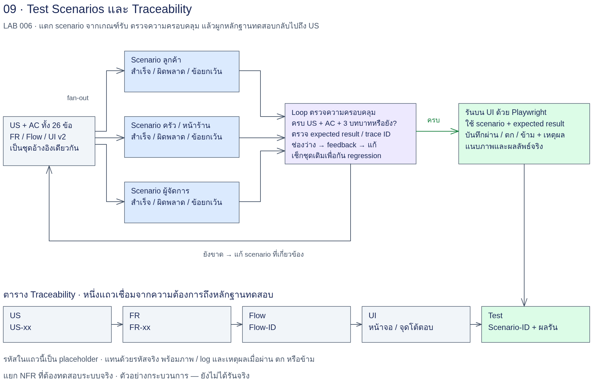
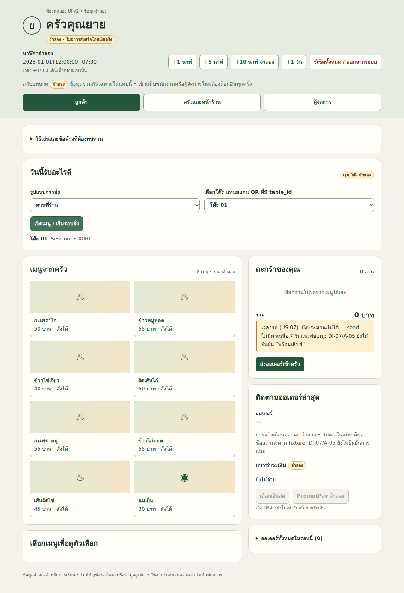
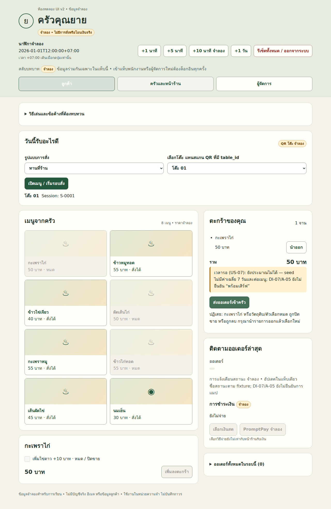
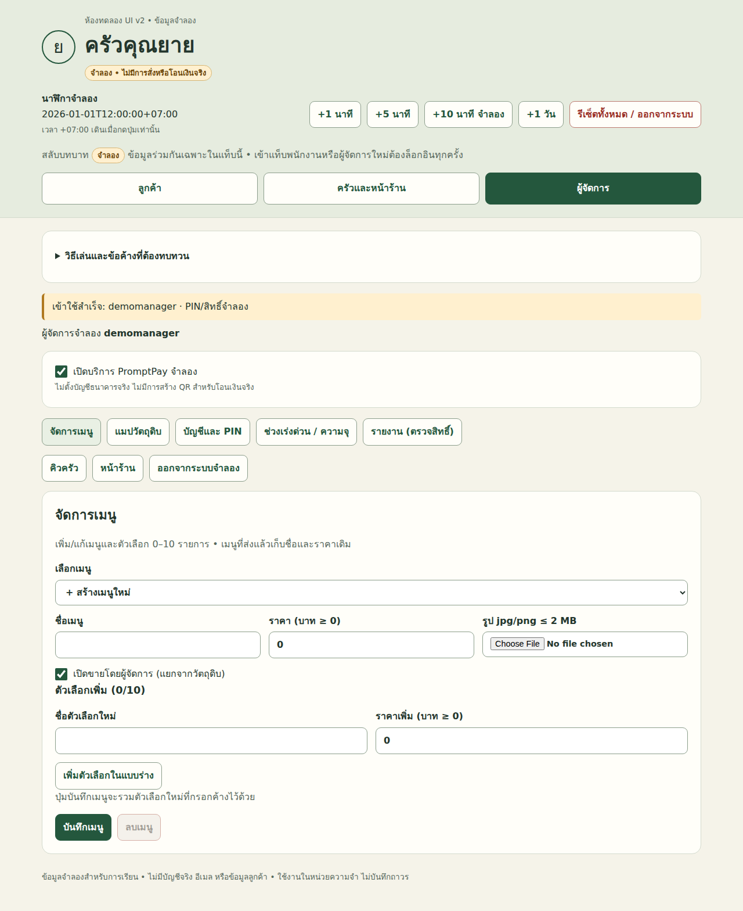

# LAB 006 — Test Scenarios และ Traceability

## โจทย์

รับบท SA ส่งต่อชิ้นงานครัวคุณยายจาก LAB 005 ให้ Developer/QA ตรวจย้อนกลับได้
สร้าง Test Scenarios จาก AC ครบทุกบทบาท แล้วตรวจส่วน UI ที่รันได้บน Mock-up v2
แยกความครบถ้วนของเอกสารออกจากผลคลิก และแยกผลคลิกออกจากการผ่านระบบจริง

## เป้าหมาย

- ออกแบบ Static Graph แบบ fan-out ตามสามบทบาทและ fan-in โดยรักษารหัสอ้างอิง
- ใช้ Loop ผู้สร้าง–ผู้ตรวจ–ผู้แก้ที่มีเกณฑ์และเพดานชัดเจน
- สร้าง US→FR→Flow→Screen→TestID และเห็นช่องว่างแทนการกลบด้วยข้อความว่าครบ
- รันชุดทดสอบ UI อัตโนมัติ เก็บ JSON/ภาพ และจำแนกเหตุล้มเหลว
- แยก NFR ที่ต้องตรวจระบบจริง พร้อมวิธีเก็บหลักฐานตามตัวเลขต้นฉบับ

## ความรู้ก่อนเรียน

อ่าน [กรณีศึกษา](../docs/case-study-source.md), [ข้อสงสัยข้อมูล](../docs/data-issues.md) และ [Rubric](../docs/rubric.md)
ผ่าน LAB 001–005 เข้าใจ FR/NFR, AC, Flow, UI state, Static/Conditional Graph และ Re-planning
ใช้ Terminal เปิดไฟล์ Markdown/CSV/HTML ได้ และเข้าใจว่า JSON ผลทดสอบไม่ใช่คำรับรองระบบทั้งหมด

## เวลาโดยประมาณ

วางแผนการเรียน 150–180 นาที: เตรียม 15, fan-out 25, coverage 30, traceability 20,
NFR 15, UI 30 และปรับ Prompt/อภิปราย 15–45 นาที
นี่เป็นค่าประมาณเพื่อจัดกิจกรรม ไม่ใช่เวลารันที่วัดแล้ว; เวลา/โทเคนจริงยังไม่มีข้อมูล
เพดานแก้ coverage 2 รอบหลังตรวจตั้งต้น round-0; จำนวนรอบสูงสุดไม่ใช่ผลที่เกิดขึ้นแล้ว

## User Story ที่ใช้ครบ 26 รายการ

ตารางนี้เป็นดัชนีสรุป ไม่ใช้แทน AC เต็มในต้นฉบับ
แต่ละ US ต้องมี scenario สำเร็จและผิดพลาด/ข้อยกเว้นอย่างน้อยอย่างละหนึ่ง

| US | เจ้าของ fan-out | หัวข้อที่ต้องออกแบบทดสอบ |
|---|---|---|
| US-01 | customer | QR เปิดเมนู |
| US-02 | customer | ผูกหมายเลขโต๊ะ |
| US-03 | customer | กลับบ้านและเวลารับ |
| US-04 | customer | ตัวเลือกต่อจาน |
| US-05 | customer | สถานะลูกค้า |
| US-06 | customer | เมนูหมดและปฏิเสธคำสั่ง |
| US-07 | customer | เวลารอและสูตร |
| US-08 | customer | ชำระเงินและ fallback |
| US-09 | customer | ทำไม่ได้และทางออกลูกค้า |
| US-10 | kitchen-front | ลำดับคิวคงที่ |
| US-11 | kitchen-front | เปลี่ยนสถานะหนึ่งแตะ |
| US-12 | kitchen-front | แมปวัตถุดิบและปิดเมนู/ตัวเลือก |
| US-13 | kitchen-front | กลับมามี |
| US-14 | kitchen-front | ทำไม่ได้ในคิวครัว |
| US-15 | kitchen-front | โต๊ะ/กลับบ้าน/สถานะจ่าย |
| US-16 | kitchen-front | ปิดโต๊ะและ session ใหม่ |
| US-17 | kitchen-front | รวมบิลหลายรอบ |
| US-18 | kitchen-front | ค้างเกินเวลา |
| US-19 | manager | จัดการเมนู/ราคา/ภาพ/ตัวเลือก |
| US-20 | manager | แมปวัตถุดิบหลังมีเมนู |
| US-21 | manager | ครัวเต็มและเพดาน |
| US-22 | manager | เปิดปิดกลับบ้าน |
| US-23 | manager | รายงาน/CSV |
| US-24 | manager | ประวัติวัตถุดิบหมด |
| US-25 | manager | บัญชี PIN และสิทธิ์ |
| US-26 | manager | Ubuntu/local/offline |

## แผนภาพ Workflow



Input v2 → fan-out customer / kitchen-front / manager → ผู้ตรวจ coverage → รวม traceability
เมื่อ GAPS ผู้แก้ส่ง manifest รุ่นใหม่กลับผู้ตรวจ; เมื่อครบหรือถึงเพดานจึงส่งต่อพร้อมสถานะจริง
จากนั้นแยก NFR → รัน UI v2 → ผูกผล JSON → สรุปส่ง LAB 007
ภาพเป็นแผนการทำงาน ไม่ใช่หลักฐานว่าได้รัน node แล้ว

## สิ่งส่งมอบ

- work/input-source.md, input-check.md และ snapshot สามไฟล์ใน work/source/
- scenario สามบทบาทและ manifest ทุกรอบที่ทำจริง พร้อม coverage/fixes
- work/test-scenarios.md, traceability.csv, traceability-notes.md, nfr-split.md
- JSON ผล UI, screenshots ที่มีจริง, ui-run-review.md และ traceability-after-ui.csv
- Prompt ฉบับปรับ แผนทดลอง ผลก่อน–หลังที่มีจริง และข้อจำกัด
- log, รุ่น Input/Output และบันทึกทรัพยากรที่ตรวจย้อนกลับได้

## ทฤษฎีและข้อจำกัดของ LAB 005

LAB 005 วางแผนและปรับ FR/Flow/UI ตามข้อมูลที่เปิดเผยเพิ่ม แต่ยังไม่มีชุด Test ครบทุก AC
แผนที่ระบุว่าจะทำงานไม่ได้ยืนยันว่าทำแล้ว และ UI ที่เปิดได้ไม่ได้ยืนยันว่าทางผิดพลาดครบ
Static Graph กำหนด node และ dependency ก่อนเริ่ม จึงแบ่ง US ตามเจ้าของได้คงที่
fan-out ส่ง input snapshot เดียวกันให้สามบทบาทและแยก output เพื่อไม่ชนกัน
รันแต่ละบทบาทตามลำดับก็ยังเป็นกราฟเดียวกัน; หากรันขนานต้องแยก log และรอครบก่อน fan-in
ผู้ตรวจเริ่มได้เมื่อมี output ครบสามบทบาท; ไฟล์ที่ขาดถือเป็น dependency ที่ยังไม่พร้อม
หนึ่ง US อาจข้ามหลายหน้าจอใน steps แต่เจ้าของการเขียน scenario มีคนเดียว
fan-in รวมด้วยรหัสและหลักฐาน ไม่รวมตามเสียงส่วนใหญ่หรือความยาวคำตอบ
Loop เพิ่มการแก้ตามรายการช่องว่าง โดยไม่ต้องให้ Planner เปลี่ยนโครงกราฟทุกครั้ง
round-0 คือผลตั้งต้น ส่วน round-1/2 คือแก้ตาม feedback และตรวจซ้ำ
หยุดเมื่อ COVERED หรือ STOP_WITH_GAPS; ถ้าข้อเดิมไม่คืบต้องหาสาเหตุ ไม่ retry Prompt เดิมไม่จำกัด
Coverage วัดว่ามีข้อทดสอบรองรับ ไม่วัดว่าระบบผ่าน: 52 scenario อาจยังขาด clause
การผ่าน smoke 14 กรณีไม่ได้ยืนยัน 26 US หรือจำนวนตัวอย่างตามต้นฉบับ
UI v2 ใช้ file://, state ในแท็บ และข้อมูลจำลอง จึงตรวจพฤติกรรมได้บางส่วน
เวลา LAN ความทนทานข้อมูล สิทธิ์ server และเงินจริงต้องแยกแผนตรวจระบบจริง
คงข้อสงสัยหมายเหตุ ก./ค./ช. และการอ้างรหัสที่ไม่ชัดไว้ในทะเบียน ไม่ตัดสินเอง

## วิธีรันร่วมและเก็บหลักฐาน

เปิด Terminal ที่ราก LAB นี้ ใช้ session ใหม่ทุก Prompt และเลือกเครื่องมือเดียวกันเมื่อเทียบผล
คำสั่งต่อไปนี้เป็นคำสั่งให้นักศึกษารัน ไม่ใช่หลักฐานว่ามีการเรียก AI แล้ว
ติดตั้ง Python และ Playwright ตามการเตรียมเครื่องของรายวิชาก่อนเริ่มงาน UI
ใช้ `python3` ของ environment ที่มี `playwright.sync_api`; เครื่องชั้นเรียนอาจเป็น `/opt/venv/bin/python3`

```bash
mkdir -p work
run_prompt() {
  prompt_file="$1"
  run_id="$2"
  run_dir="work/logs/$run_id"
  test -f "$prompt_file" || return 1
  mkdir -p work/logs
  mkdir "$run_dir" || return 1
  cp "$prompt_file" "$run_dir/prompt.md"
  date -u +%FT%TZ > "$run_dir/started-utc.txt"
  codex exec --json -o "$run_dir/response.md" "$(cat "$prompt_file")" \
    < /dev/null > "$run_dir/log.jsonl" 2> "$run_dir/stderr.txt"
  cli_status=$?
  date -u +%FT%TZ > "$run_dir/ended-utc.txt"
  printf '%s\n' "$cli_status" > "$run_dir/exit-code.txt"
  return "$cli_status"
}
```

ทางเลือกเรียก Prompt ด้วย `claude -p "$(cat prompts/<ชื่อไฟล์>.md)"` ใน session ใหม่
หากเลือกทางเลือกนี้ต้องบันทึก log/usage ตามที่เครื่องมือให้จริง ไม่สมมติว่ารูปแบบตรงกับ Codex
เก็บรุ่นเครื่องมือ โมเดล/effort ตามหลักฐาน Input hash และค่า wall time ที่วัดจริงใน metadata ของรอบ
ผลตอบ CLI ไม่ใช่ผลตรวจชิ้นงาน; เปิดไฟล์ output และอ่าน log ว่ามี turn.failed หรือไม่ก่อนใช้งานต่อ
ถ้า CLI ไม่มี usage ให้เขียน “ไม่มีข้อมูล” ไม่เดาจากจำนวนคำหรือบรรทัด
หากรันซ้ำใช้ run_id และ output รุ่นใหม่ทุกครั้ง โดยแก้ path ในสำเนา Prompt ที่เก็บใน work/
ไม่ลบผลเก่าและไม่เขียน output ทับรอบก่อน; Prompt ที่มี placeholder ต้องแทนค่าก่อนเรียก

## ขั้น 6.0 — เตรียม Input

### 1. เป้าหมายและ Input

ใช้ fr-nfr-v2.md, flow-v2.md และ ui-mockup-v2.html ที่สร้างจริงจาก LAB 005
เลือกผลนักศึกษาก่อน; ถ้าใช้ reference ให้บันทึกว่าใช้ผลอ้างอิง ไม่ใช่ผลที่นักศึกษารันเอง
ตรวจ [สัญญา UI เดิม](../004_LAB_Conditional_Graph_UI_Mockup/input/ui-contract.md) และ [ส่วนขยาย v2](input/ui-v2-test-contract.md)
ถ้า fallback ยังไม่มีไฟล์ให้หยุด ไม่สร้างผลอ้างอิงขึ้นเอง
Working directory คือราก LAB นี้; แต่ละ Prompt ใช้ session ใหม่และอ่าน input จาก path ที่ระบุ

### 2. Prompt พร้อมคัดลอก

ไฟล์ [00-prepare-input.md](prompts/00-prepare-input.md)

```text
# ขั้น 6.0 — ตรวจ Input และที่มา
## บริบทและเป้าหมาย
คุณเป็น SA เตรียม snapshot สำหรับสร้าง Test Scenarios จาก UI v2 ของครัวคุณยาย
## Input
อ่าน work/input-source.md, work/source/fr-nfr-v2.md, work/source/flow-v2.md,
work/source/ui-mockup-v2.html, ../docs/case-study-source.md, ../docs/data-issues.md,
input/README.md, input/ui-v2-test-contract.md และ ../004_LAB_Conditional_Graph_UI_Mockup/input/ui-contract.md
## งานและ Output
ตรวจไฟล์ครบและบันทึก hash/ที่มา/รุ่น/การใช้ผลอ้างอิงใน work/input-check.md
ตรวจ selector เดิมและส่วนขยาย v2 จาก HTML โดยไม่อ้างว่าคลิกผ่าน
ถ้า selector v2 ต่าง ให้ระบุ mapping ที่พบจริงและรายการยังขาด ไม่เปลี่ยนต้นทาง
แยก plan-v3 จากสิ่งที่ทำจริงใน UI v2; รายงานที่เพียง planned ยัง NOT_TESTED
สร้าง work/scenario-set-round-0.json เป็น object role -> path:
customer -> work/scenarios-customer.md
kitchen-front -> work/scenarios-kitchen-front.md
manager -> work/scenarios-manager.md
manifest นี้เป็นรายการ output ที่คาดหวัง ไม่ใช่การรับรองว่าทั้งสามไฟล์มีแล้ว
หยุดขั้นถัดไปถ้า Input จำเป็นขาด; อย่าสร้าง UI หรือผล LAB 005 แทน

## กติกาและขอบเขต
Working directory: AI_Workflow_Engineering_for_SA/006_LAB_Test_Scenarios_Traceability/
เริ่ม session ใหม่ทุกการเรียก อ่าน Input จากไฟล์ ไม่พึ่งประวัติสนทนา ไม่เรียกผู้ช่วยเพิ่ม
เขียนเฉพาะ work/ ไม่แก้ต้นทาง input/, prompts/, reference/, img/ หรือ LAB อื่น
หาก output มีแล้วให้หยุดและขอ path รุ่นใหม่ในบันทึก ไม่เขียนทับหลักฐาน
รักษาข้อความ US/AC ตัวเลข หน่วย สูตร และจำนวนตัวอย่างต้นฉบับทุกข้อ
ใช้ข้อมูลจำลองเท่านั้น; สมมติฐาน fixture ไม่ใช่ข้อกำหนดร้าน
ข้อมูลขาดให้ระบุ BLOCKED/ไม่มีข้อมูล ไม่แต่ง FR, Flow, selector หรือผลผ่าน
ผลคลิก Mock-up ไม่ยืนยัน LAN, Security, Load, Availability หรือการชำระเงินจริง
สรุปไฟล์ที่สร้างจริง ข้อบกพร่อง ข้อค้าง และสิ่งที่ยังไม่ได้ทดสอบ

```

### 3. วิธีรันและเปิดผล

Terminal: ประกาศ `run_prompt` ตามด้านบนก่อน แล้วรันคำสั่งชุดนี้

```bash
# เลือกแหล่งเดียวที่มีไฟล์ครบสามชิ้น
export LAB005_SOURCE=../005_LAB_Dynamic_Workflow_Replanning/work
# หากเลือกผลอ้างอิง ใช้ค่าต่อไปนี้แทน และสคริปต์จะบันทึกประเภทให้
# export LAB005_SOURCE=../005_LAB_Dynamic_Workflow_Replanning/reference/step-05-execute-v2
python3 - <<'CHECK'
import os, hashlib, shutil
from pathlib import Path
src = Path(os.environ['LAB005_SOURCE'])
names = ['fr-nfr-v2.md', 'flow-v2.md', 'ui-mockup-v2.html']
assert all((src / n).is_file() for n in names), 'Input ขาด: หยุดและบันทึกสิ่งที่ขาด'
dst = Path('work/source')
assert not dst.exists() and not Path('work/input-source.md').exists(), 'ใช้ชุด output ใหม่'
dst.mkdir(parents=True)
kind = 'ใช้ผลอ้างอิง ไม่ใช่ผลที่นักศึกษารันเอง' if 'reference' in src.parts else 'ใช้ผลของนักศึกษา'
lines = ['# ที่มาของ Input', kind, '| file | source | SHA256 |', '|---|---|---|']
for name in names:
    shutil.copy2(src / name, dst / name)
    digest = hashlib.sha256((dst / name).read_bytes()).hexdigest()
    lines.append(f'| {name} | {(src / name).resolve()} | {digest} |')
Path('work/input-source.md').write_text('\n'.join(lines)+'\n', encoding='utf-8')
CHECK
run_prompt prompts/00-prepare-input.md prepare-r0
less work/input-check.md
```

### 4. ตัวอย่างผลรันล่วงหน้า

**ผลรันล่วงหน้าจริง — ตรวจ Input แล้ว**

ใช้ snapshot ผลอ้างอิงจาก LAB 005 พร้อม provenance/SHA-256; การอ่าน selector ยังไม่ใช่ผลคลิก UI

ฉบับเต็ม [input-check.md](reference/step-00-input/input-check.md) · [prompt ที่ใช้จริง](reference/step-00-input/prompt-used.md) · [log](reference/step-00-input/log.jsonl) · [meta](reference/step-00-input/meta.json) · [ที่มาและ SHA-256](reference/step-00-input/provenance.md)

ตัดตอนจากไฟล์จริง (เนื้อหาคงตามผลรัน):

~~~~text
# ตรวจ Input และที่มา — ขั้น 6.0

เวลาตรวจ (UTC): 2026-09-14T14:25:05+00:00

**ผลตรวจ Input: ครบ 9/9 ไฟล์ อ่านได้ และ snapshot v2 3/3 ไฟล์มี SHA-256 ตรงกับ provenance และต้นทางที่อ้างจริง** ไม่มี Input จำเป็นขาดสำหรับขั้น 6.0; ใช้เตรียมการออกแบบ scenario ต่อได้โดยคงข้อค้างด้านล่าง การรับรองพฤติกรรม UI/US/AC ทั้งหมดเป็น **NOT_TESTED** รอบนี้ตรวจไฟล์และอ่าน HTML เท่านั้น ไม่เปิด browser ไม่คลิก ไม่รัน JavaScript ของ UI และไม่เรียกผู้ช่วยเพิ่ม

**ใช้ผลอ้างอิง ไม่ใช่ผลที่นักศึกษารันเอง** ใช้ผล LAB 005 เพื่อกำหนด snapshot ที่ทำซ้ำได้ ไม่ถือผลตรวจหรือข้อความ PASS ของต้นทางเป็นผลรัน LAB นี้ ไม่สร้าง UI หรือผล LAB 005 แทน

ก่อนเริ่มตรวจไม่พบ `input-check.md` และ `scenario-set-round-0.json` จึงสร้างใหม่ด้วยโหมดไม่เขียนทับ หากพบ Output เดิมในการเรียกครั้งถัดไป ต้องหยุดและขอ path รุ่นใหม่ในบันทึกการสนทนา ห้ามแก้หรือเขียนทับหลักฐานเดิม

## ฐาน path และการใช้ Input

path ในตาราง Input ต่อไปนี้ relative จากโฟลเดอร์ขั้นนี้ ส่วน path ต้นทางที่ถอดจาก provenance และค่าทุกตัวใน manifest relative จากราก LAB ซึ่งอยู่ที่ `../..` ตาม prompt นี้ คำสั่งจัดเก็บใน README/สัญญาต้นแบบไม่ได้ใช้แทนขอบเขต Output ของรอบนี้

| Input ที่อ่านจริง (relative จากขั้นนี้) | รุ่น/สถานะต้นทาง | การใช้ผลอ้างอิง |
|---|---|---|
| `provenance.md` | ไม่ระบุเลขรุ่น; provenance ของ snapshot รอบนี้ | ที่มา snapshot และฐาน path ของ manifest |
| `fr-nfr-v2.md` | v2; ส่วนเอกสารระบุ EXECUTED และรอตรวจ | FR/NFR, US/AC และข้อค้างของ v2 |
| `flow-v2.md` | v2; ส่วนเอกสารระบุ EXECUTED และรอตรวจ | Flow และ mapping ที่เอกสารออกแบบไว้ |
| `ui-mockup-v2.html` | UI v2; offline mock จำลอง | ตรวจ markup, template, seed และ event handler แบบ static |
| `../../../docs/case-study-source.md` | ไม่ระบุเลขรุ่น; วันที่ตรวจในเอกสาร 2026-09-14 | ฐาน US/AC ต้นฉบับ 26 รายการและบริบท |
| `../../../docs/data-issues.md` | ไม่ระบุเลขรุ่น; วันที่ตรวจในเอกสาร 2026-09-14 | ทะเบียน DI-01–DI-09 และ A-01–A-06 ที่ยังไม่ยืนยัน |
| `../../input/README.md` | Input LAB 006; ไม่ระบุเลขรุ่น | กติกา Input, runner และขอบเขตหลักฐาน |
| `../../input/ui-v2-test-contract.md` | fixture เพิ่ม UI v2 | selector ที่คาดหวังเพิ่ม 9 รายการและ precondition fixture |
| `../../../004_LAB_Conditional_Graph_UI_Mockup/input/ui-contract.md` | fixture เดิม LAB 004; ไม่ระบุเลขรุ่น | selector เดิม 81 รายการและข้อสมมติ fixture |

SHA-256 คำนวณจาก bytes ทั้งไฟล์ ไม่ปรับ newline หรือ encoding ก่อน hash:

| Input | bytes | SHA-256 ที่ตรวจจริง |
~~~~


### 5. เปรียบเทียบและตรวจผ่าน

- [ ] ไฟล์ครบสามชิ้นและที่มาตรง snapshot/hash
- [ ] แยก work จาก reference ชัดเจน; ไม่ถือว่าใช้ reference คือรันเอง
- [ ] selector ใหม่ตรวจจาก HTML แล้วหรือมีข้อค้างระบุ
- [ ] plan-v3 ไม่ถูกอ้างเป็น UI v3 ที่เสร็จแล้ว
ถ้อยคำอธิบายยืดหยุ่นได้ แต่รหัส AC เกณฑ์ และความหมายของหลักฐานต้องตรง
เทียบผลของนักศึกษากับเกณฑ์ที่คาดหวังและหลักฐานผลรันล่วงหน้าด้านบน โดยอ้างผลของนักศึกษาเองแยกจากผลอ้างอิง

### 6. แก้ไขและส่งต่อ

แก้ path ที่ผิดก่อนคัดลอก; ส่ง snapshot/input-check และ manifest round-0 ไป 6.1
เมื่อข้อมูลจำเป็นขาดหรือครบเพดานแล้วให้หยุดพร้อมข้อค้าง ไม่เติมผลผ่านเอง

## ขั้น 6.1 — fan-out สามบทบาท

### 1. เป้าหมายและ Input

ใช้ snapshot และ scenario-template เดียวกันทั้งสาม session; output แยกตามบทบาท กราฟไม่เปลี่ยนตามคำตอบ
Working directory คือราก LAB นี้; แต่ละ Prompt ใช้ session ใหม่และอ่าน input จาก path ที่ระบุ

### 2. Prompt พร้อมคัดลอก

ไฟล์ [01-scenarios-customer.md](prompts/01-scenarios-customer.md)

```text
# ขั้น 6.1 — สร้าง Scenario บทบาทลูกค้า
## บริบทและเป้าหมาย
คุณเป็นผู้ออกแบบการทดสอบบทบาทลูกค้า ใน Static Graph; รับผิดชอบ US-01 ถึง US-09
## Input
อ่าน ../docs/case-study-source.md, ../docs/data-issues.md, work/input-check.md,
work/source/fr-nfr-v2.md, work/source/flow-v2.md, work/source/ui-mockup-v2.html,
input/scenario-template.md, input/coverage-criteria.md, input/ui-scenarios.json,
input/ui-v2-test-contract.md และ ../004_LAB_Conditional_Graph_UI_Mockup/input/ui-contract.md
## งาน
สร้าง scenario จากแต่ละ clause ของ AC ไม่เริ่มจากการเดาว่าหน้า UI ทำอะไรได้
ทุก US ในขอบเขตต้องมีอย่างน้อย 1 สำเร็จ และ 1 ผิดพลาด/ข้อยกเว้น
ใช้รหัส TS-<US>-<n> เช่น TS-US-01-1; n ไม่ซ้ำภายใน US และห้ามเปลี่ยน ID หลังเผยแพร่
ช่วง n=101 ขึ้นไปสงวนให้ fixture input/ui-scenarios.json ให้อ้างเชื่อม ไม่สร้างซ้ำ
คัด AC ต้นฉบับครบพร้อมตัวเลขเดิมก่อนแยก functional assertions กับ NFR
ระบุ precondition, test data จำลอง, steps, expected, ประเภท, automation: auto/manual/mock-not-testable
ระบุ data-testid ที่ใช้และ scope; selector ซ้ำต้องชี้รายการโดย order ID หรือใช้ fixture ที่มีใบเดียว
auto หมายถึงรันกับ Mock-up ได้ ไม่หมายความว่า AC ระบบจริงผ่านแล้ว
manual ใช้เมื่อมีขั้นตรวจด้วยคน; mock-not-testable ใช้เมื่อจำเป็นต้องมีระบบจริง
US ที่ UI v2 ยังไม่มีต้องออกแบบ scenario ต่อ แต่ระบุเหตุที่ยังรันไม่ได้
กรณีผิดพลาดที่ต้นฉบับไม่กำหนดผลชัด ให้แยกเป็นสมมติฐานรอยืนยัน ไม่เพิ่มกฎเอง
ข้ามบทบาทได้ใน steps เพื่อ setup แต่เจ้าของ US ยังคงตามขอบเขตนี้
## Output
สร้าง work/scenarios-customer.md ตาม template พร้อมดัชนี US -> TestID และข้อค้าง
Status เริ่ม NOT_RUN หรือ NOT_TESTABLE ไม่ใส่ PASS โดยไม่มีผลรันจริง

## กติกาและขอบเขต
Working directory: AI_Workflow_Engineering_for_SA/006_LAB_Test_Scenarios_Traceability/
เริ่ม session ใหม่ทุกการเรียก อ่าน Input จากไฟล์ ไม่พึ่งประวัติสนทนา ไม่เรียกผู้ช่วยเพิ่ม
เขียนเฉพาะ work/ ไม่แก้ต้นทาง input/, prompts/, reference/, img/ หรือ LAB อื่น
หาก output มีแล้วให้หยุดและขอ path รุ่นใหม่ในบันทึก ไม่เขียนทับหลักฐาน
รักษาข้อความ US/AC ตัวเลข หน่วย สูตร และจำนวนตัวอย่างต้นฉบับทุกข้อ
ใช้ข้อมูลจำลองเท่านั้น; สมมติฐาน fixture ไม่ใช่ข้อกำหนดร้าน
ข้อมูลขาดให้ระบุ BLOCKED/ไม่มีข้อมูล ไม่แต่ง FR, Flow, selector หรือผลผ่าน
ผลคลิก Mock-up ไม่ยืนยัน LAN, Security, Load, Availability หรือการชำระเงินจริง
สรุปไฟล์ที่สร้างจริง ข้อบกพร่อง ข้อค้าง และสิ่งที่ยังไม่ได้ทดสอบ

```

ไฟล์ [01-scenarios-kitchen-front.md](prompts/01-scenarios-kitchen-front.md)

```text
# ขั้น 6.1 — สร้าง Scenario บทบาทครัวและหน้าร้าน
## บริบทและเป้าหมาย
คุณเป็นผู้ออกแบบการทดสอบบทบาทครัวและหน้าร้าน ใน Static Graph; รับผิดชอบ US-10 ถึง US-18
## Input
อ่าน ../docs/case-study-source.md, ../docs/data-issues.md, work/input-check.md,
work/source/fr-nfr-v2.md, work/source/flow-v2.md, work/source/ui-mockup-v2.html,
input/scenario-template.md, input/coverage-criteria.md, input/ui-scenarios.json,
input/ui-v2-test-contract.md และ ../004_LAB_Conditional_Graph_UI_Mockup/input/ui-contract.md
## งาน
สร้าง scenario จากแต่ละ clause ของ AC ไม่เริ่มจากการเดาว่าหน้า UI ทำอะไรได้
ทุก US ในขอบเขตต้องมีอย่างน้อย 1 สำเร็จ และ 1 ผิดพลาด/ข้อยกเว้น
ใช้รหัส TS-<US>-<n> เช่น TS-US-01-1; n ไม่ซ้ำภายใน US และห้ามเปลี่ยน ID หลังเผยแพร่
ช่วง n=101 ขึ้นไปสงวนให้ fixture input/ui-scenarios.json ให้อ้างเชื่อม ไม่สร้างซ้ำ
คัด AC ต้นฉบับครบพร้อมตัวเลขเดิมก่อนแยก functional assertions กับ NFR
ระบุ precondition, test data จำลอง, steps, expected, ประเภท, automation: auto/manual/mock-not-testable
ระบุ data-testid ที่ใช้และ scope; selector ซ้ำต้องชี้รายการโดย order ID หรือใช้ fixture ที่มีใบเดียว
auto หมายถึงรันกับ Mock-up ได้ ไม่หมายความว่า AC ระบบจริงผ่านแล้ว
manual ใช้เมื่อมีขั้นตรวจด้วยคน; mock-not-testable ใช้เมื่อจำเป็นต้องมีระบบจริง
US ที่ UI v2 ยังไม่มีต้องออกแบบ scenario ต่อ แต่ระบุเหตุที่ยังรันไม่ได้
กรณีผิดพลาดที่ต้นฉบับไม่กำหนดผลชัด ให้แยกเป็นสมมติฐานรอยืนยัน ไม่เพิ่มกฎเอง
ข้ามบทบาทได้ใน steps เพื่อ setup แต่เจ้าของ US ยังคงตามขอบเขตนี้
## Output
สร้าง work/scenarios-kitchen-front.md ตาม template พร้อมดัชนี US -> TestID และข้อค้าง
Status เริ่ม NOT_RUN หรือ NOT_TESTABLE ไม่ใส่ PASS โดยไม่มีผลรันจริง

## กติกาและขอบเขต
Working directory: AI_Workflow_Engineering_for_SA/006_LAB_Test_Scenarios_Traceability/
เริ่ม session ใหม่ทุกการเรียก อ่าน Input จากไฟล์ ไม่พึ่งประวัติสนทนา ไม่เรียกผู้ช่วยเพิ่ม
เขียนเฉพาะ work/ ไม่แก้ต้นทาง input/, prompts/, reference/, img/ หรือ LAB อื่น
หาก output มีแล้วให้หยุดและขอ path รุ่นใหม่ในบันทึก ไม่เขียนทับหลักฐาน
รักษาข้อความ US/AC ตัวเลข หน่วย สูตร และจำนวนตัวอย่างต้นฉบับทุกข้อ
ใช้ข้อมูลจำลองเท่านั้น; สมมติฐาน fixture ไม่ใช่ข้อกำหนดร้าน
ข้อมูลขาดให้ระบุ BLOCKED/ไม่มีข้อมูล ไม่แต่ง FR, Flow, selector หรือผลผ่าน
ผลคลิก Mock-up ไม่ยืนยัน LAN, Security, Load, Availability หรือการชำระเงินจริง
สรุปไฟล์ที่สร้างจริง ข้อบกพร่อง ข้อค้าง และสิ่งที่ยังไม่ได้ทดสอบ

```

ไฟล์ [01-scenarios-manager.md](prompts/01-scenarios-manager.md)

```text
# ขั้น 6.1 — สร้าง Scenario บทบาทผู้จัดการร้าน
## บริบทและเป้าหมาย
คุณเป็นผู้ออกแบบการทดสอบบทบาทผู้จัดการร้าน ใน Static Graph; รับผิดชอบ US-19 ถึง US-26
## Input
อ่าน ../docs/case-study-source.md, ../docs/data-issues.md, work/input-check.md,
work/source/fr-nfr-v2.md, work/source/flow-v2.md, work/source/ui-mockup-v2.html,
input/scenario-template.md, input/coverage-criteria.md, input/ui-scenarios.json,
input/ui-v2-test-contract.md และ ../004_LAB_Conditional_Graph_UI_Mockup/input/ui-contract.md
## งาน
สร้าง scenario จากแต่ละ clause ของ AC ไม่เริ่มจากการเดาว่าหน้า UI ทำอะไรได้
ทุก US ในขอบเขตต้องมีอย่างน้อย 1 สำเร็จ และ 1 ผิดพลาด/ข้อยกเว้น
ใช้รหัส TS-<US>-<n> เช่น TS-US-01-1; n ไม่ซ้ำภายใน US และห้ามเปลี่ยน ID หลังเผยแพร่
ช่วง n=101 ขึ้นไปสงวนให้ fixture input/ui-scenarios.json ให้อ้างเชื่อม ไม่สร้างซ้ำ
คัด AC ต้นฉบับครบพร้อมตัวเลขเดิมก่อนแยก functional assertions กับ NFR
ระบุ precondition, test data จำลอง, steps, expected, ประเภท, automation: auto/manual/mock-not-testable
ระบุ data-testid ที่ใช้และ scope; selector ซ้ำต้องชี้รายการโดย order ID หรือใช้ fixture ที่มีใบเดียว
auto หมายถึงรันกับ Mock-up ได้ ไม่หมายความว่า AC ระบบจริงผ่านแล้ว
manual ใช้เมื่อมีขั้นตรวจด้วยคน; mock-not-testable ใช้เมื่อจำเป็นต้องมีระบบจริง
US ที่ UI v2 ยังไม่มีต้องออกแบบ scenario ต่อ แต่ระบุเหตุที่ยังรันไม่ได้
กรณีผิดพลาดที่ต้นฉบับไม่กำหนดผลชัด ให้แยกเป็นสมมติฐานรอยืนยัน ไม่เพิ่มกฎเอง
ข้ามบทบาทได้ใน steps เพื่อ setup แต่เจ้าของ US ยังคงตามขอบเขตนี้
## Output
สร้าง work/scenarios-manager.md ตาม template พร้อมดัชนี US -> TestID และข้อค้าง
Status เริ่ม NOT_RUN หรือ NOT_TESTABLE ไม่ใส่ PASS โดยไม่มีผลรันจริง

## กติกาและขอบเขต
Working directory: AI_Workflow_Engineering_for_SA/006_LAB_Test_Scenarios_Traceability/
เริ่ม session ใหม่ทุกการเรียก อ่าน Input จากไฟล์ ไม่พึ่งประวัติสนทนา ไม่เรียกผู้ช่วยเพิ่ม
เขียนเฉพาะ work/ ไม่แก้ต้นทาง input/, prompts/, reference/, img/ หรือ LAB อื่น
หาก output มีแล้วให้หยุดและขอ path รุ่นใหม่ในบันทึก ไม่เขียนทับหลักฐาน
รักษาข้อความ US/AC ตัวเลข หน่วย สูตร และจำนวนตัวอย่างต้นฉบับทุกข้อ
ใช้ข้อมูลจำลองเท่านั้น; สมมติฐาน fixture ไม่ใช่ข้อกำหนดร้าน
ข้อมูลขาดให้ระบุ BLOCKED/ไม่มีข้อมูล ไม่แต่ง FR, Flow, selector หรือผลผ่าน
ผลคลิก Mock-up ไม่ยืนยัน LAN, Security, Load, Availability หรือการชำระเงินจริง
สรุปไฟล์ที่สร้างจริง ข้อบกพร่อง ข้อค้าง และสิ่งที่ยังไม่ได้ทดสอบ

```

### 3. วิธีรันและเปิดผล

Terminal: ประกาศ `run_prompt` ตามด้านบนก่อน แล้วรันคำสั่งชุดนี้

```bash
run_prompt prompts/01-scenarios-customer.md customer-r0
run_prompt prompts/01-scenarios-kitchen-front.md kitchen-front-r0
run_prompt prompts/01-scenarios-manager.md manager-r0
less work/scenarios-customer.md
less work/scenarios-kitchen-front.md
less work/scenarios-manager.md
```

### 4. ตัวอย่างผลรันล่วงหน้า

**ผลรันล่วงหน้าจริง — fan-out สามบทบาทสำเร็จ**

สร้างพร้อมกันใน session แยก: customer 32, kitchen-front 40, manager 35 รวม 107 scenario รุ่นตั้งต้น ทุกผลมี log/meta ของตนเอง; ยังไม่ใช่ผลรันระบบจริง

**customer**

ฉบับเต็ม [scenarios-customer.md](reference/step-01-fanout/customer/scenarios-customer.md) · [prompt ที่ใช้จริง](reference/step-01-fanout/customer/prompt-used.md) · [log](reference/step-01-fanout/customer/log.jsonl) · [meta](reference/step-01-fanout/customer/meta.json)

ตัดตอนจากไฟล์จริง (เนื้อหาคงตามผลรัน):

~~~~text
## TS-US-01-1 — เปิดรายการแรกโดยไม่ล็อกอินครบโต๊ะใน seed

- US: US-01
- เจ้าของ: customer
- ประเภท: สำเร็จ
- AC ต้นฉบับเต็ม: นับจากกล้องมือถืออ่าน QR สำเร็จ จนถึงหน้าเมนูแสดงรายการแรก ภายใน 3 วินาทีบน Wi‑Fi ร้าน ในอย่างน้อย 18 จาก 20 ครั้งของชุดทดสอบ
- clause ที่ตรวจ: F01: สแกนแล้วเข้าถึงเมนูโดยไม่ล็อกอินในข้อความ US; ตรวจเฉพาะปลายทางรายการแรกของ AC
- FR / Flow / Screen: FR-01; NFR-01 → MRG-01, MRG-12 → SCR-01; [FR/NFR — Traceability](reference/step-00-input/fr-nfr-v2.md), [Flow — Coverage/ทะเบียนส่วนเดิม/ส่วน MRG v2](reference/step-00-input/flow-v2.md); Screen เป็นรหัสออกแบบ ไม่ใช่ data-testid
- automation: auto
- เหตุผล automation และขอบเขตที่พิสูจน์ได้: auto ตรวจเฉพาะพฤติกรรมจำลองผ่าน UI/DOM; ไม่พิสูจน์ QR, LAN/Wi‑Fi, Security, Load, Availability, server log หรือการชำระเงินจริง
- Precondition/reset: R0 แยก context ใหม่ต่อโต๊ะ; ยังไม่ login และ menu-list ยังไม่แสดง
- Test data: โต๊ะ 01, 02, 03 ตาม seed; m01 กะเพราไก่ 50 บาท
- data-testid และ scope: G: btn-reset, role-customer; C: table-select, btn-open-menu, active-table, menu-list > menu-item-m01; ฟอร์ม staff-user/staff-pin ตรวจระดับหน้า; คำย่อ G/C/K/F/R/I/M และขั้น O/K0/F0/M0 ตามส่วน Precondition และ scope ที่ใช้ซ้ำ
- ขั้นตอน:

  1. ทำ R0 แล้วเลือกโต๊ะแต่ละค่าผ่าน table-select โดยไม่กรอกข้อมูลเข้าใช้
  2. กด btn-open-menu; ตรวจ active-table และรายการ m01 ภายใน menu-list
  3. ตรวจว่าไม่ต้องผ่านฟอร์ม login เพื่อเห็นรายการแรก; ทำซ้ำใน context ใหม่ให้ครบ 3 โต๊ะ

- Expected result: แต่ละโต๊ะเปิด menu-list และ menu-item-m01 ที่มองเห็นได้ พร้อมหมายเลขโต๊ะที่เลือก โดยไม่ต้อง login; fixture TS-US-01-101 ตรวจเพียง menu-list จึงยังไม่แทน assertion รายการแรกและหลายโต๊ะนี้
- จำนวนตัวอย่างและเกณฑ์ระบบจริง: คงข้อความ AC ต้นฉบับเต็มของ US-01 ในรายการนี้ทุกตัวเลข/สูตร/หน่วย/สัดส่วน; ตารางแยก assertions ระบุประชากรที่ต้องเก็บ. ชุดย่อยหรือจำนวน fixture ใน Test data ไม่ใช้แทนประชากรนั้น; assertion เฉพาะข้อผิดพลาดที่ไม่มีกลุ่มตัวอย่างใน AC ไม่เพิ่มเกณฑ์จำนวนเอง. ทุกเกณฑ์ระบบจริงยังไม่ได้ทดสอบ
- สมมติฐาน/ข้อค้าง: table-select เป็นตัวแทน QR เท่านั้น; การสแกนจริงและเวลาแยก TS-US-01-2
- Status: NOT_RUN
~~~~

**kitchen-front**

ฉบับเต็ม [scenarios-kitchen-front.md](reference/step-01-fanout/kitchen-front/scenarios-kitchen-front.md) · [prompt ที่ใช้จริง](reference/step-01-fanout/kitchen-front/prompt-used.md) · [log](reference/step-01-fanout/kitchen-front/log.jsonl) · [meta](reference/step-01-fanout/kitchen-front/meta.json)

ตัดตอนจากไฟล์จริง (เนื้อหาคงตามผลรัน):

~~~~text
## TS-US-10-1 — ออเดอร์ใหม่ปรากฏและเรียงตามเวลารับ

- US: US-10
- เจ้าของ: kitchen-front
- ประเภท: สำเร็จ
- AC ต้นฉบับเต็ม: นับจากลูกค้ากดยืนยันสั่ง จนถึงจอครัวแสดงออเดอร์ใหม่ ภายใน 3 วินาทีบน LAN ในร้าน ในอย่างน้อย 18 จาก 20 ใบของชุดทดสอบ · กฎเรียงลำดับ: เรียงตาม timestamp ฝั่งเซิร์ฟเวอร์ที่รับคำสั่ง (ความละเอียดวินาที) จากน้อยไปมาก และเมื่อ timestamp เท่ากันหรือออเดอร์เข้าพร้อมกัน ให้เรียงตามเลขออเดอร์ที่ระบบออกให้แบบ monotonic (เพิ่มขึ้นทีละ 1 ไม่ซ้ำ ไม่ย้อนกลับ) · ทดสอบยิง 30 ออเดอร์ต่อเนื่องจากมือถือ 2 เครื่องพร้อมกัน ลำดับบนจอครัวต้องตรงกับลำดับเลขออเดอร์ 30 จาก 30 ใบ และรันซ้ำ 3 รอบต้องได้ผลเดิมทุกรอบ (ไม่ยอมรับการสลับคู่)
- clause ที่ตรวจ: F10-a: แสดงออเดอร์ใหม่; F10-b: timestamp ระดับวินาทีเรียงน้อยไปมาก
- FR / Flow / Screen: FR-10; NFR-06 ใน [fr-nfr-v2.md](reference/step-00-input/fr-nfr-v2.md); MRG-04 → SCR-03 / SCR-06 / SCR-08 ใน [flow-v2.md](reference/step-00-input/flow-v2.md) หัวข้อ Coverage US → FR/NFR → Flow → module → screen
- automation: auto
- เหตุผล automation และขอบเขตที่พิสูจน์ได้: ตรวจการแสดงและเรียงข้อมูลจำลองได้; server timestamp และเวลา LAN ต้องตรวจ TS-US-10-3/4
- Precondition/reset: R0; เปิดโต๊ะ 01 ตาม C0; คิวว่าง
- Test data: m01=50 บาท รายการละ 1; 3 ออเดอร์ที่เวลาจำลอง 12:00, 12:10, 12:20 (ข้อมูลจำลองเท่านั้น; seed/สัญญา UI หรือชุดออกแบบที่ระบุ ไม่ใช่กฎร้าน)
- data-testid และ scope: C0, K0; kitchen-queue > kitchen-order ทั้งชุดเพื่ออ่านลำดับ; K(o) สำหรับแต่ละใบ; sim-clock, btn-advance-10m ส่วนกลาง; ขยายคำย่อตามส่วน Precondition และ SCOPE
- ขั้นตอน:
  1. C0 ส่งใบแรก จด order-id
  2. กด btn-advance-10m แล้วส่งใบที่สอง
  3. เพิ่มเวลาอีก 10 นาทีแล้วส่งใบที่สาม
  4. K0 อ่าน kitchen-order ทุกใบและ data-received-at
  5. สลับลูกค้าแล้วกลับ K0 ตรวจลำดับซ้ำ
- Expected result: ใบครัวครบ 3 ใบ ตรง order ID ที่จด; timestamp ISO มีความละเอียดวินาทีและเรียงน้อยไปมาก; เลขออเดอร์เพิ่มทีละ 1 ไม่ซ้ำไม่ย้อน; ลำดับเดิมหลังสลับบทบาท
- จำนวนตัวอย่างและเกณฑ์ระบบจริง: 3 วินาทีบน LAN ในร้าน อย่างน้อย 18 จาก 20 ใบ; เรียง timestamp ฝั่งเซิร์ฟเวอร์ความละเอียดวินาทีและเลข monotonic เพิ่มขึ้นทีละ 1 ไม่ซ้ำ ไม่ย้อนกลับ; มือถือ 2 เครื่องพร้อมกัน 30 ออเดอร์ ต้องตรง 30 จาก 30 ใบ รันซ้ำ 3 รอบได้ผลเดิมทุกรอบ ไม่ยอมรับการสลับคู่; scenario นี้ตรวจเฉพาะ clause ที่ระบุ ส่วนที่เหลือเชื่อมในดัชนี ไม่ใช้จำนวน smoke ลดเกณฑ์ต้นฉบับ
~~~~

**manager**

ฉบับเต็ม [scenarios-manager.md](reference/step-01-fanout/manager/scenarios-manager.md) · [prompt ที่ใช้จริง](reference/step-01-fanout/manager/prompt-used.md) · [log](reference/step-01-fanout/manager/log.jsonl) · [meta](reference/step-01-fanout/manager/meta.json)

ตัดตอนจากไฟล์จริง (เนื้อหาคงตามผลรัน):

~~~~text
## TS-US-19-1 — เพิ่มและแก้เมนูในขอบเขตหน้าจัดการเมนู

- US: US-19
- เจ้าของ: manager
- ประเภท: สำเร็จ
- AC ต้นฉบับเต็ม: ขอบเขต: หน้า “จัดการเมนู” เท่านั้น ไม่มีการแมปวัตถุดิบ (แยกไป US-20) · รูปเมนูรับไฟล์ jpg/png ขนาดไม่เกิน 2 MB ต่อรูป · ตัวเลือกเพิ่มระบุชื่อและราคาเพิ่มได้ 0–10 ตัวเลือกต่อเมนู · นับจากกดบันทึก จนถึงเมนูและตัวเลือกเพิ่มใหม่ปรากฏบนหน้าลูกค้าเมื่อรีเฟรช ภายใน 1 นาที · การแก้ราคาไม่เปลี่ยนยอดของออเดอร์ที่สั่งไปแล้ว (ตรวจ 5 ออเดอร์เดิม ผ่าน 5 จาก 5) · ลบเมนูที่มีการแมปวัตถุดิบอยู่ ระบบต้องเตือนและลบการแมปนั้นด้วย
- clause ที่ตรวจ: หน้า “จัดการเมนู” เท่านั้น ไม่มีการแมปวัตถุดิบ; เพิ่ม/แก้ชื่อและราคา; การปรากฏบนลูกค้าตรวจเฉพาะ state ในแท็บ
- Functional assertions: ชื่อ/ราคาใหม่ตรงค่าที่บันทึกและเมนูเลือกสั่งได้; หน้าจัดการเมนูไม่มีงานแมป; ไม่สรุปเกณฑ์รีเฟรชหรือ 1 นาที
- NFR ที่แยกจาก functional: NFR-11: กดบันทึก→ข้อมูลเมนูและตัวเลือกปรากฏเมื่อลูกค้ารีเฟรช ภายใน 1 นาที; ตรวจจริง TS-US-19-8
- FR / Flow / Screen: FR-19 / NFR-11 ใน ../../step-00-input/fr-nfr-v2.md; MRG-21/22/23/24 ใน ../../step-00-input/flow-v2.md; SCR-11 (menu-admin), SCR-03 ลูกค้า; MRG-25/SCR-12 สำหรับ setup แมป
- automation: auto
- เหตุผล automation และขอบเขตที่พิสูจน์ได้: มี controls/handler ใน HTML v2 ให้รัน assertion ใน Mock-up ได้; คำว่า auto ไม่ใช่ผลรัน ไม่ยืนยัน AC ระบบจริงหรือ NFR
- Precondition/reset: R0 → M → nav-menu-admin; ไม่มีเมนูใหม่หลัง reset; ใช้ขั้นตอนร่วมที่ระบุโดยไม่พึ่ง Scenario อื่นเคยรันผ่าน
- Test data: เมนูจำลอง “อาหารทดสอบ” ราคา 70; แก้ชื่อเป็น “อาหารทดสอบใหม่” ราคา 75; ไม่ใส่ตัวเลือก
- data-testid และ scope: menu-admin: admin-menu-select/name/price, btn-save-menu, admin-message (ชื่อเต็มตามทะเบียน S-M); ลูกค้า: menu-list > menu-item-m09; ตรวจ mapping-menu/mapping-scope ภายใน menu-admin ว่าไม่มี
- ขั้นตอน:

  1. เลือก admin-menu-select=new กรอกชื่อและราคา 70 กดบันทึก; ตรวจมี m09 ในรายการจัดการ
  2. ไป C เปิดเมนู ตรวจ m09 ชื่อและราคา 70
  3. กลับ M เลือก m09 แก้ชื่อ/ราคา 75 บันทึก กลับ C ตรวจชื่อและราคาใหม่
  4. เปิด nav-menu-admin ตรวจไม่มีฟอร์มเลือกวัตถุดิบภายใน menu-admin; ลิงก์ nav-mapping ที่อยู่นอก section ไม่ถือเป็นฟอร์มแมป

- Expected result: ชื่อ/ราคาใหม่ตรงค่าที่บันทึกและเมนูเลือกสั่งได้; หน้าจัดการเมนูไม่มีงานแมป; ไม่สรุปเกณฑ์รีเฟรชหรือ 1 นาที
~~~~


### 5. เปรียบเทียบและตรวจผ่าน

- [ ] customer 9 US, kitchen-front 9 US, manager 8 US
- [ ] ทุก US มีสำเร็จและผิดพลาด/ข้อยกเว้นอย่างน้อยอย่างละหนึ่ง
- [ ] AC เต็มอยู่กับ scenario และไม่ทำตัวเลขหล่น
- [ ] มี automation/selector/expected และไม่เขียน PASS ล่วงหน้า
ถ้อยคำอธิบายยืดหยุ่นได้ แต่รหัส AC เกณฑ์ และความหมายของหลักฐานต้องตรง
เทียบผลของนักศึกษากับเกณฑ์ที่คาดหวังและหลักฐานผลรันล่วงหน้าด้านบน โดยอ้างผลของนักศึกษาเองแยกจากผลอ้างอิง

### 6. แก้ไขและส่งต่อ

บทบาทใด output ขาดให้แก้เฉพาะบทบาทนั้นตามหลักฐานก่อน fan-in; ส่งไฟล์ทั้งสามกับ manifest ไป 6.2
เมื่อข้อมูลจำเป็นขาดหรือครบเพดานแล้วให้หยุดพร้อมข้อค้าง ไม่เติมผลผ่านเอง

## ขั้น 6.2 — Loop ตรวจความครอบคลุม เพดานแก้ 2 รอบ

### 1. เป้าหมายและ Input

ผู้ตรวจอ่าน scenario ผ่าน manifest รอบนั้น; เริ่ม round-0 และแก้เฉพาะ MISSING จากผลตรวจจริง
Working directory คือราก LAB นี้; แต่ละ Prompt ใช้ session ใหม่และอ่าน input จาก path ที่ระบุ

### 2. Prompt พร้อมคัดลอก

ไฟล์ [02-coverage-check.md](prompts/02-coverage-check.md)

```text
# ขั้น 6.2 — ผู้ตรวจความครอบคลุม
## บริบทและเป้าหมาย
คุณเป็นผู้ตรวจอิสระของชุด scenario; ROUND = {{ROUND}} (ตรวจตั้งต้น 0; แก้ได้ 1 และ 2)
## Input
อ่าน ../docs/case-study-source.md, input/coverage-criteria.md,
work/scenario-set-round-{{ROUND}}.json และไฟล์ scenario ทั้งสามตาม manifest
อ่าน work/input-check.md และ input/ui-scenarios.json เพื่อกัน ID ชน/การอ้างเกินขอบเขต
## งาน
ตรวจครบ 26 US แยกสำเร็จ/ทางเลือก/ผิดพลาด/ข้อยกเว้น ไม่ใช้จำนวน scenario รวมแทน coverage
ตรวจแต่ละ clause, ตัวเลข AC, expected, mapping และประเภท automation
รายงานตาราง 26 แถว × ประเภท scenario โดยทุกช่องมี TestID หรือ MISSING/N/A พร้อมเหตุผล
เงื่อนไขขั้นต่ำทุก US: สำเร็จ >=1 และผิดพลาดหรือข้อยกเว้น >=1
กรณี mock-not-testable นับเป็นการออกแบบที่ครอบคลุมได้ แต่ไม่ใช่ผลทดสอบผ่าน
อย่าให้ผ่านเมื่อมีเพียงชื่อ scenario แต่ไม่มีวิธีตรวจ/expected หรือแก้ตัวเลขต้นฉบับ
## Output
สร้าง work/coverage-round-{{ROUND}}.md มีตาราง US | สำเร็จ | ทางเลือก | ผิดพลาด | ข้อยกเว้น | AC clauses | automation | ขาด/ผิด
ตามด้วยรายการ MISSING ที่ระบุ US, clause, เจ้าของ, เหตุผล, path, วิธีแก้
ระบุผล COVERED หรือ GAPS พร้อมจำนวน US ที่เข้าเกณฑ์จากไฟล์จริง
ผู้ตรวจไม่แก้ scenario เอง; ถ้าช่องว่างเดิมไม่ลดหรือครบแก้ 2 รอบให้ STOP_WITH_GAPS

## กติกาและขอบเขต
Working directory: AI_Workflow_Engineering_for_SA/006_LAB_Test_Scenarios_Traceability/
เริ่ม session ใหม่ทุกการเรียก อ่าน Input จากไฟล์ ไม่พึ่งประวัติสนทนา ไม่เรียกผู้ช่วยเพิ่ม
เขียนเฉพาะ work/ ไม่แก้ต้นทาง input/, prompts/, reference/, img/ หรือ LAB อื่น
หาก output มีแล้วให้หยุดและขอ path รุ่นใหม่ในบันทึก ไม่เขียนทับหลักฐาน
รักษาข้อความ US/AC ตัวเลข หน่วย สูตร และจำนวนตัวอย่างต้นฉบับทุกข้อ
ใช้ข้อมูลจำลองเท่านั้น; สมมติฐาน fixture ไม่ใช่ข้อกำหนดร้าน
ข้อมูลขาดให้ระบุ BLOCKED/ไม่มีข้อมูล ไม่แต่ง FR, Flow, selector หรือผลผ่าน
ผลคลิก Mock-up ไม่ยืนยัน LAN, Security, Load, Availability หรือการชำระเงินจริง
สรุปไฟล์ที่สร้างจริง ข้อบกพร่อง ข้อค้าง และสิ่งที่ยังไม่ได้ทดสอบ

```

ไฟล์ [03-fix-coverage.md](prompts/03-fix-coverage.md)

```text
# ขั้น 6.2 — แก้ตาม Feedback
## บริบทและเป้าหมาย
คุณเป็นผู้แก้ coverage ใน Static Graph ที่กำหนดบทบาทไว้แล้ว; รอบแก้ ROUND = {{ROUND}}
## Input
รายการที่ผู้ตรวจพบ:
{{MISSING}}
อ่าน work/scenario-set-round-<ROUND ลบ 1>.json และ scenario ที่ manifest อ้าง
อ่าน ../docs/case-study-source.md, input/scenario-template.md, input/coverage-criteria.md
## งาน
อนุญาต ROUND 1 หรือ 2 เท่านั้น แก้เฉพาะข้อที่ชี้หลักฐานและตรวจ regression ของส่วนเดิม
เพิ่ม scenario สำเร็จหรือผิดพลาดที่ขาดโดยรักษารหัสเดิมและตัวเลข AC
ถ้าไม่มีข้อมูลตัดสิน ให้คงข้อค้างและระบุเจ้าของการตัดสินใจ ไม่สร้างคำตอบธุรกิจเอง
บทบาทที่แก้เขียน work/scenarios-<role>-round-{{ROUND}}.md
บทบาทที่ไม่เปลี่ยนใช้ไฟล์เดิม พร้อมเหตุผล reuse
## Output
สร้าง work/scenario-set-round-{{ROUND}}.json รูปแบบ role -> path ครบสามบทบาท
สร้าง work/coverage-fixes-round-{{ROUND}}.md ตารางข้อบกพร่อง -> การแก้ -> TestID -> regression
ส่งให้ผู้ตรวจรอบเดียวกัน ห้ามประกาศ COVERED ด้วยตนเอง

## กติกาและขอบเขต
Working directory: AI_Workflow_Engineering_for_SA/006_LAB_Test_Scenarios_Traceability/
เริ่ม session ใหม่ทุกการเรียก อ่าน Input จากไฟล์ ไม่พึ่งประวัติสนทนา ไม่เรียกผู้ช่วยเพิ่ม
เขียนเฉพาะ work/ ไม่แก้ต้นทาง input/, prompts/, reference/, img/ หรือ LAB อื่น
หาก output มีแล้วให้หยุดและขอ path รุ่นใหม่ในบันทึก ไม่เขียนทับหลักฐาน
รักษาข้อความ US/AC ตัวเลข หน่วย สูตร และจำนวนตัวอย่างต้นฉบับทุกข้อ
ใช้ข้อมูลจำลองเท่านั้น; สมมติฐาน fixture ไม่ใช่ข้อกำหนดร้าน
ข้อมูลขาดให้ระบุ BLOCKED/ไม่มีข้อมูล ไม่แต่ง FR, Flow, selector หรือผลผ่าน
ผลคลิก Mock-up ไม่ยืนยัน LAN, Security, Load, Availability หรือการชำระเงินจริง
สรุปไฟล์ที่สร้างจริง ข้อบกพร่อง ข้อค้าง และสิ่งที่ยังไม่ได้ทดสอบ

```

### 3. วิธีรันและเปิดผล

Terminal: ประกาศ `run_prompt` ตามด้านบนก่อน แล้วรันคำสั่งชุดนี้

```bash
sed 's/{{ROUND}}/0/g' prompts/02-coverage-check.md > work/coverage-prompt-round-0.md
run_prompt work/coverage-prompt-round-0.md coverage-r0
less work/coverage-round-0.md
# ทำส่วนนี้เฉพาะเมื่อ GAPS และยังไม่ชนเพดาน; เปลี่ยน FIX_ROUND เป็น 2 ได้อีกครั้ง
export FIX_ROUND=1
python3 - <<'RENDER'
import os
from pathlib import Path
n = int(os.environ['FIX_ROUND'])
assert n in (1, 2)
feedback = Path(f'work/coverage-round-{n-1}.md').read_text()
for name, stem in [('03-fix-coverage.md','fix'),('02-coverage-check.md','coverage')]:
    prompt = Path('prompts',name).read_text().replace('{{ROUND}}',str(n)).replace('{{MISSING}}',feedback)
    dst = Path(f'work/{stem}-prompt-round-{n}.md')
    with dst.open('x') as f: f.write(prompt)
RENDER
run_prompt "work/fix-prompt-round-$FIX_ROUND.md" "fix-r$FIX_ROUND"
run_prompt "work/coverage-prompt-round-$FIX_ROUND.md" "coverage-r$FIX_ROUND"
less "work/coverage-round-$FIX_ROUND.md"
```

### 4. ตัวอย่างผลรันล่วงหน้า

**ผลรันล่วงหน้าจริง — ตรวจ 2 ครั้ง แก้ 1 รอบ แล้วหยุดพร้อมข้อค้าง**

ขั้นต่ำการออกแบบเพิ่มจาก 19/26 เป็น 26/26 US; ยังมี mapping upstream ขาด 5 US และ fixture/คำถามธุรกิจค้าง จึงไม่ประกาศ COVERED ทุกมิติ

| มิติที่ตรวจ | รอบแรก: round-1 | รอบสุดท้าย: round-2 |
|---|---:|---:|
| Scenario เชิงออกแบบ | 107 | 114 |
| US ที่มีรหัส scenario | 26/26 | 26/26 |
| US ผ่านเกณฑ์ขั้นต่ำเชิงความหมายของผู้ตรวจ | 19/26 | 26/26 |
| ช่องขั้นต่ำ D01–D07 ที่ยังขาด | 7 | 0 |
| US ที่มี mapping active ใน FR/Flow | 21/26 | 21/26 |
| ผลรวมทุกมิติ | GAPS | STOP_WITH_GAPS |

ฉบับเต็ม [coverage-round-1.md](reference/step-02-coverage/round-1/coverage-round-1.md) · [prompt ที่ใช้จริง](reference/step-02-coverage/round-1/prompt-used.md) · [log](reference/step-02-coverage/round-1/log.jsonl) · [meta](reference/step-02-coverage/round-1/meta.json)

ฉบับเต็ม [coverage-fixes-round-1.md](reference/step-02-coverage/fix-1/coverage-fixes-round-1.md) · [prompt ที่ใช้จริง](reference/step-02-coverage/fix-1/prompt-used.md) · [log](reference/step-02-coverage/fix-1/log.jsonl) · [meta](reference/step-02-coverage/fix-1/meta.json)

ฉบับเต็ม [coverage-round-2.md](reference/step-02-coverage/round-2/coverage-round-2.md) · [prompt ที่ใช้จริง](reference/step-02-coverage/round-2/prompt-used.md) · [log](reference/step-02-coverage/round-2/log.jsonl) · [meta](reference/step-02-coverage/round-2/meta.json)

[decision-log](reference/step-02-coverage/decision-log.md) · [ชุดที่เลือก](reference/step-02-coverage/selected-set.md)

ตัดตอนจากไฟล์จริง (เนื้อหาคงตามผลรัน):

~~~~text
# ผลตรวจ coverage — round-1

**ผล: GAPS — เข้าเกณฑ์ขั้นต่ำที่มีวิธีตรวจและ expected 19 จาก 26 US; อีก 7 US ยังไม่เข้าเกณฑ์** ได้แก่ US-04, US-05, US-07, US-11, US-17, US-22 และ US-24. ทั้ง 26 US มีแบบสำเร็จที่ตรวจผลได้เชิงออกแบบ แต่การมีชื่อประเภทผิดพลาด/ข้อยกเว้นครบทุก US ยังไม่พอให้ผ่าน. US-13 นับเฉพาะกรณี A ของ TS-US-13-4 ซึ่งมี expected แบบ fixture เสนอไว้อย่างชัดเจน; ไม่ได้นับกรณี B ที่ยังไม่มี oracle และไม่รับรองนโยบายร้าน

นี่คือ **การตรวจตั้งต้นครั้งแรก**: ชื่อโฟลเดอร์และ Output ใช้ round-1 แต่ตรงกับ round-0 ใน loop บทเรียน; จำนวนรอบแก้ coverage ที่ใช้แล้ว = 0 จากที่อนุญาต 2 รอบ. ยังไม่มีชุด gap จากการตรวจครั้งก่อนให้เปรียบเทียบ จึงไม่อ้างว่าช่องว่างเดิมไม่ลดและยังไม่ใช้ STOP_WITH_GAPS. ข้อแก้ด้าน scenario ทำต่อได้โดยแยกคำถามธุรกิจและข้อจำกัดระบบออกตามทะเบียนด้านล่าง

การนับนี้เป็น **coverage การออกแบบ ไม่ใช่ผลทดสอบผ่าน**. mock-not-testable ที่มีข้อมูลทดสอบ ขั้นตอน จุดสังเกต และ expected อ้าง AC หรือสมมติฐาน fixture ที่เปิดเผย นับการออกแบบได้แม้ยังรันไม่ได้. กรณีที่ expected ระบุเพียงรอคำตอบ/ไม่มีข้อมูล ไม่นับปิดช่องขั้นต่ำของเหตุผิดพลาดนั้น. การมีคำตอบธุรกิจที่ยังขาดไม่บังคับให้หยุดทุก US ถ้าส่วนที่ชัดยังออกแบบต่อได้

## ไฟล์และฐาน path ที่ใช้

ทุก path ในรายงาน relative จากโฟลเดอร์รายงานนี้ เว้นคอลัมน์ที่ระบุฐานไว้. อ่าน Input จากไฟล์ใน session นี้ ไม่มีผู้ช่วยเพิ่ม ไม่มีการแก้ scenario หรือ Input

| หลักฐาน | Path ที่อ่าน |
|---|---|
| US/AC ต้นฉบับ 26 US | [case-study-source.md](../docs/case-study-source.md) |
| เกณฑ์ coverage และ loop | [coverage-criteria.md](input/coverage-criteria.md) |
| Manifest | [scenario-set-round-0.json](reference/step-00-input/scenario-set-round-0.json) |
| customer — C | [scenarios-customer.md](reference/step-01-fanout/customer/scenarios-customer.md) |
| kitchen-front — K | [scenarios-kitchen-front.md](reference/step-01-fanout/kitchen-front/scenarios-kitchen-front.md) |
| manager — M | [scenarios-manager.md](reference/step-01-fanout/manager/scenarios-manager.md) |
| ขอบเขต Input/selector/ข้อค้าง | [input-check.md](reference/step-00-input/input-check.md) |
| Fixture สงวน ID | [ui-scenarios.json](input/ui-scenarios.json) |
| ตรวจ mapping เพิ่มจากไฟล์จริง | [fr-nfr-v2.md](reference/step-00-input/fr-nfr-v2.md), [flow-v2.md](reference/step-00-input/flow-v2.md) |
| ตรวจ seed/markup/handler ประกอบ automation แบบ static | [ui-mockup-v2.html](reference/step-00-input/ui-mockup-v2.html) |

**P01 — ความคลาดเคลื่อนฐาน path:** manifest เก็บ `../step-01-fanout/<role>/scenarios-<role>.md` แต่ input-check/ข้อความใน scenario อธิบายฐานเป็นราก LAB. รอบนี้ใช้ข้อแก้ไขเฉพาะของ prompt: resolve ทั้งสามค่าจากโฟลเดอร์ manifest `../../step-00-input` จึงได้ `../../step-01-fanout/...` จากรายงานนี้ หรือ `reference/step-01-fanout/...` จากราก LAB `../../..`. พบไฟล์จริงครบทั้งสาม; ไม่สร้างไฟล์หายและไม่แก้ manifest. ผู้ดูแล manifest ต้องระบุฐานให้ตรงในรุ่นใหม่เมื่อส่งต่อ; ความคลาดเคลื่อนนี้ไม่ใช่หลักฐานว่า scenario หาย

## ผลตรวจโครงสร้าง ข้อความ และ mapping
~~~~


ตัดตอนจากไฟล์จริง (เนื้อหาคงตามผลรัน):

~~~~text
# บันทึกแก้ coverage — ROUND 1

สถานะ: **แก้การออกแบบและส่งตรวจซ้ำ**; ไม่ใช่ผลรันและไม่ประกาศ COVERED. รอบนี้เป็นรอบแก้ที่ 1 จากเพดาน 2 ตาม feedback [coverage-round-1.md](reference/step-02-coverage/round-1/coverage-round-1.md) ซึ่งเป็นการตรวจตั้งต้นชื่อ round-1 (ตรง round-0 ใน loop). ไม่เรียกผู้ช่วยหรือ AI เพิ่ม

อ่าน [scenario-set-round-0.json](reference/step-00-input/scenario-set-round-0.json) และไฟล์ที่อ้างครบสามบทบาท รวม [case-study-source.md](../docs/case-study-source.md), [scenario-template.md](input/scenario-template.md), [coverage-criteria.md](input/coverage-criteria.md). ตรวจประกอบจาก [input-check.md](reference/step-00-input/input-check.md), [fr-nfr-v2.md](reference/step-00-input/fr-nfr-v2.md), [flow-v2.md](reference/step-00-input/flow-v2.md) และ ID สงวนใน [ui-scenarios.json](input/ui-scenarios.json)

## ขอบเขตและฐาน path

P01: path ที่สะกด `../../step-00-../../../input/scenario-set-round-0.json` ไม่มีไฟล์จริง; ใช้ `../../step-00-input/scenario-set-round-0.json` ตามข้อกำหนด resolve พิเศษของ prompt. ค่าต้นทาง `../step-01-fanout/...` resolve จากโฟลเดอร์ manifest ต้นทางเท่านั้น พบครบทั้งสามไฟล์. ไม่แก้ manifest เก่า

Path ในรายงานนี้ relative จากโฟลเดอร์นี้ เว้นค่าภายใน **scenario-set-round-1.json ซึ่ง relative จากราก LAB ที่ ../../..**. ชุดใหม่ใช้ `reference/step-02-coverage/fix-1/...` ครบสามบทบาท; ทั้งสามบทบาทเปลี่ยนเพราะ D01–D07 กระจายครบทุกบทบาท จึงไม่มีบทบาท reuse ทั้งไฟล์. ส่วนเดิมทุกนิยาม TestID reuse แบบข้อความตรงกันและคงความหมาย/ข้อค้าง; ไม่ย้ายข้อค้างไปแปลงเป็น expected ธุรกิจ

## ข้อบกพร่อง → การแก้ → TestID → regression

ผลในคอลัมน์ regression เป็นการตรวจเอกสาร/คำนวณ fixture ในรอบนี้เท่านั้น การรัน control/fault ที่ระบุใน scenario ยัง BLOCKED และ Actual/หลักฐานไม่มีข้อมูล

| ข้อบกพร่องและหลักฐานเดิม | การแก้เฉพาะข้อที่ชี้ | TestID ใหม่ | regression ส่วนเดิมและผลตรวจ |
|---|---|---|---|
| D01 / US-04; TS-US-04-3 ไม่มี oracle required/conflict | เพิ่มสองจานคนละตัวเลือก; แทรกตัดราคาเพิ่มที่ตัวคำนวณยอดและสลับตัวเลือกเฉพาะข้อมูลใบครัว แยกกรณี/แยก reset เทียบ configuration และเครื่องคิดเลขอิสระ | [TS-US-04-4](reference/step-02-coverage/fix-1/scenarios-customer-round-1.md) | TS-US-04-1/2/3 คงบล็อกเดิม; คำนวณ 60+55=115 และ fault ราคา105ต่าง−10; คงใบครัวอย่างน้อย19จาก20; Q-04 ยังไม่มี oracle ธุรกิจ |
| D02 / US-05; TS-US-05-3 recovery ไม่มี oracle | หน่วงส่วนส่งสถานะในระบบจน t0+6วินาที โดย LAN ไม่ขาด ลูกค้าเปิดค้าง; ระบุ3ครั้งจาก20และจุดจับ t0/t1 ต่อ ID | [TS-US-05-4](reference/step-02-coverage/fix-1/scenarios-customer-round-1.md) | TS-US-05-1/2/3 คงเดิม; ตรวจเลข20−3=17 ต่ำกว่า18และเกณฑ์≤5วินาที; ไม่เพิ่ม SLA reconnect; ชุด fault ไม่แอบตัดครั้งช้าออก |
| D03 / US-07; TS-US-07-3 ขาด fallback | เตรียมประวัติ7วันครบ14ใบและ fixture วิธีเฉลี่ย10/4/6; เปลี่ยนค่าคิวจาก2เป็น5โดยรวมใบพร้อมเสิร์ฟ3ใบ เทียบ26กับ56อิสระ | [TS-US-07-4](reference/step-02-coverage/fix-1/scenarios-customer-round-1.md) | TS-US-07-1/2/3 คงเดิม; คำนวณค่าเฉลี่ยและ26/24/56ตรง; สูตร/สองช่วงเร่งด่วน/1วัน/10นาที/80% และหมายเหตุ ช. คงครบ; วิธีเฉลี่ย fixture ไม่ใช่กฎร้าน |
| D04 / US-11; TS-US-11-3 กดซ้ำ/ย้อนยังไม่ตัดสิน | แทรกเปลี่ยน ID ปลายทางสถานะอาหารจาก A เป็น B หลังครัวแตะ A ครั้งเดียว; ดู A/B และเวลาแยกใบ | [TS-US-11-5](reference/step-02-coverage/fix-1/scenarios-kitchen-front-round-1.md) | TS-US-11-1/2/3/4 คงเดิม; เก็บ1แตะ/≤5วินาที/อย่างน้อย18จาก20; B ไม่ถูกนับเป็นเวลาแสดงของ A; Q-11 คงรอเจ้าของข้อกำหนด |
| D05 / US-17; TS-US-17-2 รวมซ้ำ/draft ไม่มี oracle | ทุกโต๊ะยืนยัน3รอบครบ; fault ลบ/เพิ่มรายการ30บาทและแทนด้วยรายการต่างโต๊ะราคาเท่ากัน เทียบทั้งรายละเอียดและยอด | [TS-US-17-3](reference/step-02-coverage/fix-1/scenarios-kitchen-front-round-1.md) | TS-US-17-1/2 คงเดิม; ตรวจยอด185…545ตามเครื่องคิดเลข,155/215เมื่อขาด/ซ้ำ; ข้ามโต๊ะยอด185ก็จับ ID ได้; คง10โต๊ะอย่างน้อย9จาก10และ U17=MISSING |
| D06 / US-22; TS-US-22-2 หน้าเก่าไม่มี oracle | แทรกให้ขอบเขตสวิตช์ปิดรวมหน้าร้านผิด แล้วสแกน QR ใหม่และส่งคำสั่งจริงในระบบทดสอบ; ตรวจผลรับ/รายการตาม ID | [TS-US-22-4](reference/step-02-coverage/fix-1/scenarios-manager-round-1.md) | TS-US-22-1/2/3 คงเดิม; oracle QR ยังสั่งได้มาจาก AC; ไม่ใช้การซ่อนโหมดเป็นผลของหน้าเก่า; คง10วินาที/อย่างน้อย9จาก10 และ U22=MISSING |
| D07 / US-24; TS-US-24-2 กดซ้ำไม่มีจำนวน expected | สร้างตารางอ้างอิง10เหตุการณ์ restockก่อนทุกครั้ง; สลับผู้กด2แถวและเปลี่ยนความถี่5/3/2เป็น4/4/2เป็นสอง fault | [TS-US-24-3](reference/step-02-coverage/fix-1/scenarios-manager-round-1.md) | TS-US-24-1/2 คงเดิม; ผู้กดตรง8จาก10ต่ำกว่า9; ผลรวมความถี่10เท่ากันยังจับส่วนต่างรายวัตถุดิบได้; คง U24/Q-M24 และไม่เปลี่ยนการนับกดซ้ำ |
| P01 / ฐาน manifest คลาดเคลื่อน | ใช้ข้อ resolve ต้นทางตาม prompt และสร้าง manifest ใหม่ฐาน LAB พร้อมแก้คำอธิบายฐาน path/รุ่นในสำเนา | scenario-set-round-1.json | resolve ค่าทั้ง3จาก LAB ไปยังไฟล์ Output จริง; manifest เก่าคงเดิม; การแก้ metadata ไม่เปลี่ยนนิยาม107รายการ |

## ข้อค้างและเจ้าของการตัดสินใจ

| ข้อค้าง | สถานะ/เจ้าของ/งานส่งต่อ |
~~~~


ตัดตอนจากไฟล์จริง (เนื้อหาคงตามผลรัน):

~~~~text
# ผลตรวจความครอบคลุม — ROUND 2

**ผล: GAPS — STOP_WITH_GAPS สำหรับวงแก้ scenario ด้วย Input ชุดปัจจุบัน**

- **ผ่านเกณฑ์ขั้นต่ำการออกแบบ 26/26 US**: ทุก US มีสำเร็จอย่างน้อยหนึ่งกรณี และผิดพลาดหรือข้อยกเว้นอย่างน้อยหนึ่งกรณีที่มีวิธีกระตุ้น/สังเกตและ expected ตรวจเทียบได้ จากเดิม 19/26 เพิ่ม 7 US ได้แก่ US-04, US-05, US-07, US-11, US-17, US-22 และ US-24
- **ครบ mapping ทุกมิติที่จำเป็นในทะเบียนออกแบบ 21/26 US**: US-01–US-16, US-19–US-21 และ US-25–US-26; อีก 5 US ขาด FR/Flow/Screen active ตาม U17/U18/U22/U23/U24. จำนวนนี้หมายถึงการอ้าง US → FR/NFR ที่เกี่ยวข้อง → Flow → Screen หรือ N/A ที่มีเหตุผล ไม่ได้หมายถึงครบ oracle ธุรกิจทุกข้อ มี implementation ทุกหน้า หรือผ่านระบบจริง
- **ผลการรัน: ไม่มีข้อมูล / NOT_TESTED** ทั้งแบบจำลองและระบบจริง ไม่มีจำนวน passed/failed/skipped ที่เกิดจากการรันให้รายงาน

นี่คือการตรวจครั้งที่ 2 หลังแก้ครั้งที่ 1; ใช้รอบแก้แล้ว **1/2** และยังเหลือสิทธิ์แก้ **1 รอบ**. ไม่ใช้ชื่อโฟลเดอร์ round-2 เป็นหลักฐานว่าหมดเพดาน. ช่องขั้นต่ำ D01–D07 ลดจาก 7 เหลือ 0 และ P01 ฐาน manifest แก้แล้ว จึงไม่หยุดด้วยเหตุ “ชุดช่องว่างเดิมไม่ลด”. หยุดเพราะสิ่งที่ขวาง COVERED ต่อจากนี้เป็น mapping/นิยามธุรกิจและ fixture Input ต้นทางที่ผู้แก้ scenario เปลี่ยนไม่ได้ รวมความพร้อมระบบสำหรับรัน; การเพิ่ม scenario โดยเดาคำตอบไม่ปิดข้อค้างเหล่านี้

## หลักฐานและฐาน path

อ่านหลักฐานจากไฟล์ใน session นี้ ไม่เรียก AI/ผู้ช่วยเพิ่ม ไม่แก้ scenario หรือ Input. ทุก path ในรายงาน relative จากโฟลเดอร์นี้ เว้นค่าภายใน manifest ซึ่งใช้ฐาน **ราก LAB `../../..`** ตามคำสั่ง

| หลักฐาน | Path จากรายงาน |
|---|---|
| US/AC ต้นฉบับ 26 US | [case-study-source.md](../docs/case-study-source.md) |
| เกณฑ์ตรวจและเงื่อนไขหยุด | [coverage-criteria.md](input/coverage-criteria.md) |
| Manifest รุ่นที่ตรวจ | [scenario-set-round-1.json](reference/step-02-coverage/fix-1/scenario-set-round-1.json) |
| C — customer | [scenarios-customer-round-1.md](reference/step-02-coverage/fix-1/scenarios-customer-round-1.md) |
| K — kitchen-front | [scenarios-kitchen-front-round-1.md](reference/step-02-coverage/fix-1/scenarios-kitchen-front-round-1.md) |
| M — manager | [scenarios-manager-round-1.md](reference/step-02-coverage/fix-1/scenarios-manager-round-1.md) |
| ขอบเขตและ selector | [input-check.md](reference/step-00-input/input-check.md) |
| ID สงวน/steps smoke | [ui-scenarios.json](input/ui-scenarios.json) |
| ผลตรวจตั้งต้น | [coverage-round-1.md](reference/step-02-coverage/round-1/coverage-round-1.md) |
| บันทึกผู้แก้ | [coverage-fixes-round-1.md](reference/step-02-coverage/fix-1/coverage-fixes-round-1.md) |
~~~~


### 5. เปรียบเทียบและตรวจผ่าน

- [ ] ตารางมี 26 US และ TestID ในช่องประเภทที่เกี่ยวข้อง
- [ ] เปรียบเทียบชุดข้อขาดก่อน–หลัง ไม่ใช้จำนวนข้อความเป็นความคืบหน้า
- [ ] แก้ได้สูงสุด round-1 และ round-2 แล้วหยุด
- [ ] ผู้ตรวจออกสถานะแยกจากผู้สร้าง/ผู้แก้; mock-not-testable ไม่ใช่ PASS
ถ้อยคำอธิบายยืดหยุ่นได้ แต่รหัส AC เกณฑ์ และความหมายของหลักฐานต้องตรง
เทียบผลของนักศึกษากับเกณฑ์ที่คาดหวังและหลักฐานผลรันล่วงหน้าด้านบน โดยอ้างผลของนักศึกษาเองแยกจากผลอ้างอิง

### 6. แก้ไขและส่งต่อ

เลือก manifest รอบล่าสุดพร้อมผลตรวจจริงไป 6.3; หาก STOP_WITH_GAPS ให้ส่งช่องว่างไปด้วยและไม่อ้างว่า COVERED
เมื่อข้อมูลจำเป็นขาดหรือครบเพดานแล้วให้หยุดพร้อมข้อค้าง ไม่เติมผลผ่านเอง

## ขั้น 6.3 — รวม traceability.csv

### 1. เป้าหมายและ Input

ใช้รายงาน coverage และ manifest รอบที่ผ่านหรือรอบที่หยุดจริง พร้อม FR/Flow/UI snapshot เดิม
Working directory คือราก LAB นี้; แต่ละ Prompt ใช้ session ใหม่และอ่าน input จาก path ที่ระบุ

### 2. Prompt พร้อมคัดลอก

ไฟล์ [04-merge-traceability.md](prompts/04-merge-traceability.md)

```text
# ขั้น 6.3 — รวม Test Scenarios และ Traceability
## บริบทและเป้าหมาย
คุณเป็นผู้รวมงานหลัง fan-in ให้ Developer/QA ตามรอยได้โดยไม่กลบช่องว่าง
## Input
อ่าน work/selected-set.md ที่ระบุ manifest และรายงาน coverage รอบที่เลือก
อ่านไฟล์ตาม manifest, work/source/fr-nfr-v2.md, work/source/flow-v2.md,
work/source/ui-mockup-v2.html, input/ui-scenarios.json และ ../docs/case-study-source.md
## งาน
รวม scenario สามบทบาท รักษารหัสและ AC เดิม ห้ามถือเสียงส่วนใหญ่แทนหลักฐาน
เชื่อม fixture TS-<US>-101 ขึ้นไปกับ scenario เชิงออกแบบ ไม่อ้างว่า fixture ครบ AC
ตรวจทุก US อย่างน้อยหนึ่งแถว และทุก TestID เชื่อม FR/Flow/Screen ที่มีจริง
หาก mapping ไม่มี ให้ใช้ MISSING พร้อมข้อบกพร่องในรายงาน ห้ามแต่ง FR ID
หนึ่งความสัมพันธ์ต่อแถว; กรณีหลาย FR/Flow ให้เพิ่มแถวด้วย TestID เดิม ไม่ยัด CSV ผิดรูปแบบ
## Output
สร้าง work/test-scenarios.md และ work/traceability.csv แบบ UTF-8 ผ่าน csv writer
CSV header ต้องเป็น US,FR,Flow,Screen,TestID,Scenario,Status ตามลำดับ
Status เริ่ม NOT_RUN, MANUAL_PENDING หรือ MOCK_NOT_TESTABLE ตาม automation
เพิ่ม work/traceability-notes.md บอกข้อขัดแย้ง จุดขาด และความหมาย Status
ผล COVERED คือเอกสารออกแบบครบ ไม่ใช่ PASS; ผล UI จะผูกจาก JSON ในขั้น 6.5

## กติกาและขอบเขต
Working directory: AI_Workflow_Engineering_for_SA/006_LAB_Test_Scenarios_Traceability/
เริ่ม session ใหม่ทุกการเรียก อ่าน Input จากไฟล์ ไม่พึ่งประวัติสนทนา ไม่เรียกผู้ช่วยเพิ่ม
เขียนเฉพาะ work/ ไม่แก้ต้นทาง input/, prompts/, reference/, img/ หรือ LAB อื่น
หาก output มีแล้วให้หยุดและขอ path รุ่นใหม่ในบันทึก ไม่เขียนทับหลักฐาน
รักษาข้อความ US/AC ตัวเลข หน่วย สูตร และจำนวนตัวอย่างต้นฉบับทุกข้อ
ใช้ข้อมูลจำลองเท่านั้น; สมมติฐาน fixture ไม่ใช่ข้อกำหนดร้าน
ข้อมูลขาดให้ระบุ BLOCKED/ไม่มีข้อมูล ไม่แต่ง FR, Flow, selector หรือผลผ่าน
ผลคลิก Mock-up ไม่ยืนยัน LAN, Security, Load, Availability หรือการชำระเงินจริง
สรุปไฟล์ที่สร้างจริง ข้อบกพร่อง ข้อค้าง และสิ่งที่ยังไม่ได้ทดสอบ

```

### 3. วิธีรันและเปิดผล

Terminal: ประกาศ `run_prompt` ตามด้านบนก่อน แล้วรันคำสั่งชุดนี้

```bash
# ใส่เลขรอบที่เลือกจริง เช่น 0 หากไม่มีการแก้
export SELECTED_ROUND=0
python3 - <<'SELECT'
import os
from pathlib import Path
n = int(os.environ['SELECTED_ROUND'])
a = Path(f'work/scenario-set-round-{n}.json')
b = Path(f'work/coverage-round-{n}.md')
assert a.is_file() and b.is_file()
with Path('work/selected-set.md').open('x') as f:
    f.write(f'Manifest: {a}\nCoverage: {b}\n')
SELECT
run_prompt prompts/04-merge-traceability.md merge-r0
less work/test-scenarios.md
python3 - <<'CSV'
import csv
from pathlib import Path
rows=list(csv.DictReader(Path('work/traceability.csv').open(encoding='utf-8')))
assert rows and list(rows[0]) == ['US','FR','Flow','Screen','TestID','Scenario','Status']
assert {r['US'] for r in rows} == {f'US-{n:02}' for n in range(1,27)}
print('ตรวจโครงสร้างแล้ว; ต้องตรวจความหมาย mapping ด้วยคนต่อ')
CSV
```

### 4. ตัวอย่างผลรันล่วงหน้า

**ผลรันล่วงหน้าจริง — รวม 114 scenario เชิงออกแบบ ครบ 26 US**

ตรวจ CSV ด้วย csv.DictReader แล้ว; ฉบับสุดท้ายมี 1545 แถวข้อมูล คอลัมน์ US,FR,Flow,Screen,TestID,Scenario,Status โดยคง MISSING ที่ไม่มี mapping จริง; แถวเป็น tuple ของชุดอ้างอิงระดับ US ไม่ใช่จำนวนการทดสอบหรือการยืนยันคู่ Flow → Screen รายเหตุการณ์

ฉบับเต็ม [test-scenarios.md](reference/step-03-merge/test-scenarios.md) · [prompt ที่ใช้จริง](reference/step-03-merge/prompt-used.md) · [log](reference/step-03-merge/log.jsonl) · [meta](reference/step-03-merge/meta.json) · [CSV ก่อน UI](reference/step-03-merge/traceability.csv) · [ข้อค้าง mapping](reference/step-03-merge/traceability-notes.md)

ฉบับส่งต่อ: [test-scenarios.md](reference/final/test-scenarios.md) · [traceability หลังผูกผล UI](reference/final/traceability.csv)

ตัดตอนจากไฟล์จริง (เนื้อหาคงตามผลรัน):

~~~~text
## TS-US-01-1 — เปิดรายการแรกโดยไม่ล็อกอินครบโต๊ะใน seed

- US: US-01
- เจ้าของ: customer
- ประเภท: สำเร็จ
- AC ต้นฉบับเต็ม: นับจากกล้องมือถืออ่าน QR สำเร็จ จนถึงหน้าเมนูแสดงรายการแรก ภายใน 3 วินาทีบน Wi‑Fi ร้าน ในอย่างน้อย 18 จาก 20 ครั้งของชุดทดสอบ
- clause ที่ตรวจ: F01: สแกนแล้วเข้าถึงเมนูโดยไม่ล็อกอินในข้อความ US; ตรวจเฉพาะปลายทางรายการแรกของ AC
- FR / Flow / Screen: FR-01; NFR-01 → MRG-01, MRG-12 → SCR-01; [FR/NFR — Traceability](reference/step-00-input/fr-nfr-v2.md), [Flow — Coverage/ทะเบียนส่วนเดิม/ส่วน MRG v2](reference/step-00-input/flow-v2.md); Screen เป็นรหัสออกแบบ ไม่ใช่ data-testid
- automation: auto
- เหตุผล automation และขอบเขตที่พิสูจน์ได้: auto ตรวจเฉพาะพฤติกรรมจำลองผ่าน UI/DOM; ไม่พิสูจน์ QR, LAN/Wi‑Fi, Security, Load, Availability, server log หรือการชำระเงินจริง
- Precondition/reset: R0 แยก context ใหม่ต่อโต๊ะ; ยังไม่ login และ menu-list ยังไม่แสดง
- Test data: โต๊ะ 01, 02, 03 ตาม seed; m01 กะเพราไก่ 50 บาท
- data-testid และ scope: G: btn-reset, role-customer; C: table-select, btn-open-menu, active-table, menu-list > menu-item-m01; ฟอร์ม staff-user/staff-pin ตรวจระดับหน้า; คำย่อ G/C/K/F/R/I/M และขั้น O/K0/F0/M0 ตามส่วน Precondition และ scope ที่ใช้ซ้ำ
- ขั้นตอน:

  1. ทำ R0 แล้วเลือกโต๊ะแต่ละค่าผ่าน table-select โดยไม่กรอกข้อมูลเข้าใช้
  2. กด btn-open-menu; ตรวจ active-table และรายการ m01 ภายใน menu-list
  3. ตรวจว่าไม่ต้องผ่านฟอร์ม login เพื่อเห็นรายการแรก; ทำซ้ำใน context ใหม่ให้ครบ 3 โต๊ะ

- Expected result: แต่ละโต๊ะเปิด menu-list และ menu-item-m01 ที่มองเห็นได้ พร้อมหมายเลขโต๊ะที่เลือก โดยไม่ต้อง login; fixture TS-US-01-101 ตรวจเพียง menu-list จึงยังไม่แทน assertion รายการแรกและหลายโต๊ะนี้
- จำนวนตัวอย่างและเกณฑ์ระบบจริง: คงข้อความ AC ต้นฉบับเต็มของ US-01 ในรายการนี้ทุกตัวเลข/สูตร/หน่วย/สัดส่วน; ตารางแยก assertions ระบุประชากรที่ต้องเก็บ. ชุดย่อยหรือจำนวน fixture ใน Test data ไม่ใช้แทนประชากรนั้น; assertion เฉพาะข้อผิดพลาดที่ไม่มีกลุ่มตัวอย่างใน AC ไม่เพิ่มเกณฑ์จำนวนเอง. ทุกเกณฑ์ระบบจริงยังไม่ได้ทดสอบ
- สมมติฐาน/ข้อค้าง: table-select เป็นตัวแทน QR เท่านั้น; การสแกนจริงและเวลาแยก TS-US-01-2
- Status: NOT_RUN
~~~~


### 5. เปรียบเทียบและตรวจผ่าน

- [ ] ทุก US และทุก TestID มี mapping หรือ MISSING ที่อธิบายได้
- [ ] อ่าน CSV ด้วย csv reader ได้แม้ Scenario มี comma/อัญประกาศ
- [ ] FR/Flow/Screen ชี้ของจริง ไม่แต่งรหัสเพื่อให้ตารางเต็ม
- [ ] Status ไม่มี PASS ล่วงหน้าและแยก fixture จาก scenario เต็ม AC
ถ้อยคำอธิบายยืดหยุ่นได้ แต่รหัส AC เกณฑ์ และความหมายของหลักฐานต้องตรง
เทียบผลของนักศึกษากับเกณฑ์ที่คาดหวังและหลักฐานผลรันล่วงหน้าด้านบน โดยอ้างผลของนักศึกษาเองแยกจากผลอ้างอิง

### 6. แก้ไขและส่งต่อ

ใช้ Prompt แก้ทั่วไปเมื่อพบ mapping ผิดพร้อม path รุ่นใหม่; ส่ง test-scenarios/traceability/notes ไป 6.4
เมื่อข้อมูลจำเป็นขาดหรือครบเพดานแล้วให้หยุดพร้อมข้อค้าง ไม่เติมผลผ่านเอง

## ขั้น 6.4 — แยก NFR

### 1. เป้าหมายและ Input

ใช้ test-scenarios, traceability และ AC ต้นฉบับครบถ้วน เพื่อแยกเครื่องมือทดสอบกับสิ่งที่ต้องพิสูจน์
Working directory คือราก LAB นี้; แต่ละ Prompt ใช้ session ใหม่และอ่าน input จาก path ที่ระบุ

### 2. Prompt พร้อมคัดลอก

ไฟล์ [05-nfr-split.md](prompts/05-nfr-split.md)

```text
# ขั้น 6.4 — แยก NFR ที่ Mock-up ตรวจได้และระบบจริง
## บริบทและเป้าหมาย
คุณเป็น QA ป้องกันการนำผลคลิกแทนหลักฐาน AC ระบบจริง
## Input
อ่าน ../docs/case-study-source.md, ../docs/data-issues.md, work/source/fr-nfr-v2.md,
work/test-scenarios.md, work/traceability.csv และ work/traceability-notes.md
## งานและ Output
สร้าง work/nfr-split.md ตาราง US/AC เดิม | ส่วน functional ใน Mock-up | ข้อจำกัด | วิธีตรวจระบบจริง | environment/data | เกณฑ์/จำนวนตัวอย่าง | automation | หลักฐานที่ต้องเก็บ | สถานะ
คัดตัวเลข หน่วย สูตร ช่วงเวลา และสัดส่วนเดิม ห้ามลดจำนวนตัวอย่างให้เท่าชุด smoke
รวมเวลา Wi-Fi/LAN, ความแม่นเวลารอ, timestamp/concurrency, security/PIN/สิทธิ์,
รายงาน/ข้อมูลคงทน, Ubuntu/install/offline และการยืนยันชำระเงินด้วยมือ
แยกตรวจซ่อนหน้าจอได้จากยืนยันสิทธิ์ฝั่ง server ได้; file:// ไม่พิสูจน์การติดตั้ง 30 นาที
แยกนาฬิกาจำลองจาก wall time; ไม่ใช้ timeout ของ Playwright เป็นเกณฑ์ธุรกิจ
ให้แผนเก็บ log/เครื่อง/ผู้ตรวจ/จำนวนตัวอย่างครบ แต่สถานะระบบจริงเริ่ม NOT_TESTED
กรณี AC เดียวมีสองประเภทให้แยกแถวโดยคง AC เต็มและขอบเขตแต่ละแถว

## กติกาและขอบเขต
Working directory: AI_Workflow_Engineering_for_SA/006_LAB_Test_Scenarios_Traceability/
เริ่ม session ใหม่ทุกการเรียก อ่าน Input จากไฟล์ ไม่พึ่งประวัติสนทนา ไม่เรียกผู้ช่วยเพิ่ม
เขียนเฉพาะ work/ ไม่แก้ต้นทาง input/, prompts/, reference/, img/ หรือ LAB อื่น
หาก output มีแล้วให้หยุดและขอ path รุ่นใหม่ในบันทึก ไม่เขียนทับหลักฐาน
รักษาข้อความ US/AC ตัวเลข หน่วย สูตร และจำนวนตัวอย่างต้นฉบับทุกข้อ
ใช้ข้อมูลจำลองเท่านั้น; สมมติฐาน fixture ไม่ใช่ข้อกำหนดร้าน
ข้อมูลขาดให้ระบุ BLOCKED/ไม่มีข้อมูล ไม่แต่ง FR, Flow, selector หรือผลผ่าน
ผลคลิก Mock-up ไม่ยืนยัน LAN, Security, Load, Availability หรือการชำระเงินจริง
สรุปไฟล์ที่สร้างจริง ข้อบกพร่อง ข้อค้าง และสิ่งที่ยังไม่ได้ทดสอบ

```

### 3. วิธีรันและเปิดผล

Terminal: ประกาศ `run_prompt` ตามด้านบนก่อน แล้วรันคำสั่งชุดนี้

```bash
run_prompt prompts/05-nfr-split.md nfr-r0
less work/nfr-split.md
rg -n 'NOT_TESTED|mock-not-testable|LAN|Ubuntu' work/nfr-split.md
```

### 4. ตัวอย่างผลรันล่วงหน้า

**ผลรันล่วงหน้าจริง — แยก NFR แล้ว; ระบบจริงยัง NOT_TESTED**

ครอบคลุม Security, Load, Availability และเกณฑ์เวลาของ US-01/05/07; การคลิกและนาฬิกาจำลองไม่ใช้แทนเวลา LAN, สิทธิ์ server หรือการติดตั้งจริง

ฉบับเต็ม [nfr-split.md](reference/step-04-nfr-split/nfr-split.md) · [prompt ที่ใช้จริง](reference/step-04-nfr-split/prompt-used.md) · [log](reference/step-04-nfr-split/log.jsonl) · [meta](reference/step-04-nfr-split/meta.json) · [ฉบับส่งต่อ](reference/final/nfr-split.md)

ตัดตอนจากไฟล์จริง (เนื้อหาคงตามผลรัน):

~~~~text
# NFR split — แยกหลักฐาน Mock-up และระบบจริง

เอกสารแผนตรวจจาก Input เท่านั้น ไม่ใช่ผลรัน ทุกแถวระบบจริงเริ่ม **NOT_TESTED**; Actual, log, เครื่องที่ใช้จริง, ผู้ตรวจที่ลงมือจริง และจำนวนตัวอย่างที่เก็บจริง: **ไม่มีข้อมูล**. BLOCKED ระบุความพร้อมที่ขาดแยกจากสถานะผลทดสอบ ไม่เขียนผลผ่านจากการอ่านเอกสารหรือผลคลิก.

ใช้ข้อมูลจำลองเท่านั้น สมมติฐาน fixture ไม่ใช่ข้อกำหนดร้าน ไม่เรียกผู้ช่วยเพิ่ม ไม่แก้ Input/ผลเก่า และสร้างเฉพาะ `nfr-split.md`. Path เอกสารนี้ relative จากโฟลเดอร์ขั้นนี้; หากอ้างค่าภายใน manifest ให้ resolve จากราก LAB `../..` เสมอ. URL ตัวอย่างใน AC คงตามต้นฉบับ ไม่ใช่ path เครื่องทดสอบ.

## แหล่งอ้างอิงและขอบเขต

- [case-study-source.md](../docs/case-study-source.md)
- [data-issues.md](../docs/data-issues.md)
- [fr-nfr-v2.md](reference/step-00-input/fr-nfr-v2.md)
- [test-scenarios.md](reference/step-03-merge/test-scenarios.md)
- [traceability.csv](reference/step-03-merge/traceability.csv)
- [traceability-notes.md](reference/step-03-merge/traceability-notes.md)

ใช้ case-study-source เป็น authority ของข้อความ US/AC ครบ 26 US; FR/NFR v2 มี active scope 21 US. US-17/18/22/23/24 จึงคง FR/Flow/Screen และ NFR ID เป็น MISSING ตาม traceability ไม่สร้างรหัสใหม่. US-26 มี FR/Flow แต่ Screen MISSING สำหรับงานติดตั้ง/เครือข่าย. ข้อค้นพบ UI ในเอกสารนี้อ้างจาก test-scenarios/traceability-notes ไม่ใช่ผลตรวจ browser รอบใหม่.

ตารางละเอียดใช้ F = ขอบเขต functional ใน Mock-up และ R = ขอบเขตที่ต้องตรวจระบบจริง เป็นป้ายแถวในเอกสารนี้ ไม่ใช่ TestID ใหม่. AC เดียวที่มีหลายประเภทคัด **AC เต็มตรงตัวทุกแถว** และระบุ clause ของแต่ละแถว; การผ่าน F ไม่ผ่าน R และการผ่าน R บาง clause ไม่ผ่านทั้ง AC. ชุดตัวอย่างที่แชร์กันได้ต้องผูก ID และหลักฐานครบทุก clause; ห้ามนับจำนวนแถว CSV เป็นจำนวนตัวอย่างหรือกระจาย PASS ไปทุก TestID ที่เชื่อมกัน.

## ตารางสรุป

| NFR | ตรวจใน mock-up ได้ | ต้องทดสอบระบบจริง | วิธีวัด |
|---|---|---|---|
| เวลา US-01 / NFR-01 | เมนูแรกโดยไม่ล็อกอินจากโต๊ะจำลอง | นับจากกล้องมือถืออ่าน QR สำเร็จ จนถึงหน้าเมนูแสดงรายการแรก ภายใน 3 วินาทีบน Wi‑Fi ร้าน ในอย่างน้อย 18 จาก 20 ครั้งของชุดทดสอบ | กล้องอ่าน QR สำเร็จ→รายการแรกบน Wi-Fi ร้าน; เก็บ 20 ครั้งแล้วนับครั้ง ≤3 วินาที ไม่ใช้เวลาเปิด file |
| เวลา US-05 / NFR-02 | สถานะจำลองตรงออเดอร์ | นับจากพนักงานครัวกดปุ่มเปลี่ยนสถานะ จนถึงหน้าจอลูกค้าที่โต๊ะแสดงสถานะใหม่โดยไม่รีเฟรช ภายใน 5 วินาทีบน LAN ในร้าน ในอย่างน้อย 18 จาก 20 ครั้งของชุดทดสอบ | ครัวกด→ลูกค้าเห็นสถานะใหม่ไม่รีเฟรชบน LAN; เก็บ 20 ครั้ง นับครั้ง ≤5 วินาที |
| เวลา/ความแม่นยำ US-07 / NFR-04 | ตรวจสูตรได้เมื่อมี ETA/fixture; ปัจจุบัน BLOCKED/MISSING | หน้ายืนยันสั่งแสดงเวลารอโดยประมาณทุกออเดอร์ คำนวณจากสูตร: (จำนวนออเดอร์ค้างในคิวครัวที่ยังไม่ “พร้อมเสิร์ฟ” × เวลาเฉลี่ยต่อออเดอร์ 7 วันล่าสุด) + เวลาเฉลี่ยต่อเมนูของเมนูที่นานที่สุดในตะกร้า · เวลาจริงวัดจากจุดเริ่ม “ลูกค้ากดยืนยันสั่ง” ถึงจุดจบ “ครัวกดสถานะพร้อมเสิร์ฟ” (log ฝั่งเซิร์ฟเวอร์) · ช่วงเร่งด่วนนิยามเป็น 11:30–13:00 และ 17:30–19:30 · ในออเดอร์ช่วงเร่งด่วนของ 1 วันทดสอบ ค่าประมาณคลาดเคลื่อนจากเวลาจริงไม่เกิน 10 นาทีในอย่างน้อย 80% ของออเดอร์ (ดูหมายเหตุ ช.) | สูตรจาก snapshot/ประวัติ 7 วัน; เวลาจริงจาก server log; K ที่ abs(ETA−จริง)≤10 นาที ÷ D ทุกออเดอร์สองช่วงของ 1 วัน ×100 ≥80%; D ไม่มีข้อมูล ห้ามแทนด้วย smoke |
| Security / NFR-18 | ฟอร์ม/PIN/ล็อกจำลอง และซ่อนหรือปฏิเสธหน้าใน UI | สร้างบัญชีด้วยชื่อผู้ใช้ (ตัวอักษร/ตัวเลข 3–20 ตัว) และ PIN ตัวเลข 4–6 หลัก เข้าสู่ระบบด้วยชื่อผู้ใช้+PIN ใส่ PIN ผิด 5 ครั้งติดถูกล็อก 5 นาที และบัญชีสิทธิ์ครัว/หน้าร้านเปิด URL หน้ารายงานและหน้าจัดการเมนูแล้วถูกปฏิเสธ ทดสอบ 3 บัญชี × 2 หน้า ผ่าน 6 จาก 6 | จับเวลาล็อกจาก server จริง; ส่งคำขอ URL โดยตรง 3 บัญชี × 2 หน้า เก็บ request/response/access log ครบ 6 จาก 6 |
| Security / NFR-19, NFR-21 | สถานะเงิน/log จำลอง และรอบใหม่ไม่แสดงรายการเดิม | US-15 สถานะถูก 20 จาก 20 และชื่อผู้ใช้/เวลาทุกการกด 20 จาก 20; US-16 แยกรอบ 5 โต๊ะ อย่างน้อย 5 จาก 5 | ตรวจ server event/audit และคำสั่ง session เก่า; log ไม่ยืนยันเงินจริง |
~~~~


### 5. เปรียบเทียบและตรวจผ่าน

- [ ] US-01 คง 3 วินาทีและ 18 จาก 20; ไม่ใช้ timeout สคริปต์แทน
- [ ] US-07 คงสูตร ช่วงเร่งด่วน และความคลาดเคลื่อนจากต้นฉบับ
- [ ] US-25 การซ่อนหน้า UI ไม่แทน server authorization
- [ ] US-26 คงติดตั้งภายใน 30 นาทีและทดสอบ offline ครบ 20 ใบ
ถ้อยคำอธิบายยืดหยุ่นได้ แต่รหัส AC เกณฑ์ และความหมายของหลักฐานต้องตรง
เทียบผลของนักศึกษากับเกณฑ์ที่คาดหวังและหลักฐานผลรันล่วงหน้าด้านบน โดยอ้างผลของนักศึกษาเองแยกจากผลอ้างอิง

### 6. แก้ไขและส่งต่อ

ถ้า NFR ถูกเรียกว่าผ่านจาก Mock-up ให้แก้การจัดประเภทและตรวจซ้ำ; ส่ง nfr-split พร้อมข้อค้างไป 6.5
เมื่อข้อมูลจำเป็นขาดหรือครบเพดานแล้วให้หยุดพร้อมข้อค้าง ไม่เติมผลผ่านเอง

## ขั้น 6.5 — รัน tests/run-scenarios.py กับ UI v2

### 1. เป้าหมายและ Input

ใช้ snapshot HTML v2 และ [ui-scenarios.json](input/ui-scenarios.json) ซึ่งมี 14 กรณี ครอบคลุมบางส่วนของ 13 US
ก่อนรันตรวจส่วนขยาย v2; หาก mapping ต่างให้สร้าง work/ui-scenarios-v2.json และเปลี่ยน --scenarios รวมถึง Input ในสำเนา Prompt
ชุดนี้ใช้ select ผ่าน action fill; ทุกกรณีแยก context เริ่ม reset และใช้ข้อมูลจำลอง
ครัวเต็มและทำไม่ได้เป็นการทดสอบ UI v2 เพิ่ม ไม่อ้างว่าเป็นฟีเจอร์ที่มีแล้วในทุกไฟล์
Working directory คือราก LAB นี้; แต่ละ Prompt ใช้ session ใหม่และอ่าน input จาก path ที่ระบุ

### 2. Prompt พร้อมคัดลอก

ไฟล์ [07-review-ui-run.md](prompts/07-review-ui-run.md)

```text
# ขั้น 6.5 — ตรวจผลรัน UI v2
## บริบทและเป้าหมาย
คุณเป็น QA อ่านผลจากสคริปต์ที่รันจริง ไม่รัน browser หรือเรียก AI เพิ่มในขั้นนี้
## Input
อ่าน work/ui-results-round-0.json, input/ui-scenarios.json, work/traceability.csv,
work/test-scenarios.md, work/nfr-split.md และ work/input-source.md
## งานและ Output
ตรวจจำนวน passed/failed/skipped ให้ตรง results และผูกด้วย TestID ไม่ใช้ตำแหน่งแถว
สร้าง work/ui-run-review.md แยก assertion failure, setup/infrastructure, fixture mismatch และ skip
สร้าง work/traceability-after-ui.csv header เดิม โดยอัปเดตเฉพาะ TestID ที่มีผลจริง
ใช้ Status UI_PASS/UI_FAIL/SKIP สำหรับ fixture; scenario อื่นคงสถานะเดิม
UI_PASS เป็นผล Mock-up เท่านั้น ไม่เปลี่ยนสถานะ NFR ระบบจริงเป็น PASS
อ้าง screenshot path ตาม JSON เฉพาะไฟล์ที่มีจริง; null คือไม่มีภาพพร้อม reason
อย่าสรุปภาพสวยหรือ layout ถูกต้องจากชื่อไฟล์ ต้องมีผู้เปิดตรวจภาพจริงแยกไว้
สร้างรายการข้อบกพร่องและคำแนะนำตรวจซ้ำรุ่นใหม่; ผลล้มเหลวต้องคงอยู่ในรายงาน

## กติกาและขอบเขต
Working directory: AI_Workflow_Engineering_for_SA/006_LAB_Test_Scenarios_Traceability/
เริ่ม session ใหม่ทุกการเรียก อ่าน Input จากไฟล์ ไม่พึ่งประวัติสนทนา ไม่เรียกผู้ช่วยเพิ่ม
เขียนเฉพาะ work/ ไม่แก้ต้นทาง input/, prompts/, reference/, img/ หรือ LAB อื่น
หาก output มีแล้วให้หยุดและขอ path รุ่นใหม่ในบันทึก ไม่เขียนทับหลักฐาน
รักษาข้อความ US/AC ตัวเลข หน่วย สูตร และจำนวนตัวอย่างต้นฉบับทุกข้อ
ใช้ข้อมูลจำลองเท่านั้น; สมมติฐาน fixture ไม่ใช่ข้อกำหนดร้าน
ข้อมูลขาดให้ระบุ BLOCKED/ไม่มีข้อมูล ไม่แต่ง FR, Flow, selector หรือผลผ่าน
ผลคลิก Mock-up ไม่ยืนยัน LAN, Security, Load, Availability หรือการชำระเงินจริง
สรุปไฟล์ที่สร้างจริง ข้อบกพร่อง ข้อค้าง และสิ่งที่ยังไม่ได้ทดสอบ

```

### 3. วิธีรันและเปิดผล

Terminal: ประกาศ `run_prompt` ตามด้านบนก่อน แล้วรันคำสั่งชุดนี้

```bash
python3 tests/run-scenarios.py --help
python3 tests/run-scenarios.py --html work/source/ui-mockup-v2.html \
  --scenarios input/ui-scenarios.json --out work/ui-results-round-0.json \
  --shots work/shots/round-0 --allow-fail
python3 -m json.tool work/ui-results-round-0.json
# เปิด HTML ด้วย browser บนเครื่องที่มีหน้าจอ และเปิดภาพจริงเพื่อเทียบผล
xdg-open work/source/ui-mockup-v2.html
# ภาพมีเลขลำดับนำหน้า; เปิดไฟล์ที่ JSON ระบุ เช่นกรณีแรกเมื่อมีจริง
xdg-open work/shots/round-0/000-TS-US-01-101.png
run_prompt prompts/07-review-ui-run.md ui-review-r0
less work/ui-run-review.md
```

### 4. ตัวอย่างผลรันล่วงหน้า

**ผลรันล่วงหน้าจริง — ผ่าน 12 / ตก 2 / ข้าม 0 จาก 14 fixture**

รัน tests/run-scenarios.py กับ HTML snapshot และ input/ui-scenarios.json เดิม โดยใช้ --allow-fail; exit code ไม่ใช่จำนวนผ่าน ทุก context แยกกันที่ viewport 1280×900 และถ่าย full page

ฉบับเต็ม [ui-run-report.md](reference/step-05-ui-run/ui-run-report.md) · [prompt ที่ใช้จริง](reference/step-05-ui-run/prompt-used.md) · [log](reference/step-05-ui-run/log.jsonl) · [meta](reference/step-05-ui-run/meta.json) · [JSON ผล UI](reference/step-05-ui-run/ui-test-results.json) · [log ของ browser runner และ JSON ดิบ](reference/step-05-ui-run/runner/log.jsonl) · [เวลา browser runner](reference/step-05-ui-run/runner/meta.json)

| Scenario | กรณีใน fixture | ผล | สาเหตุ / เหตุผลจาก JSON | ภาพ |
|---|---|---|---|---|
| TS-US-01-101 | เปิดเมนูโดยไม่ล็อกอิน; ไม่วัด QR/Wi-Fi | pass | All assertions observed; mock UI only | [ภาพ](img/scenario-TS-US-01-101.png) |
| TS-US-02-101 | ผูกโต๊ะ 02 ใน UI จำลอง | pass | All assertions observed; mock UI only | [ภาพ](img/scenario-TS-US-02-101.png) |
| TS-US-03-101 | กลับบ้านและช่วงรับจำลอง | pass | All assertions observed; mock UI only | [ภาพ](img/scenario-TS-US-03-101.png) |
| TS-US-04-101 | ตัวเลือกไข่รวมราคาและส่งใบครัว | pass | All assertions observed; mock UI only | [ภาพ](img/scenario-TS-US-04-101.png) |
| TS-US-05-101 | ลูกค้าเห็นสถานะใหม่ในแท็บเดียว | pass | All assertions observed; mock UI only | [ภาพ](img/scenario-TS-US-05-101.png) |
| TS-US-06-101 | ตะกร้าเก่าถูกปฏิเสธหลัง chicken หมด | pass | All assertions observed; mock UI only | [ภาพ](img/scenario-TS-US-06-101.png) |
| TS-US-08-101 | PromptPay ค้างยืนยันและ fallback 10 นาทีจำลอง | pass | All assertions observed; mock UI only | [ภาพ](img/scenario-TS-US-08-101.png) |
| TS-US-08-102 | เงินสดต้องให้หน้าร้านยืนยัน | pass | All assertions observed; mock UI only | [ภาพ](img/scenario-TS-US-08-102.png) |
| TS-US-09-101 | แจ้งทำไม่ได้และลูกค้าคืนรายการ; ไม่ใช่คืนเงินจริง | fail | fixture mismatch: payment-summary-total ไม่มีใน UI v2 — ดู [F01](reference/step-05-ui-run/ui-run-report.md) | [ภาพ](img/scenario-TS-US-09-101.png) |
| TS-US-11-101 | ครัวหนึ่งแตะเปลี่ยนสถานะถึงหน้าร้าน | pass | All assertions observed; mock UI only | [ภาพ](img/scenario-TS-US-11-101.png) |
| TS-US-12-101 | egg หมดปิดเฉพาะตัวเลือก m01 ยังสั่งได้ | pass | All assertions observed; mock UI only | [ภาพ](img/scenario-TS-US-12-101.png) |
| TS-US-14-101 | ทำไม่ได้ย้ายรายการไปรอลูกค้าตัดสินใจ | pass | All assertions observed; mock UI only | [ภาพ](img/scenario-TS-US-14-101.png) |
| TS-US-21-101 | N=5 แสดงครัวเต็มก่อนยืนยันใบถัดไป | fail | fixture mismatch: rush-start ไม่มี และขาดขั้น nav-capacity — ดู [F02](reference/step-05-ui-run/ui-run-report.md); Step 6: TimeoutError: Locator.evaluate: Timeout 2500ms exceeded. | [ภาพ](img/scenario-TS-US-21-101.png) |
| TS-US-25-101 | PIN ผิดปฏิเสธเข้า manager | pass | All assertions observed; mock UI only | [ภาพ](img/scenario-TS-US-25-101.png) |

รายการ manual/mock-not-testable ที่ทดสอบไม่ได้อยู่ใน [รายงาน UI](reference/step-05-ui-run/ui-run-report.md) พร้อมเหตุผล; ไม่รวมรายการเหล่านั้นเป็น pass หรือเปลี่ยน fixture ที่ตกให้เป็น skip

เวลา browser runner 13.299 วินาที; ขั้นนี้ไม่ใช้ AI จึงไม่มี turn.completed.usage ส่วนการอ่านผลโดย AI มี log/meta แยกในโฟลเดอร์ขั้น

JSON ที่เผยแพร่ปรับเฉพาะ top-level html ให้เป็น relative path; JSON ดิบอยู่ใน runner/log.jsonl ผล reason/status และ screenshot คงเดิมทุกค่า


ตัดตอนจากไฟล์จริง (เนื้อหาคงตามผลรัน):

~~~~text
# รายงานตรวจผลรัน UI v2 — ขั้น 6.5

ผลจาก `ui-test-results.json`: **passed 12 / failed 2 / skipped 0 รวม 14 fixture** ตรงกับการนับสมาชิก `results` ด้วย TestID ไม่ใช้ตำแหน่งแถว ผลล้มเหลวทั้งสองรายการคงเป็น **UI_FAIL**; ไม่มีผลรันใหม่ในขั้นนี้ และไม่มีการรัน browser หรือเรียกผู้ช่วย/AI เพิ่ม

## แหล่งหลักฐานและการตรวจความสอดคล้อง

| Input | ใช้ตรวจ |
|---|---|
| [ui-test-results.json](reference/step-05-ui-run/ui-test-results.json) | ผลจริง สถานะ เหตุผล และ screenshot ต่อ TestID |
| [../../input/ui-scenarios.json](input/ui-scenarios.json) | ชื่อ/US/steps ของ 14 fixture; เป็นสัญญาการทดสอบ ไม่ใช่ผลรัน |
| [../step-03-merge/traceability.csv](reference/step-03-merge/traceability.csv) | header, mapping และ Status ก่อนรัน |
| [../step-03-merge/test-scenarios.md](reference/step-03-merge/test-scenarios.md) | 114 scenario เชิงออกแบบ, automation, precondition และข้อจำกัด fixture |
| [../step-04-nfr-split/nfr-split.md](reference/step-04-nfr-split/nfr-split.md) | ขอบเขต functional/ระบบจริง, NFR และ US/AC ต้นฉบับ |
| [../step-00-input/provenance.md](reference/step-00-input/provenance.md) | ที่มา snapshot อ้างอิง LAB 005 และฐาน path |
| [../step-00-input/input-check.md](reference/step-00-input/input-check.md) | ข้อค้นพบ selector/setup/fixture mismatch แบบ static |
| [runner/log.jsonl](reference/step-05-ui-run/runner/log.jsonl) | ผลดิบก่อน normalize, ยอด stdout, เวลาและ exit code |

Path ใน manifest และค่า `html`/`screenshot` ของผลรันอ้างจากราก LAB `../..`; ลิงก์ในรายงานนี้อ้างจากโฟลเดอร์รายงาน ตาม provenance ข้อมูลต้นทางเป็นผลอ้างอิง LAB 005 ไม่ใช่ผลของนักศึกษา และไม่ใช้ผลตรวจต้นทางแทนผลรันครั้งนี้

บันทึก runner เริ่ม `2026-09-14T15:08:37.463423+00:00` จบ `2026-09-14T15:08:50.762850+00:00` ใช้เวลา `13.299 s`; `browser=launch`, `launch_fallback_reason=null`, `scope=offline mock UI`. ระยะเวลารวมของ runner ไม่ใช่เวลา LAN หรือเวลาแต่ละ AC; ไม่มีข้อมูล version ของ browser/viewport หรือผลจับเวลาราย AC ใน JSON

ตรวจ `runner.report.raw_json` กับ JSON แล้วต่างกันเฉพาะ top-level `html` ซึ่ง normalize เป็น `reference/step-00-input/ui-mockup-v2.html` และชี้ snapshot เดียวกัน; `results` ทั้งชุด รวมสถานะ เหตุผล และ screenshot ตลอดจนยอดรวมและ metadata อื่นตรงกัน ไม่คัด path เครื่องจากผลดิบลงรายงาน `runner.stdout` ยืนยันยอด 12/2/0; stderr ว่าง และ `exit_code=0` มาพร้อม `--allow-fail` จึงไม่แปลว่า fixture ผ่านทั้งหมด

พบ 14 TestID ไม่ซ้ำใน fixture และ 14 TestID ไม่ซ้ำใน results; ชุด ID ตรงกันครบ ไม่มีผลเกินหรือ fixture ขาดผล; US ของแต่ละ ID ตรงกับ fixture และทุกแถวที่เกี่ยวข้องใน traceability ตรวจพบไฟล์ screenshot ที่ JSON ระบุครบ 14/14 ไฟล์ โดยตรวจการมีอยู่เท่านั้น **ไม่ได้เปิดดูภาพ**

## ผลทุก fixture scenario

`UI_PASS` หมายถึง assertions ที่ runner รายงานผ่านใน Mock-up เท่านั้น ไม่ใช่ PASS ของ US/AC เต็มหรือ NFR ระบบจริง คอลัมน์เหตุผลคัดข้อความ JSON; กรณี F01 แสดงส่วน error/call log ในตารางและเก็บ reason เต็มตาม JSON ในภาคผนวก ลำดับชื่อไฟล์ภาพไม่ใช้จับคู่ผล

| TestID / US | Fixture scenario ตาม input | ผล JSON → Status | เหตุผลตาม JSON | ภาพที่มีจริง |
~~~~

บันทึกตรวจภาพแยกโดยผู้จัดทำ (เปิดไฟล์ PNG จริงผ่าน view_image): TS-US-01-101 เห็นหน้าเมนูและตะกร้าว่าง; TS-US-06-101 เห็นเมนูที่หมดและข้อความปฏิเสธการส่ง; TS-US-21-101 เห็นหน้าจัดการเมนูผู้จัดการซึ่งยังไม่ได้เปิดหน้าความจุ การตรวจภาพตัวอย่างนี้ไม่เปลี่ยนผล assertion และไม่รับรอง responsive ทุกขนาด


### 5. เปรียบเทียบและตรวจผ่าน

- [ ] ผลรวม passed+failed+skipped เท่าจำนวน results และเท่าจำนวน scenario
- [ ] fail มีขั้นและ reason; infrastructure แยกจากบั๊ก UI
- [ ] แต่ละกรณีที่เปิด page ได้มีภาพ หรือมีเหตุที่ถ่ายไม่ได้; skip ไม่แต่งภาพ
- [ ] --allow-fail คืน exit 0 ได้แม้ fail จึงห้ามถือ exit code เป็นผลผ่าน
- [ ] ข้อมูล fixture, ขั้นคลิก และผลที่คาดหวังตรงสัญญา; ไม่แก้เกณฑ์ให้ UI ผ่าน
- [ ] traceability-after-ui อัปเดตเฉพาะ TestID ที่มีผล JSON; NFR ยัง NOT_TESTED
ถ้อยคำอธิบายยืดหยุ่นได้ แต่รหัส AC เกณฑ์ และความหมายของหลักฐานต้องตรง
เทียบผลของนักศึกษากับเกณฑ์ที่คาดหวังและหลักฐานผลรันล่วงหน้าด้านบน โดยอ้างผลของนักศึกษาเองแยกจากผลอ้างอิง

### 6. แก้ไขและส่งต่อ

แก้ตาม work/fix-request.md ในรุ่นใหม่ แล้วรัน --out/--shots รอบใหม่; ส่ง JSON ภาพและ traceability-after-ui ไป 6.6
เมื่อข้อมูลจำเป็นขาดหรือครบเพดานแล้วให้หยุดพร้อมข้อค้าง ไม่เติมผลผ่านเอง

## ขั้น 6.6 — กิจกรรมปรับ Prompt

### 1. เป้าหมายและ Input

เลือกข้อบกพร่องจริงหนึ่งประเด็นจาก 6.1–6.5 แล้วเขียนคำขอทดลองจากแบบด้านล่าง; ห้ามแต่ง defect เพื่อให้มีกิจกรรม
Working directory คือราก LAB นี้; แต่ละ Prompt ใช้ session ใหม่และอ่าน input จาก path ที่ระบุ

### 2. Prompt พร้อมคัดลอก

ไฟล์ [08-improve-prompt.md](prompts/08-improve-prompt.md)

```text
# ขั้น 6.6 — ทดลองปรับ Prompt
## บริบทและเป้าหมาย
คุณเป็นผู้เรียนทดลองปรับ Prompt หนึ่งประเด็นหลังทำขั้นหลักครบ
## Input
อ่าน work/improvement-request.md ซึ่งระบุ Prompt ต้นทางหนึ่งไฟล์, ข้อบกพร่องจากผลจริง,
snapshot input, เกณฑ์เดิม, เพดานเวลา/รอบ/งบ, output directory ใหม่ และเหตุผลที่เลือก
อ่าน Prompt กับหลักฐานที่อ้างเท่านั้น
## งานและ Output
สร้าง work/prompt-experiment/prompt-v2.md โดยเปลี่ยนเพียงประเด็นที่ต้องการทดสอบ
สร้าง work/prompt-experiment/design.md ระบุสมมติฐาน ตัวแปรคงที่ ตัวแปรเปลี่ยน และคำสั่งรัน
ให้ Prompt ใหม่เขียน output ใน work/prompt-experiment/variant/ ไม่ทับผลตั้งต้น
สร้าง work/prompt-experiment/comparison.md เป็นแบบบันทึกก่อน–หลัง
แยกการเตรียมทดลองจากผลจริง; ช่องที่ยังไม่วัดเป็นไม่มีข้อมูล ห้ามเติมว่าดีขึ้น
เมื่อผู้เรียนรันจริง ให้ประเมินด้วย coverage-criteria เดิมและเก็บผลตรวจทั้งสองชุด

## กติกาและขอบเขต
Working directory: AI_Workflow_Engineering_for_SA/006_LAB_Test_Scenarios_Traceability/
เริ่ม session ใหม่ทุกการเรียก อ่าน Input จากไฟล์ ไม่พึ่งประวัติสนทนา ไม่เรียกผู้ช่วยเพิ่ม
เขียนเฉพาะ work/ ไม่แก้ต้นทาง input/, prompts/, reference/, img/ หรือ LAB อื่น
หาก output มีแล้วให้หยุดและขอ path รุ่นใหม่ในบันทึก ไม่เขียนทับหลักฐาน
รักษาข้อความ US/AC ตัวเลข หน่วย สูตร และจำนวนตัวอย่างต้นฉบับทุกข้อ
ใช้ข้อมูลจำลองเท่านั้น; สมมติฐาน fixture ไม่ใช่ข้อกำหนดร้าน
ข้อมูลขาดให้ระบุ BLOCKED/ไม่มีข้อมูล ไม่แต่ง FR, Flow, selector หรือผลผ่าน
ผลคลิก Mock-up ไม่ยืนยัน LAN, Security, Load, Availability หรือการชำระเงินจริง
สรุปไฟล์ที่สร้างจริง ข้อบกพร่อง ข้อค้าง และสิ่งที่ยังไม่ได้ทดสอบ

```

ไฟล์ [06-fix-common.md](prompts/06-fix-common.md)

```text
# แก้ข้อบกพร่องร่วมโดยรักษาหลักฐาน
## บริบทและเป้าหมาย
คุณเป็น SA แก้ข้อบกพร่องที่ตรวจพบจริง โดยไม่เปลี่ยนเกณฑ์ให้ผ่านง่ายขึ้น
## Input
อ่าน work/fix-request.md ซึ่งต้องมี input path, output path รุ่นใหม่, หลักฐานข้อบกพร่อง,
TestID/US ที่เกี่ยวข้อง, สิ่งที่อนุญาตให้แก้ และวิธีตรวจซ้ำ
อ่านเฉพาะไฟล์ที่คำขอระบุและ ../docs/case-study-source.md
## งานและ Output
ถ้า selector ไม่ตรง ให้ตรวจ DOM/สัญญาแล้วแยกว่า UI ผิดหรือ fixture ผิดก่อนแก้
ถ้า CSV เชื่อมผิด ให้ยืนยันรหัสจากต้นทาง; ถ้าตัวเลข AC หาย ให้คืนข้อความเดิม
ถ้า automation เกินขอบเขต ให้เปลี่ยนเป็น manual/mock-not-testable พร้อมเหตุผล ไม่ลบ scenario
เขียนเฉพาะ output รุ่นใหม่ตามคำขอและรายงาน diff ที่อยู่ใน work/
ห้ามแก้ต้นฉบับ tests/ หรือ input/ เพื่อทำให้รายงานเป็น PASS
ห้ามปลอมภาพ/log/ผลทดสอบ; ให้คำสั่งตรวจซ้ำและคงผลก่อนแก้
ถ้าแก้ 2 รอบแล้วยังไม่คืบ ให้ STOP_WITH_GAPS พร้อมส่งให้คนตรวจ

## กติกาและขอบเขต
Working directory: AI_Workflow_Engineering_for_SA/006_LAB_Test_Scenarios_Traceability/
เริ่ม session ใหม่ทุกการเรียก อ่าน Input จากไฟล์ ไม่พึ่งประวัติสนทนา ไม่เรียกผู้ช่วยเพิ่ม
เขียนเฉพาะ work/ ไม่แก้ต้นทาง input/, prompts/, reference/, img/ หรือ LAB อื่น
หาก output มีแล้วให้หยุดและขอ path รุ่นใหม่ในบันทึก ไม่เขียนทับหลักฐาน
รักษาข้อความ US/AC ตัวเลข หน่วย สูตร และจำนวนตัวอย่างต้นฉบับทุกข้อ
ใช้ข้อมูลจำลองเท่านั้น; สมมติฐาน fixture ไม่ใช่ข้อกำหนดร้าน
ข้อมูลขาดให้ระบุ BLOCKED/ไม่มีข้อมูล ไม่แต่ง FR, Flow, selector หรือผลผ่าน
ผลคลิก Mock-up ไม่ยืนยัน LAN, Security, Load, Availability หรือการชำระเงินจริง
สรุปไฟล์ที่สร้างจริง ข้อบกพร่อง ข้อค้าง และสิ่งที่ยังไม่ได้ทดสอบ

```

### 3. วิธีรันและเปิดผล

Terminal: ประกาศ `run_prompt` ตามด้านบนก่อน แล้วรันคำสั่งชุดนี้

```bash
# กรอกข้อมูลจริงตามช่อง; หยุดหากยังไม่มีข้อบกพร่องที่มีหลักฐาน
cat > work/improvement-request.md <<'REQUEST'
Prompt ต้นทาง: <เลือกหนึ่ง path>
ข้อบกพร่องและหลักฐาน: <path/หัวข้อ/TestID ที่พบจริง>
snapshot input และ hash: <ค่าเดียวกันทั้งก่อนและหลัง>
เกณฑ์: input/coverage-criteria.md
เพดาน: แก้ไม่เกิน 2 รอบ; เวลา/งบที่ผู้เรียนกำหนดก่อนทดลอง
output directory: work/prompt-experiment/
ประเด็นที่ต้องการเปลี่ยนและเหตุผล: <ระบุหนึ่งเรื่อง>
REQUEST
# แทนข้อความใน <> ให้ครบก่อนรัน
run_prompt prompts/08-improve-prompt.md improve-design-r0
less work/prompt-experiment/prompt-v2.md
less work/prompt-experiment/design.md
# หลังตรวจ design แล้วจึงรัน variant; ตรวจผลด้วยเกณฑ์เดิมและ output รุ่นใหม่
run_prompt work/prompt-experiment/prompt-v2.md improve-variant-r0
less work/prompt-experiment/comparison.md
# หากต้องแก้ทั่วไป เตรียม work/fix-request.md ตาม Input ของ Prompt ก่อน
# run_prompt prompts/06-fix-common.md common-fix-r1
```

### 4. ตัวอย่างผลรันล่วงหน้า

**ตัวอย่างประกอบ — ยังไม่ได้รันจริง**

กิจกรรม 6.6 ทดลองปรับ Prompt/รัน variant ไม่อยู่ในขอบเขตการรันครั้งนี้ ซึ่งสิ้นสุดที่การตรวจผล UI v2 จึงไม่มีผลทดลอง เวลา หรือโทเคนของ variant และไม่มี log ที่จะอ้างว่าทดลองแล้ว

ใช้ [coverage รอบสุดท้าย](reference/step-02-coverage/round-2/coverage-round-2.md) และ [ข้อบกพร่องจาก UI](reference/step-05-ui-run/ui-run-report.md) เป็นข้อมูลตั้งต้นให้ผลของนักศึกษาในการทดลองรอบใหม่ ผลแก้ coverage ใน 6.2 ไม่ใช่การทดลอง variant ใน 6.6


### 5. เปรียบเทียบและตรวจผ่าน

- [ ] เก็บ Prompt เต็มก่อน–หลังและระบุสิ่งที่เปลี่ยนหนึ่งประเด็น
- [ ] Input/model/effort และเกณฑ์เทียบเหมือนเดิม; แยก output/log
- [ ] เติม comparison จากผลตรวจจริง ไม่คงแบบฟอร์มแล้วอ้างว่าทดลองแล้ว
- [ ] ถ้าไม่มีการรัน variant ให้คงไม่มีข้อมูลและบอกว่าสร้างเพียงแผนทดลอง
ถ้อยคำอธิบายยืดหยุ่นได้ แต่รหัส AC เกณฑ์ และความหมายของหลักฐานต้องตรง
เทียบผลของนักศึกษากับเกณฑ์ที่คาดหวังได้; ยังเทียบกับผลอ้างอิงจริงไม่ได้เมื่อช่องนั้นไม่มีข้อมูล

### 6. แก้ไขและส่งต่อ

นำเกณฑ์ coverage เดิมตรวจ variant ในสำเนา Prompt ที่เปลี่ยนเฉพาะ input/output path; ส่งชิ้นงานและข้อจำกัดไป LAB 007
เมื่อข้อมูลจำเป็นขาดหรือครบเพดานแล้วให้หยุดพร้อมข้อค้าง ไม่เติมผลผ่านเอง

## ตัวอย่างผลลัพธ์ที่รันไว้แล้ว

ผลอ้างอิงวันที่ 2026-09-14 ใช้ **Codex CLI 0.154.0**, **gpt-6-astra**, effort **high** ตาม flag ที่สั่ง CLI (ไม่ใช่การยืนยันโมเดลกลับจากบริการ) โดยเก็บ prompt/log/meta ทุกการเรียก

[ดัชนีหลักฐาน](reference/README.md) · [test-scenarios.md](reference/final/test-scenarios.md) · [traceability.csv](reference/final/traceability.csv) · [nfr-split.md](reference/final/nfr-split.md) · [ui-test-results.json](reference/step-05-ui-run/ui-test-results.json) · [เวลาและโทเคน CSV](reference/metrics.csv)

| เกณฑ์ที่คาดหวัง | ผลรันล่วงหน้า | ผลของนักศึกษา |
|---|---|---|
| ครบ 26 US; ≥2 scenario และมีสำเร็จ/ผิดพลาดหรือข้อยกเว้นต่อ US | 114 scenario; ผู้ตรวจขั้นต่ำ 26/26 หลังแก้ | รอกรอก path และผลตรวจของตนเอง |
| Coverage Loop หยุดตามหลักฐาน | ตรวจ 2 ครั้ง แก้ 1 รอบ; 19/26 → 26/26; STOP_WITH_GAPS เพราะข้อค้างต้นทาง | รอกรอกรอบและเหตุผลของตนเอง |
| Traceability มี mapping จริงหรือ MISSING ที่อธิบายได้ | 1545 แถว; mapping active 21/26 US; คงข้อค้าง 5 US | รอกรอก mapping และข้อค้าง |
| NFR แยกขอบเขต mock/system | แยกแล้ว; ระบบจริง NOT_TESTED | รอกรอกหลักฐานระบบจริง |
| UI มีผลจริงและภาพ | ผ่าน 12 / ตก 2 / ข้าม 0 จาก 14 fixture; ภาพ 14 ไฟล์ | รอกรอก passed/failed/skipped และภาพของตนเอง |
| ทดลอง Prompt ก่อน–หลังใน 6.6 | ยังไม่ได้รันจริง — ไม่อยู่ในรอบนี้ | รอกรอกหลักฐานทดลอง |

| ขั้น / การเรียก AI | เวลา (วินาที) | input_tokens | output_tokens | หลักฐาน |
|---|---:|---:|---:|---|
| step-00-input | 243.023 | 1349396 | 10475 | [meta](reference/step-00-input/meta.json) · [log](reference/step-00-input/log.jsonl) |
| step-01-fanout/customer | 469.919 | 639601 | 24275 | [meta](reference/step-01-fanout/customer/meta.json) · [log](reference/step-01-fanout/customer/log.jsonl) |
| step-01-fanout/manager | 636.925 | 1701022 | 28648 | [meta](reference/step-01-fanout/manager/meta.json) · [log](reference/step-01-fanout/manager/log.jsonl) |
| step-01-fanout/kitchen-front | 513.646 | 1547200 | 26511 | [meta](reference/step-01-fanout/kitchen-front/meta.json) · [log](reference/step-01-fanout/kitchen-front/log.jsonl) |
| step-02-coverage/round-1 | 383.913 | 2001703 | 18369 | [meta](reference/step-02-coverage/round-1/meta.json) · [log](reference/step-02-coverage/round-1/log.jsonl) |
| step-02-coverage/fix-1 | 334.576 | 676078 | 18119 | [meta](reference/step-02-coverage/fix-1/meta.json) · [log](reference/step-02-coverage/fix-1/log.jsonl) |
| step-02-coverage/round-2 | 355.925 | 1972697 | 17770 | [meta](reference/step-02-coverage/round-2/meta.json) · [log](reference/step-02-coverage/round-2/log.jsonl) |
| step-03-merge | 503.494 | 886509 | 28339 | [meta](reference/step-03-merge/meta.json) · [log](reference/step-03-merge/log.jsonl) |
| step-04-nfr-split | 378.177 | 793302 | 19824 | [meta](reference/step-04-nfr-split/meta.json) · [log](reference/step-04-nfr-split/log.jsonl) |
| step-05-ui-run | 218.734 | 583279 | 11313 | [meta](reference/step-05-ui-run/meta.json) · [log](reference/step-05-ui-run/log.jsonl) |
| step-05-ui-run/browser | 13.299 | ไม่ใช้ AI | ไม่ใช้ AI | [meta](reference/step-05-ui-run/runner/meta.json) · [log](reference/step-05-ui-run/runner/log.jsonl) |


เวลาในตารางเป็น wall time ของแต่ละการเรียกจาก meta; fan-out สามงานรันขนาน จึงไม่รวมคอลัมน์เวลาเป็นเวลารอจริง โทเคนอ่านจาก turn.completed.usage โดย input_tokens รวม cached input ตามค่าที่ CLI รายงาน; ไม่มีการคำนวณราคา

รวมโทเคนของการเรียก AI ที่บันทึก: input_tokens 12150787, output_tokens 203643. Browser runner ใช้ 13.299 วินาทีและไม่มีโทเคน AI

ภาพตัวอย่างจากการรันจริง (เปิดตรวจภาพแยกจาก assertion):


TS-US-01-101



TS-US-06-101



TS-US-21-101



## ตารางบันทึกกิจกรรม

| ขั้น | Prompt | ผลนักศึกษา | ตัวอย่างอ้างอิง | ผลตรวจ | ข้อบกพร่อง | การแก้ไข | ขั้นถัดไป |
|---|---|---|---|---|---|---|---|
| 6.0 | 00-prepare-input.md | รอกรอก | [ตัวอย่างอ้างอิง](reference/step-00-input/input-check.md) | รอกรอก | รอกรอก | รอกรอก | 6.1 |
| 6.1 | 01-scenarios-*.md | รอกรอก | [ตัวอย่างอ้างอิง](reference/step-01-fanout/customer/scenarios-customer.md) | รอกรอก | รอกรอก | รอกรอก | 6.2 |
| 6.2 | 02-coverage-check.md / 03-fix-coverage.md | รอกรอก | [ตัวอย่างอ้างอิง](reference/step-02-coverage/round-2/coverage-round-2.md) | รอกรอก | รอกรอก | รอกรอก | 6.3 |
| 6.3 | 04-merge-traceability.md | รอกรอก | [ตัวอย่างอ้างอิง](reference/final/traceability.csv) | รอกรอก | รอกรอก | รอกรอก | 6.4 |
| 6.4 | 05-nfr-split.md | รอกรอก | [ตัวอย่างอ้างอิง](reference/final/nfr-split.md) | รอกรอก | รอกรอก | รอกรอก | 6.5 |
| 6.5 | 07-review-ui-run.md / 06-fix-common.md | รอกรอก | [ตัวอย่างอ้างอิง](reference/step-05-ui-run/ui-run-report.md) | รอกรอก | รอกรอก | รอกรอก | 6.6 |
| 6.6 | 08-improve-prompt.md | รอกรอก | ยังไม่ได้รันจริง — รอบนี้ไม่ทดลอง variant | รอกรอก | รอกรอก | รอกรอก | LAB 007 |

## สรุปและอภิปราย

Static Graph ช่วยแบ่งความรับผิดชอบ แต่ fan-in ต้องตรวจรหัสและข้อขัดแย้งเอง
Loop ช่วยแก้ coverage โดยมีต้นทุนเพิ่มและไม่รับประกันว่ารอบถัดไปดีขึ้น
Traceability เชื่อมหลักฐานเพื่อบอกว่ารู้หรือยังไม่รู้เรื่องใด ไม่ใช่เพียงตารางสวย
ประเมิน M1–M5 จาก Rubric โดยอ้าง path จริง; คะแนนยังไม่มีข้อมูลจนกว่าจะตรวจ

1. มี scenario ครบ 52 รายการแล้วแต่ยังไม่ครบทุก AC ได้อย่างไร?
2. เมื่อ UI_PASS แต่ NFR ยัง NOT_TESTED ควรสื่อสารกับผู้ว่าจ้างอย่างไร?
3. ช่องว่างเดิมไม่ลดในรอบแก้ ควรเปลี่ยน Prompt หรือหาข้อมูลใดก่อน?
4. ข้อดีของการแบ่งตามบทบาทแลกกับภาระตรวจข้ามบทบาทอย่างไร?
5. ถ้า fixture ไม่ตรง UI v2 ใครควรแก้และต้องมีหลักฐานอะไร?

## ข้อจำกัดและส่งต่อ LAB 007

ชุด smoke ไม่ครอบคลุมครบทุก US, จำนวนตัวอย่างต้นฉบับ, หลายอุปกรณ์ หรือระบบจริง
selector v2 ที่เพิ่มเป็นข้อตกลง fixture ต้องตรวจเทียบ HTML ก่อน ไม่รับประกันว่าจะตรงทุกผลงาน
หากผลผลิต LAB 005 ยังไม่มี ขั้นที่พึ่ง snapshot จะยังรันไม่ได้; ผลอ้างอิงรอบนี้ใช้ snapshot ที่ตรวจ provenance แล้ว
การทดสอบสคริปต์กับ fixture เพื่อพัฒนาคู่มือไม่ใช่การรันกิจกรรมนักศึกษาหรือผ่าน AC ร้าน
สมมติว่าเลือก input snapshot ที่ผู้เรียนตรวจที่มาแล้ว; เรื่องธุรกิจที่ไม่ชัดคงรอยืนยัน

ส่ง manifest, scenario ทุกรอบ, coverage, traceability, NFR split, JSON/ภาพ/log และข้อค้าง
ไป [LAB 007](../007_LAB_Evaluation_Compare_Workflows/README.md) เพื่อประเมินคุณภาพควบคู่ทรัพยากร
ไม่สรุปว่า workflow ซับซ้อนกว่าดีกว่าเสมอจากการมีขั้นตอนเพิ่ม

[กลับภาพรวม](../README.md)
