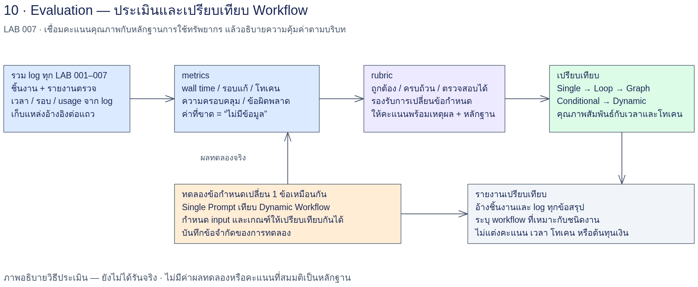

# LAB 007 — Evaluation และเปรียบเทียบ Workflows

## โจทย์

รับบท SA ตรวจคุณภาพงานครัวคุณยายจาก LAB 001–006 และการทดลองของ LAB 007
เปรียบเทียบวิธีทำงานด้วยหลักฐานที่เปิดตรวจได้ รวมเวลา จำนวนรอบ การเรียก และโทเคน
ทดลองข้อกำหนดเปลี่ยนเพียงหนึ่งข้อ แล้วเทียบ Single Prompt กับ Dynamic Workflow อย่างเป็นธรรม

## เป้าหมาย

- อ่าน log เพื่อวัดทรัพยากรโดยไม่ให้ AI เดาตัวเลข
- ใช้ Rubric 5 มิติครบ 7 LAB พร้อม path ของหลักฐานและข้อจำกัดขอบเขต
- แยกผลจริง ค่าประมาณ และไม่มีข้อมูลในทุกข้อสรุป
- ออกแบบการทดลองก่อนรันและนับภาระการวางแผน/ตรวจ/แก้ให้ครบ
- เลือก workflow ตามงานและข้อจำกัด โดยไม่สรุปว่าซับซ้อนกว่าดีกว่าเสมอ

## ความรู้ก่อนเรียน

ทำ LAB 001–006 และเข้าใจความต่างระหว่างแผน เอกสารที่สร้างแล้ว และผลทดสอบจริง
อ่าน [Rubric](../docs/rubric.md), [ต้นฉบับกรณีศึกษา](../docs/case-study-source.md) และผลส่งต่อ LAB 006
ใช้ Terminal, CSV, Markdown และ JSONL ได้; เข้าใจว่า event ไม่จำเป็นต้องเท่าหนึ่ง process

## เวลาโดยประมาณ

วางแผนเรียน 120–150 นาที: metrics 20, Rubric 30, ทดลองข้อเปลี่ยน 45–60 และรายงาน 25–40 นาที
เวลานี้เป็นประมาณการจัดกิจกรรม ไม่ใช่เวลารันจริงหรือหลักฐานว่าทดลองแล้ว
กำหนดเพดานรวมเวลา/โทเคนก่อนทดลอง; Dynamic แก้ได้ไม่เกิน 2 รอบหลังตั้งต้น
Single Prompt ใช้หนึ่งการเรียก ส่วน Dynamic นับทุก phase และทุกการแก้

## User Story ที่ใช้

ประเมิน coverage ครบ 26 US จากต้นฉบับตามขอบเขตชิ้นงานแต่ละ LAB
การทดลองข้อเปลี่ยนจำกัด US-21 และ regression ส่วนที่สัมพันธ์กับการสั่ง/คิว/แสดงข้อความ
US-09/US-14 ใน UI v2 ยังคงเป็น regression เดิม ไม่ใช่ข้อเปลี่ยนใหม่ใน LAB นี้
ข้อกำหนดเปลี่ยนในการทดลองเป็นโจทย์สมมติ ไม่ใช่ reveal ของต้นฉบับแบบ LAB 005

## แผนภาพและสิ่งส่งมอบ



หลักฐานเดิม → metrics → Rubric → ทดลองข้อเปลี่ยนเดียว → ตรวจผลร่วมกัน → รายงาน
ภาพแสดงขั้นตอนที่ต้องทำ ไม่ใช่หลักฐานว่าขั้นตอนเกิดขึ้นแล้ว

- work/metrics.csv และ work/metrics-summary.md ที่สร้างจาก log มีจริง
- work/evidence-index.md และ work/rubric-scores.md พร้อม locator
- snapshot baseline, conditions, ผล single/dynamic ทุกรอบ และ log
- ผลทดสอบด้วยเกณฑ์เดียวกัน ภาพที่มีจริง และรายการข้อบกพร่อง
- work/comparison-report.md พร้อมการจัดประเภทค่าทุกตัวและข้อจำกัด

## จาก LAB 006 สู่การประเมิน

LAB 006 ทำให้เห็น scenario และผล UI แต่ยังไม่ตอบว่าคุณภาพนั้นใช้ทรัพยากรเท่าใด
จำนวนไฟล์หรือความยาวคำตอบไม่ใช่คุณภาพ และจำนวนโทเคนต่ำไม่ยืนยันความถูกต้อง
M1 ตรวจความครบของข้อกำหนดและ AC ที่วัดได้
M2 ตรวจความสอดคล้องและ traceability ของชิ้นงานที่มีในขอบเขต
M3 ตรวจ UI ตาม scenario พร้อมผลจริง ไม่ให้คะแนนจากภาพอย่างเดียว
M4 ตรวจปัญหา สมมติฐาน และการรับมือข้อเปลี่ยนพร้อมเหตุผล
M5 ตรวจความน่าเชื่อถือของการวัด ไม่ให้รางวัลเพียงเพราะรันเร็ว
คะแนน 0 หมายถึงตรวจพบว่าตรงเกณฑ์ระดับ 0; ไม่มีข้อมูลหมายถึงยังให้คะแนนไม่ได้
LAB แรกที่ไม่ได้ผลิต UI อาจไม่มีข้อมูล M3 อย่างมีเหตุผล จึงไม่ควรถูกนับเป็นศูนย์
ขอบเขต LAB ต่างกันต้องแสดงส่วนร่วมก่อนเทียบคะแนนดิบหรือค่าเฉลี่ย
การทดลองคู่เดียวมีความแปรผันของโมเดล ลำดับรัน และความชำนาญของผู้เรียน
ห้ามสรุปว่า workflow ซับซ้อนกว่าดีกว่าเสมอ หรืออ้างความเป็นเหตุจากความสัมพันธ์เพียงคู่เดียว

## วิธีรันร่วมและเก็บหลักฐาน

เปิด Terminal ที่ราก LAB นี้ ใช้ session ใหม่ทุก Prompt และเลือกเครื่องมือเดียวกันเมื่อเทียบผล
คำสั่งต่อไปนี้เป็นคำสั่งให้นักศึกษารัน ไม่ใช่หลักฐานว่ามีการเรียก AI แล้ว
ติดตั้ง Python และ Playwright ตามการเตรียมเครื่องของรายวิชาก่อนเริ่มงาน UI
ใช้ `python3` ของ environment ที่มี `playwright.sync_api`; เครื่องชั้นเรียนอาจเป็น `/opt/venv/bin/python3`

```bash
mkdir -p work
run_prompt() {
  prompt_file="$1"
  run_id="$2"
  run_dir="work/logs/$run_id"
  test -f "$prompt_file" || return 1
  mkdir -p work/logs
  mkdir "$run_dir" || return 1
  cp "$prompt_file" "$run_dir/prompt.md"
  date -u +%FT%TZ > "$run_dir/started-utc.txt"
  codex exec --json -o "$run_dir/response.md" "$(cat "$prompt_file")" \
    < /dev/null > "$run_dir/log.jsonl" 2> "$run_dir/stderr.txt"
  cli_status=$?
  date -u +%FT%TZ > "$run_dir/ended-utc.txt"
  printf '%s\n' "$cli_status" > "$run_dir/exit-code.txt"
  return "$cli_status"
}
```

ทางเลือกเรียก Prompt ด้วย `claude -p "$(cat prompts/<ชื่อไฟล์>.md)"` ใน session ใหม่
หากเลือกทางเลือกนี้ต้องบันทึก log/usage ตามที่เครื่องมือให้จริง ไม่สมมติว่ารูปแบบตรงกับ Codex
เก็บรุ่นเครื่องมือ โมเดล/effort ตามหลักฐาน Input hash และค่า wall time ที่วัดจริงใน metadata ของรอบ
ผลตอบ CLI ไม่ใช่ผลตรวจชิ้นงาน; เปิดไฟล์ output และอ่าน log ว่ามี turn.failed หรือไม่ก่อนใช้งานต่อ
ถ้า CLI ไม่มี usage ให้เขียน “ไม่มีข้อมูล” ไม่เดาจากจำนวนคำหรือบรรทัด
หากรันซ้ำใช้ run_id และ output รุ่นใหม่ทุกครั้ง โดยแก้ path ในสำเนา Prompt ที่เก็บใน work/
ไม่ลบผลเก่าและไม่เขียน output ทับรอบก่อน; Prompt ที่มี placeholder ต้องแทนค่าก่อนเรียก


## ขั้น 7.1 — เก็บ metrics จาก log

### 1. เป้าหมายและ Input

Input คือ log.jsonl ภายใน 00?_LAB_*/reference/**/ และ metadata ในโฟลเดอร์เดียวกัน
เครื่องมืออ่าน reference อย่างเดียวและเขียนผลใน work/; ไม่รัน Prompt และไม่สร้าง log เพิ่ม
ผล reference ไม่ใช่ผลนักศึกษา; ต้องแยกที่มาใน evidence-index และรายงาน
Working directory คือราก LAB 007; ทุก Prompt ใช้ session ใหม่และไม่เห็นผลของอีกวิธีระหว่างทดลอง

### 2. Prompt พร้อมคัดลอก

ขั้นนี้ใช้สคริปต์คำนวณโดยตรง ไม่ต้องเรียก AI เพื่อเดาตัวเลข; ไม่มี Prompt สำหรับคัดลอก

### 3. วิธีรันและเปิดผล

คำสั่ง Terminal ต่อไปนี้เป็นวิธีทำกิจกรรม ไม่ใช่บันทึกว่ามีการรันแล้ว

```bash
python3 tools/collect-metrics.py --help
python3 tools/collect-metrics.py --root .. --out work/metrics.csv --summary work/metrics-summary.md
less work/metrics-summary.md
python3 - <<'READ'
import csv
from pathlib import Path
rows=list(csv.DictReader(Path('work/metrics.csv').open(encoding='utf-8')))
print('จำนวนไฟล์ log ที่พบ:',len(rows))
for row in rows: print(row)
READ
```

### 4. ตัวอย่างผลรันล่วงหน้า

**ผลรันล่วงหน้า 2026-09-14 (UTC): เก็บจาก log จริง 85 ไฟล์ของ LAB 001–006**

ใช้ Python ตามคำสั่งข้างต้น ไม่เรียก AI ในขั้นเก็บ metrics; การประเมิน/ทดลองขั้นถัดไปใช้ Codex CLI 0.154.0, `gpt-6-astra` (ตาม flag ที่สั่ง CLI ไม่ยืนยันกลับ), effort `high`.
ตารางรวมคำนวณจาก [metrics.csv](reference/metrics.csv) โดยสคริปต์เดิม; หากแถวใดขาดข้อมูล ยอดรวมมิตินั้นคง “ไม่มีข้อมูล” ไม่ใช่ 0. แถว LAB 007 ของ snapshot นี้ยังไม่มีการเรียก; ค่าใหม่แยกใน [lab-metrics.csv](reference/lab-metrics.csv).

| lab | calls | failed | input_tokens | cached_input_tokens | output_tokens | reasoning_tokens | duration_s |
| --- | --- | --- | --- | --- | --- | --- | --- |
| 001_LAB_Single_Prompt_Baseline | 3 | 0 | 1512903 | 1342720 | 47163 | 2957 | ไม่มีข้อมูล |
| 002_LAB_Loop_FR_NFR | 5 | 0 | 2341246 | 2087424 | 83388 | 2259 | 1488.91 |
| 003_LAB_Static_Graph_Flow_Structure | 6 | 0 | ไม่มีข้อมูล | ไม่มีข้อมูล | ไม่มีข้อมูล | ไม่มีข้อมูล | ไม่มีข้อมูล |
| 004_LAB_Conditional_Graph_UI_Mockup | 3 | 0 | 4352097 | 4036480 | 54538 | 6260 | ไม่มีข้อมูล |
| 005_LAB_Dynamic_Workflow_Replanning | 22 | 0 | ไม่มีข้อมูล | ไม่มีข้อมูล | ไม่มีข้อมูล | ไม่มีข้อมูล | 5718.442563 |
| 006_LAB_Test_Scenarios_Traceability | 10 | 0 | ไม่มีข้อมูล | ไม่มีข้อมูล | ไม่มีข้อมูล | ไม่มีข้อมูล | 4051.631 |
| 007_LAB_Evaluation_Compare_Workflows | ไม่มีข้อมูล | ไม่มีข้อมูล | ไม่มีข้อมูล | ไม่มีข้อมูล | ไม่มีข้อมูล | ไม่มีข้อมูล | ไม่มีข้อมูล |

ยอดโทเคนรวม LAB 003/005/006 เป็น “ไม่มีข้อมูล” เพราะมี log ที่ไม่มี terminal event หนึ่งไฟล์ต่อ LAB; ยอดรายแถวที่อ่านได้อยู่ใน CSV ข้างต้น

ยอด duration เป็นผลรวมต่อ log ไม่ใช่ wall ของงานขนาน. LAB 003 มีช่วงขนานสะอาด **268.956 s** และช่วงรวม retry **526.073 s** (ประมาณ 526 s เมื่อปัด); ไม่บวกสองช่วงนี้เข้าด้วยกัน. LAB 002 รวม e1-set ที่ FAIL → fix → PASS; LAB 004 รวม demo-fix-path ที่ฉีดข้อบกพร่องเพื่อสาธิต edge=fix แยกจากลูปหลัก.
ไม่มีตารางราคาที่ตรวจสอบได้ จึงระบุต้นทุนเงินว่า **ไม่มีข้อมูล**. การรันครั้งเดียวไม่ใช่ค่าเฉลี่ย และไฟล์ที่ไม่มี terminal event ไม่แสดงต้นทุนครบ.

[เงื่อนไขและข้อจำกัดสคริปต์](reference/step-01-metrics/metrics-notes.md) · [สรุปจากสคริปต์](reference/step-01-metrics/metrics-summary.md) · [ตรวจชนิด event/สำเนา log](reference/step-01-metrics/log-audit.json)

<details>
<summary>แถวค่าจริงคัดจาก CSV ทุก LAB (ตัวเลขไม่เติมมือ)</summary>

| LAB | step | calls | failed | input_tokens | output_tokens | duration_s |
|---|---|---|---|---|---|---|
| 001_LAB_Single_Prompt_Baseline | step-01/round-1 | 1 | 0 | 321508 | 17758 | ไม่มีข้อมูล |
| 001_LAB_Single_Prompt_Baseline | step-02/round-1 | 1 | 0 | 386796 | 12187 | ไม่มีข้อมูล |
| 001_LAB_Single_Prompt_Baseline | step-03/round-1 | 1 | 0 | 804599 | 17218 | ไม่มีข้อมูล |
| 002_LAB_Loop_FR_NFR | e1-set/step-02/round-1 | 1 | 0 | 395674 | 10855 | 200.935 |
| 002_LAB_Loop_FR_NFR | e1-set/step-02/round-2 | 1 | 0 | 679097 | 17352 | 313.925 |
| 002_LAB_Loop_FR_NFR | e1-set/step-03/round-1 | 1 | 0 | 568817 | 29273 | 504.05 |
| 002_LAB_Loop_FR_NFR | step-01/round-1 | 1 | 0 | 320575 | 16797 | 297 |
| 002_LAB_Loop_FR_NFR | step-02/round-1 | 1 | 0 | 377083 | 9111 | 173 |
| 003_LAB_Static_Graph_Flow_Structure | step-01-fanout/customer | 1 | 0 | 426099 | 14491 | 259.970197083 |
| 003_LAB_Static_Graph_Flow_Structure | step-01-fanout/kitchen-front | 1 | 0 | 418604 | 13633 | 252.91237089 |
| 003_LAB_Static_Graph_Flow_Structure | step-01-fanout/manager | 1 | 0 | 426966 | 10398 | 206.347334509 |
| 003_LAB_Static_Graph_Flow_Structure | step-01-fanout/manager/round-1/session | 0 | 0 | ไม่มีข้อมูล | ไม่มีข้อมูล | ไม่มีข้อมูล |
| 003_LAB_Static_Graph_Flow_Structure | step-02-state-machine | 1 | 0 | 697429 | 16391 | 315.688285671 |
| 003_LAB_Static_Graph_Flow_Structure | step-03-structure | 1 | 0 | 750324 | 19623 | 354.064948025 |
| 003_LAB_Static_Graph_Flow_Structure | step-04-merge | 1 | 0 | 1522112 | 20163 | 400.013340799 |
| 004_LAB_Conditional_Graph_UI_Mockup | demo-fix-path/round-2 | 1 | 0 | 270348 | 3895 | ไม่มีข้อมูล |
| 004_LAB_Conditional_Graph_UI_Mockup | review | 1 | 0 | 3252625 | 27473 | ไม่มีข้อมูล |
| 004_LAB_Conditional_Graph_UI_Mockup | round-1 | 1 | 0 | 829124 | 23170 | ไม่มีข้อมูล |
| 005_LAB_Dynamic_Workflow_Replanning | . | 0 | 0 | ไม่มีข้อมูล | ไม่มีข้อมูล | 0.039076 |
| 005_LAB_Dynamic_Workflow_Replanning | session/browser-temp | 0 | 0 | ไม่มีข้อมูล | ไม่มีข้อมูล | 0.003017 |
| 005_LAB_Dynamic_Workflow_Replanning | session/evaluations | 0 | 0 | ไม่มีข้อมูล | ไม่มีข้อมูล | 0.116509 |
| 005_LAB_Dynamic_Workflow_Replanning | session/evaluations/plan-v1 | 0 | 0 | ไม่มีข้อมูล | ไม่มีข้อมูล | 0.047227 |
| 005_LAB_Dynamic_Workflow_Replanning | session/evaluations/plan-v2 | 0 | 0 | ไม่มีข้อมูล | ไม่มีข้อมูล | 0.073929 |
| 005_LAB_Dynamic_Workflow_Replanning | session/evaluations/plan-v3 | 0 | 0 | ไม่มีข้อมูล | ไม่มีข้อมูล | 0.012022 |
| 005_LAB_Dynamic_Workflow_Replanning | session/execution | 0 | 0 | ไม่มีข้อมูล | ไม่มีข้อมูล | 0.042342 |
| 005_LAB_Dynamic_Workflow_Replanning | session/execution/plan-v1/audit-fr-baseline-run | 0 | 0 | ไม่มีข้อมูล | ไม่มีข้อมูล | 0.013906 |
| 005_LAB_Dynamic_Workflow_Replanning | session/execution/plan-v1 | 0 | 0 | ไม่มีข้อมูล | ไม่มีข้อมูล | 0.008257 |
| 005_LAB_Dynamic_Workflow_Replanning | session/execution/plan-v1/test-outline-run | 0 | 0 | ไม่มีข้อมูล | ไม่มีข้อมูล | 0.013333 |
| 005_LAB_Dynamic_Workflow_Replanning | session/execution/plan-v2/flow-v2-run | 0 | 0 | ไม่มีข้อมูล | ไม่มีข้อมูล | 0.013447 |
| 005_LAB_Dynamic_Workflow_Replanning | session/execution/plan-v2/fr-v2-run | 0 | 0 | ไม่มีข้อมูล | ไม่มีข้อมูล | 0.013335 |
| 005_LAB_Dynamic_Workflow_Replanning | session/execution/plan-v2 | 0 | 0 | ไม่มีข้อมูล | ไม่มีข้อมูล | 0.01393 |
| 005_LAB_Dynamic_Workflow_Replanning | session/execution/plan-v2/outline-v2-run | 0 | 0 | ไม่มีข้อมูล | ไม่มีข้อมูล | 0.013737 |
| 005_LAB_Dynamic_Workflow_Replanning | session/execution/plan-v2/ui-v2-run | 0 | 0 | ไม่มีข้อมูล | ไม่มีข้อมูล | 0.013292 |
| 005_LAB_Dynamic_Workflow_Replanning | session/execution/ui-v2-evaluator-runtime/feature-shots | 0 | 0 | ไม่มีข้อมูล | ไม่มีข้อมูล | 0.093093 |
| 005_LAB_Dynamic_Workflow_Replanning | session/execution/ui-v2-evaluator-runtime/features | 0 | 0 | ไม่มีข้อมูล | ไม่มีข้อมูล | 32.187471 |
| 005_LAB_Dynamic_Workflow_Replanning | session/execution/ui-v2-evaluator-runtime | 0 | 0 | ไม่มีข้อมูล | ไม่มีข้อมูล | 0.056159 |
| 005_LAB_Dynamic_Workflow_Replanning | session/execution/ui-v2-evaluator-runtime/regression-shots | 0 | 0 | ไม่มีข้อมูล | ไม่มีข้อมูล | 0.225524 |
| 005_LAB_Dynamic_Workflow_Replanning | session | 0 | 0 | ไม่มีข้อมูล | ไม่มีข้อมูล | 0.132731 |
| 005_LAB_Dynamic_Workflow_Replanning | step-00-input/baseline-filtered | 0 | 0 | ไม่มีข้อมูล | ไม่มีข้อมูล | 0.122037 |
| 005_LAB_Dynamic_Workflow_Replanning | step-00-input/baseline-filtered-v2 | 0 | 0 | ไม่มีข้อมูล | ไม่มีข้อมูล | 0.108685 |
| 005_LAB_Dynamic_Workflow_Replanning | step-00-input/baseline-screen | 0 | 0 | ไม่มีข้อมูล | ไม่มีข้อมูล | 0.945 |
| 005_LAB_Dynamic_Workflow_Replanning | step-00-input/baseline-ui-run | 0 | 0 | ไม่มีข้อมูล | ไม่มีข้อมูล | 16.536 |
| 005_LAB_Dynamic_Workflow_Replanning | step-00-input/baseline-ui-run/shots | 0 | 0 | ไม่มีข้อมูล | ไม่มีข้อมูล | 0.182578 |
| 005_LAB_Dynamic_Workflow_Replanning | step-00-input | 1 | 0 | 419349 | 6139 | 131.811 |
| 005_LAB_Dynamic_Workflow_Replanning | step-00-input/round-2 | 1 | 0 | 402790 | 7110 | 143.06 |
| 005_LAB_Dynamic_Workflow_Replanning | step-00-input/round-3 | 1 | 0 | 594494 | 9773 | 196.94 |
| 005_LAB_Dynamic_Workflow_Replanning | step-01-plan-v1/evaluation | 1 | 0 | 661394 | 10991 | 218.179 |
| 005_LAB_Dynamic_Workflow_Replanning | step-01-plan-v1 | 1 | 0 | 614588 | 14771 | 298.33 |
| 005_LAB_Dynamic_Workflow_Replanning | step-02-execute-v1/audit-fr-baseline/evaluation | 1 | 0 | 3750973 | 22563 | 492.838 |
| 005_LAB_Dynamic_Workflow_Replanning | step-02-execute-v1/audit-fr-baseline | 1 | 0 | 788539 | 11797 | 237.703 |
| 005_LAB_Dynamic_Workflow_Replanning | step-02-execute-v1/draft-test-outline/evaluation | 1 | 0 | 716975 | 8041 | 174.496 |
| 005_LAB_Dynamic_Workflow_Replanning | step-02-execute-v1/draft-test-outline | 1 | 0 | 599870 | 10183 | 205.292 |
| 005_LAB_Dynamic_Workflow_Replanning | step-02-execute-v1 | 0 | 0 | ไม่มีข้อมูล | ไม่มีข้อมูล | 0.00661 |
| 005_LAB_Dynamic_Workflow_Replanning | step-03-reveal-1 | 0 | 0 | ไม่มีข้อมูล | ไม่มีข้อมูล | 0.023672 |
| 005_LAB_Dynamic_Workflow_Replanning | step-04-plan-v2/evaluation | 1 | 0 | 707874 | 8031 | 168.555 |
| 005_LAB_Dynamic_Workflow_Replanning | step-04-plan-v2 | 1 | 0 | 772834 | 16376 | 313.425 |
| 005_LAB_Dynamic_Workflow_Replanning | step-04-plan-v2/round-2 | 1 | 0 | 475042 | 5654 | 133.544 |
| 005_LAB_Dynamic_Workflow_Replanning | step-05-execute-v2/baseline-import | 0 | 0 | ไม่มีข้อมูล | ไม่มีข้อมูล | 0.032292 |
| 005_LAB_Dynamic_Workflow_Replanning | step-05-execute-v2/browser-regression | 0 | 0 | ไม่มีข้อมูล | ไม่มีข้อมูล | 16.19 |
| 005_LAB_Dynamic_Workflow_Replanning | step-05-execute-v2/browser-regression/shots | 0 | 0 | ไม่มีข้อมูล | ไม่มีข้อมูล | 0.186297 |
| 005_LAB_Dynamic_Workflow_Replanning | step-05-execute-v2/draft-test-outline/evaluation | 1 | 0 | 790587 | 8881 | 189.368 |
| 005_LAB_Dynamic_Workflow_Replanning | step-05-execute-v2/draft-test-outline | 1 | 0 | 668503 | 13036 | 248.326 |
| 005_LAB_Dynamic_Workflow_Replanning | step-05-execute-v2/evaluation | 1 | 0 | 1804845 | 16896 | 377.147 |
| 005_LAB_Dynamic_Workflow_Replanning | step-05-execute-v2 | 1 | 0 | 1028656 | 24302 | 460.839 |
| 005_LAB_Dynamic_Workflow_Replanning | step-05-execute-v2/revise-flow/evaluation | 1 | 0 | 903004 | 9260 | 189.817 |
| 005_LAB_Dynamic_Workflow_Replanning | step-05-execute-v2/revise-flow | 1 | 0 | 1275863 | 22594 | 420.492 |
| 005_LAB_Dynamic_Workflow_Replanning | step-05-execute-v2/revise-fr/evaluation | 1 | 0 | 584095 | 8106 | 174.652 |
| 005_LAB_Dynamic_Workflow_Replanning | step-05-execute-v2/revise-fr | 1 | 0 | 465303 | 11264 | 210.751 |
| 005_LAB_Dynamic_Workflow_Replanning | step-05-execute-v2/ui-browser | 0 | 0 | ไม่มีข้อมูล | ไม่มีข้อมูล | 0.038534 |
| 005_LAB_Dynamic_Workflow_Replanning | step-05-execute-v2/ui-browser/round-1 | 0 | 0 | ไม่มีข้อมูล | ไม่มีข้อมูล | 9.273271 |
| 005_LAB_Dynamic_Workflow_Replanning | step-05-execute-v2/ui-browser/round-2 | 0 | 0 | ไม่มีข้อมูล | ไม่มีข้อมูล | 10.279308 |
| 005_LAB_Dynamic_Workflow_Replanning | step-06-reveal-2 | 0 | 0 | ไม่มีข้อมูล | ไม่มีข้อมูล | 0.020942 |
| 005_LAB_Dynamic_Workflow_Replanning | step-07-plan-v3/evaluation | 1 | 0 | 1064474 | 12340 | 262.52 |
| 005_LAB_Dynamic_Workflow_Replanning | step-07-plan-v3 | 1 | 0 | 1062611 | 20613 | 383.28 |
| 006_LAB_Test_Scenarios_Traceability | step-00-input | 1 | 0 | 1349396 | 10475 | 243.023 |
| 006_LAB_Test_Scenarios_Traceability | step-01-fanout/customer | 1 | 0 | 639601 | 24275 | 469.919 |
| 006_LAB_Test_Scenarios_Traceability | step-01-fanout/kitchen-front | 1 | 0 | 1547200 | 26511 | 513.646 |
| 006_LAB_Test_Scenarios_Traceability | step-01-fanout/manager | 1 | 0 | 1701022 | 28648 | 636.925 |
| 006_LAB_Test_Scenarios_Traceability | step-02-coverage/fix-1 | 1 | 0 | 676078 | 18119 | 334.576 |
| 006_LAB_Test_Scenarios_Traceability | step-02-coverage/round-1 | 1 | 0 | 2001703 | 18369 | 383.913 |
| 006_LAB_Test_Scenarios_Traceability | step-02-coverage/round-2 | 1 | 0 | 1972697 | 17770 | 355.925 |
| 006_LAB_Test_Scenarios_Traceability | step-03-merge | 1 | 0 | 886509 | 28339 | 503.494 |
| 006_LAB_Test_Scenarios_Traceability | step-04-nfr-split | 1 | 0 | 793302 | 19824 | 378.177 |
| 006_LAB_Test_Scenarios_Traceability | step-05-ui-run | 1 | 0 | 583279 | 11313 | 218.734 |
| 006_LAB_Test_Scenarios_Traceability | step-05-ui-run/runner | 0 | 0 | ไม่มีข้อมูล | ไม่มีข้อมูล | 13.299 |

</details>

| เกณฑ์ที่คาดหวัง | ผลรันล่วงหน้า | ผลของนักศึกษา |
|---|---|---|
| เก็บค่าจาก log พร้อมแหล่งที่มา | 85 แถว; ครบ 6 LAB; ค่าที่ขาดคงไม่มีข้อมูล | ยังไม่มีข้อมูล รอรันใน work/ ของตนเอง |

### 5. เปรียบเทียบและตรวจผ่าน

- [ ] CSV header เป็น lab,step,calls,failed,input_tokens,cached_input_tokens,output_tokens,reasoning_tokens,duration_s
- [ ] หนึ่งแถวต่อ log.jsonl; step คง path ใต้ reference รวม round เพื่อไม่รวมไฟล์คนละรอบ
- [ ] calls = turn.completed + turn.failed และ failed เป็นส่วนหนึ่งของ calls
- [ ] missing usage ใช้ .get() แล้วรายงานไม่มีข้อมูล พร้อม subtotal ที่สังเกตได้ในข้อสังเกต
- [ ] duration สแกนเฉพาะ metadata ข้าง log; ไม่มีค่าไม่ใช้ศูนย์
- [ ] summary มีหนึ่งแถวต่อ LAB ที่พบ; LAB ไม่มี log แสดงไม่มีข้อมูล
- [ ] ไม่พบ log ให้ CSV มีหัวตารางและรายงานไม่มีข้อมูล ไม่สร้างแถวผลปลอม
ถ้อยคำรายงานยืดหยุ่นได้ แต่ข้อมูลดิบ ขอบเขตเกณฑ์ และที่มาของผลต้องตรวจซ้ำได้

### 6. แก้ไขและส่งต่อ

อ่านข้อสังเกตของไฟล์ผิดรูปแบบก่อนใช้ตัวเลข; แก้ metadata ที่แหล่งหลักฐานด้วยกระบวนการเจ้าของงาน แล้วเก็บผลรอบใหม่; ส่ง metrics และรายการข้อจำกัดไป 7.2
หากขาดหลักฐานให้ส่งข้อค้างต่อด้วยคำว่าไม่มีข้อมูล ไม่เติมตัวเลขแทนและไม่ลบผลก่อนแก้

### นิยามตัววัดและ metadata

| ฟิลด์ | ความหมาย/ข้อจำกัด |
|---|---|
| calls | จำนวน terminal events ที่อ่านได้ ไม่ยืนยันจำนวน CLI processes |
| failed | จำนวน turn.failed ที่อ่านได้ ไม่ได้หักออกจาก calls |
| input_tokens | ผลรวม usage.input_tokens ของ terminal events |
| cached_input_tokens | แยกแสดง ไม่บวกซ้ำกับ input_tokens |
| output_tokens | ผลรวม usage.output_tokens |
| reasoning_tokens | ผลรวม usage.reasoning_output_tokens แยกแสดง ไม่บวกซ้ำ |
| duration_s | เวลาที่ metadata ระบุเป็นวินาที ไม่อนุมานจากขนาด log |
| รอบ | ต้องอ่านประวัติสร้าง–ตรวจ–แก้จากแผน ไม่ใช้จำนวนไฟล์แทน |

อ่าน `meta.json` ก่อน `run-meta.md`; รองรับ key `duration_s`, `wall_time_s`, `wall_s`, `wall_time_seconds`, `duration_seconds`
Markdown รองรับเช่น `duration_s: 12.5` หรือแถว `| duration_s | 12.5 |`
เลข 12.5 ในบรรทัดนี้เป็นตัวอย่างไวยากรณ์สมมติ ไม่ใช่เวลาจากผลรัน
ไม่อ่านเวลาจาก metadata โฟลเดอร์แม่ เพราะอาจเป็นเวลารวมหลายการเรียก
ถ้าขาด usage key ใน terminal event ใด ผลรวมของ key นั้นเป็นไม่มีข้อมูล ไม่ตีความว่าศูนย์
บรรทัด JSON เสียจะแจ้งคำเตือนและนับเฉพาะ event ที่อ่านได้ จึงยังใช้เทียบแบบครบถ้วนไม่ได้
หลาย terminal events ใน log เดียวต้องอธิบายรูปแบบการเรียกก่อนเทียบจำนวน CLI calls
เวลาใน summary เป็นผลรวมต่อ log; งานขนานอาจมีเวลารวมนี้มากกว่า wall time ของกราฟ
script ไม่เก็บ token ของงานใน work/; การทดลองใหม่ให้ตรวจ log ของตนเองแยกในตารางทรัพยากร
ต้นทุนเงินบาท/ดอลลาร์ไม่มีใน usage ต้องใช้หลักฐานค่าใช้จ่ายหรือราคาอ้างอิงพร้อมวันที่เพื่อคำนวณประมาณ
หากไม่มีหลักฐานราคาให้เขียนไม่มีข้อมูล ไม่ใช้ข้อสมมติว่าทุกโทเคนมีราคาเท่ากัน

## ขั้น 7.2 — กรอก Rubric 5 มิติ × 7 LAB

### 1. เป้าหมายและ Input

ใช้ docs/rubric.md และ evidence-index ที่ชี้หลักฐาน Input/Prompt/Output/log/ผลตรวจพร้อมรุ่น; เติมตาราง 35 แถวด้านล่างโดยไม่ให้ AI เดาคะแนน
Working directory คือราก LAB 007; ทุก Prompt ใช้ session ใหม่และไม่เห็นผลของอีกวิธีระหว่างทดลอง

### 2. Prompt พร้อมคัดลอก

ไฟล์ [01-rubric-score.md](prompts/01-rubric-score.md)

```text
# ขั้น 7.2 — ให้คะแนน Rubric จากหลักฐาน
## บริบทและ Input
คุณเป็นผู้ประเมินอิสระ อ่าน ../docs/rubric.md, work/evidence-index.md,
work/metrics.csv, work/metrics-summary.md และไฟล์หลักฐานที่ index ระบุเท่านั้น
## งาน
ประเมิน M1–M5 ระดับ 0–3 ครบ LAB 001–007 ตามขอบเขตจริงแต่ละ LAB
M1 ความครบถ้วนบทบาท/กฎธุรกิจ/FR-NFR/AC ทดสอบได้
M2 ความสอดคล้องและตรวจย้อนกลับ
M3 ความสำเร็จ UI ตาม Test Scenarios
M4 ข้อขัดแย้ง/ตกหล่น/สมมติฐาน/รับมือข้อกำหนดเปลี่ยน
M5 เวลา/รอบ/จำนวนเรียก/ต้นทุนที่วัดได้
ไม่มีหลักฐานหรือมิติไม่เกี่ยวข้อง ให้คะแนนไม่มีข้อมูลพร้อมเหตุผล ไม่ใช่ 0
คะแนน 0 ต้องมีหลักฐานว่าตรงเกณฑ์ 0; ไม่รวมช่องไม่มีข้อมูลเป็นศูนย์ในค่าเฉลี่ย
อ้าง path พร้อม locator เช่นบรรทัด/หัวข้อ/TestID/version; ตรวจว่าไฟล์เปิดได้จริง
อย่าให้คะแนนสูงเพราะจำนวนเรียกน้อย และอย่าเทียบคะแนนดิบของขอบเขตต่างกัน
## Output
สร้าง work/rubric-scores.md ตาราง 35 แถว LAB | มิติ | คะแนน | หลักฐาน | ค่าจริง-ประมาณ-ไม่มีข้อมูล | เหตุผล/ขอบเขต
ตามด้วยข้อบกพร่องและหลักฐานที่ยังต้องเก็บ; คะแนนจาก AI ต้องให้คนตรวจซ้ำ

## กติกา
Working directory: AI_Workflow_Engineering_for_SA/007_LAB_Evaluation_Compare_Workflows/
เริ่ม session ใหม่ ใช้ input จากไฟล์ ไม่ resume ไม่เรียกผู้ช่วยหรือ CLI เพิ่ม
เขียนเฉพาะ work/ และ output รุ่นใหม่ หากมีไฟล์แล้วให้หยุดโดยคงหลักฐานเดิม
ห้ามแก้ reference/, img/, prompts/, ต้นทาง LAB อื่น หรือต้นฉบับข้อกำหนดร้าน
ใช้ข้อมูลจำลองและ placeholder เท่านั้น ไม่ใช้ข้อมูลบัญชีจริง
ตัวเลขเวลา/รอบ/โทเคนมาจาก log ที่มีจริง; ไม่มีให้เขียนไม่มีข้อมูล
ข้อประมาณต้องมีสูตร ที่มา และสมมติฐานแยกจากค่าจริง ไม่ใช้ 0 แทนข้อมูลที่ขาด
ห้ามสรุปว่า workflow ซับซ้อนกว่าดีกว่าเสมอ; ตัดสินตามขอบเขต คุณภาพ และทรัพยากร

```


### 3. วิธีรันและเปิดผล

คำสั่ง Terminal ต่อไปนี้เป็นวิธีทำกิจกรรม ไม่ใช่บันทึกว่ามีการรันแล้ว

```bash
# สร้าง index ใหม่แล้วกรอก path จริง; ใช้ชื่อใหม่ถ้ามีไฟล์เดิม
python3 - <<'INDEX'
from pathlib import Path
with Path('work/evidence-index.md').open('x') as f:
    f.write('# ดัชนีหลักฐาน\n\n| LAB | ที่มา work/reference | ขอบเขต | Input/Prompt/Output/log/check | รุ่น/locator |\n|---|---|---|---|---|\n')
    for n in range(1,8): f.write(f'| {n:03} | ไม่มีข้อมูล | ไม่มีข้อมูล | ไม่มีข้อมูล | ไม่มีข้อมูล |\n')
INDEX
# กรอก index จากไฟล์จริงก่อนให้คะแนน; LAB ที่ไม่มีหลักฐานคงไม่มีข้อมูล
run_prompt prompts/01-rubric-score.md rubric-r0
less work/rubric-scores.md
```

### 4. ตัวอย่างผลรันล่วงหน้า

**ผลรันล่วงหน้า: Codex ประเมินครบ 35 แถว (5 มิติ × 7 LAB)**

ใช้เวลา 284.932 s, input 1288765 tokens, output 14155 tokens ตาม [meta.json](reference/step-02-rubric/meta.json) และ [log.jsonl](reference/step-02-rubric/log.jsonl).
คะแนนตัวเลขเป็น **ประมาณโดย AI**; ไม่มีข้อมูลไม่เท่ากับ 0. ตรวจด้วย Python พบไฟล์จริงครบ 38 path และทุกแถวมีหลักฐาน โดยไม่แก้คะแนน AI. [ผลตรวจ path](reference/step-02-rubric/verification.md) ไม่ใช่การตรวจคะแนนซ้ำโดยคน.

ตัดตอน LAB 006/007 จาก [Rubric เต็ม](reference/rubric-filled.md); path ในตารางสัมพัทธ์จากราก AI_Workflow_Engineering_for_SA/.
LAB 007 เป็น snapshot ก่อนจบการทดลองและรายงาน จึงมีช่องไม่มีข้อมูลตามช่วงเวลาประเมิน; ดูผลที่เกิดภายหลังในรายงานโดยไม่ปรับคะแนนย้อนหลังเอง.

| LAB | มิติ | คะแนน | หลักฐาน | ค่าจริง/ประมาณ/ไม่มีข้อมูล | เหตุผล |
|---|---|---|---|---|---|
| 006 | M1 | 2 | `006_LAB_Test_Scenarios_Traceability/reference/step-03-merge/test-scenarios.md` บรรทัด 3, ดัชนีครบ 26 US; `006_LAB_Test_Scenarios_Traceability/reference/step-04-nfr-split/summary.md` บรรทัด 1–5; `006_LAB_Test_Scenarios_Traceability/reference/step-03-merge/traceability-notes.md` บรรทัด 21–28 | ประมาณโดย AI; จำนวนเอกสารเป็นค่าที่รายงาน | ออกแบบ 114 scenarios ครบสามบทบาท/26 US และแยก functional/NFR 63 แถว คง AC พร้อมทางสำเร็จ/ข้อยกเว้น แต่ oracle ธุรกิจบางส่วนยังขาดและ upstream ห้า US ยังไม่มี active mapping จึงเป็นขั้นต่ำออกแบบ ไม่ใช่วิธีตรวจที่พร้อมตัดสินทุกข้อ |
| 006 | M2 | 2 | `006_LAB_Test_Scenarios_Traceability/reference/step-03-merge/traceability-notes.md` บรรทัด 13–30, 40; `006_LAB_Test_Scenarios_Traceability/reference/step-05-ui-run/ui-run-report.md` บรรทัด 24–45 | ประมาณโดย AI | Traceability ส่วนใหญ่ตาม US/FR/Flow/Screen/TestID ได้และเชื่อมผล 14 fixture ด้วย TestID แต่ US-17/18/22/23/24 มี FR/Flow/Screen MISSING; US-26 ไม่มี Screen ตามขอบเขต CSV ที่แจกแจงผลคูณระดับ US ไม่พิสูจน์ทุกคู่ Flow→Screen รายเหตุการณ์ คงผู้รับผิดชอบ/ช่องว่างและผล fail จึงไม่ถึง 3 |
| 006 | M3 | 1 | `006_LAB_Test_Scenarios_Traceability/reference/step-05-ui-run/ui-test-results.json` ฟิลด์ passed=12, failed=2, skipped=0 และ results.id=TS-US-09-101/TS-US-21-101; `006_LAB_Test_Scenarios_Traceability/reference/step-05-ui-run/ui-run-report.md` บรรทัด 40–55 | ประมาณโดย AI; ผล 12/2/0 เป็นค่าจริงตาม JSON | ผ่าน 12 ตก 2 จาก 14 fixture เส้นทางคืนรายการจบ assertion ไม่สำเร็จเพราะไม่พบ payment-summary-total และครัวเต็มหยุดที่ setup rush-start จึงยังพิสูจน์เส้นทางหลักทั้งชุดไม่ครบ ให้ 1 สำหรับความสำเร็จของการทดสอบ ไม่สรุปว่า logic ธุรกิจสองส่วนเสีย ไม่เปลี่ยน failure เป็น skip/ไม่มีข้อมูล |
| 006 | M4 | 2 | `006_LAB_Test_Scenarios_Traceability/reference/step-02-coverage/decision-log.md` บรรทัด 5–13; `006_LAB_Test_Scenarios_Traceability/reference/step-03-merge/traceability-notes.md` บรรทัด 19–30; `006_LAB_Test_Scenarios_Traceability/reference/step-05-ui-run/ui-run-report.md` หัวข้อ F01 / F02 | ประมาณโดย AI | มีทะเบียนช่องว่าง แก้ coverage หนึ่งรอบจากขั้นต่ำ 19/26→26/26 แล้วหยุด STOP_WITH_GAPS แยกสาเหตุ fixture/ข้อมูลธุรกิจและเสนอผลกระทบการแก้ แต่ F01/F02 ยังไม่แก้และตรวจซ้ำจริง รวมถึง mapping upstream ที่ค้าง จึงยังไม่ครบหลักฐานระดับ 3 |
| 006 | M5 | 2 | `006_LAB_Test_Scenarios_Traceability/reference/metrics.csv` ทั้ง 10 แถว; `006_LAB_Test_Scenarios_Traceability/reference/README.md` บรรทัด 22, 32–36; `006_LAB_Test_Scenarios_Traceability/reference/step-05-ui-run/ui-run-report.md` บรรทัด 20; `007_LAB_Evaluation_Compare_Workflows/reference/step-01-metrics/metrics-summary.md` แถว LAB 006 | ประมาณโดย AI; ผลรวมค่าที่บันทึกเป็นค่าจริง; เงินไม่มีข้อมูล | 10 calls รวมเวลารายเรียก 4,038.332 s, input 12,150,787/output 203,643; browser runner 13.299 s แยก รวมจึงเป็น 4,051.631 s ตามตารางกลาง ไม่ใช่ wall ของ fan-out มีแก้ 1 จากเพดาน 2 รอบและนิยามการนับ แต่ยอด usage กลางยังไม่มีข้อมูลและไม่มีการเทียบเงื่อนไขเดียวกันครบระดับ 3 |
| 007 | M1 | ไม่มีข้อมูล | `007_LAB_Evaluation_Compare_Workflows/reference/change-conditions.md` บรรทัด 5–8; `007_LAB_Evaluation_Compare_Workflows/reference/change-baseline/manifest.md` บรรทัด 8–14; `007_LAB_Evaluation_Compare_Workflows/reference/evidence-index.md` บรรทัด 5 | ไม่มีข้อมูล | มี baseline และเงื่อนไข US-21 N=5→N=3 แต่ยังไม่มี FR/Flow/UI/scenarios หลังข้อเปลี่ยนให้ตรวจความครบ ไม่ใช้ชิ้นงานที่นำเข้ามาแทนผลผลิต LAB 007 |
| 007 | M2 | 2 | `007_LAB_Evaluation_Compare_Workflows/reference/step-01-metrics/metrics-notes.md` บรรทัด 11–25 และตาราง source; `007_LAB_Evaluation_Compare_Workflows/reference/step-01-metrics/metrics-summary.md` นิยามการนับและตารางต่อ LAB; `007_LAB_Evaluation_Compare_Workflows/reference/change-baseline/manifest.md` บรรทัด 8–14 | ประมาณโดย AI | ประเมินเฉพาะความสอดคล้อง/ตรวจย้อนกลับของงานวัดขั้น 7.1 และทะเบียน baseline ที่มีแล้ว: metrics ระบุ lab/step/source และ manifest ระบุ version/hash แต่ยังมีความเสี่ยงนับสำเนาซ้ำและช่วงเวลาต่างขอบเขต ไม่ใช้คะแนนนี้รับรอง traceability ของชิ้นงานทดลองข้อเปลี่ยนที่ยังไม่มี |
| 007 | M3 | ไม่มีข้อมูล | `007_LAB_Evaluation_Compare_Workflows/reference/evidence-index.md` บรรทัด 5; `007_LAB_Evaluation_Compare_Workflows/reference/change-conditions.md` บรรทัด 5–11 | ไม่มีข้อมูล | ยังไม่มีผลรัน UI หลังข้อเปลี่ยนของ Single/Dynamic ใน snapshot ที่อนุญาตอ่าน ข้อกำหนดให้ทดสอบสามรอบเป็นเงื่อนไข ไม่ใช่หลักฐานผ่าน |
| 007 | M4 | ไม่มีข้อมูล | `007_LAB_Evaluation_Compare_Workflows/reference/change-conditions.md` บรรทัด 4–9; `007_LAB_Evaluation_Compare_Workflows/reference/change-baseline/manifest.md` บรรทัด 14; `007_LAB_Evaluation_Compare_Workflows/reference/evidence-index.md` บรรทัด 5 | ไม่มีข้อมูล | เตรียม baseline/แผนก่อนเปลี่ยนและเพดานแล้ว แต่ยังไม่มีแผนหลัง N=3, impact และผลตรวจของสอง workflow จึงยังให้คะแนนการรับมือข้อเปลี่ยนครั้งนี้ไม่ได้ |
| 007 | M5 | ไม่มีข้อมูล | `007_LAB_Evaluation_Compare_Workflows/reference/step-01-metrics/metrics-summary.md` แถว LAB 007; `007_LAB_Evaluation_Compare_Workflows/reference/step-01-metrics/metrics-notes.md` บรรทัด 6–8; `007_LAB_Evaluation_Compare_Workflows/reference/change-conditions.md` บรรทัด 7–11 | ไม่มีข้อมูล | snapshot metrics เก็บก่อนการเรียก AI ของ LAB 007 จึงไม่มี usage/เวลา/รอบของการทดลองนี้ เพดาน 3600 s/8,000,000 tokens ไม่ใช่ค่าที่ใช้จริง และไม่แต่งเวลา/โทเคนของ JOB-7.2 ผู้ทดลองจะอ่านจาก log หลังจบเอง เงินไม่มีข้อมูล |

[Prompt ที่ใช้](reference/step-02-rubric/prompt-used.md) · [สคริปต์ตรวจหลักฐาน](reference/verify-evidence.py)

| เกณฑ์ที่คาดหวัง | ผลรันล่วงหน้า | ผลของนักศึกษา |
|---|---|---|
| 35 แถวและ path ตรวจได้ | 35 แถว; พบ 38 path; รอคนตรวจคะแนน | ยังไม่มีข้อมูล รอประเมินหลักฐานของตนเอง |

### 5. เปรียบเทียบและตรวจผ่าน

- [ ] มีครบ 35 แถวและทุกคะแนนมี path พร้อมตำแหน่งหลักฐาน
- [ ] ใช้ระดับ 0–3 ตาม docs/rubric.md ไม่คิดเกณฑ์ใหม่เอง
- [ ] แยก work ของนักศึกษาจาก reference ของผู้จัดทำ
- [ ] ช่องไม่มีข้อมูลหรือไม่เกี่ยวกับ LAB นั้นไม่ถูกแปลงเป็น 0
- [ ] ผู้เรียนเปิดหลักฐานยืนยันคะแนน AI และบันทึกข้อที่เห็นต่าง
- [ ] LAB 007 ที่ยังทำไม่ครบคงไม่มีข้อมูล แล้วเพิ่ม rubric-scores-v2 หลัง 7.4
ถ้อยคำรายงานยืดหยุ่นได้ แต่ข้อมูลดิบ ขอบเขตเกณฑ์ และที่มาของผลต้องตรวจซ้ำได้

### 6. แก้ไขและส่งต่อ

คะแนนที่ไม่มีหลักฐานให้ถอนเป็นไม่มีข้อมูลก่อน; ส่งตารางที่ผู้เรียนตรวจแล้วพร้อมข้อค้างไปตั้งเงื่อนไข 7.3
หากขาดหลักฐานให้ส่งข้อค้างต่อด้วยคำว่าไม่มีข้อมูล ไม่เติมตัวเลขแทนและไม่ลบผลก่อนแก้

### ตารางบันทึกจาก docs/rubric.md

คะแนนเริ่มไม่มีข้อมูล; ประเภทค่าคือ ค่าจริง / ประมาณ / ไม่มีข้อมูล
คะแนน Rubric เป็นการตัดสินของผู้ตรวจจากหลักฐาน ต้องระบุชื่อบทบาทผู้ตรวจและเหตุผล ไม่ถือเป็นตัววัดอัตโนมัติ

| LAB | มิติ | คะแนน | หลักฐาน | ค่าจริง-ประมาณ-ไม่มีข้อมูล | เหตุผล/ขอบเขต |
|---|---|---|---|---|---|
| 001 | M1 | ไม่มีข้อมูล | ไม่มีข้อมูล | ไม่มีข้อมูล | รอประเมินตามขอบเขตจริง |
| 001 | M2 | ไม่มีข้อมูล | ไม่มีข้อมูล | ไม่มีข้อมูล | รอประเมินตามขอบเขตจริง |
| 001 | M3 | ไม่มีข้อมูล | ไม่มีข้อมูล | ไม่มีข้อมูล | รอประเมินตามขอบเขตจริง |
| 001 | M4 | ไม่มีข้อมูล | ไม่มีข้อมูล | ไม่มีข้อมูล | รอประเมินตามขอบเขตจริง |
| 001 | M5 | ไม่มีข้อมูล | ไม่มีข้อมูล | ไม่มีข้อมูล | รอประเมินตามขอบเขตจริง |
| 002 | M1 | ไม่มีข้อมูล | ไม่มีข้อมูล | ไม่มีข้อมูล | รอประเมินตามขอบเขตจริง |
| 002 | M2 | ไม่มีข้อมูล | ไม่มีข้อมูล | ไม่มีข้อมูล | รอประเมินตามขอบเขตจริง |
| 002 | M3 | ไม่มีข้อมูล | ไม่มีข้อมูล | ไม่มีข้อมูล | รอประเมินตามขอบเขตจริง |
| 002 | M4 | ไม่มีข้อมูล | ไม่มีข้อมูล | ไม่มีข้อมูล | รอประเมินตามขอบเขตจริง |
| 002 | M5 | ไม่มีข้อมูล | ไม่มีข้อมูล | ไม่มีข้อมูล | รอประเมินตามขอบเขตจริง |
| 003 | M1 | ไม่มีข้อมูล | ไม่มีข้อมูล | ไม่มีข้อมูล | รอประเมินตามขอบเขตจริง |
| 003 | M2 | ไม่มีข้อมูล | ไม่มีข้อมูล | ไม่มีข้อมูล | รอประเมินตามขอบเขตจริง |
| 003 | M3 | ไม่มีข้อมูล | ไม่มีข้อมูล | ไม่มีข้อมูล | รอประเมินตามขอบเขตจริง |
| 003 | M4 | ไม่มีข้อมูล | ไม่มีข้อมูล | ไม่มีข้อมูล | รอประเมินตามขอบเขตจริง |
| 003 | M5 | ไม่มีข้อมูล | ไม่มีข้อมูล | ไม่มีข้อมูล | รอประเมินตามขอบเขตจริง |
| 004 | M1 | ไม่มีข้อมูล | ไม่มีข้อมูล | ไม่มีข้อมูล | รอประเมินตามขอบเขตจริง |
| 004 | M2 | ไม่มีข้อมูล | ไม่มีข้อมูล | ไม่มีข้อมูล | รอประเมินตามขอบเขตจริง |
| 004 | M3 | ไม่มีข้อมูล | ไม่มีข้อมูล | ไม่มีข้อมูล | รอประเมินตามขอบเขตจริง |
| 004 | M4 | ไม่มีข้อมูล | ไม่มีข้อมูล | ไม่มีข้อมูล | รอประเมินตามขอบเขตจริง |
| 004 | M5 | ไม่มีข้อมูล | ไม่มีข้อมูล | ไม่มีข้อมูล | รอประเมินตามขอบเขตจริง |
| 005 | M1 | ไม่มีข้อมูล | ไม่มีข้อมูล | ไม่มีข้อมูล | รอประเมินตามขอบเขตจริง |
| 005 | M2 | ไม่มีข้อมูล | ไม่มีข้อมูล | ไม่มีข้อมูล | รอประเมินตามขอบเขตจริง |
| 005 | M3 | ไม่มีข้อมูล | ไม่มีข้อมูล | ไม่มีข้อมูล | รอประเมินตามขอบเขตจริง |
| 005 | M4 | ไม่มีข้อมูล | ไม่มีข้อมูล | ไม่มีข้อมูล | รอประเมินตามขอบเขตจริง |
| 005 | M5 | ไม่มีข้อมูล | ไม่มีข้อมูล | ไม่มีข้อมูล | รอประเมินตามขอบเขตจริง |
| 006 | M1 | ไม่มีข้อมูล | ไม่มีข้อมูล | ไม่มีข้อมูล | รอประเมินตามขอบเขตจริง |
| 006 | M2 | ไม่มีข้อมูล | ไม่มีข้อมูล | ไม่มีข้อมูล | รอประเมินตามขอบเขตจริง |
| 006 | M3 | ไม่มีข้อมูล | ไม่มีข้อมูล | ไม่มีข้อมูล | รอประเมินตามขอบเขตจริง |
| 006 | M4 | ไม่มีข้อมูล | ไม่มีข้อมูล | ไม่มีข้อมูล | รอประเมินตามขอบเขตจริง |
| 006 | M5 | ไม่มีข้อมูล | ไม่มีข้อมูล | ไม่มีข้อมูล | รอประเมินตามขอบเขตจริง |
| 007 | M1 | ไม่มีข้อมูล | ไม่มีข้อมูล | ไม่มีข้อมูล | รอประเมินตามขอบเขตจริง |
| 007 | M2 | ไม่มีข้อมูล | ไม่มีข้อมูล | ไม่มีข้อมูล | รอประเมินตามขอบเขตจริง |
| 007 | M3 | ไม่มีข้อมูล | ไม่มีข้อมูล | ไม่มีข้อมูล | รอประเมินตามขอบเขตจริง |
| 007 | M4 | ไม่มีข้อมูล | ไม่มีข้อมูล | ไม่มีข้อมูล | รอประเมินตามขอบเขตจริง |
| 007 | M5 | ไม่มีข้อมูล | ไม่มีข้อมูล | ไม่มีข้อมูล | รอประเมินตามขอบเขตจริง |

## ขั้น 7.3 — ทดลองข้อกำหนดเปลี่ยนหนึ่งข้อ Single Prompt เทียบ Dynamic

### 1. เป้าหมายและ Input

โจทย์สมมติเพื่อทดลอง ไม่ใช่ต้นฉบับ: เปลี่ยนเฉพาะค่าเพดานทดสอบ US-21 จาก N=5 เป็น N=3
คงหน้าต่าง 15 นาทีที่เริ่ม 00/15/30/45 และทดสอบ 3 จาก 3 รอบเดิม ไม่เพิ่มเงื่อนไขปฏิเสธออเดอร์
ข้อความข้อเปลี่ยนเดียวกันอยู่ในทั้งสอง Prompt และทั้งสองวิธีได้รับ PREV_PLAN เดียวกัน
ใช้ baseline FR/Flow/UI/scenarios เดียวกัน เก็บ hash และห้ามฝ่ายใดเห็นผลอีกฝ่ายก่อนจบ
Single ทำทุกชิ้นงานในหนึ่งเรียก; Dynamic แยก plan→execute→ตรวจสคริปต์→evaluate แล้ว replan เมื่อจำเป็น
เพดานรวมเวลา/โทเคนเหมือนกันทั้งสองวิธี; การตั้งเพดานไม่ได้บังคับว่าจะต้องใช้จนหมด
Working directory คือราก LAB 007; ทุก Prompt ใช้ session ใหม่และไม่เห็นผลของอีกวิธีระหว่างทดลอง

### 2. Prompt พร้อมคัดลอก

ไฟล์ [02-change-single-prompt.md](prompts/02-change-single-prompt.md)

```text
# ขั้น 7.3 — ทดลองแบบ Single Prompt
## ข้อกำหนดเปลี่ยน
โจทย์สมมติเพื่อทดลอง ไม่ใช่ต้นฉบับ: เปลี่ยนเกณฑ์ US-21 เฉพาะค่าเพดานที่ใช้ทดสอบจาก N=5 เป็น N=3 โดยคงหน้าต่าง 15 นาทีที่เริ่มนาที 00/15/30/45 และการทดสอบ 3 จาก 3 รอบเดิม; เมื่อถึง N ต้องแสดง “ครัวเต็ม รอประมาณ X นาที” ก่อนยืนยัน โดยไม่เพิ่มกฎปฏิเสธออเดอร์
## Input และการควบคุมการทดลอง
อ่าน work/change/baseline/manifest.md, fr-nfr-v2.md, flow-v2.md, ui-mockup-v2.html,
ui-scenarios.json ภายใต้ work/change/baseline/ และ work/change/conditions.md
แผนก่อนเปลี่ยนที่ใช้เป็น baseline ของทั้งสองวิธี:
{{PREV_PLAN}}
อ่านสัญญา UI และต้นฉบับเฉพาะ path ที่ baseline manifest ระบุ
## งาน
ทำการวิเคราะห์ผลกระทบและผลิตชิ้นงานทั้งหมดในคำขอเดียว ห้ามแบ่งเรียก Planner/Executor/Evaluator เพิ่ม
ใช้ input/เกณฑ์/โมเดล/effort/เพดานรวมเดียวกับ Dynamic; ไม่เห็นผลของอีกวิธี
แก้ FR, Flow, UI และ scenarios ให้ตรงข้อเปลี่ยนเดียวข้างต้น พร้อม regression ส่วนเดิม
คง AC อื่นและรหัสเดิม; fixture สมมติต้องติดป้ายและไม่ส่งกลับเป็นต้นฉบับ
## Output
สร้าง work/change/single/fr-nfr-v3.md, flow-v3.md, ui-mockup-v3.html, ui-scenarios-v3.json
สร้าง work/change/single/impact.md ระบุส่วนเปลี่ยน/ใช้ซ้ำ/ต้องตรวจใหม่และข้อค้าง
ยังไม่อ้างว่ารัน UI ผ่าน; ผู้ทดลองต้องรันสคริปต์เดียวกันภายนอกภายหลัง

## กติกา
Working directory: AI_Workflow_Engineering_for_SA/007_LAB_Evaluation_Compare_Workflows/
เริ่ม session ใหม่ ใช้ input จากไฟล์ ไม่ resume ไม่เรียกผู้ช่วยหรือ CLI เพิ่ม
เขียนเฉพาะ work/ และ output รุ่นใหม่ หากมีไฟล์แล้วให้หยุดโดยคงหลักฐานเดิม
ห้ามแก้ reference/, img/, prompts/, ต้นทาง LAB อื่น หรือต้นฉบับข้อกำหนดร้าน
ใช้ข้อมูลจำลองและ placeholder เท่านั้น ไม่ใช้ข้อมูลบัญชีจริง
ตัวเลขเวลา/รอบ/โทเคนมาจาก log ที่มีจริง; ไม่มีให้เขียนไม่มีข้อมูล
ข้อประมาณต้องมีสูตร ที่มา และสมมติฐานแยกจากค่าจริง ไม่ใช้ 0 แทนข้อมูลที่ขาด
ห้ามสรุปว่า workflow ซับซ้อนกว่าดีกว่าเสมอ; ตัดสินตามขอบเขต คุณภาพ และทรัพยากร

```

ไฟล์ [03-change-dynamic.md](prompts/03-change-dynamic.md)

```text
# ขั้น 7.3 — ทดลองแบบ Dynamic Workflow
## ข้อกำหนดเปลี่ยน
โจทย์สมมติเพื่อทดลอง ไม่ใช่ต้นฉบับ: เปลี่ยนเกณฑ์ US-21 เฉพาะค่าเพดานที่ใช้ทดสอบจาก N=5 เป็น N=3 โดยคงหน้าต่าง 15 นาทีที่เริ่มนาที 00/15/30/45 และการทดสอบ 3 จาก 3 รอบเดิม; เมื่อถึง N ต้องแสดง “ครัวเต็ม รอประมาณ X นาที” ก่อนยืนยัน โดยไม่เพิ่มกฎปฏิเสธออเดอร์
## Input และการควบคุมการทดลอง
อ่าน work/change/baseline/manifest.md, fr-nfr-v2.md, flow-v2.md, ui-mockup-v2.html,
ui-scenarios.json ภายใต้ work/change/baseline/ และ work/change/conditions.md
แผนก่อนเปลี่ยนที่ใช้เป็น baseline ของทั้งสองวิธี:
{{PREV_PLAN}}
PHASE = {{PHASE}}; ROUND = {{ROUND}}
อ่านผลก่อนหน้าจาก work/change/dynamic/ ตาม dependency ของ PHASE เท่านั้น ไม่อ่านผล single
## งาน
PHASE=plan: สร้าง plan-round-<ROUND>.md มี task id, dependency, inputs, outputs, owner, state และ stop rule
แสดงแผนเดิม -> ข้อมูลใหม่ -> งานเพิ่ม/แยก/ยกเลิก/จัดลำดับ -> ชิ้นงานกระทบ -> ส่วนใช้ซ้ำ/ตรวจใหม่
รอบ 0 วางแผนจากข้อเปลี่ยน; รอบ 1/2 ใช้ผล evaluate ก่อนหน้าเป็น feedback และบันทึก diff แผน
PHASE=execute: อ่านแผนรอบนี้ แล้วผลิต fr-nfr-v3.md, flow-v3.md, ui-mockup-v3.html,
ui-scenarios-v3.json ใน work/change/dynamic/round-<ROUND>/ พร้อม execution.md ตาม dependency
PHASE=evaluate: อ่านแผน/ผล execute/ผลสคริปต์ tests.json ของรอบนี้ ตรวจข้อเปลี่ยนเดียวและ regression
เขียน evaluation-round-<ROUND>.md ระบุ COMPLETE, REPLAN หรือ STOP_WITH_GAPS พร้อมหลักฐาน
หนึ่งการเรียกทำหนึ่ง PHASE เท่านั้น; ผู้ทดลองเป็นผู้เรียก phase ถัดไป ไม่ให้โมเดลเรียกตัวเอง
REPLAN เมื่อพบข้อบกพร่องที่แก้ได้; หยุดเมื่อครบเกณฑ์ เพดานแก้ 2 รอบ งบหมด หรือข้อเดิมไม่คืบ
## Output
เขียนไฟล์ใหม่ภายใต้ work/change/dynamic/ ตาม PHASE/ROUND ไม่ทับแผน/ผลก่อนหน้า
รักษา AC อื่นและรหัสเดิม; เปลี่ยนแผน AI ไม่ใช่เปลี่ยนสถานะออเดอร์
นับทุกการเรียกของ plan/execute/evaluate/แก้ในต้นทุนรวม ไม่ซ่อนค่า orchestration

## กติกา
Working directory: AI_Workflow_Engineering_for_SA/007_LAB_Evaluation_Compare_Workflows/
เริ่ม session ใหม่ ใช้ input จากไฟล์ ไม่ resume ไม่เรียกผู้ช่วยหรือ CLI เพิ่ม
เขียนเฉพาะ work/ และ output รุ่นใหม่ หากมีไฟล์แล้วให้หยุดโดยคงหลักฐานเดิม
ห้ามแก้ reference/, img/, prompts/, ต้นทาง LAB อื่น หรือต้นฉบับข้อกำหนดร้าน
ใช้ข้อมูลจำลองและ placeholder เท่านั้น ไม่ใช้ข้อมูลบัญชีจริง
ตัวเลขเวลา/รอบ/โทเคนมาจาก log ที่มีจริง; ไม่มีให้เขียนไม่มีข้อมูล
ข้อประมาณต้องมีสูตร ที่มา และสมมติฐานแยกจากค่าจริง ไม่ใช้ 0 แทนข้อมูลที่ขาด
ห้ามสรุปว่า workflow ซับซ้อนกว่าดีกว่าเสมอ; ตัดสินตามขอบเขต คุณภาพ และทรัพยากร

```


### 3. วิธีรันและเปิดผล

คำสั่ง Terminal ต่อไปนี้เป็นวิธีทำกิจกรรม ไม่ใช่บันทึกว่ามีการรันแล้ว

```bash
# ตรวจว่ามี input จริงก่อน; previous-plan.md คือแผนล่าสุดที่มีอยู่จริงจาก LAB 005
# คัดลอกแผนที่เลือกเป็น work/change/previous-plan.md และใส่ที่มา/hash ใน manifest
mkdir -p work/change/baseline
cp -n ../006_LAB_Test_Scenarios_Traceability/work/source/fr-nfr-v2.md work/change/baseline/
cp -n ../006_LAB_Test_Scenarios_Traceability/work/source/flow-v2.md work/change/baseline/
cp -n ../006_LAB_Test_Scenarios_Traceability/work/source/ui-mockup-v2.html work/change/baseline/
cp -n ../006_LAB_Test_Scenarios_Traceability/input/ui-scenarios.json work/change/baseline/
# ถ้า LAB 006 ใช้ JSON ที่แก้ selector ให้ใช้รุ่นนั้นแทนพร้อมที่มา
sha256sum work/change/baseline/*
# สร้างเกณฑ์ร่วมก่อนผลิตผล; อ่าน JSON ที่ได้และคง hash ไว้ใน conditions
python3 - <<'TESTS'
import copy, json
from pathlib import Path
src=Path('work/change/baseline/ui-scenarios.json')
data=json.loads(src.read_text())
scenarios=data['scenarios'] if isinstance(data,dict) else data
capacity=next(s for s in scenarios if s['id']=='TS-US-21-101')
steps=copy.deepcopy(capacity['steps'])
limit=next(st for st in steps if st['testid']=='capacity-limit')
limit['value']='3'
# fixture เดิมมีส่ง 5 ครั้งด้วยสาม action: เลือก m01, เพิ่ม, ยืนยัน
submit_positions=[i for i,st in enumerate(steps) if st['action']=='click' and st['testid']=='btn-submit-order']
assert len(submit_positions)==5, 'fixture ต่างจากตัวอย่าง: ตรวจและปรับด้วยคนก่อน'
# แยก setup, order หนึ่งใบ, ส่วนเตรียมใบถัดไป+assertions
start=submit_positions[0]-2
setup=steps[:start]
order=steps[start:submit_positions[0]+1]
tail=steps[submit_positions[-1]+1:]
assert [st['testid'] for st in order]==['menu-item-m01','btn-add-item','btn-submit-order']
shared=[copy.deepcopy(s) for s in scenarios if s['us']!='US-21']
for round_index in range(3):
    for count in (2,3):
        ending=copy.deepcopy(tail)
        if count==2:
            ending=[st for st in ending if st['testid']!='capacity-message']
            ending.append({'action':'expect_hidden','testid':'capacity-message'})
        shared.append({'id':f'TS-US-21-{101+round_index*2+(count-2)}',
            'us':'US-21','automation':'auto',
            'scenario':f'โจทย์สมมติ N=3; ยืนยันแล้ว {count} ใบ; รอบ {round_index+1}',
            'steps':copy.deepcopy(setup+order*count)+ending})
with Path('work/change/shared-tests.json').open('x') as f:
    json.dump({'scenarios':shared},f,ensure_ascii=False,indent=2)
TESTS
sha256sum work/change/shared-tests.json
# กรอก manifest.md และ conditions.md ตามแบบด้านล่างก่อน render
python3 - <<'RENDER'
from pathlib import Path
prev=Path('work/change/previous-plan.md').read_text()
assert Path('work/change/baseline/manifest.md').is_file()
assert Path('work/change/conditions.md').is_file()
for name,out in [('02-change-single-prompt.md','single'),('03-change-dynamic.md','dynamic')]:
    prompt=Path('prompts',name).read_text().replace('{{PREV_PLAN}}',prev)
    with Path(f'work/change/{out}-prompt.md').open('x') as f: f.write(prompt)
RENDER
# Single Prompt ใช้หนึ่งเรียก
run_prompt work/change/single-prompt.md change-single-r0
# Dynamic หนึ่ง phase ต่อการเรียก; ตัวอย่างรอบตั้งต้น
sed 's/{{PHASE}}/plan/g; s/{{ROUND}}/0/g' work/change/dynamic-prompt.md > work/change/dynamic-plan-r0.md
run_prompt work/change/dynamic-plan-r0.md change-dynamic-plan-r0
sed 's/{{PHASE}}/execute/g; s/{{ROUND}}/0/g' work/change/dynamic-prompt.md > work/change/dynamic-execute-r0.md
run_prompt work/change/dynamic-execute-r0.md change-dynamic-execute-r0
# เกณฑ์ร่วมเตรียมก่อนรันทั้งสองวิธี: work/change/shared-tests.json ตามรายละเอียดด้านล่าง
python3 ../006_LAB_Test_Scenarios_Traceability/tests/run-scenarios.py \
  --html work/change/single/ui-mockup-v3.html --scenarios work/change/shared-tests.json \
  --out work/change/single/tests.json --shots work/change/single/shots --allow-fail
python3 ../006_LAB_Test_Scenarios_Traceability/tests/run-scenarios.py \
  --html work/change/dynamic/round-0/ui-mockup-v3.html --scenarios work/change/shared-tests.json \
  --out work/change/dynamic/round-0/tests.json --shots work/change/dynamic/round-0/shots --allow-fail
sed 's/{{PHASE}}/evaluate/g; s/{{ROUND}}/0/g' work/change/dynamic-prompt.md > work/change/dynamic-evaluate-r0.md
run_prompt work/change/dynamic-evaluate-r0.md change-dynamic-evaluate-r0
less work/change/dynamic/evaluation-round-0.md
less work/change/single/impact.md
```

### 4. ตัวอย่างผลรันล่วงหน้า

**ผลรันล่วงหน้า: ทั้งสองวิธีผลิตชิ้นงานจริง; ยังไม่ผ่านครบ — STOP_WITH_GAPS**

ทั้งสองใช้ข้อเปลี่ยน US-21 จาก N=5 เป็น N=3 และ plan-v3 ของ LAB 005 เดียวกัน. Single รันหนึ่งครั้ง; Dynamic รัน plan → execute → ตรวจ UI → evaluate ครบรอบ 0. ข้อกำหนดที่เหลือคงเดิมตามการเทียบแถว US/FR/NFR.
UI ชุดร่วมผ่าน 18 ตก 1 ทั้งสองวิธี; TS-US-09-101 ไม่พบ payment-summary-total. N−1/N ผ่าน 6 fixture ใน 3 รอบอิสระ แต่ยังไม่มีผลครบเรื่องรอยต่อเวลาและการยืนยันใบถัดไปหลังคำเตือน จึงไม่เปลี่ยนป้ายเป็นผ่านทั้งหมด.

| เกณฑ์ | Single Prompt | Dynamic | แหล่งค่า (จริง/ประมาณ/ไม่มีข้อมูล) |
|---|---|---|---|
| ข้อเปลี่ยน | US-21 N=5 → N=3; 15 นาที; 00/15/30/45; 3 จาก 3 รอบ; เตือนก่อนยืนยัน ไม่เพิ่มกฎปฏิเสธ | เหมือน Single ทุกคำในส่วนข้อกำหนดเปลี่ยน | จริง: prompt-used.md ทั้งสองขั้น |
| จำนวนเรียก AI | 1 | 3 (plan + execute + evaluate) | จริง: terminal events ของทุก phase |
| จำนวนรอบทดลอง | 1 การเรียก; ไม่มีการแก้ซ้ำ | round 0; ไม่มี replan/รอบแก้ | จริง: log/meta และ evaluation-round-0.md |
| input_tokens | 1420196 | 1959100 | จริง: usage; รวมทุก phase |
| output_tokens | 20384 | 35578 | จริง: usage; รวมทุก phase |
| โทเคนรวม input+output | 1440580 | 1994678 | จริง: บวกสองคอลัมน์ข้างต้น ไม่บวก cache ซ้ำ |
| เวลา AI รวม (s) | 411.758 | 707.744 | จริง: ผลรวม wall ของ subprocess รายเรียก ไม่ใช่ wall แบบขนาน |
| เวลา UI runner (s) | 15.805 | 16.257 | จริง: ui-run-meta.json แยกจาก AI |
| เวลา AI + UI runner (s) | 427.563 | 724.001 | จริง: ผลรวมช่วงที่วัด แยกจากเวลารอระหว่างขั้น |
| ช่วงเริ่ม AI ถึงจบตรวจ (s) | 464.927 | 779.935 | จริง: timestamps; รวมช่องว่างระหว่างขั้น; Single จบที่ script, Dynamic จบ evaluate |
| จำนวนไฟล์หลักที่กระทบ | 4: FR, Flow, UI, scenarios | 4: FR, Flow, UI, scenarios | จริง: เทียบไฟล์กับ baseline; ไม่นับเอกสารกำกับ |
| ไฟล์ที่ AI ผลิตรวมเอกสารกำกับ | 8: 4 หลัก + impact + scenario Markdown 3 | 9: 4 หลัก + execution + plan 3 ไฟล์ + evaluation | จริง: นับไฟล์ที่มีอยู่ ไม่รวม log/meta/summary/ภาพ/รายงานตรวจภายนอก |
| แถวข้อกำหนดที่ใช้ซ้ำ | US/FR/NFR นอก US-21/FR-21 คงเดิมทุกแถว | เหมือน Single | จริง: เทียบข้อความทุกแถวรวม ID ที่ซ้ำใน traceability |
| ส่วน UI ที่ใช้ซ้ำ | selectors, role, reset, capacity window/count/notice และ submit | เหมือน Single | ประมาณด้านความหมายจาก diff/source; ไม่ใช่การรับรองทุกพฤติกรรม |
| ผล Shared UI | ผ่าน 18 / ตก 1 / skip 0 จาก 19 | ผ่าน 18 / ตก 1 / skip 0 จาก 19 | จริง: tests.json; ใช้ shared-tests-v2.json hash เดียวกัน |
| N−1/N ในสามรอบ | 6/6 fixture ผ่าน | 6/6 fixture ผ่าน | จริง: TS-US-21-101–106; ยังไม่ครบทุก AC US-21 |
| ข้อผิดพลาด UI ที่พบ | 1: TS-US-09-101 ไม่พบ payment-summary-total | 1: TS-US-09-101 ไม่พบ payment-summary-total | จริง: runner assertions; ต้องแยก UI/fixture mismatch ต่อ |
| รูปแบบ scenarios ที่ AI ผลิต | ดัชนี role→Markdown ไม่ใช่ executable action array | steps เป็นข้อความ ไม่ตรง runner action/testid | จริง: JSON และโค้ด runner; ไม่ใช้ไฟล์เหล่านี้แทนชุดร่วมที่ผู้ทดลองตรึง |
| ข้อค้างด้านเกณฑ์ | รอยต่อ clock 00/15/30/45; ยืนยันใบถัดไปหลังเต็ม; server/LAN และอื่น ๆ | เหมือนกัน พร้อมทะเบียน gap จาก evaluate | ไม่มีข้อมูล runtime ของเกณฑ์ที่ไม่ได้รัน; แผนหรือ source ไม่ใช่ผลผ่าน |
| สถานะรวม | STOP_WITH_GAPS ตามผลตรวจภายนอก | STOP_WITH_GAPS ตาม evaluate | จริง: มี regression ตกและเกณฑ์ไม่ครบ |
| ต้นทุนเงิน | ไม่มีข้อมูล | ไม่มีข้อมูล | ไม่มีข้อมูล: ไม่มีตารางราคาที่ตรวจสอบได้ |
| ผลของนักศึกษา | ไม่มีข้อมูล | ไม่มีข้อมูล | ไม่มีข้อมูล: ชุดนี้เป็น reference |

[ตารางเปรียบเทียบเต็มและแหล่งค่ารายการ](reference/change-compare.md) · [baseline/hash](reference/change-baseline/manifest.md) · [ข้อจำกัดชุดทดสอบร่วม](reference/shared-tests-notes.md)

- Single: [Prompt](reference/step-03-change-single/prompt-used.md), [FR ฉบับแก้](reference/step-03-change-single/fr-nfr-v3.md), [impact](reference/step-03-change-single/impact.md), [ผล UI](reference/step-03-change-single/tests.json), [log](reference/step-03-change-single/log.jsonl), [meta](reference/step-03-change-single/meta.json).
- Dynamic: [Prompt plan](reference/step-04-change-dynamic/prompt-used.md), [plan-v4.json](reference/step-04-change-dynamic/plan-v4.json), [impact](reference/step-04-change-dynamic/impact-analysis-change.md), [ผล execute](reference/step-04-change-dynamic/round-0/execution.md), [ผล UI](reference/step-04-change-dynamic/round-0/tests.json), [evaluate](reference/step-04-change-dynamic/evaluation-round-0.md).
- log Dynamic ครบทุก phase: [plan](reference/step-04-change-dynamic/log.jsonl), [execute](reference/step-04-change-dynamic/execute/log.jsonl), [evaluate](reference/step-04-change-dynamic/evaluate/log.jsonl).

[หลักฐานเทียบไฟล์](reference/change-artifact-check.json) ใช้ hash รุ่นรัน; [ข้อมูลรุ่นเผยแพร่](reference/publication-meta.json) ระบุการปรับชื่อ key/ถ้อยคำของ JSON หลังรันและที่เก็บข้อความเดิม. ไม่เปลี่ยน FR/Flow/UI, ผลตรวจ, คะแนน หรือค่าทรัพยากร.

| เกณฑ์ที่คาดหวัง | ผลรันล่วงหน้า | ผลของนักศึกษา |
|---|---|---|
| ข้อเปลี่ยนเดียว/ชิ้นงานหลักครบ | ครบ 4 ชิ้นทั้งสอง; input scenario มีข้อจำกัดร่วม | ยังไม่มีข้อมูล รอทดลองเอง |
| regression และขอบเขตเวลา US-21 ครบ | ยังไม่ผ่านครบ: UI ตก 1 และ clock/ยืนยันหลังเต็มยังไม่วัดครบ | รอกรอกผล/ข้อค้างโดยไม่เติม PASS |

### 5. เปรียบเทียบและตรวจผ่าน

- [ ] ข้อเปลี่ยนทั้งสอง Prompt ตรงกันทุกคำและ PREV_PLAN เป็น snapshot เดียวกัน
- [ ] ตั้งเกณฑ์ร่วมก่อนอ่านผล; ไม่ให้ผู้ผลิตแต่ละวิธีเลือก test ที่ตนผ่านเอง
- [ ] ตรวจ boundary N-1/N ในหน้าต่าง 15 นาที และคงเกณฑ์ 3 จาก 3 รอบของข้อสมมติ
- [ ] ข้ออื่นและ selector เดิมไม่เปลี่ยน; มี regression ที่เกี่ยวกับการสั่ง/คิว/ทำไม่ได้
- [ ] นับทุก phase ของ Dynamic รวมวางแผน ประเมิน และแก้ ไม่เทียบเฉพาะ execute
- [ ] REPLAN ต้องมีข้อบกพร่องและเปลี่ยนงาน/dependency จริง; ไม่คืบหรือครบ 2 รอบให้หยุด
- [ ] ผลชุดแรกของทั้งสองวิธีอยู่ครบ แม้ Dynamic มีโอกาสแก้ภายในงบ
ถ้อยคำรายงานยืดหยุ่นได้ แต่ข้อมูลดิบ ขอบเขตเกณฑ์ และที่มาของผลต้องตรวจซ้ำได้

### 6. แก้ไขและส่งต่อ

ถ้า Dynamic ต้องแก้ ให้ render ROUND=1 หรือ 2 และรัน plan/execute/tests/evaluate ไปตาม dependency ด้วย output รุ่นใหม่; Single ที่ผิดคงเป็นผลหนึ่งเรียก ส่งหลักฐานทั้งหมดไป 7.4
หากขาดหลักฐานให้ส่งข้อค้างต่อด้วยคำว่าไม่มีข้อมูล ไม่เติมตัวเลขแทนและไม่ลบผลก่อนแก้

### แบบตั้งเงื่อนไขก่อนทดลอง

สร้าง work/change/conditions.md และ work/change/baseline/manifest.md โดยกรอกข้อมูลที่ทราบจริงตามตารางนี้
ใช้แผนเดิมจาก LAB 005 ที่เลือกจริงทั้งสองวิธี; ถ้าไม่มีแผนอย่าแต่งย้อนหลัง ให้หยุดการทดลองส่วนพึ่งแผน
คัดแผนรุ่นนั้นเป็น work/change/previous-plan.md และบันทึก path ต้นทาง/hash
manifest ต้องระบุ source path และ hash ของทุก baseline รวมสัญญา UI เดิมและส่วนขยาย v2
ผลอ้างอิงที่คัดมาถือเป็น Input จาก reference ไม่ใช่ผลที่นักศึกษาผลิตเอง

| เงื่อนไข | สิ่งที่ต้องบันทึกก่อนรัน |
|---|---|
| Input | path/hash/version เดียวกันทั้งสองวิธี |
| เครื่องมือ | รุ่นจริง โมเดล/effort ตามการตั้งค่าและหลักฐาน |
| เวลา | นิยามเริ่ม/จบและเพดานรวมที่ผู้เรียนเลือก |
| โทเคน/งบ | เพดานรวมเท่ากัน; ถ้าเครื่องมือไม่วัดให้บอกควบคุมไม่ได้ |
| จำนวนเรียก | Single 1; Dynamic ตาม phase ภายในเพดานแก้ 2 รอบ |
| ลำดับ | ระบุลำดับทดลอง; ทดลองเพิ่มภายหลังอาจสลับลำดับเพื่อดูผล |
| ผู้ตรวจ | ใช้คน/Prompt/เกณฑ์เดียวกันและไม่เห็นชื่อวิธีเมื่อประเมินได้ |
| เกณฑ์ร่วม | shared-tests.json ที่กำหนดก่อนสร้างผลทั้งสองวิธี |
| ระบบจริง | ยังไม่วัด LAN/concurrency/เวลา X ที่มีหลักฐาน server |

ก่อนเรียกทั้งสอง Prompt ให้สร้าง shared-tests.json จาก baseline JSON และตรวจด้วยคน
คง regression เดิมทั้งหมด ยกเว้นกรณี TS-US-21-101 ให้เป็น baseline ของข้อสมมติ N=3
เปลี่ยนค่า fill ของ capacity-limit เป็น 3 และจำนวนส่งในกรณีครัวเต็มจาก 5 เป็น 3
เพิ่มกรณี N-1 ที่ยืนยัน 2 ใบแล้วเตรียมใบที่ 3 ต้องยังไม่เห็น capacity-message
เพิ่มกรณี boundary N ที่ยืนยัน 3 ใบแล้วเตรียมใบถัดไปต้องเห็นข้อความ
ใช้รหัสใหม่ TS-US-21-102 เป็นต้นเมื่อเพิ่มกรณี ไม่ทับกรณีอื่นคนละพฤติกรรม
เพิ่ม 3 รอบ fixture อิสระโดยเริ่ม reset ทุกครั้งเพื่อทดสอบครบ 3 จาก 3 ตามโจทย์สมมติ
ตรวจหน้าต่าง 00/15/30/45 ด้วยนาฬิกาจำลองที่ UI รองรับ; ถ้าไม่มี control ต้องเก็บเป็น manual/ข้อค้าง
ชุดห้า action นี้ไม่เพียงพอพิสูจน์เวลา server และ LAN ต้องรายงานข้อจำกัดแยก
freeze shared-tests.json และ hash ก่อนเริ่ม Single/Dynamic ไม่แก้ตามผลฝ่ายใดเพื่อให้ผ่าน
ไฟล์ ui-scenarios-v3.json ที่โมเดลผลิตใช้ตรวจคุณภาพการออกแบบ แต่ผลเทียบต้องมาจาก shared-tests.json
บันทึกเกณฑ์ที่ยังตรวจไม่ได้ทั้งสองวิธีเหมือนกัน และอย่านับ skip เป็น pass

### แบบบันทึกทรัพยากรของนักศึกษา

ตารางว่างด้านล่างเป็นผลที่นักศึกษาต้องวัดเอง; ผลรันล่วงหน้าอยู่ในตารางข้างต้น ไม่คัดค่าของ reference ลงเป็นผลนักศึกษา

| วิธี/phase/round | Input/Prompt/Output | log | wall time | รอบจริง | calls | tokens | ประเภทค่า | ข้อจำกัด |
|---|---|---|---|---|---|---|---|---|
| Single | รอกรอก | ไม่มีข้อมูล | ไม่มีข้อมูล | ไม่มีข้อมูล | ไม่มีข้อมูล | ไม่มีข้อมูล | ไม่มีข้อมูล | รอทดลอง |
| Dynamic plan | รอกรอก | ไม่มีข้อมูล | ไม่มีข้อมูล | ไม่มีข้อมูล | ไม่มีข้อมูล | ไม่มีข้อมูล | ไม่มีข้อมูล | รอทดลอง |
| Dynamic execute | รอกรอก | ไม่มีข้อมูล | ไม่มีข้อมูล | ไม่มีข้อมูล | ไม่มีข้อมูล | ไม่มีข้อมูล | ไม่มีข้อมูล | รอทดลอง |
| Dynamic evaluate/แก้ | รอกรอก | ไม่มีข้อมูล | ไม่มีข้อมูล | ไม่มีข้อมูล | ไม่มีข้อมูล | ไม่มีข้อมูล | ไม่มีข้อมูล | รอทดลอง |

ผลรวม phase ไม่ใช่เวลารวมของกราฟเสมอ บันทึก wall time ตั้งแต่เริ่มถึงจบแยกจากผลรวม
ไม่ย้าย log ทดลองไป reference เพื่อทำให้ตัวเก็บ metrics มองเห็น; เก็บ work/logs และคำนวณจาก usage จริงแยก

## ขั้น 7.4 — รายงานเปรียบเทียบและส่งมอบ

### 1. เป้าหมายและ Input

ใช้ metrics, Rubric, baseline/conditions และผลทดลองจริง โดยปรับ evidence-index ให้ชี้รุ่นสุดท้ายและทุกความล้มเหลวที่เกี่ยวข้อง
Working directory คือราก LAB 007; ทุก Prompt ใช้ session ใหม่และไม่เห็นผลของอีกวิธีระหว่างทดลอง

### 2. Prompt พร้อมคัดลอก

ไฟล์ [04-comparison-report.md](prompts/04-comparison-report.md)

```text
# ขั้น 7.4 — รายงานเปรียบเทียบ Workflow
## บริบทและ Input
คุณเป็น SA สรุปหลักฐานให้ทีมตัดสินใจเลือก workflow ตามงาน
อ่าน work/evidence-index.md, work/metrics.csv, work/metrics-summary.md, work/rubric-scores.md,
work/change/conditions.md และผล single/dynamic/ผลตรวจ/log ที่ index อ้างเท่านั้น
## งานและ Output
สร้าง work/comparison-report.md มีขอบเขตทดลอง Input และ hash, เครื่องมือ/รุ่น/โมเดล/effort,
Prompt/Output รุ่นที่ใช้, เพดานงบ/รอบ/เวลา, รายการหลักฐาน และข้อจำกัดการเทียบ
ตาราง LAB ทั้ง 7: คุณภาพ M1–M5, ช่องว่าง, เวลา, รอบ, calls, tokens, ค่าใช้จ่าย และ path
ตารางทดลองข้อเปลี่ยน: Single/Dynamic, ผล criteria เดียวกัน, regression, ภาระรวมและข้อค้าง
ทุกค่าติดประเภท ค่าจริง/ประมาณ/ไม่มีข้อมูล; ห้ามเปลี่ยนผล fixture เป็นผล UI ระบบจริง
ผลจาก reference กับผลของนักศึกษาแยกแถว; ห้ามนำโทเคน reference ไปอ้างว่าเป็นงานนักศึกษา
เรียงเหตุผลจากหลักฐานที่เห็น; ห้ามสรุปเชิงเหตุว่า workflow ทำให้ดีขึ้นจากการทดลองคู่เดียว
อธิบาย tradeoff กรณีงานเล็ก input คงที่ กับงานเปลี่ยน/มี dependency โดยผูกกับหลักฐาน
ส่วนที่ยังไม่วัดให้เป็นแผนตรวจต่อ ไม่เติมตัวเลขหรือข้อสรุปชนะไว้ก่อน
ส่งรายงาน ชิ้นงานรุ่นสุดท้าย ข้อบกพร่อง และรายการระบบจริงที่ยังต้องทดสอบให้ทีม

## กติกา
Working directory: AI_Workflow_Engineering_for_SA/007_LAB_Evaluation_Compare_Workflows/
เริ่ม session ใหม่ ใช้ input จากไฟล์ ไม่ resume ไม่เรียกผู้ช่วยหรือ CLI เพิ่ม
เขียนเฉพาะ work/ และ output รุ่นใหม่ หากมีไฟล์แล้วให้หยุดโดยคงหลักฐานเดิม
ห้ามแก้ reference/, img/, prompts/, ต้นทาง LAB อื่น หรือต้นฉบับข้อกำหนดร้าน
ใช้ข้อมูลจำลองและ placeholder เท่านั้น ไม่ใช้ข้อมูลบัญชีจริง
ตัวเลขเวลา/รอบ/โทเคนมาจาก log ที่มีจริง; ไม่มีให้เขียนไม่มีข้อมูล
ข้อประมาณต้องมีสูตร ที่มา และสมมติฐานแยกจากค่าจริง ไม่ใช้ 0 แทนข้อมูลที่ขาด
ห้ามสรุปว่า workflow ซับซ้อนกว่าดีกว่าเสมอ; ตัดสินตามขอบเขต คุณภาพ และทรัพยากร

```


### 3. วิธีรันและเปิดผล

คำสั่ง Terminal ต่อไปนี้เป็นวิธีทำกิจกรรม ไม่ใช่บันทึกว่ามีการรันแล้ว

```bash
run_prompt prompts/04-comparison-report.md comparison-r0
less work/comparison-report.md
rg -n 'ค่าจริง|ประมาณ|ไม่มีข้อมูล|ข้อจำกัด|หลักฐาน' work/comparison-report.md
# หลังมีรายงาน LAB 007 แล้วประเมินใหม่ใน output รุ่นใหม่
sed 's@work/rubric-scores.md@work/rubric-scores-v2.md@g' prompts/01-rubric-score.md > work/rubric-final-prompt.md
run_prompt work/rubric-final-prompt.md rubric-r1
less work/rubric-scores-v2.md
```

### 4. ตัวอย่างผลรันล่วงหน้า

**ผลรันล่วงหน้า: รายงานจริง 174 บรรทัด ครบ 7 LAB**

รายงานแยกเงื่อนไขทดลอง ค่าจริง ค่าประมาณ ไม่มีข้อมูล และภาระที่เพิ่มขึ้นต่อ LAB โดยไม่สรุปว่าซับซ้อนกว่าดีกว่าเสมอ.
การเรียกเขียนรายงานใช้เวลา 319.155 s, input 1061529 tokens, output 16262 tokens จาก log; ค่าภายในรายงานเป็น snapshot ก่อนจบการเรียกของตัวเอง ส่วนค่าทั้ง LAB ล่าสุดอยู่ใน lab-metrics.csv.

[รายงานฉบับเต็ม](reference/comparison-report.md) · [Prompt พร้อมเอกสารแนบ](reference/step-05-report/prompt-used.md) · [log](reference/step-05-report/log.jsonl) · [meta](reference/step-05-report/meta.json) · [ทรัพยากรทุกขั้นของ LAB นี้](reference/lab-metrics.csv)

| เกณฑ์ที่คาดหวัง | ผลรันล่วงหน้า | ผลของนักศึกษา |
|---|---|---|
| รายงานเทียบคุณภาพและทรัพยากรพร้อมแหล่งค่า | ครบ 7 LAB; มีเงื่อนไขและข้อค้าง; เงินไม่มีข้อมูล | ยังไม่มีข้อมูล รอรายงานจากผลที่ตนรัน |

### 5. เปรียบเทียบและตรวจผ่าน

- [ ] ทุกข้อสรุปมี path และขอบเขต; ข้อความว่าเร็ว/ถูกกว่าไม่ลอยจากตัวเลขจริง
- [ ] แยกคุณภาพตาม M1–M5 กับทรัพยากร ไม่จัดอันดับจากจำนวนขั้น
- [ ] แยกค่าจริง/ประมาณ/ไม่มีข้อมูลทุกตาราง และคงข้อค้างในบทสรุป
- [ ] รายงานแยก reference และผลนักศึกษา รวมเงื่อนไขที่เทียบไม่ได้
- [ ] ตาราง 7 LAB ไม่รวมไม่มีข้อมูลเป็น 0; บอกจำนวนมิติที่ประเมินได้
- [ ] ไม่อ้างว่า UI ที่ผ่าน Mock-up เป็นระบบ production พร้อมใช้งาน
ถ้อยคำรายงานยืดหยุ่นได้ แต่ข้อมูลดิบ ขอบเขตเกณฑ์ และที่มาของผลต้องตรวจซ้ำได้

### 6. แก้ไขและส่งต่อ

ตรวจคะแนนสุดท้ายกับรายงาน หากเปลี่ยนสาระให้สร้าง comparison-report-v2 และอ้าง rubric-scores-v2; ส่งชุดส่งมอบและข้อค้างให้ทีมโดยคงรุ่นก่อนทั้งหมด
หากขาดหลักฐานให้ส่งข้อค้างต่อด้วยคำว่าไม่มีข้อมูล ไม่เติมตัวเลขแทนและไม่ลบผลก่อนแก้

## ตัวอย่างผลลัพธ์ที่รันไว้แล้ว

**ผลรันล่วงหน้า 2026-09-14 (UTC)** — Codex CLI 0.154.0, `gpt-6-astra` ตาม flag, effort `high`. ไม่มีผลนักศึกษาในชุดนี้.

| เกณฑ์ที่คาดหวัง | ผลรันล่วงหน้า | ผลของนักศึกษา |
|---|---|---|
| metrics อ่าน log และรักษาค่าที่ขาด | 85 แถว ครบ LAB 001–006; คงไม่มีข้อมูลตามสคริปต์ | รอกรอก path ของตนเอง |
| Rubric 35 แถวพร้อมหลักฐาน | 35 แถว/38 path พบจริง; คะแนนประมาณโดย AI รอคนตรวจ | รอกรอกคะแนนที่ตรวจจริง |
| ทดลองข้อเปลี่ยนเดียว Input เดียว | ใช้ snapshot ร่วม; สองวิธีได้ UI 18/1; STOP_WITH_GAPS; เปิดเผยข้อบกพร่อง input/fixture | รอกรอกผลและข้อค้าง |
| รายงานคุณภาพเทียบทรัพยากร | รายงานจริงพร้อมภาระเพิ่ม 7 LAB; เงินไม่มีข้อมูล; ไม่จัดอันดับจากความซับซ้อน | รอกรอกข้อสรุปตามหลักฐาน |

ทรัพยากรของ LAB 007 เอง คัดจาก [lab-metrics.csv](reference/lab-metrics.csv) ซึ่งสร้างด้วย [สคริปต์อ่าน log/meta](reference/collect-run-metrics.py); ใช้ชื่อแยกจาก metrics.csv รวม LAB ก่อนหน้าเพื่อไม่ชน schema. เวลาไม่ใช่ค่าเฉลี่ยหรือ wall รวมของการรันขนาน.

| step | duration_s | input_tokens | output_tokens |
|---|---|---|---|
| step-01-metrics | 1.522843869 | ไม่มีข้อมูล | ไม่มีข้อมูล |
| step-02-rubric | 284.932 | 1288765 | 14155 |
| step-03-change-single | 411.758 | 1420196 | 20384 |
| step-04-change-dynamic/evaluate | 196.386 | 785183 | 9120 |
| step-04-change-dynamic/execute | 304.658 | 852970 | 15295 |
| step-04-change-dynamic | 206.7 | 320947 | 11163 |
| step-05-report | 319.155 | 1061529 | 16262 |

[ดัชนีผลรัน/เครื่องมือ/สถานะทุกขั้น](reference/README.md) · [Rubric](reference/rubric-filled.md) · [รายงาน](reference/comparison-report.md) · [ความครอบคลุม US](../docs/us-coverage.md)


## ตารางบันทึกกิจกรรม

| ขั้น | Prompt | ผลนักศึกษา | ตัวอย่างอ้างอิง | ผลตรวจ | ข้อบกพร่อง | การแก้ไข | ขั้นถัดไป |
|---|---|---|---|---|---|---|---|
| 7.1 | ใช้ collect-metrics.py ไม่เรียก AI | รอกรอก | 85 แถว ครบ LAB 001–006 | รอกรอก | รอกรอก | รอกรอก | 7.2 |
| 7.2 | 01-rubric-score.md | รอกรอก | 35 แถว/38 path; รอคนตรวจคะแนน | รอกรอก | รอกรอก | รอกรอก | 7.3 |
| 7.3 | 02-change-single-prompt.md / 03-change-dynamic.md | รอกรอก | UI 18/1 ทั้งสอง; STOP_WITH_GAPS | รอกรอก | รอกรอก | รอกรอก | 7.4 |
| 7.4 | 04-comparison-report.md | รอกรอก | รายงานจริง 174 บรรทัด | รอกรอก | รอกรอก | รอกรอก | ส่งมอบทีม |

## สรุปและอภิปราย

การประเมิน workflow ต้องผูกผลผลิตกับขอบเขตและต้นทุนที่เกิดขึ้นจริง
ความซับซ้อนเพิ่มทั้งความสามารถในการแบ่ง/ตรวจงานและภาระจัดการที่ต้องนับ
ข้อมูลที่ขาดควรถูกเปิดเผยเพื่อวางแผนตรวจต่อ ไม่ใช่เติมคะแนนหรือค่าใช้จ่ายให้ตารางเต็ม
รายงานที่อธิบายว่าเหตุใดยังตัดสินไม่ได้มีประโยชน์กว่าการตัดสินชนะโดยไม่มีหลักฐาน

1. ถ้า Dynamic คุณภาพดีขึ้นแต่มีจำนวนเรียกเพิ่ม งานลักษณะใดคุ้มภาระนี้?
2. เหตุใดการเทียบคะแนนดิบ LAB 001 กับ LAB 006 จึงอาจไม่เป็นธรรม?
3. ข้อใดของ Rubric ต้องอาศัยการตัดสินคนมากกว่าตัวเลขจาก log?
4. หาก usage ขาดบาง key เหตุใดศูนย์จึงทำให้การตัดสินผิด?
5. ข้อเปลี่ยนสมมติแตกต่างจากการเปิดเผยข้อมูลต้นฉบับใน LAB 005 อย่างไร?
6. การทดลองซ้ำหรือสลับลำดับช่วยแยกผลของ workflow จากความแปรผันได้อย่างไร?

## สมมติฐาน ข้อจำกัด และส่งต่อ

สมมติว่าผู้เรียนมีสิทธิ์อ่านและใช้ชิ้นงานก่อนหน้า พร้อมรู้ว่าเป็น work หรือ reference
หากไม่มีผล LAB ก่อนหน้าให้ประเมินส่วนที่มี และหยุดการทดลองที่พึ่ง Input ขาด
ตัวเก็บ metrics สแกนเฉพาะ reference และรูปแบบ terminal events ที่กำหนด
ไม่พบ log ไม่เท่ากับไม่ได้ใช้ทรัพยากร และ duration รวมไม่แทนเวลา wall ของงานขนาน
เครื่องมือไม่รับรองราคาเงินจริงจากโทเคน และไม่ยืนยันชื่อโมเดลเกินหลักฐานที่ CLI ส่งกลับ
ข้อเปลี่ยน N=3 เป็นโจทย์สมมติจำกัดการทดลอง ห้ามเขียนกลับ case-study-source.md
การทดลองหนึ่งคู่ไม่ยืนยันว่า workflow ใดดีกว่าสำหรับทุกระบบหรือทุกรูปแบบงาน
ผลระบบจริงเรื่อง Security/Load/LAN/Availability และการชำระเงินจริงยังต้องตรวจตาม nfr-split
ไม่มี LAB ถัดไปในชุดนี้: ส่งชุดผลและรายการ NOT_TESTED ให้ Developer/QA วางแผนระบบจริงต่อ
เก็บ path/รุ่นของ FR/NFR/Flow/UI/Test/รายงานและข้อค้าง เพื่อไม่ให้ผู้รับเข้าใจว่าทุกข้อผ่านแล้ว

[กลับภาพรวม](../README.md) · [กลับ LAB 006](../006_LAB_Test_Scenarios_Traceability/README.md)
