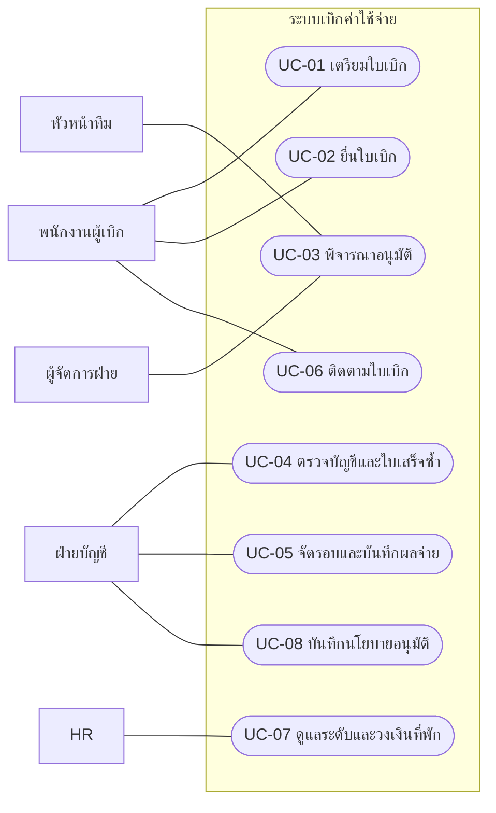
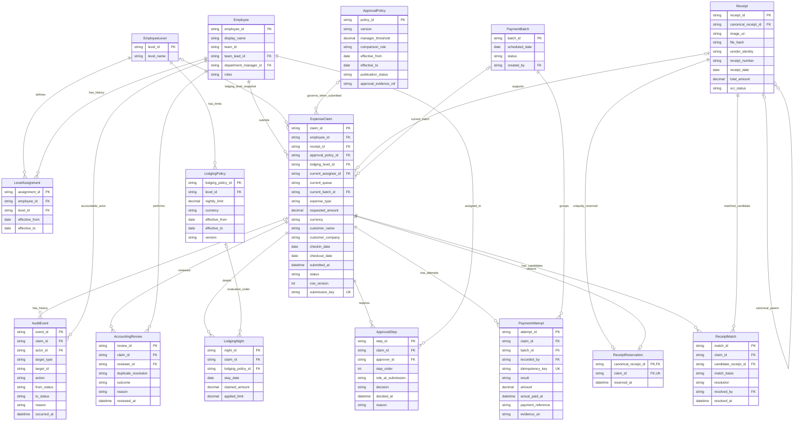
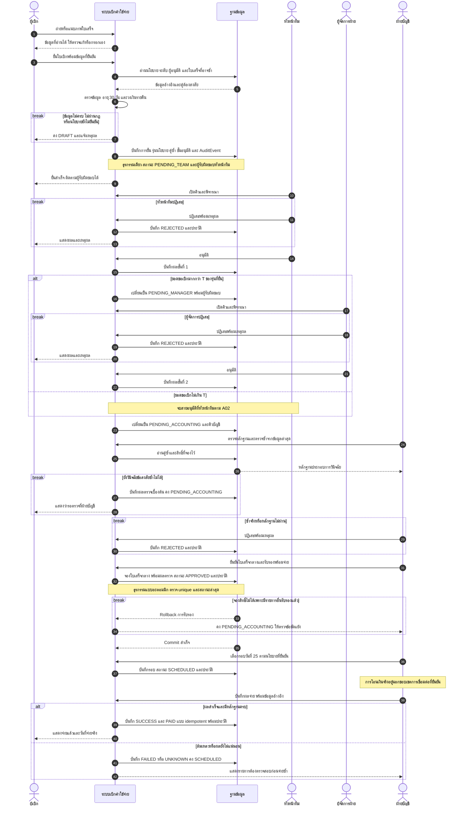
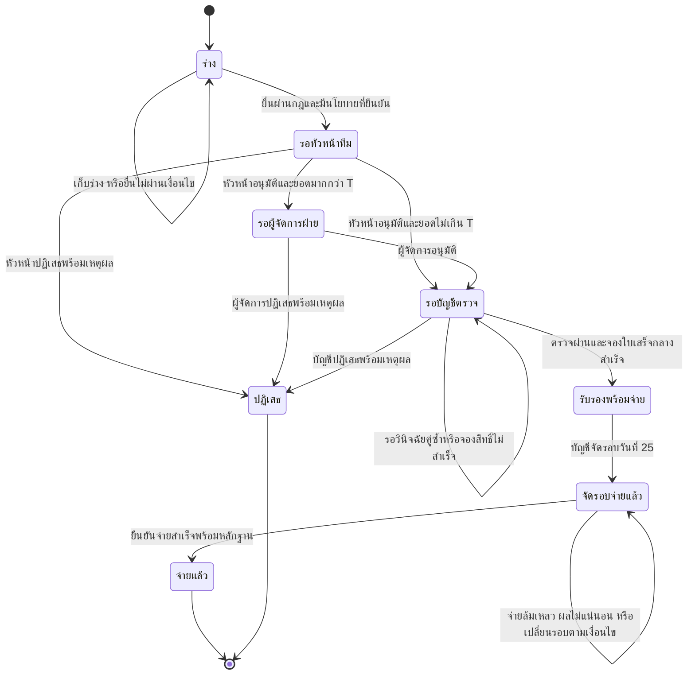

# วิเคราะห์ Requirement ระบบเบิกค่าใช้จ่าย

เอกสารวิเคราะห์จากบันทึกสัมภาษณ์ที่ให้มาเท่านั้น ไม่มีข้อมูลใหม่ (NEW INFORMATION = NONE) และไม่มีการตัดข้อกำหนดต้นทางออก ข้อกำหนดที่ขัดแย้งหรือยังขาดข้อมูลคงไว้ใน Open Issues แบบจำลองเป็นข้อเสนอสำหรับทบทวน ยังไม่ใช่นโยบายที่องค์กรอนุมัติแล้ว

## 1. ประโยคต้นทาง

| ID | ผู้ให้ข้อมูล | ประโยคต้นทาง |
|---|---|---|
| S01 | พนักงานฝ่ายขาย | อยากถ่ายรูปใบเสร็จแล้วเบิกได้เลย ไม่อยากกรอกเยอะ |
| S02 | พนักงานฝ่ายขาย | ส่วนใหญ่เบิกค่าน้ำมัน ค่าที่พัก ค่ารับรองลูกค้า |
| S03 | หัวหน้าทีม | ผมต้องอนุมัติทุกใบ |
| S04 | หัวหน้าทีม | ถ้าเกิน 5,000 บาทต้องให้ผู้จัดการฝ่ายอนุมัติอีกชั้น |
| S05 | ผู้จัดการฝ่าย | อะไรเกิน 10,000 ค่อยส่งมาผม ต่ำกว่านั้นหัวหน้าทีมจบได้เลย |
| S06 | ฝ่ายบัญชี | ต้องตรวจใบเสร็จซ้ำ เคยมีคนเบิกใบเดียวสองรอบ |
| S07 | ฝ่ายบัญชี | ต้องเบิกภายใน 30 วันนับจากวันที่ในใบเสร็จ |
| S08 | ฝ่ายบัญชี | จ่ายเงินรอบวันที่ 25 ของเดือน |
| S09 | ฝ่ายบัญชี | ค่ารับรองลูกค้าต้องระบุชื่อลูกค้าและชื่อบริษัท |
| S10 | HR | พนักงานแต่ละระดับมีวงเงินค่าที่พักต่อคืนไม่เท่ากัน |
| S11 | พนักงานฝ่ายขาย | อยากเห็นว่าใบเบิกของเราค้างอยู่ที่ใคร |

## 2. Actor / Stakeholder

| ผู้เกี่ยวข้อง | บทบาทในระบบ / ความรับผิดชอบ | สิ่งที่ต้องการ |
|---|---|---|
| พนักงานผู้เบิก (เริ่มจากฝ่ายขาย) | สร้างและยื่นใบเบิก ตรวจข้อมูลจากภาพ ติดตามสถานะ | กรอกน้อย เบิกสะดวก รู้ผู้รับผิดชอบปัจจุบัน |
| หัวหน้าทีม | พิจารณาใบเบิกทุกใบในทีม | คิวอนุมัติและขอบเขตอำนาจชัดเจน |
| ผู้จัดการฝ่าย | พิจารณาต่อจากหัวหน้าทีมเมื่อเกินเกณฑ์ที่ยืนยันแล้ว | รับเฉพาะใบที่อยู่ในอำนาจตน |
| ฝ่ายบัญชี | ตรวจหลักฐานและรายการซ้ำ จัดรอบจ่าย บันทึกผลจ่าย | ป้องกันเบิกซ้ำ ปฏิบัติตามกำหนดเวลา |
| HR | เจ้าของข้อมูลระดับพนักงานและวงเงินที่พัก; เสนอให้ดูแลข้อมูลเหล่านี้ในระบบ | ใช้วงเงินถูกระดับและช่วงเวลาที่มีผล |
| ผู้มีอำนาจรับรองนโยบาย (ยังไม่ระบุบุคคล) | Stakeholder สำหรับชี้ขาดเกณฑ์อนุมัติ; ยังไม่ถือเป็น Actor ที่กำหนดแล้ว | ยืนยันนโยบายเดียวที่ใช้ทั่วระบบ |

ขอบเขตระบบประกอบด้วยการยื่นเบิก อนุมัติ ตรวจบัญชี ติดตาม และบันทึกการจ่าย การโอนเงินจริงผ่านธนาคารและการเชื่อมระบบ HR/บัญชียังไม่มีข้อกำหนด จึงจำลองให้บัญชีบันทึกหลักฐานผลจ่ายก่อน ไม่มีการสมมติว่าได้เชื่อมบริการเหล่านั้นแล้ว

## 3. สมมติฐานและข้อขัดแย้ง

| ID | สมมติฐานสำหรับแบบจำลอง (ยังต้องยืนยัน) | ผลต่อการออกแบบ / Issue |
|---|---|---|
| A01 | หนึ่งใบเบิกมีหนึ่งใบเสร็จ หนึ่งประเภทค่าใช้จ่าย และใช้เงินบาท | เกณฑ์อนุมัติเทียบยอดขอเบิกของใบ; ใบเสร็จรวมหลายรายการหรือแบ่งเบิกต้องยืนยัน OI-03 |
| A02 | เกณฑ์ผู้จัดการเป็นตัวแปร T ที่ต้องได้รับการรับรอง ใช้ยอด > T; เท่ากับ T จบที่หัวหน้าทีมด้านสายอนุมัติ | ไม่เลือก T = 5,000 หรือ 10,000 เอง; ก่อนมีนโยบายที่ครบถ้วนเก็บเป็นร่างและไม่ยื่น OI-01 |
| A03 | ระยะยื่นใช้วันปฏิทินในเขตเวลาธุรกิจ: 0 ≤ วันที่ยื่น − วันที่ใบเสร็จ ≤ 30; ไม่รับวันที่อนาคต | วันเดียวกันและวันที่ 30 ยื่นได้ วันที่ 31 ยื่นไม่ได้; เขตเวลาต้องยืนยัน OI-02 |
| A04 | เก็บวันที่เข้าพัก ออกพัก และยอดที่พักของแต่ละคืน; ห้ามเฉลี่ยยอดเพื่อกลบคืนที่เกินเพดาน | ใช้ระดับพนักงาน ณ วันเข้าพักและรุ่นวงเงินที่มีผลแต่ละคืน; ข้อมูลนโยบายขาดหรือคืนใดเกินเพดานให้แก้ร่างก่อน OI-04 |
| A05 | ตรวจบัญชีหลังสายอนุมัติครบ; ข้อสงสัยใบเสร็จซ้ำต้องมีผลวินิจฉัยก่อนผ่านตรวจ | คำว่า “หัวหน้าทีมจบได้เลย” ตีความว่าจบสายอนุมัติ ไม่ใช่ข้ามบัญชี OI-05 |
| A06 | ระบบช่วยอ่านภาพและกรอกข้อมูล แต่ผู้เบิกตรวจและแก้ได้; อ่านไม่ได้ให้กรอกเอง | OCR เป็นแนวทางตอบ S01 ที่เสนอเพิ่ม ไม่ใช่เทคโนโลยีที่ผู้ให้สัมภาษณ์กำหนด OI-06 |
| A07 | ฝ่ายบัญชีเลือกรอบวันที่ 25 ด้วยตนเองจนกว่าจะยืนยัน cutoff และวันหยุด; เปลี่ยนเป็นจ่ายแล้วเมื่อมีหลักฐานสำเร็จ | ไม่รับประกันว่าทุกใบจะได้เงินวันที่ 25 ที่ใกล้ที่สุด; ไม่เลื่อนวันอัตโนมัติ OI-07 |
| A08 | หลังยื่นแก้ข้อมูลการเงินและหลักฐานไม่ได้; ผู้พิจารณาปฏิเสธพร้อมเหตุผลได้; ใบที่ปฏิเสธปิดถาวร | การแก้ใบเดิม ส่งกลับ ถอน หรือยื่นใหม่ต้องออกแบบเพิ่มเติมหลังยืนยัน OI-08 |
| A09 | จับรุ่นนโยบาย ผู้อนุมัติ และข้อมูลระดับที่ใช้ประเมินไว้ตอนยื่น; อนุมัติเกณฑ์ใหม่ไม่เปลี่ยนใบเดิมอัตโนมัติ | ต้องตกลงการรักษาการ การย้ายทีม และผลย้อนหลัง OI-09 |
| A10 | เสนอให้ HR ดูแลระดับ/เพดานที่พัก และบัญชีบันทึกรุ่นเกณฑ์อนุมัติหลังมีผู้มีอำนาจรับรอง | ไม่ให้บัญชีชี้ขาดข้อขัดแย้งเอง; ต้องยืนยันสิทธิ์ดูแลนโยบาย OI-10 |
| A11 | คัดกรองรายการซ้ำจากภาพและข้อมูลใบเสร็จ แล้วบัญชียืนยันการจับคู่กับใบเสร็จกลาง | กันการรับรองสิทธิ์ซ้ำด้วยการจองใบเสร็จกลางแบบอะตอมมิก; ความแม่นยำในการจับคู่ต้องยืนยัน OI-11 |

ความขัดแย้ง S04/S05 เป็นข้อเท็จจริงที่พบจากข้อมูลต้นทาง ไม่ใช่ NEW INFORMATION และอยู่ในขอบเขตงานวิเคราะห์เดิม จึงไม่ก่อให้เกิด Re-plan

| ยอดขอเบิก A | ตามหัวหน้าทีม (S04) | ตามผู้จัดการ (S05) | ข้อสรุปที่ใช้ได้ตอนนี้ |
|---|---|---|---|
| A ≤ 5,000 | หัวหน้าทีม | หัวหน้าทีม | ตรงกัน |
| 5,000 < A < 10,000 | หัวหน้า → ผู้จัดการ | หัวหน้าทีม | ขัดแย้ง ต้องตัดสิน |
| A = 10,000 | หัวหน้า → ผู้จัดการ | ไม่ชัดเจน: พูดทั้ง “เกิน” และ “ต่ำกว่า” | ต้องยืนยันขอบเขตเท่ากับ |
| A > 10,000 | หัวหน้า → ผู้จัดการ | หัวหน้า → ผู้จัดการ | ตรงกัน |

แบบจำลองใช้ T แบบยังไม่กำหนดค่า รวมถึงต้องยืนยันกรณีเท่ากับเกณฑ์ตาม A02 ก่อนเผยแพร่นโยบาย ไม่มีการเลือกเกณฑ์ใดเป็นข้อยุติ

## 4. Functional Requirements

“ต้นทาง” คือความต้องการจากสัมภาษณ์ ส่วนรายละเอียดวิธีทำและเกณฑ์ที่อ้าง Axx เป็นข้อเสนอรอยืนยัน

| ID | ความสามารถและเงื่อนไขตรวจรับ | ต้นทาง / กฎ |
|---|---|---|
| FR-01 | ผู้เบิกถ่ายหรือแนบภาพใบเสร็จ ระบบเสนอวันที่ เลขใบเสร็จ ผู้ขาย และยอดจาก OCR ให้ตรวจแก้ก่อนยื่น; อ่านไม่สำเร็จยังกรอกเองและเก็บร่างได้ | S01; A06 |
| FR-02 | สร้างร่าง เลือกค่าน้ำมัน/ค่าที่พัก/ค่ารับรอง และยื่นเมื่อข้อมูลครบ; ค่ารับรองบังคับชื่อลูกค้าและบริษัท; ที่พักต้องมีวันที่และยอดรายคืน | S02,S09,S10; BR-01,BR-02,BR-06 |
| FR-03 | ตรวจอายุใบเสร็จวันที่ยื่นจริง วันที่อนาคต และเพดานที่พักแต่ละคืน; แสดงสาเหตุเมื่อไม่ผ่านและคงเป็นร่าง | S07,S10; BR-03,BR-06 |
| FR-04 | ส่งใบเบิกทุกใบให้หัวหน้าทีมก่อน; เมื่อหัวหน้าอนุมัติจึงส่งผู้จัดการเฉพาะยอดเกิน T ตามรุ่นนโยบายที่บันทึกไว้; ถ้านโยบาย/ผู้รับผิดชอบขาดให้ยื่นไม่ได้พร้อมเหตุผล | S03–S05; BR-04,BR-05; A02,A09 |
| FR-05 | ผู้อนุมัติเห็นเฉพาะคิวที่รับผิดชอบและข้อมูลประกอบ กดอนุมัติหรือปฏิเสธพร้อมเหตุผล; เก็บผู้ตัดสิน เวลา ขั้น และผล; ไม่ข้ามขั้น | S03–S05; BR-04,BR-05,BR-10; A08 |
| FR-06 | คัดกรองใบเสร็จซ้ำตอนยื่นและตรวจซ้ำก่อนบัญชีรับรอง โดยเทียบ hash ภาพและข้อมูลผู้ขาย/เลขที่/วันที่/ยอดข้ามผู้เบิก; แสดงคู่ต้องสงสัยและเหตุผลให้บัญชีวินิจฉัย | S06; BR-07; A11 |
| FR-07 | บัญชีตรวจหลักฐานและผลจับคู่หลังอนุมัติครบ รับรองได้ต่อเมื่อไม่มีคู่ซ้ำที่ยังไม่ตัดสินและได้จองใบเสร็จกลางสำเร็จ; ปฏิเสธพร้อมเหตุผลได้ | S06; BR-07,BR-08; A05,A11 |
| FR-08 | บัญชีเลือกรายการที่รับรองแล้วเข้ารอบวันที่ 25; แสดงรอบที่เลือกและรายการที่ยังไม่ถูกจัดรอบ; ใบเดียวอยู่ในรอบที่ใช้งานได้ครั้งเดียว | S08; BR-09; A07 |
| FR-09 | บัญชีบันทึกผลจ่ายและเลขอ้างอิง/หลักฐานสำเร็จ ก่อนเปลี่ยนเป็นจ่ายแล้ว; ผลล้มเหลวหรือยังไม่ทราบไม่ทำให้เป็นจ่ายแล้ว; การบันทึกซ้ำไม่สร้างการจ่ายสำเร็จซ้ำ | S08; BR-09,BR-12; A07 |
| FR-10 | ผู้เบิกเห็นใบของตน สถานะ ประวัติ ผู้รับผิดชอบปัจจุบัน และรอบจ่ายที่กำหนด; ถ้าอยู่บัญชีแสดง “คิวฝ่ายบัญชี” และชื่อผู้รับงานถ้ามี | S11; BR-11 |
| FR-11 | ผู้มีสิทธิ์ดูแลข้อมูลบันทึกระดับพนักงานและวงเงินที่พักต่อคืน พร้อมวันเริ่ม/สิ้นสุดที่มีผล; ห้ามมีช่วงนโยบายซ้อนสำหรับระดับเดียวกัน | S10; BR-06; A04,A10 |
| FR-12 | ผู้มีสิทธิ์บันทึกรุ่นเกณฑ์ T ขอบเขตเปรียบเทียบ วันมีผล และหลักฐานการรับรองนโยบาย; เผยแพร่ไม่ได้ถ้ายังไม่ยืนยัน OI-01; เก็บรุ่นที่ใช้กับใบเบิก | S04,S05; BR-05; A02,A09,A10 |
| FR-13 | บันทึกประวัติการยื่น การตรวจซ้ำ การเปลี่ยนผู้รับงาน การตัดสิน การเปลี่ยนนโยบาย และผลจ่าย พร้อมตัวตน/เวลา/เหตุผล ให้ตรวจย้อนหลังได้ | S06,S11; BR-10–BR-12; ข้อเสนอเพื่อการตรวจสอบ |

## 5. Non-functional Requirements

ไม่มีค่า SLA หรือเป้าหมายคุณภาพที่ยืนยันจากการสัมภาษณ์ รายการต่อไปนี้เป็นข้อเสนอสำหรับตรวจรับและต้องให้เจ้าของระบบรับรอง (OI-12)

| ID | ข้อเสนอ | วิธีตรวจรับที่เสนอ |
|---|---|---|
| NFR-01 | จำกัดสิทธิ์ตามบทบาทและขอบเขตทีม ผู้เบิกเห็นเฉพาะของตน; ตรวจสิทธิ์ที่ฝั่งบริการและการเข้าถึงไฟล์ภาพ | ทดลองอ่าน/อนุมัติข้ามสิทธิ์ด้วย API ต้องถูกปฏิเสธ; HR เห็นเฉพาะข้อมูลที่จำเป็นต่อหน้าที่ |
| NFR-02 | ประวัติการตัดสินและการจ่ายไม่แก้ย้อนหลังผ่านหน้าจอทั่วไป; ระบุผู้กระทำและเวลาได้ | ทุกการเปลี่ยนสถานะมี AuditEvent; การแก้ประวัติโดยสิทธิ์ปกติถูกปฏิเสธ; retention ยังรอยืนยัน |
| NFR-03 | การยื่น การเปลี่ยนสถานะ การจองใบเสร็จ และบันทึกผลจ่ายต้องเป็นธุรกรรมที่คงความถูกต้องเมื่อคำขอพร้อมกันหรือส่งซ้ำ | ส่งคำขออนุมัติ/จอง/จ่ายพร้อมกัน ต้องสำเร็จตามเงื่อนไขเพียงครั้งเดียว ไม่มีสถานะหรือหลักฐานบางส่วนหลุดค้าง |
| NFR-04 | หน้าจอมือถืออ่านและแก้ข้อมูล OCR ได้ง่าย มีข้อความข้อผิดพลาดชัดเจนและกรอกเองได้ | ทดสอบแนบภาพ→ตรวจแก้→ยื่นบนมือถือกับผู้ใช้จริง; จำนวนช่อง/เวลาเป้าหมายและเกณฑ์ accessibility ต้องตกลง |
| NFR-05 | ตอบสนองคิวและสถานะได้ตามภาระงานที่ตกลง; OCR แสดงสถานะกำลังทำงานและข้อผิดพลาด | ยังไม่กำหนดตัวเลข p95, จำนวนผู้ใช้พร้อมกัน, ขนาดภาพ, SLA และ RPO/RTO; ต้องตกลงก่อน load/recovery test |
| NFR-06 | ปกป้องใบเสร็จและข้อมูลลูกค้าระหว่างส่งและจัดเก็บ จำกัดการเข้าถึงภาพและข้อมูลใน log | ตรวจการตั้งค่าการเข้ารหัสและสิทธิ์ไฟล์; ไม่บันทึกภาพ/ข้อมูลลูกค้าเต็มลง application log; อายุเก็บและลบข้อมูลรอยืนยัน |

## 6. Business Rules

| ID | กฎ | สถานะ / ที่มา |
|---|---|---|
| BR-01 | รองรับอย่างน้อยค่าน้ำมัน ค่าที่พัก และค่ารับรองลูกค้า; ประเภทเพิ่มเติมยังไม่กำหนด | ต้นทาง S02; ไม่ตีความว่าองค์กรมีได้เพียง 3 ประเภท |
| BR-02 | ค่ารับรองต้องระบุทั้งชื่อลูกค้าและชื่อบริษัทก่อนยื่น | ต้นทาง S09 |
| BR-03 | ยื่นภายใน 30 วันนับจากวันที่ใบเสร็จ | ต้นทาง S07; วิธีนับรวมวันที่ 30 และการไม่รับวันอนาคตตาม A03 รอยืนยัน |
| BR-04 | ทุกใบต้องผ่านหัวหน้าทีมก่อน; ผู้จัดการเป็นชั้นเพิ่มเติมตามเกณฑ์ | ต้นทาง S03,S04 |
| BR-05 | เกณฑ์ผู้จัดการยังขัดแย้ง: S04 ให้ > 5,000, S05 ให้ > 10,000 และไม่ชัดที่ = 10,000; แบบจำลองใช้ > T หลังยืนยันนโยบาย | ยังไม่ยุติ OI-01; T ไม่ใช่ค่าที่ระบบเลือกเอง |
| BR-06 | วงเงินค่าที่พักต่อคืนแตกต่างตามระดับพนักงาน | ต้นทาง S10; ตารางจำนวนเงินจริง ภาษี ข้อยกเว้น และการใช้รุ่นตามวันตาม A04 ยังรอยืนยัน |
| BR-07 | ต้องตรวจใบเสร็จซ้ำและไม่รับรองสิทธิ์เบิกซ้ำสำหรับใบเสร็จเดียวที่ยืนยันแล้ว | ต้นทาง S06; ข้อเสนอ A11: ข้อสงสัยต้องตรวจโดยบัญชี ไม่ใช้ OCR ตัดสินทุจริต; ใบที่ปฏิเสธไม่ถือว่าเบิกสำเร็จ |
| BR-08 | รับรองพร้อมจ่ายได้เมื่อสายอนุมัติครบ บัญชีตรวจผ่าน และจองใบเสร็จกลางได้; ใบสงสัยซ้ำค้างตรวจบัญชี | ข้อเสนอ A05,A11 เพื่อรองรับ S06,S08 |
| BR-09 | รอบจ่ายเป็นวันที่ 25 ของเดือน; เข้ารอบได้หลังรับรองพร้อมจ่ายเท่านั้น | ต้นทาง S08; cutoff วันหยุด และการจ่ายล่าช้ารอยืนยัน OI-07 |
| BR-10 | หลังยื่นห้ามแก้ยอด/ข้อมูลหลักฐานโดยตรง; ปฏิเสธต้องมีเหตุผลและประวัติ; เปลี่ยนสถานะได้เฉพาะผู้รับผิดชอบขั้นนั้น | ข้อเสนอ A08 เพื่อรักษาฐานข้อมูลที่ใช้อนุมัติ |
| BR-11 | ใบที่รอดำเนินการต้องระบุผู้รับผิดชอบเป็นบุคคลหรือคิวงาน; ใบจบแล้วไม่มีผู้ที่กำลังรอให้ทำงาน | ต้นทาง S11; รูปแบบการแสดงเป็นข้อเสนอ |
| BR-12 | “จ่ายแล้ว” ต้องมีผลสำเร็จและหลักฐาน; ใบเบิกหนึ่งใบมีผลจ่ายสำเร็จได้ไม่เกินหนึ่งรายการ | ข้อเสนอ A07 เพื่อรองรับ S08; ผลไม่แน่นอนต้องตรวจสอบก่อนลองจ่ายอีก |

## 7. Use Case Specifications

| ID | ชื่อ / Actor | เงื่อนไขก่อนและผลลัพธ์หลัก | ทางเลือกหรือข้อผิดพลาด |
|---|---|---|---|
| UC-01 | เตรียมใบเบิก — ผู้เบิก | มีบัญชีผู้ใช้; แนบภาพ อ่าน/แก้ข้อมูล เลือกประเภท กรอกข้อมูลเฉพาะ; ได้ DRAFT | OCR ไม่สำเร็จกรอกเอง; ข้อมูลไม่ครบยังเก็บร่างได้ |
| UC-02 | ยื่นใบเบิก — ผู้เบิก | เป็นเจ้าของร่าง; ตรวจข้อมูล กฎอายุ/ที่พัก นโยบาย และผู้อนุมัติ; คัดกรองซ้ำ บันทึกรุ่นนโยบายและยื่นเป็น PENDING_TEAM | ไม่ผ่านคง DRAFT พร้อมเหตุผล; พบคู่ซ้ำติดธงให้บัญชีพิจารณาภายหลัง |
| UC-03 | พิจารณาอนุมัติ — หัวหน้าทีม/ผู้จัดการ | อยู่ในคิวและลำดับของตน; หัวหน้าอนุมัติแล้วไป PENDING_MANAGER เมื่อ > T มิฉะนั้นไป PENDING_ACCOUNTING; ผู้จัดการอนุมัติแล้วไปบัญชี | ปฏิเสธพร้อมเหตุผลเป็น REJECTED; คำขอผิดลำดับหรือสถานะเก่าถูกปฏิเสธ |
| UC-04 | ตรวจบัญชีและใบเสร็จซ้ำ — บัญชี | PENDING_ACCOUNTING; ตรวจภาพและคู่ซ้ำ ยืนยันใบเสร็จกลาง และจองสิทธิ์พร้อมเปลี่ยนเป็น APPROVED ในธุรกรรมเดียว | ยังสงสัยคงสถานะเดิม; ซ้ำจริง/หลักฐานไม่ผ่านปฏิเสธ; จองไม่ได้ต้องตรวจซ้ำและห้ามรับรอง |
| UC-05 | จัดรอบและบันทึกผลจ่าย — บัญชี | APPROVED → SCHEDULED เมื่อเลือกรอบ; SCHEDULED → PAID เมื่อยืนยันผลสำเร็จพร้อมหลักฐาน | ล้มเหลว/ผลไม่แน่นอนคง SCHEDULED; เปลี่ยนรอบได้หลังยืนยันว่าไม่เคยจ่ายสำเร็จและบันทึกเหตุผล |
| UC-06 | ติดตามใบเบิก — ผู้เบิก | เข้าถึงใบของตน; เห็นสถานะ ผู้รับผิดชอบ ประวัติ และรอบจ่าย | ถ้ายังไม่จัดรอบแสดง “ยังไม่กำหนดรอบ”; ไม่แสดงวันได้เงินที่เดาเอง |
| UC-07 | ดูแลระดับและวงเงินที่พัก — HR (เสนอ) | มีสิทธิ์; บันทึกระดับและวงเงินที่มีวันมีผลโดยช่วงไม่ซ้อน | ข้อมูลขาด/ช่วงซ้อนเผยแพร่ไม่ได้; ผู้มีสิทธิ์จริงรอยืนยัน |
| UC-08 | บันทึกนโยบายอนุมัติ — บัญชี (เสนอ) | มีสิทธิ์และหลักฐานการรับรอง; เผยแพร่ T และรุ่นนโยบาย | ยังไม่ยุติ OI-01 ต้องคงนโยบายเป็นร่าง; การบันทึกไม่ใช่อำนาจชี้ขาดนโยบาย |

## 8. Open Issues

คำถามต่อไปนี้เป็นรายการสำหรับผู้มีอำนาจตัดสินใจภายหลัง ไม่มีการถามผู้ใช้ระหว่างการรันนี้

| ID | เรื่องที่ต้องตัดสินใจ | เจ้าของที่เสนอ | ผลกระทบ / แนวทางชั่วคราว |
|---|---|---|---|
| OI-01 | ใช้ 5,000 หรือ 10,000 หรือเกณฑ์อื่น? เท่ากับเกณฑ์อยู่ชั้นใด? เกณฑ์ต่อใบหรือต่อรายการ? ใครรับรองข้อยุติ? | หัวหน้าทีม + ผู้จัดการ + ผู้มีอำนาจนโยบาย | ขัดแย้งสำคัญต่อ FR-04,FR-12,BR-05 และเส้นทางอนุมัติ; ใช้ T ที่ยังไม่กำหนด และไม่เปิดยื่นจริงจนยืนยัน |
| OI-02 | นับ 30 วันรวมวันใด ใช้เขตเวลาใด มีข้อยกเว้นย้อนหลัง/ใบอนาคต/ยื่นใหม่หรือไม่? | บัญชี | FR-03,BR-03; ใช้ A03 เพื่ออธิบายและทดสอบเท่านั้น |
| OI-03 | หนึ่งใบเบิกหลายใบเสร็จได้หรือไม่? หลายประเภท/สกุลเงิน ภาษี และยอดขอเบิกบางส่วนจัดการอย่างไร? | บัญชี + ฝ่ายขาย | FR-01–FR-04,ERD และ duplicate logic; ใช้ A01 |
| OI-04 | แต่ละระดับได้กี่บาทต่อคืน รวมภาษีหรือไม่? เปลี่ยนระดับระหว่างพักใช้ระดับใด? เกินเพดานตัดยอดหรือห้ามยื่น? ยกเว้นได้หรือไม่? | HR + บัญชี | FR-03,FR-11,BR-06; ใช้ A04 ไม่มีการแต่งจำนวนเงินจริง |
| OI-05 | บัญชีตรวจก่อนหรือหลังอนุมัติ? “หัวหน้าทีมจบได้เลย” ยังต้องผ่านบัญชีหรือไม่? หลักฐานแบบใดผ่าน? | บัญชี + ผู้อนุมัติ | UC-03,UC-04 และลำดับสถานะ; ใช้ A05 |
| OI-06 | ต้องการ OCR จริงหรือไม่? ข้อมูลใดต้องอ่านอัตโนมัติ? ภาษาภาพ ขนาดไฟล์ และความแม่นยำขั้นต่ำเท่าใด? | ฝ่ายขาย + เจ้าของระบบ | FR-01,NFR-04,NFR-05; ให้ผู้เบิกตรวจและกรอกเองได้ |
| OI-07 | cutoff รอบวันที่ 25 คือเมื่อใด? ถ้าเป็นวันหยุดทำอย่างไร? ใบอนุมัติหลัง cutoff เข้ารอบใด? จ่ายล้มเหลวเปลี่ยนรอบอย่างไร? ต้องเชื่อมธนาคารหรือไม่? | บัญชี | FR-08,FR-09,UC-05; ใช้ A07 เลือกรอบด้วยคน ไม่สัญญาวันรับเงินอัตโนมัติ |
| OI-08 | ต้องมีส่งกลับแก้ไข ถอน ยกเลิก ยื่นใหม่ หรือแบ่งจ่ายหรือไม่? ถ้ามีต้องอนุมัติใหม่อย่างไร? | ฝ่ายขาย + ผู้อนุมัติ + บัญชี | FR-05,BR-10,State; แบบจำลองมีปฏิเสธปลายทางตาม A08 ยังไม่มีวงจรแก้หลังยื่น |
| OI-09 | ใครอนุมัติเมื่อหัวหน้าไม่อยู่ ย้ายทีม หรือผู้เบิกเป็นหัวหน้าเอง? ห้ามอนุมัติตนเองหรือไม่? นโยบายใหม่มีผลกับใบค้างหรือไม่? | HR + ผู้จัดการ | Assignment และประวัติ; ใช้ A09 จับข้อมูล ณ ยื่น ต้องมีผู้อนุมัติที่กำหนดแล้ว |
| OI-10 | HR/บัญชีเป็นผู้บันทึกนโยบายจริงหรือไม่? ใครมีสิทธิ์เผยแพร่ และมีการตรวจทานก่อนเผยแพร่หรือไม่? | ผู้มีอำนาจนโยบาย + HR + บัญชี | UC-07,UC-08,NFR-01; ใช้ A10 เป็นบทบาทเสนอ |
| OI-11 | ใบเสร็จเดียวระบุเอกลักษณ์อย่างไรเมื่อไม่มีเลขที่? จัดการภาพครอป/ถ่ายใหม่ คู่ที่ตรวจพลาด และใบที่ปฏิเสธอย่างไร? | บัญชี | FR-06,FR-07,BR-07; ใช้ A11 + ตรวจโดยคน; ห้ามรับรองว่าตรวจจับซ้ำได้ 100% |
| OI-12 | ต้องการ SLA, ปริมาณงาน, retention, RPO/RTO, accessibility, วิธี login และขอบเขตสิทธิ์เท่าใด? | เจ้าของระบบ + IT + เจ้าของข้อมูล | NFR ทั้งหมดเป็นข้อเสนอ; ต้องกำหนดตัวเลขและเกณฑ์ก่อนตรวจรับระบบจริง |

OI-01 เป็นข้อขัดแย้งที่ต้องชี้ขาดก่อนใช้เส้นทางอนุมัติจริง และ OI-04 ต้องมีตารางวงเงินจริงก่อนยื่นค่าที่พัก การวิเคราะห์เอกสารสามารถเสร็จได้โดยเปิดเผยข้อจำกัดเหล่านี้

## 9. Use Case Diagram

ใช้ Mermaid flowchart แสดง Actor นอกขอบเขตระบบและ Use Case เป็นวงรี เนื่องจาก Mermaid ไม่มีไวยากรณ์ UML Use Case โดยตรง เส้นเชื่อมหมายถึงมีส่วนร่วมใน Use Case ไม่ใช่ลำดับการทำงาน

UC-07/UC-08 ใช้ผู้ดูแลตาม A10 ผู้มีอำนาจรับรองนโยบายเป็น Stakeholder นอกกระบวนการบันทึก จนกว่า OI-10 จะได้ข้อยุติ

## 10. ERD

เป็น logical data model; คอลัมน์แสดงข้อมูลหลัก ไม่ใช่ schema migration สุดท้าย ค่า enum, unique constraints, nullable และธุรกรรมที่จำเป็นระบุในคำอธิบายใต้ภาพ

ข้อกำหนดความสัมพันธ์และความถูกต้องของข้อมูล:

- ร่างอาจยังไม่มีใบเสร็จ/รุ่นนโยบาย แต่ตอนยื่นต้องมีครบ; Receipt หนึ่งรายการอาจถูกอ้างโดยหลายคำขอเพื่อเก็บประวัติใบที่ปฏิเสธ จึงห้ามตั้ง unique บน ExpenseClaim.receipt_id แบบครอบคลุมทุกสถานะ
- Receipt เก็บภาพต้นฉบับและข้อมูลที่ตรวจแล้ว; เมื่อบัญชียืนยันว่าหลายภาพเป็นใบเสร็จเดียวกัน ให้ผูก canonical_receipt_id ไปยังใบเสร็จกลาง เก็บการจับคู่ใน ReceiptMatch และ AuditEvent ห้ามมีวงจรการอ้างอิง การผูกอัตลักษณ์นี้ไม่ใช่การแก้ยอดหรือหลักฐานหลังยื่น
- ReceiptReservation ใช้ canonical_receipt_id เป็น PK และ claim_id เป็น unique เพื่อรับรองสิทธิ์ได้ใบเดียวต่อใบเสร็จกลาง; การจับคู่ใบเสร็จกลางและจองต้อง serialize/lock ตามเอกลักษณ์ที่บัญชียืนยัน และ commit พร้อม AccountingReview, สถานะ APPROVED และ AuditEvent ถ้าชนต้อง rollback และคงรอตรวจ ไม่อ้างว่ากลไกนี้ตรวจพบภาพซ้ำทุกกรณี
- การจองไม่ถูกปล่อยเมื่อจ่ายสำเร็จ เพื่อป้องกันเบิกซ้ำในอนาคต; การกลับรายการ/ยกเลิกหลังรับรองยังอยู่ OI-08 ไม่ลบข้อมูลเดิมเพื่อเปิดสิทธิ์ใหม่เอง
- จำนวนเงินใช้ decimal ตามสกุลเงิน; แบบจำลองชั่วคราวใช้ THB เท่านั้น ค่ารับรองมี customer_name และ customer_company ที่ไม่ว่าง; LodgingNight ต้องมีครบทุกคืนและยอดรวมเท่ากับ requested_amount ภายใต้ A01/A04
- LevelAssignment ของคนเดียวกันและ LodgingPolicy ของระดับเดียวกันต้องไม่มีช่วงมีผลซ้อน; lodging_level_id บันทึกระดับ ณ เข้าพัก และแต่ละ LodgingNight เก็บรุ่นเพดานที่มีผลในคืนนั้นตาม A04 ไม่คำนวณประวัติใหม่จากค่าปัจจุบัน
- ApprovalPolicy ที่เผยแพร่มีช่วงมีผลไม่ซ้อน ใช้ได้เมื่อยืนยัน T และ comparison_rule แล้วเท่านั้น; แบบจำลองเสนอ GT ตาม A02 ใบที่ยื่นแล้วอ้างรุ่นเดิมที่แก้ย้อนหลังไม่ได้
- ApprovalStep มี unique (claim_id, step_order): ขั้น 1 หัวหน้าทีมเสมอ ขั้น 2 ผู้จัดการเฉพาะเมื่อเข้าเกณฑ์ ผู้จัดการเริ่มตัดสินได้หลังขั้น 1 อนุมัติแล้วเท่านั้น
- current_assignee_id อ้าง Employee; current_queue รองรับ TEAM, MANAGER, ACCOUNTING เมื่ออยู่บัญชีและยังไม่มีผู้รับงานรายบุคคลให้แสดงชื่อคิว; เปลี่ยนเจ้าของงาน สถานะ และประวัติพร้อมกัน
- current_batch_id คือรอบที่จัดให้ปัจจุบันเพียงรอบเดียว; PaymentAttempt เก็บรอบที่ลองจ่ายจริงแต่ละครั้ง แม้ภายหลังเปลี่ยนรอบ ประวัติยังอยู่ครบ; scheduled_date เป็นวันที่ 25 ตาม A07
- PaymentAttempt.result ใช้ SUCCESS, FAILED, UNKNOWN; ต้องมี unique แบบมีเงื่อนไขให้ SUCCESS ได้ไม่เกินหนึ่งต่อ claim_id และมี idempotency_key กันบันทึกซ้ำ; SUCCESS ต้องมีหลักฐาน เลขอ้างอิง และ actual_paid_at ยอดเท่ากับยอดใบเบิกตามสมมติฐานไม่แบ่งจ่าย
- ขณะมี UNKNOWN ห้ามเริ่มจ่ายซ้ำจนบัญชีตรวจผลและบันทึกข้อยุติ; update ผลพร้อม AuditEvent; row_version และธุรกรรมกันคำสั่งตัดสินจากหน้าจอที่ถือสถานะเก่า
- AuditEvent.claim_id ว่างได้สำหรับการดูแลนโยบาย โดยระบุ target_type/target_id; เหตุการณ์จากระบบใช้ตัวตนบริการที่ตรวจสอบได้ ไม่บันทึกเป็นผู้ใช้ที่ไม่ได้ทำรายการจริง

## 11. Sequence Diagram: ยื่นเบิก → อนุมัติ → จ่ายเงิน

ภาพแสดงขั้นหลักและทางออกที่สำคัญ `break` หมายถึงจบรอบการดำเนินการที่แสดง เมื่อแก้ข้อมูลหรือข้อสงสัยแล้วจึงเริ่มดำเนินการต่อในภายหลัง ตาม Use Case และ State Diagram

ทุกการเปลี่ยนสถานะในภาพต้องตรวจสิทธิ์/สถานะเดิมและบันทึก AuditEvent ในธุรกรรมเดียว แม้บางข้อความย่อเพื่อให้อ่านง่าย การส่งผลกลับผู้เบิกในภาพหมายถึงข้อมูลที่ดูได้ในระบบ ยังไม่กำหนด email หรือ push notification

## 12. State Diagram ของใบเบิก

| สถานะ | ผู้รับผิดชอบปัจจุบันที่ผู้เบิกเห็น | เงื่อนไขสำคัญ |
|---|---|---|
| DRAFT | ผู้เบิก | ยังไม่ถือว่ายื่น; เวลาเก็บร่างไม่ใช้แทนวันที่ยื่นจริง |
| PENDING_TEAM | หัวหน้าทีมที่ระบุชื่อ | ทุกใบต้องผ่านขั้นนี้ |
| PENDING_MANAGER | ผู้จัดการฝ่ายที่ระบุชื่อ | เกิดเฉพาะเข้าเกณฑ์ T ที่ได้รับการรับรอง |
| PENDING_ACCOUNTING | คิวบัญชี และชื่อผู้รับงานถ้ามี | พบคู่ซ้ำไม่เพิ่มสถานะหลักใหม่ แต่เก็บผลวินิจฉัยประกอบ |
| APPROVED | ฝ่ายบัญชี: รอจัดรอบ | หมายถึงผ่านทั้งผู้อนุมัติและบัญชีพร้อมจองสิทธิ์แล้ว |
| SCHEDULED | ฝ่ายบัญชี: รอ/ตรวจผลจ่าย | แสดงรอบและผลจ่ายล่าสุด; UNKNOWN ต้องตรวจผลก่อนลองจ่ายใหม่ |
| PAID | ไม่มีงานค้าง | แสดงวันที่จ่ายจริงและข้อมูลอ้างอิงตามสิทธิ์ |
| REJECTED | ไม่มีงานค้าง | แสดงผู้ปฏิเสธและเหตุผล; ไม่ย้อนกลับร่างตาม A08 |

## 13. Traceability Matrix

ประโยคอ้างอิงตรงกับตารางต้นทางส่วน 1 ทุกประโยคมีเส้นทางถึง FR/BR, Use Case และ Entity; รายการเสริมท้ายตารางทำให้ข้อเสนอไม่มีที่มาแฝง

| ต้นทาง / ข้อเสนอ | FR / BR | Use Case | Entity หลัก |
|---|---|---|---|
| S01 “อยากถ่ายรูปใบเสร็จแล้วเบิกได้เลย ไม่อยากกรอกเยอะ” | FR-01,FR-02; วิธี OCR ตาม A06 | UC-01,UC-02 | ExpenseClaim, Receipt |
| S02 “ส่วนใหญ่เบิกค่าน้ำมัน ค่าที่พัก ค่ารับรองลูกค้า” | FR-02; BR-01 | UC-01,UC-02 | ExpenseClaim, LodgingNight |
| S03 “ผมต้องอนุมัติทุกใบ” | FR-04,FR-05; BR-04 | UC-03 | Employee, ExpenseClaim, ApprovalStep |
| S04 “ถ้าเกิน 5,000 บาทต้องให้ผู้จัดการฝ่ายอนุมัติอีกชั้น” | FR-04,FR-05,FR-12; BR-04,BR-05 | UC-03,UC-08 | ApprovalPolicy, ApprovalStep, ExpenseClaim |
| S05 “อะไรเกิน 10,000 ค่อยส่งมาผม ต่ำกว่านั้นหัวหน้าทีมจบได้เลย” | FR-04,FR-05,FR-12; BR-05; ขัดแย้ง OI-01 | UC-03,UC-08 | ApprovalPolicy, ApprovalStep, ExpenseClaim |
| S06 “ต้องตรวจใบเสร็จซ้ำ เคยมีคนเบิกใบเดียวสองรอบ” | FR-06,FR-07,FR-13; BR-07,BR-08 | UC-02,UC-04 | Receipt, ReceiptMatch, ReceiptReservation, AccountingReview, AuditEvent |
| S07 “ต้องเบิกภายใน 30 วันนับจากวันที่ในใบเสร็จ” | FR-03; BR-03 | UC-02 | Receipt, ExpenseClaim |
| S08 “จ่ายเงินรอบวันที่ 25 ของเดือน” | FR-08,FR-09; BR-09,BR-12 | UC-05 | ExpenseClaim, PaymentBatch, PaymentAttempt |
| S09 “ค่ารับรองลูกค้าต้องระบุชื่อลูกค้าและชื่อบริษัท” | FR-02; BR-02 | UC-01,UC-02 | ExpenseClaim |
| S10 “พนักงานแต่ละระดับมีวงเงินค่าที่พักต่อคืนไม่เท่ากัน” | FR-02,FR-03,FR-11; BR-06 | UC-01,UC-02,UC-07 | Employee, EmployeeLevel, LevelAssignment, LodgingPolicy, LodgingNight, ExpenseClaim |
| S11 “อยากเห็นว่าใบเบิกของเราค้างอยู่ที่ใคร” | FR-10,FR-13; BR-11 | UC-06 | ExpenseClaim, Employee, ApprovalStep, AccountingReview, AuditEvent, PaymentBatch |
| A08 ข้อเสนอปฏิเสธ/ล็อกข้อมูลหลังยื่น | FR-05,FR-07,FR-13; BR-10 | UC-03,UC-04,UC-06 | ExpenseClaim, ApprovalStep, AccountingReview, AuditEvent |
| A09,A10 ข้อเสนอผู้ดูแลและรุ่นนโยบาย | FR-04,FR-11,FR-12,FR-13; BR-05,BR-06 | UC-02,UC-07,UC-08 | ApprovalPolicy, EmployeeLevel, LevelAssignment, LodgingPolicy, AuditEvent |
| A07,A11 ข้อเสนอความถูกต้องของการรับรอง/ผลจ่าย | FR-06–FR-09,FR-13; BR-07–BR-09,BR-12 | UC-04,UC-05 | ReceiptMatch, ReceiptReservation, AccountingReview, PaymentAttempt, AuditEvent |

| NFR ที่เสนอ | ความต้องการที่สนับสนุน | Use Case / ข้อมูลที่ได้รับผล |
|---|---|---|
| NFR-01 | FR-04,FR-05,FR-10–FR-12 | UC-01–UC-08; Employee และข้อมูลทุกใบที่เข้าถึง |
| NFR-02 | FR-05,FR-07,FR-09,FR-13 | UC-02–UC-08; AuditEvent, ApprovalStep, AccountingReview, PaymentAttempt |
| NFR-03 | FR-04–FR-09 | UC-02–UC-05; ExpenseClaim, ReceiptReservation, PaymentAttempt |
| NFR-04 | FR-01–FR-03,FR-10 | UC-01,UC-02,UC-06; Receipt, ExpenseClaim |
| NFR-05 | FR-01,FR-05,FR-10 | UC-01,UC-03,UC-06; Receipt, ExpenseClaim, ApprovalStep |
| NFR-06 | FR-01,FR-02,FR-13 | UC-01–UC-08 ตามสิทธิ์; Receipt, ExpenseClaim, AuditEvent |

## 14. ผลตรวจของ EVALUATOR

### การตรวจความครบถ้วนและโครงสร้าง

- มี Actor/Stakeholder, FR 13 ข้อ, NFR ที่เสนอ 6 ข้อ, BR 12 ข้อ, Use Case 8 รายการ, Mermaid 4 ภาพ, Traceability และ Open Issues 12 รายการครบตามโจทย์
- ตรวจอัตโนมัติด้วย Python ผ่าน 22/22 รายการด้านโครงสร้าง: fenced block และชนิด diagram, รหัสข้อกำหนดและการอ้างอิง, ต้นทางครบ 11 ประโยค, โหนดและความสัมพันธ์, Entity ใน Traceability, การปิด control block ของ Sequence และชุดสถานะที่ตรงกับ State Diagram
- ไม่พบ `mmdc` หรือ `mermaid` ใน PATH และ Node ไม่พบ `mermaid`, `@mermaid-js/mermaid-cli`, `@mermaid-js/parser` จึงยังไม่ได้ parse หรือ render ด้วย Mermaid จริง การตรวจด้วย Python ไม่ใช่การรับรอง Mermaid syntax ครบถ้วน ไม่มีการติดตั้งแพ็กเกจหรือใช้งานเครือข่าย
- ตรวจเนื้อหาโดยอ่านแบบจำลองและกฎร่วมกัน ไม่มีการตัดประโยคต้นทางทิ้ง และไม่มีการแต่งข้อยุติเรื่องเกณฑ์ 5,000/10,000 วงเงินที่พัก หรือ cutoff การจ่าย

### ตรวจสถานการณ์ตามข้อกำหนด

ตารางนี้เป็นการทบทวนความสอดคล้องของเอกสาร ไม่ใช่ผลทดสอบซอฟต์แวร์ที่พัฒนาแล้ว กรณีที่ขึ้นกับสมมติฐานยังต้องรับรองก่อนใช้ตรวจรับจริง

| สถานการณ์ | ผลตามเอกสาร | ผลตรวจ |
|---|---|---|
| ยังไม่มีนโยบาย T ที่ได้รับการรับรอง | คง DRAFT แจ้งขาดนโยบาย; ไม่เลือก 5,000/10,000 แทนผู้มีอำนาจ | ตรงกับ A02,FR-04,UC-02 และ Sequence |
| ยอด 5,000 / 5,001 / 10,000 / 10,001 | เมื่อเลือก T = 5,000 จะส่งผู้จัดการเฉพาะสามค่าหลัง; เมื่อเลือก T = 10,000 ตาม A02 จะส่งเฉพาะ 10,001; ทั้งสองเป็นตัวอย่างเชิงเงื่อนไข ไม่ใช่ข้อยุติ | ตรงกับตารางข้อขัดแย้ง และเปิดประเด็น = 10,000 ไว้ OI-01 |
| ยอด = T และยอด > T หลังยืนยัน A02 | เท่ากับไปบัญชีหลังหัวหน้าอนุมัติ; เกินต้องผ่านผู้จัดการ | ตรงกันใน BR-05,UC-03,Sequence,State |
| ใบเสร็จอายุ 0 / 30 / 31 วัน หรือวันอนาคต | 0 และ 30 ผ่านเงื่อนไขอายุ; 31 และอนาคตไม่ผ่าน ตาม A03 | มีเงื่อนไขชัดเจนและระบุ OI-02 |
| ค่ารับรองขาดชื่อลูกค้าหรือบริษัทอย่างใดอย่างหนึ่ง | เก็บร่างได้ แต่ยื่นไม่ได้ | ตรงกับ BR-02 และ FR-02 |
| ค่าที่พักหนึ่งคืนเกินเพดาน แต่เฉลี่ยหลายคืนไม่เกิน | ยื่นไม่ได้ตาม A04; ไม่ใช้ค่าเฉลี่ยกลบคืนที่เกิน | ตรงกับ LodgingNight และ FR-03 |
| ยังไม่มีวงเงินของระดับนั้น | คง DRAFT ไม่สมมติจำนวนเงิน | ตรงกับ A04 และ OI-04 |
| OCR อ่านวันที่หรือยอดผิด | ผู้เบิกแก้และยืนยันก่อนยื่น; อ่านไม่ได้กรอกเองได้ | ตรงกับ FR-01 และ UC-01 |
| พบคู่สงสัยใบเสร็จซ้ำแต่ยังตัดสินไม่ได้ | เก็บคู่ตรวจและค้าง PENDING_ACCOUNTING ก่อนรับรอง | ตรงกับ FR-06,FR-07,Sequence,State |
| สองใบพยายามรับรองใบเสร็จกลางเดียวกันพร้อมกัน | จองได้เพียงใบเดียว อีกใบ rollback และค้างตรวจ; ต้องตรวจจับและผูกอัตลักษณ์ได้ก่อน | ตรงกับ ReceiptReservation,BR-07,NFR-03; ไม่อ้างความแม่นยำ 100% |
| หัวหน้า/ผู้จัดการ/บัญชีปฏิเสธ | REJECTED พร้อมเหตุผลและประวัติ ไม่มีผู้รับผิดชอบที่กำลังรอทำงาน | ตรงกับ UC-03,UC-04 และ State |
| ผ่านผู้อนุมัติแล้วแต่ยังไม่ผ่านบัญชี | ยังไม่พร้อมจัดรอบ; APPROVED ต้องผ่านบัญชีและจองสิทธิ์แล้ว | ตรงกับ BR-08 และสถานะทั้งหมด |
| รับรองใกล้วันที่ 25 แต่ยังไม่ยืนยัน cutoff | ไม่สัญญาว่าเข้ารอบใกล้สุด; บัญชีต้องเลือกรอบตามนโยบายที่ยืนยัน | ตรงกับ A07 และ OI-07 |
| บันทึกจ่ายสำเร็จซ้ำ | ไม่สร้างผล SUCCESS ซ้ำหรือจ่ายซ้ำจากคำขอเดิม | ตรงกับ FR-09,BR-12 และ PaymentAttempt |
| ผลจ่าย FAILED / UNKNOWN | คง SCHEDULED; UNKNOWN ต้องตรวจข้อยุติก่อนเริ่มจ่ายซ้ำ | ตรงกับ UC-05,Sequence,State |
| ผู้เบิกดูใบที่ค้างผู้จัดการหรือบัญชี | เห็นชื่อผู้จัดการ หรือคิวบัญชีและชื่อผู้รับงานถ้ามี | ตรงกับ FR-10,BR-11 และข้อมูลผู้รับผิดชอบ |

EVALUATOR ยืนยันว่าบรรลุเป้าหมายการวิเคราะห์และส่งมอบเอกสารครบแล้ว แผน v1 ยังเหมาะสม ทุกงาน DONE และ Re-plan 0/3 ครั้ง การพร้อมใช้งานจริงยังขึ้นกับข้อยุติใน Open Issues และการตรวจ Mermaid ด้วย parser/render จริงตามข้อจำกัดที่ระบุ
