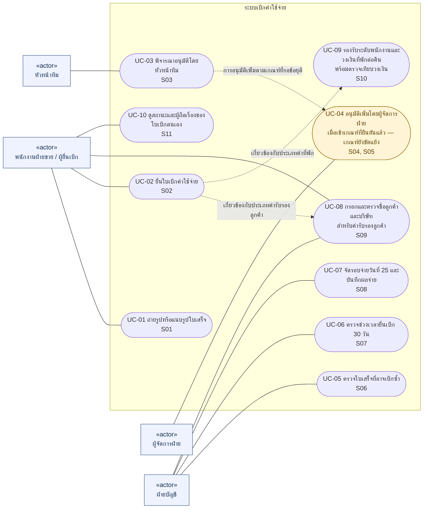
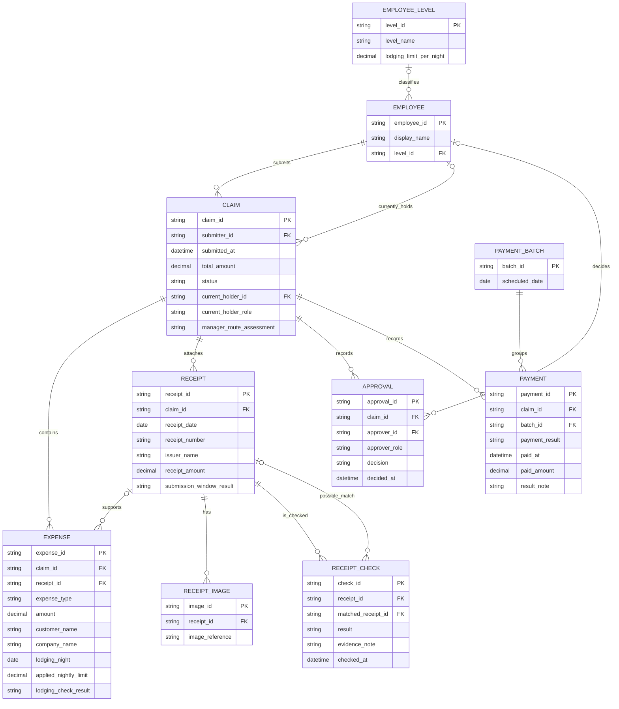
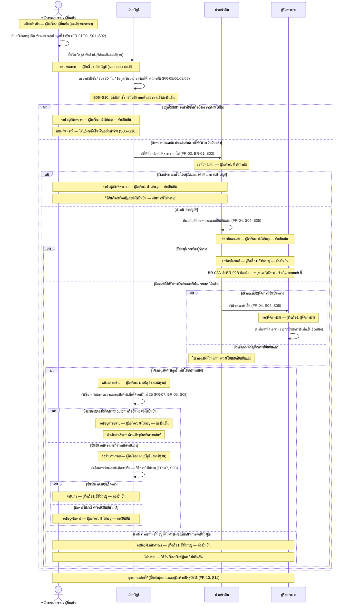

## 1. Execution trace

| Node | สถานะ | หมายเหตุ |
|---|---|---|
| N1 | DONE | สกัด Actors, FR, NFR, BR และประโยค S01–S11; บันทึก contract แล้ว |
| N1b | DONE | ทำหลัง N1 เพราะพบเกณฑ์อนุมัติขัดแย้ง; เสร็จก่อน N5 |
| N2 | DONE | ใช้เฉพาะผล N1; สร้าง Use Case Diagram อย่างอิสระ |
| N3 | DONE | ใช้เฉพาะผล N1; สร้าง ERD อย่างอิสระ |
| N4 | DONE | ใช้เฉพาะผล N1; สร้าง Sequence และ State Diagram อย่างอิสระ |
| N5 | DONE | รับเฉพาะ contract ที่ครบและ DONE; ตรวจความสอดคล้อง รวมผล และจัดทำ Matrix/Open Issues |

N2–N4 ทำงานขนานในผู้ทำงานแยกกัน โดยแต่ละคนอ่านเฉพาะ N1 และไม่อ่านผลของกันและกัน N1b แยกจาก N1 เมื่อพบความขัดแย้ง N5 เริ่มเมื่อ N2/N3/N4 และ N1b เป็น DONE แล้ว รายการจริงตามลำดับจบและ JSON contract อยู่ใน `trace.md` ซึ่งบันทึกแบบ append-only

## 2. ผลงานส่งมอบสุดท้ายที่รวมแล้ว

เอกสารวิเคราะห์ Requirement ระบบเบิกค่าใช้จ่ายจากบทสัมภาษณ์เท่านั้น รหัส S คือประโยคต้นทาง; รายการที่ระบุว่า “ข้อเสนอ/อนุมาน/สมมติฐาน” ยังไม่ใช่กติกาที่เจ้าของกระบวนการรับรอง เกณฑ์อนุมัติที่ขัดแย้งยังไม่มีข้อยุติ

### ประโยคต้นทาง
- S01 [พนักงานฝ่ายขาย] “อยากถ่ายรูปใบเสร็จแล้วเบิกได้เลย ไม่อยากกรอกเยอะ”
- S02 [พนักงานฝ่ายขาย] “ส่วนใหญ่เบิกค่าน้ำมัน ค่าที่พัก ค่ารับรองลูกค้า”
- S03 [หัวหน้าทีม] “ผมต้องอนุมัติทุกใบ”
- S04 [หัวหน้าทีม] “ถ้าเกิน 5,000 บาทต้องให้ผู้จัดการฝ่ายอนุมัติอีกชั้น”
- S05 [ผู้จัดการฝ่าย] “อะไรเกิน 10,000 ค่อยส่งมาผม ต่ำกว่านั้นหัวหน้าทีมจบได้เลย”
- S06 [ฝ่ายบัญชี] “ต้องตรวจใบเสร็จซ้ำ เคยมีคนเบิกใบเดียวสองรอบ”
- S07 [ฝ่ายบัญชี] “ต้องเบิกภายใน 30 วันนับจากวันที่ในใบเสร็จ”
- S08 [ฝ่ายบัญชี] “จ่ายเงินรอบวันที่ 25 ของเดือน”
- S09 [ฝ่ายบัญชี] “ค่ารับรองลูกค้าต้องระบุชื่อลูกค้าและชื่อบริษัท”
- S10 [HR] “พนักงานแต่ละระดับมีวงเงินค่าที่พักต่อคืนไม่เท่ากัน”
- S11 [พนักงานฝ่ายขาย] “อยากเห็นว่าใบเบิกของเราค้างอยู่ที่ใคร”

### Actors / Stakeholders
| ID | บุคคล/บทบาท | ความเกี่ยวข้อง | หลักฐาน |
|---|---|---|---|
| A01 | พนักงานฝ่ายขาย / ผู้ยื่นเบิก | ถ่ายรูป ยื่นเบิก ติดตามใบเบิกของตน | S01, S02, S11 |
| A02 | หัวหน้าทีม | อนุมัติทุกใบและส่งต่อเมื่อเข้าเกณฑ์ | S03, S04 |
| A03 | ผู้จัดการฝ่าย | อนุมัติอีกชั้นตามเกณฑ์ที่ยังขัดแย้ง | S04, S05 |
| A04 | ฝ่ายบัญชี | ตรวจซ้ำ ตรวจเงื่อนไขเอกสารและกำหนดเวลา จ่ายเงิน | S06–S09 |
| A05 | HR | ผู้ให้ข้อมูลเรื่องระดับพนักงานและวงเงินที่พัก; ยังไม่มีหลักฐานว่าต้องใช้ระบบโดยตรง | S10 |
ไม่มีหลักฐานให้เพิ่มธนาคาร ผู้ดูแลระบบ หรือลูกค้าเป็นผู้ใช้งานระบบ

### Functional Requirements
| ID | ข้อกำหนด | หลักฐานโดยตรง / สถานะ |
|---|---|---|
| FR-01 | ให้พนักงานถ่ายรูปหรือแนบรูปใบเสร็จเพื่อเริ่มใบเบิก และลดการกรอกด้วยมือ; วิธีอ่านข้อมูลอัตโนมัติยังไม่ตกลง | S01 “อยากถ่ายรูปใบเสร็จแล้วเบิกได้เลย ไม่อยากกรอกเยอะ” |
| FR-02 | ให้ยื่นใบเบิกที่รองรับค่าน้ำมัน ค่าที่พัก และค่ารับรองลูกค้า โดยไม่สรุปว่ามีได้เพียงสามประเภท | S02 “ส่วนใหญ่เบิกค่าน้ำมัน ค่าที่พัก ค่ารับรองลูกค้า” |
| FR-03 | ส่งทุกใบที่เข้าสู่กระบวนการอนุมัติให้หัวหน้าทีมพิจารณาและเก็บผล | S03 “ผมต้องอนุมัติทุกใบ” |
| FR-04 | ส่งให้ผู้จัดการฝ่ายอนุมัติเพิ่มเมื่อเข้าเกณฑ์ที่ได้รับข้อยุติ; ต้องแสดงว่าเกณฑ์ปัจจุบันขัดแย้งและยังตั้งใช้งานจริงไม่ได้ | S04 “ถ้าเกิน 5,000 บาท...” และ S05 “อะไรเกิน 10,000 ค่อยส่งมาผม...” |
| FR-05 | รองรับการตรวจพบหรือช่วยฝ่ายบัญชีตรวจใบเสร็จที่อาจถูกใช้เบิกซ้ำ และเก็บผลตรวจ; วิธีตัดสินและการจัดการผลบวกเทียมยังไม่ตกลง | S06 “ต้องตรวจใบเสร็จซ้ำ เคยมีคนเบิกใบเดียวสองรอบ” |
| FR-06 | ตรวจวันที่ใบเสร็จกับวันที่ยื่นเบิกตามช่วง 30 วัน; ขอบเขตเวลาและวิธีจัดการกรณีไม่ผ่านต้องยืนยัน | S07 “ต้องเบิกภายใน 30 วันนับจากวันที่ในใบเสร็จ” |
| FR-07 | รองรับการจัดใบเบิกที่พร้อมจ่ายเข้ารอบวันที่ 25 และบันทึกผลจ่ายจริง; cutoff เดือนที่เข้ารอบและวิธีจ่ายยังไม่ระบุ | S08 “จ่ายเงินรอบวันที่ 25 ของเดือน” |
| FR-08 | ให้กรอกและตรวจว่ามีชื่อลูกค้าและชื่อบริษัทเมื่อเป็นค่ารับรองลูกค้า | S09 “ค่ารับรองลูกค้าต้องระบุชื่อลูกค้าและชื่อบริษัท” |
| FR-09 | รองรับข้อมูลระดับพนักงาน วงเงินที่พักต่อคืน และการตรวจค่าใช้จ่ายที่พักกับวงเงินของระดับนั้น; ค่าจริง วันที่มีผล และการจัดการเกินวงเงินยังไม่ระบุ | S10 “พนักงานแต่ละระดับมีวงเงินค่าที่พักต่อคืนไม่เท่ากัน” |
| FR-10 | ให้เจ้าของใบเบิกดูสถานะและผู้ที่ถือเรื่องอยู่ในปัจจุบัน | S11 “อยากเห็นว่าใบเบิกของเราค้างอยู่ที่ใคร” |

### NFR
| ID | คุณลักษณะ | หลักฐาน / ขอบเขตความแน่นอน |
|---|---|---|
| NFR-01 | ใช้งานสะดวกและมีภาระกรอกข้อมูลต่ำ | S01 “ไม่อยากกรอกเยอะ”; เป็นความต้องการตรง แต่ยังไม่มีเกณฑ์จำนวนช่อง ขั้นตอน หรือเวลาที่วัดได้ |
| NFR-02 | สถานะและผู้ถือเรื่องที่แสดงต้องตรงกับขั้นตอนปัจจุบัน | อนุมานจาก S11 “อยากเห็นว่าใบเบิกของเราค้างอยู่ที่ใคร”; ยังไม่มีข้อกำหนดความเร็วการอัปเดต |
| NFR-03 | ผลตรวจซ้ำและข้อมูลวัน/ระดับต้องมีความถูกต้องที่ตรวจสอบได้ | ข้อเสนอจาก S06 “ต้องตรวจใบเสร็จซ้ำ...” และ S07 “ต้องเบิกภายใน 30 วัน...” และ S10 “พนักงานแต่ละระดับมีวงเงินค่าที่พักต่อคืนไม่เท่ากัน”; วิธีวัดและเกณฑ์ยอมรับยังไม่ตกลง |
ความปลอดภัย สิทธิ์เข้าถึง ระยะเวลาเก็บภาพ ปริมาณผู้ใช้ SLA ประสิทธิภาพ และ availability ยังไม่มีข้อกำหนดจากการสัมภาษณ์ ต้องเก็บเพิ่ม ไม่ถือเป็น NFR ที่ยืนยันแล้ว

### Business Rules
| ID | กติกา | หลักฐาน / สถานะ |
|---|---|---|
| BR-01 | หัวหน้าทีมต้องอนุมัติทุกใบที่เข้าสู่กระบวนการอนุมัติ | S03 “ผมต้องอนุมัติทุกใบ” |
| BR-02A | หากเกิน 5,000 บาท ต้องให้ผู้จัดการฝ่ายอนุมัติเพิ่ม | S04 “ถ้าเกิน 5,000 บาทต้องให้ผู้จัดการฝ่ายอนุมัติอีกชั้น”; ข้อเสนอจากหัวหน้าทีม ยังขัดแย้งกับ BR-02B |
| BR-02B | ส่งให้ผู้จัดการฝ่ายเมื่อเกิน 10,000; ต่ำกว่า 10,000 ให้หัวหน้าทีมจบได้ | S05 “อะไรเกิน 10,000 ค่อยส่งมาผม ต่ำกว่านั้นหัวหน้าทีมจบได้เลย”; ข้อเสนอจากผู้จัดการฝ่าย ยังขัดแย้งกับ BR-02A และประโยคไม่ครอบคลุมเท่ากับ 10,000 |
| BR-03 | ต้องตรวจการใช้ใบเสร็จเดิมเบิกซ้ำ; เจตนาคือป้องกันการเบิกใบเดียวสองรอบ | S06 “ต้องตรวจใบเสร็จซ้ำ เคยมีคนเบิกใบเดียวสองรอบ”; นิยามซ้ำและการปฏิเสธอัตโนมัติยังไม่ระบุ |
| BR-04 | ต้องยื่นเบิกภายใน 30 วันนับจากวันที่ในใบเสร็จ | S07 “ต้องเบิกภายใน 30 วันนับจากวันที่ในใบเสร็จ”; การนับวันรวมวันแรก เวลา เขตเวลา และข้อยกเว้นยังไม่ระบุ |
| BR-05 | รอบจ่ายเงินคือวันที่ 25 ของเดือน | S08 “จ่ายเงินรอบวันที่ 25 ของเดือน”; ไม่อนุมานว่าจะเข้ารอบเดือนใด cutoff วันหยุด และการจ่ายล้มเหลวยังไม่ระบุ |
| BR-06 | ค่ารับรองลูกค้าต้องมีชื่อลูกค้าและชื่อบริษัท | S09 “ค่ารับรองลูกค้าต้องระบุชื่อลูกค้าและชื่อบริษัท” |
| BR-07 | วงเงินค่าที่พักต่อคืนต่างกันตามระดับพนักงาน | S10 “พนักงานแต่ละระดับมีวงเงินค่าที่พักต่อคืนไม่เท่ากัน”; ไม่กำหนดระดับ จำนวนเงิน หรือสิทธิ์ยกเว้นขึ้นเอง |

### Use Case Diagram

ใช้ Mermaid flowchart แทน UML Use Case: โหนดทรงรีคือ Use Case ผู้ใช้วางนอกกรอบระบบ เส้นทึบคือความเกี่ยวข้อง ส่วนเส้นประแสดงความเกี่ยวข้องของความสามารถ ไม่ใช่ลำดับงานหรือ UML include/extend HR เป็น stakeholder เพราะ S10 ยังไม่ระบุการใช้ระบบโดยตรง และ UC-09 ยังไม่ยืนยันผู้ใช้งานที่รับผิดชอบ

### ERD

Entity, PK/FK และ cardinality เป็นข้อเสนอทางแบบจำลอง ไม่ใช่จำนวนหรือเงื่อนไขธุรกิจที่ยืนยันแล้ว

- เสนอให้ใบเบิกเชื่อมหลายรายการ หลายใบเสร็จ และใบเสร็จหนึ่งระเบียนเชื่อมหลายรูปได้ ค่า `o{` อนุญาตให้เก็บข้อมูลระหว่างจัดเตรียมได้ แต่ไม่ได้ยืนยันว่ามี workflow ร่างหรือยื่นโดยไม่มีเอกสารได้ ต้องยืนยันจำนวนและเงื่อนไขก่อนยื่นอีกครั้ง (S01, S02)
- เสนอให้รายการอ้างใบเสร็จได้หนึ่งระเบียน และใบเสร็จรองรับหลายรายการได้ โดยใบเสร็จและรายการต้องอยู่ในใบเบิกเดียวกัน นี่เป็นข้อจำกัดของแบบจำลองฉบับเสนอ หากหนึ่งรายการต้องมีหลายใบเสร็จต้องปรับความสัมพันธ์ (S01, S02)
- `receipt_id` ระบุระเบียนที่ระบบรับเข้า ไม่ได้พิสูจน์ว่าเป็นใบเสร็จจริงคนละใบ การส่งใบเสร็จเดิมอีกครั้งอาจเกิดคนละระเบียน จึงเก็บคู่ที่อาจซ้ำและผลตรวจใน `RECEIPT_CHECK`; ไม่ตั้งเลขใบเสร็จหรือภาพซ้ำเป็นข้อห้ามโดยอัตโนมัติ และยังไม่เลือกวิธีตรวจซ้ำ (S06)
- เสนอให้ค่าที่พักแยกรายการตามคืน โดย `lodging_night` ระบุคืนและ `amount` เป็นยอดของคืนนั้น เพื่อเทียบวงเงินต่อคืนโดยไม่เฉลี่ยยอดรวมจนซ่อนคืนที่เกินวงเงิน รายละเอียดการแบ่งยอด ภาษี และการเลือกวงเงินตามวันที่ยังต้องยืนยัน; `applied_nightly_limit` เป็นสำเนาวงเงินที่ใช้ตรวจเพื่ออธิบายผล ไม่ใส่ตัวเลขสมมติ (S10)
- `EMPLOYEE_LEVEL` เก็บระดับและวงเงินที่พักซึ่งยังไม่มีค่าจริง ช่องวงเงินที่ไม่ทราบต้องเป็นค่าว่าง ไม่ใช้ศูนย์แทน ส่วนวันที่มีผลและวิธีเลือกสิทธิ์เมื่อระดับเปลี่ยนยังไม่ยุติ แบบนี้ยังไม่อ้างว่ารองรับประวัตินโยบายครบถ้วน HR เป็น stakeholder ผู้ให้ข้อมูล ไม่ได้เพิ่มเป็นผู้ใช้ระบบหรือผู้อนุมัติ (S10)
- `CLAIM.status` และผู้ถือเรื่องเป็นข้อมูลปัจจุบัน ไม่มีรายการสถานะธุรกิจที่ยืนยันแล้วในแหล่งข้อมูล ถ้ายังไม่ทราบผู้ถือเรื่องให้แสดง “ยังไม่ระบุ — ต้องยืนยัน”; หากทราบเพียงบทบาทให้แสดงบทบาทและยังไม่ระบุบุคคล ไม่สร้างผู้มีอำนาจเพิ่ม (S11)
- `manager_route_assessment` เสนอให้เก็บ “เข้าเกณฑ์ที่ยืนยันแล้ว”, “ไม่เข้าเกณฑ์ที่ยืนยันแล้ว” หรือ “ยังหาข้อยุติไม่ได้” ปัจจุบัน BR-02A/BR-02B ขัดแย้ง จึงยังตั้งเกณฑ์ใช้งานจริงไม่ได้ ไม่กำหนด default เป็น 5,000 หรือ 10,000 บาท และไม่ใช้ยอดรวมในแบบจำลองตัดสินว่าคำว่า “ใบ” หมายถึงหน่วยใดโดยพลการ (S04, S05)
- ความสัมพันธ์อนุมัติและจ่ายเป็นข้อเสนอสำหรับบันทึกผล ไม่กำหนดลำดับฝ่ายบัญชี การอนุมัติแทน การจ่ายบางส่วน หรือการลองจ่ายซ้ำ `scheduled_date` แยกจาก `paid_at` เพื่อแยกรอบที่วางไว้กับผลจริง โดยรอบตามหลักฐานคือวันที่ 25; เดือนที่เข้ารอบและวันหยุดยังต้องยืนยัน (S03–S05, S08)

#### Data dictionary แบบย่อ

ทุก PK เป็น surrogate ID ที่เสนอเพื่ออ้างอิงระเบียนเท่านั้น ไม่ใช่เลขตามกติกาธุรกิจ FK เชื่อมตามเส้น ERD และชนิด `string`/`decimal`/`date`/`datetime` เป็นชนิดเชิงแนวคิด ยังไม่กำหนดรูปแบบรหัส ความละเอียดจำนวนเงิน เขตเวลา หรือระบบฐานข้อมูล

| Entity | ข้อมูลสำคัญและหน้าที่ | หลักฐาน |
|---|---|---|
| EMPLOYEE | `employee_id`, `display_name`, `level_id` ใช้ระบุผู้ยื่น ผู้อนุมัติ ผู้ถือเรื่อง และระดับที่ทราบ ไม่ได้ยืนยันโครงสร้างสิทธิ์ผู้ใช้ | S01, S03–S05, S10, S11 |
| EMPLOYEE_LEVEL | `level_id`, `level_name`, `lodging_limit_per_night` เก็บระดับและวงเงินต่อคืนที่ได้รับการยืนยันภายหลัง; ไม่กำหนดชื่อระดับหรือยอดขึ้นเอง | S10 |
| CLAIM | `claim_id`, `submitter_id`, `submitted_at`, `total_amount`, `status`, `current_holder_id`, `current_holder_role`, `manager_route_assessment` เก็บใบเบิก วันยื่น ยอดรวมเพื่อแสดงผล และผู้ถือเรื่อง | S01, S03–S05, S07, S11 |
| EXPENSE | `expense_id`, `claim_id`, `receipt_id`, `expense_type`, `amount`; `customer_name` และ `company_name` สำหรับค่ารับรอง; `lodging_night`, `applied_nightly_limit`, `lodging_check_result` สำหรับที่พัก ประเภทเปิดให้เพิ่มได้ ไม่จำกัดเพียงสามประเภท | S02, S09, S10 |
| RECEIPT | `receipt_id`, `claim_id`, `receipt_date`, `receipt_number`, `issuer_name`, `receipt_amount`, `submission_window_result` เก็บเอกสารและผลเทียบวันที่กับวันยื่น เลขใบเสร็จ/ผู้ออกเป็นข้อมูลช่วยตรวจที่เสนอ ไม่ถือว่าทุกใบต้องมี | S01, S06, S07 |
| RECEIPT_IMAGE | `image_id`, `receipt_id`, `image_reference` อ้างไฟล์รูป ไม่กำหนดว่าจะใช้ OCR และไม่กำหนดผู้ให้บริการจัดเก็บ | S01 |
| RECEIPT_CHECK | `check_id`, `receipt_id`, `matched_receipt_id`, `result`, `evidence_note`, `checked_at` เก็บผลตรวจและคู่ที่อาจซ้ำ คู่เปรียบเทียบอาจว่างได้เมื่อไม่มีคู่; ผลสงสัยไม่เท่ากับปฏิเสธอัตโนมัติ | S06 |
| APPROVAL | `approval_id`, `claim_id`, `approver_id`, `approver_role`, `decision`, `decided_at` เก็บการพิจารณาและบทบาทหัวหน้าทีม/ผู้จัดการฝ่าย ไม่กำหนดชุดคำตัดสินหรือลำดับใหม่ | S03–S05 |
| PAYMENT_BATCH | `batch_id`, `scheduled_date` เก็บวันของรอบจ่าย โดยวันที่ 25 เป็นกติกาที่มีหลักฐาน แต่เดือนที่จัดเข้าและ cutoff ยังไม่ทราบ | S08 |
| PAYMENT | `payment_id`, `claim_id`, `batch_id`, `payment_result`, `paid_at`, `paid_amount`, `result_note` เก็บผลจ่ายจริงกับรอบที่เกี่ยวข้อง วันและยอดจ่ายจริงอาจว่างจนมีผล ไม่ได้หมายถึงเชื่อมธนาคาร | S08 |

`submitted_at` เป็นวันเวลาที่เสนอให้เก็บสำหรับการยื่น และ `receipt_date` เป็นวันที่ตามใบเสร็จ; การนับช่วง 30 วัน รวมวันแรก เวลา เขตเวลา และผลเมื่อไม่ผ่านยังต้องยืนยัน (S07) ชื่อลูกค้าและบริษัทต้องมีเมื่อเป็นค่ารับรองตาม BR-06 แต่ไม่ได้เพิ่มลูกค้าหรือบริษัทเป็นผู้ใช้ระบบหรือ master data โดยไม่มีความจำเป็น (S09)

### Sequence Diagram: ยื่นเบิก → อนุมัติ → จ่ายเงิน

รับแผนภาพจาก N4 โดยคง **scenario ให้บัญชีตรวจเอกสารก่อนอนุมัติ** ซึ่ง S03 และ S06–S09 ยังไม่ยืนยัน แผนภาพแสดงปฏิสัมพันธ์ทางธุรกิจ ไม่กำหนด API ช่องทางส่งต่อ OCR หรือการเชื่อมธนาคาร การตรวจผ่านและอนุมัติครบก่อนจ่ายเป็นเงื่อนไขของแบบจำลองที่เสนอ ไม่เติมข้อยกเว้นเอง

“เกณฑ์ที่ยืนยันแล้ว” เป็นเงื่อนไขสำหรับแบบจำลองหลังได้ข้อยุติ ไม่ได้หมายความว่าปัจจุบันได้ข้อยุติแล้ว เส้นทางที่ยังไม่ยุติเกณฑ์ไม่ไหลไปจ่าย ระหว่างรอผู้อนุมัติตัดสิน ใบเบิกยังอยู่กับหัวหน้าทีมหรือผู้จัดการฝ่ายตามขั้นตอน ไม่เปลี่ยนเป็นผู้ถือเรื่องที่ไม่ทราบเพียงเพราะยังไม่มีผล

### State Diagram ของใบเบิก

ทุกสถานะระบุผู้ถือเรื่องที่ทราบหรือระบุ “ยังไม่ระบุ — ต้องยืนยัน” ชื่อสถานะและสถานะพักเป็นข้อเสนอเพื่อสื่อสารช่องว่างข้อมูล ไม่ใช่ workflow ที่พร้อมนำไปใช้จริง จุดเริ่มต้น [*] เป็นสัญลักษณ์ ไม่ใช่สถานะธุรกิจ

```mermaid
stateDiagram-v2
    state "เตรียมใบเบิก | ผู้ถือเรื่อง: ผู้ยื่นเบิก (สมมติฐาน)" as Draft
    state "ตรวจเอกสาร | ผู้ถือเรื่อง: ฝ่ายบัญชี (scenario สมมติ)" as Check
    state "รอข้อยุติผลตรวจ | ผู้ถือเรื่อง: ยังไม่ระบุ — ต้องยืนยัน" as CheckHold
    state "รอหัวหน้าทีม | ผู้ถือเรื่อง: หัวหน้าทีม" as Team
    state "ประเมินเกณฑ์ส่งผู้จัดการ | ผู้ถือเรื่อง: ยังไม่ระบุ — ต้องยืนยัน" as Route
    state "รอข้อยุติเกณฑ์ | ผู้ถือเรื่อง: ยังไม่ระบุ — ต้องยืนยัน" as PolicyHold
    state "รอผู้จัดการฝ่าย | ผู้ถือเรื่อง: ผู้จัดการฝ่าย" as Manager
    state "รอข้อยุติผลพิจารณา | ผู้ถือเรื่อง: ยังไม่ระบุ — ต้องยืนยัน" as DecisionHold
    state "เตรียมรอบจ่าย | ผู้ถือเรื่อง: ฝ่ายบัญชี (สมมติฐาน)" as Schedule
    state "รอข้อยุติรอบจ่าย | ผู้ถือเรื่อง: ยังไม่ระบุ — ต้องยืนยัน" as ScheduleHold
    state "รอจ่ายตามรอบ | ผู้ถือเรื่อง: ฝ่ายบัญชี (สมมติฐาน)" as Payment
    state "จ่ายแล้ว | ผู้ถือเรื่อง: ยังไม่ระบุ — ต้องยืนยัน" as Paid
    state "รอข้อยุติผลจ่าย | ผู้ถือเรื่อง: ยังไม่ระบุ — ต้องยืนยัน" as PaymentHold

    [*] --> Draft
    Draft --> Check: ยื่นพร้อมรูปและข้อมูล (FR-01/02, S01–S02)
    Check --> CheckHold: ไม่ผ่าน / สงสัยซ้ำ / ยังตัดสินไม่ได้ (S06–S10)
    Check --> Team: ตรวจผ่านตามรายละเอียดกติกาที่ได้รับยืนยันแล้ว (S03, S06–S10)
    Team --> DecisionHold: มีผลพิจารณาที่ไม่ใช่อนุมัติ — วิธีจัดการต้องยืนยัน (S03)
    Team --> Route: หัวหน้าทีมอนุมัติ (FR-03, BR-01, S03)
    Route --> PolicyHold: ยังไม่ยุติเกณฑ์ (BR-02A/02B, S04–S05)
    Route --> Manager: เข้าเกณฑ์ส่งผู้จัดการที่ยืนยันแล้ว (FR-04, S04–S05)
    Route --> Schedule: ไม่เข้าเกณฑ์ส่งผู้จัดการที่ยืนยันแล้ว (FR-04, S04–S05)
    Manager --> DecisionHold: มีผลพิจารณาที่ไม่ใช่อนุมัติ — วิธีจัดการต้องยืนยัน (S04–S05)
    Manager --> Schedule: ผู้จัดการอนุมัติครบตามนโยบาย (FR-04, S04–S05)
    Schedule --> ScheduleHold: ยังยืนยันเดือนเข้ารอบ / cutoff / วันหยุดไม่ได้ (S08)
    Schedule --> Payment: ตรวจผ่าน + อนุมัติครบ + ยืนยันรอบจริงแล้ว (FR-07, S08)
    Payment --> Paid: ถึงรอบที่ยืนยัน + ยืนยันผลจ่ายสำเร็จ (FR-07, BR-05, S08)
    Payment --> PaymentHold: ผลจ่ายไม่สำเร็จ / ยังยืนยันไม่ได้ (S08; กติกาต้องเก็บเพิ่ม)

    note right of Check
        ตรวจซ้ำ: FR-05 / BR-03 / S06
        ภายใน 30 วัน: FR-06 / BR-04 / S07
        ชื่อลูกค้าและบริษัทเมื่อรับรอง: FR-08 / BR-06 / S09
        วงเงินที่พักต่อคืนตามระดับ: FR-09 / BR-07 / S10
        ไม่อนุมานการปฏิเสธหรือตัดยอดอัตโนมัติ
    end note
    note right of PolicyHold
        ยังไม่เลือก 5,000 หรือ 10,000
        ไม่มี transition ออกสู่การจ่าย
        ต้องยืนยันนโยบายและวิธีกลับเข้าพิจารณาก่อน
    end note
    note right of ScheduleHold
        รอบตามหลักฐานคือวันที่ 25
        ไม่ทราบ cutoff เดือนเข้ารอบ และวิธีจัดการวันหยุด
        ไม่มี transition ออกสู่การจ่ายโดยอัตโนมัติ
    end note
    note left of Draft
        ทุกสถานะต้องแสดงผู้ถือเรื่องให้ผู้ยื่นเบิกดูได้
        FR-10 / S11
        ยังไม่กำหนดเวลาอัปเดตที่วัดได้
    end note
```

สถานะพักไม่มี transition กลับเข้ากระบวนการในฉบับนี้เพราะยังไม่ทราบผู้รับผิดชอบและวิธีแก้ไข จึงไม่ถือว่าถูกปฏิเสธหรือปิดงาน การยังไม่ทราบผู้ถือเรื่องเป็นช่องว่างต่อ FR-10 ที่ต้องเก็บข้อมูลเพิ่ม ไม่ใช่ข้อยกเว้นที่ถือว่ายอมรับแล้ว ส่วนหลังจ่ายยังไม่กำหนดผู้ดูแล การเก็บเอกสาร หรือกติกาปิดงาน

### Traceability Matrix

รหัส S อ้างข้อความเต็มในส่วนประโยคต้นทาง; คอลัมน์ประโยคด้านล่างยกข้อความเดิมเพื่อให้ตรวจย้อนกลับได้ รหัส UC ตรงกับ Use Case Diagram และชื่อ Entity ตรงกับ ERD เครื่องหมาย — หมายถึงไม่มี BR ที่ระบุโดยตรง ไม่ใช่ข้อกำหนดตกหล่น

| ประโยคต้นทาง | FR / BR | Use Case | Entity / ข้อมูลที่รองรับ |
|---|---|---|---|
| S01 “อยากถ่ายรูปใบเสร็จแล้วเบิกได้เลย ไม่อยากกรอกเยอะ” | FR-01; BR —; NFR-01 | UC-01 ถ่าย/แนบรูป | CLAIM, RECEIPT, RECEIPT_IMAGE |
| S02 “ส่วนใหญ่เบิกค่าน้ำมัน ค่าที่พัก ค่ารับรองลูกค้า” | FR-02; BR — | UC-02 ยื่นใบเบิก | CLAIM, EXPENSE.expense_type |
| S03 “ผมต้องอนุมัติทุกใบ” | FR-03 / BR-01 | UC-03 หัวหน้าทีมพิจารณา | CLAIM, APPROVAL, EMPLOYEE |
| S04 “ถ้าเกิน 5,000 บาทต้องให้ผู้จัดการฝ่ายอนุมัติอีกชั้น” | FR-04 / BR-02A **ยังขัดแย้ง** | UC-04 ผู้จัดการฝ่ายอนุมัติเพิ่ม | CLAIM.manager_route_assessment, APPROVAL, EMPLOYEE |
| S05 “อะไรเกิน 10,000 ค่อยส่งมาผม ต่ำกว่านั้นหัวหน้าทีมจบได้เลย” | FR-04 / BR-02B **ยังขัดแย้ง** | UC-04 ผู้จัดการฝ่ายอนุมัติเพิ่ม | CLAIM.manager_route_assessment, APPROVAL, EMPLOYEE |
| S06 “ต้องตรวจใบเสร็จซ้ำ เคยมีคนเบิกใบเดียวสองรอบ” | FR-05 / BR-03 | UC-05 ตรวจซ้ำ | RECEIPT, RECEIPT_IMAGE, RECEIPT_CHECK |
| S07 “ต้องเบิกภายใน 30 วันนับจากวันที่ในใบเสร็จ” | FR-06 / BR-04 | UC-06 ตรวจช่วงเวลายื่น | CLAIM.submitted_at, RECEIPT.receipt_date, RECEIPT.submission_window_result |
| S08 “จ่ายเงินรอบวันที่ 25 ของเดือน” | FR-07 / BR-05 | UC-07 จัดรอบและบันทึกผลจ่าย | CLAIM, PAYMENT_BATCH, PAYMENT |
| S09 “ค่ารับรองลูกค้าต้องระบุชื่อลูกค้าและชื่อบริษัท” | FR-08 / BR-06 | UC-08 กรอก/ตรวจข้อมูลรับรอง | EXPENSE.customer_name, EXPENSE.company_name, EXPENSE.expense_type |
| S10 “พนักงานแต่ละระดับมีวงเงินค่าที่พักต่อคืนไม่เท่ากัน” | FR-09 / BR-07 | UC-09 รองรับวงเงินและตรวจเทียบ | EMPLOYEE, EMPLOYEE_LEVEL, EXPENSE.lodging_night, EXPENSE.amount, EXPENSE.applied_nightly_limit, EXPENSE.lodging_check_result |
| S11 “อยากเห็นว่าใบเบิกของเราค้างอยู่ที่ใคร” | FR-10; BR —; NFR-02 (อนุมาน) | UC-10 ติดตามใบเบิกของตน | CLAIM.status, CLAIM.current_holder_id, CLAIM.current_holder_role, EMPLOYEE |

NFR-03 เป็นข้อเสนอที่อนุมานจาก S06/S07/S10 จึงเชื่อมกับ UC-05/UC-06/UC-09 และข้อมูลผลตรวจที่เกี่ยวข้อง ยังไม่มีตัวชี้วัดที่ตกลงแล้ว

### ความสอดคล้องข้ามแผนภาพ

| ขั้นตอน / สถานะ | Use Case | ข้อมูลใน ERD | ขอบเขต |
|---|---|---|---|
| Draft → Check | UC-01, UC-02 | CLAIM, EXPENSE, RECEIPT, RECEIPT_IMAGE | ร่างและลำดับบัญชีก่อนอนุมัติเป็นข้อเสนอ |
| Check / CheckHold | UC-05, UC-06, UC-08, UC-09 | RECEIPT_CHECK, RECEIPT, EXPENSE, EMPLOYEE_LEVEL, EMPLOYEE | UC-09 ยังไม่ยืนยันผู้ใช้งาน; การให้บัญชีตรวจเป็นเพียง scenario |
| Team / Route / PolicyHold / Manager / DecisionHold | UC-03, UC-04 | APPROVAL, CLAIM.manager_route_assessment, CLAIM.status, EMPLOYEE | ไม่แทนเกณฑ์ที่ขัดแย้งด้วยตัวเลขฝ่ายใด |
| Schedule / ScheduleHold / Payment / PaymentHold / Paid | UC-07 | PAYMENT_BATCH, PAYMENT, CLAIM.status | วันที่กำหนดรอบและวันจ่ายจริงเป็นคนละข้อมูล |
| ทุกสถานะ | UC-10 | CLAIM.status, CLAIM.current_holder_id, CLAIM.current_holder_role | ผู้ถือเรื่องที่ยังไม่ทราบต้องแสดงความไม่แน่นอน |

ผู้เข้าร่วม E/A/T/M ใน Sequence เป็นบทบาทบุคคล ไม่ใช่ Entity ใหม่ บทบาทเหล่านี้เชื่อมกับ EMPLOYEE และช่อง approver_role/current_holder_role ส่วนรหัสสถานะเป็นค่าของ CLAIM.status ไม่ต้องสร้าง Entity แยกทุกสถานะ การแสดงข้อมูลให้เจ้าของใบเบิกเป็น FR-10 ส่วนกติกาสิทธิ์เข้าถึงโดยละเอียดต้องเก็บเพิ่ม

### Open Issues

รายการนี้เป็นสิ่งที่ต้องเก็บข้อมูลต่อ ไม่ใช่คำถามที่หยุดการจัดทำเอกสาร

| ID | สิ่งที่ยังไม่ทราบ | ผู้ให้ข้อมูลที่ควรหารือต่อ (ไม่ใช่การแต่งตั้งผู้มีอำนาจ) | ผลกระทบ / การจัดการในฉบับนี้ |
|---|---|---|---|
| OI-01 | เกณฑ์ผู้จัดการฝ่าย 5,000 หรือ 10,000 และขอบเขตเท่ากับ | หัวหน้าทีม, ผู้จัดการฝ่าย | BR-02A/02B, UC-04; เก็บทั้งสองข้อเสนอและใช้ PolicyHold เป็นเครื่องหมายรอข้อยุติ |
| OI-02 | ยอดสำหรับเกณฑ์คิดต่อใบเสร็จ ต่อรายการ หรือต่อใบเบิก รวมอะไรบ้าง | หัวหน้าทีม, ผู้จัดการฝ่าย, บัญชี | S04/S05 ใช้คำว่า “ใบ/อะไร”; CLAIM.total_amount เป็นข้อมูลที่เสนอ ยังไม่ถือว่าเป็นฐานคำนวณเกณฑ์ |
| OI-03 | นิยามใบเสร็จซ้ำ วิธีตรวจ ขอบเขตประวัติ และวิธีจัดการผลสงสัย | บัญชี | S06; เก็บหลักฐาน/ผลตรวจ ไม่ปฏิเสธอัตโนมัติ |
| OI-04 | วิธีนับ 30 วัน วันแรก เวลา เขตเวลา วันที่อนาคต และข้อยกเว้น | บัญชี | S07; ไม่เติมสูตรรวม/ไม่รวมวันแรกเอง |
| OI-05 | cutoff เดือนที่เข้ารอบ วันที่ 25 ตรงวันหยุด วิธีจ่ายและผลจ่ายล้มเหลว | บัญชี | S08; ไม่เลือกเดือนจ่ายหรือวิธีเลื่อนวันเอง |
| OI-06 | ระดับพนักงาน วงเงินจริงต่อคืน วันที่มีผล สิทธิ์เมื่อระดับเปลี่ยน และกรณีเกินวงเงิน | HR, บัญชี | S10; วงเงินไม่ทราบเป็นค่าว่าง ไม่เป็นศูนย์ และไม่กำหนดการตัดยอด |
| OI-07 | บัญชีตรวจช่วงใด ใครตรวจวงเงิน ใครกรอก/ปรับนโยบาย และใครส่งต่อเรื่อง | บัญชี, หัวหน้าทีม, ผู้จัดการฝ่าย, HR | Sequence/State ใช้ scenario บัญชีก่อนอนุมัติเท่านั้น; HR ยังเป็น stakeholder |
| OI-08 | ร่าง แก้ไข คืนเรื่อง ปฏิเสธ ยกเลิก อนุมัติแทน และเงื่อนไขกลับจากสถานะพัก | ผู้เกี่ยวข้องกับการยื่น/อนุมัติ/จ่าย | S03–S11 ยังไม่ให้กติกา; ไม่มี transition ที่แต่งเพิ่มสำหรับวิธีแก้ปัญหา |
| OI-09 | ผู้ถือเรื่องในช่วงรอข้อยุติและหลังจ่าย รวมถึงวิธีระบุบุคคลที่รับผิดชอบ | หัวหน้าทีม, ผู้จัดการฝ่าย, บัญชี | S11; ใช้ “ยังไม่ระบุ — ต้องยืนยัน”; ระหว่างรอผู้อนุมัติเดิมยังแสดงบทบาทเดิม |
| OI-10 | จำนวนรายการ ใบเสร็จ รูปต่อใบเบิก การแบ่งค่าที่พักตามคืนและภาษี | ฝ่ายขาย, บัญชี, HR | S01/S02/S10; cardinality และการแยกคืนใน ERD เป็นข้อเสนอ |
| OI-11 | วิธีลดการกรอก ช่องที่ต้องมี และจำเป็นต้องอ่านข้อมูลจากภาพอัตโนมัติหรือไม่ | ฝ่ายขาย, บัญชี | S01; ไม่สรุปว่าต้องใช้ OCR; NFR-01 ยังไม่มีเกณฑ์วัด |
| OI-12 | เกณฑ์ความถูกต้อง/ความสดของสถานะ สิทธิ์เข้าถึง การเก็บภาพ ปริมาณใช้งานและคุณภาพบริการ | ผู้เกี่ยวข้องทุกฝ่าย | S01/S06/S11 ให้เพียงความต้องการบางด้าน; ไม่สร้าง SLA ตัวเลขหรืออ้างว่าข้อเสนอเป็น NFR ที่ยืนยันแล้ว |

### ผลตรวจของ N5 และข้อจำกัด

รับผล N1/N1b/N2/N3/N4 เฉพาะที่มีคีย์ node, status, output, assumptions ครบและ status = DONE ตรวจว่าประโยค S01–S11 มีแถว Traceability ครบ, FR-01–FR-10 มี Use Case และ Entity รองรับ, BR ที่ขัดแย้งยังคงอยู่ และ Entity/สถานะในข้อความตรงกับ ERD/State Diagram

ตรวจโครงสร้าง Markdown, fenced Mermaid และการอ้างอิงด้วยสคริปต์ภายในโฟลเดอร์ พร้อมตรวจข้อความแผนภาพด้วยสายตา ไม่พบ mmdc หรือ Mermaid parser ที่เรียกใช้ได้ จึง **ยังไม่ได้ยืนยันการ parse/render ด้วย Mermaid engine** ไม่มีการติดตั้งแพ็กเกจหรือใช้เครือข่าย ทุก Node สำเร็จในครั้งแรกจึงไม่ใช้ retry และไม่มีผลงานจาก Node ที่ขาดหาย

## 3. ข้อขัดแย้งที่พบและวิธีหาข้อสรุป

| ID | ประเด็น | หลักฐาน | ข้อสรุป / วิธีดำเนินต่อ |
|---|---|---|---|
| C-01 | เกณฑ์อนุมัติขัดกันโดยตรง | S04 “ถ้าเกิน 5,000 บาทต้องให้ผู้จัดการฝ่ายอนุมัติอีกชั้น”; S05 “อะไรเกิน 10,000 ค่อยส่งมาผม ต่ำกว่านั้นหัวหน้าทีมจบได้เลย” | ช่วงมากกว่า 5,000 แต่น้อยกว่า 10,000 ส่งผู้จัดการตาม S04 แต่จบที่หัวหน้าทีมตาม S05; **ยังหาข้อสรุปไม่ได้** ต้องยืนยันนโยบายร่วม ไม่เลือกฝ่ายตามตำแหน่ง เก็บ BR-02A/02B และ OI-01 |
| C-02 | ขอบเขตเท่ากับ 10,000 ยังไม่ชัด | S05 ใช้ “เกิน 10,000” และ “ต่ำกว่านั้น”; S04 ครอบคลุมว่าเกิน 5,000 | ไม่เติมเครื่องหมายรวมเท่ากับให้ S05; ต้องยืนยันกรณีนี้โดยตรง เป็นช่องว่างข้อมูลร่วมกับ C-01 |
| C-03 | วงเงินที่พักมีหลักการแต่ไม่มีค่าจริง | S10 “พนักงานแต่ละระดับมีวงเงินค่าที่พักต่อคืนไม่เท่ากัน” | เก็บระดับ/วงเงินที่ยังว่างได้ และระบุผลตรวจที่ยังตัดสินไม่ได้; ไม่เติมชื่อระดับ ยอดวงเงิน หรือวิธีตัดยอด — OI-06 |
| C-04 | ลำดับบัญชีและการจัดรอบจริงไม่มีข้อยืนยัน | S03 “ผมต้องอนุมัติทุกใบ”; S06 “ต้องตรวจใบเสร็จซ้ำ”; S08 “จ่ายเงินรอบวันที่ 25 ของเดือน” | หลักฐานไม่ได้บอกก่อน/หลังอนุมัติหรือ cutoff; ใช้ลำดับบัญชีก่อนเป็น **scenario ที่ต้องยืนยัน** ในทั้ง Sequence/State ไม่ประกาศเป็นกติกา — OI-05/OI-07 |
| M-01 | N2 ไม่ระบุผู้ใช้ UC-09 แต่ N4 ให้บัญชีตรวจวงเงินใน scenario | S10 ยืนยันเพียงวงเงินตามระดับ; S06–S09 อ้างบทบาทบัญชี แต่ไม่มอบหมายงานวงเงินโดยตรง | คง UC-09 ไม่ผูกผู้ใช้งานอย่างยืนยัน และระบุการให้บัญชีตรวจเป็นสมมติฐานของ scenario; ยังต้องหาข้อสรุปเรื่องผู้รับผิดชอบ — OI-07 |
| M-02 | คำว่า “ยังไม่ได้ผลอนุมัติ” ใน N4 อาจทำให้ผู้ถือเรื่องที่ทราบอยู่แล้วกลายเป็นไม่ทราบ | S03 “ผมต้องอนุมัติทุกใบ”; S11 “อยากเห็นว่าใบเบิกของเราค้างอยู่ที่ใคร” | ปรับถ้อยคำให้การรอตัดสินยังอยู่ที่ Team/Manager; ใช้ DecisionHold เฉพาะมีผลที่ไม่ใช่อนุมัติแต่ยังไม่รู้วิธีดำเนินการต่อ ไม่อ้างว่าเกิดคำปฏิเสธอัตโนมัติ |
| M-03 | Cardinality และการจัดเก็บผลจาก N3 อาจถูกอ่านเป็นกติกาธุรกิจ | S01 กล่าวถึงถ่ายใบเสร็จ; S02 กล่าวถึงประเภท; S08 กล่าวถึงรอบจ่าย แต่ไม่ระบุจำนวนต่อใบหรือการจ่ายแบ่งส่วน | คง ERD เป็นข้อเสนอและแจ้งขอบเขตชัดเจน; ความสัมพันธ์หลายระเบียนไม่อนุญาตการจ่ายแบ่งส่วน/จ่ายซ้ำโดยตัวมันเอง — OI-10 |

การวิเคราะห์จุดที่คำพูดสอดคล้องกัน: ยอดไม่เกิน 5,000 ไม่เข้าเงื่อนไขส่งผู้จัดการตาม S04 และต่ำกว่า 10,000 ตาม S05; ยอดเกิน 10,000 ทั้งสองคำพูดต้องส่งผู้จัดการ แต่ข้อสังเกตนี้ **ไม่ใช่การเปิดใช้กติกาแยกบางช่วง** เพราะฐานยอดและนโยบายรวมยังต้องยืนยัน แผนภาพจึงอ้างเกณฑ์ที่ยืนยันแล้วโดยไม่เลือก threshold จริง

ไม่พบ Entity ที่ใช้งานในเอกสารรวมแล้วไม่มีใน ERD ความต่างเรื่องบทบาทและการเก็บข้อมูลอธิบายไว้ในตารางความสอดคล้อง ไม่มีการใช้ผลของ Node พี่น้องเป็น input ระหว่าง N2–N4; เฉพาะ N5 เท่านั้นที่อ่านและรวมผลทั้งหมด
