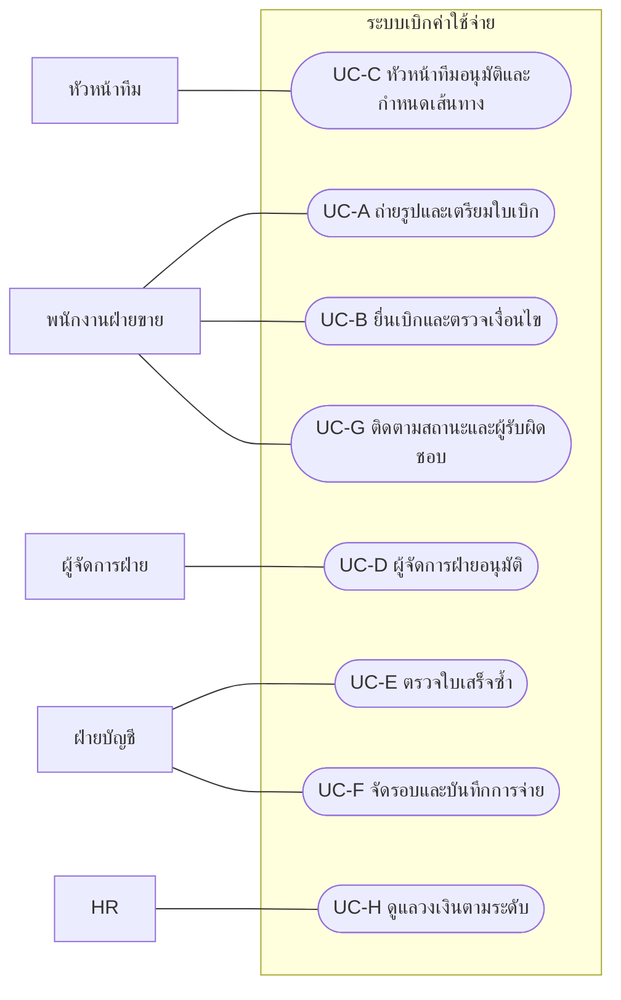
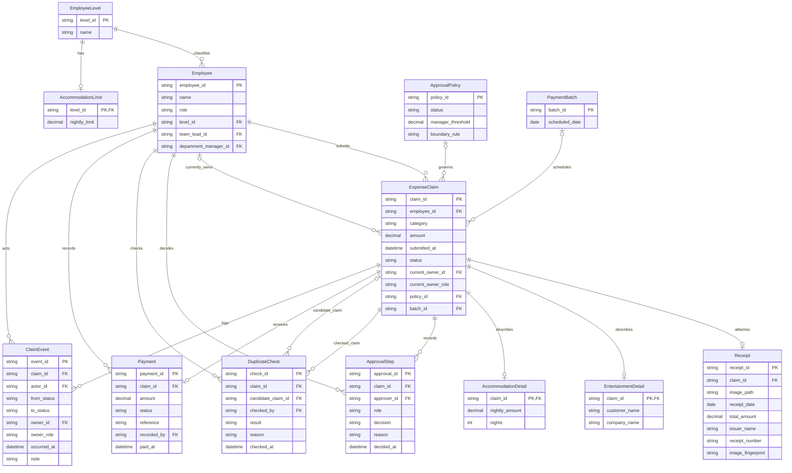
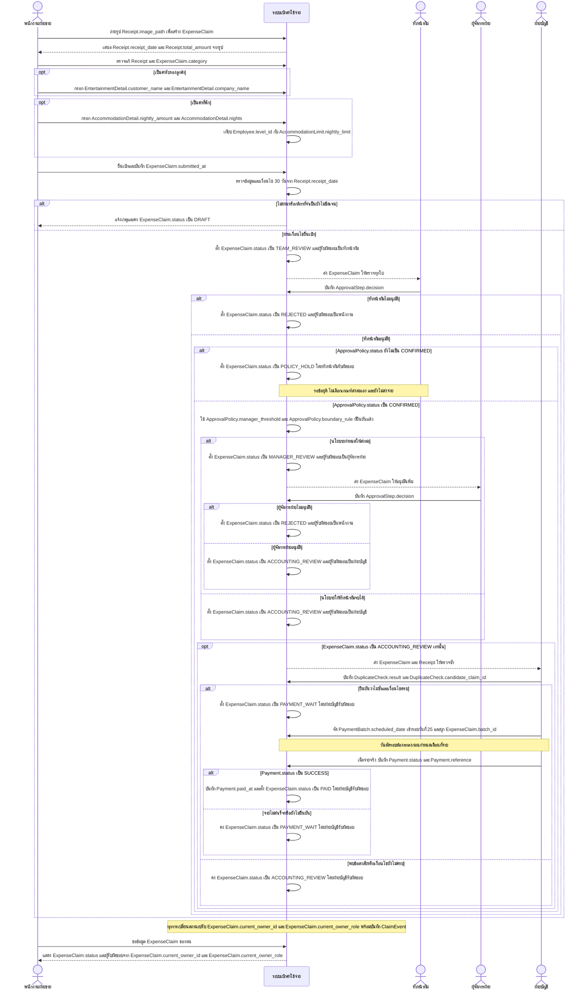
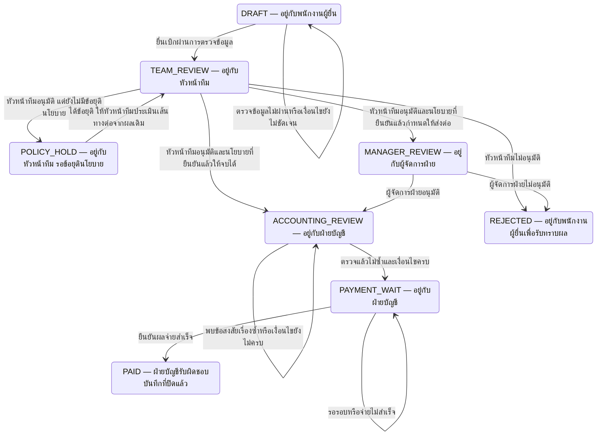

# วิเคราะห์ Requirement ระบบเบิกค่าใช้จ่าย

## 1. ตารางบันทึก Iteration

| Iteration | สิ่งที่เปลี่ยน | C1 | C2 | C3 |
|---|---|---|---|---|
| 1 | GENERATOR สร้างเอกสารครบทุกส่วน; CRITIC ตรวจความครบถ้วน แหล่งที่มา ความขัดแย้ง และความสอดคล้องของ diagram | PASS | PASS | PASS |

## 2. ผลงานสุดท้าย

### ขอบเขตและวิธีอ่าน

เอกสารนี้แยกข้อกำหนดจากคำสัมภาษณ์ออกจากสมมติฐานในการออกแบบ รหัส FR/BR/UC และเลขลำดับเป็นรหัสอ้างอิง ไม่ใช่ค่าตัวเลขของกติกาธุรกิจ ข้อความที่ระบุว่าสมมติฐานยังต้องให้ผู้เกี่ยวข้องยืนยันก่อนใช้จริง โดยเฉพาะกติกาส่งต่ออนุมัติซึ่งยังตัดสินไม่ได้จากข้อมูลที่มี

### Actor / Stakeholder

| ผู้เกี่ยวข้อง | หน้าที่หรือความต้องการ | สถานะข้อมูล |
|---|---|---|
| พนักงานฝ่ายขาย | ถ่ายรูปใบเสร็จ ยื่นเบิก ลดการกรอกข้อมูล และดูว่าใบเบิกค้างอยู่กับใคร | จากสัมภาษณ์ |
| หัวหน้าทีม | อนุมัติทุกใบ และเสนอเงื่อนไขส่งต่อผู้จัดการฝ่าย | จากสัมภาษณ์ |
| ผู้จัดการฝ่าย | อนุมัติใบเบิกที่ต้องส่งต่อ โดยเสนอเกณฑ์ต่างจากหัวหน้าทีม | จากสัมภาษณ์ |
| ฝ่ายบัญชี | ตรวจใบเสร็จซ้ำ ตรวจเงื่อนไขการเบิก และดำเนินการจ่ายเงินตามรอบ | ข้อกำหนดจากสัมภาษณ์; ลำดับการทำงานเป็นสมมติฐาน A-FLOW |
| HR | ให้ข้อมูลวงเงินค่าที่พักแยกตามระดับพนักงาน | จากสัมภาษณ์; การเป็นผู้ดูแลข้อมูลในระบบเป็นสมมติฐาน A-HR |

### Functional Requirements

| รหัส | ข้อกำหนด | ที่มา / ขอบเขตการอนุมาน |
|---|---|---|
| FR-01 | พนักงานถ่ายรูปหรือแนบรูปใบเสร็จเพื่อสร้างและยื่นใบเบิกได้ โดยลดข้อมูลที่ต้องกรอกเอง | S-A; การแนบรูปเป็นทางเลือกที่เสนอใน A-CAPTURE |
| FR-02 | เสนอการอ่านวันที่ ยอดเงิน และผู้ออกใบเสร็จจากรูป พร้อมให้พนักงานตรวจและแก้ก่อนยื่น | สมมติฐาน A-CAPTURE เพื่อรองรับ S-A; ผู้ให้สัมภาษณ์ไม่ได้ระบุ OCR โดยตรง |
| FR-03 | รองรับการเบิกค่าน้ำมัน ค่าที่พัก และค่ารับรองลูกค้า | S-B; ไม่สรุปว่าเป็นประเภททั้งหมดที่องค์กรอนุญาต |
| FR-04 | ส่งทุกใบให้หัวหน้าทีมอนุมัติ และรองรับการส่งต่อผู้จัดการฝ่ายตามนโยบายที่ตกลงแล้ว หากยังไม่มีข้อยุติให้พักการตัดสินเส้นทางโดยหัวหน้าทีม | S-C, S-D; BR-01–BR-03; การพักเป็น A-POLICY |
| FR-05 | ช่วยฝ่ายบัญชีค้นหาและตรวจใบเสร็จที่อาจถูกใช้เบิกซ้ำ พร้อมบันทึกผลการตรวจและใบเบิกที่เกี่ยวข้อง | S-E; วิธีจับคู่และการตัดสินเมื่อพบรายการต้องสงสัยเป็น A-DUP |
| FR-06 | ตรวจการยื่นเบิกภายใน 30 วันนับจากวันที่ในใบเสร็จ และแจ้งกรณีไม่เข้าเงื่อนไข | S-F; BR-05; วิธีนับและข้อยกเว้นยังเปิดไว้ |
| FR-07 | รองรับการจัดใบเบิกที่ผ่านเงื่อนไขเข้ารอบจ่ายวันที่ 25 ของเดือน และบันทึกผลการจ่ายเงินจริง | S-F; BR-06; วันตัดรอบและช่องทางจ่ายยังไม่ระบุ |
| FR-08 | ใบเบิกค่ารับรองลูกค้าต้องกรอกชื่อลูกค้าและชื่อบริษัทก่อนยื่น | S-G; BR-07 |
| FR-09 | จัดเก็บวงเงินค่าที่พักต่อคืนตามระดับพนักงาน และตรวจค่าใช้จ่ายกับวงเงินของระดับนั้น | S-H; BR-08; วิธีจัดการยอดเกินวงเงินยังไม่ระบุ |
| FR-10 | แสดงสถานะใบเบิกและผู้รับผิดชอบปัจจุบันให้เจ้าของใบเบิกดูได้ | S-I; รูปแบบผู้รับผิดชอบเป็น A-OWNER |

### Non-functional Requirements

คำสัมภาษณ์ไม่ได้ให้เกณฑ์เชิงปริมาณด้านคุณภาพ รายการต่อไปนี้เป็นข้อเสนอที่ยังต้องยืนยัน ไม่กำหนดค่าความเร็ว ความแม่นยำ หรือระยะเวลาเก็บข้อมูลขึ้นเอง

| รหัส | คุณภาพที่ต้องการ | วิธีตรวจรับที่เสนอ / สมมติฐาน |
|---|---|---|
| NFR-USABILITY | ขั้นตอนถ่ายรูปและยื่นเบิกใช้งานง่าย ลดการกรอกซ้ำ | ให้พนักงานฝ่ายขายทดลองยื่นเบิกแต่ละประเภทและประเมินขั้นตอน; เกณฑ์ยอมรับต้องตกลงเพิ่มเติม |
| NFR-ACCESS | จำกัดการเข้าถึงรูปใบเสร็จและการเปลี่ยนสถานะตามบทบาท | สมมติฐาน A-QUALITY; ทดสอบว่าเจ้าของดูใบของตนและผู้ปฏิบัติงานเข้าถึงเฉพาะงานที่ได้รับสิทธิ์ |
| NFR-AUDIT | ย้อนดูผู้ตัดสิน ผลตรวจ และผลจ่ายได้ | สมมติฐาน A-QUALITY; ตรวจว่าการเปลี่ยนสถานะมีผู้กระทำและเวลาใน ClaimEvent |
| NFR-CONSISTENCY | สถานะ ผู้รับผิดชอบ และผลการจ่ายต้องสอดคล้องกันแม้มีคำขอซ้ำ | สมมติฐาน A-QUALITY; ทดสอบคำขอซ้ำและการทำงานพร้อมกันไม่ให้เกิดผลจ่ายซ้ำหรือแสดงเจ้าของงานผิด |

### Business Rules

| รหัส | กติกา | สถานะ |
|---|---|---|
| BR-01 | หัวหน้าทีมต้องอนุมัติทุกใบ | ข้อกำหนด S-C |
| BR-02 | หัวหน้าทีมระบุว่า ถ้าเกิน 5,000 บาทต้องให้ผู้จัดการฝ่ายอนุมัติอีกชั้น | ข้อเสนอจาก S-C ซึ่งขัดแย้งกับ BR-03; ยังไม่ใช่นโยบายที่ตกลงแล้ว |
| BR-03 | ผู้จัดการฝ่ายระบุว่า อะไรเกิน 10,000 ค่อยส่งมาผม ต่ำกว่านั้นหัวหน้าทีมจบได้เลย | ข้อเสนอจาก S-D ซึ่งขัดแย้งกับ BR-02; ยังไม่ใช่นโยบายที่ตกลงแล้ว |
| BR-04 | ต้องตรวจใบเสร็จซ้ำเพื่อป้องกันการเบิกใบเดียวซ้ำ | S-E; หลักเกณฑ์ยืนยันว่าเป็นใบเดียวกันและวิธีจัดการยังต้องตกลง |
| BR-05 | ต้องเบิกภายใน 30 วันนับจากวันที่ในใบเสร็จ | S-F; ยังไม่สรุปวิธีนับวันหรือข้อยกเว้น |
| BR-06 | จ่ายเงินรอบวันที่ 25 ของเดือน | S-F; ยังไม่สรุปวันตัดรอบหรือการเลื่อนวันจ่าย |
| BR-07 | ค่ารับรองลูกค้าต้องระบุชื่อลูกค้าและชื่อบริษัท | S-G |
| BR-08 | พนักงานแต่ละระดับมีวงเงินค่าที่พักต่อคืนไม่เท่ากัน | S-H; ยังไม่มีระดับหรือค่าของวงเงินจริง |

### Use Case Diagram

ใช้ Mermaid flowchart แทนสัญลักษณ์ UML Use Case โดยโหนดทรงวงรีแทน Use Case และกรอบแทนขอบเขตระบบ Mermaid ไม่มีไวยากรณ์ usecaseDiagram โดยตรง เส้นเชื่อมแสดงการมีส่วนร่วม ไม่ใช่ลำดับเวลา

UC-A ครอบคลุม FR-01–FR-03; UC-B ครอบคลุม FR-03, FR-06, FR-08, FR-09; UC-C และ UC-D ครอบคลุม FR-04; UC-E ครอบคลุม FR-05; UC-F ครอบคลุม FR-07; UC-G ครอบคลุม FR-10; UC-H ครอบคลุม FR-09 การดูแลวงเงินโดย HR เป็นสมมติฐาน A-HR

### ERD

โครงสร้างข้อมูลทั้งหมดเป็นแบบจำลองที่เสนอ (A-DATA) ไม่ใช่รายละเอียดฐานข้อมูลที่ผู้ให้สัมภาษณ์ระบุ ใบเบิกผูกกับใบเสร็จหลักและประเภทค่าใช้จ่ายตาม A-UNIT; สถานะร่างอาจยังไม่มีใบเสร็จ ตาราง ApprovalPolicy เก็บนโยบายที่ต้องยืนยัน โดยยังไม่ใส่ค่า manager_threshold หรือกำหนด status เป็น CONFIRMED

Employee.team_lead_id, Employee.department_manager_id, ExpenseClaim.current_owner_id และ ClaimEvent.owner_id อ้างถึง Employee.employee_id; ClaimEvent.actor_id, ApprovalStep.approver_id, DuplicateCheck.checked_by และ Payment.recorded_by อ้างถึง Employee เช่นกัน DuplicateCheck.candidate_claim_id อ้างถึง ExpenseClaim ของใบที่สงสัยว่าซ้ำและเว้นว่างได้เมื่อไม่พบคู่เทียบ ข้อมูลเหล่านี้เป็นสมมติฐานเพื่อให้ตรวจสอบย้อนหลังได้

ExpenseClaim.current_owner_role ต้องมีค่าตลอดอายุใบเบิก; current_owner_id อาจว่างในคิวฝ่ายบัญชีและต้องมีค่าหากมอบหมายให้บุคคล สถานะรอหัวหน้าทีมหรือผู้จัดการอ้างบุคคลตามสายงาน ส่วน ApprovalPolicy.manager_threshold และ boundary_rule ยังว่างได้ระหว่างรอข้อยุติ ระบบต้องไม่ใช้เป็นเกณฑ์อนุมัติจนกว่านโยบายได้รับการยืนยัน

### Sequence Diagram: ยื่นเบิก → อนุมัติ → จ่ายเงิน

EmployeeActor, TeamLeadActor, ManagerActor และ AccountingActor เป็นบทบาทผู้ใช้; App เป็นขอบเขตระบบ ไม่ใช่ Entity เพิ่มเติม ชื่อในรูป Entity.attribute อ้างถึง ERD โดยตรง ลำดับการตรวจบัญชีหลังอนุมัติและการให้พนักงานรับเรื่องที่ไม่ผ่านเป็น A-FLOW; วิธีอ่านรูปเป็น A-CAPTURE

หลัง POLICY_HOLD ได้ข้อยุติ หัวหน้าทีมให้ระบบประเมินเส้นทางใหม่ตาม State Diagram โดยไม่ลบ ApprovalStep เดิม ไม่มีเส้นทางจาก POLICY_HOLD ไปจ่ายเงินโดยข้ามการอนุมัติที่จำเป็น

### State Diagram ของใบเบิก

โหนดทั้งหมดคือค่าของ ExpenseClaim.status ไม่ใช่ Entity เพิ่มเติม ทุกโหนดระบุผู้รับผิดชอบในสถานะนั้น; ใช้ DRAFT เป็นจุดเริ่มทางธุรกิจ และ REJECTED / PAID เป็นปลายทาง จึงไม่ใช้โหนดเริ่มหรือจบที่ไม่มีเจ้าของงาน การแก้ใบที่ถูกปฏิเสธ การถอน หรือการยื่นใหม่ยังไม่อยู่ในแบบจำลองจนกว่าจะยืนยันนโยบาย

ทุก transition ที่เปลี่ยนสถานะต้องปรับ ExpenseClaim.status, ExpenseClaim.current_owner_id และ ExpenseClaim.current_owner_role พร้อมบันทึก ClaimEvent ให้สอดคล้องกันตามสมมติฐาน A-QUALITY สถานะ PAID หมายถึงจ่ายสำเร็จแล้ว ไม่ใช่เพียงจัดเข้ารอบ

### Traceability Matrix

ยกข้อความครบทุกบรรทัดของคำสัมภาษณ์ โดยบรรทัดต่อเนื่องที่ไม่มีชื่อผู้พูดใช้ชื่อผู้พูดจากบรรทัดก่อนหน้า แต่ละแถวเชื่อมทั้งข้อกำหนด Use Case และ Entity

| ต้นทาง | ผู้พูดและประโยคต้นทาง | FR / BR | Use Case | Entity |
|---|---|---|---|---|
| S-A | [พนักงานฝ่ายขาย] อยากถ่ายรูปใบเสร็จแล้วเบิกได้เลย ไม่อยากกรอกเยอะ | FR-01, FR-02 | UC-A, UC-B | ExpenseClaim, Receipt |
| S-B | [พนักงานฝ่ายขาย] ส่วนใหญ่เบิกค่าน้ำมัน ค่าที่พัก ค่ารับรองลูกค้า | FR-03 | UC-A, UC-B | ExpenseClaim, AccommodationDetail, EntertainmentDetail |
| S-C | [หัวหน้าทีม] ผมต้องอนุมัติทุกใบ ถ้าเกิน 5,000 บาทต้องให้ผู้จัดการฝ่ายอนุมัติอีกชั้น | FR-04, BR-01, BR-02 | UC-C, UC-D | Employee, ExpenseClaim, ApprovalStep, ApprovalPolicy |
| S-D | [ผู้จัดการฝ่าย] อะไรเกิน 10,000 ค่อยส่งมาผม ต่ำกว่านั้นหัวหน้าทีมจบได้เลย | FR-04, BR-03 | UC-C, UC-D | ExpenseClaim, ApprovalStep, ApprovalPolicy |
| S-E | [ฝ่ายบัญชี] ต้องตรวจใบเสร็จซ้ำ เคยมีคนเบิกใบเดียวสองรอบ | FR-05, BR-04 | UC-E | Receipt, DuplicateCheck, ExpenseClaim |
| S-F | [ฝ่ายบัญชี] ต้องเบิกภายใน 30 วันนับจากวันที่ในใบเสร็จ จ่ายเงินรอบวันที่ 25 ของเดือน | FR-06, FR-07, BR-05, BR-06 | UC-B, UC-F | Receipt, ExpenseClaim, PaymentBatch, Payment |
| S-G | [ฝ่ายบัญชี] ค่ารับรองลูกค้าต้องระบุชื่อลูกค้าและชื่อบริษัท | FR-08, BR-07 | UC-B | ExpenseClaim, EntertainmentDetail |
| S-H | [HR] พนักงานแต่ละระดับมีวงเงินค่าที่พักต่อคืนไม่เท่ากัน | FR-09, BR-08 | UC-B, UC-H | Employee, EmployeeLevel, AccommodationLimit, AccommodationDetail |
| S-I | [พนักงานฝ่ายขาย] อยากเห็นว่าใบเบิกของเราค้างอยู่ที่ใคร | FR-10 | UC-G | ExpenseClaim, Employee, ClaimEvent |

### วิธีตรวจและหลักฐานของ CRITIC

CRITIC ตรวจแยกจากขั้นสร้างผลงาน โดยตัดสินแต่ละเกณฑ์ดังนี้

| เกณฑ์ | ผล | หลักฐานหนึ่งบรรทัด |
|---|---|---|
| C1 | PASS | มี Actor/Stakeholder, FR, NFR, BR, Use Case Diagram, ERD, Sequence, State, Traceability และ Open Issues; ฟีเจอร์จากคำสัมภาษณ์ครบใน FR-01–FR-10 |
| C2 | PASS | Traceability ยกต้นทางครบ 9 บรรทัดและเชื่อม FR/BR ทุกแถว; OI-APPROVAL ยกข้อความขัดแย้งทั้งสองโดยไม่เลือกข้าง; ค่าตัวเลขธุรกิจใน FR/BR/Open Issues มีเพียง 5,000, 10,000, 30, 25 ตรงต้นทาง |
| C3 | PASS | Mermaid ทั้ง 4 บล็อกผ่านการตรวจ syntax แบบเข้มงวดตามทางเลือกเมื่อไม่มี renderer; ชื่อ Entity/Attribute ตรงกับ ERD และสถานะทั้ง 8 ระบุผู้รับผิดชอบครบ |

วิธีตรวจ Mermaid: ไม่พบคำสั่ง `mmdc` หรือ `mermaid` และ Node หาโมดูล `mermaid`, `@mermaid-js/mermaid-cli`, `@mermaid-js/parser` ไม่พบ จึงไม่ได้ render ภาพจริงและไม่ได้ติดตั้งหรือใช้เครือข่าย ใช้ Python ตรวจโครงสร้างของไวยากรณ์ส่วนที่ใช้ในเอกสาร ร่วมกับการทบทวนด้วย CRITIC: ชนิด diagram และ fenced blocks, รูปโหนดและปลายเส้นใน flowchart, cardinality และการประกาศ Attribute ของ ERD, ผู้ส่ง/ผู้รับและการซ้อน `alt`/`else`/`opt`/`end` ใน Sequence และการประกาศสถานะ/transition ใน State ผ่านทั้งหมด วิธีนี้เป็นการตรวจ syntax แบบสถิต ไม่ใช่ผลจาก Mermaid renderer

ตรวจอ้างอิงชื่อข้อมูลทั้งเอกสารได้ 62 จุดกับ Entity ใน ERD ทั้ง 13 รายการ โดยไม่นับข้อความตัวอย่างรูปแบบ `Entity.attribute` เป็นชื่อ Entity จริง ตรวจผู้รับผิดชอบครบทุกสถานะและการส่งต่อทั้งกรณีอนุมัติ ปฏิเสธ พักนโยบาย ตรวจซ้ำ และจ่ายสำเร็จแล้ว ไม่พบเส้นทางจ่ายที่ข้ามการอนุมัติหรือการตรวจซ้ำ

หยุดหลัง Iteration 1 เพราะ C1–C3 เป็น PASS ทั้งหมด ไม่มีการแก้เนื้อหาส่วนที่ผ่านแล้วใน Iteration ถัดไป

## 3. ประเด็นที่ยังเหลือหรือสมมติฐาน

### Open Issues

| รหัส | ประเด็นที่ต้องได้ข้อยุติ | ผู้เกี่ยวข้อง / ผลต่อระบบ |
|---|---|---|
| OI-APPROVAL | ข้อความต้นทางทั้งสอง: [หัวหน้าทีม] “ผมต้องอนุมัติทุกใบ ถ้าเกิน 5,000 บาทต้องให้ผู้จัดการฝ่ายอนุมัติอีกชั้น” และ [ผู้จัดการฝ่าย] “อะไรเกิน 10,000 ค่อยส่งมาผม ต่ำกว่านั้นหัวหน้าทีมจบได้เลย” ให้กติกาต่างกันสำหรับการส่งต่ออนุมัติ ยังไม่เลือกฝ่ายใด ต้องยืนยันเกณฑ์และกรณียอดเท่ากับเกณฑ์ โดยเฉพาะ 10,000 ที่ถ้อยคำเกิน/ต่ำกว่าไม่ครอบคลุม | หัวหน้าทีมและผู้จัดการฝ่ายตกลงร่วมกัน; ApprovalPolicy ยังไม่ยืนยัน ห้ามนำเกณฑ์ฝ่ายใดไปใช้เอง |
| OI-DEADLINE | การเบิกภายใน 30 วันนับจากวันที่ในใบเสร็จ นับวันเริ่มต้นอย่างไร ใช้เวลาส่งสำเร็จหรือเวลาเริ่มทำรายการ ใช้เขตเวลาใด และมีข้อยกเว้นหรือไม่ | ฝ่ายบัญชี; มีผลต่อการรับยื่นและกรณีขอบเขตวัน |
| OI-PAYMENT | รอบวันที่ 25 ของเดือน มีวันตัดรอบอย่างไร วันหยุดหรือใบที่อนุมัติหลังตัดรอบทำอย่างไร จ่ายผ่านช่องทางใด และใช้หลักฐานใดยืนยันผล | ฝ่ายบัญชี; ยังเลือกเดือนที่จะจ่ายหรือวิธีเชื่อมต่อการจ่ายจริงไม่ได้ |
| OI-DUPLICATE | ใช้ข้อมูลใดตัดสินว่าใบเสร็จซ้ำ รวมใบที่ปฏิเสธหรือไม่ ตรวจข้ามพนักงานหรือไม่ และจัดการภาพถ่ายต่างมุมอย่างไร | ฝ่ายบัญชี; ผลจับคู่เป็นเพียงข้อสงสัยจนกว่าจะยืนยัน |
| OI-LODGING | ระดับพนักงานและวงเงินจริงคืออะไร ใช้ระดับ ณ วันใด รวมภาษีหรือไม่ กรณีราคาห้องต่างกันแต่ละคืนหรือเกินวงเงินต้องจัดการอย่างไร | HR และฝ่ายบัญชี; ยังไม่มีค่าตั้งต้นหรือสูตรจัดการยอดเกิน |
| OI-SCOPE | หน่วยใบเบิกเป็นใบเสร็จหรือชุดใบเสร็จ มีประเภทอื่นหรือไม่ รองรับสกุลเงินอื่นหรือไม่ และยอดใช้อนุมัติรวมรายการใดบ้าง | ฝ่ายขาย หัวหน้าทีม และฝ่ายบัญชี; มีผลต่อแบบข้อมูลและยอดใช้ประเมินเส้นทาง |
| OI-WORKFLOW | ยืนยันลำดับตรวจบัญชี การปฏิเสธ การแก้ไขส่งใหม่ การถอนเรื่อง ผู้รับงานแทน และผู้มีสิทธิ์ยืนยันนโยบาย | ผู้เกี่ยวข้องทั้งหมด; diagram เป็นเส้นทางที่เสนอตามสมมติฐาน |
| OI-QUALITY | ยืนยันเกณฑ์การใช้งาน ความแม่นยำการอ่านรูป ความเร็ว สิทธิ์เข้าถึง และการเก็บประวัติหรือรูปใบเสร็จ | ผู้เกี่ยวข้องทั้งหมด; NFR ยังไม่มีเป้าหมายเชิงปริมาณจากสัมภาษณ์ |

### สมมติฐานที่ใช้เพื่อให้แบบจำลองทำงานต่อได้

| รหัส | สมมติฐาน |
|---|---|
| A-CAPTURE | ใช้การถ่ายหรือแนบรูป พร้อมเสนอ OCR อ่านข้อมูลพื้นฐาน ผู้ยื่นตรวจและแก้ได้ หากอ่านไม่ได้ให้กรอกเอง; ไม่รับรองความแม่นยำที่ยังไม่ได้ตกลง |
| A-UNIT | ใบเบิกที่ยื่นแล้วอ้างถึงใบเสร็จหลักและประเภทค่าใช้จ่ายเฉพาะรายการ ใช้บาทในขอบเขตเบื้องต้นตามบริบท; โครงสร้างรวมหลายใบและหลายสกุลเงินรอข้อยุติ |
| A-DATA | ชื่อ Entity, Attribute, ความสัมพันธ์ และรหัสสถานะเป็นข้อเสนอการออกแบบ Receipt.total_amount เป็นยอดใบเสร็จ ส่วน ExpenseClaim.amount เป็นยอดขอเบิก; ความสัมพันธ์ของยอดและยอดอนุมัติต้องยืนยันเพิ่มเติม |
| A-FLOW | ตรวจข้อมูลก่อนยื่น หัวหน้าทีมตรวจทุกใบ ผู้จัดการตรวจเมื่อจำเป็น แล้วบัญชีตรวจซ้ำก่อนจัดรอบจ่าย; ใบไม่อนุมัติอยู่กับพนักงานเพื่อรับทราบ; ข้อสงสัยการตรวจซ้ำคงอยู่กับบัญชีและยังไม่จ่าย |
| A-POLICY | ระหว่างยังไม่มีนโยบายส่งต่อที่ยืนยัน ให้ใบที่หัวหน้าทีมอนุมัติอยู่กับหัวหน้าทีมใน POLICY_HOLD; เมื่อได้ข้อยุติจึงประเมินเส้นทางต่อ การพักนี้เป็นข้อเสนอ ไม่ใช่กติกาที่พบในสัมภาษณ์ |
| A-OWNER | เก็บทั้งบทบาทและบุคคลที่รับผิดชอบ คิวบัญชีแสดงชื่อฝ่ายได้ระหว่างยังไม่มอบหมายบุคคล ใบจ่ายแล้วให้ฝ่ายบัญชีเป็นผู้รับผิดชอบบันทึก |
| A-DUP | ใช้ผู้ออกใบเสร็จ เลขที่ วันที่ ยอดเงิน และลักษณะภาพเป็นข้อมูลช่วยหาคู่ต้องสงสัย ให้บัญชียืนยันผล; ภาพต่างกันไม่ได้พิสูจน์ว่าเป็นคนละใบ |
| A-HR | เสนอให้ HR ดูแลระดับและวงเงิน; แบบ AccommodationDetail ใช้ราคาต่อคืนคงที่ต่อรายการ หากแต่ละคืนราคาต่างกันต้องขยายแบบหลังยืนยัน |
| A-QUALITY | เพิ่มการควบคุมสิทธิ์ ประวัติการเปลี่ยนสถานะ และความสอดคล้องของข้อมูล ใช้ Payment เป็นผลจ่ายของใบเบิกและป้องกันการบันทึกจ่ายสำเร็จซ้ำ; ไม่มีข้อสมมติว่าระบบเชื่อมธนาคารแล้ว |

สถานะนโยบายธุรกิจ: ยังต้องได้ข้อยุติใน Open Issues; การผ่านเกณฑ์เอกสารไม่ใช่การยืนยันนโยบายเหล่านี้
