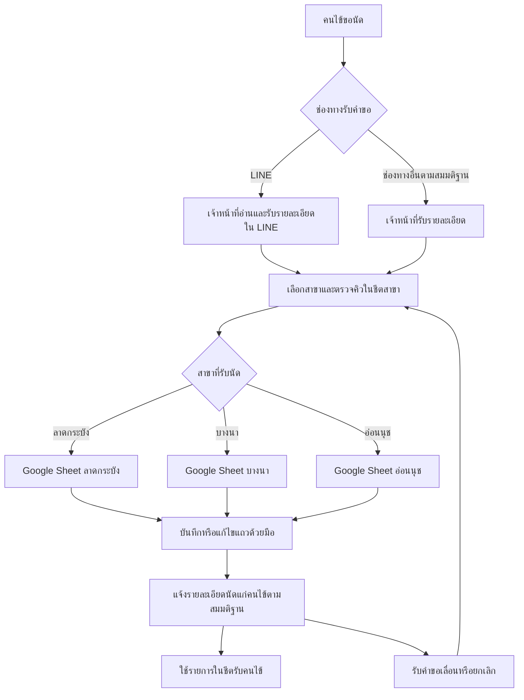
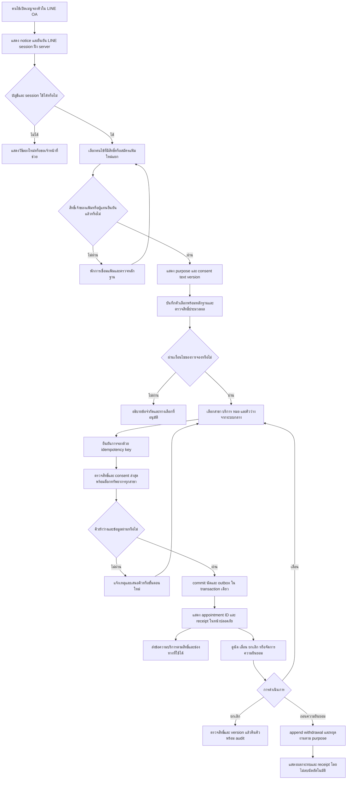
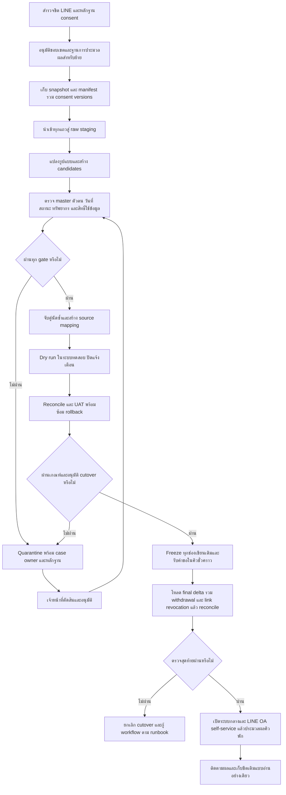

# แผนย้ายระบบนัดหมายคลินิก 3 สาขา

## 1. บันทึกเวอร์ชันแผน (updated: change request)

## Plan v1 — PLANNER

| งาน | คำอธิบาย | Dependency | สถานะ (TODO / DONE / DROPPED) |
|---|---|---|---|
| T1 | กำหนดขอบเขต สมมติฐาน และ As-Is Process | - | TODO |
| T2 | ตรวจคุณภาพข้อมูลตัวอย่างและผลกระทบรายแถว | T1 | TODO |
| T3 | ออกแบบ To-Be Process และ Data Model | T2 | TODO |
| T4 | จัดทำ Data Mapping วิธีจับคู่คนไข้ และแผน Migration | T3 | TODO |
| T5 | จัดทำ Gap Analysis และ Roll-out Plan | T4 | TODO |
| T6 | ประกอบเอกสาร ตรวจความครบถ้วนและ Mermaid แล้วส่งมอบ | T5 | TODO |

- เหตุผล: แผนเริ่มต้นตามข้อกำหนด; NEW INFORMATION = NONE
- สิ่งที่เปลี่ยน: สร้าง T1–T6; ยังไม่มีการปรับแผน
- ผลกระทบ: ครอบคลุมผลงานทั้งหกส่วน; เป้าหมายคือเอกสารออกแบบและแผนย้าย ไม่ใช่การย้ายระบบจริง
- Reuse: ยังไม่มีงาน DONE
- จำนวน Re-plan: 0/3

### Plan v2 — PLANNER

| งาน | คำอธิบาย | Dependency | สถานะ (TODO / DONE / DROPPED) |
|---|---|---|---|
| T1 | กำหนดขอบเขต สมมติฐาน และ As-Is Process | - | DONE |
| T2 | ตรวจคุณภาพข้อมูลตัวอย่างและผลกระทบรายแถว | T1 | DONE |
| T2a | กำหนดทะเบียนตัดสินข้อมูล หลักฐาน ผู้รับผิดชอบ และกติกากักกันรายแถว | T2 | TODO |
| T3 | ออกแบบ To-Be Process และ Data Model ที่รองรับผล T2a | T2a | TODO |
| T4 | จัดทำ Data Mapping วิธีจับคู่คนไข้ และแผน Migration พร้อม review gate | T3 | TODO |
| T5 | จัดทำ Gap Analysis และ Roll-out Plan | T4 | TODO |
| T6 | ประกอบเอกสาร ตรวจความครบถ้วนและ Mermaid แล้วส่งมอบ | T5 | TODO |

- เหตุผลที่เปลี่ยนแผน: Trigger “พบงานที่ยังไม่มีในแผน” จาก T2 — ข้อมูลตัวอย่างต้องตัดสินเชิงความหมาย ไม่ใช่เพียงเปลี่ยนรูปแบบวันที่หรือเบอร์
- สิ่งที่เปลี่ยน: เพิ่ม T2a; เปลี่ยน dependency T3 จาก T2 เป็น T2a; ขยายรายละเอียด T3/T4 ให้รองรับ quarantine และหลักฐานการตัดสิน ไม่มีงาน DROPPED
- Impact analysis: T3 ต้องเพิ่มโครงสร้าง source lineage, review และ identity decision; T4 ต้องแยกข้อมูลที่เข้าได้ออกจากรายการรอตรวจ; T5 ต้องเพิ่มเกณฑ์ปิดเคสก่อน cutover; T6 ต้องตรวจความสอดคล้องของส่วนเหล่านี้ งานเหล่านี้ยังไม่เริ่ม จึงไม่มีผลงาน DONE ที่ต้องทำซ้ำ
- Reuse: เก็บ T1 (As-Is และ A1–A7) และ T2 (findings และผลคำนวณวัน) ใช้ต่อทั้งหมด
- จำนวน Re-plan: 1/3; NEW INFORMATION ยังคงเป็น NONE

### สถานะปิดงานของ Plan v2 — ประวัติเฟส 1 (updated: change request)

ตาราง v1/v2 ด้านบนเป็น snapshot ตอนสร้างแผน ตารางนี้เป็นสถานะปิดเฟส 1; สถานะเฟส 2 ให้ใช้ Plan v3 และตารางปิดเฟส 2 (updated: change request)

| งาน | คำอธิบาย | Dependency | สถานะ (TODO / DONE / DROPPED) |
|---|---|---|---|
| T1 | ขอบเขต สมมติฐาน และ As-Is | - | DONE |
| T2 | Data Quality Findings | T1 | DONE |
| T2a | ทะเบียนตัดสิน หลักฐาน และ quarantine | T2 | DONE |
| T3 | To-Be Process และ Data Model | T2a | DONE |
| T4 | Data Mapping, patient matching และ Migration | T3 | DONE |
| T5 | Gap Analysis และ Roll-out | T4 | DONE |
| T6 | ประกอบและตรวจเอกสารส่งมอบ | T5 | DONE |

เมื่อปิดเฟส 1 ใช้ re-plan 1/3 ครั้ง; หลังรับ change request ใช้สะสม 2/3 ครั้ง ไม่มีงาน DROPPED และไม่มีข้อกำหนดถูกตัดทิ้ง (updated: change request)

### Plan v3 — PLANNER (updated: change request)

| งาน | คำอธิบาย | Dependency | สถานะ (TODO / DONE / DROPPED) |
|---|---|---|---|
| T1 | ขอบเขต สมมติฐาน และ As-Is ฉบับเฟส 1 | - | DONE |
| T2 | Data Quality Findings ของ CSV ฉบับเฟส 1 | T1 | DONE |
| T2a | ทะเบียนตัดสินและกักกันข้อมูลฉบับเฟส 1 | T2 | DONE |
| T3 | To-Be และ Data Model ฉบับเฟส 1 | T2a | DONE |
| T4 | Mapping และ Migration ฉบับเฟส 1 | T3 | DONE |
| T5 | Gap และ Roll-out ฉบับเฟส 1 | T4 | DONE |
| T6 | ตรวจและส่งมอบเฟส 1 | T5 | DONE |
| T7 | ออกแบบความยินยอมและเพิ่มข้อกำหนด/ช่องว่างข้อมูล/เกณฑ์ตรวจของเฟส 2 | T1, T2, T2a, T6 | TODO |
| T8 | ปรับ To-Be และ Data Model ให้จองเองผ่าน LINE OA พร้อม consent lifecycle | T7, T3 | TODO |
| T9 | ปรับ Mapping, patient linking และ Migration รวม legacy consent และ rollback | T8, T4 | TODO |
| T10 | ปรับ Gap, Roll-out และ acceptance ให้ PDPA consent กับ LINE OA self-service เป็น P0 | T9, T5 | TODO |
| T11 | ตรวจการเปลี่ยนแปลง การ reuse ความครบถ้วน และส่งมอบเฟส 2 | T10, T6 | TODO |

- เหตุผลที่เปลี่ยนแผน: Trigger “NEW INFORMATION ทำให้ข้อกำหนดเปลี่ยนไป” — เจ้าของคลินิกกำหนดให้เก็บความยินยอมของคนไข้ตาม PDPA และให้คนไข้จองเองผ่าน LINE OA ได้
- สิ่งที่เปลี่ยน: เพิ่มงานส่วนต่าง T7–T11; LINE OA self-service เปลี่ยนจากส่วนเสริมในแผนเดิมเป็นข้อกำหนด P0 ก่อนเปิดให้คนไข้ใช้; เพิ่ม purpose/version/evidence/withdrawal ของ consent และการผูก LINE กับคนไข้ ไม่ตัดงานหรือข้อกำหนดเดิม ไม่มี DROPPED
- Impact analysis: T1 เฉพาะขอบเขต/A5 ใน 3.1; T2 เพิ่ม findings เรื่อง consent/LINE ใน 3.3 โดยไม่ตรวจ CSV เดิมซ้ำ; T2a เพิ่ม review gate ใน 3.4; T3 ปรับ flow/model/notification ใน 3.5–3.6; T4 ปรับ mapping, identity linking, import, reconciliation และ rollback ใน 3.7–3.9; T5 ปรับ P0, rollout และ UAT ใน 3.10–3.11; T6 ปรับผลตรวจและคำตัดสินใน 3.12 พร้อม Version Log/Work Log การแก้ผล DONE จำกัดเฉพาะส่วนที่ระบุนี้ ผ่าน T7–T11
- Reuse: คง As-Is 3.2 ทั้งหมด; findings CSV 12 กลุ่มและผลปฏิทินเดิม; ทะเบียน R1–R5 เดิม; master/ตารางคิว/กฎห้าม merge จากเบอร์; source lineage, idempotency, single writer และ rollback journal ใช้ต่อโดยเพิ่มข้อกำหนดใหม่ ไม่ทำงานเดิมซ้ำทั้งงาน
- ขอบเขตการยืนยัน: ส่งมอบเอกสารออกแบบ ไม่ใช่ลงระบบจริงหรือรับรองการปฏิบัติตามกฎหมาย ต้องให้ผู้รับผิดชอบ PDPA ของคลินิกทบทวนวัตถุประสงค์ ฐานการประมวลผล ข้อความ และอายุการเก็บก่อนใช้งาน; ไม่ใช้เครือข่าย/ติดตั้งแพ็กเกจตาม harness เดิม
- จำนวน Re-plan สะสม: 2/3 ครั้ง (v1 → v2 ครั้งที่ 1; v2 → v3 ครั้งที่ 2); เหลือได้อีก 1 ครั้งหากเกิด trigger ใหม่
- สถานะ DONE ของ T1–T6/T2a คือผลเฟส 1 ที่ส่งมอบแล้ว ไม่ได้หมายความว่าส่วนที่ได้รับผลกระทบในเฟส 2 เสร็จก่อน T7–T11

### สถานะปิดเฟส 2 — Plan v3 (updated: change request)

ตาราง Plan v3 ก่อนหน้าเป็น snapshot ขณะสร้างแผน ตารางนี้คือสถานะล่าสุด T1–T6/T2a เป็นผลเฟส 1 และ T7–T11 คือส่วนต่างที่ทำเฉพาะผลกระทบตาม change request:

| งาน | คำอธิบาย | Dependency | สถานะ (TODO / DONE / DROPPED) |
|---|---|---|---|
| T1 | ขอบเขตและ As-Is เดิม; ปรับส่วนกระทบผ่าน T7 | - | DONE |
| T2 | Findings CSV เดิม; เพิ่มส่วนใหม่ผ่าน T7 | T1 | DONE |
| T2a | ทะเบียนเดิม; เพิ่ม gate ผ่าน T7 | T2 | DONE |
| T3 | To-Be/model เดิม; ปรับผ่าน T8 | T2a | DONE |
| T4 | Mapping/migration เดิม; ปรับผ่าน T9 | T3 | DONE |
| T5 | Gap/rollout เดิม; ปรับผ่าน T10 | T4 | DONE |
| T6 | การส่งมอบเฟส 1; ประเมินเฟส 2 ผ่าน T11 | T5 | DONE |
| T7 | consent policy, scope, findings และ review gates | T1, T2, T2a, T6 | DONE |
| T8 | LINE OA self-booking และโมเดล consent/authority | T7, T3 | DONE |
| T9 | mapping/linking, migration และ privacy rollback | T8, T4 | DONE |
| T10 | Gap/rollout และ UAT-CR สำหรับทั้งสองข้อกำหนด | T9, T5 | DONE |
| T11 | ตรวจและส่งมอบเฟส 2 | T10, T6 | DONE |

รวม 12 งาน DONE (เดิม 7 + ส่วนต่าง 5), ไม่มี DROPPED; re-plan สะสม 2/3 ครั้ง ไม่มี trigger ใหม่ในเฟส 2 และไม่ถึงขีดจำกัด จึงหยุดเพราะงานครบและ EVALUATOR รับรองผลเอกสาร

## 2. บันทึกการทำงาน (updated: change request)

### เฟส 1 — บันทึกเดิมที่เก็บไว้ (updated: change request)

| ขั้นตอน | งาน | ผลลัพธ์ | การตัดสินของ EVALUATOR |
|---|---|---|---|
| 1 | T1 | ขอบเขต A1–A7 และ As-Is ของ 3 สาขา/LINE | แผนยังเหมาะสมอยู่หรือไม่? ใช่ — แยกข้อเท็จจริงกับสมมติฐานแล้ว |
| 2 | T2 | Findings 12 กลุ่ม พร้อมแถว/ผลกระทบ และผลตรวจวันในสัปดาห์ | แผนยังเหมาะสมอยู่หรือไม่? ไม่ — พบงานทะเบียนตัดสินข้อมูลที่ยังไม่มีในแผน จึงสร้าง v2 |
| 3 | T2a | ทะเบียน R1–R5 พร้อม candidate, evidence, owner และ quarantine gate | แผนยังเหมาะสมอยู่หรือไม่? ใช่ — T3 ใช้กติกาที่รองรับความไม่แน่นอนต่อได้ |
| 4 | T3 | To-Be, ER model, กติกาคิวหมอข้ามสาขา และ audit | แผนยังเหมาะสมอยู่หรือไม่? ใช่ — รองรับกรณีข้อมูลตัวอย่างครบ |
| 5 | T4 | Mapping ครบ 8 คอลัมน์, identity matching, dedup, M0–M7, reconcile และ rollback | แผนยังเหมาะสมอยู่หรือไม่? ใช่ — รักษา lineage และรายการหลัง cutover |
| 6 | T5 | Gap 12 เรื่องและ rollout W1–W6 พร้อม single-writer/เจ้าของ/เกณฑ์เปิดใช้ | แผนยังเหมาะสมอยู่หรือไม่? ใช่ — ควบคุมคิวหมอร่วมระหว่างทยอยเปิดใช้ |
| 7 | T6 | ตรวจหัวข้อ ตัวเลขตัวอย่าง โครงสร้าง Mermaid และสถานะแผน; จัดทำไฟล์ส่งมอบ | แผนยังเหมาะสมอยู่หรือไม่? ใช่ — บรรลุเป้าหมายเอกสาร ทุกงาน DONE; ข้อจำกัดการตรวจและเรื่องรอยืนยันระบุชัด |

### เฟส 2 — งานส่วนต่างตาม Plan v3 (updated: change request)

| ขั้นตอน | งาน | ผลลัพธ์ | การตัดสินของ EVALUATOR |
|---|---|---|---|
| 8 | T7 | consent purposes/lifecycle/evidence; ปรับ A5 และเพิ่ม findings/review gates | แผนยังเหมาะสมอยู่หรือไม่? ใช่ — ครบข้อกำหนดใหม่โดยไม่เดา legacy consent |
| 9 | T8 | LINE OA self-booking flow และ ER 23 entities พร้อม authorization/consent events | แผนยังเหมาะสมอยู่หรือไม่? ใช่ — เส้นทางปกติคนไข้ยืนยันเอง และมีการควบคุมสิทธิ์ |
| 10 | T9 | Mapping/linking และ migration/rollback ที่รักษา withdrawal และ revocation | แผนยังเหมาะสมอยู่หรือไม่? ใช่ — reuse กติกาข้อมูลเดิมและไม่คืนสิทธิ์จาก snapshot เก่า |
| 11 | T10 | Gap/rollout ใหม่ ทำทั้งสอง CR เป็น P0 พร้อม UAT 18 สถานการณ์ | แผนยังเหมาะสมอยู่หรือไม่? ใช่ — manual fallback ไม่ถูกนับแทน self-service |
| 12 | T11 | ตรวจส่วนเปลี่ยน Mermaid โครงสร้างแผน และการคง trace/As-Is; ส่งมอบเฟส 2 | แผนยังเหมาะสมอยู่หรือไม่? ใช่ — บรรลุเป้าหมายเอกสารและหยุด ทุกงาน DONE |

## 3. ผลงานส่งมอบสุดท้าย

### 3.1 ขอบเขต หลักฐาน และสมมติฐาน (T1 → T7) (updated: change request)

**ผลลัพธ์ที่ส่งมอบ:** แบบออกแบบ As-Is → To-Be และแผน Migration สำหรับลาดกระบัง บางนา และอ่อนนุช พร้อมกติกาจัดการข้อมูลตัวอย่าง 5 แถว เอกสารนี้ยังไม่ได้เชื่อม Google Sheet, LINE หรือระบบกลาง และไม่ได้ย้ายข้อมูลจริง

**ข้อเท็จจริงจากโจทย์:** มี Google Sheet แยก 3 สาขาและรับจองผ่าน LINE; CSV มี 8 คอลัมน์และ 5 แถว ไม่มีรหัสคนไข้ รหัสนัด สถานะนัด เวลาสิ้นสุด หรือเวลาปรับปรุงข้อมูล ระบุ R1–R5 ตามลำดับข้อมูลโดยไม่นับหัวตาราง ทุกข้อสรุปเรื่องจำนวนปัญหาอ้างอิงเพียงตัวอย่างนี้ ไม่ได้ใช้ประมาณอัตราปัญหาของทั้งคลินิก

**สมมติฐานเพื่อออกแบบ:**

| รหัส | สมมติฐาน / สิ่งที่ยังไม่ทราบ | วิธีใช้และเงื่อนไขก่อนใช้งานจริง |
|---|---|---|
| A1 | เจ้าหน้าที่นำคำขอจาก LINE หรือผู้มาติดต่อมาลงชีต แล้วใช้ชีตดูคิว | ใช้สร้าง As-Is เบื้องต้น; หัวหน้าสาขาต้องเดินทบทวนกระบวนการจริงก่อนกำหนดขั้นตอนปฏิบัติงาน |
| A2 | นัดใช้เวลาท้องถิ่นประเทศไทย Asia/Bangkok | ระบบเก็บเวลาที่มี timezone; ยืนยันกับทั้ง 3 สาขาก่อนแปลงเวลา |
| A3 | รูปแบบวันที่ไม่ได้มีข้อตกลงร่วมที่พิสูจน์ได้ | ห้ามตั้งค่า DD/MM ให้ทุกแถวโดยอัตโนมัติ; วันที่กำกวมต้องมีหลักฐานจากแหล่งต้นทาง |
| A4 | ยังไม่มีข้อมูลระยะเวลาบริการ เก้าอี้ ตารางทำงาน และเวลาเดินทางของหมอ | ใช้ค่าที่ผู้รับผิดชอบกำหนดและอนุมัติก่อนเปิดจองจริง; ห้ามสร้างค่าที่ดูเหมือนข้อมูลจริง |
| A5 | ระบบกลางยังไม่ได้เลือก; ข้อกำหนดใหม่บังคับให้คนไข้จองเองผ่าน LINE OA | ออกแบบ LINE OA entry → self-service web/LIFF → backend กลาง; ต้องพิสูจน์ integration ก่อนเปิดใช้ การบันทึกแทนโดยเจ้าหน้าที่เป็น fallback ไม่ใช่ผลส่งมอบแทน self-service (updated: change request) |
| A6 | คำว่า “หมอเอ/หมอบี” อาจเป็นชื่อเรียกที่ไม่ได้เป็นรหัสบุคลากรเดียวกันทุกสาขา | ต้องทำ doctor crosswalk ที่เจ้าของตารางแพทย์ยืนยัน; อย่าใช้ชื่อเรียกเป็น primary key |
| A7 | ข้อมูลตัวอย่างอาจเป็นข้อมูลสมมติหรือข้อมูลจริง | ใช้สภาพแวดล้อมที่จำกัดสิทธิ์; เอกสารใช้ R1–R5 และตัวอย่างชื่อเท่าที่จำเป็น งดสร้างข้อมูลติดต่อหรือ LINE ID ที่ไม่มีในต้นฉบับ |

รายการที่ต้องยืนยันเป็นงานเตรียมย้ายในแผน ผู้จัดทำไม่ถามผู้ใช้ตามคำสั่งการรัน การจัดทำเอกสารเสร็จได้โดยไม่ถือว่าสมมติฐานเหล่านี้ได้รับการยืนยันแล้ว

#### ข้อกำหนดใหม่และ consent policy สำหรับออกแบบ (T7) (updated: change request)

CR1: ต้องเก็บความยินยอมของคนไข้ตาม PDPA พร้อมหลักฐานย้อนหลังและช่องทางถอนความยินยอม; CR2: คนไข้ต้องเลือกคิวและยืนยันการจองเองผ่าน LINE OA จนได้รับ appointment ID โดยไม่ต้องให้เจ้าหน้าที่กดอนุมัติในกรณีปกติ

แบบนี้เป็นข้อกำหนดระบบเพื่อให้คลินิกนำไปตรวจรับ ไม่ใช่ข้อวินิจฉัยว่าทุกการใช้ข้อมูลต้องอาศัย consent หรือรับรองการปฏิบัติตาม PDPA แล้ว ตามข้อห้ามใช้เครือข่ายจึงยังไม่ได้ตรวจตัวบท/ประกาศล่าสุด ให้ผู้รับผิดชอบ PDPA หรือผู้ทบทวนกฎหมายที่คลินิกแต่งตั้งอนุมัติ purpose, ประเภทข้อมูล, ฐานการประมวลผล, ข้อความแจ้ง, การใช้ข้อมูลสุขภาพ, ผู้รับข้อมูล, ระยะเก็บ และสิทธิของผู้แทนก่อนใช้งานจริง ไม่ใส่เลขมาตราหรือระยะเวลาเก็บตายตัวที่ไม่มีหลักฐาน

| Purpose ที่เสนอ | สิ่งที่ต้องแยกและอนุมัติ | ผลเมื่อปฏิเสธ / ถอน |
|---|---|---|
| P-AUTH: ยืนยัน session และผูกบัญชี | ข้อมูล LINE subject และข้อมูลความปลอดภัยขั้นต่ำ; กำหนดฐานและ notice ของ authentication แยกจากการยินยอมทางการตลาด | หากยืนยันบัญชีไม่ได้ ให้ใช้ช่องทางเจ้าหน้าที่ตามขั้นตอนที่อนุมัติ; ห้ามเปิดประวัติจากเบอร์อย่างเดียว |
| P-BOOK: จัดการนัดและข้อมูลบริการที่อาจเกี่ยวกับสุขภาพ | แยกวัตถุประสงค์จำเป็นและชนิดข้อมูล; หากใช้ consent เป็นฐาน ให้มี affirmative action และข้อความเฉพาะที่ผู้รับผิดชอบอนุมัติก่อนประมวลผลส่วนนั้น; หากใช้ฐานอื่น ให้บันทึกเหตุผลที่อนุมัติแยกจาก consent | บล็อกเฉพาะการใช้ข้อมูลที่ต้องพึ่ง consent แต่ไม่มีสิทธิ์ใช้; เสนอเจ้าหน้าที่อธิบายทางเลือกโดยไม่ใช้ fallback ข้าม gate; การถอนต้องทบทวนผลต่อนัดและประวัติ ไม่ลบหรือยกเลิกอัตโนมัติ |
| P-NOTIFY: ส่งข้อความบริการเกี่ยวกับนัดผ่าน LINE | แยก channel preference/permission และฐานการส่งข้อความบริการออกจาก marketing; ไม่ส่งรายละเอียดรักษาเกินจำเป็นในแชต | ปิดช่องทางตาม preference/สิทธิ์ล่าสุด; คนไข้ยังดู booking receipt ในหน้าปลอดภัยได้ และใช้ช่องทางอื่นที่ยืนยัน/ได้รับอนุญาต |
| P-MKT: ข่าวสารและโปรโมชั่น | optional consent แยกชัด ไม่เลือกไว้ล่วงหน้า ไม่ผูกกับการได้คิว และไม่รวมอยู่ในปุ่มยืนยันนัด | ปฏิเสธแล้วยังจองได้; ถอนแล้วหยุดการใช้เพื่อการตลาดและ suppress งานที่รอส่ง |

**Consent lifecycle:** แสดง privacy notice และ consent text แบบเข้าใจได้ → ให้เลือกเป็นราย purpose → เก็บ event ที่อ้างอิง text/version ที่แสดงจริง → ออก receipt → ให้ดูและเปลี่ยนความยินยอมได้จาก LINE OA/หน้าบัญชีหรือเจ้าหน้าที่ → append withdrawal/decline event และบังคับใช้กับงานปลายทาง การอ่าน notice, การกดเพิ่มเพื่อน OA, การอนุญาต LINE Login และการส่งคำขอนัด **ไม่ใช่หลักฐาน consent ของคลินิกแทนกันได้**

**หลักฐานที่ต้องเก็บ:** `subject_id/patient_id, actor_id, actor_relationship, purpose_id, notice_version_id, consent_text_version, action, server_received_at, channel, evidence_ref, event_id, request_id` พร้อม hash หรือ snapshot ของข้อความที่แสดงจริงและวิธีพิสูจน์ผู้กระทำ หากเป็นผู้แทน/ผู้ปกครองต้องตรวจ authority และขอบเขตตามนโยบายที่ผ่านการทบทวน; ไม่อนุมานอายุหรือสิทธิแทนจากชื่อหรือ LINE account การบันทึกของเจ้าหน้าที่ต้องระบุวิธี/หลักฐาน ไม่ติ๊กแทนโดยไม่มีหลักฐานและไม่ลงวันที่ย้อนหลังเพื่อทำให้ดูเหมือนเคยยินยอม

**สถานะ:** `unknown` = ไม่พบหลักฐาน, `granted` = มีการยินยอมที่ตรวจสอบได้, `declined` = มีการปฏิเสธชัดแจ้ง, `withdrawn` = มีการถอน, `expired` = หมดอายุตามนโยบายที่อนุมัติ แยก `requires_reconsent` เมื่อต้องขอใหม่จากการเปลี่ยน purpose/ข้อความสาระสำคัญ; การแก้ notice เล็กน้อยไม่ควร reset ทุก purpose โดยอัตโนมัติ การยินยอมต่อ purpose หนึ่งไม่เป็นสิทธิ์ของ purpose อื่น

**การถอนและการรักษาหลักฐาน:** บันทึก event ใหม่และคำนวณสิทธิ์ปัจจุบันจากลำดับ event ฝั่ง server; ไม่ลบ grant เดิมเพื่อเก็บประวัติ แต่กำหนด retention/access สำหรับหลักฐานอย่างมีผู้อนุมัติ ก่อนส่งข้อความหรือทำงานที่ต้องอาศัย consent ให้ตรวจสิทธิ์ล่าสุดอีกครั้ง การ rollback หรือ import ห้ามทำให้ withdrawal กลับเป็น granted ข้อมูลที่ยังมีเหตุให้เก็บตามฐานที่อนุมัติต้องแยกจากข้อมูลที่ต้องหยุดใช้/ลบ ผู้รับผิดชอบประเมินสิทธิการลบและผลต่อนัดโดยไม่เหมาว่าถอน consent เท่ากับยกเลิกการรักษา

### 3.2 As-Is Process (T1)

แผนภาพเป็นกระบวนการที่อนุมานจาก A1; โจทย์ไม่ได้ยืนยันขั้นตอนตรวจคิว การแจ้งเตือน หรือการซิงก์ข้ามสาขาที่ใช้อยู่จริง

จุดเสี่ยงคือไม่มีรหัสนัดและตัวตนร่วมที่เห็นได้ใน CSV; การส่งคำขอซ้ำทาง LINE อาจสร้างแถวซ้ำ; การตรวจคิวเฉพาะชีตสาขาอาจมองไม่เห็นตารางหมอข้ามสาขา ทั้งหมดเป็นความเสี่ยงที่ต้องพิสูจน์ในการสำรวจ ไม่ใช่ข้อยืนยันว่าคลินิกไม่มีวิธีตรวจอื่น

### 3.3 Data Quality Findings (T2 → T7) (updated: change request)

| ปัญหา | แถว / หลักฐาน | ผลกระทบ | การจัดการที่ต้องมี |
|---|---|---|---|
| รูปแบบวันที่ผสมและกำกวม | R1, R4 = `03/09/2026`; R2 = `2026-09-03`; R3 = `3 ก.ย. 69`; R5 = `09/03/2026` | นัดอาจเลื่อนไปคนละเดือน หรือผิดปี | แยก parser ตาม source metadata; เก็บ raw และทางเลือก; ส่งกรณีไม่ชัดให้เจ้าของข้อมูลยืนยัน |
| ปีสองหลักภาษาไทย | R3 ระบุ `69` แต่ไม่ระบุศักราช | ค.ศ. 2069 กับ พ.ศ. 2569 ให้คนละผล | เสนอ 2569 → 2026 เป็น candidate ตามบริบทเท่านั้น; ยืนยันศักราชและกติกาของชีต |
| รูปแบบเบอร์ไม่สม่ำเสมอ | R1 มีขีด, R2 ไม่มีตัวคั่น, R5 มีช่องว่าง; หลัง normalize ได้เบอร์เดียวกัน | หาแฟ้มเดิมไม่พบหรือสร้างคนไข้ซ้ำ | เก็บ raw และ normalized; normalize เบอร์ไทยที่เข้าเกณฑ์เป็น E.164 โดยคงศูนย์นำหน้าใน raw |
| ไม่มีช่องทางติดต่อที่ใช้ได้จาก CSV | R3 เบอร์ว่าง หมายเหตุระบุให้ติดต่อ LINE แต่ไม่มี LINE user ID | ส่งแจ้งเตือนหรือยืนยันตัวตนอัตโนมัติไม่ได้ | สร้างเคสตรวจสอบ; เชื่อม LINE จากบัญชีจริงเมื่อมีหลักฐาน ห้ามเติมเบอร์หรือ ID สมมติ |
| ชื่อไม่ครบและคำนำหน้าไม่สม่ำเสมอ | R3 = “คุณมาลี” ไม่มีนามสกุล; R1/R2 ชื่อไทย; R5 ชื่ออังกฤษ | ชื่ออย่างเดียวไม่พอจับคู่ตัวตน; อาจรวมคนผิด | เก็บ display name เดิมและ search key แยกกัน; ไม่บังคับแยกชื่อ/นามสกุลถ้าไม่มีหลักฐาน |
| คนไข้ที่อาจซ้ำข้ามภาษา | R1, R2, R5 ใช้เบอร์ normalized เดียวกัน และชื่อ R5 คล้ายการถอดเสียง R1/R2 | อาจมีแฟ้มเดียวหลายชื่อ หรือเป็นเบอร์ร่วมของครอบครัว | เปิด candidate group; เบอร์หรือ transliteration อย่างเดียวห้ามรวมแฟ้ม |
| นัดที่อาจซ้ำ | R1/R2 สาขา เวลา ชื่อ เบอร์ หมอ บริการตรงกัน และ R2 มีหมายเหตุ “จองซ้ำทางไลน์”; วันที่ตรงเมื่อ R1 ใช้ DD/MM | จำนวนคิวสูงเกินจริงหรือแจ้งเตือนซ้ำ | ยืนยันวันที่และว่าเป็นเหตุการณ์นัดเดียวกันก่อนรวม; เก็บ lineage ทั้งสองแถว |
| หมอเริ่มนัดพร้อมกันในสาขาเดียว | R3/R4 เวลา 13:30 หมอบี ที่บางนา; อาจเป็น 2026-09-03 เดียวกัน | เสี่ยงจองหมอเกินความจุ หากเป็นหมอเดียวและต้องรักษารายบุคคล | เป็น potential conflict จนวันที่และ doctor ID ยืนยัน; ห้ามลบนัดคนใดคนหนึ่งอัตโนมัติ |
| วันที่ขัดกับหมายเหตุวันทำงาน | R5: DD/MM → 2026-03-09 (จันทร์); MM/DD → 2026-09-03 (พฤหัสบดี); หมายเหตุระบุทุกวันพุธ | การเลือก format อย่างเดียวไม่แก้ความขัดแย้ง | ตรวจตารางหมอจริงและข้อยกเว้น; ห้ามย้ายวันที่ให้ตรงวันพุธเอง |
| ไม่ทราบเวลาสิ้นสุดและทรัพยากร | R1–R5 ไม่มี duration, end time, chair หรือ buffer | ยังพิสูจน์ไม่ได้ว่า R5 เวลา 09:00 ที่อ่อนนุชเดินทางไปนัด 10:00 ลาดกระบังได้หรือไม่ หากเป็นวันและหมอเดียวกัน | เติมจากกติกาบริการที่อนุมัติและตารางหมอ; ประเมินช่วงเวลาและเวลาเดินทางก่อนเปิดจอง |
| ไม่มีรหัสและประวัติแก้ไขที่เสถียร | R1–R5 ไม่มี patient ID, appointment ID, source row ID, updated_at หรือสถานะนัด | แยกการรันซ้ำออกจากข้อมูลใหม่ไม่ได้ และอาจนำเข้านัดยกเลิกแล้ว | สร้าง source lineage ใน snapshot; ยืนยันสถานะจากเจ้าของรายการ; ใช้ stable key สำหรับ delta |
| ชื่อสาขา หมอ และบริการเป็น free text | R1–R5; หมอเอปรากฏมากกว่าสาขา | mapping ผิดหรือมองไม่เห็นคิวหมอข้ามสาขา | สร้าง master และ alias crosswalk ให้เจ้าของข้อมูลอนุมัติ |

**สรุปเชิงปริมาณของตัวอย่าง:** 5 แถวจาก 3 สาขา; เบอร์หาย 1/5; วันที่รูปแบบตัวเลขที่ตีความได้สองแบบ 3/5 (R1, R4, R5); ปีไทยสองหลัก 1/5; ISO date ชัดเจน 1/5; เบอร์ที่มีข้อมูล 4 แถว normalize เป็น 2 ค่าที่ต่างกัน โดยยังไม่เท่ากับจำนวนคนไข้; กลุ่มนัดอาจซ้ำ 1 กลุ่ม (R1/R2); คู่คิวอาจชน 1 คู่ (R3/R4) ภายใต้เงื่อนไขวันที่และหมอ ปัญหาต่างชนิดซ้อนแถวกัน จึงห้ามรวมจำนวนปัญหาเป็นจำนวนแถวเสีย

**ผลตรวจปฏิทินแบบออฟไลน์:** คำนวณด้วย Python `datetime.date` ได้ 2026-09-03 = Thursday และ 2026-03-09 = Monday การตรวจนี้ยืนยันวันในสัปดาห์เท่านั้น ไม่ได้ยืนยันวันที่ที่คนไข้ตั้งใจจอง

**ประเด็นที่ทำให้ต้องปรับแผน:** การ normalize รูปแบบไม่สามารถตัดสินวันที่ ตัวตน นัดซ้ำ และคิวชนได้อย่างปลอดภัย ต้องมีงานใหม่เพื่อกำหนดทะเบียนการตัดสิน หลักฐาน ผู้รับผิดชอบ และสถานะกักกันรายแถวก่อน T3/T4

#### Findings เพิ่มจาก change request (T7) (updated: change request)

ใช้ผลตรวจ CSV เดิมต่อโดยไม่รัน T2 ซ้ำ เพิ่มประเด็นตามข้อกำหนดใหม่เท่านั้น:

| ปัญหา | แถว / หลักฐาน | ผลกระทบ | การจัดการ |
|---|---|---|---|
| ไม่มีหลักฐานความยินยอมแบบแยก purpose/version | R1–R5: CSV ไม่มีฟิลด์ consent, timestamp, notice version หรือ evidence | ไม่อาจอ้างว่าได้รับ consent แล้ว และยังประเมินสิทธิ์ใช้งานแต่ละ purpose ไม่ได้ | กำหนด legacy consent เป็น unknown ทั้ง 5 แถวใน staging; ค้นหลักฐานแหล่งอื่นที่เข้าถึงได้โดยมีอำนาจ หรือเก็บใหม่ก่อนใช้ purpose ที่ต้องพึ่ง consent ห้ามแปลงเป็น granted/declined เอง |
| ไม่มี LINE subject และหลักฐานผูก patient | R1–R5; หมายเหตุ R2/R3 กล่าวถึง LINE แต่ไม่มี identifier | คนอื่นอาจเข้าถึงแฟ้มหรือสวมสิทธิ์จอง ถ้าผูกจากเบอร์/ชื่อเพียงอย่างเดียว | แยกการยืนยัน LINE session จากการยืนยันตัวตนคนไข้; verified account linking/authority review ตาม 3.8 |
| ไม่มีประวัติการแสดงข้อความ/ถอน/ผู้กระทำ | R1–R5 | พิสูจน์ว่าคนใดเลือกข้อความเวอร์ชันใดไม่ได้; merge อาจทำ consent ของคนหนึ่งตกไปอีกคน | เก็บ consent events พร้อม subject, actor และ source evidence; ไม่ใช้ patient merge คัดลอก consent อัตโนมัติ |

จำนวน findings รวมเป็น **15 กลุ่ม** (เดิม 12 + ใหม่ 3); consent unknown คือ 5 source rows มิใช่ 5 คนไข้แน่นอน และ “ไม่มีหลักฐานใน CSV” ไม่ใช่ข้อยืนยันว่าคลินิกไม่เคยเก็บ consent ที่อื่น

### 3.4 ทะเบียนตัดสินและกักกันข้อมูล (T2a → T7) (updated: change request)

`PARSED` หมายถึงอ่านรูปแบบได้; `REVIEW` หมายถึงมีประเด็นต้องตัดสิน; `READY` หมายถึงผ่านทุก gate และนำเข้าได้; `QUARANTINED` คือรายการที่ยังไม่ผ่านและถูกกันจากตารางนัดที่ใช้งานจริง การมีค่าที่ parse ได้ไม่เท่ากับ READY ใช้สถานะการย้ายแยกจากสถานะนัดของคนไข้

| แถว | ค่าหรือทางเลือกหลังแปลงใน staging | เคสที่เปิดและผู้รับผิดชอบ | ผลที่อนุญาต / สถานะขณะนี้ |
|---|---|---|---|
| R1 | date candidates: 2026-09-03 / 2026-03-09; phone normalized ตรง R2/R5 | Q-D1: หัวหน้าลาดกระบังยืนยันวันที่จาก cell metadata/ประวัติจอง; Q-I1 และ Q-A1: ผู้ดูแลทะเบียนตรวจตัวตนและนัดซ้ำ R1/R2 | REVIEW → QUARANTINED; ถ้ายืนยันว่าเป็นนัดเดียวกับ R2 จึง map ทั้งคู่สู่นัดกลางเดียว |
| R2 | date = 2026-09-03; start local = 10:00; หมายเหตุคงเดิม | Q-I1/Q-A1 ร่วมกับ R1; เจ้าของรายการยืนยันสถานะนัด หมอ และระยะเวลา | วันที่ PARSED แต่รายการ QUARANTINED; อาจใช้เป็นตัวแทนกลุ่มเมื่ออนุมัติ ไม่ใช่ผู้ชนะโดยอัตโนมัติ |
| R3 | candidate date = 2026-09-03 ถ้ายืนยัน พ.ศ. 2569; phone = null; LINE identity = unknown | Q-D3/Q-I3: หัวหน้าบางนาและเจ้าหน้าที่ LINE ยืนยันปี ตัวตน และช่องทางติดต่อ; Q-C1: เจ้าของตารางหมอตัดสินคิวชน R4 | QUARANTINED; หากตัวตนพอแยกได้ อาจสร้าง provisional patient โดยไม่บังคับมีเบอร์ แต่ต้องมีผู้รับผิดชอบติดตาม |
| R4 | date candidates: 2026-09-03 / 2026-03-09; phone normalized เป็นอีกค่าหนึ่ง | Q-D4: หัวหน้าบางนายืนยันวันที่; Q-C1 ร่วมกับ R3 ถ้าเป็นวันเดียวกันและหมอเดียวกัน | QUARANTINED; ถ้าคิวชนจริง ให้คลินิกติดต่อเสนอเวลาใหม่ ห้ามให้ importer เลือกยกเลิกเอง |
| R5 | date candidates: 2026-03-09 / 2026-09-03; phone normalized ตรง R1/R2; ชื่ออังกฤษเก็บเป็น raw | Q-D5: หัวหน้าอ่อนนุชตรวจวันและข้อยกเว้นตารางหมอ; Q-I5: ผู้ดูแลทะเบียนตรวจว่าเป็นคนเดียวกับ R1/R2 หรือใช้เบอร์ร่วม; Q-X5: ตรวจการเดินทางข้ามสาขาถ้าเกี่ยวข้อง | QUARANTINED; ไม่ใช้หมายเหตุวันพุธเดาวันที่ใหม่; หากเป็นคนเดียวกันยังต้องเก็บเป็นนัดแยกเพราะสาขา เวลา บริการต่างกัน |

ทุกแถวยังต้องยืนยัน source status, master mapping และ duration ตามบริบทนัดย้อนหลังหรืออนาคต ตัวอย่างนี้จึงมี **raw 5, quarantined 5, READY 0, production appointments ที่นำเข้าจริง 0** เป็นผลของการประเมินตัวอย่าง ไม่ใช่ผลการรัน migration จริง และไม่ใช่ข้อสรุปว่า 5 แถวใช้ไม่ได้ถาวร

**หลักฐานที่ยอมรับ:** snapshot ของ cell พร้อมชนิดข้อมูล/locale, ประวัติแก้ไข, ข้อความยืนยันนัดที่เจ้าหน้าที่มีสิทธิ์เข้าถึง, บันทึกทะเบียนคนไข้, ตารางแพทย์และข้อยกเว้นที่อนุมัติ แต่ละคำตัดสินต้องเก็บ `case_id, source_record_id, issue_type, candidates, decision, evidence_ref, reviewer, reviewed_at, rule_version` และค่าก่อน/หลัง การรวมตัวตนหรือเปลี่ยนวันที่ควรมีผู้ตรวจคนที่สองก่อนนำเข้า; สิทธิ์ดูหลักฐานแยกจากสิทธิ์ดูคิวทั่วไป

**วิธีปิดเคส:** ข้อมูลยืนยันได้ → อนุมัติค่า → รัน validation ของแถวนั้นและ dependency ใหม่ → READY; ข้อมูลไม่พอ → คง quarantine พร้อมเจ้าของเคสและกำหนดติดตาม; พิสูจน์ว่าเป็นนัดซ้ำ → map ไปนัดเดียวและเก็บแถวต้นฉบับ; พิสูจน์ว่ายกเลิกแล้ว → เก็บสถานะ cancelled พร้อมหลักฐาน ไม่ลบประวัติ

**เงื่อนไขอนุมัติเปิดใช้:** นัดอนาคตในสาขาที่จะ cutover ต้องไม่มีประเด็นสำคัญเรื่องวันที่ ตัวตน คิวชน หรือสถานะค้างอยู่; นัดย้อนหลังที่ยังพิสูจน์ไม่ได้อาจอยู่ใน archive/quarantine ที่ค้นคืนได้ หากหัวหน้าสาขารับรองจำนวน เหตุผล และเจ้าของเคส แผนนี้ไม่อนุญาตนำข้อมูลกำกวมเข้าตารางใช้งานโดยเงียบ ๆ

#### Review gate เพิ่มสำหรับ consent และ LINE (T7) (updated: change request)

- เปิด Q-PDPA-R1 ถึง Q-PDPA-R5 ให้ผู้ดูแลข้อมูลและผู้รับผิดชอบ PDPA ตรวจ evidence ต่อ purpose; ทุกแถวยังมีประเด็นเดิมจึงคง quarantine 5, READY 0 ไม่สร้าง grant จาก CSV
- เปิด Q-LINK ต่อแถวเมื่อมีคำขอเชื่อมแฟ้มเดิมกับบัญชี LINE; source rows ไม่ต้องมี LINE account ทุกแถวเพื่อเก็บประวัติ แต่ **ห้ามแสดงประวัติ/จัดการนัดให้บัญชีใดก่อน link ผ่าน** การพิสูจน์สิทธิ์ผู้แทนต้องมี scope และหลักฐานแยก
- แยก `migration_status`, `consent_status_by_purpose`, `processing_eligibility_by_purpose` และ `line_link_status`; unknown consent ไม่ได้แปลว่าต้องลบข้อมูลเดิม หรือห้ามเก็บ archive ทุกกรณี ผู้รับผิดชอบต้องอนุมัติฐาน/ขอบเขตสำหรับ extract, staging, archive และบริการที่เกี่ยวข้องก่อนทำจริง
- READY สำหรับการนำเข้าใช้ตาม purpose ต้องมีฐาน/สิทธิ์ที่อนุมัติและไม่มีประเด็นสำคัญค้าง หาก purpose นั้นต้องพึ่ง consent ให้ผ่านได้เมื่อมี grant ที่ตรวจสอบได้เท่านั้น; optional marketing ที่ unknown/declined/withdrawn ต้อง off แต่ไม่บล็อกการจองที่มีสิทธิ์ดำเนินการแล้ว
- การขอ consent ใหม่จากคนไข้เก่าต้องใช้ช่องทางที่ยืนยันและมีสิทธิ์ติดต่อแล้ว ห้ามส่งข้อความหาทุกรายโดยถือว่าการขอ consent ให้สิทธิ์ติดต่อในตัวเอง ผู้รับผิดชอบ PDPA กำหนดวิธีที่อนุมัติและเจ้าหน้าที่บันทึกผล

### 3.5 To-Be Process (T3 → T8) (updated: change request)

**เส้นทางหลักของคนไข้:** เมนูจองคิวใน LINE OA → หน้า self-service ที่เชื่อมระบบกลาง (เสนอ LIFF หรือ web app ที่ยืนยัน LINE session ได้) → เลือก/ยืนยันคนไข้ที่ตนมีสิทธิ์ทำแทน → ดู notice และเลือก consent ตาม purpose → เลือกสาขา/บริการ/หมอ/เวลา → ยืนยันเอง → ได้ appointment ID และ receipt จากระบบกลาง ไม่มีเจ้าหน้าที่เป็นผู้อนุมัติในเส้นทางปกติ ผู้รับนัดเป็นทางช่วยเหลือเฉพาะข้อยกเว้นและระบบขัดข้อง

เลือกสถาปัตยกรรมนี้เป็นข้อเสนอออกแบบ ยังไม่ได้สร้าง OA, channel, LIFF, API หรือทดสอบความสามารถบัญชีจริง การเปิดใช้ต้องตรวจ configuration/เอกสารผู้ให้บริการและทดสอบใน environment ที่อนุมัติในโครงการจริง; งานนี้ไม่ใช้เครือข่าย

**กติกาคิวที่ reuse จาก T3:** นัดมีช่วง `[starts_at, ends_at)` และ `ends_at > starts_at`; ช่วงทับซ้อนเมื่อ `start1 < end2` และ `start2 < end1` สำหรับหมอหรือเก้าอี้เดียวกัน ตรวจ global doctor ID ทุกสาขา บวก buffer เดินทาง/ทำความสะอาดจากกติกาที่อนุมัติ; ระยะบริการ snapshot ลงนัด ห้ามอาศัยการตรวจหน้าจอเพียงอย่างเดียว ต้อง lock/check/commit แบบ atomic; ระบบกลางเป็น single writer รวมรายการที่เจ้าหน้าที่ช่วยจอง การเลื่อนใช้นัด ID เดิมและ optimistic version check ต้องได้คิวใหม่และปล่อยคิวเก่าใน transaction เดียว; การยกเลิกเก็บ audit และคืนทรัพยากร

**Contract ของ self-service และ integration:**

| จุดควบคุม | พฤติกรรมที่ต้องพิสูจน์ก่อนเปิดใช้ |
|---|---|
| LINE identity | ฝั่ง server ตรวจ token/session ที่ออกให้แอปตามช่องทางที่กำหนด ตรวจ issuer/audience/expiry และ anti-replay ตาม flow ที่เลือก; ไม่เชื่อ userId/patientId/profile ที่ client ส่งมาอย่างเดียว; login proof ไม่ใช่ PDPA consent |
| OA entry / webhook | หากมี webhook ให้ตรวจ signature กับ raw body ก่อน parse, deduplicate event ID และรับ redelivery ได้; rich menu/self-service เป็นทางหลัก แม้ webhook ไม่ได้เป็นตัวสร้างนัด; เก็บ secret ฝั่ง server และหมุนตามนโยบาย |
| Authorization | ทุก API ของดู/สร้าง/เลื่อน/ยกเลิกนัด และ consent ตรวจสิทธิ์ต่อ patient_id ฝั่ง server; resource identifier ที่เดาได้ต้องไม่เปิดข้อมูลคนอื่น; proxy booking ตรวจ scope/expiry ของ authority; CSRF/replay protection และ session expiry ต้องทดสอบ |
| Consent ก่อนประมวลผล | gate ก่อนเก็บ/ใช้ข้อมูลแต่ละ purpose ที่ต้องอาศัย consent; เก็บ authentication metadata ขั้นต่ำภายใต้ฐานที่อนุมัติแยกไว้; service options ที่สื่อสุขภาพไม่ควรถูกผูกกับบุคคลก่อน gate ที่เกี่ยวข้องผ่าน |
| Concurrent request / withdrawal | ภายใน transaction ก่อน commit ตรวจ consent/authority version ล่าสุดและ serialize กับ withdrawal ที่เกี่ยวข้อง; withdrawal ที่ commit ก่อนทำให้คำขอที่พึ่ง grant เก่านั้นไม่ผ่าน หากจอง commit ก่อนให้ใช้กติกาผลต่อรายการเดิมและแจ้งผลโดยไม่ยกเลิกเงียบ ๆ |
| Idempotency | unique key ตาม authenticated actor + operation + request key; key เดิม/payload เดิมคืนผลเดิมและ appointment ID เดิม; key เดิม/payload ต่างกัน reject; double tap/timeout/retry/webhook redelivery ไม่สร้างนัดซ้ำ |
| Stale slot | แสดงคิวว่างเป็นข้อมูลขณะค้นเท่านั้น; ตรวจใหม่ตอน commit หากถูกจองไปแล้วแสดงเหตุและให้เลือกใหม่ ไม่แจ้ง success ก่อน commit และไม่ retry ไปเลือกเวลาใหม่แทนคนไข้ |
| Held slot ถ้าใช้ | กำหนด TTL และ owner พร้อมตรวจ capacity ทั้งคิว hold/confirmed; หมดอายุคืนคิวอัตโนมัติ; ไม่ใช้ hold ที่ค้างตลอดและไม่ถือเป็น confirmed |
| Receipt / notification | หน้า self-service คืน receipt เมื่อ commit สำเร็จ แม้ LINE delivery ล้มเหลว; outbox retry โดย delivery key เดิม ห้ามสร้างนัดใหม่ตาม delivery failure; แจ้งเพียงข้อมูลนัดที่จำเป็นและลิงก์ที่ต้องตรวจสิทธิ์ หลีกเลี่ยงบริการ/ข้อมูลสุขภาพในแชต |
| สถานะนัด | ใช้ requested สำหรับคำขอที่ยังไม่ commit; confirmed เมื่อผ่านทุก gate และ commit; arrived/completed/cancelled/no_show ตามเหตุการณ์จริง; unknown legacy อยู่ staging/archive ไม่เดาจากวันที่ |
| Withdrawal | ตรวจสิทธิ์ปัจจุบันก่อนส่งทุกข้อความตาม purpose; suppress งานที่หมดสิทธิ์รวมคิว marketing ที่ยังไม่ส่ง; blocking OA/unfollow เป็นสถานะช่องทาง ไม่ตีความเป็นการถอนทุก purpose ของคลินิกอัตโนมัติ |
| Failure / support | ระบบกลางไม่พร้อมให้หยุดรับยืนยันใหม่ แสดงสถานะและช่องทางช่วยเหลือ; ทีมช่วยใช้ระบบกลางเดียวกัน หรือคิวพักที่มี request ID ตาม runbook ห้ามรับปากว่าจองสำเร็จเมื่อยังไม่ commit |

สิทธิ์พนักงานใช้หลักเดิม: เจ้าหน้าที่สาขาเห็นข้อมูลที่จำเป็น ผู้ดูแลทะเบียนจัดการ identity ผู้จัดตารางแพทย์อนุมัติข้อยกเว้น และ admin คุมสิทธิ์/import เพิ่มผู้รับผิดชอบ PDPA ที่อนุมัติ purpose/text/basis/retention และเจ้าหน้าที่ที่มีสิทธิ์รับคำขอถอน/จัดการข้อมูล ต้องมี audit ทุกการเปลี่ยน consent และ account link

### 3.6 Data Model (T3 → T8) (updated: change request)

```mermaid
erDiagram
    PATIENT ||--o{ PATIENT_CONTACT : has
    PATIENT ||--o{ APPOINTMENT : books
    BRANCH ||--o{ APPOINTMENT : hosts
    DOCTOR ||--o{ APPOINTMENT : treats
    SERVICE ||--o{ APPOINTMENT : defines
    RESOURCE ||--o{ APPOINTMENT : reserves
    BRANCH ||--o{ RESOURCE : owns
    DOCTOR ||--o{ DOCTOR_AVAILABILITY : schedules
    BRANCH ||--o{ DOCTOR_AVAILABILITY : locates
    IMPORT_BATCH ||--o{ SOURCE_RECORD : contains
    SOURCE_RECORD ||--o{ SOURCE_MAPPING : maps
    APPOINTMENT o|--o{ SOURCE_MAPPING : traces
    PATIENT o|--o{ SOURCE_MAPPING : identifies
    SOURCE_RECORD ||--o{ REVIEW_CASE : requires
    PATIENT ||--o{ IDENTITY_DECISION : canonical
    APPOINTMENT ||--o{ NOTIFICATION : generates
    APPOINTMENT o|--o{ AUDIT_EVENT : changes
    PATIENT o|--o{ PRIVACY_SUBJECT : identifies
    PRIVACY_SUBJECT ||--o{ CONSENT_EVENT : records
    PROCESSING_PURPOSE ||--o{ CONSENT_EVENT : scopes
    PROCESSING_PURPOSE ||--o{ NOTICE_VERSION : versions
    NOTICE_VERSION ||--o{ CONSENT_EVENT : evidences
    LINE_IDENTITY ||--o{ PATIENT_LINK : requests
    PATIENT ||--o{ PATIENT_LINK : links
    LINE_IDENTITY ||--o{ AUTHORIZATION_GRANT : acts
    PATIENT ||--o{ AUTHORIZATION_GRANT : authorizes
    AUTHORIZATION_GRANT o|--o{ PATIENT_LINK : supports
    LINE_IDENTITY ||--o{ BOOKING_REQUEST : submits
    PATIENT ||--o{ BOOKING_REQUEST : concerns
    APPOINTMENT o|--o{ BOOKING_REQUEST : results
    PATIENT {
        uuid patient_id PK
        string display_name
        string identity_status
        uuid merged_into_patient_id FK
    }
    PATIENT_CONTACT {
        uuid contact_id PK
        uuid patient_id FK
        string channel
        string normalized_value
        string verification_status
    }
    BRANCH {
        uuid branch_id PK
        string name
        string timezone
    }
    DOCTOR {
        uuid doctor_id PK
        string display_name
    }
    SERVICE {
        uuid service_id PK
        string name
        int default_duration_minutes
    }
    RESOURCE {
        uuid resource_id PK
        uuid branch_id FK
        string resource_type
    }
    DOCTOR_AVAILABILITY {
        uuid availability_id PK
        uuid doctor_id FK
        uuid branch_id FK
        datetime starts_at
        datetime ends_at
    }
    APPOINTMENT {
        uuid appointment_id PK
        uuid patient_id FK
        uuid branch_id FK
        uuid doctor_id FK
        uuid service_id FK
        uuid resource_id FK
        datetime starts_at
        datetime ends_at
        string status
        string source_channel
        string request_key UK
        int version
    }
    IMPORT_BATCH {
        uuid batch_id PK
        string snapshot_hash
        string rule_version
        string status
    }
    SOURCE_RECORD {
        uuid source_record_id PK
        uuid batch_id FK
        string source_key
        string raw_payload
        string row_hash
        string migration_status
    }
    SOURCE_MAPPING {
        uuid mapping_id PK
        uuid source_record_id FK
        uuid patient_id FK
        uuid appointment_id FK
        string disposition
    }
    REVIEW_CASE {
        uuid case_id PK
        uuid source_record_id FK
        string issue_type
        string decision
        string evidence_ref
        string reviewer
    }
    IDENTITY_DECISION {
        uuid decision_id PK
        uuid canonical_patient_id FK
        uuid candidate_patient_id FK
        string outcome
        string evidence_ref
    }
    NOTIFICATION {
        uuid notification_id PK
        uuid appointment_id FK
        string delivery_key UK
        string delivery_status
    }
    AUDIT_EVENT {
        uuid event_id PK
        uuid appointment_id FK
        string actor_id
        string action
        datetime occurred_at
    }
    PRIVACY_SUBJECT {
        uuid subject_id PK
        uuid patient_id FK
        string verification_status
    }
    PROCESSING_PURPOSE {
        uuid purpose_id PK
        string code UK
        string approved_basis_ref
        boolean consent_required
        string retention_policy_ref
    }
    NOTICE_VERSION {
        uuid notice_version_id PK
        uuid purpose_id FK
        string version
        string content_hash
        string immutable_text_ref
        string approval_ref
    }
    CONSENT_EVENT {
        uuid consent_event_id PK
        uuid subject_id FK
        uuid purpose_id FK
        uuid notice_version_id FK
        string action
        string actor_id
        string actor_relationship
        string channel
        datetime server_received_at
        string evidence_ref
        string request_id UK
        int subject_sequence
    }
    LINE_IDENTITY {
        uuid line_identity_id PK
        string provider_id
        string subject_id
        string channel_id
        string verification_status
    }
    PATIENT_LINK {
        uuid link_id PK
        uuid line_identity_id FK
        uuid patient_id FK
        uuid authorization_id FK
        string link_status
        string verification_ref
    }
    AUTHORIZATION_GRANT {
        uuid authorization_id PK
        uuid line_identity_id FK
        uuid patient_id FK
        string relationship
        string allowed_actions
        string authority_evidence_ref
        string status
        datetime expires_at
    }
    BOOKING_REQUEST {
        uuid booking_request_id PK
        uuid line_identity_id FK
        uuid patient_id FK
        uuid appointment_id FK
        string idempotency_key
        string payload_hash
        string operation
        string status
        int consent_revision
        string result_ref
    }
```

**รายละเอียดและข้อจำกัดของโมเดล:**

| ส่วน | ฟิลด์ / กติกาเพิ่มเติมที่ต้องใช้ในการพัฒนา |
|---|---|
| Patient | `aliases`, search key, created_at, identity_status = provisional/verified/merged; patient_id เป็น surrogate ID; ห้ามใช้ชื่อ เบอร์ หรือ LINE ID เป็น patient primary key; merged_into อ้างคนหลักและป้องกันวงจร |
| PatientContact | เก็บ raw_value, verification_method, verified_at, provider_account_id, contact_owner/relationship และ preference; เบอร์ซ้ำระหว่างคนไข้ได้; LINE ID ต้อง scoped กับ provider/account และอาจเป็นช่องทางของผู้ปกครอง; ห้าม unique โทรศัพท์ทั้งตาราง |
| Master / aliases | ตารางหรือ configuration versioned สำหรับ alias → branch/doctor/service ID พร้อมผู้อนุมัติ; duration มาจากบริการและข้อยกเว้นที่อนุมัติ แต่ snapshot ระยะเวลาที่ใช้ลงนัดด้วยเพื่อไม่ให้นัดเก่าเปลี่ยนเมื่อ default เปลี่ยน |
| Availability | เก็บช่วงทำงานเป็น instance ของตารางและข้อยกเว้น; กติกาประจำสัปดาห์ต้องมีวันเริ่ม/สิ้นสุดและ timezone; กำหนด travel buffer ระหว่างคู่สาขาโดยผู้จัดตาราง ไม่ดึงค่าจากหมายเหตุโดยไม่ตรวจ |
| Appointment | เวลาที่มี timezone หรือ UTC พร้อม timezone สาขา; note จำกัดสิทธิ์, original date text ผ่าน lineage, duration provenance, request_key แบบ namespaced; resource_id ต้องอยู่สาขาเดียวกับนัด; นัดย้ายเข้าอาจไม่มี request_key ช่องทางเดิม แต่ต้องมี source mapping ที่ไม่ซ้ำ |
| SourceRecord / Mapping | unique `(batch_id, source_key)`; เก็บ raw ทุกแถวรวมแถวซ้ำและประวัติเวอร์ชัน; source_key ข้าม batch ต้องเสถียรสำหรับ delta; แถวซ้ำหลายแถว map ไป appointment เดียวได้; quarantine มี mapping disposition โดย patient_id/appointment_id เป็น null ได้ |
| Review / Identity | เก็บ candidates, before/after, reviewed_at, second_reviewer, rule_version, owner และ due_at; IDENTITY_DECISION เก็บคำตัดสินรวม/ไม่รวมโดยอ้าง source records ผ่าน evidence; ห้าม hard delete แฟ้มที่ merge และต้องย้อนการรวมได้โดยอาศัย provenance |
| Audit / Notification | Audit แบบ append-only มี actor, entity_type/entity_id, before/after และ correlation ID; audit ของ patient/import ไม่มี appointment_id ได้ แม้ภาพแสดงความสัมพันธ์นัดเป็นหลัก; notification มี channel, destination reference, appointment version, retry count และ last_error |

ER diagram เป็นแบบเชิงตรรกะ แสดงโมเดลหลัก ส่วน actor/role, alias crosswalk, ตารางกติกาเดินทาง และการเก็บหลักฐานเป็นรายละเอียดสนับสนุนตามตารางนี้ ขอบเขตตัวอย่างกำหนดหนึ่งบริการและหนึ่งเก้าอี้ต่อนัด หากมีหลายบริการต่อครั้งให้ขยายด้วย AppointmentService/AppointmentResource ก่อนพัฒนา กติกานี้ไม่ตัดบริการใน CSV ทิ้ง

#### ส่วนขยายข้อมูล consent และ LINE OA (T8) (updated: change request)

ER model มี 23 entities: 15 เดิมที่ reuse และ 8 ส่วนขยายใน change request นี้ ข้อความ/หลักฐานอ้างอิงเก็บแบบ immutable และจำกัดสิทธิ์; ภาพเป็น logical model ไม่ใช่ database migration ที่รันแล้ว

| Entity / constraint | ความหมายและกติกา |
|---|---|
| PrivacySubject | subject ของ consent แยกจาก LINE account; patient_id อาจยังไม่ถูกยืนยันตอนรับความยินยอม ต้องเก็บ provenance ของการผูกภายหลัง ห้ามย้าย consent ระหว่างคนเพียงเพราะ merge candidate หรือเบอร์ตรง |
| ProcessingPurpose | แยก P-AUTH/P-BOOK/P-NOTIFY/P-MKT; basis/data categories/controller/recipients และ retention ต้องมี approved policy reference; consent_required เป็นค่าที่ผ่านการทบทวน ไม่ใช่ importer เดาเอง; นโยบายต้อง versioned |
| NoticeVersion | unique purpose + version; เก็บ consent text และ privacy notice version/language ที่แสดง, effective time, content hash และผู้อนุมัติ; ห้ามแก้เนื้อหาเก่าใต้ version เดิม; การเปิด version ใหม่ไม่เขียนทับหลักฐานเก่า |
| ConsentEvent | append-only grant/decline/withdraw/expiry พร้อม source, event occurrence time ถ้ามีหลักฐาน, server ingestion time, actor, authority ref และ evidence; current status เป็น projection ต่อ subject/purpose ที่ rebuild ได้; unknown คือ absence of valid evidence ใน migration profile ไม่สร้าง grant event ปลอม; request_id scoped และ unique เพื่อกัน retry |
| Consent concurrency | unique sequence ต่อ subject; endpoint serialize state changes และตรวจ consent_revision ตอน commit งานที่พึ่ง consent; imported events ต้องไม่แซง withdrawal ปัจจุบันเพียงเพราะ ingest ทีหลัง ต้องใช้ลำดับ/evidence ที่ตรวจแล้ว ไม่ใช่ last-import-wins |
| LineIdentity | unique provider_id + subject_id ตาม namespace ที่ตรวจจาก provider; channel/account metadata ต้องตรวจ configuration ที่ใช้จริง; เปลี่ยน OA/provider ต้องทำ mapping อย่างมีหลักฐาน; LINE profile name ไม่ใช่ patient name ที่ยืนยันแล้ว |
| PatientLink | มี pending/verified/revoked พร้อม verification method/time/reviewer; query ข้อมูลสุขภาพ/นัดเดิมได้เมื่อ link และ authority ยังใช้ได้; หลายคนไข้ต่อบัญชีได้เมื่อเป็นผู้แทนที่มีสิทธิ์ ไม่ auto-link ด้วยโทรศัพท์ |
| AuthorizationGrant | แยกสิทธิ์ทำแทนออกจากความยินยอมให้ใช้ข้อมูล; เก็บ scope เช่น book/view/reschedule/cancel/manage_consent และหลักฐานผู้แทน; linked account ไม่ได้มีสิทธิ์ถอน consent ของทุกคนโดยอัตโนมัติ |
| BookingRequest | unique authenticated identity + operation + idempotency_key; payload_hash กัน key reuse ผิดคำขอ; appointment_id ว่างได้ก่อนสำเร็จ; หนึ่งนัดมีหลาย request สำหรับ create/reschedule/cancel; เก็บ committed result เพื่อให้ retry คืนผลเดิม |
| Notification / Audit เดิม | เพิ่ม purpose_id, policy/consent revision, destination/link reference และ suppression reason; ตอนส่งตรวจสิทธิ์ล่าสุดอีกครั้ง; audit entity_type/entity_id รองรับ consent/link/authorization โดยไม่บังคับ appointment_id; ปิด payload ที่มีข้อมูลสุขภาพหรือ token ใน logs |

**Consent กับการ merge:** รวม patient แล้วต้องคง subject/event/evidence lineage และประเมินราย purpose ใหม่; ห้าม OR grants ของสองแฟ้มเพื่อให้สิทธิ์กว้างขึ้น หากมี consent ขัดกันให้ระงับ purpose ที่พึ่ง consent จนตรวจได้ การ unmerge ต้องแยก events คืนตาม subject เดิม การถอนสิทธิ์เป็นเหตุการณ์ที่ต้อง replay ก่อนปล่อยงานค้างหลัง restore เสมอ

### 3.7 Data Mapping (T4 → T9) (updated: change request)

เก็บ CSV ต้นฉบับเป็น immutable snapshot พร้อม encoding, source spreadsheet/tab, locale, timezone, extraction time และ hash; การแปลงเกิดใน staging โดยไม่เขียนทับ raw

| Source | Target | Transformation / Validation | กรณีไม่ผ่าน |
|---|---|---|---|
| สาขา | Branch.branch_id และ Appointment.branch_id | trim, Unicode NFC, alias crosswalk ที่อนุมัติ; ต้องตรงหนึ่งใน 3 สาขา | unknown/หลาย match → review |
| วันที่ | staging date_candidates → Appointment.starts_at | ISO `YYYY-MM-DD` ตรวจวันที่จริง; numeric ใช้ format ต่อ source ที่มีหลักฐาน; เดือน ก.ย. → 09; ปี พ.ศ. ลบ 543 เฉพาะเมื่อยืนยันศักราช; ปีสองหลักไม่ตั้ง pivot เอง | เก็บทุก candidate; ambiguous/invalid → quarantine |
| เวลา | Appointment.starts_at | parse 24h `HH:mm`; รวมกับวันที่ที่อนุมัติและ Asia/Bangkok; เก็บ UTC เพื่อประมวลผลได้ | ค่าว่าง/นอกช่วง → review; ห้ามตั้งเวลา default |
| ชื่อคนไข้ | Patient.display_name, aliases และ name_search_key | เก็บ raw; trim/collapse whitespace/NFC ใน search key; คำนำหน้าแยกได้ใน search แต่ไม่ลบจากหลักฐาน; transliteration ใช้หา candidate เท่านั้น | ชื่อไม่พอแยกคน → provisional/review |
| เบอร์ | PatientContact.raw_value, normalized_value | เก็บเป็น string; ลบช่องว่าง/ขีด/วงเล็บที่ยอมรับ; ถ้าเป็นเบอร์ไทย 10 หลักขึ้นต้น 0 ที่เข้าเกณฑ์ แปลงเป็น +66 ตามด้วยอีก 9 หลัก; เช่น 081-234-5678 → +66812345678; เบอร์รูปแบบอื่นตรวจตามกติกาที่อนุมัติ | ว่างเป็น null; ผิดรูปแบบเก็บ raw และ review; รูปแบบถูกไม่แปลว่ายืนยันเจ้าของเบอร์แล้ว |
| หมอ | Doctor.doctor_id | crosswalk ต่อสาขา/ชื่อเรียกไป global doctor ID ที่ยืนยัน; ตรวจ active และ availability | ไม่รู้หรือชื่อชน → review |
| บริการ | Service.service_id และ duration snapshot | crosswalk ขูดหินปูน/จัดฟัน/อุดฟัน/ตรวจฟัน; ใช้ duration ที่อนุมัติและระบุ provenance | ไม่มี duration สำหรับนัดที่จะใช้งาน → quarantine |
| หมายเหตุ | Appointment.note และ SourceRecord.raw_payload | เก็บเนื้อหาเดิมและที่มาทุกแถว; tag “อาจซ้ำ/ติดต่อ LINE/ตารางหมอ” เป็น flag ให้ตรวจ ไม่ใช่คำตัดสิน | ข้อมูลสำคัญที่ยังไม่ยืนยัน → review; จำกัดสิทธิ์อ่าน note |
| ไม่มีใน CSV: รหัสต่าง ๆ | Patient/Appointment/source_record IDs | สร้าง UUID และ source mapping; reuse รหัสที่ตัดสินแล้วเมื่อ rerun | ห้าม generate appointment ใหม่ทุกครั้งที่ rerun |
| ไม่มี: สถานะและเวลาสิ้นสุด | Appointment.status, ends_at | ยืนยันสถานะจากแหล่งที่เชื่อถือได้; ends_at มาจาก start + duration ที่มีหลักฐาน/กติกาอนุมัติ | นัดย้อนหลังที่สถานะไม่รู้เก็บ archive/staging; ห้ามตั้ง completed หรือ confirmed โดยเดา |
| ไม่มี: LINE identity | PatientContact สำหรับ LINE | ผูกเมื่อเจ้าหน้าที่ตรวจบัญชี/ผู้ติดต่อจริง; บันทึก provider_account_id และความสัมพันธ์กับคนไข้ | หมายเหตุ “ติดต่อทางไลน์” อย่างเดียวไม่สร้าง LINE ID |
| ไม่มี: channel ที่ชัดเจน | Appointment.source_channel | ค่า legacy_sheet; แยก suspected_line ใน provenance เมื่อมีหมายเหตุ; ยืนยันจากหลักฐานก่อนระบุช่องทางต้นเหตุ | ไม่เหมารวมทุกแถวว่า LINE |
| metadata จาก extract | ImportBatch, SourceRecord, SourceMapping | batch_id, source key, snapshot hash, row hash, transform rule version, extracted_at และ disposition | key ชน/ข้อมูลเปลี่ยนโดยไม่ทราบที่มา → หยุด batch ที่เกี่ยวข้อง |

ตัวอย่างเวลาเพื่ออธิบายการแปลง: ถ้า R2 ได้รับอนุมัติวันที่ เวลา และ A2 แล้ว `2026-09-03T10:00:00+07:00` เท่ากับ `2026-09-03T03:00:00Z`; ยังไม่ใช่การอนุมัตินำเข้า R2

#### Mapping เพิ่มสำหรับ consent และ LINE self-service (T9) (updated: change request)

Mapping 8 คอลัมน์เดิมยังใช้ต่อ ส่วนข้อมูลใหม่ต้องมาจากหลักฐานหรือคำขอที่ผ่านการตรวจ ไม่สร้างค่าขึ้นเพื่อให้ import ผ่าน

| Source / สภาพข้อมูล | Target | Transformation และ validation |
|---|---|---|
| CSV R1–R5 ไม่มี consent | staging consent profile ต่อ source row/purpose | `unknown`; ไม่มี grant event; แยกจาก declined; ตัวตนที่ยังไม่ยืนยันไม่สร้าง subject รวมด้วยเบอร์ |
| หลักฐาน consent เดิมจากทะเบียน/แบบฟอร์มที่ตรวจแล้ว | PrivacySubject + ConsentEvent + NoticeVersion | map purpose, ข้อความเวอร์ชันที่พิสูจน์ได้, actor/authority, วันเวลาที่มีหลักฐาน และ evidence_ref; ถ้าไม่รู้ข้อความ/ขอบเขตอย่าอ้าง consent ครบ ส่ง review; เก็บ source_event_time แยก ingestion time |
| ตัวเลือกในหน้า LINE self-service | ConsentEvent | authenticated actor, subject ที่มีสิทธิ์, purpose/version ที่ server เสนอ, action ชัดเจน, server timestamp, event/request ID; dedup retry; ช่องที่ไม่ถูกเลือกไม่สร้าง granted |
| คำขอถอนจาก LINE/เจ้าหน้าที่ | ConsentEvent และ suppression projection | append withdraw พร้อมหลักฐานและ receipt; คำขอเจ้าหน้าที่ต้องยืนยัน actor/authority; เก็บ sequence และส่งไปทุก consumer ที่ใช้ purpose นั้น |
| LINE identity ที่ตรวจฝั่ง server | LineIdentity | namespace provider + subject ที่ตรวจแล้ว และ channel metadata; ไม่ใช้ข้อความใน note เป็น ID และไม่รับ userId จาก client เป็นหลักฐาน |
| การผูกแฟ้มเดิมและสิทธิ์ผู้แทน | PatientLink / AuthorizationGrant | ตรวจหลักฐานแยกจากการถือ LINE account; scope, expiry, status และ reviewer ตามนโยบาย; migrated link ที่หลักฐานไม่ครบเป็น pending ไม่ใช่ verified |
| คำขอจอง/เลื่อน/ยกเลิกจาก self-service | BookingRequest + Appointment | idempotency key scoped ต่อ actor/operation; payload hash; patient authorization; consent revision; สำเร็จเมื่อ transaction commit เท่านั้น; appointment source_channel = line_oa_self_service |
| งานข้อความบริการ/การตลาด | Notification | purpose + channel + permission/consent check; เก็บส่งสำเร็จ/failed/suppressed พร้อมเหตุผล; unknown/withdrawn ของ marketing ไม่ส่งและไม่เปลี่ยนกลับตอน retry |

หาก legacy consent มีแต่ลายเซ็นโดยไม่มีข้อความที่ลงนามหรือไม่มีการระบุตัวตนเพียงพอ ให้บันทึก “evidence incomplete” และ review ไม่อนุมานว่าใช้ได้ทุก purpose การ backfill เวลาใช้เฉพาะเวลาที่มีหลักฐานจริง ไม่ใช้ extraction time แทนเวลาที่คนไข้ยินยอม

### 3.8 วิธีจับคู่ตัวตนและจัดการนัดซ้ำ (T4 → T9) (updated: change request)

**แยกสองการตัดสิน:** `Patient matching` ตัดสินว่าเป็นคนเดียวกันหรือไม่ ส่วน `Appointment deduplication` ตัดสินว่าเป็นเหตุการณ์นัดเดียวกันหรือไม่ คนเดียวกันมีหลายนัดต่างสาขาและต่างบริการได้

| ลำดับ | หลักฐาน | การดำเนินการ |
|---|---|---|
| 1 | มี stable patient ID จากทะเบียนเดิมที่ตรวจสอบแล้ว หรือมี source→patient mapping ที่อนุมัติอยู่แล้ว | เชื่อมรหัสเดิมเมื่อไม่พบข้อขัดแย้ง; CSV ตัวอย่างไม่มี patient ID จึงใช้ขั้นนี้ไม่ได้ในรอบแรก |
| 2 | normalized phone + ชื่อมาตรฐานตรงกัน และวัน/สาขานัดสอดคล้อง | เสนอ strong candidate ให้ผู้ดูแลทะเบียนตรวจ; ไม่ auto-merge ด้วยเบอร์และชื่ออย่างเดียว โดยเฉพาะเมื่อยังไม่ยืนยันเจ้าของเบอร์ |
| 3 | เบอร์ตรง แต่ชื่อภาษาไทย/อังกฤษต่างกัน หรือพบเบอร์ครอบครัว | แสดง candidate พร้อมหลักฐานเพิ่มเติมจากทะเบียนหรือการยืนยันผู้ติดต่อ; transliteration/fuzzy score มีไว้จัดลำดับ ไม่ใช่ตัดสินรวม |
| 4 | ไม่มีเบอร์ เช่น R3 หรือหลักฐานขัดกัน | ค้นทะเบียน/LINE โดยเจ้าหน้าที่ที่มีสิทธิ์; ถ้าไม่มีแฟ้มเดิมและพอแยกคนได้ สร้าง provisional patient แยก พร้อมเจ้าของเคส; ห้ามจับคู่จากชื่อ “มาลี” เพียงอย่างเดียว |
| 5 | พบว่าคนละคนแม้เบอร์เดียว | เก็บคนไข้แยกและ contact relationship; บันทึก “do not merge” เพื่อไม่ให้รอบต่อไปเสนอรวมซ้ำโดยไร้เหตุผล |

ผู้ตรวจใช้ข้อมูลที่คลินิกมีอยู่แล้วและได้รับอนุญาตให้ใช้ เช่น รหัสแฟ้มเดิมหรือข้อมูลยืนยันในทะเบียน; ไม่บังคับเก็บเลขประจำตัวใหม่เพื่อแก้ CSV เพียงอย่างเดียว ทุก merge ต้องบันทึก canonical ID, IDs ที่รวม, หลักฐาน, ผู้อนุมัติ, เวลา และ mapping ก่อน/หลัง; ต้องแยกคืนได้และตรวจนัด/การแจ้งเตือนที่ได้รับผล หากไม่ชัดให้แยกแฟ้มไว้ก่อน

**ใช้กับตัวอย่าง:** R1/R2 เป็น strong patient candidate และ candidate นัดซ้ำเมื่อยืนยันวันเดียวกัน; R5 เป็น possible patient match แต่เป็นนัดคนละเหตุการณ์กับ R1/R2 แม้ภายหลังยืนยันว่าเป็นคนเดียวกัน; R3 เป็นตัวตนที่ยังต้องตรวจ; R4 ไม่ควรถูกรวมกับ R3 เพียงเพราะคิวหมอเวลาเดียวกัน จึงยังไม่สรุปจำนวนคนไข้จริง

**กติกา dedup นัด:** สร้าง candidate fingerprint จาก `(canonical_patient_id, branch_id, doctor_id, service_id, starts_at)` หลังอนุมัติองค์ประกอบทั้งหมด ใช้เพื่อค้น ไม่เป็น unique key ที่ลบข้อมูลอัตโนมัติ ตรวจสถานะ ข้อความอ้างอิง และประวัติการจองเพื่อแยกนัดใหม่/นัดเลื่อน/นัดซ้ำ เมื่อ R1/R2 พิสูจน์ว่าเป็นนัดเดียวกัน ให้สร้าง appointment เดียว เก็บ SourceMapping สองรายการ และรักษาหมายเหตุทั้งสองพร้อมที่มา ไม่มี updated_at จึงห้ามใช้ “แถวหลังสุดชนะ” การรวมแถวต้นทางไม่ทำให้ audit หรือ raw สูญหาย

#### การผูกตัวตนสำหรับ LINE OA และความยินยอม (T9) (updated: change request)

1. ยืนยัน LINE principal ฝั่ง server ก่อนสร้าง session; การผ่านขั้นนี้พิสูจน์บัญชีที่ใช้ ไม่ได้พิสูจน์ว่าเป็นคนไข้ในแฟ้มใดโดยอัตโนมัติ
2. ผู้มีแฟ้มเดิมต้องผ่านวิธี link ที่คลินิกอนุมัติ เช่น รหัสใช้ครั้งเดียวที่คลินิกออกหลังยืนยันตัวตน หรือขั้นตอนตรวจหลายหลักฐานที่ไม่อาศัยเบอร์ร่วมเพียงอย่างเดียว; token ผูกบัญชีต้องหมดอายุ ใช้ได้ครั้งเดียวและจำกัด attempts การทดสอบต้องครอบคลุมผู้โจมตีที่รู้ชื่อ/เบอร์
3. R1/R2/R5 ไม่ auto-link จาก normalized phone เดียวกัน และไม่ส่งประวัติให้ทั้งสามชื่อ; R3 ไม่มีเบอร์ใช้วิธียืนยันกับคลินิก/รหัสที่ออกอย่างมีหลักฐานได้ ไม่สร้างเบอร์ขึ้นและไม่ทำ OTP โทรศัพท์เป็นทางเดียว
4. คนไข้ใหม่กรอกข้อมูลขั้นต่ำและยืนยันว่าเป็นการจองให้ตนเอง ระบบสร้างแฟ้มใหม่ที่มีระดับความเชื่อมั่นตามจริงได้โดยไม่ merge เข้าข้อมูลเดิม; happy path จองและได้ receipt เอง หากพบ candidate เดิมให้พักเฉพาะการเชื่อม/เปิดประวัติ ไม่เปิดเผยรายละเอียดแฟ้มเพื่อให้เลือกเดาว่าเป็นของใคร; กรณีไม่พอระบุตัวนัดตามนโยบายให้ขอเจ้าหน้าที่ตรวจเป็นข้อยกเว้น
5. ผู้จองแทนเลือก subject ที่มี verified authority เท่านั้น; scope ของ book ไม่เท่ากับ manage_consent; ถ้าเป็นผู้เยาว์หรือผู้แทน ให้ผู้รับผิดชอบตรวจหลักฐานและเงื่อนไขที่เกี่ยวข้องก่อนมอบสิทธิ์ ไม่กำหนดเกณฑ์อายุทางกฎหมายเองในเอกสารนี้
6. เมื่อ merge patient ให้ review consent subject mapping และ account links แยกกัน คง event ต้นฉบับ ไม่ union grants และไม่ขยาย authority ให้บัญชีอื่นโดยอัตโนมัติ; มี conflicting grant/withdraw → ใช้สถานะจำกัด purpose นั้นจนมีหลักฐานตัดสิน
7. การเพิกถอน account link/authority ต้องทำให้ API เข้าถึงนัด/consent หยุดทันทีตาม state ล่าสุด รวม active sessions; การยกเลิก link ไม่เท่ากับถอนทุก consent และการถอน consent ไม่เท่ากับลบ LINE identity จึงต้องมีคำสั่งและ audit แยกกัน

### 3.9 แผน Migration (T4 → T9) (updated: change request)

| ระยะ | งานและผลลัพธ์ | เจ้าของ / Gate |
|---|---|---|
| M0 สำรวจและกำหนดขอบเขต | inventory ทุก spreadsheet/tab, owner, locale, formula, แถวซ่อน และสถานะต่าง ๆ; ตรวจ LINE bookings ที่ยังไม่อยู่ในชีต; ตกลงช่วงประวัติและ retention; สำรวจวันทำงานจริง | Migration lead + หัวหน้า 3 สาขา; ลงนาม manifest ขอบเขตเพื่อไม่ทำข้อมูลหล่น |
| M1 Snapshot | export ค่าจริงพร้อม cell metadata ที่จำเป็น; hash ไฟล์/จำนวนแถวต่อสาขา; raw immutable พร้อม backup และสิทธิ์จำกัด | Data engineer; เปิดอ่านและตรวจ hash ได้; CSV อย่างเดียวไม่ยืนยัน date locale |
| M2 Staging | assign source key, normalize, crosswalk master, เปิดเคส T2a; ห้ามส่งแจ้งเตือน | Data steward + เจ้าของตารางหมอ; validation report แยกตามสาขาและ issue |
| M3 Review และ mapping | อนุมัติตัวตน วันที่ status duration duplicate และ conflict; แยกข้อมูลนัดที่จะใช้งานจาก archive | หัวหน้าสาขา + ผู้ดูแลทะเบียน; มีหลักฐานและผู้ตรวจตามกติกา |
| M4 Dry run | โหลดเฉพาะ READY ใน sandbox; rerun batch เดิม; ทดสอบ mapping counts, referential integrity, การจองแข่ง และการแจ้งเตือนจำลอง | QA + เจ้าหน้าที่ 3 สาขา; ผ่าน acceptance ด้านล่าง |
| M5 Cutover rehearsal | จับเวลา extract/freeze/delta/reconcile/restore; ซ้อมคิวรับคำขอระหว่างหยุดและผู้ประกาศ go/no-go | Migration lead; ระยะหยุดต้องอยู่ในหน้าต่างที่คลินิกอนุมัติ ห้ามสัญญาเวลาที่ไม่เคยวัด |
| M6 Final cutover | หยุดการแก้ชีตและ bot/integration ที่เขียนชีต; คิวคำขอ LINE/โทรศัพท์ด้วย request ID; backup target; โหลด final delta; reconcile; อนุมัติเปิด | หัวหน้าปฏิบัติการ + ตัวแทนทั้ง 3 สาขา; เปิดเฉพาะเมื่อเกณฑ์ครบ |
| M7 Hypercare | ตรวจคิวรายวันและ review queue; กระทบยอดคำขอทุกช่องทาง; ปิดสิทธิ์เขียนชีตเดิม; ทดสอบ restore ตามรอบที่กำหนด | Support + branch champions; ส่งต่องานเมื่อผู้ใช้และข้อมูลผ่านเกณฑ์ |

**Idempotency และ delta:** ใช้ `source_system + spreadsheet_id + tab_id + immutable_row_id` เมื่อมีรหัสแถวเสถียร ห้ามใช้เลขแถวในชีตที่ยังแก้/เรียงอยู่เป็น stable ID หากไม่มี ให้เพิ่มรหัสอ้างอิงในขั้นเตรียมย้ายโดยมีเจ้าของชีตรับรอง; หากทำไม่ได้ ให้ใช้ final full snapshot ภายใต้ freeze และ reconcile เทียบ snapshot เดิมโดย review แถวที่จับคู่ไม่แน่นอน ห้ามอ้างว่าทำ incremental delta ได้ถูกต้องจาก row number หรือ hash เนื้อหาอย่างเดียว

snapshot แบบ frozen สามารถใช้ `(snapshot_id, tab, original_row_index)` ระบุแถวภายใน snapshot นั้นได้ ส่วน content hash ใช้ตรวจการเปลี่ยน ไม่ใช้แทน identity เพราะแถวซ้ำที่มีเนื้อหาเหมือนกันต้องยังนับครบ รันซ้ำด้วย batch key และ source version เดิมต้องไม่สร้าง patient, appointment, mapping หรือ notification เพิ่ม; การแก้ไขต้นทางเป็น source version ใหม่ต้องมี update policy และ audit; แถวที่หายไปต้องตรวจว่าเป็นการลบหรือการย้ายแถว ไม่อนุมาน cancelled

**Reconciliation:** ทุก source row ต้องมี primary disposition เดียว: `PRIMARY_MAPPED`, `DUPLICATE_LINKED`, `QUARANTINED` หรือ `ARCHIVED_EXCLUDED` ที่มีเหตุผล/ผู้อนุมัติ โดยผลรวมเท่ากับ raw count แต่ issue flags มีได้หลายชนิด ในตัวอย่างสถานะปัจจุบัน `5 = 0 + 0 + 5 + 0`; ถ้า R1/R2 รวมกันได้ในภายหลังให้นับหนึ่ง primary และหนึ่ง duplicate-linked มิใช่แถวหาย จำนวน appointment ต้องเท่ากับ distinct appointment IDs ใน mapping และต้องแยก insert/update จากเป้าหมายเดิม

กระทบยอดทั้งจำนวนและค่าฟิลด์หลักต่อสาขา/วัน/หมอ/สถานะ รวมคนไข้และ contacts, null/invalid, orphan FK, note provenance, merge decisions และ audit; สุ่มตรวจรายการทั่วไปเพิ่มเติม แต่รายการนัดอนาคตและข้อยกเว้นต้องตรวจครบ วันที่ทุก candidate ใน CSV อยู่ก่อนวันที่จัดทำ 2026-09-16 หากยืนยันปี 2026 จึงต้องจัดเป็นข้อมูลย้อนหลังตามวัน cutover จริง ไม่ส่ง reminder หรือเดาสถานะรักษาเสร็จจากความเก่า

**Acceptance ก่อน production:** raw ทุกแถวมี disposition และค้น source ได้ 100%; จำนวน/field reconciliation ไม่มีส่วนต่างที่อธิบายไม่ได้; นัดอนาคตในขอบเขตเปิดใช้ไม่มี critical review ค้าง; ไม่มี orphan FK หรือคิวชนที่ไม่ได้รับอนุมัติ; rerun เดิมมี net new records = 0; ทดสอบสองสาขาจองหมอเวลาเดียวกันได้สำเร็จเพียงหนึ่งรายการ; ทดสอบย้าย/ยกเลิกและคืนทรัพยากร; ทดสอบสิทธิ์ข้ามสาขา, retry notifications, backup/restore และจับเวลาผ่านหน้าต่างที่ตกลง; เจ้าหน้าที่ทุกสาขาผ่าน UAT เกณฑ์ทั้งหมดเป็นข้อกำหนดสำหรับการลงมือย้ายจริง ยังไม่ได้รันทดสอบระบบจริงในงานนี้

**Rollback runbook:**

1. ก่อนเปิดให้เขียนในระบบกลาง หาก final reconciliation ไม่ตรง, restore ไม่ผ่าน, จองชนได้ หรือพบข้อมูลสำคัญผิด ให้ no-go; ปิด importer/notification, คืน target จาก pre-import backup หรือย้อน batch อย่างมี audit, ตรวจจำนวน แล้วเปิด legacy writer ตามคำสั่งผู้ควบคุม cutover; replay คิวพักด้วย request ID โดยไม่ทำซ้ำ
2. หลังเปิดใช้งานแล้ว หากข้อมูลเสียหาย สิทธิ์รั่ว หรือการจองหลักใช้งานไม่ได้ ให้ Incident lead หยุด writer และ notification กลางชั่วคราว พร้อมรับคำขอในคิวควบคุม ห้ามเปิดทั้งชีตและระบบกลางรับเขียนพร้อมกัน
3. เก็บ snapshot และ mutation journal ตั้งแต่เวลาเปิดใช้ รวม create/reschedule/cancel/status/contact/identity changes; การคืน backup อย่างเดียวจะทำรายการใหม่หาย จึงต้อง replay journal ไปเป้าหมายที่เลือกและ reconcile ทุก appointment ID รวม cancellation/tombstone และข้อความที่ส่งไปแล้ว
4. ถ้าจะกลับไปชีต ต้องเตรียมชีต fallback ที่มี appointment ID, version และสถานะ; replay รายการเปลี่ยนทั้งหมดและคิวพัก ตรวจหมอข้ามสาขา และให้แต่ละสาขารับรองก่อนเปิด legacy writer อีกครั้ง ถ้า journal/replay ยังไม่ครบ ให้อยู่ในคิวควบคุมจนกู้สำเร็จ
5. หัวหน้าปฏิบัติการเป็นผู้ประกาศ rollback/go-forward; Migration lead บันทึกสาเหตุ เวลา และผู้อนุมัติ กำหนด RTO/RPO จากการซ้อมและความสามารถที่พิสูจน์แล้วก่อน cutover โดยตั้งเป้าไม่สูญเสียรายการที่แจ้งยืนยันแก่คนไข้ แต่ไม่อ้างว่าบรรลุ RPO นี้ก่อนทดสอบ

#### ส่วนขยาย M0–M7 และ cutover ของเฟส 2 (T9) (updated: change request)

ตาราง M0–M7 ด้านบนเป็นงานหลักที่ reuse ต้องทำร่วมกับส่วนเพิ่มต่อไปนี้จึงถือว่าผ่าน v3:

| ระยะ | สิ่งที่เพิ่ม | Gate เพิ่ม |
|---|---|---|
| M0 | inventory แบบฟอร์ม/consent text/withdrawals, OA/provider/channel และบัญชีผู้ดูแล; ระบุบทบาทผู้ควบคุม/ผู้ประมวลผลและการส่งข้อมูลให้ผู้ให้บริการ; อนุมัติ purpose/basis สำหรับย้าย | ผู้รับผิดชอบ PDPA ลงนาม policy/text/retention/access; ห้ามเริ่ม extract ที่ยังไม่มีสิทธิ์ดำเนินการ |
| M1 | snapshot หลักฐานแยกจาก CSV พร้อม hash/access; บันทึก consent source event IDs และ policy versions | ค้นย้อนถึงข้อความที่ใช้ขอและบุคคลได้; unknown ไม่ถูกเติมเป็น grant |
| M2 | เพิ่ม staging profile, account link status และ processing eligibility ต่อ purpose; suppress notifications ทุกชนิดใน sandbox | staging raw 5 / quarantine 5 / READY 0 ตามตัวอย่าง; grant ที่สร้างจากการเดา = 0 |
| M3 | ตรวจ legacy evidence, ขอบเขต subject/authority และ withdrawal; เก็บ consent ใหม่เมื่อจำเป็นผ่านช่องทางที่อนุมัติ | ไม่มี critical consent/identity cases สำหรับ purpose ที่จะเปิดใช้; marketing ที่ไม่มี grant ยังคง off โดยไม่ขัดขวาง booking ที่มีสิทธิ์ |
| M4 | จำลอง OA self-booking, consent versioning/withdrawal, authorization, token expiry, retries และการแย่งคิว; ซ้อม merge/unmerge ไม่คืน grant ที่ถอนไป | ผ่าน UAT-CR ใน 3.11 ทั้ง UI/API/backend; ห้ามใช้เพียง demo หน้าจอเป็นหลักฐานผ่าน |
| M5 | ซ้อม freeze booking writer แต่ยังรับคำขอถอนผ่าน durable privacy journal; ซ้อม downtime, API retry, queue suppression และ replay | ทุก withdrawal/link revocation มี receipt และ sequence; ระหว่าง journal ยังไม่ reconcile ให้หยุดการใช้ purpose ที่ได้รับผล ไม่ค้างการตลาดไว้ส่งภายหลัง |
| M6 | freeze รายการเขียนนัดทุกช่องรวม OA; ปิดยืนยันคิวใหม่ชั่วคราว; โหลด data delta + consent/authority delta; reconcile แล้วเปิด single writer และ self-service ตาม pilot scope | consent/authority projections เท่ากับ event journal ล่าสุดก่อนเปิด; OA identity config ตรวจผ่าน; ไม่มีแอบเปิด manual-only เป็น final go-live |
| M7 | monitor booking completion, authorization failures, stale slots, consent evidence completeness, withdrawal-to-suppression และ delivery failures | มี owner และ SLA ที่คลินิกอนุมัติจาก rehearsal; ติดตาม P0 defects จนปิดก่อนขยายสาขา |

**Legacy consent:** ไม่มี consent ใน CSV → unknown ไม่ใช่ declined และไม่ใช่ granted; นำเข้า raw/staging/archive ได้เฉพาะขอบเขต/ฐานที่อนุมัติ การใช้เพื่อ purpose ที่ต้องพึ่ง consent ต้องรอ grant ที่ถูกต้องก่อน งานที่อาศัยฐานอื่นต้องมี policy reference ไม่ใช้คำว่า consent_unknown เป็นข้ออ้างข้ามการทบทวนฐาน; ห้ามบังคับขอ marketing consent เพื่อปล่อยข้อมูลนัดเข้า production

**Reconciliation เพิ่ม:** กระทบยอด source evidence ต่อ consent event โดยแยก grant/decline/withdraw, purpose/text version/subject และ link status; one raw row อาจไม่มี consent event ได้; unique source event keys ป้องกัน duplicate imports; event count ไม่จำเป็นต้องเท่าจำนวนคนไข้หรือนัด ทุกรายการที่ไม่มีหลักฐานมี disposition/owner; เปรียบเทียบ current entitlement projection กับ event ledger ที่อนุมัติ ต้องไม่มี grant ที่ไม่มี evidence และไม่มี withdrawal/revocation ตกหล่น จำนวน raw 5 และ disposition เดิมไม่เปลี่ยนเพราะเพิ่ม events

**Rollback และ retention เพิ่ม:** ก่อน restore ปิด booking writers และการส่งข้อความทุกช่อง เก็บ mutation journal เดิมพร้อม consent/withdrawal/authority-link revocation journal ที่ทนต่อการ restore; กู้ appointment data แล้ว replay privacy events และ suppress งานที่สิทธิ์หมดก่อนเปิด writer หรือ notification อีกครั้ง Snapshot เก่าห้ามทับสถานะ withdrawn/revoked ปัจจุบัน และ importer ห้ามเลือก grant ที่ ingest ทีหลังแทน withdrawal ที่เกิดจริงทีหลัง การกลับชีตยังต้องใช้ consent registry ที่เชื่อถือได้; ถ้าระบบเก่าไม่บังคับสิทธิ์ตาม purpose ได้ ให้งดกิจกรรมนั้นและใช้คิวควบคุมจนแก้ได้ ไม่ rollback แบบคืนสิทธิ์เดิมทั้งหมด

การถอยระบบเป็นมาตรการรับเหตุ ไม่ได้ทำให้ข้อกำหนด self-service หายไป ต้องกู้และตรวจ LINE OA self-booking ใหม่ก่อนประกาศส่งมอบบริการตาม CR2 การหยุดเฉพาะหน้าจองไม่ปิดช่องทางรับคำขอถอนสิทธิ์; journal คำขอถอนต้องออก receipt และนำไปบังคับใช้แบบจำกัดการใช้ข้อมูลจน reconcile สำเร็จ การเก็บ raw แบบ immutable หมายถึงแก้ย้อนหลังไม่ได้ระหว่างอายุการเก็บที่อนุมัติ ไม่ได้หมายถึงเก็บข้อมูลส่วนบุคคลตลอดไป; ลบตามนโยบายและเก็บ audit ที่จำเป็นในขอบเขตที่อนุมัติ

### 3.10 Gap Analysis (T5 → T10) (updated: change request)

As-Is ที่ยังไม่พิสูจน์ให้ระบุว่า “ไม่ปรากฏในข้อมูล” แทนการอ้างว่าคลินิกไม่มีระบบควบคุมนั้น

| Gap: As-Is → To-Be | สิ่งที่ต้องทำ / ผลส่งมอบ | เจ้าของ | ลำดับและเกณฑ์ปิด |
|---|---|---|---|
| ชีตแยกสาขา → ปฏิทินและคิวหมอกลาง | สำรวจชีตทั้งหมดและจัดตารางแพทย์ร่วม รวมข้อยกเว้นและ buffer เดินทาง | ผู้จัดตารางหมอ | P0: จองแข่งข้ามสาขาไม่เกิด overlap; ตรวจทั้ง 3 สาขา |
| ชื่อ/เบอร์เป็นข้อมูลค้น → patient ID และหลักฐานจับคู่ | identity crosswalk, shared-contact rule, merge/unmerge runbook | Data steward | P0: R1/R2/R5 ถูก review; ไม่รวมคนด้วยเบอร์เพียงอย่างเดียว |
| วันที่หลายรูปแบบ → datetime พร้อม timezone | source-format registry และ date adjudication | หัวหน้าสาขา | P0: นัดอนาคตทุกแถวมีวันที่ยืนยันและตรวจวันทำงาน |
| ไม่ปรากฏ duration/เก้าอี้ → จองตามทรัพยากร | service catalog, duration และ resource master | ผู้จัดตารางหมอ | P0: ทุกบริการที่จะเปิดจองมีค่าที่อนุมัติ |
| นัดซ้ำ/ไม่มี source ID → lineage และ import ที่รันซ้ำได้ | source keys, mappings, row disposition report | Data engineer | P0: raw reconcile 100%; rerun ไม่เพิ่มรายการ |
| LINE แยกจากชีต → คนไข้จองเองผ่าน LINE OA | OA entry + self-service UI + backend กลาง พร้อม token verification/authorization/idempotency; เจ้าหน้าที่ช่วยเฉพาะข้อยกเว้น | Integration lead + หัวหน้ารับนัด | P0: คนไข้จองเองได้ appointment ID จริงจากการ commit โดยไม่มีพนักงานกดยืนยัน; ทดสอบครบทุกสาขาก่อนปิดโครงการ |
| ไม่มีเบอร์ในบางรายการ → ช่องทางติดต่อ/ผู้รับผิดชอบชัดเจน | provisional identity และ contact follow-up | เจ้าหน้าที่สาขา | P0: รายการที่จะใช้งานมีตัวตนพอแยกได้และวิธีติดตามที่อนุมัติ |
| ไม่ปรากฏสถานะนัด → lifecycle และ audit | status mapping, reschedule/cancel rules และ versioning | Operations lead | P0: ไม่เดาสถานะย้อนหลัง; เลื่อน/ยกเลิกไม่ทำประวัติหาย |
| การจัดสิทธิ์และการสำรองยังไม่ทราบ → role-based access และ restore ได้ | access matrix, audit, backup, restore rehearsal และ retention ที่เจ้าของข้อมูลอนุมัติ | System admin | P0: UAT สิทธิ์ผ่านและกู้คืนได้ในเวลาที่ตกลง |
| ไม่มีหลักฐาน single writer ระหว่างย้าย → cutover ควบคุมได้ | freeze checklist, pending-request queue และ rollback journal | Migration lead | P0: ซ้อม replay ครบและไม่มีสองระบบรับเขียนพร้อมกัน |
| วิธีทำงานต่างกัน → SOP และผู้รับผิดชอบสาขา | คู่มือจอง/ค้น/เลื่อน/ยกเลิก/แก้ข้อมูล และอบรม | Branch champions | P0: เจ้าหน้าที่ทำสถานการณ์หลักได้ก่อนให้สิทธิ์เขียน |
| รายงานแยกสาขา → ตัวชี้วัดข้อมูลและบริการร่วม | dashboard คิวชน import exceptions delivery failures และ pending requests | Operations lead | P1: มีรายงานตรวจประจำวัน; ไม่จำเป็นต้องรอ dashboard เพื่อเริ่มเก็บ metrics |
| ไม่มี consent evidence ใน CSV → ความยินยอมแยก purpose/version | notice/text registry, immutable events, receipt และ legacy evidence review | ผู้รับผิดชอบ PDPA + Data steward | P0: ข้อความ/ฐาน/retention ได้รับรอง; ทุก grant มีหลักฐานและ subject ที่ตรวจสอบได้; unknown ไม่เป็น granted |
| ไม่ปรากฏ withdrawal workflow → ถอนและบังคับใช้ปลายทางได้ | OA consent settings + เจ้าหน้าที่รับคำขอ; suppression/reconsent/restore journal | Privacy operations + Backend lead | P0: withdrawal ที่บันทึกแล้วหยุด purpose ที่เกี่ยวข้อง รวม queue/import/rollback; marketing decline ไม่บล็อก booking |
| ไม่มี verified LINE-patient link → สิทธิ์เข้าถึงเฉพาะตน/ผู้แทน | server auth, account linking, authorization scope และ revocation | Security/Integration lead + ผู้ดูแลทะเบียน | P0: ไม่มีการเห็นนัดคนอื่นจากชื่อ/เบอร์/patientId ที่เดาได้; R3 มีวิธี link ที่ไม่บังคับมีเบอร์ |

P0 คือสิ่งที่ต้องพร้อมก่อนเปิดงานที่เกี่ยวข้อง ข้อกำหนด consent และ LINE OA self-service เป็น P0 ทั้งคู่; P1 คงเฉพาะส่วนเสริม เช่น dashboard ระบบอัตโนมัติที่มีการตรวจด้วยเจ้าหน้าที่รองรับ ความสามารถ “คนไข้จองเอง” ไม่เลื่อนเป็น P1 และ manual booking ใช้แทนการส่งมอบ CR2 ไม่ได้ (updated: change request)

### 3.11 Roll-out Plan (T5 → T10) (updated: change request)

**แนวทาง:** เตรียมตารางหมอและระบบเขียนคิวกลางครบทั้ง 3 สาขาก่อน pilot; เปิดคนไข้ใช้ LINE OA self-service ที่ลาดกระบังก่อน แล้วขยายบางนาและอ่อนนุชโดยผ่าน gate แต่ละรอบ ทีมรับนัดกลางรองรับคิวอีกสาขาที่ยังไม่เปิด UI แต่เมื่อปิด rollout คนไข้ต้องจองเองได้ครบทุกสาขา การเลือกสาขา pilot เป็นสมมติฐานจากตัวอย่าง ไม่ใช่ข้อยืนยันความพร้อมจริง

| ระยะ / เวลา | กิจกรรมที่รวม change request | Entry / Exit gate |
|---|---|---|
| W1 สำรวจและอนุมัติแบบ; กรอบเดิมประมาณ 1 สัปดาห์ต้องประเมินอีกครั้ง | M0–M1; ยืนยัน master/ขอบเขต; แต่งตั้งผู้ดูแล PDPA และ integration; purpose/basis/text/retention/authority policy; ตรวจ OA/provider/channel และความสามารถระบบที่จะเลือก | ลงนาม inventory รวม consent sources; อนุมัติข้อมูลขั้นต่ำและนโยบายก่อนใช้ข้อมูลจริง; ข้อกำหนด self-service อยู่ในสัญญาขอบเขตงาน |
| W2 เตรียมข้อมูลและพัฒนา; ประมาณใหม่หลังเลือกระบบและทราบขนาด integration | M2–M3; สร้าง consent registry และ LINE account linking; self-service UI/API, concurrency/idempotency, webhook ถ้ามี, receipt และ withdrawal controls; ทดสอบในระบบแยก | นัดอนาคตพร้อมตาม review gates; integration ทำงาน end-to-end ใน sandbox; ไม่อ้างว่าระยะเดิม 1–2 สัปดาห์ยังพอเมื่อมี CR |
| W3 ซ้อมและ UAT; กรอบเดิมประมาณ 1 สัปดาห์ต้องยืนยันจากจำนวนเคส | M4–M5; เจ้าหน้าที่/คนไข้ทดสอบ UAT-CR; ซ้อม consent/authority delta, freeze, privacy journal, downtime, restore และ notification suppression | ผ่าน P0 scenarios ทั้งหมด; ไม่มีข้อบกพร่องสำคัญค้าง; เวลาหยุด/RTO/RPO และเวลารับคำขอสิทธิ์กำหนดจากผลซ้อม/นโยบายที่อนุมัติ |
| W4 Cutover คิวกลาง + LINE OA pilot; สังเกตการณ์ประมาณ 3–5 วันทำการ | M6; single writer กลางสำหรับทั้ง 3 สาขา; เปิด self-service ให้กลุ่มคนไข้ลาดกระบังที่กำหนดและบังคับ scope ฝั่ง server; อีกสองสาขาทีมรับนัดกลางช่วยบันทึก; ติดตาม consent receipts/withdrawal และ conversion จอง | ผ่านทุก gate ก่อนเปิด; จองเองตั้งแต่ OA จนได้ ID โดยไม่รอพนักงาน; อย่างน้อย 3 วันทำการไม่มี P0 incident, unexplained mismatch หรือคำขอสำคัญตกค้าง |
| W5 ขยาย LINE OA self-service และ staff UI บางนาแล้วอ่อนนุช; ประมาณ 2–3 วันต่อสาขาหลัง gate ผ่าน | ทดสอบคนไม่มีเบอร์ ผู้แทน เบอร์ร่วม หมอข้ามสาขา และ stale slots; เปิด branch scope ฝั่ง server ตามลำดับและตรวจ capacity รวม | แต่ละสาขาผ่าน UAT-CR และตรวจงานจริงอย่างน้อย 2 วันทำการ; เงื่อนไขปิดระยะคือคนไข้ทั้ง 3 สาขาจองเองได้ ไม่ใช่เพียงเปิด UI ให้พนักงาน |
| W6 Hypercare และส่งต่อ; ประมาณ 1–2 สัปดาห์หลังเปิดครบ | M7; ตรวจ event ledger/projections, คำขอถอน/ลิงก์ถูกเพิกถอน, คิวพักและ delivery failures; ส่ง SOP จอง/เลื่อน/ยกเลิก/consent/restore | ไม่มีเหตุสำคัญอย่างน้อย 5 วันทำการ, P0 cases ปิดครบ, หลักฐาน consent ตรวจย้อนกลับได้, owner/SLA/support พร้อม และฝ่ายปฏิบัติการลงนาม |

เวลาเป็นกรอบเพื่อวางลำดับ ไม่รับประกันวันใช้งาน ต้องประมาณใหม่จากระบบ ทีม ปริมาณข้อมูล และผลซ้อม ไม่มีการเปิดรับนัดจริงในการจัดทำเอกสารนี้ หาก LINE integration หรือ consent gate ไม่พร้อม ให้ no-go สำหรับการเปิดบริการตาม v3 แม้การรับนัดโดยเจ้าหน้าที่จะใช้ได้แล้ว

**Single writer ระหว่าง pilot:** ชีตเดิม read-only ทุกสาขา หมอร่วมต้องมีคิวครบในระบบกลางก่อนรับ self-service จอง เจ้าหน้าที่ช่วยใช้ backend และ validation ชุดเดียวกับคนไข้ การจำกัด pilot ต้องทำที่ API ไม่ใช่เพียงซ่อนสาขาในหน้าจอ หากตารางหมอร่วมไม่ครบให้ระงับการรับจองส่วนที่เกี่ยวข้องหรือเลื่อนเปิด ไม่เปิดคิวสองแหล่งพร้อมกัน

#### UAT-CR และเกณฑ์ตรวจรับส่วนเพิ่ม (T10) (updated: change request)

ตารางนี้เป็น **กรณีทดสอบที่ต้องรันในโครงการจริง** ยังไม่ได้รันกับ LINE OA หรือระบบ production ในการจัดทำเอกสาร ใช้ร่วมกับ acceptance เดิมใน 3.9:

| ID | สถานการณ์ | ผลที่ต้องได้ / หลักฐานรับมอบ |
|---|---|---|
| U01 | คนไข้ใหม่และคนไข้ที่ linked แล้ว จองจาก OA แต่ละสาขา | เลือก consent/คิวและยืนยันเอง ได้ appointment ID/receipt ตรง DB โดยไม่มีเจ้าหน้าที่กดอนุมัติในเส้นทางปกติ |
| U02 | ปฏิเสธ marketing แต่ผ่านสิทธิ์ของ P-BOOK | ยังจองสำเร็จ; ไม่มี marketing message; บันทึก declined อย่างถูก purpose |
| U03 | P-BOOK ต้องพึ่ง consent ตามนโยบาย แต่ยัง unknown/declined/withdrawn | ไม่ประมวลผลข้อมูลส่วนนั้นหรือยืนยันนัดโดยข้าม gate; อธิบายทางเลือกที่ผ่านการอนุมัติ; หากใช้ฐานอื่นต้องมี approved basis ไม่สร้าง grant ปลอม |
| U04 | อ่าน notice/เพิ่มเพื่อน OA/อนุญาต LINE Login อย่างเดียว | ไม่เกิด clinic consent grant; ข้อความ/version ที่ผู้ใช้เลือกจริงเรียกคืนได้จาก receipt |
| U05 | เปลี่ยน purpose/text version ที่มีสาระสำคัญ | แสดงเวอร์ชันใหม่และขอใหม่เฉพาะ scope ที่ต้องทำ; consent เดิมและ text snapshot ไม่ถูกเขียนทับ |
| U06 | ถอน consent ขณะ notification อยู่ใน queue หรือ retry | append withdrawal และ receipt; send-time check ทำให้ purpose ที่หมดสิทธิ์ไม่ส่ง; นับ suppression ได้; ไม่ยกเลิกนัดทุกกรณีโดยอัตโนมัติ |
| U07 | grant/withdraw แข่งกับ booking commit | ได้ลำดับเหตุการณ์ที่ตรวจสอบได้; withdrawal ที่ commit ก่อนบล็อกงานที่พึ่ง grant เก่า; ไม่ให้ cache เก่าอนุมัติใหม่ |
| U08 | token ปลอม/หมดอายุ, patientId ของคนอื่น, signature ไม่ถูกต้อง หรือ replay | ปฏิเสธที่ server ไม่มีข้อมูลนัด/สุขภาพรั่วและไม่มี side effect; webhook ที่ถูกต้องซ้ำประมวลผลครั้งเดียว |
| U09 | double tap, network timeout แล้ว retry, key เดิมแต่ payload ต่าง | คืน appointment ID เดิมสำหรับคำขอเดิม; reject key ที่ใช้ผิด payload; ไม่มี duplicate appointment/outbox |
| U10 | สองสาขาจองหมอคนเดียวกันพร้อมกัน / slot หมดระหว่างเลือก | commit สำเร็จเพียงรายการที่ได้ทรัพยากร อีกคนได้เหตุ/คิวใหม่; ไม่ยืนยันทั้งคู่ |
| U11 | LINE ส่งข้อความไม่ได้หรือคนไข้ block OA | นัดที่ commit แล้วยังคงอยู่และดู receipt ได้; retry ไม่สร้างนัดใหม่; แยก channel unavailable ออกจาก withdrawal ทุก purpose |
| U12 | เบอร์เดียว R1/R2/R5 และ R3 ไม่มีเบอร์ | ไม่ auto-link/merge หรือเปิดแฟ้ม; R3 มีทางยืนยันที่อนุมัติโดยไม่สร้างเบอร์; คนไข้ใหม่สมัครแฟ้มแยกได้ตามนโยบาย |
| U13 | ผู้แทนมีสิทธิ์ book แต่ไม่มี manage_consent; revoke authority ระหว่าง session | จองได้เฉพาะ scope ที่มีสิทธิ์; เปลี่ยน consent ไม่ได้; revoke แล้ว API/session ไม่เข้าถึงอีกตาม state ล่าสุด |
| U14 | import CSV เดิมซ้ำ + import evidence เก่าหลัง withdrawal ใหม่ | 5 source rows ยัง reconcile; unknown ไม่กลายเป็น granted; ไม่เพิ่ม grant ซ้ำและไม่คืนสิทธิ์ที่ถอน |
| U15 | restore backup ก่อน withdrawal หรือ patient merge/unmerge | replay privacy/revocation journal ก่อนเปิดงาน; คง subject evidence ไม่ union consent ข้ามคน; คิวที่หมดสิทธิ์ยัง suppressed |
| U16 | OA/backend down, booking freeze และ rollback | ไม่มีการแจ้งยืนยันก่อน commit; คำขอนัดมี request ID; ช่องทางถอนยังรับได้ใน durable journal และหยุด purpose ที่ได้รับผล; กู้ self-service ผ่าน U01 ก่อนประกาศพร้อม |
| U17 | คนไข้เลื่อน/ยกเลิกผ่าน self-service และคำขอซ้ำ | ตรวจสิทธิ์/นัด version; การเลื่อนคงนัดเดิมถ้าจองช่วงใหม่ไม่ได้; ยกเลิกคืนคิวครั้งเดียวและเก็บ audit |
| U18 | ตรวจหลักฐาน consent และ access/retention policy | ทุก grant อ้าง subject/purpose/text/version/actor/time/evidence ได้; เฉพาะผู้มีสิทธิ์เข้าถึง; sample exports/logs ไม่เผย token หรือข้อมูลสุขภาพเกินจำเป็น |

**Go/no-go:** ต้องมีผลผ่าน U01–U18 ที่เกี่ยวข้องทั้งหมดและ acceptance เดิม ไม่มี critical defects หรือ event/appointment reconciliation ที่อธิบายไม่ได้; ผู้รับผิดชอบ PDPA อนุมัติข้อความ ฐานการใช้ข้อมูล และวิธีรับสิทธิ์; Integration lead ยืนยัน OA/auth/webhook/config ที่เลือก; Operations lead เป็นผู้อนุมัติเปิดและ rollback ใช้เจ้าหน้าที่ช่วยจองเพื่อรับเหตุได้ แต่ไม่ใช่หลักฐานว่า U01/CR2 ผ่าน

**ตัวชี้วัดเพิ่มเติม:** self-service completion และ failure แยกตามสาขา, successful bookings ที่ไม่มี staff approval, invalid authorization attempts ที่ถูกบล็อก, duplicate committed appointments = 0, grants ไม่มีหลักฐาน = 0, withdrawal/revocation ตกหล่นหลัง replay = 0, การใช้ purpose หลังถอนโดยไม่มีสิทธิ์อื่นที่อนุมัติ = 0; วัด withdrawal processing/delivery retry lag จากการซ้อมและตั้ง SLA ที่คลินิกอนุมัติ ไม่อ้างค่าระยะเวลาตามกฎหมายโดยไม่ได้ตรวจยืนยัน

**ผู้รับผิดชอบ:** Sponsor/Operations lead คุม go/no-go; Migration lead คุม runbook/journal; หัวหน้าสาขารับรองข้อมูล; Data steward คุม identity; ผู้จัดตารางแพทย์คุม availability; System admin คุมสิทธิ์/backup; เพิ่มผู้รับผิดชอบ PDPA สำหรับ purpose/text/basis/retention/คำขอสิทธิ์ และ Integration/Security lead สำหรับ LINE identity, API authorization, secret และ replay controls ระบุชื่อและผู้แทนเวรก่อน M0

**การดูแลข้อมูล:** ใช้ข้อมูลทดสอบที่ปกปิดใน UAT เท่าที่ทำได้ จำกัดสิทธิ์และเข้ารหัส raw/evidence/token ตามแบบที่ทดสอบจริง ไม่ส่งรายละเอียดรักษาใน LINE เกินจำเป็น และกำหนด retention/การลบสำเนาทุกแหล่งพร้อมเหตุผลที่อนุมัติ เอกสารนี้ยังไม่รับรองความสอดคล้องกับ PDPA ล่าสุด เนื่องจากไม่ได้ตรวจแหล่งกฎหมายผ่านเครือข่ายตาม harness

### 3.12 ผลตรวจเอกสาร ข้อจำกัด และคำตัดสินสุดท้าย (T6 → T11) (updated: change request)

| รายการตรวจ | ผล / ขอบเขต |
|---|---|
| ผลงานเดิมครบ | คง As-Is, Findings, To-Be, Data Model, Mapping/identity, Migration, Gap, Roll-out และ Version Log v1–v3; As-Is เก็บเนื้อหาเดิมทั้งหมด |
| CR1: เก็บความยินยอมตาม PDPA | ออกแบบ purpose/basis review, notice/text version, affirmative consent/evidence, receipt, withdrawal, legacy unknown, retention และการ replay ที่ไม่คืนสิทธิ์; มีเจ้าของและ UAT gates |
| CR2: คนไข้จองเองผ่าน LINE OA | มี OA entry → verified session/link → consent gate → slot → transaction → receipt โดยไม่รอเจ้าหน้าที่ในกรณีปกติ; ขยายครบ 3 สาขาเป็น P0 |
| แผนและการ reuse | v3 เป็น re-plan ครั้งที่ 2; ทำ T7 → T8 → T9 → T10 → T11 เมื่อ dependency DONE; งานเดิมแก้เฉพาะส่วนใน Impact analysis |
| Mermaid | 4 fenced mermaid blocks: As-Is, To-Be, ER model 23 entities, Migration; ตรวจการปิด fence, ชนิด diagram, delimiters, flow references และ ER entity references แบบออฟไลน์ |
| ข้อจำกัด Mermaid | ไม่มี Mermaid parser/renderer ที่พบว่าเรียกใช้ได้; ไม่ได้รับรอง syntax ด้วย parser หรือ render ภาพจริง; ไม่ใช้เครือข่ายหรือติดตั้งแพ็กเกจ |
| ข้อจำกัด PDPA/LINE | ไม่ได้ตรวจตัวบท/ประกาศ PDPA ล่าสุดหรือเอกสาร/API/account configuration ของ LINE ผ่านเครือข่ายตาม harness; แบบนี้ต้องผ่าน policy/legal review และ integration UAT ที่กำหนดก่อนเปิดใช้ ไม่ใช่ใบรับรอง compliance |
| ชุดทดสอบ | UAT-CR 18 สถานการณ์เป็นแผนสำหรับระบบจริง; งานนี้ตรวจเอกสารและความสอดคล้อง ไม่ได้ทดสอบ OA/backend/production, consent collection หรือย้ายข้อมูลจริง |
| การคงหลักฐานเดิม | ตรวจ prefix/hash ของ trace.md ก่อนเฟส 2, hash ของ As-Is 3.2 และ response.md เฟส 1 ว่าคงเดิม; trace เพิ่มเฉพาะท้ายไฟล์ |
| เครื่องหมายการเปลี่ยน | ทุกหัวข้อผลงานที่เปลี่ยนมี (updated: change request); 3.2 ไม่ติด marker เพราะ reuse โดยไม่แก้; ประวัติ v1/v2 และบันทึกงานเฟส 1 คงไว้ |
| ไฟล์ | output.md เป็นฉบับสมบูรณ์ล่าสุดในไฟล์เดิม; trace.md เก็บการรันต่อท้าย; response-phase2.md เป็นข้อความตอบเฟสนี้; response.md คงเป็นประวัติเฟส 1 |

**Impact analysis ระหว่าง T11:** พบตำแหน่งแทรกนิยาม 8 entities ใหม่จาก T8 อยู่ก่อน opening fence ของ ER จึงย้ายเข้า fenced mermaid เดิมเพื่อให้ diagram รวมทั้ง 23 entities; แก้เฉพาะการจัดวาง syntax ใน 3.6 ภายใต้ขอบเขตตรวจ/ประกอบเอกสาร T11 ที่ระบุใน Plan v3 ไม่เปลี่ยนความหมายแบบหรือ dependency และไม่ทำ T8 ซ้ำทั้งงาน จึงไม่เกิด trigger re-plan ใหม่

**เรื่องที่ยังต้องยืนยันก่อนโครงการลงมือจริง:** วันที่/ตัวตน/นัดซ้ำ/คิวชนของ CSV และ master/duration/timetable ตามเดิม; เพิ่มผู้รับผิดชอบ PDPA, ฐานราย purpose, text/notice versions, legacy evidence, ระยะเก็บ, สิทธิ์ผู้แทน, OA/provider/channel configuration, วิธี link ที่อนุมัติ, ระบบที่จะเลือกและระยะพัฒนา/หยุดบริการ ข้อมูลไม่พอถูกระบุเป็น unknown/review พร้อม owner/gate แล้ว ไม่ขอคำตอบผู้ใช้และไม่เดาว่าพร้อม production

**EVALUATOR — แผนยังเหมาะสมอยู่หรือไม่? ใช่ และบรรลุเป้าหมายด้านเอกสาร:** ส่งมอบครบข้อกำหนดเดิมและ change request ทั้งสอง พร้อม version log ทุกเวอร์ชันและบันทึกเฟส 2; ทุกงาน 12 งาน DONE ไม่มี DROPPED ใช้ re-plan 2/3 ครั้ง จึงหยุดตามเงื่อนไขงานเสร็จและ EVALUATOR ยืนยัน การยืนยันนี้ไม่เท่ากับเปิดระบบจริง ยืนยันความยินยอมของคนไข้จริง หรือรับรองการปฏิบัติตาม PDPA ล่าสุด
