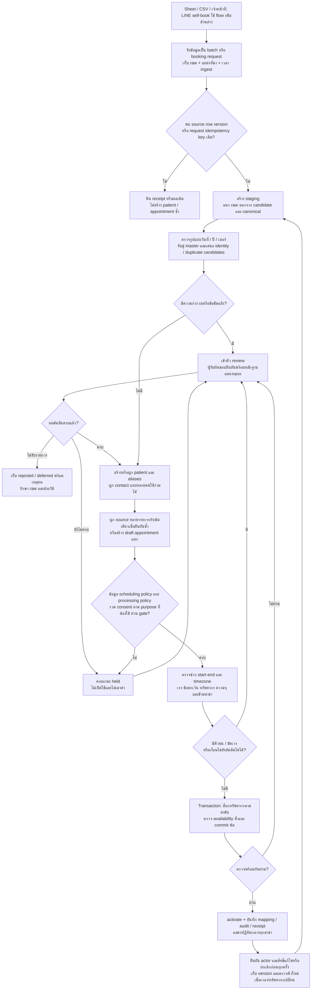
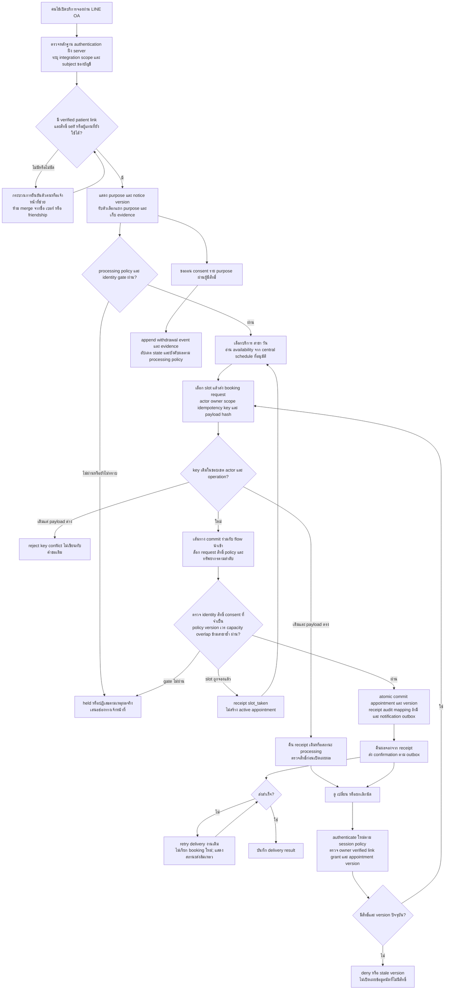

## N3 — To-Be ที่เสนอ (updated: change request)

ข้อเท็จจริงจาก INPUT/N1/N1b: คลินิกมี 3 สาขา ใช้ Sheet แยกสาขาร่วมกับ LINE; ตัวอย่างมีวันที่กำกวม ชื่อ/เบอร์ต่างรูปแบบ ข้อมูลติดต่อไม่ครบ และคู่ต้องสงสัยซ้ำ/ชนคิว ยังไม่มีข้อมูลพอรับรองระยะเวลา ความจุ timezone เวร หรือกฎการจอง รายละเอียดด้านล่างเป็น **ข้อเสนอระบบ** ต้องให้ผู้รับผิดชอบยืนยันค่ากำหนดก่อน activate ไม่ใช่ข้อเท็จจริงที่เติมให้ CSV

### To-Be flowchart — เส้นทางนำเข้าและเจ้าหน้าที่ (updated: change request)

ระบบกลางเป็นจุดอนุมัติคิว; Sheet/LINE เป็นช่องทางรับคำขอและแสดงผลตามวิธีเชื่อมต่อที่คลินิกอนุมัติ การป้องกันชนคิวต้องทำใน transaction รวมทรัพยากรเดียวกันข้ามสาขาและรับมือการจองพร้อมกัน การ sync สำเนาตามหลังอย่างเดียวไม่รับรองว่าจะไม่มีการจองซ้ำ

### ER diagram หลัก — ปรับ optional สำหรับ draft/held (updated: change request)

```mermaid
erDiagram
    PATIENT ||--o{ PATIENT_ALIAS : has
    PATIENT ||--o{ PATIENT_CONTACT : uses
    CONTACT_POINT ||--o{ PATIENT_CONTACT : shared_by
    PATIENT o|--o{ APPOINTMENT : attends
    BRANCH o|--o{ APPOINTMENT : hosts
    SERVICE o|--o{ APPOINTMENT : requested_service
    APPOINTMENT ||--o{ APPOINTMENT_RESOURCE : reserves
    RESOURCE ||--o{ APPOINTMENT_RESOURCE : allocated
    RESOURCE ||--o{ RESOURCE_SCHEDULE : availability
    BRANCH ||--o{ RESOURCE_SCHEDULE : located_at
    RESOURCE ||--o{ SCHEDULE_EXCEPTION : overrides
    BRANCH o|--o{ SCHEDULE_EXCEPTION : applies_at
    POLICY_VERSION o|--o{ APPOINTMENT : validated_under
    IMPORT_BATCH ||--o{ SOURCE_RECORD : contains
    SOURCE_RECORD ||--o{ STAGING_CANDIDATE : interpretations
    SOURCE_RECORD ||--o{ REVIEW_DECISION : reviewed
    REVIEW_DECISION o|--o{ CANONICAL_MAPPING : authorizes
    SOURCE_RECORD ||--o{ CANONICAL_MAPPING : maps_to
    PATIENT o|--o{ CANONICAL_MAPPING : resolved_patient
    APPOINTMENT o|--o{ CANONICAL_MAPPING : resolved_appointment

    PATIENT {
        uuid patient_id PK
        string display_name
        string identity_state
        int version
    }
    PATIENT_ALIAS {
        uuid alias_id PK
        uuid patient_id FK
        string alias_text
        string language_optional
        string verification_state
        uuid source_record_id FK
    }
    CONTACT_POINT {
        uuid contact_id PK
        string channel
        string namespace_optional
        string raw_value
        string normalized_value
        string verification_state
    }
    PATIENT_CONTACT {
        uuid patient_id PK,FK
        uuid contact_id PK,FK
        string relationship_optional
        boolean preferred
        string contact_permission_state
    }
    BRANCH {
        uuid branch_id PK
        string name
        string timezone_iana
        string config_state
    }
    SERVICE {
        uuid service_id PK
        string name
        int default_duration_minutes_optional
        string config_state
    }
    RESOURCE {
        uuid resource_id PK
        string type
        string display_name
        string config_state
    }
    RESOURCE_SCHEDULE {
        uuid schedule_id PK
        uuid resource_id FK
        uuid branch_id FK
        date effective_from
        date effective_to_optional
        string recurrence_rule
        time local_start
        time local_end
        string timezone_iana
        string approval_state
        uuid source_record_id_optional FK
    }
    SCHEDULE_EXCEPTION {
        uuid exception_id PK
        uuid resource_id FK
        uuid branch_id_optional FK
        datetime start_at
        datetime end_at
        string exception_type
        string reason
        string approval_state
    }
    APPOINTMENT {
        uuid appointment_id PK
        uuid patient_id_optional FK
        uuid branch_id_optional FK
        uuid service_id_optional FK
        datetime start_at_optional
        datetime end_at_optional
        string timezone_iana_optional
        string status
        uuid policy_version_id_optional FK
        int version
        datetime created_at
        datetime updated_at
    }
    APPOINTMENT_RESOURCE {
        uuid appointment_id PK,FK
        uuid resource_id PK,FK
        string role
        decimal units
    }
    POLICY_VERSION {
        uuid policy_version_id PK
        json approved_rules
        string scope
        string approval_state
        string approved_by
        datetime approved_at
        datetime effective_from
        datetime effective_to_optional
    }
    IMPORT_BATCH {
        uuid batch_id PK
        string source_system
        string source_locator
        string artifact_hash
        string importer_version
        datetime ingested_at
    }
    SOURCE_RECORD {
        uuid source_record_id PK
        uuid batch_id FK
        string source_entity_key
        string source_version_key
        int source_row_number_optional
        json raw_payload
        string payload_hash
        string idempotency_key UK
        datetime source_updated_at_optional
        datetime ingested_at
        string processing_state
    }
    STAGING_CANDIDATE {
        uuid candidate_id PK
        uuid source_record_id FK
        string target_field_or_match
        json proposed_value
        string rule_version
        json evidence
        string resolution_state
    }
    REVIEW_DECISION {
        uuid decision_id PK
        uuid source_record_id FK
        string target_type
        string target_id_optional
        string decision_type
        json before_after_and_related_ids
        string reviewer_id
        datetime decided_at
        string reason
        json evidence
        uuid supersedes_decision_id_optional FK
    }
    CANONICAL_MAPPING {
        uuid mapping_id PK
        uuid source_record_id FK
        uuid patient_id_optional FK
        uuid appointment_id_optional FK
        uuid decision_id_optional FK
        string resolution_method
        string rule_version_optional
        string mapping_state
        datetime mapped_at
    }
```

### ความหมายและข้อกำหนดของแบบจำลอง

- **ตัวตน:** `patient_id` เป็นกุญแจถาวร ชื่อไทย/อังกฤษเก็บเป็น aliases หลังยืนยัน ไม่ใช้ชื่อหรือเบอร์เป็น unique key ของคนไข้ `PATIENT_CONTACT` รองรับหลายคนใช้เบอร์หรือ LINE เดียวกันและคนหนึ่งมีหลายช่องทาง (updated: change request) `CONTACT_POINT.channel` รองรับ phone/LINE เป็นข้อมูลติดต่อเท่านั้น; authenticated LINE identity ต้องอยู่ใน LINE_ACCOUNT และ verified patient link ของ diagram เพิ่มด้านล่าง โดยมี account scope ชัดเจนทุกครั้ง การลบขีดหรือช่องว่างในเบอร์ใช้สร้าง candidate เท่านั้น การแปลงรหัสประเทศต้องมี convention ที่อนุมัติ เบอร์และ LINE เป็น optional; ไม่สร้างค่าปลอมให้แถว 3
- **แหล่งที่มา:** เก็บ raw แบบไม่แก้ทับ พร้อม file/Sheet locator, tab/row หรือ stable source ID เมื่อมี และ source version เมื่อมี `ingested_at` คือเวลารับข้อมูล ไม่ใช่เวลาจองเดิม ช่อง raw ที่ระบุ “ว่าง” คงข้อความเดิมไว้; candidate null แยกต่างหากและใช้กฎที่บันทึก version แล้ว
- **Idempotency:** มี unique index บน `idempotency_key` พร้อม processing state/receipt ที่ commit ร่วมกับ canonical mapping สำหรับ CSV ที่ไม่มี source ID ใช้ source namespace + artifact hash + row index เป็น key ของ record เดิม การ import ไฟล์เดิมซ้ำจึงไม่สร้างนัดเพิ่ม แต่ไฟล์ที่แก้หรือเรียงแถวใหม่เป็นอีก artifact ต้องตรวจจับคู่ใหม่ ห้ามอ้างว่า key นี้แก้ cross-file duplicates ได้ สำหรับ API/LINE ต้องมี source event/request ID; version ใหม่ของ source entity เดิมเข้าสู่เส้นทาง update/review ไม่ถูกทิ้งเพราะ entity ID เหมือนกัน
- **Canonical mapping:** หลาย source records ผูกกับ appointment เดียวได้หลังยืนยัน เช่น 1/2 และเก็บ raw/หมายเหตุทั้งคู่ `CANONICAL_MAPPING` ต้องมี patient หรือ appointment อย่างน้อยหนึ่งรายการ; ถ้ามีทั้งคู่ patient ต้องตรงกับ appointment การย้าย mapping หรือแก้ข้อสรุปสร้างประวัติใหม่ ห้ามลบหลักฐานเดิม รายการที่ตัดสินโดยมนุษย์ต้องอ้าง `decision_id`; การแปลง deterministic ต้องมี rule version ที่ตรวจสอบย้อนหลังได้
- **Manual decisions:** เก็บผู้ตัดสิน เวลา เหตุผล หลักฐาน ค่าเดิม/ใหม่ และ source/candidate/canonical IDs ที่เกี่ยวข้อง การยืนยันว่าเป็นคนเดียวกันกับการยืนยันว่านัดเดียวกันเป็นคนละ decision; การยืนยันวัน เวร และการแก้คิวชนก็แยกกัน ระบบใช้ decision ล่าสุดที่ยังมีผลและเก็บรายการที่ supersede ไว้
- **เวลาและทรัพยากร:** draft อนุญาตค่าเวลาหรือ master ที่ยังขาด; active ต้องมี FK/ช่วงเวลาครบตามกฎที่อนุมัติ `start_at/end_at` เก็บเป็น instant พร้อม IANA timezone ที่ใช้ตีความ local time และต้องมี `end_at > start_at` ตรวจ overlap ด้วยช่วง `[start,end)` ตามข้อเสนอที่ต้องรับรอง หากมี buffer ให้คำนวณตาม policy ที่อนุมัติ ห้ามแปลงเวลาเป็น UTC จนกว่า timezone ได้รับการยืนยัน
- **หมอข้ามสาขา:** ใช้ RESOURCE เดียวต่อหมอที่ยืนยันตัวตนแล้วทุกสาขา ไม่สร้างหมอแยกตาม Sheet; schedule ระบุสาขา recurrence ช่วงเวลามีผล timezone และ exceptions หมายเหตุ “ทุกวันพุธ” ยังเป็นหลักฐานเสนอเวร ไม่มีเวลาเริ่ม/เลิกหรือขอบเขตวันที่พอสร้างเวรใช้งานจริง ห้อง/เก้าอี้เพิ่มเป็น resource เมื่อคลินิกยืนยันว่าต้องใช้ตรวจคิว
- **Policy ก่อน activate:** ผู้รับผิดชอบต้องยืนยันระยะเวลาหรือ end time รายบริการ/รายนัด, timezone, ตารางเวรและข้อยกเว้น, ทรัพยากรที่ต้องจองและจำนวนที่ใช้, ความจุแต่ละทรัพยากรตามช่วงมีผล, สถานะใดกินคิว, buffer/เวลาเดินทางข้ามสาขารวมถึงกรณีไม่ต้องใช้, และข้อกำหนดการติดต่อขั้นต่ำ `approved_rules` เก็บค่าเหล่านี้ตาม scope พร้อม approver/version โดยไม่ใส่ค่าเริ่มต้นที่เดาจาก CSV การมี default duration ใน SERVICE ยังไม่ทำให้ใช้งานได้จน config อนุมัติ และใช้คำนวณ end time ที่เก็บจริงในนัด ไม่เปลี่ยนย้อนหลังตาม default ใหม่
- **ความถูกต้องขณะจอง:** lock และตรวจทรัพยากรทั้งหมดของนัด รวมหมอเดียวกันข้ามสาขา โดยคำนึงถึง overlap/capacity/เวร/buffer ตาม policy สถานะ held ไม่ถือเป็นนัด activate; ถ้าต้องการ soft hold ที่กันคิวจริงต้องกำหนดระยะเวลาและผลต่อความจุเพิ่มก่อนใช้

### เส้นทางของตัวอย่างทั้ง 5 แถว

| แถว | ผลที่ต้องได้ก่อน activate |
|---|---|
| 1–2 | เสนอคู่ซ้ำและ candidate วันของ 1; แถว 2 มีวัน ISO ชัดเจน แต่ยังไม่เลือกระเบียนหลักหรือรวมคนไข้/นัดเอง เมื่อผู้รับผิดชอบยืนยันจึงผูก provenance ทั้งสองกับนัดเดียว |
| 3 | ยืนยันปี/ศักราชของ 69 และ identity; ไม่มีเบอร์ได้ตาม policy ที่อนุมัติ ถ้าต้องติดต่อ LINE ต้องได้ตัวระบุจริง ไม่เติมจากข้อความหมายเหตุ |
| 4 | ยืนยัน DMY/MDY แยกจากแถว 2 ซึ่งอยู่คนละสาขา; ตรวจคิวกับ 3 เมื่อวัน หมอบี และรายละเอียดทรัพยากรได้รับการยืนยัน |
| 5 | ทั้ง 2026-03-09 (จันทร์) และ 2026-09-03 (พฤหัสบดี) ไม่ตรงพุธ จึง held เพื่อยืนยันวันและเวร/ข้อยกเว้น ไม่เลื่อนวันเอง; ชื่ออังกฤษและเบอร์ร่วมกับ 1/2 เป็น identity candidate เท่านั้น และนัดต่างสาขา/บริการ/เวลาไม่รวมอัตโนมัติ |

ผู้รับผิดชอบที่ต้องแต่งตั้งเป็นข้อเสนอ: เจ้าหน้าที่ข้อมูลยืนยัน raw/รูปแบบวันและตัวตน; ผู้จัดการสาขาหรือผู้จัดเวรรับรองทรัพยากร/เวร/นโยบาย; ผู้มีสิทธิ์จัดคิวตัดสินการแก้ conflict ทั้งหมดบันทึกใน decision/config audit ก่อนเปิดใช้งาน

### ขอบเขต requirement และ gate (updated: change request)

ทุกส่วนในหัวข้อที่มีเครื่องหมายนี้เป็นการปรับจาก change request รวม diagram และกติกาภายในหัวข้อนั้น Diagram เพิ่มด้านล่างอ้าง entity ชื่อเดียวกับ diagram หลักเป็นตารางเดียวกัน; ฟิลด์ที่แสดงซ้ำใน APPOINTMENT เป็นส่วนต่อเติม ไม่ใช่อีกตาราง

การเก็บ consent เป็นราย purpose และ notice version; ไม่ใช้ checkbox เดียวอนุญาตทุกกิจกรรม ผู้รับผิดชอบคลินิกต้องรับรอง processing basis, ขอบเขตข้อมูล/ผู้รับ, notice, ผู้แทน/ผู้เยาว์, retention และผลการถอนของแต่ละ purpose ก่อนเปิดใช้ ไม่มีหลักฐานเพียงพอระบุฐานกฎหมายหรือจำนวนวันเก็บข้อมูลในงานนี้ `PROCESSING_POLICY` แยกจาก `POLICY_VERSION` ด้านตารางนัด และไม่ถือว่าการรักษา การจอง การแจ้งเตือน หรือการตลาดต้องใช้ consent เหมือนกันทั้งหมด

Gate ประเมินเฉพาะ purpose ที่กิจกรรมนั้นต้องใช้ตาม policy ที่อนุมัติ หาก policy ต้องใช้ consent ให้ granted ที่ยังมีผลและตรง purpose/version ผ่าน; unknown, denied และ withdrawn เป็นคนละสถานะและจัดการตาม policy หากฐานอื่นที่รับรองรองรับกิจกรรมนั้น ให้ประเมินตามฐานนั้นโดยไม่ backfill consent การปฏิเสธ purpose ทางเลือกไม่ปิดสิทธิ์จองหรือบริการที่มีฐานรองรับ การไม่มีหลักฐานใน CSV ไม่ใช่คำวินิจฉัยว่าการรักษาผิดกฎหมาย; หากตัดสิน gate ไม่ได้ให้ held และส่งเจ้าหน้าที่ตรวจ

### LINE OA self-booking และถอนความยินยอม (updated: change request)

การเปลี่ยน/ยกเลิกใช้ `operation` และ target appointment ใน request เส้นทางเดียวกัน แต่ตรวจ policy ของ operation นั้นโดยเฉพาะ: cancel ไม่ต้องหาคิวใหม่และไม่บังคับ granted สำหรับ purpose การตลาด; reschedule ตรวจคิวใหม่ก่อนย้ายภายใน transaction เดียว ล้มเหลวต้องคงนัดเดิม การดูผล/retry ต้องตรวจสิทธิ์ด้วย ไม่ใช้ idempotency key เป็นสิทธิ์เข้าถึง ระบบแสดงเฉพาะ slot ว่าง ไม่แสดงข้อมูลผู้ป่วยคนอื่น คิวที่แสดงเป็น snapshot จึงต้องตรวจซ้ำตอน commit

### ER extension — consent, identity, authorization และ delivery (updated: change request)

```mermaid
erDiagram
    PURPOSE ||--o{ PURPOSE_VERSION : versions
    PURPOSE_VERSION ||--o{ NOTICE_PURPOSE : described_by
    NOTICE_VERSION ||--o{ NOTICE_PURPOSE : covers
    PURPOSE_VERSION ||--o{ PROCESSING_POLICY : governed_by
    PATIENT ||--o{ PATIENT_PURPOSE_STATE : state_for
    PURPOSE_VERSION ||--o{ PATIENT_PURPOSE_STATE : tracks
    CONSENT_EVENT o|--o{ PATIENT_PURPOSE_STATE : last_event
    PATIENT ||--o{ CONSENT_EVENT : subject
    PURPOSE_VERSION ||--o{ CONSENT_EVENT : decision_on
    NOTICE_VERSION o|--o{ CONSENT_EVENT : presented_notice
    PROCESSING_POLICY o|--o{ CONSENT_EVENT : evaluated_under
    CONSENT_EVENT ||--o{ CONSENT_EVIDENCE : supported_by
    CONSENT_EVENT o|--o{ CONSENT_EVENT : references_prior
    LINE_SCOPE ||--o{ LINE_ACCOUNT : namespaces
    LINE_ACCOUNT ||--o{ AUTH_SESSION : authenticates
    LINE_ACCOUNT ||--o{ PATIENT_ACCOUNT_LINK : linked_account
    PATIENT ||--o{ PATIENT_ACCOUNT_LINK : verified_subject
    PATIENT_ACCOUNT_LINK o|--o{ AUTHORIZATION_GRANT : supports
    PATIENT ||--o{ AUTHORIZATION_GRANT : covers_patient
    LINE_ACCOUNT o|--o{ AUTHORIZATION_GRANT : grantee_account
    APPOINTMENT o|--o{ AUTHORIZATION_GRANT : optional_target
    LINE_ACCOUNT o|--o{ CONSENT_EVENT : acting_account
    AUTHORIZATION_GRANT o|--o{ CONSENT_EVENT : representative_authority
    LINE_ACCOUNT o|--o{ APPOINTMENT : booking_owner
    LINE_ACCOUNT o|--o{ BOOKING_REQUEST : requester
    AUTH_SESSION o|--o{ BOOKING_REQUEST : authenticates_request
    PATIENT_ACCOUNT_LINK o|--o{ BOOKING_REQUEST : resolves_patient
    AUTHORIZATION_GRANT o|--o{ BOOKING_REQUEST : authorizes_operation
    PATIENT o|--o{ BOOKING_REQUEST : requested_patient
    APPOINTMENT o|--o{ BOOKING_REQUEST : targets_existing
    APPOINTMENT o|--o{ BOOKING_REQUEST : committed_result
    BOOKING_REQUEST ||--o| REQUEST_RECEIPT : yields
    BOOKING_REQUEST ||--o{ POLICY_EVALUATION : gate_history
    PROCESSING_POLICY ||--o{ POLICY_EVALUATION : applied_policy
    CONSENT_EVENT o|--o{ POLICY_EVALUATION : consent_evidence
    BOOKING_REQUEST ||--o{ OPERATION_AUDIT : records
    APPOINTMENT o|--o{ OPERATION_AUDIT : changed
    APPOINTMENT ||--o{ NOTIFICATION_OUTBOX : emits
    LINE_ACCOUNT o|--o{ NOTIFICATION_OUTBOX : recipient
    NOTIFICATION_OUTBOX ||--o{ DELIVERY_ATTEMPT : attempts

    PURPOSE {
        uuid purpose_id PK
        string code UK
    }
    PURPOSE_VERSION {
        uuid purpose_version_id PK
        uuid purpose_id FK
        int version
        string description
        string scope
        string approval_state
    }
    NOTICE_VERSION {
        uuid notice_version_id PK
        string version
        string locale
        string content_ref
        string content_hash
        string approval_state
        datetime effective_from_optional
    }
    NOTICE_PURPOSE {
        uuid notice_version_id PK,FK
        uuid purpose_version_id PK,FK
    }
    PROCESSING_POLICY {
        uuid processing_policy_id PK
        uuid purpose_version_id FK
        string activity_scope
        string basis_code_pending_review
        boolean consent_required_optional
        json withdrawal_and_version_rules
        string retention_policy_ref_optional
        string approval_state
        string approved_by_optional
        datetime approved_at_optional
        datetime effective_from_optional
        datetime effective_to_optional
    }
    PATIENT_PURPOSE_STATE {
        uuid patient_id PK,FK
        uuid purpose_version_id PK,FK
        string state
        string evidence_state
        uuid last_event_id_optional FK
        int revision
    }
    CONSENT_EVENT {
        uuid consent_event_id PK
        uuid patient_id FK
        uuid purpose_version_id FK
        uuid notice_version_id_optional FK
        uuid processing_policy_id_optional FK
        string event_type
        string actor_kind
        string actor_ref
        uuid actor_account_id_optional FK
        uuid authorization_grant_id_optional FK
        string collector_ref
        string channel
        datetime occurred_at_optional
        datetime recorded_at
        uuid prior_event_id_optional FK
        string event_idempotency_key UK
    }
    CONSENT_EVIDENCE {
        uuid evidence_id PK
        uuid consent_event_id FK
        string artifact_ref
        string artifact_hash
        string capture_method
        string verification_state
        json provenance
    }
    LINE_SCOPE {
        uuid line_scope_id PK
        string integration_config_ref
        string provider_channel_oa_scope
        string verification_state
    }
    LINE_ACCOUNT {
        uuid line_account_id PK
        uuid line_scope_id FK
        string subject_identifier
        string state
    }
    AUTH_SESSION {
        uuid session_id PK
        uuid line_account_id FK
        string verified_method
        string evidence_ref
        datetime authenticated_at
        datetime expires_at
        datetime revoked_at_optional
    }
    PATIENT_ACCOUNT_LINK {
        uuid link_id PK
        uuid patient_id FK
        uuid line_account_id FK
        string relationship
        string verification_state
        string method_optional
        string evidence_ref_optional
        string verified_by_optional
        datetime verified_at_optional
        datetime revoked_at_optional
        int version
    }
    AUTHORIZATION_GRANT {
        uuid grant_id PK
        uuid patient_id FK
        uuid grantee_account_id_optional FK
        string staff_actor_ref_optional
        uuid link_id_optional FK
        uuid appointment_id_optional FK
        json allowed_operations
        string authority_type
        string evidence_ref
        string policy_ref
        datetime valid_from
        datetime valid_to_optional
        datetime revoked_at_optional
        int version
    }
    APPOINTMENT {
        uuid appointment_id PK
        uuid booking_owner_account_id_optional FK
        string origin
    }
    BOOKING_REQUEST {
        uuid request_id PK
        string channel
        string operation
        string request_scope
        string idempotency_key
        string payload_hash
        uuid actor_account_id_optional FK
        uuid auth_session_id_optional FK
        uuid verified_link_id_optional FK
        uuid authorization_grant_id_optional FK
        uuid requested_patient_id_optional FK
        uuid target_appointment_id_optional FK
        uuid result_appointment_id_optional FK
        int expected_appointment_version_optional
        json slot_selection_optional
        string schedule_snapshot_version_optional
        string status
        datetime received_at
    }
    REQUEST_RECEIPT {
        uuid receipt_id PK
        uuid request_id UK,FK
        string outcome
        json authorized_result
        datetime recorded_at
    }
    POLICY_EVALUATION {
        uuid evaluation_id PK
        uuid request_id FK
        uuid processing_policy_id FK
        uuid consent_event_id_optional FK
        string observed_consent_state
        int observed_state_revision_optional
        string outcome
        datetime evaluated_at
    }
    OPERATION_AUDIT {
        uuid audit_id PK
        uuid request_id FK
        uuid appointment_id_optional FK
        string actor_ref
        string authorization_snapshot_ref
        json before_after_version
        string outcome_reason
        datetime recorded_at
    }
    NOTIFICATION_OUTBOX {
        uuid outbox_id PK
        uuid appointment_id FK
        int appointment_version
        uuid recipient_account_id_optional FK
        string channel
        string delivery_dedupe_key UK
        string payload_template_ref
        string policy_evaluation_ref
        string status
        datetime next_attempt_at_optional
    }
    DELIVERY_ATTEMPT {
        uuid attempt_id PK
        uuid outbox_id FK
        datetime attempted_at
        string provider_message_id_optional
        string outcome
        string error_code_optional
    }
```

### ข้อบังคับข้อมูลและ transaction เพิ่มเติม (updated: change request)

- **Consent/history:** `state` ใช้ unknown / granted / denied / withdrawn; absence ของ state หมายถึง unknown เช่นกัน `event_type` เป็น grant / deny / withdraw / corrected evidence; ไม่สร้าง grant/deny event สำหรับ CSV ที่ไม่มีหลักฐาน State เป็น projection จากประวัติที่ตรวจสอบได้ การถอนหรือแก้ข้อมูลเพิ่ม event พร้อม prior reference ไม่แก้ประวัติเดิม; บันทึกเวลาที่ผู้ใช้ตัดสินกับเวลารับเข้าแยกกัน และเรียงเหตุการณ์อย่างมี revision ไม่ใช้เวลาเครื่องลูกข่ายล้วน ๆ `last_event_id` ต้องเป็นของ patient/purpose เดียวกัน
- **Notice/evidence:** grant หรือ deny ใหม่ต้องผูก notice version ที่แสดงจริงและ purpose version ที่ notice ครอบคลุม เก็บข้อความฉบับนั้นหรือ immutable reference/hash พร้อมการกระทำของผู้ใช้ ผู้ให้ความยินยอม ผู้เก็บ ช่องทาง เวลา และหลักฐาน; การแสดง notice/เพิ่มเพื่อน OA ไม่เท่ากับ grant หนึ่ง event มี evidence ได้หลายชิ้น และ event ที่จะใช้เป็นหลักฐานผ่าน gate ต้องมี evidence ที่ตรวจสอบแล้วอย่างน้อยหนึ่งชิ้น Withdrawal ผูก prior event เมื่อทราบ ถ้าประวัติเดิม unknown ก็รับคำขอถอนพร้อมหลักฐานได้โดยไม่แต่ง grant ย้อนหลัง ไม่ถือว่า consent ฉบับเก่าครอบคลุม purpose/notice ใหม่อัตโนมัติ
- **ผลการถอน:** authenticate และตรวจสิทธิ์ผู้ป่วย/ผู้แทนก่อนรับคำสั่ง ถอนเป็นราย purpose แล้วอัปเดต state และหยุดกิจกรรมในขอบเขตที่ policy กำหนด รวมคิวข้อความที่ยังไม่ส่ง ไม่ลบนัดหรือประวัติทั้งหมดอัตโนมัติ ไม่เปลี่ยน basis ย้อนหลังเพื่อหลบการถอน ต้องรับรอง retention/access/การลบตามข้อมูลและวัตถุประสงค์จริง ประวัติแบบ append-only หมายถึงการแก้เชิงธุรกรรมต้องตรวจย้อนหลังได้ ไม่ใช่สั่งเก็บข้อมูลตลอดไป
- **LINE identity:** unique `(line_scope_id, subject_identifier)` โดย scope มาจาก integration ที่ตรวจสอบแล้ว ไม่รวมบัญชีข้าม provider/channel/OA จาก subject string อย่างเดียว ตรวจ authentication token/assertion และ event authenticity ฝั่ง server ตามวิธีที่จะรับรองจริงก่อนสร้าง session/รับเหตุการณ์ ไม่เก็บ token ลับใน audit ข้อกำหนดเฉพาะ LINE Login/LIFF/Messaging API, การตรวจ signature/token, token lifetime และ retry ยังรอตรวจเอกสาร implementation; ไม่มีการยืนยันสเปกหรือเรียก network ในงานนี้
- **Contact กับ link:** CONTACT_POINT เป็นข้อมูลติดต่อที่แชร์ได้ ไม่ทำหน้าที่ login หรือ ownership PATIENT_ACCOUNT_LINK ต้องมี method/evidence/ผู้ยืนยัน/เวลาเมื่อ verified; shared contact, display name, phone และ friendship ไม่สร้าง link หรือ merge patient อัตโนมัติ บัญชีผู้ปกครองอาจเชื่อมหลาย patient ได้แต่ทุก link/สิทธิ์ผู้แทนต้องมีหลักฐานแยก การรวมคนไข้ใน migration ไม่สร้างสิทธิ์ LINE ให้เอง
- **Authorization/owner:** LINE self-book ต้องมี active session, verified non-revoked link และ grant ที่อนุญาต operation สำหรับ patient/appointment นั้น `AUTHORIZATION_GRANT` ระบุ account หรือ staff actor อย่างใดอย่างหนึ่ง และถ้ามี link ต้องตรง patient/account grant เป็น self หรือ representative ตาม policy ที่รับรอง การเป็น booking owner เพียงอย่างเดียวไม่พอดู/แก้/ยกเลิกนัดเมื่อ link/grant ถูกถอน; ต้องตรวจสิทธิ์ปัจจุบันทุกครั้ง ชื่อ/เบอร์/การรู้ appointment ID ไม่ให้สิทธิ์ Legacy owner เป็น null; เมื่อยืนยันภายหลังให้ claim/link พร้อม audit ไม่เขียนว่าเป็น self-book มาแต่เดิม
- **Optional และ integrity:** `o|`/`_optional` อนุญาต unresolved, draft, held หรือ legacy เท่านั้นตามสถานะ APPOINTMENT ที่ active ต้องมี patient/branch/service/เวลา/timezone/scheduling policy ครบ ส่วน consent event/LINE account ไม่ใช่ required FK ของนัดทั้งหมด Draft request มี result appointment, receipt, policy evaluations เป็นศูนย์ได้; terminal request ต้องมี receipt หนึ่งรายการ success create จึงต้องมี result appointment, change/cancel ต้องมี target และ expected version และ result ตรง target; failed/slot_taken ไม่สร้างนัดใหม่ Grant, request, link และนัดต้องอ้าง patient/account สอดคล้องกัน enforced ด้วย constraints และ transaction verification
- **Unknown policy:** policy ที่ยังไม่ทราบ consent_required ใช้ null และ approval_state=pending_review ไม่ตีความ false; ประเมินแล้วได้ unresolved gate ต้อง held พร้อมเหตุผล ไม่มีการสมมติ retention หรือฐานกฎหมายจากชื่อ purpose NOTICE_VERSION/PURPOSE_VERSION ที่รับรองแล้วเก็บ revision ที่อ้างอิงเดิมได้ ไม่แก้เนื้อหาทับโดยใช้ ID เดิม
- **Idempotency/concurrency:** unique `(request_scope, operation, idempotency_key)` โดย request_scope ผูก authenticated actor และ integration; payload เดิมคืนผลเดิม payload ต่าง reject และ concurrent request เดียวให้มีผู้ commit เพียงรายเดียว Retry ขณะ processing คืนสถานะ/รอผล ไม่สร้างคำขอจองซ้ำ การเลือก slot ใหม่หลัง slot_taken ต้องเป็น request ใหม่พร้อม key ใหม่ และ payload hash ต้องรวม patient/operation/target/version/slot ใช้ source event ID รับมือ webhook delivery ซ้ำแยกจาก logical booking request key
- **Atomic gate และคิว:** ภายใน transaction ตรวจ session/link/grant, policy approvals/versions และ consent state revision ซ้ำพร้อม scheduling/capacity ทุก resource; serialize หรือ compare revisions กับการถอนสิทธิ์/consent และการแก้เวร เพื่อไม่ commit จาก gate เก่า ล็อกทรัพยากรตามลำดับเดียวทุกช่องทาง รวมหมอข้ามสาขา ใน success transaction เดียวบันทึก appointment/version, mapping หากมี, receipt, audit และ outbox Failure rollback การจองทั้งหมดและบันทึก failure receipt อย่าง idempotent; timeout หลัง commit ตรวจ receipt ก่อน retry
- **แก้/ยกเลิก/แจ้งเตือน:** reschedule ใช้ expected version และย้ายทรัพยากร atomically ไม่ปล่อยคิวเดิมจนคิวใหม่ผ่าน; cancel เปลี่ยนสถานะ/คืน capacity ตาม policy และ version ไม่ลบประวัติ outbox unique ตาม appointment/version/recipient/message kind; worker retry เฉพาะ delivery และตรวจสถานะนัด/สิทธิ์ผู้รับ/processing policy ปัจจุบันก่อนส่ง เก็บ attempts/provider result ไม่มีการรับรอง exactly-once ของข้อความเมื่อ provider รับแล้วแต่ response หาย; appointment ยังคงมีหนึ่งรายการ ไม่ส่งข้อมูลผู้ป่วยไป shared contact โดยไม่มีสิทธิ์ยืนยัน

### ผลต่อข้อมูลเดิมและเกณฑ์ยอมรับเพิ่ม (updated: change request)

ทั้ง 5 แถวคงข้อวินิจฉัย N1b และเส้นทางเดิมด้านบน ทุกแถวมี consent evidence unknown/missing และยังไม่มี verified LINE link/booking owner จาก CSV แม้แถว 2/3 มีข้อความ LINE; ไม่สร้าง identifiers, timestamps การยินยอม หรือ self-book origin ย้อนหลัง ระบุ provenance เป็น legacy_import หลังผ่าน review เดิม และใช้ processing policy ที่รับรองตัดสินการเปิดใช้นัด ไม่บังคับให้หลักฐาน consent ทุก purpose ต้อง granted ก่อนให้บริการ

ตรวจยอมรับก่อน rollout: (1) unknown แยกจาก denied/withdrawn และ grant ต้องอ้าง notice/evidence จริง (2) เบอร์ร่วม/ชื่อเหมือน/OA friendship ไม่ merge หรือเปิดดูนัด (3) บัญชีคนอื่นและ revoked grant เปลี่ยน/ยกเลิกไม่ได้ (4) retry key เดิมได้ appointment เดิมและ key เดิม payload ต่างถูก reject (5) สอง request แย่งความจุสุดท้ายสำเร็จได้เพียงหนึ่ง อีกคำขอได้ slot_taken (6) ส่ง confirmation ล้มเหลวแล้ว retry ไม่เพิ่ม appointment (7) reschedule ชนคิวยังเก็บนัดเดิมและ stale version ถูกปฏิเสธ (8) withdrawal ที่แข่งกับ commit หรือข้อความค้างต้องเป็นไปตาม policy/revision (9) legacy import ซ้ำยังรักษา mapping และ unknown ตามเดิม

ผู้รับผิดชอบเพิ่มที่ต้องแต่งตั้ง: เจ้าของ policy/ผู้รับผิดชอบ PDPA ของคลินิกรับรอง purpose, notice, basis, retention และผู้แทน; ผู้ดูแล integration รับรอง LINE scope/authentication และ delivery behavior รายละเอียดเหล่านี้ยังรอตรวจ policy/implementation ก่อนใช้งานจริง ไม่ใช่คำรับรองการปฏิบัติตามกฎหมายหรือสเปก LINE ปัจจุบัน
