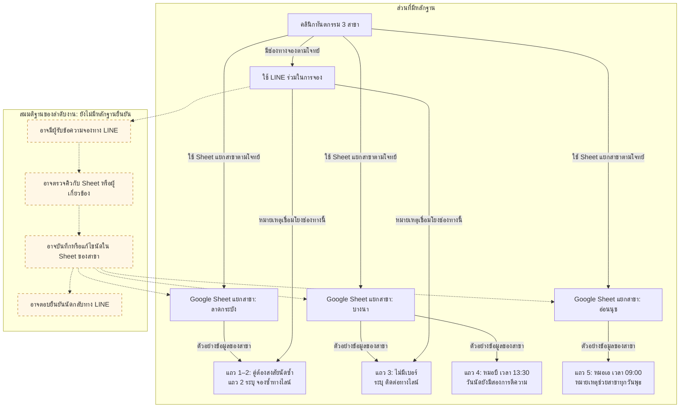
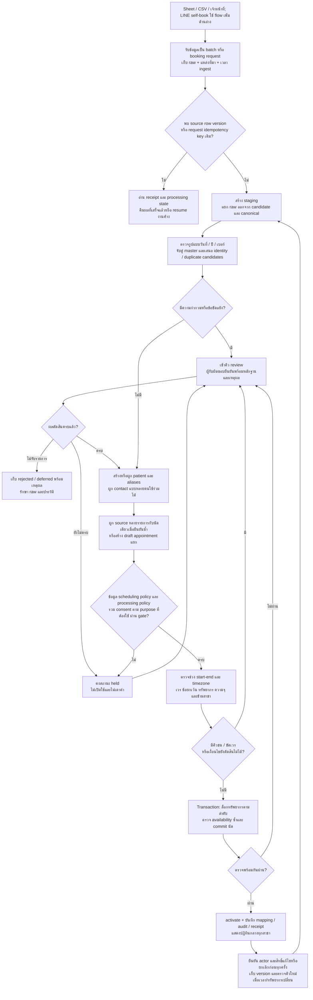
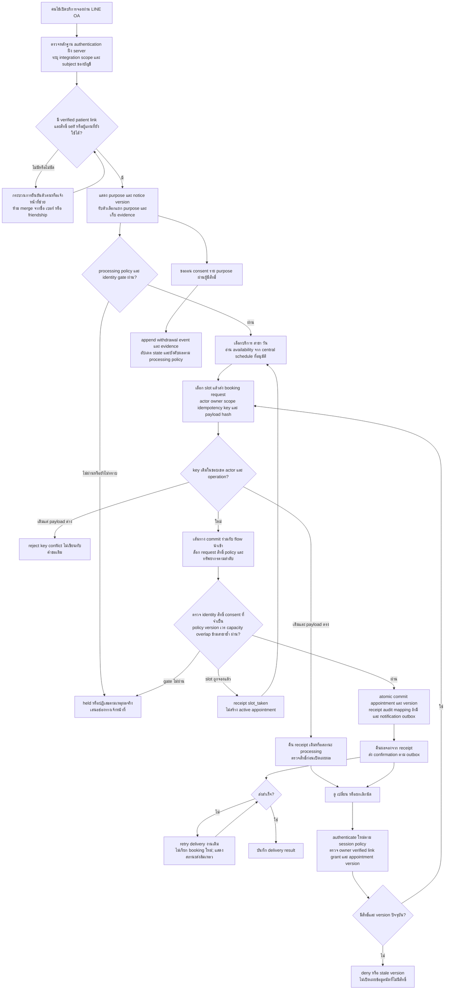

# 1. Execution trace ของการรันซ้ำครั้งนี้ (updated: change request)

## ตารางการรันซ้ำ (updated: change request)

| Node | รันซ้ำหรือไม่? (yes/no) | เหตุผล |
|---|---|---|
| N1 | yes | INPUT เพิ่ม PDPA consent และ LINE OA self-booking แม้ CSV ไม่เปลี่ยน จึงมี completeness findings ใหม่ |
| N1b | yes | ผล N1 เปลี่ยน ต้องตรวจใหม่; หลักฐานของค่ากำกวมเดิมไม่เปลี่ยน ผลลัพธ์จึงเท่าเดิมทุกประการ |
| N2 | yes | Dependency N1 เปลี่ยน ต้องประเมิน As-Is ใหม่; requirement อนาคตไม่เปลี่ยนหลักฐาน As-Is จึงคงผลเดิมทุกประการ |
| N3 | yes | Dependency N1 เปลี่ยน ต้องเพิ่มกระบวนการและ model ของ consent/LINE self-booking |
| N4 | yes | Dependency N1 เปลี่ยน ต้องเพิ่ม mapping/migration/rollback ของข้อมูลใหม่ |
| N5 | yes | ผล N3/N4 เปลี่ยน จึงรวมใหม่ตาม MERGE RULES หลังทุก dependency DONE |

ไม่มี Node ที่เข้าเงื่อนไข no ในรอบนี้: N1 เพิ่มช่องว่างความครบถ้วนที่มีผลต่อปลายทาง จึงทำให้ dependency ของ N2–N4 เปลี่ยนจริง การรันแล้วได้ผลเดิม (N1b/N2) แยกจากการ reuse โดยไม่รัน ไม่ได้แก้ผลเดิมเพื่อทำให้ดูเหมือนมีการเปลี่ยนแปลง

| Node | สถานะ | หมายเหตุ |
|---|---|---|
| N1 | DONE | ผลเปลี่ยน: เพิ่มข้อค้นพบที่มีที่มาจาก requirement ใหม่; findings CSV เดิมคงอยู่ |
| N1b | DONE | ประเมินหลัง N1 DONE; contract เท่าผลเดิมทุกไบต์ ไม่มีหลักฐานใหม่เลือกค่ากำกวม |
| N2 | DONE | รันหลัง N1/N1b DONE อย่างอิสระ; contract เท่าผลเดิมทุกไบต์ |
| N3 | DONE | รันหลัง N1/N1b DONE โดยไม่เห็น N2/N4; เพิ่ม consent/LINE flows และ model |
| N4 | DONE | รันหลัง N1/N1b DONE โดยไม่เห็น N2/N3; เพิ่ม mapping/onboarding/migration |
| N5 | DONE | รับเฉพาะ DONE contracts หลัง N2–N4 ครบ; รวมความต่าง ตรวจแผนภาพ และคงส่วนเดิมที่ไม่เปลี่ยน |

ไม่พบ Node FAILED และไม่ต้อง retry; ไม่มีผลงานขาด หยุดเมื่อ N5 DONE ข้อมูลหรือ policy ที่ยังรอยืนยันไม่ใช่ความล้มเหลวของ Node ในการจัดทำแผน ผลรันเดิมและ trace เดิมคงอยู่; เพิ่มบันทึกเฟส 2 ต่อท้ายเท่านั้น

# 2. ผลงานส่งมอบสุดท้ายที่รวมแล้ว (updated: change request)

## ขอบเขตและหลักฐานต้นทาง (updated: change request)

แผนย้ายระบบนัดหมายคลินิกทันตกรรมจาก Google Sheet แยกสาขาและ LINE สู่ระบบกลาง เอกสารนี้เป็นแบบออกแบบและแผนดำเนินงาน ยังไม่ได้ย้ายข้อมูลจริงหรือรับรองนัดใดให้เปิดใช้งาน

หลักฐานตั้งต้น: “คลินิกทันตกรรม 3 สาขา ใช้ Google Sheet แยกสาขา ร่วมกับจองผ่าน LINE ต้องการย้ายมาระบบนัดหมายกลาง” เลขแถวต่อไปนี้นับเฉพาะข้อมูล ไม่รวม header:

```csv
สาขา,วันที่,เวลา,ชื่อคนไข้,เบอร์,หมอ,บริการ,หมายเหตุ
ลาดกระบัง,03/09/2026,10:00,สมชาย ใจดี,081-234-5678,หมอเอ,ขูดหินปูน,
ลาดกระบัง,2026-09-03,10:00,สมชาย ใจดี,0812345678,หมอเอ,ขูดหินปูน,จองซ้ำทางไลน์
บางนา,3 ก.ย. 69,13:30,คุณมาลี,,หมอบี,จัดฟัน,ไม่มีเบอร์ ติดต่อทางไลน์
บางนา,03/09/2026,13:30,วิชัย ศรีสุข,089-111-2222,หมอบี,อุดฟัน,
อ่อนนุช,09/03/2026,09:00,Somchai Jaidee,081 234 5678,หมอเอ,ตรวจฟัน,หมอเอมาช่วยสาขานี้ทุกวันพุธ
```

ทุก entity, field, บทบาท, สถานะและวิธีควบคุมใน To-Be/Migration/Roll-out เป็น **ข้อเสนอ** ไม่ใช่กฎเดิมที่โจทย์ยืนยัน ไม่กำหนดวันเปิดจริง ระยะเวลาบริการ ความจุ เป้าหมายเชิงตัวเลข หรือเกณฑ์คะแนนจับคู่ที่โจทย์ไม่ได้ให้ การอนุมัติที่ระบุเป็นกิจกรรมในแผนของคลินิก ไม่ใช่การถามผู้ใช้ในการรันนี้

### ข้อกำหนดเพิ่มจากเจ้าของคลินิก (updated: change request)

- “ต้องเก็บความยินยอมของคนไข้ตาม PDPA”
- “คนไข้ต้องจองคิวเองผ่าน LINE OA ได้”

CSV เดิมไม่เปลี่ยน ข้อกำหนดทั้งสองเป็นความต้องการของระบบเป้าหมาย ไม่มีหลักฐานว่าเป็นกระบวนการที่ใช้อยู่แล้ว ทุกส่วนที่เปลี่ยนทำเครื่องหมาย `(updated: change request)` ที่หัวข้อหรือข้อความที่แก้; ถ้า marker อยู่ที่หัวข้อ ให้รวมเนื้อหา ตาราง และ Mermaid ในหัวข้อนั้นด้วย เนื้อหา As-Is และข้อสรุปค่ากำกวมคงผลเดิม เอกสารออกแบบการเก็บและใช้หลักฐาน ไม่ถือว่าการมี consent table ทำให้ปฏิบัติตาม PDPA ครบแล้ว รายละเอียด policy/implementation ยังต้องรับรองตามบริบทจริง ไม่มีการใช้เครือข่ายในรันนี้

## Data Quality Findings — N1 (updated: change request)

นับแถวข้อมูล 1–5 ไม่นับ header; เป็นตัวอย่างเท่านั้น ไม่ใช่สถิติทั้งระบบ

| ปัญหา | แถว | หลักฐานและผลกระทบ |
|---|---|---|
| รูปแบบวันที่และลำดับวัน/เดือนต่างกัน | 1, 3, 4, 5 (เทียบ 2) | 1/4 เป็น 03/09/2026, 5 เป็น 09/03/2026 จึงอาจสลับวันเดือน; 2 เป็น ISO 2026-09-03; 3 เป็น 3 ก.ย. 69 ต้องตีความปีและศักราช ทำให้นัดผิดวันได้ |
| ปีสองหลักและศักราชไม่ระบุ | 3 | 69 อาจหมายถึง พ.ศ. 2569 หรือ ค.ศ. 2069 หรือปีอื่นตาม convention; ห้ามแปลงโดยไม่มีการยืนยัน |
| นัดซ้ำ | 1, 2 | สาขา เวลา หมอ บริการ ชื่อ และเบอร์เมื่อจัดรูปแบบตรงกัน; 2 ระบุ “จองซ้ำทางไลน์”; วันที่ 1 ยังต้องตรวจ ทำให้คิวซ้ำและนับยอดเกิน |
| เบอร์รูปแบบต่างกัน | 1, 2, 4, 5 | ขีด ช่องว่าง และติดกัน; เบอร์ 1/2/5 หลังลบตัวคั่นตรงกัน แต่ยังไม่พิสูจน์ตัวบุคคล อาจเป็นเบอร์ร่วม |
| ขาดช่องทางติดต่อแบบมีโครงสร้าง | 3; LINE ID ไม่อยู่ใน schema ทุกแถว | เบอร์ว่างและระบุ “ไม่มีเบอร์ ติดต่อทางไลน์” แต่ไม่มี LINE ID ใช้เชื่อมอัตโนมัติ/แจ้งเตือนไม่ได้ |
| ชื่อไม่สม่ำเสมอ/ไม่พอระบุตัวตน | 1, 2, 3, 5 | 3 เป็น “คุณมาลี” ไม่ทราบชื่อเต็ม; 5 เป็น Somchai Jaidee เทียบชื่อไทย 1/2 ได้เพียงผู้สมัครจับคู่; เสี่ยงรวมผิดหรือแยกคนเดียวหลายระเบียน |
| ไม่มีกุญแจถาวรและ provenance เพียงพอ | 1–5 | ไม่มี patient_id, appointment_id, source row ID/version, booked_at; แยกการแก้ไขจากการจองใหม่และรันซ้ำอย่างปลอดภัยไม่ได้จาก CSV ลำพัง |
| เสี่ยงชนคิวหมอ | 3, 4 | บางนา หมอบี 13:30 ตรงกัน หากวันของทั้งคู่ตรงกัน; ยังไม่ใช่ข้อพิสูจน์ double booking เพราะวัน/ระยะเวลา/ทรัพยากรและความจุไม่ทราบ |
| หมอหลายสาขาและเงื่อนไขในข้อความ | 1, 2, 5 | หมอเอปรากฏทั้งลาดกระบังและอ่อนนุช; 5 ระบุ “หมอเอมาช่วยสาขานี้ทุกวันพุธ”; ยังไม่มี master ID ยืนยันว่าเป็นหมอคนเดียวและไม่มีตารางเวร/เวลาเดินทาง |
| วันนัดอาจขัดกับวันเวรในหมายเหตุ | 5 | 09/03/2026 มีสองการอ่าน; ต้องตรวจวันในสัปดาห์ ไม่ควรเปลี่ยนวันนัดให้ตรงวันพุธเอง |
| คอลัมน์เดียวเก็บข้อเท็จจริงหลายชนิด | 2, 3, 5 | หมายเหตุปะปนที่มานัดซ้ำ ช่องทางติดต่อ และตารางเวร ทำให้กฎจากข้อความคลาดเคลื่อนได้; หมายเหตุว่าง 1/4 ไม่ถือเป็นข้อผิดพลาด |
| ขาด master และรายละเอียดสำหรับตรวจคิว | 1–5 | ไม่มีรหัสหมอ/สาขา/บริการ เวลาเลิกหรือระยะเวลา สถานะนัด timezone เก้าอี้/ห้อง/ความจุ และเวลาแก้ไข จึงพิสูจน์ availability หรือเลือกข้อมูลล่าสุดไม่ได้; เป็นช่องว่าง schema ไม่ใช่ข้อมูลที่อนุมานเติมได้ |

| แถว | มีค่าที่ตีความได้หลายแบบ | ประเด็นต้องติดตาม |
|---|---|---|
| 1 | ใช่ | วันที่ DMY/MDY; ความสัมพันธ์กับนัดแถว 2 และคนไข้แถว 5 |
| 2 | ใช่ (ความหมายของระเบียน) | วันที่ ISO ไม่กำกวม แต่บันทึกซ้ำของนัดใดและควรเป็นระเบียนหลักใดยังไม่มี ID/เวลาแก้ไข |
| 3 | ใช่ | ปี 69/ศักราช, ชื่อ “คุณมาลี”, ตัวตนและ LINE ที่ใช้ติดต่อ |
| 4 | ใช่ | วันที่ DMY/MDY และการชนคิวกับแถว 3 แบบมีเงื่อนไข |
| 5 | ใช่ | วันที่ DMY/MDY, ชื่อข้ามภาษา/เบอร์ร่วม, ขอบเขตและข้อยกเว้นของ “ทุกวันพุธ” |

### ช่องว่างจากข้อกำหนดใหม่ (updated: change request)

INPUT เพิ่ม “ต้องเก็บความยินยอมของคนไข้ตาม PDPA” และ “คนไข้ต้องจองคิวเองผ่าน LINE OA ได้” ส่วน CSV 5 แถว/8 คอลัมน์ยังเหมือนเดิม ความเปลี่ยนแปลงนี้เพิ่มข้อค้นพบด้านความครบถ้วนเทียบกับระบบเป้าหมาย ไม่ได้พิสูจน์ว่าคลินิกไม่เคยเก็บความยินยอมหรือมีข้อมูลผิดกฎหมาย

| ปัญหา/ช่องว่างใหม่ | แถว | หลักฐานและผลกระทบ |
|---|---|---|
| ไม่มีหลักฐานความยินยอมแบบมีโครงสร้างใน CSV | 1–5 | ไม่มี purpose, notice/version, consent status, ผู้ให้/ผู้รับแทน, เวลาตัดสินหรือถอน และหลักฐาน; ห้ามแปลงนัดเดิมหรือเบอร์/LINE ที่มีให้เป็น consent granted และห้ามถือว่าไม่มีข้อมูลเท่ากับปฏิเสธ |
| ไม่มีข้อมูลผูกบัญชี LINE OA กับตัวคนไข้ที่ยืนยันแล้ว | 1–5; มี LINE hint ใน 2/3 | “จองซ้ำทางไลน์” และ “ไม่มีเบอร์ ติดต่อทางไลน์” ไม่ให้ account scope/user identifier/ผลยืนยัน patient link; ชื่อแสดงผล เบอร์ หรือการเป็นเพื่อน OA ไม่ยืนยันตัวตนหรือความยินยอม เสี่ยงจองให้คนผิดหรือเปิดเผยนัดผิดคน |
| ไม่มีร่องรอยคำขอ self-booking และสิทธิ์ในการจัดการนัด | 1–5 | ไม่มี booking request ID/version, actor/account link, สถานะรับคำขอ/ยืนยัน, หลักฐานการเลือกคิว/การตอบกลับ และเจ้าของคำขอ จึงย้ายเป็นนัดที่คนไข้จองเองหรือระบุ authorization ย้อนหลังไม่ได้ |
| ไม่ทราบขอบเขต purpose/notice/การถอน/นโยบายที่ใช้จริง | 1–5 | Requirement บอกให้เก็บ consent ตาม PDPA แต่ไม่ให้ข้อความ purpose, ฐานการประมวลผลแต่ละงาน, retention, เงื่อนไขผู้แทน/ผู้เยาว์ หรือผลของการถอน; ต้องกำหนดและรับรองก่อนใช้ ไม่แต่งกฎว่าทุกการประมวลผลต้องอาศัย consent หรือถอนแล้วต้องลบนัดทั้งหมด |
| การจองเองต้องอาศัย availability ที่เชื่อถือได้และการจองพร้อมกัน | 1–5; เน้น 3/4 และ 5 | ข้อมูลเดิมยังไม่มี duration/end/เวรที่รับรอง; self-booking เพิ่มความจำเป็นต้องแสดงคิวจากระบบกลาง ตรวจซ้ำตอน commit และแยก failure ของการส่งข้อความจากผลการบันทึกนัด เพื่อไม่ยืนยันคิวชน/สร้างซ้ำ |

ประเด็นกำกวมของค่า CSV และข้อสรุปของ N1b เดิมไม่เปลี่ยน ทั้ง 5 แถวต้องมี consent evidence state = unknown/missing สำหรับการนำเข้าเมื่อไม่มีหลักฐานเพิ่มเติม ซึ่งเป็นสถานะข้อมูล ไม่ใช่คำวินิจฉัยว่าห้ามให้บริการ ห้าม backfill consent/LINE identity/self-booking origin จากหมายเหตุ หากมีหลักฐานอื่นให้ตรวจแหล่งที่มาและผูกหลังยืนยันเท่านั้น

รายละเอียด To-Be ที่ต้องส่งต่อให้ N3/N4: เก็บ purpose/notice versions และ consent events/withdrawal พร้อม evidence; มี LINE account link ที่ตรวจสิทธิ์ได้ แยกจาก shared contact; self-booking ต้องใช้คิวกลางและ idempotent request/transaction ตรวจ race condition; ส่ง confirmation จากผล commit จริงและ retry การส่งโดยไม่จองซ้ำ; migration คง unknown แทนการแต่งความยินยอม; rollout ทดสอบครบวงจรด้วยผู้ใช้ที่ผูกตัวตนแล้ว รายละเอียดทั้งหมดเป็นข้อเสนอออกแบบ ไม่ใช่คำยืนยันกฎหมายหรือสเปก LINE API ปัจจุบัน

## ข้อสรุปแถวกำกวม — N1b

| แถว/ประเด็น | หลักฐาน | ข้อสรุปและสถานะ |
|---|---|---|
| 1 วันที่ | แถว 2 มี 2026-09-03 และสาขา/เวลา/ชื่อ/เบอร์หลังปรับรูปแบบ/หมอ/บริการตรงกับ 1 พร้อม “จองซ้ำทางไลน์” | มีหลักฐานสนับสนุน 2026-09-03 เป็น candidate ของ 1 มากกว่า 2026-03-09 แต่การถือว่าเป็นนัดเดียวกันยังสัมพันธ์กับข้อสรุปนี้; ต้องให้มนุษย์ยืนยันก่อน promote |
| 1–2 นัดซ้ำ | ค่าตรงกันข้างต้นและหมายเหตุแถว 2 | เป็นคู่ต้องสงสัยซ้ำที่มีหลักฐานชัด; ห้ามลบทิ้งหรือเลือกแถวล่าสุดเอง เพราะไม่มี source ID/updated_at; ให้มนุษย์ยืนยัน same appointment แล้วรวม provenance/หมายเหตุ |
| 2 วันที่ | 2026-09-03 เป็น ISO ที่มีปีสี่หลัก | ตีความได้เป็น 2026-09-03; ไม่ต้องให้มนุษย์ยืนยันรูปแบบวันที่ แต่ข้อสงสัยซ้ำยังค้าง |
| 3 วันที่/ตัวตน | “3 ก.ย. 69” ระบุวันและเดือนชัด; แถวอื่นมี 2026 แต่ไม่มีหลักฐานกำหนดศักราชของ 69; “คุณมาลี” และ “ไม่มีเบอร์ ติดต่อทางไลน์” | วัน=3 เดือน=9; 2026-09-03 เป็น candidate ถ้า 69=พ.ศ. 2569; ปี/ศักราช ชื่อเต็ม ตัวตนและ LINE ID ต้องให้มนุษย์ยืนยัน; ห้ามสร้างเบอร์หรือ LINE ID |
| 4 วันที่ | 03/09/2026 อยู่สาขาบางนา ไม่มี convention ยืนยัน; วันที่ ISO ในแถว 2 อยู่คนละสาขา | candidate 2026-09-03 และ 2026-03-09; ต้องให้มนุษย์ยืนยัน; หากตรงกับ 3 ให้ตรวจคิวหมอบีต่อ |
| 5 วันที่/วันเวร | 09/03/2026 อ่าน DMY ได้ 2026-03-09 (จันทร์) หรือ MDY ได้ 2026-09-03 (พฤหัสบดี); คำนวณด้วย Python datetime ในเครื่อง; หมายเหตุบอก “ทุกวันพุธ” | ทั้งสอง candidate ไม่ใช่พุธ จึงใช้หมายเหตุเลือกไม่ได้; ต้องให้มนุษย์ยืนยันวันนัดและเวร/ข้อยกเว้น; ห้ามเดาวันพุธใกล้เคียง |
| 1/2/5 ตัวตน | เบอร์หลังปรับรูปแบบเหมือนกัน และชื่อไทย/อังกฤษอาจสอดคล้องกัน | เป็น candidate คนเดียวกัน แต่ชื่อข้ามภาษาและเบอร์ร่วมไม่ใช่หลักฐานยืนยัน; ต้องให้มนุษย์ยืนยันก่อนรวม patient; บริการ/สาขา/เวลาแถว 5 ต่างจาก 1/2 จึงไม่ใช่นัดซ้ำโดยอัตโนมัติ |
| 3/4 การชนคิว | หมอบี บางนา 13:30 ตรงกัน แต่วันยังไม่ยืนยันและไม่มีระยะเวลา | เป็นความเสี่ยงแบบมีเงื่อนไข; ต้องให้มนุษย์ยืนยันวันที่และทรัพยากร ไม่ยกเลิกนัดฝ่ายใดเอง |

## As-Is: การจองของคลินิก 3 สาขาตามหลักฐานที่มี

แผนภาพนี้แสดงแหล่งข้อมูลและความสัมพันธ์ที่ทราบ ไม่ได้ยืนยันลำดับงานของพนักงานทั้งหมด เส้นทึบหมายถึงความสัมพันธ์ที่มีหลักฐานในโจทย์หรือ CSV; เส้นประหมายถึงขั้นตอนที่เป็นสมมติฐานและยังไม่ทราบว่าปฏิบัติจริงอย่างไร



### หลักฐานที่ยืนยันได้

- โจทย์ระบุว่ามีคลินิก 3 สาขา ใช้ Google Sheet แยกสาขาและใช้ LINE ร่วมจอง จึงแสดงเป็นแหล่งข้อมูลและช่องทางของงานปัจจุบัน ยังไม่ทราบว่าใช้บัญชี LINE ร่วมกันหรือแยกสาขา
- แถว 1–2 เป็นข้อมูลลาดกระบังที่มีชื่อ เวลา หมอ บริการ และเบอร์หลังจัดรูปแบบตรงกัน พร้อมหมายเหตุแถว 2 ว่า “จองซ้ำทางไลน์” จึงเชื่อมโยง LINE กับระเบียนที่ต้องตรวจซ้ำได้ แต่ยังยืนยันไม่ได้ว่าเป็นนัดเดียวกันหรือใครบันทึกก่อนหลัง
- แถว 3 ระบุ “ไม่มีเบอร์ ติดต่อทางไลน์” จึงยืนยันเพียงช่องทางที่บันทึกไว้ ไม่ได้ยืนยันว่ามี LINE ID ที่เชื่อมกับตัวคนไข้ได้
- แถว 3–4 ระบุบางนา หมอบี เวลา 13:30 ตรงกัน แต่วันที่ยังไม่ยืนยันและไม่มีระยะเวลานัด จึงกล่าวได้เพียงความเสี่ยงคิวชนแบบมีเงื่อนไข
- แถว 5 ระบุอ่อนนุชและหมายเหตุว่าหมอเอมาทุกวันพุธ ขณะที่วันที่ 09/03/2026 อ่านได้เป็น 9 มีนาคม 2026 หรือ 3 กันยายน 2026 ซึ่ง N1b ตรวจว่าเป็นจันทร์และพฤหัสบดีตามลำดับ จึงใช้หมายเหตุเลือกวันนัดไม่ได้ และยังยืนยันไม่ได้ว่าปฏิบัติตามเวรจริงหรือมีข้อยกเว้น

### สมมติฐานและขอบเขตที่ยังไม่ทราบ

ลำดับรับข้อความ → ตรวจคิว → บันทึก → ยืนยันนัด เป็นเพียงตัวอย่างลำดับงานที่อาจเกิดขึ้น จึงใช้เส้นประทั้งหมด ยังไม่ทราบผู้รับผิดชอบ วิธีตรวจคิว การส่งต่องานระหว่างสาขา การคัดลอกด้วยมือหรือระบบอัตโนมัติ และช่วงเวลาที่ตอบยืนยัน

ตัวอย่าง CSV ไม่พิสูจน์ว่าปัจจุบันไม่มีการตรวจนัดซ้ำ ไม่มีตารางเวร ไม่มีทะเบียนคนไข้ หรือไม่มีการประสานงานข้ามสาขา เพียงแต่ข้อมูลดังกล่าวไม่ได้อยู่ในหลักฐานที่ได้รับ ไม่ควรอธิบายว่าขั้นตอนเหล่านี้ขาดหายไปเป็นข้อเท็จจริง ระบบกลางเป็นความต้องการในอนาคต จึงไม่ใส่เป็นขั้นตอน As-Is

N1/N1b ใช้เป็นข้อค้นพบสำหรับกำกับความไม่แน่นอนเท่านั้น การตรวจโดยมนุษย์ก่อนรวมข้อมูลที่ N1b เสนอเป็นแนวทางสำหรับงานย้ายข้อมูล ไม่ใช่หลักฐานว่าคลินิกมีกระบวนการนั้นอยู่แล้ว

## N3 — To-Be ที่เสนอ (updated: change request)

ข้อเท็จจริงจาก INPUT/N1/N1b: คลินิกมี 3 สาขา ใช้ Sheet แยกสาขาร่วมกับ LINE; ตัวอย่างมีวันที่กำกวม ชื่อ/เบอร์ต่างรูปแบบ ข้อมูลติดต่อไม่ครบ และคู่ต้องสงสัยซ้ำ/ชนคิว ยังไม่มีข้อมูลพอรับรองระยะเวลา ความจุ timezone เวร หรือกฎการจอง รายละเอียดด้านล่างเป็น **ข้อเสนอระบบ** ต้องให้ผู้รับผิดชอบยืนยันค่ากำหนดก่อน activate ไม่ใช่ข้อเท็จจริงที่เติมให้ CSV

### To-Be flowchart — เส้นทางนำเข้าและเจ้าหน้าที่ (updated: change request)



ระบบกลางเป็นจุดอนุมัติคิว; Sheet/LINE เป็นช่องทางรับคำขอและแสดงผลตามวิธีเชื่อมต่อที่คลินิกอนุมัติ การป้องกันชนคิวต้องทำใน transaction รวมทรัพยากรเดียวกันข้ามสาขาและรับมือการจองพร้อมกัน การ sync สำเนาตามหลังอย่างเดียวไม่รับรองว่าจะไม่มีการจองซ้ำ

### ER diagram หลัก — ปรับ optional สำหรับ draft/held (updated: change request)

```mermaid
erDiagram
    PATIENT ||--o{ PATIENT_ALIAS : has
    PATIENT ||--o{ PATIENT_CONTACT : uses
    CONTACT_POINT ||--o{ PATIENT_CONTACT : shared_by
    PATIENT o|--o{ APPOINTMENT : attends
    BRANCH o|--o{ APPOINTMENT : hosts
    SERVICE o|--o{ APPOINTMENT : requested_service
    APPOINTMENT ||--o{ APPOINTMENT_RESOURCE : reserves
    RESOURCE ||--o{ APPOINTMENT_RESOURCE : allocated
    RESOURCE ||--o{ RESOURCE_SCHEDULE : availability
    BRANCH ||--o{ RESOURCE_SCHEDULE : located_at
    RESOURCE ||--o{ SCHEDULE_EXCEPTION : overrides
    BRANCH o|--o{ SCHEDULE_EXCEPTION : applies_at
    POLICY_VERSION o|--o{ APPOINTMENT : validated_under
    IMPORT_BATCH ||--o{ SOURCE_RECORD : contains
    SOURCE_RECORD ||--o{ PATIENT_ALIAS : provenance
    SOURCE_RECORD o|--o{ RESOURCE_SCHEDULE : supports
    REVIEW_DECISION o|--o{ REVIEW_DECISION : supersedes
    IMPORT_BATCH ||--o{ IMPORT_OPERATION : runs
    SOURCE_RECORD ||--o{ IMPORT_OPERATION : processed_by
    IMPORT_OPERATION ||--o{ IMPORT_MUTATION : records
    SOURCE_RECORD ||--o{ STAGING_CANDIDATE : interpretations
    SOURCE_RECORD ||--o{ REVIEW_DECISION : reviewed
    REVIEW_DECISION o|--o{ CANONICAL_MAPPING : authorizes
    SOURCE_RECORD ||--o{ CANONICAL_MAPPING : maps_to
    PATIENT o|--o{ CANONICAL_MAPPING : resolved_patient
    APPOINTMENT o|--o{ CANONICAL_MAPPING : resolved_appointment

    PATIENT {
        uuid patient_id PK
        string display_name
        string identity_state
        int version
    }
    PATIENT_ALIAS {
        uuid alias_id PK
        uuid patient_id FK
        string alias_text
        string language_optional
        string verification_state
        uuid source_record_id FK
    }
    CONTACT_POINT {
        uuid contact_id PK
        string channel
        string namespace_optional
        string raw_value
        string normalized_value
        string verification_state
    }
    PATIENT_CONTACT {
        uuid patient_id PK,FK
        uuid contact_id PK,FK
        string relationship_optional
        boolean preferred
        string contact_permission_state
    }
    BRANCH {
        uuid branch_id PK
        string name
        string timezone_iana
        string config_state
    }
    SERVICE {
        uuid service_id PK
        string name
        int default_duration_minutes_optional
        string config_state
    }
    RESOURCE {
        uuid resource_id PK
        string type
        string display_name
        string config_state
    }
    RESOURCE_SCHEDULE {
        uuid schedule_id PK
        uuid resource_id FK
        uuid branch_id FK
        date effective_from
        date effective_to_optional
        string recurrence_rule
        time local_start
        time local_end
        string timezone_iana
        string approval_state
        uuid source_record_id_optional FK
    }
    SCHEDULE_EXCEPTION {
        uuid exception_id PK
        uuid resource_id FK
        uuid branch_id_optional FK
        datetime start_at
        datetime end_at
        string exception_type
        string reason
        string approval_state
    }
    APPOINTMENT {
        uuid appointment_id PK
        uuid patient_id FK
        uuid branch_id FK
        uuid service_id FK
        datetime start_at
        datetime end_at
        string timezone_iana
        string status
        string note_optional
        uuid policy_version_id FK
        int version
        datetime created_at
        datetime updated_at
    }
    APPOINTMENT_RESOURCE {
        uuid appointment_id PK,FK
        uuid resource_id PK,FK
        string role
        decimal units
    }
    POLICY_VERSION {
        uuid policy_version_id PK
        json approved_rules
        string scope
        string approval_state
        string approved_by
        datetime approved_at
        datetime effective_from
        datetime effective_to_optional
    }
    IMPORT_BATCH {
        uuid batch_id PK
        string source_system
        string source_locator
        string artifact_hash
        string importer_version
        string mapping_version
        string normalization_version
        datetime ingested_at
    }
    SOURCE_RECORD {
        uuid source_record_id PK
        uuid batch_id FK
        string source_entity_key
        string source_version_key
        int source_row_number_optional
        json raw_payload
        string payload_hash
        string idempotency_key UK
        datetime source_updated_at_optional
        datetime ingested_at
        string processing_state
    }
    STAGING_CANDIDATE {
        uuid candidate_id PK
        uuid source_record_id FK
        string target_field_or_match
        json proposed_value
        string rule_version
        json evidence
        string resolution_state
    }
    REVIEW_DECISION {
        uuid decision_id PK
        uuid source_record_id FK
        string target_type
        string target_id_optional
        string decision_type
        json before_after_and_related_ids
        string reviewer_id
        datetime decided_at
        string reason
        json evidence
        uuid supersedes_decision_id_optional FK
    }
    CANONICAL_MAPPING {
        uuid mapping_id PK
        uuid source_record_id FK
        uuid patient_id_optional FK
        uuid appointment_id_optional FK
        uuid decision_id_optional FK
        string resolution_method
        string rule_version_optional
        string mapping_state
        datetime mapped_at
    }
    IMPORT_OPERATION {
        uuid operation_id PK
        uuid batch_id FK
        uuid source_record_id FK
        string operation_key UK
        string mapping_version
        string normalization_version
        string decision_version
        string state
        json receipt
    }
    IMPORT_MUTATION {
        uuid mutation_id PK
        uuid operation_id FK
        string target_type
        string target_id
        string mutation_type
        json before_image
        json after_image
        string expected_target_revision
        string resulting_target_revision
        string reversal_state
    }

```



### ความหมายและข้อกำหนดของแบบจำลอง

- **ตัวตน:** `patient_id` เป็นกุญแจถาวร ชื่อไทย/อังกฤษเก็บเป็น aliases หลังยืนยัน ไม่ใช้ชื่อหรือเบอร์เป็น unique key ของคนไข้ `PATIENT_CONTACT` รองรับหลายคนใช้เบอร์หรือ LINE เดียวกันและคนหนึ่งมีหลายช่องทาง (updated: change request) `CONTACT_POINT.channel` รองรับ phone/LINE เป็นข้อมูลติดต่อเท่านั้น; authenticated LINE identity ต้องอยู่ใน LINE_ACCOUNT และ verified patient link ของ diagram เพิ่มด้านล่าง โดยมี account scope ชัดเจนทุกครั้ง การลบขีดหรือช่องว่างในเบอร์ใช้สร้าง candidate เท่านั้น การแปลงรหัสประเทศต้องมี convention ที่อนุมัติ เบอร์และ LINE เป็น optional; ไม่สร้างค่าปลอมให้แถว 3
- **แหล่งที่มา:** เก็บ raw แบบไม่แก้ทับ พร้อม file/Sheet locator, tab/row หรือ stable source ID เมื่อมี และ source version เมื่อมี `ingested_at` คือเวลารับข้อมูล ไม่ใช่เวลาจองเดิม ช่อง raw ที่ระบุ “ว่าง” คงข้อความเดิมไว้; candidate null แยกต่างหากและใช้กฎที่บันทึก version แล้ว
- **Idempotency:** มี unique index บน `idempotency_key` พร้อม processing state/receipt ที่ commit ร่วมกับ canonical mapping สำหรับ CSV ที่ไม่มี source ID ใช้ source namespace + artifact hash + row index เป็น key ของ record เดิม การ import ไฟล์เดิมซ้ำจึงไม่สร้างนัดเพิ่ม แต่ไฟล์ที่แก้หรือเรียงแถวใหม่เป็นอีก artifact ต้องตรวจจับคู่ใหม่ ห้ามอ้างว่า key นี้แก้ cross-file duplicates ได้ สำหรับ API/LINE ต้องมี source event/request ID; version ใหม่ของ source entity เดิมเข้าสู่เส้นทาง update/review ไม่ถูกทิ้งเพราะ entity ID เหมือนกัน
- **Canonical mapping:** หลาย source records ผูกกับ appointment เดียวได้หลังยืนยัน เช่น 1/2 และเก็บ raw/หมายเหตุทั้งคู่ `CANONICAL_MAPPING` ต้องมี patient หรือ appointment อย่างน้อยหนึ่งรายการ; ถ้ามีทั้งคู่ patient ต้องตรงกับ appointment การย้าย mapping หรือแก้ข้อสรุปสร้างประวัติใหม่ ห้ามลบหลักฐานเดิม รายการที่ตัดสินโดยมนุษย์ต้องอ้าง `decision_id`; การแปลง deterministic ต้องมี rule version ที่ตรวจสอบย้อนหลังได้
- **Manual decisions:** เก็บผู้ตัดสิน เวลา เหตุผล หลักฐาน ค่าเดิม/ใหม่ และ source/candidate/canonical IDs ที่เกี่ยวข้อง การยืนยันว่าเป็นคนเดียวกันกับการยืนยันว่านัดเดียวกันเป็นคนละ decision; การยืนยันวัน เวร และการแก้คิวชนก็แยกกัน ระบบใช้ decision ล่าสุดที่ยังมีผลและเก็บรายการที่ supersede ไว้
- **เวลาและทรัพยากร:** draft อนุญาตค่าเวลาหรือ master ที่ยังขาด; active ต้องมี FK/ช่วงเวลาครบตามกฎที่อนุมัติ `start_at/end_at` เก็บเป็น instant พร้อม IANA timezone ที่ใช้ตีความ local time และต้องมี `end_at > start_at` ตรวจ overlap ด้วยช่วง `[start,end)` ตามข้อเสนอที่ต้องรับรอง หากมี buffer ให้คำนวณตาม policy ที่อนุมัติ ห้ามแปลงเวลาเป็น UTC จนกว่า timezone ได้รับการยืนยัน
- **หมอข้ามสาขา:** ใช้ RESOURCE เดียวต่อหมอที่ยืนยันตัวตนแล้วทุกสาขา ไม่สร้างหมอแยกตาม Sheet; schedule ระบุสาขา recurrence ช่วงเวลามีผล timezone และ exceptions หมายเหตุ “ทุกวันพุธ” ยังเป็นหลักฐานเสนอเวร ไม่มีเวลาเริ่ม/เลิกหรือขอบเขตวันที่พอสร้างเวรใช้งานจริง ห้อง/เก้าอี้เพิ่มเป็น resource เมื่อคลินิกยืนยันว่าต้องใช้ตรวจคิว
- **Policy ก่อน activate:** ผู้รับผิดชอบต้องยืนยันระยะเวลาหรือ end time รายบริการ/รายนัด, timezone, ตารางเวรและข้อยกเว้น, ทรัพยากรที่ต้องจองและจำนวนที่ใช้, ความจุแต่ละทรัพยากรตามช่วงมีผล, สถานะใดกินคิว, buffer/เวลาเดินทางข้ามสาขารวมถึงกรณีไม่ต้องใช้, และข้อกำหนดการติดต่อขั้นต่ำ `approved_rules` เก็บค่าเหล่านี้ตาม scope พร้อม approver/version โดยไม่ใส่ค่าเริ่มต้นที่เดาจาก CSV การมี default duration ใน SERVICE ยังไม่ทำให้ใช้งานได้จน config อนุมัติ และใช้คำนวณ end time ที่เก็บจริงในนัด ไม่เปลี่ยนย้อนหลังตาม default ใหม่
- **ความถูกต้องขณะจอง:** lock และตรวจทรัพยากรทั้งหมดของนัด รวมหมอเดียวกันข้ามสาขา โดยคำนึงถึง overlap/capacity/เวร/buffer ตาม policy สถานะ held ไม่ถือเป็นนัด activate; ถ้าต้องการ soft hold ที่กันคิวจริงต้องกำหนดระยะเวลาและผลต่อความจุเพิ่มก่อนใช้

### เส้นทางของตัวอย่างทั้ง 5 แถว

| แถว | ผลที่ต้องได้ก่อน activate |
|---|---|
| 1–2 | เสนอคู่ซ้ำและ candidate วันของ 1; แถว 2 มีวัน ISO ชัดเจน แต่ยังไม่เลือกระเบียนหลักหรือรวมคนไข้/นัดเอง เมื่อผู้รับผิดชอบยืนยันจึงผูก provenance ทั้งสองกับนัดเดียว |
| 3 | ยืนยันปี/ศักราชของ 69 และ identity; ไม่มีเบอร์ได้ตาม policy ที่อนุมัติ ถ้าต้องติดต่อ LINE ต้องได้ตัวระบุจริง ไม่เติมจากข้อความหมายเหตุ |
| 4 | ยืนยัน DMY/MDY แยกจากแถว 2 ซึ่งอยู่คนละสาขา; ตรวจคิวกับ 3 เมื่อวัน หมอบี และรายละเอียดทรัพยากรได้รับการยืนยัน |
| 5 | ทั้ง 2026-03-09 (จันทร์) และ 2026-09-03 (พฤหัสบดี) ไม่ตรงพุธ จึง held เพื่อยืนยันวันและเวร/ข้อยกเว้น ไม่เลื่อนวันเอง; ชื่ออังกฤษและเบอร์ร่วมกับ 1/2 เป็น identity candidate เท่านั้น และนัดต่างสาขา/บริการ/เวลาไม่รวมอัตโนมัติ |

ผู้รับผิดชอบที่ต้องแต่งตั้งเป็นข้อเสนอ: เจ้าหน้าที่ข้อมูลยืนยัน raw/รูปแบบวันและตัวตน; ผู้จัดการสาขาหรือผู้จัดเวรรับรองทรัพยากร/เวร/นโยบาย; ผู้มีสิทธิ์จัดคิวตัดสินการแก้ conflict ทั้งหมดบันทึกใน decision/config audit ก่อนเปิดใช้งาน

### ขอบเขต requirement และ gate (updated: change request)

ทุกส่วนในหัวข้อที่มีเครื่องหมายนี้เป็นการปรับจาก change request รวม diagram และกติกาภายในหัวข้อนั้น Diagram เพิ่มด้านล่างอ้าง entity ชื่อเดียวกับ diagram หลักเป็นตารางเดียวกัน; ฟิลด์ที่แสดงซ้ำใน APPOINTMENT เป็นส่วนต่อเติม ไม่ใช่อีกตาราง

การเก็บ consent เป็นราย purpose และ notice version; ไม่ใช้ checkbox เดียวอนุญาตทุกกิจกรรม ผู้รับผิดชอบคลินิกต้องรับรอง processing basis, ขอบเขตข้อมูล/ผู้รับ, notice, ผู้แทน/ผู้เยาว์, retention และผลการถอนของแต่ละ purpose ก่อนเปิดใช้ ไม่มีหลักฐานเพียงพอระบุฐานกฎหมายหรือจำนวนวันเก็บข้อมูลในงานนี้ `PROCESSING_POLICY` แยกจาก `POLICY_VERSION` ด้านตารางนัด และไม่ถือว่าการรักษา การจอง การแจ้งเตือน หรือการตลาดต้องใช้ consent เหมือนกันทั้งหมด

Gate ประเมินเฉพาะ purpose ที่กิจกรรมนั้นต้องใช้ตาม policy ที่อนุมัติ หาก policy ต้องใช้ consent ให้ granted ที่ยังมีผลและตรง purpose/version ผ่าน; unknown, denied และ withdrawn เป็นคนละสถานะและจัดการตาม policy หากฐานอื่นที่รับรองรองรับกิจกรรมนั้น ให้ประเมินตามฐานนั้นโดยไม่ backfill consent การปฏิเสธ purpose ทางเลือกไม่ปิดสิทธิ์จองหรือบริการที่มีฐานรองรับ การไม่มีหลักฐานใน CSV ไม่ใช่คำวินิจฉัยว่าการรักษาผิดกฎหมาย; หากตัดสิน gate ไม่ได้ให้ held และส่งเจ้าหน้าที่ตรวจ

### LINE OA self-booking และถอนความยินยอม (updated: change request)



การเปลี่ยน/ยกเลิกใช้ `operation` และ target appointment ใน request เส้นทางเดียวกัน แต่ตรวจ policy ของ operation นั้นโดยเฉพาะ: cancel ไม่ต้องหาคิวใหม่และไม่บังคับ granted สำหรับ purpose การตลาด; reschedule ตรวจคิวใหม่ก่อนย้ายภายใน transaction เดียว ล้มเหลวต้องคงนัดเดิม การดูผล/retry ต้องตรวจสิทธิ์ด้วย ไม่ใช้ idempotency key เป็นสิทธิ์เข้าถึง ระบบแสดงเฉพาะ slot ว่าง ไม่แสดงข้อมูลผู้ป่วยคนอื่น คิวที่แสดงเป็น snapshot จึงต้องตรวจซ้ำตอน commit

### ER extension — consent, identity, authorization และ delivery (updated: change request)

```mermaid
erDiagram
    LINE_SCOPE ||--o{ INTEGRATION_EVENT : receives
    BOOKING_REQUEST o|--o{ INTEGRATION_EVENT : correlates
    CONSENT_EVENT o|--o{ INTEGRATION_EVENT : records_decision
    BOOKING_REQUEST ||--o{ NOTIFICATION_OUTBOX : schedules_delivery
    PURPOSE_VERSION ||--o{ NOTIFICATION_OUTBOX : delivery_purpose
    LINE_ACCOUNT ||--o{ IDENTITY_EVENT : history
    PATIENT_ACCOUNT_LINK o|--o{ IDENTITY_EVENT : link_history
    AUTHORIZATION_GRANT o|--o{ IDENTITY_EVENT : permission_history
    PURPOSE ||--o{ PURPOSE_VERSION : versions
    PURPOSE_VERSION ||--o{ NOTICE_PURPOSE : described_by
    NOTICE_VERSION ||--o{ NOTICE_PURPOSE : covers
    PURPOSE_VERSION ||--o{ PROCESSING_POLICY : governed_by
    PATIENT ||--o{ PATIENT_PURPOSE_STATE : state_for
    PURPOSE_VERSION ||--o{ PATIENT_PURPOSE_STATE : tracks
    CONSENT_EVENT o|--o{ PATIENT_PURPOSE_STATE : last_event
    PATIENT ||--o{ CONSENT_EVENT : subject
    PURPOSE_VERSION ||--o{ CONSENT_EVENT : decision_on
    NOTICE_VERSION o|--o{ CONSENT_EVENT : presented_notice
    PROCESSING_POLICY o|--o{ CONSENT_EVENT : evaluated_under
    CONSENT_EVENT ||--o{ CONSENT_EVIDENCE : supported_by
    CONSENT_EVENT o|--o{ CONSENT_EVENT : references_prior
    LINE_SCOPE ||--o{ LINE_ACCOUNT : namespaces
    LINE_ACCOUNT ||--o{ AUTH_SESSION : authenticates
    LINE_ACCOUNT ||--o{ PATIENT_ACCOUNT_LINK : linked_account
    PATIENT ||--o{ PATIENT_ACCOUNT_LINK : verified_subject
    PATIENT_ACCOUNT_LINK o|--o{ AUTHORIZATION_GRANT : supports
    PATIENT ||--o{ AUTHORIZATION_GRANT : covers_patient
    LINE_ACCOUNT o|--o{ AUTHORIZATION_GRANT : grantee_account
    APPOINTMENT o|--o{ AUTHORIZATION_GRANT : optional_target
    LINE_ACCOUNT o|--o{ CONSENT_EVENT : acting_account
    AUTHORIZATION_GRANT o|--o{ CONSENT_EVENT : representative_authority
    LINE_ACCOUNT o|--o{ APPOINTMENT : booking_owner
    LINE_ACCOUNT o|--o{ BOOKING_REQUEST : requester
    AUTH_SESSION o|--o{ BOOKING_REQUEST : authenticates_request
    PATIENT_ACCOUNT_LINK o|--o{ BOOKING_REQUEST : resolves_patient
    AUTHORIZATION_GRANT o|--o{ BOOKING_REQUEST : authorizes_operation
    PATIENT o|--o{ BOOKING_REQUEST : requested_patient
    APPOINTMENT o|--o{ BOOKING_REQUEST : targets_existing
    APPOINTMENT o|--o{ BOOKING_REQUEST : committed_result
    BOOKING_REQUEST ||--o| REQUEST_RECEIPT : yields
    BOOKING_REQUEST ||--o{ POLICY_EVALUATION : gate_history
    PROCESSING_POLICY ||--o{ POLICY_EVALUATION : applied_policy
    CONSENT_EVENT o|--o{ POLICY_EVALUATION : consent_evidence
    BOOKING_REQUEST ||--o{ OPERATION_AUDIT : records
    APPOINTMENT o|--o{ OPERATION_AUDIT : changed
    APPOINTMENT ||--o{ NOTIFICATION_OUTBOX : emits
    LINE_ACCOUNT o|--o{ NOTIFICATION_OUTBOX : recipient
    NOTIFICATION_OUTBOX ||--o{ DELIVERY_ATTEMPT : attempts

    PURPOSE {
        uuid purpose_id PK
        string code UK
    }
    PURPOSE_VERSION {
        uuid purpose_version_id PK
        uuid purpose_id FK
        int version
        string description
        string scope
        string approval_state
    }
    NOTICE_VERSION {
        uuid notice_version_id PK
        string version
        string locale
        string content_ref
        string content_hash
        string approval_state
        datetime effective_from_optional
    }
    NOTICE_PURPOSE {
        uuid notice_version_id PK,FK
        uuid purpose_version_id PK,FK
    }
    PROCESSING_POLICY {
        uuid processing_policy_id PK
        uuid purpose_version_id FK
        int version
        string activity_scope
        string basis_code_pending_review
        boolean consent_required_optional
        json withdrawal_and_version_rules
        string retention_policy_ref_optional
        string approval_state
        string approved_by_optional
        datetime approved_at_optional
        datetime effective_from_optional
        datetime effective_to_optional
    }
    PATIENT_PURPOSE_STATE {
        uuid patient_id PK,FK
        uuid purpose_version_id PK,FK
        string state
        string evidence_state
        string review_state
        uuid last_event_id_optional FK
        int revision
    }
    CONSENT_EVENT {
        uuid consent_event_id PK
        uuid patient_id FK
        uuid purpose_version_id FK
        uuid notice_version_id_optional FK
        uuid processing_policy_id_optional FK
        string event_type
        string actor_kind
        string actor_ref
        uuid actor_account_id_optional FK
        uuid authorization_grant_id_optional FK
        string collector_ref
        string channel
        datetime notice_presented_at_optional
        datetime occurred_at_optional
        datetime effective_at_optional
        datetime recorded_at
        int aggregate_revision
        string interaction_id_optional
        uuid prior_event_id_optional FK
        string event_idempotency_key UK
    }
    CONSENT_EVIDENCE {
        uuid evidence_id PK
        uuid consent_event_id FK
        string artifact_ref
        string artifact_hash
        string capture_method
        string verification_state
        json provenance
    }
    LINE_SCOPE {
        uuid line_scope_id PK
        string integration_config_ref
        string provider_channel_oa_scope
        string verification_state
    }
    LINE_ACCOUNT {
        uuid line_account_id PK
        uuid line_scope_id FK
        string subject_identifier
        string state
    }
    AUTH_SESSION {
        uuid session_id PK
        uuid line_account_id FK
        string verified_method
        string evidence_ref
        datetime authenticated_at
        datetime expires_at
        datetime revoked_at_optional
    }
    PATIENT_ACCOUNT_LINK {
        uuid link_id PK
        uuid patient_id FK
        uuid line_account_id FK
        string relationship
        string verification_state
        string method_optional
        string evidence_ref_optional
        string verified_by_optional
        datetime verified_at_optional
        datetime revoked_at_optional
        int version
    }
    AUTHORIZATION_GRANT {
        uuid grant_id PK
        uuid patient_id FK
        uuid grantee_account_id_optional FK
        string staff_actor_ref_optional
        uuid link_id_optional FK
        uuid appointment_id_optional FK
        json allowed_operations
        string authority_type
        string evidence_ref
        string policy_ref
        datetime valid_from
        datetime valid_to_optional
        datetime revoked_at_optional
        int version
    }
    APPOINTMENT {
        uuid appointment_id PK
        uuid booking_owner_account_id_optional FK
        string origin
    }
    BOOKING_REQUEST {
        uuid request_id PK
        string channel
        string operation
        string request_scope
        string idempotency_key
        string payload_hash
        uuid actor_account_id_optional FK
        uuid auth_session_id_optional FK
        uuid verified_link_id_optional FK
        uuid authorization_grant_id_optional FK
        uuid requested_patient_id_optional FK
        uuid target_appointment_id_optional FK
        uuid result_appointment_id_optional FK
        int expected_appointment_version_optional
        json slot_selection_optional
        string schedule_snapshot_version_optional
        string status
        datetime received_at
    }
    REQUEST_RECEIPT {
        uuid receipt_id PK
        uuid request_id UK,FK
        string outcome
        json authorized_result
        datetime recorded_at
    }
    POLICY_EVALUATION {
        uuid evaluation_id PK
        uuid request_id FK
        uuid processing_policy_id FK
        uuid consent_event_id_optional FK
        string observed_consent_state
        int observed_state_revision_optional
        string outcome
        datetime evaluated_at
    }
    OPERATION_AUDIT {
        uuid audit_id PK
        uuid request_id FK
        uuid appointment_id_optional FK
        string actor_ref
        string authorization_snapshot_ref
        json before_after_version
        string outcome_reason
        datetime recorded_at
    }
    NOTIFICATION_OUTBOX {
        uuid outbox_id PK
        uuid appointment_id FK
        int appointment_version
        uuid recipient_account_id_optional FK
        string channel
        string delivery_dedupe_key UK
        string message_kind
        uuid request_id FK
        uuid purpose_version_id FK
        string payload_template_ref
        string policy_evaluation_ref
        string status
        datetime next_attempt_at_optional
    }
    DELIVERY_ATTEMPT {
        uuid attempt_id PK
        uuid outbox_id FK
        datetime attempted_at
        string provider_message_id_optional
        string outcome
        string error_code_optional
    }
    PATIENT {
        uuid patient_id PK
    }
    INTEGRATION_EVENT {
        uuid integration_event_id PK
        uuid line_scope_id FK
        string source_event_id
        string event_dedupe_key UK
        string event_type
        string authenticity_state
        string source_revision_optional
        datetime received_at
        uuid request_id_optional FK
        uuid consent_event_id_optional FK
        json raw_envelope_ref_and_hash
        string processing_state
    }
    IDENTITY_EVENT {
        uuid identity_event_id PK
        uuid line_account_id FK
        uuid link_id_optional FK
        uuid grant_id_optional FK
        string event_type
        int aggregate_revision
        string actor_ref
        string evidence_ref
        json before_after
        datetime occurred_at
        datetime recorded_at
        string event_idempotency_key UK
    }

```



### ข้อบังคับข้อมูลและ transaction เพิ่มเติม (updated: change request)

- **Consent/history:** `state` ใช้ unknown / granted / denied / withdrawn; absence ของ state หมายถึง unknown เช่นกัน `event_type` เป็น grant / deny / withdraw / corrected evidence; ไม่สร้าง grant/deny event สำหรับ CSV ที่ไม่มีหลักฐาน State เป็น projection จากประวัติที่ตรวจสอบได้ การถอนหรือแก้ข้อมูลเพิ่ม event พร้อม prior reference ไม่แก้ประวัติเดิม; บันทึกเวลาที่ผู้ใช้ตัดสินกับเวลารับเข้าแยกกัน และเรียงเหตุการณ์อย่างมี revision ไม่ใช้เวลาเครื่องลูกข่ายล้วน ๆ `last_event_id` ต้องเป็นของ patient/purpose เดียวกัน
- **Notice/evidence:** grant หรือ deny ใหม่ต้องผูก notice version ที่แสดงจริงและ purpose version ที่ notice ครอบคลุม เก็บข้อความฉบับนั้นหรือ immutable reference/hash พร้อมการกระทำของผู้ใช้ ผู้ให้ความยินยอม ผู้เก็บ ช่องทาง เวลา และหลักฐาน; การแสดง notice/เพิ่มเพื่อน OA ไม่เท่ากับ grant หนึ่ง event มี evidence ได้หลายชิ้น และ event ที่จะใช้เป็นหลักฐานผ่าน gate ต้องมี evidence ที่ตรวจสอบแล้วอย่างน้อยหนึ่งชิ้น Withdrawal ผูก prior event เมื่อทราบ ถ้าประวัติเดิม unknown ก็รับคำขอถอนพร้อมหลักฐานได้โดยไม่แต่ง grant ย้อนหลัง ไม่ถือว่า consent ฉบับเก่าครอบคลุม purpose/notice ใหม่อัตโนมัติ
- **ผลการถอน:** authenticate และตรวจสิทธิ์ผู้ป่วย/ผู้แทนก่อนรับคำสั่ง ถอนเป็นราย purpose แล้วอัปเดต state และหยุดกิจกรรมในขอบเขตที่ policy กำหนด รวมคิวข้อความที่ยังไม่ส่ง ไม่ลบนัดหรือประวัติทั้งหมดอัตโนมัติ ไม่เปลี่ยน basis ย้อนหลังเพื่อหลบการถอน ต้องรับรอง retention/access/การลบตามข้อมูลและวัตถุประสงค์จริง ประวัติแบบ append-only หมายถึงการแก้เชิงธุรกรรมต้องตรวจย้อนหลังได้ ไม่ใช่สั่งเก็บข้อมูลตลอดไป
- **LINE identity:** unique `(line_scope_id, subject_identifier)` โดย scope มาจาก integration ที่ตรวจสอบแล้ว ไม่รวมบัญชีข้าม provider/channel/OA จาก subject string อย่างเดียว ตรวจ authentication token/assertion และ event authenticity ฝั่ง server ตามวิธีที่จะรับรองจริงก่อนสร้าง session/รับเหตุการณ์ ไม่เก็บ token ลับใน audit ข้อกำหนดเฉพาะ LINE Login/LIFF/Messaging API, การตรวจ signature/token, token lifetime และ retry ยังรอตรวจเอกสาร implementation; ไม่มีการยืนยันสเปกหรือเรียก network ในงานนี้
- **Contact กับ link:** CONTACT_POINT เป็นข้อมูลติดต่อที่แชร์ได้ ไม่ทำหน้าที่ login หรือ ownership PATIENT_ACCOUNT_LINK ต้องมี method/evidence/ผู้ยืนยัน/เวลาเมื่อ verified; shared contact, display name, phone และ friendship ไม่สร้าง link หรือ merge patient อัตโนมัติ บัญชีผู้ปกครองอาจเชื่อมหลาย patient ได้แต่ทุก link/สิทธิ์ผู้แทนต้องมีหลักฐานแยก การรวมคนไข้ใน migration ไม่สร้างสิทธิ์ LINE ให้เอง
- **Authorization/owner:** LINE self-book ต้องมี active session, verified non-revoked link และ grant ที่อนุญาต operation สำหรับ patient/appointment นั้น `AUTHORIZATION_GRANT` ระบุ account หรือ staff actor อย่างใดอย่างหนึ่ง และถ้ามี link ต้องตรง patient/account grant เป็น self หรือ representative ตาม policy ที่รับรอง การเป็น booking owner เพียงอย่างเดียวไม่พอดู/แก้/ยกเลิกนัดเมื่อ link/grant ถูกถอน; ต้องตรวจสิทธิ์ปัจจุบันทุกครั้ง ชื่อ/เบอร์/การรู้ appointment ID ไม่ให้สิทธิ์ Legacy owner เป็น null; เมื่อยืนยันภายหลังให้ claim/link พร้อม audit ไม่เขียนว่าเป็น self-book มาแต่เดิม
- **Optional และ integrity:** `o|`/`_optional` อนุญาต unresolved, draft, held หรือ legacy เท่านั้นตามสถานะ APPOINTMENT ที่ active ต้องมี patient/branch/service/เวลา/timezone/scheduling policy ครบ ส่วน consent event/LINE account ไม่ใช่ required FK ของนัดทั้งหมด Draft request มี result appointment, receipt, policy evaluations เป็นศูนย์ได้; terminal request ต้องมี receipt หนึ่งรายการ success create จึงต้องมี result appointment, change/cancel ต้องมี target และ expected version และ result ตรง target; failed/slot_taken ไม่สร้างนัดใหม่ Grant, request, link และนัดต้องอ้าง patient/account สอดคล้องกัน enforced ด้วย constraints และ transaction verification
- **Unknown policy:** policy ที่ยังไม่ทราบ consent_required ใช้ null และ approval_state=pending_review ไม่ตีความ false; ประเมินแล้วได้ unresolved gate ต้อง held พร้อมเหตุผล ไม่มีการสมมติ retention หรือฐานกฎหมายจากชื่อ purpose NOTICE_VERSION/PURPOSE_VERSION ที่รับรองแล้วเก็บ revision ที่อ้างอิงเดิมได้ ไม่แก้เนื้อหาทับโดยใช้ ID เดิม
- **Idempotency/concurrency:** unique `(request_scope, operation, idempotency_key)` โดย request_scope ผูก authenticated actor และ integration; payload เดิมคืนผลเดิม payload ต่าง reject และ concurrent request เดียวให้มีผู้ commit เพียงรายเดียว Retry ขณะ processing คืนสถานะ/รอผล ไม่สร้างคำขอจองซ้ำ การเลือก slot ใหม่หลัง slot_taken ต้องเป็น request ใหม่พร้อม key ใหม่ และ payload hash ต้องรวม patient/operation/target/version/slot ใช้ source event ID รับมือ webhook delivery ซ้ำแยกจาก logical booking request key
- **Atomic gate และคิว:** ภายใน transaction ตรวจ session/link/grant, policy approvals/versions และ consent state revision ซ้ำพร้อม scheduling/capacity ทุก resource; serialize หรือ compare revisions กับการถอนสิทธิ์/consent และการแก้เวร เพื่อไม่ commit จาก gate เก่า ล็อกทรัพยากรตามลำดับเดียวทุกช่องทาง รวมหมอข้ามสาขา ใน success transaction เดียวบันทึก appointment/version, mapping หากมี, receipt, audit และ outbox Failure rollback การจองทั้งหมดและบันทึก failure receipt อย่าง idempotent; timeout หลัง commit ตรวจ receipt ก่อน retry
- **แก้/ยกเลิก/แจ้งเตือน:** reschedule ใช้ expected version และย้ายทรัพยากร atomically ไม่ปล่อยคิวเดิมจนคิวใหม่ผ่าน; cancel เปลี่ยนสถานะ/คืน capacity ตาม policy และ version ไม่ลบประวัติ outbox unique ตาม appointment/version/recipient/message kind; worker retry เฉพาะ delivery และตรวจสถานะนัด/สิทธิ์ผู้รับ/processing policy ปัจจุบันก่อนส่ง เก็บ attempts/provider result ไม่มีการรับรอง exactly-once ของข้อความเมื่อ provider รับแล้วแต่ response หาย; appointment ยังคงมีหนึ่งรายการ ไม่ส่งข้อมูลผู้ป่วยไป shared contact โดยไม่มีสิทธิ์ยืนยัน

### ผลต่อข้อมูลเดิมและเกณฑ์ยอมรับเพิ่ม (updated: change request)

ทั้ง 5 แถวคงข้อวินิจฉัย N1b และเส้นทางเดิมด้านบน ทุกแถวมี consent evidence unknown/missing และยังไม่มี verified LINE link/booking owner จาก CSV แม้แถว 2/3 มีข้อความ LINE; ไม่สร้าง identifiers, timestamps การยินยอม หรือ self-book origin ย้อนหลัง ระบุ provenance เป็น legacy_import หลังผ่าน review เดิม และใช้ processing policy ที่รับรองตัดสินการเปิดใช้นัด ไม่บังคับให้หลักฐาน consent ทุก purpose ต้อง granted ก่อนให้บริการ

ตรวจยอมรับก่อน rollout: (1) unknown แยกจาก denied/withdrawn และ grant ต้องอ้าง notice/evidence จริง (2) เบอร์ร่วม/ชื่อเหมือน/OA friendship ไม่ merge หรือเปิดดูนัด (3) บัญชีคนอื่นและ revoked grant เปลี่ยน/ยกเลิกไม่ได้ (4) retry key เดิมได้ appointment เดิมและ key เดิม payload ต่างถูก reject (5) สอง request แย่งความจุสุดท้ายสำเร็จได้เพียงหนึ่ง อีกคำขอได้ slot_taken (6) ส่ง confirmation ล้มเหลวแล้ว retry ไม่เพิ่ม appointment (7) reschedule ชนคิวยังเก็บนัดเดิมและ stale version ถูกปฏิเสธ (8) withdrawal ที่แข่งกับ commit หรือข้อความค้างต้องเป็นไปตาม policy/revision (9) legacy import ซ้ำยังรักษา mapping และ unknown ตามเดิม

ผู้รับผิดชอบเพิ่มที่ต้องแต่งตั้ง: เจ้าของ policy/ผู้รับผิดชอบ PDPA ของคลินิกรับรอง purpose, notice, basis, retention และผู้แทน; ผู้ดูแล integration รับรอง LINE scope/authentication และ delivery behavior รายละเอียดเหล่านี้ยังรอตรวจ policy/implementation ก่อนใช้งานจริง ไม่ใช่คำรับรองการปฏิบัติตามกฎหมายหรือสเปก LINE ปัจจุบัน

### ข้อกำกับแบบจำลองฉบับรวม (updated: change request)

ERD แสดง nullable relation สำหรับ draft appointment; เมื่อ activate ต้องมี patient, branch, service, policy และทรัพยากรที่จำเป็นครบตาม policy ที่รับรอง สถานะ draft/held จึงไม่ขัดกับข้อมูลที่ยังขาด `REVIEW_DECISION` ของ mapping เป็น optional สำหรับการแปลงที่แน่นอนตาม rule version; ถ้าเป็นการยืนยันโดยมนุษย์ต้องมี decision เสมอ `branch_id_optional` ของ exception รองรับข้อยกเว้นระดับ resource เมื่อได้รับอนุมัติขอบเขตจริง

เพิ่ม `APPOINTMENT.note_optional` เพื่อแสดงหมายเหตุที่ยืนยันแล้ว โดยยังเก็บข้อความต้นทางของทุกแถวใน `SOURCE_RECORD.raw_payload` เสมอ หมายเหตุใน CSV ที่เป็นช่องว่างจริงต้องคงเป็นช่องว่าง ไม่เติมคำว่า “ว่าง” เป็นข้อมูลนำเข้า

`IMPORT_OPERATION` แยกการประมวลผลแต่ละ version ออกจาก source record: source key คงเดิมเมื่อ replay artifact เดิม ส่วน operation key รวม source identity และ mapping/normalization/decision version; batch ใหม่เพียงอย่างเดียวไม่ทำให้ source เดิมกลายเป็นนัดใหม่ ก่อน update ต้องตรวจ canonical mapping และ target revision เดิม ไม่สร้าง target ใหม่เพียงเพราะเปลี่ยน version สถานะค้างต้อง resume หรือ review ได้ ไม่คืนผลเสมือนสำเร็จ

`IMPORT_MUTATION` เป็น ledger แบบเสนอสำหรับ rollback มี before/after image และ revision; `target_type/target_id` อ้างได้หลาย entity จึงเป็น logical reference ที่ต้องตรวจใน application ไม่ใช่ FK ที่ฐานข้อมูลรับรองอัตโนมัติ `CANONICAL_MAPPING` คือ crosswalk ส่วน `REVIEW_DECISION` คือ decision audit การแก้ไขในระบบกลางหลัง cutover ใช้ BOOKING_REQUEST/OPERATION_AUDIT เก็บ version/before-after/actor; IMPORT_OPERATION/IMPORT_MUTATION ใช้เฉพาะงานย้ายข้อมูล ทั้งสองอ้าง canonical appointment เดียวกันตาม ID/version ไม่สร้าง import batch เทียมให้คำขอของคนไข้

ไม่กำหนดชนิดฐานข้อมูล/UUID/version implementation ให้เป็นข้อยุติของระบบปลายทาง ชื่อใน ERD เป็นชื่ออ้างอิงของเอกสารและ logical model ซึ่งต้องตรวจร่วมกับระบบที่เลือกก่อน implementation

(updated: change request) คงชื่อ canonical fields ของ APPOINTMENT จากฉบับรวมเดิม เช่น start_at และ patient_id; คำลงท้าย `_optional` ที่ N3 ใช้เป็นสัญลักษณ์ของ nullability ใน draft จึงแปลเป็น relation/constraint ตามสถานะ ไม่สร้างฟิลด์สองชุด IMPORT ledger และ canonical crosswalk ที่แก้ในเฟส 1 ยังคงอยู่

(updated: change request) เพิ่ม INTEGRATION_EVENT เป็น inbox ของเหตุการณ์ LINE ที่ตรวจ authenticity แล้ว/รอตรวจ แยก source event dedup ออกจาก BOOKING_REQUEST idempotency และ NOTIFICATION_OUTBOX delivery key เหตุการณ์เดียวต้องไม่ส่งผลหลายครั้ง ส่วนหลาย event อาจอ้าง request เดียว; เก็บ state เพื่อ resume หลังล้มเหลว มี link ไป consent event ได้เมื่อเกี่ยวข้อง ไม่บังคับให้ทุก webhook เป็นคำขอจอง

(updated: change request) IDENTITY_EVENT เก็บประวัติ link/relink/revoke และ authorization changes แบบมี revision/evidence; before/after ใช้ตรวจและ rebuild สิทธิ์ล่าสุดตอน cutover/rollback ไม่คืนสิทธิ์จาก snapshot เก่า การเปลี่ยน PATIENT_ACCOUNT_LINK/AUTHORIZATION_GRANT ต้องบันทึก event ใน transaction เดียวกัน event ที่อ้าง link/grant ต้องตรงกับ account ของ event; schema แบบเสนอไม่ได้กำหนดระยะเวลาเก็บถาวร

(updated: change request) CONSENT_EVENT เพิ่ม notice_presented_at/effective_at/aggregate_revision/interaction_id เพื่อรองรับหลักฐานการแสดง notice และลำดับการมีผลจาก N4; เวลาที่ไม่ทราบยัง null และห้าม backdate effective_at โดยไม่มีหลักฐาน POLICY/NOTICE/PURPOSE version ที่ใช้งานต้องอ้างเนื้อหาและการอนุมัติที่ตรวจย้อนหลังได้ เก็บ evidence ของการถอนแม้ยังไม่พบ grant เดิม พร้อมใช้ policy ที่รับรองจัดการ unknown

(updated: change request) ก่อนประกาศ slot ว่างต้องจัดการนัด legacy ที่ยัง held หากวันที่กำกวมทำให้ระบุช่วงทรัพยากรที่ได้รับผลไม่ได้ ให้คง resource/scope ที่อาจได้รับผลในสถานะยังไม่พร้อม self-booking จนผู้รับผิดชอบตรวจได้ ไม่อ้างว่า held เท่ากับไม่มีนัด และไม่เดาช่วงเวลา block ขึ้นเอง


## Data Mapping และแผน Migration — N4 ที่รวมเข้ากับแบบจำลอง (updated: change request)

## ขอบเขตและหลักการ
ใช้เฉพาะ INPUT และผล N1/N1b ที่ DONE; ตัวเลข 1–5 ใช้อ้างแถวตัวอย่าง ไม่ถือเป็นรหัสธุรกิจถาวร ไม่มี convention วันที่ ประเทศของเบอร์ เขตเวลา master หรือนโยบายรวมระเบียนที่ยืนยันแล้ว จึงเก็บค่าที่ตีความได้หลายแบบใน staging พร้อมสถานะรอตรวจ ห้ามนำ candidate ไปเปิดใช้นัดหรือแจ้งเตือนโดยอัตโนมัติ

## Data mapping ทุกคอลัมน์
ชื่อ field ต่อไปนี้เป็นแบบเสนอ ไม่ใช่ schema ที่ยืนยันว่าระบบปลายทางมีอยู่แล้ว

| คอลัมน์ต้นทาง | ฟิลด์ใน ERD ฉบับรวม | วิธีแปลง/จุดตรวจ |
|---|---|---|
| สาขา | `SOURCE_RECORD.raw_payload["สาขา"]` → `APPOINTMENT.branch_id` อ้าง `BRANCH` | เก็บ raw; trim ค่าค้นหา; ใช้ master ที่รับรอง ไม่ถือชื่อเป็นกุญแจถาวร |
| วันที่ | raw → `STAGING_CANDIDATE.proposed_value` → ส่วนวันที่ของ `APPOINTMENT.start_at` | แถว 2 ISO ชัด; 1/4/5 มี DMY/MDY; 3 ต้องยืนยันปี/ศักราช เก็บแต่ละ candidate แยกพร้อม evidence/rule_version; ไม่มี canonical instant ก่อนวันและ timezone ชัด |
| เวลา | raw → staging local time → `APPOINTMENT.start_at`, `APPOINTMENT.timezone_iana` | 10:00/13:30/09:00 parse เป็น local time ได้ แต่ยังไม่แปลง UTC; `end_at` ต้องมาจากการยืนยันหรือ policy ที่รับรอง ไม่เดาระยะเวลา |
| ชื่อคนไข้ | raw → staging name match key → `PATIENT.display_name`, `PATIENT_ALIAS.alias_text` | ใช้ Unicode NFC, trim/collapse whitespace, case-fold อังกฤษเฉพาะค่าค้นหา; เก็บต้นฉบับและไม่ลบเครื่องหมาย/วรรณยุกต์ไทย ไม่ตัด “คุณ”/ถอดเสียงเพื่อยืนยันตัวตนอัตโนมัติ; alias ต้องผ่าน review |
| เบอร์ | raw → staging phone digits/country/E.164 candidates → `CONTACT_POINT.normalized_value` โดย `channel=phone`; เชื่อม `PATIENT_CONTACT` | ลบเฉพาะขีด/ช่องว่างที่รู้ว่าเป็นตัวคั่น ตรวจอักขระอื่นแทนการลบทิ้งเงียบ ๆ; เก็บเป็น string: 1/2/5 = 0812345678, 4 = 0891112222; 3 เป็น missing/null โดย raw คงเดิม; country/rules รอยืนยัน ไม่ใช้เป็น patient unique key |
| หมอ | raw → `RESOURCE.resource_id` ผ่าน `APPOINTMENT_RESOURCE.resource_id` และ `role` หมอ | doctor_id ใน N4 คือ logical alias ของ resource_id ที่มี type เป็นหมอ ไม่ต้องเพิ่ม DOCTOR ที่ไม่มีความสัมพันธ์ใน ERD; ยืนยัน master และหมอเอข้ามสาขาก่อนผูกทรัพยากรเดียวกัน |
| บริการ | raw → `APPOINTMENT.service_id` อ้าง `SERVICE` | รับรอง crosswalk ของชื่อบริการ ไม่เติม duration/ราคา/จำนวนเก้าอี้จากชื่อ |
| หมายเหตุ | raw → `APPOINTMENT.note_optional`; hints ใน `STAGING_CANDIDATE` | เก็บทุกข้อความพร้อม source รวมทั้งเมื่อหลายแถวผูกนัดเดียว; ข้อความเรื่องซ้ำ/LINE/วันพุธใช้เปิด review; LINE ที่ยืนยันแล้วจึงสร้าง `CONTACT_POINT` channel=LINE พร้อม namespace; ไม่สร้างเวรจากข้อความทันที |

ฟิลด์ raw ทุกคอลัมน์อยู่ใน JSON payload ด้วยชื่อคอลัมน์เดิม ฟิลด์ `source.*`, `staging.*`, `appointment.local_date`, `local_start_time`, `starts_at`, `doctor_id`, `patient.aliases` และ `contact.phone_*` ในผล N4 เป็นชื่อแนวคิด/ค่าระหว่างแปลง: ตารางนี้ผูกกับ `SOURCE_RECORD`, `STAGING_CANDIDATE`, `APPOINTMENT.start_at`, `RESOURCE`, `PATIENT_ALIAS`, `CONTACT_POINT` ตามลำดับ จึงไม่ใช่ entity ที่หลุดจาก ERD `date_review_state`/`phone_review_state` ใช้ candidate resolution state และ decision; `migration_batch_id` ใช้ IMPORT_BATCH.batch_id; `import_record_id` ใช้ SOURCE_RECORD.source_record_id ซึ่งเป็น ID ที่สร้างตอน ingest แยกจาก stable ID ต้นทางที่อาจไม่มี

การแปลงเป็น E.164 `+66` ทำได้ **เฉพาะเมื่อยืนยันประเทศของเบอร์ว่าเป็นประเทศไทยและตรวจรูปแบบเบอร์แล้ว**: จึงตัด trunk prefix `0` และเติม `+66` เช่น `0812345678` → `+66812345678` และ `0891112222` → `+66891112222` ก่อนยืนยันให้มีเพียง `phone_digits` และปล่อย `phone_e164` ว่าง ความเท่ากันของเบอร์ไม่ยืนยันว่าเป็นคนเดียวกัน

## Mapping ข้อมูลเพิ่มสำหรับ PDPA และ LINE OA (updated: change request)

ชื่อ fields ต่อไปนี้เป็นข้อเสนอออกแบบเพิ่มเติม ใช้คู่กับ mapping CSV เดิม ทั้ง 5 แถวไม่มี consent evidence, scoped LINE identifier หรือ authenticated booking request: ค่าเริ่มต้นเป็น `unknown/not derivable from CSV` และ `review_required` ตามชนิดข้อมูล ไม่ใช่ consent denied และไม่ใช่หลักฐานว่าให้บริการไม่ได้ การมีนัดเดิม หมายเหตุ LINE การเพิ่มเพื่อน OA หรือการผูกบัญชี ไม่สร้าง consent grant ย้อนหลัง

| แหล่งข้อมูลที่อนุญาต | Proposed fields | กฎ mapping และขอบเขตหลักฐาน |
|---|---|---|
| Configuration ที่ผู้รับผิดชอบคลินิกรับรอง เพิ่มจาก CSV | `purpose_id`, `purpose_version`, `processing_activity`, `legal_basis_config_id/version`, `policy_version`, `approved_by/at`, `notice_id/version`, `notice_content_ref/hash` | แยกวัตถุประสงค์และฐานประมวลผลของแต่ละกิจกรรมออกจากการตัดสินใจของคนไข้; ระบุว่า purpose ใดต้องขอ consent และผลเมื่อ unknown/denied/withdrawn ก่อนใช้จริง ไม่กำหนดว่าการรักษา การจัดนัด และ marketing ต้องใช้ consent เดียวกัน; การแจ้ง notice ไม่เท่ากับการยินยอม เก็บเนื้อหา version ที่แสดงจริงให้ตรวจย้อนหลังได้ |
| การแสดง notice และการตัดสินใจโดยผู้มีสิทธิ์ซึ่งบันทึกได้จริง | `consent_event_id`, `patient_id`, `purpose_id/version`, `notice_id/version`, `notice_presented_at`, `decision` (grant/deny/withdraw), `occurred_at`, `recorded_at`, `actor_id/type`, `on_behalf_of`, `authority_evidence_ref`, `channel`, `interaction_id`, `evidence_ref/hash`, `policy_version` | บันทึกเหตุการณ์เฉพาะ purpose พร้อมผู้กระทำ คนไข้ เวลาและหลักฐานจริง; ถ้าผู้ให้ไม่ใช่คนไข้ต้องตรวจอำนาจแทนตาม policy ที่รับรอง; ไม่สร้าง evidence หรือ actor จากชื่อใน CSV ไม่สมมติ retention ระยะเวลา หรือเกณฑ์อายุของ PDPA การแก้/ถอนใช้ event ใหม่ใน append-only audit ไม่ลบหรือเขียนทับ grant เดิม |
| คำขอถอนความยินยอมที่ตรวจสิทธิ์แล้ว | `withdrawal_request_id`, `consent_event_id`, `patient_id`, `purpose_id`, `requested_at/effective_at/recorded_at`, `actor_id`, `evidence_ref`, `aggregate_revision`, `processing_restriction_state` | เก็บคำขอและการมีผลแยกจากการส่งข้อความตอบ; state ปัจจุบัน derive จากลำดับ event/revision ที่เชื่อถือได้ ไม่ใช้ timestamp ของ client เพียงอย่างเดียวแก้ conflict; ระหว่างตรวจเหตุการณ์ผิดลำดับให้ระงับการใช้ grant ของ purpose ที่ขัดแย้งตาม policy ที่รับรอง การถอน purpose หนึ่งไม่แปลว่าลบนัดหรือข้อมูลทุกชนิดอัตโนมัติ |
| การรับรองบัญชี LINE และการพิสูจน์ linkage กับทะเบียนคนไข้ | `line_scope_id` (ขอบเขต OA/channel/provider ตาม integration ที่รับรอง), `line_subject_id`, `account_ownership_verified_at/method`, `patient_link_id`, `patient_id`, `link_revision`, `link_status`, `patient_link_verified_by/at`, `link_evidence_ref`, `revoked_at` | เก็บ external identity เป็นคู่ scope + subject ที่ระบบตรวจจริง; การพิสูจน์ว่าครอบครองบัญชีกับการพิสูจน์ว่าบัญชีนั้นผูกคนไข้ใดเป็นคนละขั้น ต้องครบก่อนเปิดดู/จัดการนัด; แยกจาก contact phone ที่อาจใช้ร่วมกันและจากสถานะเป็นเพื่อน OA ไม่ใช้ชื่อ เบอร์ display name หรือ friendship merge คนไข้ ผูกผู้แทนได้เมื่อมีอำนาจที่ตรวจแล้วและแยกสิทธิ์ต่อคนไข้ |
| Authenticated LINE booking runtime ที่ server ตรวจแล้ว | `booking_request_id`, `idempotency_key`, `authenticated_actor_id`, `patient_id`, `patient_link_id/revision`, `authorization_decision_ref`, `payload_hash`, `request_version`, `slot_id`, `slot_revision`, `requested_at`, `booking_state`, `appointment_id/revision`, `result_ref` | ไม่มี field เหล่านี้ใน CSV; กำเนิดจากคำขอจริงและการตรวจสิทธิ์ server ห้าม backfill ว่านัดเดิมเป็น self-booking; เก็บ patient/slot ที่เลือกและผล commit ให้ query สถานะเมื่อ timeout ได้ ตรวจสิทธิ์ใหม่ก่อน commit รวมถึงแก้/ยกเลิก และป้องกันการสลับ patient_id ใน payload |
| เหตุการณ์รับเข้าและข้อความแจ้งผลจาก integration จริง | `source_event_id`, `event_scope`, `event_type`, `received_at`, `event_revision`, `request_correlation_id`, `notification_id`, `outbox_id`, `delivery_state`, `attempt_id` | event delivery key ใช้กันรับ webhook ซ้ำ, booking request key ใช้กันสร้างนัดซ้ำ, notification/outbox key ใช้กันส่งผลซ้ำ เป็นคนละกุญแจและสัมพันธ์กันด้วย correlation ที่ตรวจได้ ไม่เอาแต่ละ retry หรือ webhook delivery ไปสร้างคำขอจองใหม่ |

Consent projection ควรแยก `evidence_state=unknown/missing/verified`, `review_state`, และ decision ต่อ purpose (`unknown/granted/denied/withdrawn`) เพื่อไม่เอาการขาดหลักฐานแทนคำปฏิเสธ เปลี่ยน notice/purpose version ไม่ถือว่า grant เดิมครอบคลุม version ใหม่เอง ต้องตัดสิน coverage ตาม policy ที่รับรอง พร้อมบันทึกเหตุผลและ policy version การตัดสินฐานประมวลผลเป็น config ที่รับรองต่างหาก ไม่ใช่สิ่งที่ import process มีสิทธิ์เลือกแทนคลินิก

## ตารางเทียบฟิลด์ใหม่กับ ERD ฉบับรวม (updated: change request)

ตารางนี้ทำให้ชื่อแนวคิดที่ N4 เสนอมีที่เก็บใน model ของ N3 ไม่ได้เลือก physical schema ของระบบจริงแทนคลินิก; ส่วนที่เป็น policy ยังรอรับรอง

| แนวคิด/ชื่อใน mapping N4 | ที่เก็บใน ERD ฉบับรวม | ข้อกำกับ |
|---|---|---|
| purpose_id/version | PURPOSE / PURPOSE_VERSION | ID/version ที่รับรอง ไม่สร้างจากชื่อบริการ |
| legal_basis_config_id/version, processing_activity, policy | PROCESSING_POLICY.processing_policy_id/version/activity_scope | ไม่ใช่ consent event; scheduling ใช้ POLICY_VERSION แยกกัน |
| notice_id/version/content/hash | NOTICE_VERSION + NOTICE_PURPOSE | version ที่แสดงจริงและขอบเขต purpose; consent ไม่อนุมานจากการเปิดอ่าน |
| consent_event_id, decision, actor/on_behalf_of, channel | CONSENT_EVENT.patient_id/purpose_version_id/event_type/actor_kind/actor_ref/channel พร้อม AUTHORIZATION_GRANT เมื่อให้แทน | grant/deny/withdraw เป็นเหตุการณ์จริงเท่านั้น; authority/evidence ต้องตรวจได้ |
| notice_presented_at, occurred_at, effective_at, recorded_at, interaction_id | CONSENT_EVENT fields ชื่อเดียวกัน/optional ตามที่ทราบ | ไม่สร้างวันที่ยินยอมจากวันนัดหรือเวลา ingest |
| evidence_ref/hash และ authority evidence | CONSENT_EVIDENCE.artifact_ref/artifact_hash/provenance; AUTHORIZATION_GRANT.evidence_ref | source/ผู้ตรวจ/หลักฐานการมีอำนาจแทนแยกจาก identity contact |
| withdrawal_request_id, aggregate_revision, restriction state | CONSENT_EVENT.event_idempotency_key/interaction_id/aggregate_revision; PATIENT_PURPOSE_STATE + PROCESSING_POLICY | คำขอถอนและผลต้องเชื่อมตรวจได้; processing restrictions ประเมินตาม purpose/policy ที่รับรอง |
| unknown/missing/verified, review state | PATIENT_PURPOSE_STATE.state/evidence_state/review_state และ STAGING_CANDIDATE สำหรับคนไข้ที่ยังไม่ resolve | ไม่สร้าง PATIENT ด้วยตัวตนที่เดาเพียงเพื่อเก็บ state; legacy row ที่ค้างยังมี source review ได้ |
| line_scope_id/line_subject_id, account ownership | LINE_SCOPE, LINE_ACCOUNT.subject_identifier, AUTH_SESSION | scope ต้องมาจาก integration ที่รับรอง; session เป็นหลักฐาน authentication ของบัญชี ไม่ใช่การพิสูจน์ patient โดยตัวมันเอง |
| patient_link_id/revision/verified evidence | PATIENT_ACCOUNT_LINK.link_id/version + IDENTITY_EVENT | verification/revoke history แยกจาก CONTACT_POINT ที่แชร์ได้ |
| booking request, actor, patient link, payload/slot/version | BOOKING_REQUEST + AUTHORIZATION_GRANT + POLICY_EVALUATION | policy evaluations มีผลต่อ purpose นั้น ไม่ใช้ owner เพียงอย่างเดียวเป็นสิทธิ์ |
| result_ref, booking_state, appointment revision | REQUEST_RECEIPT, BOOKING_REQUEST.status/result_appointment_id, APPOINTMENT.version | receipt ใช้ดูผลเดิมหลัง timeout แต่ตรวจสิทธิ์ก่อนเปิดเผย |
| source_event_id/event_scope/received_at/revision | INTEGRATION_EVENT และ LINE_SCOPE | event inbox แยก logical request; request_correlation ใช้ request_id_optional |
| notification_id/outbox_id/delivery/attempt | NOTIFICATION_OUTBOX + DELIVERY_ATTEMPT | ข้อความเป็นผลหลัง commit; retry การส่งไม่เรียกสร้าง appointment |
| consent/link delta และ rollback history | CONSENT_EVENT + IDENTITY_EVENT; IMPORT_OPERATION/IMPORT_MUTATION; OPERATION_AUDIT สำหรับ runtime | แยกประวัติการย้าย การกระทำคนไข้ และสิทธิ์ล่าสุด; rollback ไม่คืน grant/link ที่ถูกถอนแล้ว |

## Onboarding และ self-booking ที่ยืนยันสิทธิ์ได้ (updated: change request)

คนไข้เดิมเริ่มจาก LINE authentication เพื่อพิสูจน์การครอบครองบัญชี จากนั้นพิสูจน์และผูก patient record ผ่านวิธีที่คลินิกรับรอง เช่น เจ้าหน้าที่ตรวจทะเบียน/หลักฐานกับคนไข้และบันทึกผู้ตรวจ เวลา และผล ห้ามเปิดรายชื่อนัดจากชื่อหรือเบอร์ก่อนยืนยัน linkage และห้ามให้ code ที่อ้างสิทธิ์คนไข้ส่งไปยังช่องทางร่วมโดยไม่มีการตรวจสิทธิ์เพิ่มเติม แถว 3 ที่ไม่มีเบอร์ยังผ่านการตรวจโดยเจ้าหน้าที่และผูก LINE ได้โดยไม่สร้างเบอร์ปลอม; แถว 1/2/5 เบอร์เดียวกันยังต้องตัดสินแยกตามหลักฐาน

หลังผูกตัวตน แสดง notice version ที่ใช้จริงและรับการตัดสินใจแยก purpose ที่ต้องใช้ consent บันทึกเป็น interaction ใหม่ ณ เวลาจริง ไม่ใช่ consent ตั้งแต่วันนัดใน CSV ประเมินสิทธิ์ใช้บริการ/แจ้งเตือนตาม policy ต่อ purpose; ความยินยอมทางเลือก เช่น marketing ต้องแยกจากการจอง และไม่สร้างกฎ blanket consent gate ให้ทุกการประมวลผล ผู้ที่ยังไม่ผูก LINE คงข้อมูลเดิมพร้อมสถานะรอตรวจและช่องทางเจ้าหน้าที่ตาม workflow ที่คลินิกรับรอง

Self-booking อ่าน availability จากเวรและทรัพยากรส่วนกลางที่รับรองแล้ว; ก่อน commit ต้องตรวจ actor, active patient link และ revision, authorization, สถานะ purpose ที่จำเป็น, เวร ระยะบริการ timezone และ capacity อีกครั้งใน transaction/locking หรือ constraint ที่รับประกัน atomic reservation เมื่อผู้ใช้สองรายแย่ง slot เดียว ผู้ชนะ commit ได้เพียงตาม capacity ผู้แพ้ได้รับผล slot unavailable ไม่ได้ยืนยันนัด หากข้อมูล legacy ที่ค้างอาจครอบคลุมทรัพยากรนั้น ต้อง hold ช่วงที่เกี่ยวข้องหรือปิด slot จนคลินิกตรวจได้ ไม่เผยแพร่เป็นว่างจากการที่แถวนั้นยังไม่ promote

Idempotency ของคำขอผูกกับ authenticated actor + patient + scope ของ operation + client/server request key และ payload hash ที่ตรึงไว้; retry คำขอเดิมคืน appointment/result เดิม การใช้ key เดิมกับ payload เปลี่ยนต้อง reject conflict การเปลี่ยน slot/แก้/ยกเลิกที่ผู้ใช้ตั้งใจใหม่เป็น operation ใหม่อ้าง appointment เดิมพร้อม expected revision ไม่ใช่ appointment ใหม่ทุกครั้ง การรับ webhook ซ้ำ/ผิดลำดับมี inbox dedup และ revision guard ต่างหาก เหตุการณ์คนละ event ID อาจเป็น request เดียวกันได้ จึงห้ามใช้ event ID เป็น booking idempotency key เพียงตัวเดียว

บันทึก appointment กับ outbox ใน transaction เดียว ส่ง confirmation จากผล commit จริง หากส่งล้มเหลว retry notification โดยไม่จองซ้ำ; หากตอบ client timeout ให้ตรวจผลจาก request key ก่อน retry ระบบส่งข้อความตรวจ recipient linkage และ policy ปัจจุบันอีกครั้งเมื่อ dispatch เพื่อไม่เปิดเผยนัดไปยังบัญชีที่เพิ่งถูกยกเลิกสิทธิ์ การ revoke/relink ต้องยกเลิก session/สิทธิ์เดิมและไม่โอน consent ของคนหนึ่งไปยังอีกคนโดยอัตโนมัติ

## Patient matching และ appointment dedup เป็นคนละกระบวนการ

**Patient matching:** สร้าง candidate จากชื่อและช่องทางติดต่อที่ normalize แล้วเพื่อให้ตรวจหลักฐาน แถว 1/2 ชื่อและเบอร์ตรงกัน ส่วนแถว 5 เบอร์เดียวกันและชื่อภาษาอังกฤษอาจเป็น alias แต่ต้องยืนยันตัวตนและกรณีเบอร์ร่วมก่อนผูก `patient_id` เดียวกัน ไม่มีคะแนนหรือ threshold ที่ตั้งขึ้นเอง และไม่สร้างผู้ป่วยจริงอัตโนมัติจาก candidate ที่ยังค้าง แถว 3 ต้องยืนยันตัวตน ชื่อที่ใช้ในระบบ และ LINE ที่ผูกกับบุคคลนี้ แถว 4 ตรวจการเชื่อมผู้ป่วยตามหลักฐานต้นทาง/ทะเบียนเดิม ไม่มีหลักฐานให้รวมกับผู้อื่น

**Appointment dedup:** หลังตรวจวัน เวลา master และตัวตน ให้ประเมินแต่ละนัดแยกจากผล patient matching แถว 1/2 เป็นคู่ต้องสงสัยซ้ำที่มีหลักฐานชัดจากค่าร่วมและหมายเหตุ แต่ยังต้องยืนยันวันที่แถว 1 และยืนยันว่าเป็นเหตุการณ์จองเดียวกันก่อนผูก `appointment_id` เดียว เก็บ lineage และหมายเหตุของทั้งสองแถว ไม่เลือกแถวล่าสุดหรือระเบียนหลักจากลำดับแถวเพราะไม่มีเวลาแก้ไข แถว 5 มีสาขา/เวลา/บริการต่างจาก 1/2 จึงไม่ dedup เพียงเพราะผู้ป่วยอาจเป็นคนเดียวกัน ส่วนแถว 3/4 เป็นการตรวจชนคิวที่มีเงื่อนไข ไม่ใช่นัดซ้ำของผู้ป่วยเดียวกัน

## แถวที่ต้องให้มนุษย์ยืนยันก่อน promote

| แถว | ค่าที่จัดรูปแบบได้แล้ว | เรื่องที่ต้องยืนยัน/ตัดสินใจและหลักฐานที่ต้องบันทึก |
|---|---|---|
| 1 | เบอร์ `0812345678`, เวลา 10:00 | วันที่มีสอง candidate; N1b สนับสนุน 2026-09-03 จากแถว 2 แต่ยังไม่ใช่การยืนยัน; ตัวตนผู้ป่วยร่วมกับ 2/5; ความเป็นนัดเดียวกับ 2 และข้อมูลที่ควรแสดงหากรวม |
| 2 | วันที่ 2026-09-03, เบอร์ `0812345678`, เวลา 10:00 | ไม่ต้องทวนรูปแบบวันที่ ISO; ยังต้องยืนยันตัวตนร่วมกับ 1/5 และวลี “จองซ้ำทางไลน์” หมายถึงนัดเดียวกับแถว 1 จริงหรือไม่ พร้อมตัดสิน field ที่ขัดแย้งโดยเก็บเหตุผล |
| 3 | วัน 3 เดือน 9, เวลา 13:30, เบอร์ไม่มี | ปี/ศักราชของ 69; ตัวตนและชื่อที่ใช้ได้จริงของ “คุณมาลี”; ช่องทาง LINE ที่ถูกต้องจากหลักฐานของคลินิก; การไม่มีเบอร์เป็นข้อเท็จจริงที่ต้องเก็บ ไม่สร้างเบอร์แทน; หากวันที่ตรงแถว 4 ให้ตรวจการใช้หมอ/ทรัพยากรและการจัดคิว |
| 4 | เบอร์ `0891112222`, เวลา 13:30 | วันที่ DMY/MDY; การเชื่อมผู้ป่วยกับทะเบียนจริง; หากวันที่ตรงแถว 3 ให้ตรวจหมอบีและทรัพยากร/ความจุที่คลินิกยืนยัน ไม่ยกเลิกนัดอัตโนมัติ |
| 5 | เบอร์ `0812345678`, เวลา 09:00 | 09/03/2026 คือ 2026-03-09 (จันทร์) หรือ 2026-09-03 (พฤหัสบดี) ซึ่งทั้งคู่ไม่ใช่พุธ; ยืนยันวันนัด เวรและข้อยกเว้นจากผู้รับผิดชอบ ไม่เลื่อนไปพุธใกล้เคียง; ยืนยัน Somchai Jaidee กับชื่อไทย/เบอร์ร่วม และตัวตนหมอเอข้ามสาขา; ตัดสินนัดนี้แยกจากคู่ 1/2 |

ทุกแถวต้องอาศัยการรับรอง mapping ของสาขา หมอ บริการ และ timezone ที่เกี่ยวข้อง; ประเทศของเบอร์ต้องยืนยันก่อนสร้าง `+66` ประเด็นระดับ source/master รับรองร่วมกันได้เมื่อมีหลักฐานขอบเขตชัด ไม่จำเป็นต้องถามซ้ำทุกแถว แต่ห้ามใช้รูปแบบจากแถวเดียวกำหนดทั้งสาขา ข้อมูลระยะบริการ/ทรัพยากร/สถานะนัดที่ต้นทางไม่มีให้คงเป็น unknown และให้คลินิกรับรองก่อนใช้กฎที่ต้องอาศัยข้อมูลนั้น

## Review เพิ่มเติมทุกแถว (updated: change request)

แถว 1–5 คง raw, lineage และข้อค้างเดิมทั้งหมด เพิ่ม consent evidence = unknown/missing แยกต่อ purpose ที่ได้รับอนุมัติใน config, consent review = required, LINE ownership/linkage = unverified/unknown, self-booking origin = not derivable ไม่สร้าง consent event แบบ grant และไม่แต่ง booking actor/request ย้อนหลัง แถว 2/3 มีเพียง LINE hint; หลักฐานเพิ่มเติมต้องมาจาก source ที่ได้รับอนุญาตและผ่าน review ก่อนเชื่อม การนำเข้าครบ 5 แถวกับการเปิดใช้การจอง/การแจ้งเตือนเป็นคนละขั้น สิ่งใดเปิดใช้ได้ให้ policy และหลักฐานของกิจกรรมนั้นกำหนด ไม่ลบหรือปฏิเสธการรักษาทั้งแถวเพียงเพราะไม่มี consent ใน CSV

## แผน migration ที่ตรวจสอบและย้อนกลับได้ (updated: change request)

1. **สำรวจ source และทำ snapshot:** ทำบัญชี Google Sheets ทั้งสามสาขาและรายการจอง LINE ที่ได้รับอนุญาตให้ใช้ ระบุเจ้าของข้อมูลและช่วงข้อมูลที่ snapshot ครอบคลุม เก็บ raw CSV/ค่าต้นทางแบบไม่แก้ พร้อม checksum, snapshot ID, extracted_at, source system, file/spreadsheet ID, tab ID และเลขแถว ณ snapshot ถ้าเข้าถึงข้อมูลเหล่านั้นได้ จาก CSV ตัวอย่างเพียงอย่างเดียวไม่สร้าง ID หรือ metadata ของ Google/LINE ที่ไม่มีจริง (updated: change request) ทำ inventory เพิ่มสำหรับแหล่ง notice/consent evidence, withdrawal, identity linkage และ request/event log ที่มีจริงและได้รับอนุญาต แยก retention/access policy ที่ผู้รับผิดชอบรับรองจาก raw import ห้ามถือว่า CSV เป็นทะเบียน consent ที่ครบถ้วน
2. **กำหนด lineage และ version:** สร้าง `migration_batch_id`, `import_record_id`, `source_snapshot_id`, `source_record_id` ถ้าต้นทางมี, `source_version` ถ้ามี และ hash ของ raw แต่ละแถว แยก `mapping_version`, `normalization_version`, `decision_version` และ target revision เก็บ crosswalk จากทุก import record ไปยัง patient/appointment พร้อมผลการตัดสิน ต้นทางที่ไม่มี ID ถาวรใช้ snapshot ID + ตำแหน่งแถวระบุ record ใน snapshot นั้นเท่านั้น; content hash ใช้ตรวจความเหมือน/เปลี่ยนแปลง ไม่ใช่หลักฐานตัวตนหรือ ID นัด (updated: change request) แยก source namespace + source record ID + source revision จาก import operation key; stable record identity ไม่เปลี่ยนเมื่อ mapping version เปลี่ยน ระบุ mapping/normalization/decision/policy versions ใน operation และ crosswalk ชัดเจน Retry ใช้ operation key เดิมแม้ worker เปลี่ยน; เปลี่ยน batch ID ไม่ให้สิทธิ์สร้าง target ซ้ำจาก snapshot เดิม ใช้ unique mapping claim/crosswalk และ expected target revision ใน transaction กัน concurrent import แยก key ของ consent event, LINE link revision, booking request, inbox event และ outbox notification ไม่ใช้ hash หรือเบอร์แทน business identity
3. **ทำ staging และ validation:** นำเข้าครบทั้ง 5 แถว เก็บ raw และค่าที่แปลงแยกคอลัมน์ ตรวจ parse โดยไม่เขียนทับ raw ออก error/review reason ต่อ field และเก็บ date candidates; quarantine ระเบียนที่ค้างเพื่อไม่ให้ใช้งานนัดจริง เอกสารการตัดสินต้องมีผู้ตรวจ เวลา หลักฐาน ค่าเดิม/ใหม่ เหตุผล และขอบเขตการอนุมัติ (updated: change request) เก็บ unknown/missing consent evidence, unverified LINE linkage และ unavailable runtime provenance ครบ 5 แถวใน staging พร้อม field-level review; การตรวจโดยเจ้าหน้าที่สร้าง review record ไม่สร้างคำยินยอมแทนคนไข้ หลักฐาน notice/consent เพิ่มภายหลังต้องมีเวลาและแหล่งที่มาจริง
4. **รับรอง master และ review:** รับรอง branch/doctor/service crosswalk, timezone และข้อมูลที่จำเป็นต่อปลายทาง จากนั้นทำ patient matching, appointment dedup และตรวจความเสี่ยงชนคิวตามลำดับที่หลักฐานครบ ห้ามอนุมานสถานะนัดจากข้อความ “ว่าง” และห้ามใช้การขาดเบอร์เป็นเหตุลบทิ้งโดยไม่มีคำตัดสินที่บันทึก (updated: change request) ให้ผู้รับผิดชอบรับรอง purpose/legal basis/notice versions, ผล unknown/denied/withdrawn, access และ retention, เงื่อนไขผู้แทนตามบริบทจริงก่อนเปิด workflow ที่ใช้ข้อมูลนั้น พร้อมตรวจบัญชี LINE และ patient linkage แยกกัน ไม่อนุมาน retention หรืออายุที่ต้องได้รับอนุญาตจาก requirement นี้
5. **Dry run และ idempotent load:** โหลดทดสอบด้วย mapping/decision version ที่ระบุและ export รายงานผลก่อนใช้งานจริง กำหนด source idempotency key จาก source namespace + artifact hash + row index (หรือ stable source ID/version เมื่อมี); กำหนด unique import operation key จาก source key + mapping/normalization/decision version โดย batch ใหม่ลำพังไม่ทำให้สร้าง target ใหม่; การ retry operation เดิมต้องให้ผลเดิมโดยไม่สร้างระเบียนซ้ำ การเปลี่ยน mapping/version ใช้ crosswalk เดิมอัปเดต target ที่ระบุพร้อมตรวจ revision และ audit ไม่ถือเป็นนัดใหม่ การนำเข้า snapshot ถัดไปต้องอาศัย stable source ID/version หรือการยืนยัน crosswalk; ห้ามใช้แค่เลขแถวหรือ hash เป็นกฎ dedup ข้าม snapshot (updated: change request) Dry run ต้องพิสูจน์ว่าข้อมูลเดิมไม่สร้าง grant หรือ authenticated LINE link เอง; ทดสอบ import retry และเปลี่ยน mapping ไม่เพิ่ม target ซ้ำ รวมถึง request retry/timeout, duplicate/out-of-order events, concurrent slot claims, การปลอม patient_id/สิทธิ์ถูก revoke ระหว่างจอง, notification failure และถอน consent ระหว่าง queued dispatch โดยใช้ข้อมูลทดสอบที่ได้รับอนุญาต
6. **Reconciliation:** เทียบ raw count กับ staging count ซึ่งตัวอย่างต้องได้ 5 พร้อม checksum/ค่าราย field และ crosswalk ครบทั้ง 5 แถว แบ่ง disposition ต่อแถวให้ไม่ซ้อนกัน เช่น pending, mapped-to-new-target, linked-to-existing-target, excluded-with-approved-reason ตรวจไม่มีแถวตกหล่น และตรวจจำนวนผู้ป่วย/นัดจริงแยกจากจำนวนแถว เพราะหลายแถวอาจอ้าง target เดียวกัน หากยืนยัน 1/2 ว่านัดเดียว และ 3/4/5 เป็นคนละนัดที่อนุมัติครบ จึงคาด 4 นัด; ก่อนการยืนยันห้ามกำหนด 4 เป็นยอดสำเร็จ จำนวนผู้ป่วยขึ้นกับผล matching ไม่สรุปล่วงหน้า ตรวจหมายเหตุ ช่องทางติดต่อ และความเสี่ยงชนคิวที่ยังค้างในรายงานด้วย (updated: change request) Reconcile เพิ่ม unknown/missing consent evidence ของทั้ง 5 แถวเมื่อไม่มีหลักฐานเพิ่ม จำนวน grant ที่สร้างจาก CSV ต้องเป็นศูนย์; ห้ามแปลง unknown เป็น denied ตรวจ evidence-to-patient/purpose/notice references, link verification/revision, event/request/outbox keys และสถานะส่งแยกจาก booking state รายงาน unresolved ไม่ซ่อนด้วยยอดรวม และทวนสิทธิ์แจ้งเตือนตาม purpose ณ เวลาใช้งาน
7. **Delta และ cutover:** ให้ผู้รับผิดชอบกำหนดจุดตัดและวิธีคุมการแก้ไขจริง โดยเลือกหยุดเขียน source ชั่วคราวหรือเก็บ change log ที่มี stable ID/revision ตรวจรายการจอง/แก้/ยกเลิกใน Sheets และ LINE หลัง snapshot แล้วผ่าน staging/review เดิม การไม่มี updated_at/change log ทำให้รับรอง delta ไม่ได้จาก CSV ลำพัง ต้อง snapshot ซ้ำและตรวจ crosswalk/ความต่างโดยมนุษย์ก่อนรับรองครบ การหายจาก export ไม่แปลว่ายกเลิกนัดโดยอัตโนมัติ; ไม่กำหนดช่วงเวลา freeze หรือวันเปิดระบบเอง (updated: change request) Delta ต้องครอบคลุม grant/deny/withdrawal/notice changes, patient merge/correction, LINE link/relink/revoke, booking amend/cancel และ notification state หลัง snapshot ใช้ event sequence/checkpoint หรือ revision ที่ตรวจความครบได้และ replay idempotently กำหนด writer authority ช่วง cutover ไม่ให้สองระบบรับจอง/สิทธิ์พร้อมกันโดยไร้ synchronization ถ้าหยุดเขียนต้องมีช่องรับคำขอถอน/ยกเลิกและคิว durable ที่นำมาใช้ก่อนเปิดส่งข้อความหรือจองใหม่ ห้ามสูญเสีย withdrawal เพราะ freeze ตรวจ cutover watermark และ late events จนรับรองครบ; CSV เพียงอย่างเดียวไม่สามารถรับรอง delta เหล่านี้ได้
8. **Commit และ rollback:** ก่อน promote เก็บ backup และ before-image ของ target ที่จะเปลี่ยน ทำ mutation ledger ต่อ batch ระบุ created/updated/link changes และ target revision หากนำเข้าล้มเหลวใช้ transaction หรือ reversal ตาม ledger คืนก่อนหน้าเฉพาะการเปลี่ยนของ batch ที่ revision ยังตรง หากมีการแก้ไขใหม่ในระบบแล้วให้แยกตรวจความขัดแย้งก่อนคืนค่า ไม่ลบ target ที่งานใหม่ใช้อยู่หรือทับการแก้หลัง cutover เก็บ raw, audit และ crosswalk ประวัติไว้ ตรวจ reconciliation ซ้ำหลัง rollback และนำ delta ที่เกิดขึ้นมาพิจารณาก่อน retry (updated: change request) Rollback เก็บ consent/identity event ledger และคำขอที่มาหลัง snapshot รวมถึง withdrawals, cancellations, relinks/revocations ไว้ แล้ว rebuild/reconcile state กับ revision ปัจจุบัน ห้าม restore snapshot ทำให้ withdrawn กลับ granted หรือ identity link เก่ากลับ active; grant ใหม่หลัง withdrawal ต้องมาจากการตัดสินใจใหม่ที่ตรวจได้ มิใช่ผล rollback ใช้ compensating event และ conflict review สำหรับการแก้ย้อนหลัง ตรวจสิทธิ์ใหม่ก่อน replay outbox ไม่ส่งซ้ำ/ไม่ส่งไปผู้รับเก่า ระบบ rollback ต้องรองรับ restrictions ล่าสุดก่อนเปิดใช้งาน มิฉะนั้นคงกิจกรรมที่ได้รับผลกระทบไว้ในสถานะ hold และรับคำขอถอน/ยกเลิกต่อไปด้วย durable queue

ข้อเสนอนี้เป็นแผนและ mapping ยังไม่ได้ย้ายข้อมูลจริงหรือยืนยันข้อเท็จจริงแทนคลินิก

## Gap Analysis (updated: change request)

| Gap และหลักฐาน | ความต้องการใน To-Be/Migration | ผู้รับผิดชอบที่เสนอ / เงื่อนไขผ่าน |
|---|---|---|
| Sheet แยกสาขา + LINE ตามบริบท | คิวกลางและ intake ที่มี source/request identity; ป้องกันจองพร้อมกันด้วย transaction | เจ้าของระบบ + เจ้าหน้าที่สาขา; ทดสอบจอง แก้ ยกเลิก และส่งคำขอซ้ำข้ามช่องทางแล้วได้ผลตาม policy |
| รูปแบบวันที่ 1/3/4/5 | raw/candidate/review แยกกันและ normalize เมื่อยืนยัน | เจ้าของข้อมูล; ประเด็นที่มีผลต่อ active appointment ต้องตัดสินพร้อมหลักฐาน |
| ชื่อ/เบอร์ต่างรูปแบบและ LINE ไม่มี ID | patient ID, aliases, shared contact, review matching | ผู้ดูแลทะเบียน; ยืนยัน linkage ของ 1/2/5 และตัวตน/ช่องทางแถว 3 โดยไม่สร้างค่าปลอม |
| แถว 1/2 ซ้ำและไม่มี stable IDs | แยก identity/appointment decisions, crosswalk, idempotent operations | ทีมย้ายข้อมูล; replay input เดิมไม่เพิ่ม patient/appointment และรักษา raw ทั้งคู่ |
| หมอบี 13:30 และหมอเอข้ามสาขา | ยืนยัน doctor master, เวร, duration/end, capacity, timezone และ exceptions | ผู้จัดคิว/ผู้จัดเวร; ตรวจชนคิวและ concurrent requests ด้วยค่าที่รับรองแล้ว ไม่ถือข้อสงสัยเป็นการชนที่ยืนยัน |
| หมายเหตุผสมข้อมูลหลายชนิด | note + review hints + contact/schedule ที่รับรองแล้ว | เจ้าของข้อมูล; ไม่มีข้อความสูญหายและไม่มี hint ถูกใช้เป็นกฎจริงโดยไม่ตรวจ |
| CSV ไม่มี updated_at/source change log | snapshot/delta reconciliation และ mutation ledger | ทีมย้ายข้อมูล + เจ้าของ source; ทุกรายการเปลี่ยนหลัง snapshot มี disposition ตรวจสอบได้ |
| ไม่ทราบวิธีทำงานจริง รายละเอียดระบบปลายทาง และสิทธิ์ผู้ใช้ | ยืนยัน As-Is ที่เป็นเส้นประ, integration mode และ role/access model | ผู้จัดการคลินิก + ผู้ดูแลระบบ; walkthrough/UAT ตามกระบวนการจริงและบัญชีผู้ใช้ที่ได้รับมอบหมาย |

### Gap จากข้อกำหนดเพิ่ม (updated: change request)

| Gap / หลักฐาน | สิ่งที่เพิ่ม | ผู้รับผิดชอบที่เสนอ / เกณฑ์ผ่าน |
|---|---|---|
| “ต้องเก็บความยินยอมของคนไข้ตาม PDPA” แต่ CSV ไม่มี evidence | Purpose/notice/policy versions, consent events/evidence/withdrawal และ state แยก unknown | ผู้รับผิดชอบด้านข้อมูลส่วนบุคคลของคลินิก; รับรอง policy และทดสอบ grant/deny/withdraw โดยไม่ fabricate grant จาก legacy |
| “คนไข้ต้องจองคิวเองผ่าน LINE OA ได้” แต่ไม่มี scoped identity/link | Authentication, verified patient link, authorization และ actor audit | ผู้ดูแล integration + ทะเบียนคนไข้; บัญชีผิดคนหรือถูก revoke ต้องดู/แก้/ยกเลิกไม่ได้ แม้รู้ appointment ID |
| self-booking ต้องเลือกคิวจากหลายสาขา | Slot availability, atomic reservation, request idempotency และ outbox แยกส่งข้อความ | ทีมระบบ + ผู้จัดคิว; concurrent booking ผ่านตาม capacity ที่รับรอง; retry/timeout ไม่เพิ่มนัด |
| consent/link/นัดอาจเปลี่ยนระหว่างย้าย | Event checkpoints/delta และ rollback ที่ไม่คืนสิทธิ์เก่า | ทีมย้ายข้อมูล + เจ้าของ policy; ตรวจถอนระหว่าง freeze/dispatch และ fallback ใช้ restriction ล่าสุดได้ |
| ประเด็นกฎหมายและวิธีเชื่อม LINE ไม่อยู่ใน INPUT | รายการ policy/implementation ที่ต้องรับรองก่อนใช้จริง | ผู้รับผิดชอบที่คลินิกแต่งตั้ง; ยังไม่เลือกฐานกฎหมาย retention เกณฑ์อายุ OA configuration หรือสเปก API โดยไม่มีหลักฐาน |

## Roll-out Plan แบบผ่านเงื่อนไข (updated: change request)

ไม่มีวันเริ่ม ระยะเวลา หรือสาขานำร่องที่ได้รับอนุมัติ ขั้นต่อไปเป็นลำดับเสนอ; ผู้รับผิดชอบทุกบทบาทต้องได้รับการแต่งตั้งจริง

| ระยะ | งานและความรับผิดชอบที่เสนอ | เกณฑ์ไปต่อ / ทางถอย |
|---|---|---|
| เตรียมความพร้อม | ผู้จัดการคลินิกยืนยันเจ้าของข้อมูล/ระบบและวิธีใช้ LINE; เจ้าของ source ยืนยัน convention/master/policy; ทีมระบบกำหนดสิทธิ์และ integration | ยังไม่เปิด active ถ้าค่าที่จำเป็นไม่ครบ; ใช้ source เดิมต่อและเก็บ review queue |
| ทดลองย้ายในสภาพแวดล้อมทดสอบ | ทีมย้ายข้อมูลทำ snapshot/staging/review และ reconciliation; เจ้าหน้าที่ทดสอบทั้ง 5 กรณีในตัวอย่าง รวม retry/แก้ version/rollback | raw ครบ 5 แถวพร้อม disposition ไม่ซ้อนกัน; ตรวจ field/lineage และทดสอบย้อนกลับได้; จำนวนคนไข้/นัดขึ้นกับ decision ไม่ตั้งยอดล่วงหน้า |
| ทดลองใช้งานสาขาที่คลินิกเลือก | ฝึกผู้ใช้ด้วยการจอง แก้ ยกเลิก ข้อมูลติดต่อไม่ครบ และคิวชน; ตรวจคิวหมอข้ามสาขาครอบคลุมสาขาที่ยังไม่ cutover | สาขาที่ยังใช้ Sheet ต้องมีช่องทางส่งการเปลี่ยนคิวและผู้รับผิดชอบตรวจข้ามสาขาที่รับรองได้ก่อนเปิดจริง; ถ้ารับรองไม่ได้ให้คงการทดลองแบบ shadow จนพร้อม ห้ามอ้างว่าคิวกลางรู้ทุกสาขาแล้ว |
| Cutover ตามขอบเขตที่อนุมัติ | เจ้าของระบบกำหนดจุดตัด; source owner freeze การเขียนหรือใช้ change log; ทีมย้ายข้อมูลรับ delta; เจ้าหน้าที่เก็บคำขอ LINE ระหว่าง freeze ในคิวที่ติดตามได้ | reconciliation และ walkthrough ผ่าน; ข้อค้างที่กระทบคิวในขอบเขตเปิดจริงต้องแก้ หรือมีเจ้าของและวิธีจัดการที่อนุมัติและไม่ทำให้นัดตกหล่น; source เดิมเปลี่ยน read-only หลังรับรอง |
| ขยายครบสามสาขา | ใช้ gate เดิมกับแต่ละขอบเขตที่เพิ่ม ทวน master/cross-branch และ train ผู้ใช้ | ขยายเมื่อเจ้าของงานรับรอง; ไม่เปิดให้เขียนสองแหล่งอย่างไร้การควบคุม |
| ดูแลหลังเปิดใช้ | เจ้าหน้าที่ติดตาม duplicate candidates, missing contacts, unresolved dates, conflicts และคำขอค้าง; ทีมระบบติดตาม reconciliation/audit | ค่ารับได้และช่วงติดตามให้คลินิกกำหนด; หากพบความคลาดเคลื่อนที่กระทบการใช้งาน ให้หยุด promote ขอบเขตนั้น รักษาคิวคำขอ แล้วให้ผู้รับผิดชอบตัดสิน reversal/แก้ไข |

Rollback ต้องอ้าง mutation ledger และ revision ไม่ restore snapshot ทับงานใหม่ หากกลับไปใช้ Sheet ต้องกำหนดแหล่งรับจองหลักอีกครั้งและนำคำขอ/แก้ไข/ยกเลิกที่เกิดหลัง cutover กลับให้ครบก่อนสลับ ห้ามปล่อยให้ LINE หรือสองระบบตอบยืนยันคิวขัดกัน การยังมี held record ไม่เท่ากับลบทิ้งนัดเดิม เจ้าหน้าที่ต้องติดตามนัดนั้นจนได้ข้อสรุป

### Gate เพิ่มสำหรับ PDPA และ LINE OA (updated: change request)

ใช้ร่วมกับทุกระยะในตารางเดิม ไม่ถือว่าผ่านเกณฑ์เดิมอย่างเดียวแล้วเปิด self-booking ได้

| ระยะ | งานเพิ่มและเกณฑ์รับรอง |
|---|---|
| เตรียมพร้อม | รับรอง purpose/notice/processing basis, ผล denied/withdrawn/unknown, access/retention และกรณีผู้แทน; รับรอง LINE scope/authentication/session/authorization และวิธีเชื่อมต่อจริง โดยไม่เลือก API หรือ OA account structure จาก INPUT |
| Dry run/UAT | Legacy ทั้ง 5 แถวไม่สร้าง grant หรือ verified LINE link เอง; ทดสอบ onboarding คนไม่มีเบอร์และเบอร์ร่วม; grant ต้องมี purpose/notice/evidence; ทดสอบถอนและตรวจสิทธิ์คนอื่น/ถูก revoke; optional purpose ไม่เป็นเงื่อนไขบังคับทุกการจอง |
| ทดลอง self-booking | ใช้ผู้ใช้และสาขาที่คลินิกเลือก; slot จริงต้องผ่าน scheduling readiness ทุกสาขาที่ใช้ทรัพยากรร่วม; ทดสอบสองคำขอแย่ง capacity สุดท้าย, retry/timeout, duplicate/out-of-order events, key เดิม payload ต่าง, reschedule ที่ล้มเหลวคงนัดเดิม, cancel และ stale version |
| Cutover | กำหนด writer authority ของ booking/consent/identity; รับ delta และ checkpoint รวม withdraw/revoke/cancel; LINE มีช่องรับคำขอที่ไม่สูญหายช่วง freeze และเจ้าหน้าที่ติดตามนัด held; ระงับกิจกรรมใน scope ที่ยังประเมินสิทธิ์/คิวไม่ได้ |
| เปิดใช้/ดูแล | ตรวจ appointment, receipt, outbox และ delivery แยกสถานะ; ทดสอบส่งไม่สำเร็จไม่จองซ้ำ; worker ตรวจผู้รับและ purpose ใหม่ก่อนส่ง; ไม่มีการรับรองข้อความ exactly-once โดยไม่มีหลักฐาน provider |
| Rollback/fallback | ทวน consent/link/cancellation events ที่เกิดหลัง snapshot ก่อนคืนบริการ; ไม่คืน withdrawn เป็น granted หรือ revoked link เป็น active จาก backup; fallback ต้องบังคับสิทธิ์ล่าสุดได้ มิฉะนั้นคงกิจกรรมนั้น hold และรับคำขอถอน/ยกเลิกต่อ |

ไม่มีการกำหนดวันเปิด ระยะ pilot จำนวนผู้ใช้ทดสอบ หรือเกณฑ์คะแนนใหม่ ตัวอย่างกรณีทดสอบเป็นคุณสมบัติที่ต้องตรวจตามข้อกำหนด ไม่ใช่รายงานว่าระบบจริงผ่านแล้ว

## Plan Version Log (updated: change request)

ชื่อ version ด้านล่างใช้ติดตามเอกสารในรันนี้ ไม่ใช่วัน deploy หรือ policy ที่คลินิกอนุมัติแล้ว

| Version | เหตุการณ์ที่เกิดในรัน | สิ่งที่เปลี่ยน / สถานะ |
|---|---|---|
| v1 | N1 DONE | บัญชีปัญหาและแถวกำกวมครบ; draft findings |
| v1.1 | N1b DONE | เพิ่ม candidate และหลักฐานวันในสัปดาห์; ไม่แปลงเรื่องค้างให้เป็นข้อเท็จจริง |
| v2-N2 / v2-N3 / v2-N4 | แต่ละ Node DONE อย่างอิสระ | As-Is, To-Be/model และ mapping/migration เป็นผลคนละสาย ไม่มี version ใดรับผลของอีกสาย |
| v3 | N5 รวมและตรวจความสอดคล้อง | เพิ่ม field crosswalk, note, operation/rollback ledger, แก้ optionality และ retry state ให้ตรงคำอธิบาย; เพิ่ม gap/roll-out และบันทึกเรื่องค้าง |

การเปลี่ยนครั้งต่อไปต้องบันทึก source/mapping/normalization/decision/policy version ที่เกี่ยวข้อง พร้อมผู้อนุมัติ หลักฐานและผลกระทบใน audit; ยังไม่มีการเปลี่ยนที่อ้างว่าได้รับอนุมัติจากคลินิก

### ประวัติการเปลี่ยนในเฟส 2 (updated: change request)

| Version | เหตุการณ์ที่เกิดขึ้น | ผล/สถานะ |
|---|---|---|
| v4-N1 | N1 รันใหม่หลัง INPUT เปลี่ยน | เพิ่ม completeness gaps ของ consent, LINE identity และ booking runtime; CSV/findings เดิมคงอยู่ |
| v4-N1b / v4-N2 | รันใหม่ตาม dependency ที่เปลี่ยน | ตรวจแล้ว output/assumptions เดิมทุกประการ; ไม่ถือว่าเป็นการข้ามรัน |
| v5-N3 / v5-N4 | fan-out อิสระหลัง N1/N1b DONE | เพิ่ม To-Be/model และ mapping/migration; ไม่เห็นผลกันและกัน |
| v6 | N5 รวมเฟส 2 | คง corrections ของ v3; เพิ่ม consent/identity/event/delivery crosswalk และ ledger ที่ขาด; ปรับ gap/roll-out/conflicts พร้อม marker |

ผล contract เดิมไม่ถูกแก้; ผลใหม่อยู่ใน .nodes/phase2 และ trace เพิ่มท้ายตามจริง ไม่มี approval จากคลินิกหรือข้อมูลจริงที่อ้างว่าได้รับแล้ว

## การตรวจผลงานและข้อจำกัด (updated: change request)

ตรวจ contract ของ dependency ทุก Node ก่อนรวม และเปรียบเทียบผลเก่า/ใหม่: N1/N3/N4 เปลี่ยน ส่วน N1b/N2 เท่าเดิมทุกไบต์ ตรวจว่า trace เดิมเป็น prefix เดิมด้วย SHA-256 และไฟล์ contract เฟส 1 ไม่เปลี่ยน ตรวจ coverage CSV ครบ 5 แถว/8 คอลัมน์พร้อมข้อค้างเดิม และ mapping ใหม่มี entity รองรับ

เอกสารมี Mermaid 5 แผนภาพ: As-Is, To-Be intake, ER หลัก, LINE self-booking/consent flow และ ER extension ตรวจ fenced blocks, เครื่องหมายคั่น/subgraph และชื่อ entity ทุก relationship โดยรวม model หลักกับ extension ซึ่งใช้ entity เดียวกันเมื่อชื่อเหมือนกัน ไม่พบ Mermaid renderer/parser ที่เรียกใช้ได้ จึงยังไม่รับรองการ render; ไม่มีการติดตั้งแพ็กเกจหรือใช้เครือข่าย

ยังไม่ได้ตรวจข้อกฎหมายหรือสเปก LINE API ปัจจุบันจากแหล่งภายนอก ข้อมูลนี้ใช้เพื่อออกแบบแผนและระบุสิ่งที่ต้องรับรอง ไม่ใช่คำรับรอง PDPA compliance หรือผลทดสอบ integration จริง ส่วนค่ากำกวมของ CSV, master, timezone, duration, capacity และ policy ที่ค้างยังต้องยืนยันก่อนใช้งานตามกิจกรรมที่เกี่ยวข้อง

# 3. ข้อขัดแย้งที่พบและวิธีหาข้อสรุป (updated: change request)

| ประเด็น | หลักฐานต้นทาง / ความต่างที่พบ | วิธีหาข้อสรุปและสถานะ |
|---|---|---|
| วันนัดแถว 1/4/5 และปีแถว 3 | CSV: “03/09/2026”, “09/03/2026”, “3 ก.ย. 69”; ISO “2026-09-03” อยู่แถว 2 | **ยังไม่ยุติ:** ไม่ตั้ง DMY/MDY หรือศักราชจากแถวอื่น; แถว 1 มี candidate ที่ได้รับแรงสนับสนุนจาก 2 แต่ต้องยืนยัน; เก็บ canonical ของวันแถว 2 ได้เท่านั้น |
| วันนัดกับวันเวรแถว 5 | “09/03/2026” และ “หมอเอมาช่วยสาขานี้ทุกวันพุธ”; datetime ให้ 9 มี.ค. 2026 = จันทร์ และ 3 ก.ย. 2026 = พฤหัสบดี | **ยังไม่ยุติ:** ทั้งสองการอ่านไม่ตรงพุธ; ไม่เลือกวันหรือแก้เวรเอง ต้องยืนยันวันนัด/เวร/ข้อยกเว้น |
| คนเดียวกันกับนัดเดียวกัน | “สมชาย ใจดี” / “Somchai Jaidee” และเบอร์เมื่อจัดรูปแบบตรงกัน; แถว 2 “จองซ้ำทางไลน์” แต่แถว 5 ต่างสาขา/เวลา/บริการ | **ยังไม่ยุติในข้อมูลจริง:** แยก patient decision และ appointment decision; 1/2 เป็นคู่ซ้ำต้องตรวจ, 5 เป็น identity candidate เท่านั้น ไม่ merge ตามเบอร์ |
| คิวชนหมอบี | แถว 3/4 “บางนา”, “13:30”, “หมอบี” ตรงกัน แต่วันกำกวมและไม่ให้ end/capacity | **ยังไม่ยุติ:** ตรวจหลังรับรองวันที่ หมอและpolicy ไม่ตัดสินว่า overbook หรือยกเลิกฝ่ายใด |
| สมมติฐาน As-Is กับการตรวจที่เสนอใน To-Be | INPUT ระบุเพียง “ใช้ Google Sheet แยกสาขา ร่วมกับจองผ่าน LINE”; ไม่ระบุว่ามีใครรับ/ตรวจ/ยืนยันอย่างไร | **ยุติการนำเสนอ:** ใช้เส้นประแสดงสมมติฐาน As-Is; ไม่ยก review/matching ของแผนใหม่ไปอ้างว่าเป็นงานเดิม ข้อเท็จจริงลำดับงานจริงยังรอยืนยัน |
| ชื่อฟิลด์ N4 ไม่ตรง ERD N3 | N4 ใช้ doctor_id, starts_at, contact.phone_* และ patient.aliases; N3 ใช้ RESOURCE, start_at, CONTACT_POINT, PATIENT_ALIAS; INPUT มีคอลัมน์ “หมอ”, “เวลา”, “เบอร์”, “ชื่อคนไข้” | **ยุติเชิงเอกสาร:** ทำตาราง semantic crosswalk เก็บทั้งชื่อแนวคิดและ entity ที่รองรับ ไม่เลือก schema ระบบจริงแทนคลินิก; รูปแบบ physical schema ยังไม่ยุติเพราะ INPUT ไม่ระบุ |
| note/audit/rollback ใน N4 ยังไม่ครบใน ERD N3 | INPUT มี “หมายเหตุ” และขอ “Data Mapping + แผน Migration”; N4 ต้องเก็บหมายเหตุและ mutation ledger แต่ ERD เดิมขาดฟิลด์แสดง note และ ledger | **ยุติด้วยการเติมข้อเสนอ:** เพิ่ม note_optional, IMPORT_OPERATION/IMPORT_MUTATION และ version metadata เพื่อให้แผนมีที่เก็บข้อมูลจริง รักษา raw “จองซ้ำทางไลน์”, “ไม่มีเบอร์ ติดต่อทางไลน์”, “ทุกวันพุธ” โดยไม่ตีความแทนมนุษย์ |
| ความสัมพันธ์บังคับกับ field optional ใน N3 | N3 อธิบาย draft และ deterministic mapping ได้ แต่เส้นเดิมบังคับ policy/master/reviewer; INPUT ไม่มี policy และแถว 3 ขาดเบอร์ | **ยุติความไม่สอดคล้องภายในแบบเสนอ:** ปรับ relation เป็น optional ตามสถานะ draft/held และ reviewer ตามวิธี resolve; active ต้องครบตาม policy ที่รับรอง ไม่อนุมาน mandatory phone จากข้อมูลว่าง |
| Idempotency N3/N4 คนละระดับ และ receipt ของงานค้าง | N3 ใช้ source key; N4 ใช้ operation/version; CSV ไม่มี appointment ID หรือ updated_at จึงไม่มีหลักฐานว่า snapshot ใหม่เป็นนัดใหม่ | **ยุติเชิงออกแบบ:** แยก source identity, versioned operation และ canonical mapping; retry คงผลเดิมหรือ resume state งานค้าง; เปลี่ยน version ตรวจ target revision ก่อน update ไม่สร้างซ้ำ; cross-snapshot matching ที่ไม่มี ID ยังต้อง review |
| ค่าเวร ระยะเวลา ความจุ timezone ประเทศเบอร์ และวิธี rollout | INPUT ไม่ระบุค่าเหล่านี้; “ทุกวันพุธ” ไม่มีช่วงเวลาหรือวันมีผล | **ยังไม่ยุติ:** ไม่เลือกค่าเริ่มต้นหรือกำหนดวันเปิดเอง; บันทึกเป็น readiness gate ให้ผู้รับผิดชอบรับรองก่อนใช้จริง |

ไม่มีผล Node ที่ถูกคัดทิ้ง ไม่มีการเลือกข้อสรุปธุรกิจที่หลักฐานไม่เพียงพอ การแก้ชื่อ/ความสัมพันธ์เป็นการทำให้ข้อเสนออ่านร่วมกันได้ ไม่ใช่การรับรองข้อมูลหรือกฎของคลินิก


## ข้อขัดแย้งและการเทียบผลเฟส 2 (updated: change request)

| ประเด็น | หลักฐานต้นทาง/ความต่างของผล Node | วิธีหาข้อสรุปและสถานะ |
|---|---|---|
| Requirement ใหม่กับ As-Is เดิม | “ต้องเก็บความยินยอมของคนไข้ตาม PDPA” และ “คนไข้ต้องจองคิวเองผ่าน LINE OA ได้” ไม่ได้บอกว่าคลินิกทำสองอย่างนี้อยู่แล้ว | **ยุติการนำเสนอ:** N2 ประเมินใหม่แต่คงผลเดิมทุกประการ ไม่เติม consent/self-booking ลง As-Is เป็นข้อเท็จจริง ส่วน N1 เพิ่ม gaps ตามเป้าหมายใหม่ |
| ต้องเก็บ consent แต่ CSV ไม่มีหลักฐาน | CSV มีเพียง 8 คอลัมน์เดิม; แถว 2 “จองซ้ำทางไลน์” และแถว 3 “ไม่มีเบอร์ ติดต่อทางไลน์” ไม่ใช่คำยินยอม | **ยุติหลักการย้าย:** คง unknown/missing ไม่ backfill granted หรือ denied; หลักฐานรายคนและ policy ที่ใช้จริง **ยังไม่ยุติ** ต้องได้จากแหล่งที่รับรอง |
| Consent กับฐานประมวลผล/เงื่อนไขใช้บริการ | Requirement กล่าวเพียงให้เก็บความยินยอม “ตาม PDPA” ไม่ระบุ purpose, ฐานกฎหมาย, retention, ผู้แทนหรือผลการถอน | **ยังไม่ยุติเรื่อง policy:** ไม่เลือกว่าทุกกิจกรรมต้องใช้ consent หรือห้ามบริการทั้งหมดเมื่อ unknown; แยก PROCESSING_POLICY ต่อ purpose และ consent events; ต้องรับรองค่าจริงก่อนใช้ |
| Shared contact ใน model เดิมกับบัญชีจองเอง | เดิมพบเบอร์ 1/2/5 ตรงกัน; ใหม่ต้อง “จองคิวเองผ่าน LINE OA” แต่ CSV ไม่มี scoped account/actor | **ยุติเชิงแบบจำลอง:** CONTACT_POINT คงเป็นข้อมูลติดต่อ ส่วน LINE_ACCOUNT/PATIENT_ACCOUNT_LINK/AUTHORIZATION_GRANT แสดง authentication/identity/สิทธิ์คนละเรื่อง; ข้อเท็จจริงว่าเป็นบัญชี/คนเดียวกัน **ยังไม่ยุติ** ไม่เลือกผู้ใช้จากเบอร์ |
| N4 ใช้ field aliases ที่ยังไม่ปรากฏใน ERD N3 | N4 ต้องเก็บ notice_presented_at/effective_at/aggregate_revision, inbox events และ identity history เพื่อถอน/revoke/delta; N3 มีคำอธิบายแต่ model ยังแสดงบางส่วนไม่ครบ | **ยุติเชิงเอกสาร:** เพิ่มฟิลด์/INTEGRATION_EVENT/IDENTITY_EVENT และตาราง crosswalk รวมกับ ledger เดิม เพื่อรองรับ requirement ทั้งสอง; ไม่เลือก physical schema/LINE API ที่ INPUT ไม่ระบุ |
| ชื่อ optional fields และ audit ของการย้ายกับคำขอ runtime | N3 เฟส 2 ใช้ start_at_optional และ patient_id_optional ขณะที่ฉบับรวมเดิมใช้ชื่อ canonical; มี runtime OPERATION_AUDIT เพิ่มจาก import ledger เดิม | **ยุติความหมาย:** คงชื่อ canonical เดิมและใช้ optional relation/status constraints; import ใช้ IMPORT_OPERATION/IMPORT_MUTATION, runtime ใช้ BOOKING_REQUEST/OPERATION_AUDIT อ้าง appointment เดียวกัน ไม่ลบ corrections เฟส 1 |
| Key ของ event/request/notification | N3/N4 อธิบาย retry ต่างชั้น; requirement ต้องให้คนไข้ self-book ผ่าน LINE OA แต่ไม่ให้ event semantics ของ provider | **ยุติแบบออกแบบ:** แยก inbox delivery dedup, logical booking idempotency และ outbox retry; commit จองครั้งเดียวตาม request และตรวจ availability atomically; การรับประกันการส่งข้อความ/API behavior **ยังไม่ยุติ** จนตรวจ implementation จริง |
| Rollback คืน snapshot กับการถอนความยินยอม/สิทธิ์หลัง snapshot | Requirement ให้เก็บความยินยอม; N4 ระบุ withdraw/revoke delta ต้องอยู่ต่อ ขณะที่แผนเดิมมีการคืน before-image ของ batch | **ยุติแบบออกแบบ:** เก็บ consent/identity events และ restrictions ล่าสุดไว้ ทวน revision ก่อน reversal; ห้าม snapshot คืน granted/active ที่ถูกถอนแล้ว กฎ retention/ผลถอนตามบริบท **ยังไม่ยุติ** |
| Held legacy กับ slot self-booking | วันที่ 1/3/4/5 ยังรอยืนยันและหมอบี 13:30 อาจชน; self-booking ต้องใช้คิวจริง | **ยุติ gate:** ไม่ประกาศว่างเพียงเพราะ held ยังไม่เป็น active; ต้องตรวจนัดเดิมให้ได้หรือจำกัด scope ที่ยังไม่พร้อม ไม่เดาช่วงเวลาบล็อกเอง |

ไม่พบหลักฐานให้เปลี่ยนข้อสรุปวันนัด ตัวตนและคิวชนเดิม จึงคงข้อค้างในตารางก่อนหน้าตามเดิม การเพิ่ม entity/field เป็นการทำให้ข้อเสนอรองรับ requirements ไม่ใช่การรับรองว่าระบบจริงใช้ schema หรือ policy นั้นแล้ว
