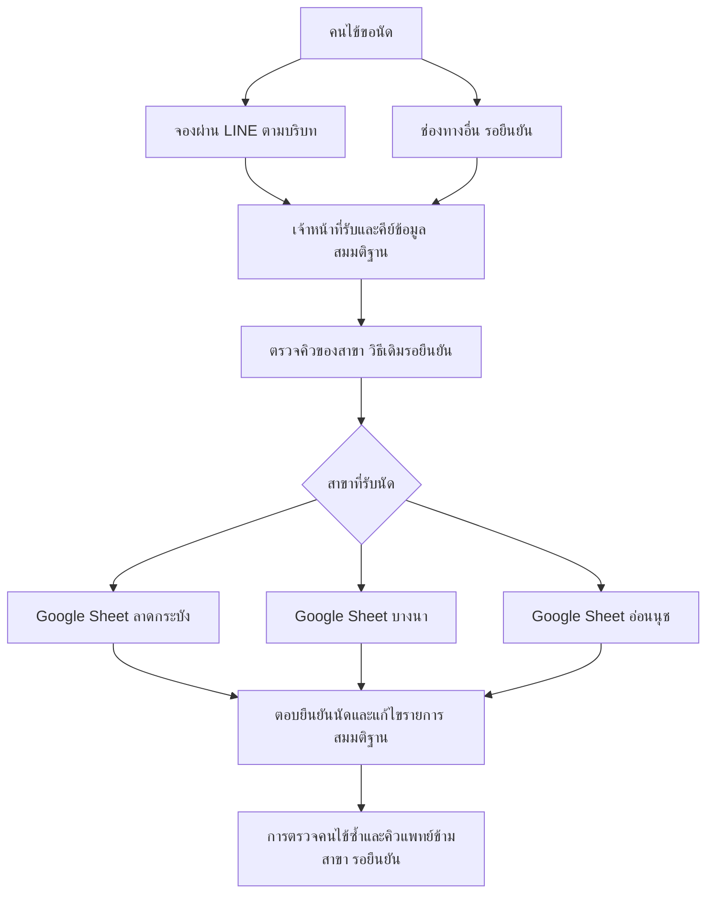
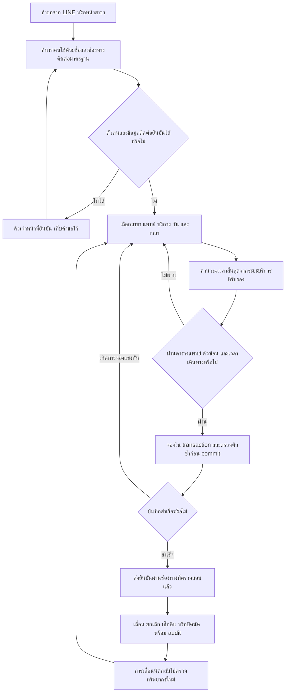
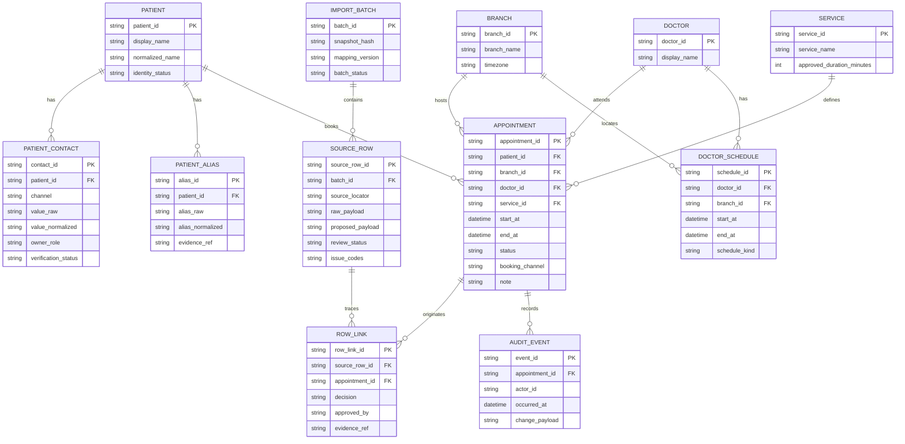
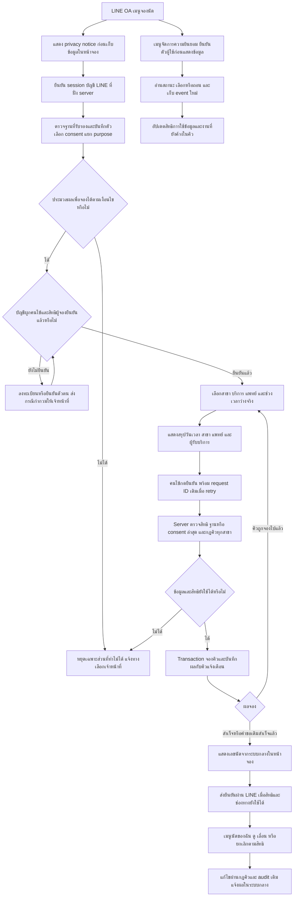

# 1. ตารางบันทึก Iteration

| Iteration | สิ่งที่เปลี่ยน | C1 | C2 | C3 |
|---|---|---|---|---|
| 1 | GENERATOR สร้างแผนทั้งหมด; CRITIC ตรวจความครบถ้วน ความกำกวม การจับคู่คนไข้ และ syntax ของ Mermaid | PASS — มีผลงานครบ 6 ส่วนใน §2.1–2.6 | PASS — §2.2 ระบุ 10 ประเภทพร้อมแถว ผลกระทบ และหลักฐานของการตีความ | PASS — §2.4 กำหนด normalization และแถวยืนยัน; §2.7 บันทึกการตรวจ Mermaid ทั้ง 3 บล็อก |
| 2 | (updated: change request) CRITIC ตรวจ v1.0 ก่อนแก้ตาม C1 ใหม่ | FAIL — ไม่มี consent และการจองเองผ่าน LINE OA | PASS — Findings เดิมครบ | PASS — normalization/review และ Mermaid เดิมผ่าน |
| 3 | (updated: change request) GENERATOR แก้เฉพาะ C1 เพิ่ม §2.8 และปรับข้อความ LINE ที่ขัดกับโจทย์ใหม่; CRITIC ตรวจซ้ำ | PASS — ครบสองข้อใหม่ใน §2.8.1–2.8.6 | PASS — §2.2 คงเดิม | PASS — §2.4 และ 3 diagram เดิมคงเดิม; diagram ใหม่ผ่าน syntax |

# 2. ผลงานสุดท้าย

**หัวข้อ:** ย้ายระบบนัดหมายคลินิกทันตกรรม 3 สาขา จาก Google Sheet และ LINE สู่ระบบกลาง

**สถานะ (updated: change request):** แผน v1.1 เพิ่มการเก็บความยินยอมตาม PDPA และคนไข้จองเองผ่าน LINE OA เป็นข้อกำหนดบังคับ; ผลตรวจเฟส 2 อยู่ใน §2.8.7 ส่วน §2.7 เป็นผลตรวจ v1.0 ในเฟส 1 ยังไม่ได้ย้ายข้อมูลหรือเชื่อม LINE OA จริง การผ่านเกณฑ์เอกสารไม่ใช่การรับรองข้อกฎหมายหรืออนุมัติเปิดใช้งานจริง

ขอบเขตหลักฐานมีเพียงบริบทและ CSV ที่ให้มา แถว R1–R5 หมายถึงแถวข้อมูลตามลำดับ ไม่รวมแถวหัวตาราง ไม่มีเลขแถวจริงของ Sheet, LINE user ID, รหัสคนไข้, รหัสแพทย์ หรือรายละเอียดระบบเดิม ส่วนที่เสนอเพิ่มระบุเป็น **ข้อเสนอ** และส่วนที่ยังไม่ทราบระบุเป็น **สมมติฐาน/รอยืนยัน**

| แถว | ข้อมูลอ้างอิงเดิมที่สำคัญ |
|---|---|
| R1 | ลาดกระบัง · `03/09/2026` · `10:00` · สมชาย ใจดี · `081-234-5678` · หมอเอ · ขูดหินปูน · หมายเหตุว่าง |
| R2 | ลาดกระบัง · `2026-09-03` · `10:00` · สมชาย ใจดี · `0812345678` · หมอเอ · ขูดหินปูน · จองซ้ำทางไลน์ |
| R3 | บางนา · `3 ก.ย. 69` · `13:30` · คุณมาลี · เบอร์ว่าง · หมอบี · จัดฟัน · ไม่มีเบอร์ ติดต่อทางไลน์ |
| R4 | บางนา · `03/09/2026` · `13:30` · วิชัย ศรีสุข · `089-111-2222` · หมอบี · อุดฟัน · หมายเหตุว่าง |
| R5 | อ่อนนุช · `09/03/2026` · `09:00` · Somchai Jaidee · `081 234 5678` · หมอเอ · ตรวจฟัน · หมอเอมาช่วยสาขานี้ทุกวันพุธ |

## 2.1 As-Is Process

**ข้อเท็จจริง:** มี Google Sheet แยก 3 สาขาและรับจองผ่าน LINE; R2 มีข้อความเรื่องจองซ้ำทางไลน์ ข้อมูลไม่ระบุว่าใครคีย์ข้อมูล ขั้นตอนตรวจคิว การตอบยืนยัน หรือการตรวจข้ามสาขาทำอย่างไร จึงแสดงกิจกรรมเหล่านั้นเป็นสมมติฐาน ไม่สรุปว่าระบบเดิมไม่มีการตรวจเลย

จุดเสี่ยงที่เห็นจากตัวอย่างคือข้อมูลกระจาย รูปแบบไม่สม่ำเสมอ และมีรายการต้องตรวจซ้ำ ยังไม่มีหลักฐานว่ามีการยืนยันนัดหรือเกิดการรักษาซ้อนจริง

## 2.2 Data Quality Findings

คำว่า **ค่าที่เสนอ** หมายถึงค่าชั่วคราวใน staging เท่านั้น ไม่ได้ยืนยันความจริง การไม่มีหลักฐานเพียงพอให้เก็บค่าต้นฉบับและเว้นค่าปลายทางไว้ ไม่เดาวันที่ ตัวตน หรือสถานะ

| ประเภทปัญหา | แถวและค่าที่ได้รับผลกระทบ | ความกำกวม หลักฐาน และการตีความ | ผลกระทบ / การจัดการ |
|---|---|---|---|
| 1. รูปแบบและลำดับวันเดือน | R1, R4 `03/09/2026`; R2 `2026-09-03`; R5 `09/03/2026` | R1/R4 กำกวมระหว่าง 3 ก.ย. กับ 9 มี.ค.; R5 กำกวมระหว่าง 9 มี.ค. กับ 3 ก.ย. R2 เป็น ISO ชัดเจนว่า 3 ก.ย. 2026 และตรงกับ R1 ในชื่อ เบอร์ที่ปรับรูปแบบ เวลา หมอ บริการ สาขา จึงเสนอ R1 = `2026-09-03` แต่รอยืนยัน R4 เสนอ 3 ก.ย. โดยอาศัย R3 ที่เขียนเดือน ก.ย. ชัดเจนและอยู่สาขา/เวลา/หมอเดียวกัน หลักฐานนี้อ่อนและไม่พิสูจน์ว่าเป็นวันเดียวกัน R5 ไม่เลือกวันที่ | ลงนัดผิดวัน; R1/R4 ต้องยืนยันรูปแบบวันที่ของแหล่งต้นทาง, R5 กักรายการไว้; ห้ามตั้ง locale เดียวแล้ว parse ทุกแถว |
| 2. ปีสองหลักและระบบศักราช | R3 `3 ก.ย. 69` | เดือนและวันที่ชัดเจน แต่ `69` กำกวมทั้งศตวรรษและศักราช อาจเป็น พ.ศ. 2569 = ค.ศ. 2026 หรือ ค.ศ. 2069 เป็นต้น เสนอ `2026-09-03` เพราะ R1/R2/R4/R5 ระบุปี 2026 แต่ไม่ได้พิสูจน์ศักราชของ R3 | อาจคลาดเคลื่อนหลายสิบปี; ให้สาขายืนยันปีและข้อตกลงการเขียนวันที่ก่อนแปลง |
| 3. ความสอดคล้องวันกับหมายเหตุ | R5 วันที่และ `ทุกวันพุธ` | `2026-03-09` เป็นวันจันทร์ และ `2026-09-03` เป็นวันพฤหัสบดี ทั้งคู่ไม่ตรงวันพุธ หมายเหตุอาจเป็นตารางประจำ ข้อความเก่า หรือมีนัดนอกตาราง ยังเลือกไม่ได้ | ตรวจคิวแพทย์ผิด; ยืนยันวันนัด ตารางแพทย์ที่มีผลในช่วงนั้น และข้อยกเว้น ห้ามเลื่อนวันไปวันพุธเอง |
| 4. รูปแบบโทรศัพท์ไม่สม่ำเสมอ | R1 `081-234-5678`, R2 `0812345678`, R5 `081 234 5678`; R4 `089-111-2222` | เมื่อลบตัวคั่น R1/R2/R5 ตรงกัน แต่ไม่มีรหัสประเทศ การเลือกประเทศไทยเป็นสมมติฐานตามบริบทชื่อสาขาภาษาไทย ยังไม่ใช่หลักฐานยืนยันประเทศ เบอร์ตรงกันอาจเป็นเบอร์ร่วม/ผู้ดูแล | ค้นหาไม่พบหรือรวมคนผิด; ใช้กฎ §2.4 และไม่ถือเบอร์เป็นรหัสบุคคล |
| 5. ข้อมูลติดต่อขาดและอ้างถึงอีกช่องทาง | R3 เบอร์ว่าง และ `ติดต่อทางไลน์` | หลักฐานบอกว่าติดต่อทาง LINE แต่ไม่มี LINE user ID หรือหลักฐานผูกบัญชีกับคนไข้ ไม่ทราบว่าเป็นบัญชีคนไข้หรือผู้ดูแล | ติดต่อหรือจับคู่ไม่ได้จาก CSV; ไม่เติมเบอร์สมมติ ให้เจ้าหน้าที่ยืนยันช่องทางติดต่อและความเป็นเจ้าของ |
| 6. ชื่อไม่ครบและชื่อข้ามภาษา | R3 `คุณมาลี`; R1/R2 `สมชาย ใจดี` เทียบ R5 `Somchai Jaidee` | R3 ไม่มีนามสกุลที่ระบุแยกได้ และ `คุณ` อาจเป็นคำนำหน้าหรือส่วนชื่อ การตัดออกเป็นเพียง candidate R5 มีชื่อที่อาจถอดเสียงตรงกับ R1/R2 และเบอร์ตรงกัน แต่ยังไม่พิสูจน์ว่าเป็นบุคคลเดียวกัน | จับคู่พลาดทั้งแยกเกินและรวมเกิน; R3/R5 ต้องยืนยัน ห้ามแปลชื่อเพื่อสร้างตัวตนใหม่หรือรวมอัตโนมัติ |
| 7. รายการนัดอาจซ้ำ | R1 และ R2 ทุกช่องสำคัญหลัง normalization | หลักฐานชื่อ/เบอร์/เวลา/สาขา/หมอ/บริการตรงกัน และ R2 ระบุ `จองซ้ำทางไลน์` สนับสนุนว่าเป็นนัดเดียวกัน หาก R1 หมายถึง 3 ก.ย. แต่หมายเหตุไม่ยืนยันว่ารายการใดถูกยกเลิกหรือเป็นต้นฉบับ | นับนัดสองครั้งและจองคิวเกิน; เจ้าหน้าที่อนุมัติการรวม พร้อมเก็บ lineage ของทั้งสองแถว ไม่ลบทิ้ง |
| 8. ความขัดแย้งทรัพยากรตามเวลา | R3/R4 หมอบี `13:30` บางนา; R1/R2 เทียบ R5 หมอเอคนละสาขา | ถ้าวัน R3/R4 ที่เสนอได้รับยืนยันและหมอบีเป็นคนเดียวกัน จะเริ่มนัดซ้อนกัน; R1/R2 กับ R5 ยังสรุปชนไม่ได้เพราะวัน R5, ระยะบริการ และเวลาเดินทางไม่ทราบ | ไม่สามารถรับรองคิวปลอดชน; ยืนยันแพทย์และวัน แล้วตรวจช่วงเวลา/เวลาเดินทางข้ามสาขาก่อนเปิดใช้ |
| 9. ตัวระบุบุคคลและข้อมูลอ้างอิงไม่ชัด | R1–R5 ไม่มี patient ID หรือ doctor ID; หมอเอ R1/R2/R5, หมอบี R3/R4; ชื่อบริการและสาขา R1–R5 | ชื่อหมอซ้ำอาจหมายถึงคนเดียวกันหรือชื่อเรียกเหมือนกัน หมายเหตุ R5 สนับสนุนว่าหมอเอเดินทางช่วยสาขา แต่ยังยืนยัน ID ไม่ได้ ชื่อบริการไม่มีรหัส/ระยะเวลา/ชนิดย่อย ชื่อสาขาเป็นเพียง label | join ผิดคนหรือใช้ระยะบริการผิด; ให้ผู้รับผิดชอบรับรอง master/crosswalk แพทย์ สาขา และบริการ ไม่สร้างรายละเอียดบริการจากชื่อ |
| 10. Metadata และสถานะนัดขาด | R1–R5 ไม่มี end time/duration/status/timezone/created time/ช่องทางจองแบบมีโครงสร้าง; R1/R4 หมายเหตุว่าง | เวลา `10:00`, `13:30`, `09:00` ชัดในรูปแบบ 24 ชั่วโมงแต่ timezone ไม่ระบุ สถานะว่างไม่เท่ากับ confirmed และหมายเหตุว่างไม่เท่ากับไม่มีเงื่อนไข R2 อ้าง LINE เรื่องจองซ้ำ; R3 อ้าง LINE เรื่องติดต่อ จึงสรุปช่องทางจองของทุกแถวไม่ได้ | ตรวจช่วงซ้อนไม่ได้และอาจส่งเตือนผิดรายการ; ใช้ `unknown` ใน staging และต้องยืนยันก่อนสร้างนัดใช้งานจริง ไม่เติมเวลา/สถานะย้อนหลัง |

## 2.3 To-Be Process และ Data Model

**ข้อเสนอ (updated: change request):** ใช้ระบบกลางเป็นแหล่งข้อมูลนัดหลักทั้ง 3 สาขา และให้คนไข้จองเองผ่าน LINE OA จนได้รับเลขนัดยืนยันโดยไม่ต้องให้เจ้าหน้าที่คีย์ซ้ำในเส้นทางปกติ ใช้ flow เพิ่มเติมใน §2.8 เชื่อมเข้ากับกระบวนการแกนกลางด้านล่าง การรับคำขอโดยเจ้าหน้าที่เป็นช่องทางช่วยเหลือกรณีข้อยกเว้นเท่านั้น ความยินยอมและการจองเองต้องผ่าน gate ก่อนเปิดใช้ ไม่เลื่อนไปเป็นทางเลือกภายหลัง

ระบบต้องตรวจช่วงเวลาทับกันของแพทย์คนเดียวกัน **ทุกสาขา** และของคนไข้คนเดียวกัน ใช้ช่วง `[start_at, end_at)` ตรวจเวลาทำงาน/วันลาและเวลาเดินทางที่คลินิกรับรอง การยกเลิกปล่อยคิว การเลื่อนนัดทำแบบ atomic และคงประวัติเดิม ตารางว่างหรือเวลาเดินทางไม่ทราบให้รอทบทวน ไม่ตีความว่าเดินทางทัน

**ข้อเสนอแบบจำลองข้อมูล:** ID ต่อไปนี้เป็นรหัสใหม่ที่ระบบจะสร้าง ไม่ใช่รหัสที่มีใน CSV

ข้อกำหนดประกอบแบบจำลอง:

- เบอร์/LINE ID ไม่เป็น unique ข้ามคนไข้ เพราะผู้ดูแลอาจติดต่อแทนหลายคน; ชื่อไม่เป็น primary key และ alias ข้ามภาษาต้องมีหลักฐานอนุมัติ
- ทุกนัดใช้งานต้องมี patient/branch/doctor/service ที่ยืนยันแล้ว, `end_at > start_at`, timezone ต้นทางที่รับรอง และสถานะที่ตรวจสอบแล้ว เก็บ instant กลางพร้อม timezone ของสาขา
- staging เก็บค่าว่างและค่ากำกวมได้; SOURCE_ROW ที่กักไว้ไม่มี ROW_LINK จนกว่าจะอนุมัติ R1/R2 อาจมี ROW_LINK สองรายการชี้ไป APPOINTMENT เดียว
- SERVICE duration เป็นค่าที่เจ้าหน้าที่รับรอง ไม่ได้อนุมานจากคำว่า “จัดฟัน” หรือชื่อบริการอื่น; APPOINTMENT เก็บ end time ณ วันจองเพื่อไม่ให้การแก้ master เปลี่ยนนัดเก่า
- DOCTOR_SCHEDULE เก็บช่วงเวลาทำงาน/วันลาเป็นรายการที่มีวันที่ ไม่สร้างตารางทุกวันพุธจาก R5 จนกว่าจะรับรอง พร้อมนโยบายเวลาเดินทางระหว่างสาขาที่จัดการเป็น configuration แบบมี version
- จำกัดสิทธิ์ตามหน้าที่และสาขา แสดงข้อมูลคนไข้ข้ามสาขาเฉพาะผู้มีสิทธิ์; บันทึกการแก้ข้อมูล การรวมตัวตน และผู้อนุมัติ migration ใน audit ของ batch และ entity ที่เกี่ยวข้อง เป็นข้อเสนอที่ต้องกำหนดบัญชีผู้ใช้งานจริง

## 2.4 Data Mapping + แผน Migration

### Data Mapping

เก็บค่าต้นฉบับทุกช่องใน `SOURCE_ROW.raw_payload` เสมอ ตารางนี้ใช้กับ R1–R5 ทั้งหมด เว้นแต่ระบุแถวเฉพาะ

| ต้นทาง | ปลายทาง | กฎแปลงและเงื่อนไข |
|---|---|---|
| สาขา | BRANCH.branch_id ผ่าน crosswalk | trim และ Unicode NFC สำหรับค้นหา; ให้ผู้รับผิดชอบรับรอง label ลาดกระบัง/บางนา/อ่อนนุชกับ master ก่อนใช้ |
| วันที่ | proposed date แล้วรวมเป็น APPOINTMENT.start_at | parse แบบ explicit ตาม §2.2; R2 เป็น `2026-09-03`; R1/R3/R4 มีเพียงค่าที่เสนอ; R5 ยัง null; เก็บ candidate วันที่และเหตุผล |
| เวลา | time component ของ start_at | ตรวจ `HH:mm` 24 ชั่วโมง; รวมวันที่ที่ยืนยันและ timezone ที่รับรอง ไม่ใช้ timezone เครื่องเป็นค่าเริ่มต้น |
| ชื่อคนไข้ | PATIENT.display_name / normalized_name / PATIENT_ALIAS | เก็บ raw; normalize เพื่อค้นหา; ไม่สร้าง alias ไทย–อังกฤษที่ได้รับการยืนยันเอง |
| เบอร์ | PATIENT_CONTACT.value_raw / value_normalized | กฎด้านล่าง; ว่างเป็น null, invalid ส่ง review; ใช้ประเทศที่ยืนยันแล้ว |
| หมอ | DOCTOR.doctor_id ผ่าน crosswalk | ชื่อเล่นใช้ค้นหาผู้สมัครเท่านั้น; ยืนยันหมอเอ R1/R2/R5 และหมอบี R3/R4 กับรายชื่อแพทย์จริง |
| บริการ | SERVICE.service_id | master ของขูดหินปูน/จัดฟัน/อุดฟัน/ตรวจฟันต้องรับรอง; duration และชนิดย่อยที่จำเป็นให้คลินิกกำหนด |
| หมายเหตุ | APPOINTMENT.note และ staging issue_codes | เก็บข้อความครบ รวมหมายเหตุ R1/R2 พร้อมที่มาเมื่อรวม; R5 สร้าง issue เรื่องตาราง ห้ามสร้าง schedule อัตโนมัติ; ว่างคงว่าง |
| ไม่มี status/channel/end time ใน CSV | staging unknown แล้ว APPOINTMENT.status / booking_channel / end_at | ไม่เติม confirmed; ไม่ตีความทุกแถวเป็น LINE; ช่องทางอนุญาต unknown หากยืนยันไม่ได้ แต่สถานะและช่วงเวลาต้องรับรองก่อนเปิดนัดใช้งาน |
| ไม่มี source ID ใน CSV | SOURCE_ROW.source_locator / source_row_id | ตัวอย่างใช้ R1–R5; งานจริงบันทึก ID ไฟล์/tab/snapshot/ลำดับแถวจากการ export หากเข้าถึงได้ สร้าง stable import key จาก snapshot และตำแหน่ง ห้าม hash เฉพาะเนื้อหาเพราะแถวซ้ำต้องยังคงอยู่ |

### การปรับมาตรฐานก่อนจับคู่ตัวตน

1. **เบอร์โทร:** เก็บ raw เป็น string เพื่อไม่เสียเลข 0 หน้า; trim, แปลงเลขไทย/เลขเต็มความกว้างเป็นเลข ASCII, ลบเฉพาะช่องว่าง ขีด และวงเล็บที่เป็นตัวคั่น ยอมรับ `+` เฉพาะต้นข้อความ ตัวอักษร/ส่วนต่อที่ไม่ทราบความหมายส่ง review ไม่ลบทิ้งเพื่อทำให้ผ่าน validation
2. หลังยืนยันว่าประเทศเป็นไทยแล้ว สำหรับตัวอย่างมือถือ `0` + ตัวเลขอีก 9 หลัก ให้แทน `0` ตัวแรกด้วย `+66`; เบอร์ `+66` หรือ `0066` ต้องตรวจความยาวและปรับสู่รูปแบบเดียวกัน ไม่เติม `+66` ให้เบอร์ที่ไม่รู้ประเทศ และไม่ตัดสินว่าเบอร์ใช้งานได้จาก syntax เพียงอย่างเดียว
3. ผลเชิงรูปแบบภายใต้สมมติฐานประเทศไทย: R1/R2/R5 → `+66812345678`; R4 → `+66891112222`; R3 → null ห้ามแทนด้วย `0`, `N/A` หรือเบอร์ของเจ้าหน้าที่
4. **ชื่อ:** เก็บ raw/display_name; Unicode NFC, trim, รวม whitespace ที่ซ้ำ และ casefold ตัวอักษรละตินเฉพาะ search key ไม่ลบสระ/วรรณยุกต์ไทย ไม่สลับลำดับชื่อเอง ไม่ถอดเสียงไทย–อังกฤษเป็นชื่อเดียวกันอัตโนมัติ
5. คำนำหน้าที่พบจริงมี `คุณ` ใน R3: เก็บ key เดิม `คุณมาลี` และ candidate `มาลี` แยกกันจนเจ้าหน้าที่ยืนยันว่าเป็นคำนำหน้า R1/R2 ได้ key `สมชาย ใจดี`; R5 ได้ `somchai jaidee` ซึ่งไม่เท่ากับ key ภาษาไทย

### กฎจับคู่และการตัดสินใจ

- สร้าง candidate ด้วยโทรมาตรฐานและชื่อมาตรฐานก่อน; คะแนน fuzzy หรือการถอดเสียงใช้จัดลำดับ review เท่านั้น ไม่ใช่หลักฐานรวมตัวตน
- ในข้อมูลตัวอย่าง **ไม่มีแถวใดได้รับการอนุมัติ auto-merge** เพราะไม่มี patient ID ที่เชื่อถือได้ R1/R2 เป็นคู่ความมั่นใจสูงแต่ต้องให้เจ้าหน้าที่ตรวจข้อมูลการจองเดิมและยืนยันคนไข้; R5 เทียบ R1/R2 ต้องยืนยัน alias และผู้เป็นเจ้าของเบอร์
- แยก **รวมคนไข้** ออกจาก **รวมรายการนัด**: เมื่ออนุมัติว่าคนเดียวกันแล้ว ยังต้องตรวจวัน เวลา สาขา หมอ และบริการก่อนรวมนัด R5 บริการและสาขาต่างจาก R1/R2 จึงคงเป็น candidate นัดแยก แม้ยืนยันภายหลังว่าเป็นคนเดียวกัน
- R3 ห้ามจับคู่ด้วยชื่อ “มาลี” อย่างเดียว ให้เจ้าหน้าที่เปิดหลักฐาน LINE ภายใต้สิทธิ์ที่เหมาะสม ยืนยันตัวตน/ผู้ดูแลและบันทึก reference ของหลักฐาน ไม่ถือข้อความหมายเหตุเป็น LINE ID
- หากต้องใช้ตัวระบุเพิ่ม ให้คลินิกยืนยันจากทะเบียนเดิมหรือสอบถามผู้ป่วยตามกระบวนการของคลินิก ตัวระบุเหล่านี้ไม่ได้อยู่ใน CSV และห้ามสมมติว่ามีอยู่ ไม่จำเป็นต้องเรียกเก็บเลขบัตรประชาชนเพื่อแก้ตัวอย่างนี้
- คนไข้ใหม่สร้างได้หลังค้นหาทะเบียนและอนุมัติว่าไม่ใช่คนเดิม ทุกการรวม/แยกบันทึกผู้อนุมัติ เหตุผล source rows และ ID ก่อน–หลัง เพื่อย้อนกลับได้

| แถวที่ต้องให้มนุษย์ยืนยัน | สิ่งที่ต้องยืนยันเฉพาะแถว | ผลก่อนยืนยัน |
|---|---|---|
| R1 + R2 | รูปแบบวัน R1, ตัวตนร่วม, นี่เป็นนัดเดียวกันหรือไม่ และสถานะนัดจริง; หากรวม ให้รับรองแหล่งค่าหลัก | เก็บ 2 source rows; ยังไม่รวมหรือสร้างนัด active |
| R3 | ปี/ศักราช, ชื่อและนามสกุลที่ใช้จริง, คำนำหน้า, LINE contact/ผู้ดูแล, วันที่เทียบ R4 | กักแถว; ไม่มีเบอร์ไม่ใช่เหตุให้ทิ้งข้อมูล |
| R4 | วัน/เดือนของวันที่, ตัวตนจากทะเบียน, ความขัดแย้งหมอบีกับ R3 | กักแถวจนวันและคิวได้รับการยืนยัน |
| R5 | วันนัดจริง, ความหมายหมายเหตุวันพุธและข้อยกเว้น, ตัวตน/alias เทียบ R1/R2, เจ้าของเบอร์ และหมอเอข้ามสาขา | กักแถว; ไม่แปลงวันหรือรวมตัวตนเอง |
| R1–R5 | ประเทศของเบอร์ที่มี, timezone, doctor/branch/service crosswalk, ระยะบริการ, สถานะ และสิทธิ์ผู้อนุมัติ | ไม่มีแถวพร้อมใช้งานจริงจาก CSV เพียงอย่างเดียว |

### ลำดับ Migration และจุดตรวจรับ

1. **เตรียมและตรึงหลักฐาน:** ผู้รับผิดชอบแต่ละสาขาสำรอง Sheet และเก็บ snapshot CSV แบบอ่านอย่างเดียวพร้อม hash; ระบุช่วงข้อมูลที่จะย้าย รายการนัดจาก LINE ที่ยังไม่ลง Sheet และเจ้าของข้อมูลก่อนเริ่ม โจทย์ยังไม่ให้ข้อมูล LINE จึงห้ามรายงานว่าดึงครบแล้ว
2. **สร้าง staging/master:** นำเข้า raw ครบ 5 แถวสำหรับตัวอย่าง สร้าง master/crosswalk ที่คลินิกรับรอง ใช้ mapping version v1.0 และ batch ID ไม่มีการเขียนทับ Sheet ต้นทาง
3. **Normalize และ review:** ใช้กฎด้านบน สร้าง issue list และ candidate links; เจ้าหน้าที่สาขายืนยันข้อมูล ผู้ดูแลทะเบียนอนุมัติ identity merge และผู้จัดตารางแพทย์อนุมัติคิว ไม่มีการส่งข้อความหาคนไข้โดยอัตโนมัติใน dry run
4. **Dry run:** เขียนข้อมูลที่อนุมัติแล้วลงสภาพแวดล้อมทดสอบ ตรวจ foreign keys, เวลาเริ่ม–สิ้นสุด, duplicate candidates, การจองแข่งกัน และคิวแพทย์ข้ามสาขา ทดสอบเลื่อน/ยกเลิก/ค้นหาคนไข้ร่วมกับพนักงานแต่ละสาขา
5. **Reconciliation:** ให้แต่ละ source row มี disposition เดียว เช่น imported, merged_into, quarantined หรือ excluded_with_reason โดยผลรวมต้องเท่ากับ 5; ROW_LINK ต้องตามย้อนจากนัดไปทุกแถวที่ใช้ได้ จำนวนคนไข้และจำนวนนัดนับแยกจากจำนวน source rows ไม่บังคับให้เท่ากัน
6. **เกณฑ์ตัวอย่าง:** ก่อนยืนยันให้ทั้ง 5 แถวอยู่ใน review ไม่มีนัด active; หากอนุมัติทุกแถวและรวมเฉพาะ R1/R2 จะมี 4 นัดและ 5 source rows นี่เป็นผลแบบมีเงื่อนไข ไม่ใช่ผลย้ายที่เกิดขึ้นแล้ว จำนวนคนไข้จะขึ้นกับการยืนยัน R5 และทะเบียนจริง ไม่กำหนดล่วงหน้า
7. **Idempotency:** rerun snapshot เดิมด้วย stable source key ต้องไม่เพิ่ม source rows หรือนัดซ้ำ; เก็บ mapping และ approval เดิม การ export ใหม่เป็น batch ใหม่และต้อง reconcile delta กับ source locator/crosswalk ที่อนุมัติ ไม่ใช้เลขแถวเดิมลำพัง เพราะ Sheet อาจเลื่อนแถว
8. **Cutover:** กำหนดเวลาหยุดแก้ Sheet ของสาขาที่กำลังย้าย เก็บคำขอใหม่ในคิวชั่วคราวที่มี request ID แล้ว export delta สุดท้าย ตรวจยอดและลงนามก่อนเปิดระบบกลาง จากนั้น replay คำขอโดย deduplicate request ID เปลี่ยน Sheet เป็นอ่านอย่างเดียว
9. **Rollback:** หากยอดไม่ตรง, identity merge ผิด, คิวแพทย์ซ้อน หรือระบบหลักใช้งานไม่ได้ ให้หยุดเขียน/ส่งยืนยัน เก็บ snapshot ระบบกลางและรายการเปลี่ยนแปลงหลัง cutover ก่อนกู้คืน สำรองและทดสอบการย้อน batch ผ่าน lineage; นำรายการใหม่/เลื่อน/ยกเลิกหลัง cutover ไป reconcile กับแหล่งที่จะกลับไปใช้ก่อนเปิดรับงานอีกครั้ง ห้ามกู้ snapshot เก่าแล้วทิ้งรายการใหม่

## 2.5 Gap Analysis + Roll-out Plan

| Gap จากหลักฐาน / สิ่งที่ยังไม่ทราบ | To-Be ที่เสนอ | งานปิดช่องว่าง | ผู้รับผิดชอบที่เสนอ / เกณฑ์ตรวจรับ |
|---|---|---|---|
| Sheet แยก 3 สาขา | ระบบกลางแหล่งหลัก | master สาขาและสิทธิ์ผู้ใช้ | ผู้ดูแลระบบ + หัวหน้าสาขา / ทุกสาขาเห็นคิวที่มีสิทธิ์และไม่มีการเขียนคู่หลัง cutover |
| วันที่/ชื่อ/เบอร์หลายรูปแบบ | ข้อมูลมาตรฐานพร้อม raw และ review | normalization + กติกาศักราช/locale | ผู้ดูแลข้อมูล / issue ทุกแถวมี disposition พร้อมหลักฐาน |
| ไม่มี patient ID ในตัวอย่าง | ทะเบียนคนไข้ร่วมและ verified aliases | ยืนยันตัวตนและ contact ownership | ผู้ดูแลทะเบียน / ทุก merge มีผู้อนุมัติและย้อนกลับได้ |
| R2 อาจซ้ำและ R3/R4 อาจชน | dedup แยกจาก resource validation | queue review + การจองแบบ atomic | ผู้จัดตาราง + ทีมระบบ / ไม่มีนัด active ที่คิวชนโดยไม่ได้แก้ไข |
| R5 อ้างตารางหมอข้ามสาขาแต่ข้อมูลขัดกัน | ตารางแพทย์รวม + วันลา/ข้อยกเว้น/เวลาเดินทาง | ยืนยันตารางจริงและกฎการเดินทาง | ผู้จัดตาราง / ทดสอบข้ามสาขาทั้งกรณีผ่านและถูกปฏิเสธ |
| LINE ไม่มี ID ใน CSV และอาจมีคำขอค้าง (updated: change request) | คนไข้จองเองผ่าน LINE OA; คำขอมี ID และผูกคนไข้ที่ยืนยันแล้ว | สำรวจรายการค้างและเชื่อม flow §2.8 เข้าระบบกลาง; เจ้าหน้าที่ช่วยเฉพาะข้อยกเว้น | ทีมระบบ + เจ้าหน้าที่รับนัด / คนไข้จองจนได้เลขนัดเองได้ คำขอไม่หายและไม่สร้างนัดซ้ำ |
| ไม่ทราบ backup/audit/การอบรมเดิม | backup ที่กู้ได้, audit, ผู้ใช้ทำงานได้ | rehearsal + training + access review | หัวหน้าโครงการ / กู้คืนพร้อม delta และทำ UAT ครบ 3 สาขา |

ระยะต่อไปนี้เป็น **ข้อเสนอแบบผ่าน gate** ไม่มีวันเริ่ม ระยะเวลา หรือรายชื่อผู้รับผิดชอบจริงในข้อมูล จึงไม่แต่งกำหนดส่ง

| ระยะ | วิธีดำเนินการ | Gate ก่อนเดินต่อ |
|---|---|---|
| 0: เตรียม | แต่งตั้งเจ้าของข้อมูล ยืนยันกติกาและ master สำรองทั้ง 3 สาขา | เจ้าของคลินิกรับรองขอบเขต/บทบาท; สำรองอ่านกลับได้ |
| 1: ทดลองในระบบทดสอบ | dry run ทุกสาขา ใช้ R1–R5 เป็นกรณีทดสอบ พร้อมข้อมูลจริงที่มีสิทธิ์ใช้งาน | source reconciliation ครบ; ไม่มี issue ที่ยังไม่แก้ในชุดจะเปิดใช้; UAT และ rollback rehearsal ผ่าน |
| 2: Pilot ลาดกระบัง | เสนอเลือกเพราะ R1/R2 มีกรณีซ้ำที่ตรวจได้ ไม่ได้อ้างว่าปริมาณงานน้อย; เปิดระบบกลางหลัง freeze/delta ของสาขา | หัวหน้าสาขาและผู้ดูแลข้อมูลลงนาม; คำขอใหม่ไม่สูญหายและไม่ซ้ำ |
| 3: บางนา แล้วอ่อนนุช | เสนอเรียงเพื่อตรวจปัญหา R3/R4 และ R5 ก่อนขยาย; ใช้ gate เดิมทุกสาขา | ปิด issue ตัวตน/ปี/คิวของบางนา และวัน/ตารางแพทย์ของอ่อนนุชก่อนเปิดใช้แต่ละสาขา |
| 4: Stabilize และปิดการเขียน Sheet | ตรวจยอดรายวันตามช่วงที่คลินิกกำหนด ทบทวน incident/สิทธิ์ เก็บต้นฉบับตามนโยบายที่อนุมัติ | ทั้ง 3 สาขาใช้ระบบกลาง; ไม่มีรายการค้างไร้ผู้รับผิดชอบ; เจ้าของคลินิกยอมรับผล |

**เงื่อนไขสำคัญของ pilot:** แพทย์อาจทำงานข้ามสาขา จึงต้องนำเวลาที่แพทย์ไม่ว่างของสาขาที่ยังไม่เปิดใช้เข้าระบบกลาง และให้ผู้ประสานงานแพทย์บันทึกการเปลี่ยนคิวข้ามสาขาในแหล่งกลางก่อนยืนยันนัดทุกครั้ง ระหว่าง pilot Sheet สาขาที่เหลือเป็นข้อมูลประกอบของการดำเนินงาน แต่ไม่เป็นผู้ตัดสินความว่างของแพทย์ หากทำขั้นตอนนี้ไม่ได้ ห้ามเปิด pilot แยกสาขา ให้เปลี่ยนเป็น cutover พร้อมกันหลังผ่าน gate ทั้ง 3 สาขา

การเปิดใช้ต้องไม่มี issue วิกฤตที่ยังไม่แก้ในนัดที่จะใช้งาน รายการ quarantined ต้องมีเจ้าของและวิธีติดตามก่อนวันนัด หากยังไม่ทราบว่าวันนัดอยู่เมื่อใดต้องตรวจให้เสร็จก่อนเปิดใช้ในสาขานั้น ไม่ปล่อยให้รายการกำกวมหายจากการปฏิบัติงาน การ rollback ให้เจ้าของคลินิกหรือผู้รับผิดชอบที่ได้รับมอบหมายตัดสินตาม trigger ใน §2.4

## 2.6 Plan Version Log

| Version | Iteration / บทบาท | สิ่งที่เปลี่ยน | ผลและเหตุผลหยุด |
|---|---|---|---|
| v1.0 | 1 / GENERATOR สร้าง; CRITIC ตรวจแยกขั้น | สร้าง As-Is, findings, To-Be/model, mapping/migration, gap/roll-out และเกณฑ์ตรวจรับทั้งหมด | C1–C3 PASS; หยุดหลัง Iteration 1 ตามเงื่อนไข ไม่แก้ส่วนที่ผ่านแล้ว |
| v1.0 — ตรวจด้วยเกณฑ์ใหม่ | 2 / CRITIC ก่อนแก้ (updated: change request) | ไม่มีการแก้ผลงานในรอบนี้; C1 รวม consent และ LINE OA self-booking | C1 FAIL, C2/C3 PASS; เดินต่อเฉพาะ C1 |
| v1.1 | 3 / GENERATOR แล้ว CRITIC (updated: change request) | เพิ่ม §2.8 พร้อม consent, LINE OA self-booking, data model/mapping ส่วนเพิ่ม, migration/roll-out gates; แก้ข้อความ LINE ที่ขัดกับข้อกำหนด | C1–C3 PASS; หยุดเฟส 2 หลังเพิ่ม 2 Iteration |

ไม่มีผลตรวจรอบก่อนหน้าที่ถูกแต่งขึ้น และไม่มีการอ้างว่าได้ย้ายข้อมูลจริง หากเปลี่ยนแผนภายหลังให้เพิ่ม version พร้อมเหตุผลและหลักฐานใหม่

## 2.7 การตรวจโดย CRITIC และ Mermaid

วิธีตรวจ Mermaid: ตรวจหา `mmdc`/`mermaid` ใน PATH และตรวจ module `@mermaid-js/mermaid-cli`/`mermaid` จาก working directory แล้วไม่พบ renderer ที่เรียกใช้ได้ จึงใช้ **การตรวจ syntax อย่างเคร่งครัด** ตามทางเลือกใน C3 โดยไม่ติดตั้งแพ็กเกจหรือใช้เครือข่าย ตรวจด้วยสคริปต์ออฟไลน์ในหน่วยความจำและอ่านทวนไวยากรณ์ flowchart/ER: fenced blocks ครบ, header ถูกชนิด, node declaration/วงเล็บ/quote ครบ, edge อ้าง node ที่ประกาศ, attribute และ PK/FK ถูกไวยากรณ์, ความสัมพันธ์อ้าง entity ที่มีจริง ทั้ง 3 บล็อกผ่าน ไม่มีการอ้างว่าได้ render ภาพจริง; ยังไม่ได้ตรวจตำแหน่งข้อความด้วยภาพ

- **C1 — PASS:** §2.1–2.6 ครบ As-Is Mermaid, Findings, To-Be, Data Model, Mapping/Migration พร้อม identity matching, Gap/Roll-out และ Version Log
- **C2 — PASS:** §2.2 มี 10 ประเภท ระบุ R1–R5 ที่เกี่ยวข้อง ผลกระทบ ความกำกวม หลักฐานและสถานะของค่าที่เสนอ รวมทั้งปี 69, วัน/เดือน, ชื่อข้ามภาษา, เบอร์ร่วม และวันพุธที่ขัดกับวันที่
- **C3 — PASS:** §2.4 ระบุกฎ normalize โทร/ชื่อก่อนจับคู่และ review ทุกแถวโดยแจกแจงประเด็น; Mermaid 3 บล็อกผ่านการตรวจ syntax แบบเข้มงวดตามวิธีที่เปิดเผยใน §2.7

## 2.8 ส่วนเพิ่มเพื่อแก้ C1 เท่านั้น (updated: change request)

ทุกย่อหน้า ตาราง รายการ และ Mermaid ภายใน §2.8 เป็น **(updated: change request)** ทั้งส่วน เป็นข้อเสนอการออกแบบตามคำขอใหม่ ไม่มีหลักฐานว่า OA, การเชื่อมต่อ หรือกระบวนการ PDPA เหล่านี้มีอยู่แล้ว คง As-Is, Findings, กฎ normalize/จับคู่ตัวตน และ Mermaid เดิมไว้ตามเดิม ส่วนนี้เพิ่มเงื่อนไขให้การจองทุกช่องทางและ migration เดิม ผล PASS หมายถึงความครบถ้วนของแผน ไม่ใช่ผลทดสอบระบบที่พัฒนาแล้ว

### 2.8.1 ขอบเขต PDPA และการเก็บความยินยอม (updated: change request)

**ข้อเสนอเพื่อรองรับ PDPA:** เก็บความยินยอมที่ตรวจสอบย้อนหลังได้แยกตามวัตถุประสงค์ พร้อมให้ปฏิเสธและถอนผ่าน LINE OA หรือเจ้าหน้าที่ได้ ไม่สรุปว่าทุกการประมวลผลต้องอาศัย consent และไม่ใช้การกดรับทราบ privacy notice แทนการให้ความยินยอม ไม่มีการค้นกฎหมายผ่านเครือข่ายตามข้อจำกัดงานนี้ ผู้รับผิดชอบ PDPA/ผู้ให้คำปรึกษาที่คลินิกแต่งตั้งต้องรับรองข้อความ ฐานการประมวลผล รวมถึงเงื่อนไขสำหรับข้อมูลสุขภาพ ก่อนใช้ข้อมูลจริง

| องค์ประกอบที่ต้องมี | พฤติกรรมและข้อมูลหลักฐานที่เสนอ | Gate |
|---|---|---|
| Privacy notice แบบมี version | แสดงผู้รับผิดชอบ ช่องทางติดต่อ วัตถุประสงค์ ข้อมูลที่ใช้ ผู้รับข้อมูล/ผู้ให้บริการ ระยะเก็บหรือหลักกำหนดระยะเก็บ วิธีใช้สิทธิ และผลของการเลือก ก่อนเก็บข้อมูลใน flow; เก็บข้อความแต่ละรุ่นแบบแก้ย้อนหลังไม่ได้และ hash | คลินิกรับรองข้อความจริงและวิธีแสดงบนมือถือก่อนเปิดใช้ |
| วัตถุประสงค์และฐานที่ได้รับอนุมัติ | แยกจัดการนัด, ผูกบัญชี LINE กับคนไข้, ส่งข้อมูลยืนยันนัด และการใช้ข้อมูลสุขภาพเท่าที่จำเป็น; แต่ละ purpose มีฐาน/เงื่อนไขที่ผู้รับผิดชอบรับรอง ไม่แต่งฐานกฎหมายขึ้นเอง | ถ้ายังไม่ระบุฐานและเงื่อนไขที่ใช้ได้ ห้ามเปิดการประมวลผล purpose นั้น; ต้องแก้ก่อนเปิดเส้นทางจองที่พึ่ง purpose นี้ |
| การขอ consent เมื่อใช้เป็นฐาน | เลือกแยกวัตถุประสงค์ ไม่ติ๊กล่วงหน้า ไม่รวมความยินยอมที่ไม่เกี่ยวกับการจองเป็นเงื่อนไขใช้บริการ; ปุ่มยินยอม/ไม่ยินยอมชัดเจน บันทึกเฉพาะการกระทำจริง | การรับทราบ notice, เพิ่มเพื่อน OA, login, มีนัดเดิม หรือเงียบ ไม่เท่ากับ consent |
| หลักฐาน | subject ที่ระบุได้, patient ID เมื่อยืนยันแล้ว, actor/ผู้แทนและหลักฐานอำนาจ, purpose, notice version/ข้อความที่แสดง, granted/declined/withdrawn, เวลาที่กระทำและเวลาบันทึก, ช่องทาง, event ID, evidence reference/hash | ค้นคืนได้ว่าใครเลือกอะไร เมื่อใด บนข้อความรุ่นใด และประวัติไม่ถูกเขียนทับ |
| ถอนความยินยอม | เมนู “จัดการความยินยอม” แสดงสถานะแยก purpose; เมื่อถอนให้เพิ่ม event และหยุดงาน/ข้อความที่ยังไม่ส่งซึ่งอาศัย consent นั้น ตรวจสิทธิอีกครั้งก่อนส่งงานจากคิว | ถอนแล้วงานที่อาศัย consent นั้นต้องไม่ดำเนินต่อ; การให้ใหม่ต้องเป็นการกระทำใหม่ ไม่ undo ประวัติถอน |
| ผลต่อการจองและข้อมูลเดิม | การปฏิเสธ purpose ที่ไม่จำเป็นต้องไม่ขวางการจอง; purpose จำเป็นที่พึ่ง consent แต่ไม่มี consent ให้หยุดเฉพาะการประมวลผลนั้นและเสนอเจ้าหน้าที่ประเมินทางเลือกตามฐานที่รับรอง ไม่ปฏิเสธการรักษาโดยอัตโนมัติ | การถอน consent ไม่ยกเลิกนัด/ลบเวชระเบียนอัตโนมัติ; ประเมินฐานและระยะเก็บของแต่ละข้อมูลแยกกัน |
| การคุ้มครองและสิทธิ | จำกัดสิทธิ์และบันทึกการอ่าน/เปลี่ยนหลักฐาน, เข้ารหัสข้อมูลและ secret, ไม่ใส่ข้อมูลสุขภาพใน log/ข้อความแจ้งเตือนเกินจำเป็น; มีช่องทางคำขอเข้าถึง แก้ไข ลบ และสิทธิที่เกี่ยวข้องพร้อมยืนยันผู้ขอ/ติดตามผล | กำหนดผู้รับผิดชอบ ขั้นตอน กรอบเวลาที่รับรอง การเก็บ/ลบรวมสำรอง และการจัดการเหตุข้อมูลรั่วก่อนเปิดจริง; ไม่แต่งระยะเวลาตามกฎหมาย |

หากผู้จองเป็นผู้ดูแลหรือผู้แทน ต้องยืนยันขอบเขตอำนาจก่อนเลือก consent แทนหรือเข้าถึงนัดของคนไข้ เบอร์ร่วมและบัญชี LINE ร่วมไม่พิสูจน์อำนาจนั้น กรณีเด็กหรือความสามารถให้ความยินยอมไม่ชัด ส่งเจ้าหน้าที่ใช้กระบวนการที่คลินิกรับรอง ไม่อนุมานอายุหรือผู้ปกครองจาก CSV

### 2.8.2 To-Be: คนไข้จองเองผ่าน LINE OA (updated: change request)

**ข้อเสนอการเชื่อมต่อ:** เมนู “จองนัด” ใน LINE OA เปิดหน้าจองของคลินิกที่เชื่อมระบบกลาง เช่น เว็บแอปภายใน LINE รูปแบบและการตั้งค่าจริงต้องยืนยันกับ OA ที่คลินิกมีสิทธิ์จัดการ ไม่อ้างว่ามี channel/API/แอปพร้อมแล้ว ผู้ใช้เลือกสาขา บริการ แพทย์หรือแพทย์ว่าง วันและเวลา ตรวจสรุป แล้วกดยืนยันเองจนได้เลขนัด เมื่อบัญชีผูกกับตัวตนที่ยืนยันแล้ว เส้นทางนี้ไม่ต้องรอเจ้าหน้าที่อนุมัติทุกนัด

กฎทำงานที่ต้องพัฒนาและตรวจรับเพิ่มเติม:

1. Server ตรวจความถูกต้องและอายุของข้อมูลยืนยันบัญชีตามกลไกที่ผู้ให้บริการรองรับ ไม่เชื่อ `patient_id`/LINE ID ที่ client ส่งมาเอง; ทุกคำสั่งอ่าน/จอง/เลื่อน/ยกเลิกต้องตรวจ patient link และสิทธิผู้จองปัจจุบัน การ login พิสูจน์การควบคุมบัญชี ไม่ได้พิสูจน์ตัวคนไข้โดยลำพัง
2. ใช้กฎ normalize และ matching เดิมใน §2.4 การค้นหาตัวตนครั้งแรกไม่เปิดเผยรายชื่อ/ประวัติคนไข้คนอื่น หากเป็นคนใหม่ให้ลงทะเบียนและยืนยันตามกระบวนการที่คลินิกรับรอง หากชนทะเบียนหรือเป็นผู้แทนส่ง review; หลังยืนยันแล้วจองเองได้ R3 ใช้การยืนยันผ่านเจ้าหน้าที่และบัญชี LINE ได้โดยไม่บังคับเติมเบอร์ปลอม
3. ช่วงเวลาว่างมาจากระบบกลางโดยใช้ duration, ตารางแพทย์ และกฎเดินทางข้ามสาขาเดิม ไม่แสดงรายละเอียดนัดของผู้อื่น การแสดง slot ไม่ถือว่าจองแล้ว; ก่อน commit ต้องตรวจซ้ำภายใต้ transaction/การล็อกทรัพยากรที่ป้องกันการจองแข่งกันได้
4. สร้าง request ID ต่อความตั้งใจจองและ reuse เมื่อกดซ้ำ/retry ใช้ unique key ต่อบัญชีและ request ID พร้อม payload hash; คำขอเดิม payload เดิมคืนเลขนัดเดิม ส่วน ID เดิมแต่ข้อมูลเปลี่ยนต้องปฏิเสธและออกคำขอใหม่ ไม่สร้างนัดเพิ่ม หากผลเครือข่ายไม่ชัดให้สอบถามสถานะคำขอเดิมก่อน retry
5. บันทึก appointment, ผล BOOKING_REQUEST และ NOTIFICATION_OUTBOX ใน transaction เดียวกัน สำเร็จแล้วจึงแสดงยืนยัน ส่ง LINE ล้มเหลวให้ retry แบบ deduplicate และให้ดูเลขนัดใน “นัดของฉัน”; ความล้มเหลวในการส่งข้อความไม่ใช่เหตุสร้างนัดใหม่หรือถือว่านัดถูกยกเลิก
6. ตรวจ consent/ฐานที่ใช้ได้ ณ เวลาส่งและก่อน commit ให้สอดคล้องกับรายการถอนที่เข้ามาพร้อมกัน ผู้จองเห็นเหตุผลเมื่อคำขอไม่ผ่าน หากถอนหลังนัดสำเร็จให้ใช้กติกาแยกเรื่องนัดกับ consent ใน §2.8.1
7. หากรับ event/webhook ให้ตรวจความน่าเชื่อถือของต้นทางด้วยกลไกที่บริการรองรับ และป้องกัน event ซ้ำก่อนเปลี่ยนสถานะ เก็บ secret ฝั่ง server เท่านั้น จำกัดปริมาณคำขอ และแยกทดสอบจาก production รายละเอียด SDK/API/version ยังไม่กำหนดในเอกสารนี้
8. เลื่อนหรือยกเลิกจาก “นัดของฉัน” ใช้สิทธิจาก link ที่ยืนยันแล้ว ตรวจนโยบายเวลาที่คลินิกกำหนด; ถ้าเลื่อนไม่สำเร็จต้องรักษานัดเดิม การแจ้งเตือนส่งเฉพาะบัญชีที่ยังมีสิทธิและมีข้อมูลเท่าที่จำเป็น

### 2.8.3 Data Model ส่วนเพิ่ม (updated: change request)

ใช้ PATIENT/APPOINTMENT/AUDIT และ lineage เดิมต่อไป ตารางต่อไปนี้เป็น entity ใหม่ที่เชื่อมกับโมเดล §2.3; FK หมายถึง foreign key ไม่มีการเปลี่ยน ID หรือนิยาม matching เดิม

| Entity / ความสัมพันธ์ | ฟิลด์หลักที่เสนอ | ข้อบังคับ |
|---|---|---|
| PRIVACY_NOTICE; หนึ่งรุ่นต่อหลาย consent events | `notice_version` PK, `text_snapshot`, `text_hash`, `published_at`, `approved_by`, `approval_status` | ข้อความรุ่นที่เคยใช้แก้ย้อนหลังไม่ได้; การเปลี่ยนข้อความสร้างรุ่นใหม่ |
| PROCESSING_PURPOSE; หนึ่ง purpose ต่อหลาย events | `purpose_id` PK, `description`, `data_scope`, `basis_policy_version`, `approved_basis`, `sensitive_data_condition`, `requires_consent`, `retention_policy_ref`, `approved_by`, `approval_status` | ฐาน/เงื่อนไขยังไม่รับรองให้ inactive; เก็บ policy ทุก version และความสัมพันธ์กับ notice ที่ใช้ ห้าม fallback เปลี่ยนฐานเองเมื่อถูกปฏิเสธ |
| LINE_ACCOUNT; หนึ่งบัญชีต่อหลาย patient links | `account_id` PK, `provider_scope`, `provider_subject_id`, `account_state`, `created_at` | unique `(provider_scope, provider_subject_id)`; ไม่ใช้ชื่อแสดงหรือเบอร์เป็น account key; ID เป็นข้อมูลที่ป้องกันการเข้าถึง ไม่มี access token ใน URL/log |
| PATIENT_ACCOUNT_LINK; เชื่อม LINE_ACCOUNT กับ PATIENT แบบหลายต่อหลาย | `link_id` PK, `account_id` FK, `patient_id` FK, `actor_role`, `verification_status`, `authority_scope`, `evidence_ref`, `verified_by`, `verified_at`, `revoked_at` | หลายบัญชีอาจเข้าถึงคนเดียวและผู้ดูแลอาจดูแลหลายคนได้ แต่ต้องอนุมัติสิทธิแต่ละ link; มีเพียง verified และไม่ revoked ที่ใช้เข้าถึงได้ |
| CONSENT_EVENT; เชื่อม purpose/notice กับ subject | `event_id` PK, `account_id` FK nullable, `patient_id` FK nullable, `purpose_id` FK, `basis_policy_version`, `notice_version` FK, `decision`, `actor_ref`, `authority_evidence_ref`, `occurred_at`, `recorded_at`, `channel`, `evidence_ref`, `evidence_hash`, `supersedes_event_id` FK nullable | อย่างน้อย account หรือ patient ต้องระบุ subject ได้; ก่อนยืนยันคนไข้เก็บ event กับบัญชีที่ยืนยันแล้วและผูกกับ patient ภายหลังด้วยหลักฐาน ไม่แก้ subject เดิมเงียบ ๆ; decision เฉพาะ granted/declined/withdrawn จากเหตุการณ์จริง; ไม่สร้าง granted จากการ import |
| BOOKING_REQUEST; เชื่อมบัญชี คนไข้ และนัด | `request_id` PK, `account_id` FK, `patient_id` FK, `payload_hash`, `requested_slot`, `request_status`, `appointment_id` FK nullable, `basis_policy_version`, `consent_event_refs`, `created_at` | unique `(account_id, request_id)`; หนึ่งคำขอจองใหม่ที่สำเร็จชี้ไปหนึ่งนัด; retry ไม่สร้างนัดเพิ่ม; refs อ้าง events ที่ใช้ตัดสิน และ null ได้เฉพาะเมื่อไม่พึ่ง consent ตาม policy ที่รับรอง |
| NOTIFICATION_OUTBOX; หลาย notification ต่อ APPOINTMENT | `notification_id` PK, `appointment_id` FK, `account_id` FK, `event_type`, `dedup_key`, `purpose_id` FK, `delivery_status`, `retry_count` | unique `dedup_key`; ตรวจ link/ฐาน/consent ล่าสุดก่อนส่ง หยุดงานที่สิทธิสิ้นสุด; ไม่บรรจุข้อมูลสุขภาพโดยไม่จำเป็น |

สถานะ consent ปัจจุบันคำนวณแยกตาม subject/purpose จากประวัติและ policy version; `unknown` หมายถึงไม่พบหลักฐาน ไม่ใช่ declined และไม่ใช่ granted การรับทราบ notice เก็บเป็น receipt แยกจาก CONSENT_EVENT การอนุมัติ link และการเปลี่ยน subject จากบัญชีสู่ patient ต้องมี audit เช่นเดียวกับการรวมคนไข้ การรวม R1/R2/R5 ภายหลังไม่รวม consent ต่าง purpose/ผู้ให้โดยอัตโนมัติ

### 2.8.4 Data Mapping และ Migration ส่วนเพิ่ม (updated: change request)

ตารางและขั้นตอนนี้เพิ่มจาก §2.4 โดยไม่เปลี่ยนค่าตัวอย่าง กฎแปลงเดิม หรือผล review เดิมของ R1–R5

| แหล่ง/แถว | ปลายทางที่เพิ่ม | วิธีนำเข้าและการยืนยัน |
|---|---|---|
| R1–R5 ไม่มีช่อง consent/notice/purpose/เวลาให้ความยินยอม | สถานะ review `consent_evidence_unknown` ใน staging; ยังไม่มี CONSENT_EVENT ที่เป็น granted | ข้อเท็จจริงคือ CSV ไม่มีหลักฐาน ไม่ได้พิสูจน์ว่าคลินิกไม่เคยเก็บ consent; สำรวจแหล่งหลักฐานเดิม ถ้าไม่มีให้เก็บใหม่เฉพาะ purpose ที่ต้องพึ่ง consent พร้อมเวลาจริง ไม่ backdate |
| R2 `จองซ้ำทางไลน์`; R3 `ติดต่อทางไลน์`; R1/R4/R5 ไม่มี account ID | PATIENT_ACCOUNT_LINK ยังไม่ verified; LINE_ACCOUNT ยังไม่สร้างจากข้อความเหล่านี้ | ทุกแถวต้องยืนยันบัญชีจริงและสิทธิ subject ก่อนผูก; R3 ไม่มีโทรให้ใช้ช่องทางตรวจตัวตนที่อนุมัติ; ห้ามสรุปว่า LINE เก่าเป็น OA หรือว่าคนเดิมเคยให้ consent |
| หลักฐาน consent ภายนอก หากพบจริงภายหลัง | CONSENT_EVENT พร้อม source/evidence refs | ผู้รับผิดชอบตรวจผู้ให้ อำนาจ purpose ข้อความและรุ่น เวลา ขอบเขตและการถอนก่อน import; เก็บ occurred_at เดิมตามหลักฐานและ recorded_at เวลานำเข้า ไม่เปลี่ยนเป็นเวลายินยอมใหม่ |
| การกระทำใหม่บน OA/ช่องทางเจ้าหน้าที่ | CONSENT_EVENT และ verified links | บันทึกเหตุการณ์จริงตาม actor/subject ที่ตรวจแล้ว; เจ้าหน้าที่ต้องอ้างหลักฐาน ไม่เลือกแทนโดยไม่มีอำนาจ |
| การจองใหม่ผ่าน OA หลัง cutover | BOOKING_REQUEST, APPOINTMENT, OUTBOX | ตั้งช่องทางของนัดใหม่นี้เป็น LINE OA ได้จากเหตุการณ์จริง ไม่แก้ช่องทางนัดประวัติทั้งหมดให้เป็น OA |

1. **ก่อนขั้นเตรียมข้อมูลจริงใน §2.4:** ให้ผู้รับผิดชอบรับรองฐาน/ขอบเขตสำหรับ export, staging, identity matching และย้ายข้อมูลที่อาจบ่งชี้สุขภาพ รวมถึงผู้ให้บริการที่เกี่ยวข้อง หากยังไม่รับรองให้หยุดการประมวลผลส่วนนั้น การจำกัดสิทธิ staging ไม่ใช้แทนฐานการประมวลผล
2. **ใน staging:** เพิ่ม issue เรื่อง consent และ account link ให้ R1–R5 แยกจาก issue วัน/ตัวตนเดิม เก็บ disposition แถวตามกฎเดิมครบ 5 แถว การขาด consent ไม่ทำให้ลบข้อมูลทิ้งหรือสร้างผู้ป่วยซ้ำ หากมีฐานอื่นที่รับรองสำหรับงานจำเป็น ใช้ได้เฉพาะขอบเขตนั้นและบันทึกเหตุผล ไม่ถือว่าได้รับ consent
3. **ก่อนเปิดนัดให้คนไข้เข้าถึง:** ต้องยืนยัน link, สิทธิผู้แทน และ policy/consent ที่ต้องใช้ R1/R2 ที่อาจรวม และ R5 ที่ชื่อข้ามภาษาต้องผ่าน review เดิมก่อน ไม่ย้ายหลักฐานจากคนหนึ่งไปอีกคนเพราะโทรตรงกัน
4. **Dry run/reconciliation เพิ่ม:** ใช้ข้อมูลทดสอบที่ระบุชัดว่าเป็น synthetic สำหรับ consent และ OA; CSV ทั้ง 5 แถวต้องไม่เกิด granted หรือ verified link อัตโนมัติ ตรวจจำนวน evidence/event ที่มีจริงและ lineage โดยแยกจากจำนวนนัด ไม่ส่งข้อความจริงจากการทดสอบ
5. **Cutover เพิ่ม:** เปิดทางจอง OA เฉพาะสาขาที่ผ่านทั้ง gate เดิมและ gate §2.8.6; freeze และ delta ต้องครอบคลุม consent events, link changes, booking requests และคิว notification ด้วย ให้บันทึกคำขอถอน consent ได้แม้ช่วงพักรับจอง แล้ว apply ก่อนกลับมาประมวลผล
6. **Rollback เพิ่ม:** ปิดการรับจองเองชั่วคราวเมื่อระบบผิดพลาด แสดงสถานะและช่องทางช่วยเหลือ; เก็บและ replay delta ของ consent โดยเฉพาะการถอน/link revoke ก่อนเปิดงานใดที่พึ่งสิทธินั้น รักษา idempotency ของคำขอและแจ้งเตือน ห้ามคืน backup แล้วทำให้ consent ที่ถูกถอนกลับมาเป็น granted หากกระบวนการสำรองทำสองข้อใหม่ไม่ได้ ต้องรายงานว่าอยู่ในโหมดขัดข้อง ไม่ถือว่าเปิดใช้ตามข้อกำหนดสำเร็จ

### 2.8.5 Gap และ Roll-out ส่วนเพิ่ม (updated: change request)

| Gap เฉพาะ C1 ใหม่ | งานที่ต้องทำ | ผู้รับผิดชอบที่เสนอ | จุดตรวจรับ |
|---|---|---|---|
| CSV ไม่มีหลักฐาน consent และแผนเดิมไม่มีวงจร consent | รับรอง notice/purpose/policy; พัฒนา evidence store, refusal/withdrawal, rights workflow และคิวงานที่ตรวจสิทธิ | เจ้าของคลินิก + ผู้รับผิดชอบ PDPA + ทีมระบบ | ดึงหลักฐานย้อนหลังได้และถอนแล้วงานที่พึ่ง consent หยุด |
| แผนเดิมให้เจ้าหน้าที่คีย์ LINE แทนคนไข้ | ตั้งค่า OA/หน้าจอง/การยืนยันบัญชี/central booking และ “นัดของฉัน” | ผู้ดูแล OA + ทีมระบบ + เจ้าหน้าที่รับนัด | คนไข้ที่ยืนยันตัวตนแล้วจองเองจนได้เลขนัดในระบบกลาง ไม่มีการคีย์ซ้ำ |
| ยังไม่มีข้อมูล OA และสิทธิผู้ให้บริการ | ตรวจสิทธิผู้ดูแล/บัญชีที่ใช้, กลไกยืนยันตัวตน, การส่งข้อความและข้อจำกัดบริการ, ค่าใช้จ่ายและขอบเขตข้อมูลผู้ให้บริการ | เจ้าของคลินิก + ผู้ดูแล OA + ผู้รับผิดชอบ PDPA | ยืนยันการตั้งค่าที่ใช้จริงและผ่าน UAT; ไม่สมมติว่าเชื่อมได้หรือส่งได้ฟรีไม่จำกัด |
| Rollback เดิมครอบคลุมนัดแต่ยังไม่มี consent delta | เพิ่ม backup/replay consent, revoked links และ request/outbox state | ทีมระบบ + ผู้ดูแลข้อมูล | กู้คืนแล้วไม่คืนสิทธิที่ถอน และไม่จอง/ส่งซ้ำ |

เพิ่ม gate ต่อระยะใน §2.5 โดยคงลำดับสาขาและกฎแพทย์ข้ามสาขาเดิม:

- **ระยะ 0:** รับรองบทบาท PDPA, purpose/ฐาน/เงื่อนไขข้อมูลสุขภาพ, notice, นโยบายเก็บ/ลบและสิทธิ พร้อมยืนยันบัญชี OA ที่มีสิทธิ์ตั้งค่า ทั้งหมดเป็นสิ่งที่ต้องจัดเตรียม ไม่ใช่ทรัพยากรที่มีหลักฐานว่าพร้อมแล้ว
- **ระยะ 1:** พัฒนาสองฟีเจอร์ให้ทำงานครบในสภาพทดสอบ และผ่าน acceptance cases §2.8.6 ทั้งหมดก่อน pilot; ไม่ใช้แบบฟอร์มส่งคำขอให้เจ้าหน้าที่คีย์เป็นผลสำเร็จของ self-booking
- **ระยะ 2:** Pilot ลาดกระบังต้องเปิดทั้ง consent และ OA self-booking พร้อมกันสำหรับกลุ่มที่คลินิกอนุมัติ ช่องทางช่วยเหลือใช้เฉพาะข้อยกเว้น พร้อมคงกฎตารางแพทย์ทุกสาขาเดิม
- **ระยะ 3:** เปิดบางนาและอ่อนนุชเมื่อผ่าน gate เดียวกันและปิด issue เดิมของสาขานั้น เมนู OA แสดงให้จองเฉพาะสาขาที่พร้อม สาขาที่ยังไม่เปิดแสดงสถานะชัดเจน
- **ระยะ 4:** ตรวจยอดนัด/คำขอ/หลักฐาน consent, การถอนที่ยังค้าง และการส่งข้อความของทั้ง 3 สาขา เจ้าของคลินิกกับผู้รับผิดชอบรับรองผลก่อนถือว่าย้ายเสร็จ ไม่มีวันเปิดใช้งานหรือระยะเวลาแต่งขึ้น

### 2.8.6 Acceptance Cases สำหรับสองฟีเจอร์ใหม่ (updated: change request)

ตารางนี้เป็น **แผนตรวจรับที่ต้องรันเมื่อมีระบบ** ยังไม่ได้รันเชื่อม OA หรือทดสอบฐานข้อมูลจริง ผล PASS ของ CRITIC ประเมินว่าเอกสารกำหนดงานและเกณฑ์ครบถ้วน

| กรณี | ผลที่ต้องได้ก่อนเปิดใช้ |
|---|---|
| ให้ consent หลังอ่านข้อความรุ่นที่อนุมัติ | พบ event ระบุ subject, purpose, decision, actor, เวลา และข้อความที่แสดงจริงครบ; เปลี่ยน notice รุ่นใหม่ไม่แก้หลักฐานเก่า |
| ไม่เลือก/ปฏิเสธ purpose ทางเลือก | ไม่เกิด granted และยังจองได้หาก purpose จำเป็นมีฐานและเงื่อนไขที่อนุมัติครบ; ไม่บังคับให้เลือก purpose ที่ไม่เกี่ยวข้อง |
| purpose จำเป็นพึ่ง consent แต่ไม่มี consent หรือ policy ยังไม่อนุมัติ | ไม่ดำเนินการ purpose นั้น แจ้งทางเลือกช่วยเหลือ; ทดสอบว่าไม่มีการเปลี่ยนฐานเองเพื่อหลบการปฏิเสธ |
| ถอน consent รวมทั้งตอนมีงานค้าง/จองพร้อมกัน | ประวัติเดิมอยู่ครบ สถานะล่าสุดถอน งานที่พึ่ง consent ไม่ถูกส่งหรือ commit หลังการถอนมีผล; นัดสำเร็จก่อนหน้านั้นไม่ถูกยกเลิกอัตโนมัติ |
| ย้าย R1–R5 โดยไม่มี evidence/account IDs | ยัง unknown/unverified; ไม่มี fabricated grant หรือ link, ไม่ใช้หมายเหตุ LINE เป็นหลักฐานยินยอม |
| คนไข้ที่ยืนยันแล้วจองเองในแต่ละสาขา | เข้า OA → เลือกคิว → ยืนยัน → ได้เลขนัดที่ตรวจพบในระบบกลางโดยไม่ให้เจ้าหน้าที่คีย์ซ้ำ; ทดสอบให้ครบทั้ง 3 สาขาก่อนปิดโครงการ |
| กดซ้ำ/retry/ผลเครือข่ายไม่ชัด/webhook ซ้ำ | คำขอเดิมได้เลขนัดเดิม มีนัดเดียวและไม่มีข้อความยืนยันเชิงตรรกะซ้ำจาก event เดียว |
| สองคนแย่ง slot หรือแพทย์ชนข้ามสาขา | ยอมรับเฉพาะรายการที่ผ่านกฎทรัพยากรใน transaction อีกคำขอเลือก slot ใหม่ ไม่มีคิวซ้อน |
| ปลอม/หมดอายุ session หรือขออ่านนัดคนอื่น | ปฏิเสธทั้งการอ่านและการเปลี่ยนสถานะ; ไม่เปิดเผยว่ามีคนไข้รายอื่นหรือแสดงรายละเอียดนัด |
| บัญชีร่วม/ผู้แทน/R3 ไม่มีเบอร์ | ไม่รวมคนไข้หรือให้สิทธิอัตโนมัติ; เมื่อเจ้าหน้าที่รับรองตัวตนและอำนาจแล้วใช้ link ที่ถูกต้องจองเองได้โดยไม่แต่งโทรศัพท์ |
| ส่ง LINE ไม่สำเร็จ/เพิกถอน link | นัดที่ commit คงอยู่และตรวจสถานะในช่องทางที่ผู้ใช้ยังมีสิทธิ์ได้; retry ไม่สร้างนัดเพิ่ม ไม่ส่งไปบัญชีที่เพิกถอน |
| คนไข้เลื่อน/ยกเลิกเอง | ตรวจสิทธิและกฎคิวเดิม บันทึก audit; เลื่อนล้มเหลวนัดเดิมยังอยู่ ยกเลิกสำเร็จคืนคิว |
| Rollback หลังมี consent withdrawal และคำขอใหม่ | replay withdrawal/link revoke ก่อนงานอื่น นัดใหม่ไม่หายและคำขอไม่ซ้ำ; ยังไม่เปิดจองเองจน gate ผ่านอีกครั้ง |

### 2.8.7 CRITIC เฟส 2 และการตรวจขอบเขตการแก้ (updated: change request)

**Iteration 2 — ตรวจ v1.0 ก่อนแก้:** C1 FAIL เพราะไม่มี consent lifecycle/model/migration และ §2.3 ให้เจ้าหน้าที่คีย์ LINE โดยการเชื่อมอัตโนมัติเป็นทางเลือก; C2 PASS จาก Findings 10 ประเภทพร้อมแถว/ผลกระทบ/ความกำกวม; C3 PASS จาก normalization/review R1–R5 และ strict syntax ของ Mermaid เดิมทั้ง 3 บล็อก

**Iteration 3 — หลัง GENERATOR แก้เฉพาะ C1:**

- **C1 — PASS:** คงงานเดิมครบและเพิ่ม consent lifecycle/evidence/withdrawal ใน §2.8.1/2.8.3, OA self-booking จนได้เลขนัดใน §2.8.2, mapping/migration และ rollout/acceptance ใน §2.8.4–2.8.6 พร้อม Version Log v1.1
- **C2 — PASS:** §2.2 คงเดิมทุกตัวอักษร; §2.8.4 ระบุชัดว่า R1–R5 ไม่มีหลักฐาน consent/LINE ID ใน CSV จึงคง unknown และไม่เดาข้อมูลเพิ่ม
- **C3 — PASS:** §2.4 และ Mermaid เดิมทั้ง 3 บล็อกคงเดิม; Mermaid ใหม่ใน §2.8.2 ผ่าน strict offline syntax เช่นเดียวกัน รวมปัจจุบัน 4 บล็อก ไม่พบ renderer ที่เรียกใช้ได้จากการตรวจ PATH/module จึงไม่อ้างว่าได้ render ภาพ

การเปลี่ยนข้อความเดิมจำกัดที่สถานะแผน/ผลรอบ, ย่อหน้า To-Be และ Gap ของ LINE ที่ขัดกับ C1 ใหม่ พร้อมเพิ่ม §2.8/Version Log/สมมติฐาน ไม่มีการแก้ Findings, กฎ normalize/identity matching, mapping/migration เดิม หรือ diagram เดิม การตรวจ syntax ตรวจ fenced blocks, ชนิด diagram, node/edge/labels, คู่ quote/วงเล็บ และ ER entity/attributes/relationships ด้วยกฎเข้มงวดและอ่านทวน ไม่ติดตั้งแพ็กเกจหรือใช้เครือข่าย

หยุดที่ Iteration 3 เพราะทุกเกณฑ์ PASS ใช้รอบใหม่ 2 รอบจากเพดาน 3 รอบ; ไม่เข้าเงื่อนไข FAIL เกณฑ์เดิมซ้ำโดยไม่ดีขึ้น และไม่ blocked

# 3. ประเด็นที่ยังเหลือหรือสมมติฐาน

- สมมติฐานประเทศไทยและ timezone `Asia/Bangkok` ต้องให้คลินิกรับรองก่อนแปลงโทร/เวลาจริง ยังไม่มีหลักฐานระบุประเทศหรือ timezone โดยตรง
- ต้องยืนยันวันที่ R1/R3/R4/R5, ตัวตน R1/R2/R5, ชื่อ/LINE ของ R3, หมอและระยะบริการ/สถานะทุกแถว ห้ามใช้ PASS ของเอกสารแทน approval เหล่านี้
- ผู้รับผิดชอบ กำหนดเวลา budget ระบบปลายทาง วิธีเชื่อม LINE ปริมาณข้อมูลจริง และนโยบายเก็บรักษายังไม่ระบุ แผนเสนอขั้นตอนและบทบาทโดยไม่อ้างว่ามีระบบหรือสิทธิ์พร้อมแล้ว
- As-Is ที่ไม่ปรากฏในข้อมูลเป็นสมมติฐานที่ต้องสำรวจเพิ่ม; รายการตัวอย่างไม่เพียงพอรับรองคุณภาพ Sheet ทั้งหมด
- การตรวจ Mermaid ใช้ syntax review เพราะไม่พบ renderer ที่เรียกใช้ได้ ไม่มีการติดตั้งหรือใช้เครือข่าย และยังไม่มีผลภาพ render
- สถานะสุดท้ายของวงจร (updated: change request): **PASS ครบ หยุดที่ Iteration 3; ไม่ blocked** เฟส 2 ใช้ 2 รอบ (Iteration 2 ตรวจตั้งต้น และ Iteration 3 แก้/ตรวจซ้ำ) ส่วนการย้ายจริงยังรอหลักฐานและ gate เดิมรวมทั้ง §2.8

- (updated: change request) ต้องรับรอง purpose/ฐาน/เงื่อนไขข้อมูลสุขภาพ ข้อความ consent/notice และวิธีใช้สิทธิตาม PDPA ก่อนเปิดจริง; เอกสารนี้เป็นข้อเสนอระบบ ไม่ได้ตรวจรับรองข้อกฎหมายผ่านแหล่งภายนอก
- (updated: change request) ยังไม่มีหลักฐาน consent หรือ OA account IDs ของ R1–R5 และยังไม่มีสิทธิ/configuration ของ OA ให้ทดสอบ ต้องยืนยันก่อนผูกตัวตนและเปิดการจองเอง; ไม่ถือว่าการสนทนา LINE เดิมเป็น consent
- (updated: change request) acceptance cases ใหม่ยังเป็นแผนทดสอบ ไม่มีผลเชื่อมต่อ OA จริง; self-booking เป็นข้อกำหนดบังคับก่อนเปิดใช้ ไม่ใช่งานทางเลือกหลัง migration
