# เรียนรู้การเขียน Prompt เพื่อสร้าง Loop, Graph และ Dynamic Workflow

บทเรียนนี้ให้นักศึกษาเรียนรู้ **การเขียน Prompt เพื่อให้ AI ทำงานเป็นเวิร์กโฟลว์ 3 รูปแบบ ได้แก่ Loop, Graph และ Dynamic Workflow** ผ่าน Prompt Template ของแต่ละรูปแบบ แล้วนำไปใช้กับโจทย์เดียวกันทั้งสามข้อ เพื่อดูว่าการกำหนดวิธีทำงานต่างกันส่งผลต่อกระบวนการและผลงานอย่างไร

**Prompt Template** คือแม่แบบข้อความที่กำหนดบทบาท ขั้นตอน กติกา และเงื่อนไขหยุดของเวิร์กโฟลว์ ผู้เรียนเติมโจทย์ ข้อมูลนำเข้า เกณฑ์ตรวจ และผลลัพธ์ที่ต้องการลงในแม่แบบก่อนใช้งาน บทเรียนนี้จึงมี Template แยกสำหรับ Loop, Graph และ Dynamic Workflow

เริ่มจากอ่านโจทย์เต็มและเกณฑ์ด้านล่าง จากนั้นเรียนวิธีเขียน Prompt ของแต่ละรูปแบบ โดยมีตัวอย่าง Prompt ที่เติมแล้วและผลงานจากการทดลองเดิมประกอบ

<a id="three-problems"></a>
## โจทย์และเกณฑ์ตรวจทั้ง 3 ข้อ

ใช้โจทย์ทั้งสามข้อนี้กับ **ทุกเวิร์กโฟลว์** รวมเป็น 9 กรณี เป้าหมายและเกณฑ์ของแต่ละโจทย์เป็นจุดตั้งต้นร่วมกัน ส่วนวิธีแบ่งงาน ตรวจงาน และปรับแผนจะเปลี่ยนไปตาม Prompt ที่เลือก

| โจทย์ | ข้อมูลนำเข้า | ผลงานที่ต้องส่ง |
| --- | --- | --- |
| 1. จองห้องประชุม | รายการความสามารถของระบบ | เว็บ Mock-up ที่เปิดและทดลองใช้งานได้ |
| 2. เบิกค่าใช้จ่าย | บันทึกสัมภาษณ์ผู้เกี่ยวข้อง | ข้อกำหนด แบบจำลองระบบ และ Web UI Mockup |
| 3. ย้ายระบบนัดหมายคลินิก | บริบทคลินิกและข้อมูลนัดหมายตัวอย่าง | ผลวิเคราะห์ แผนย้ายระบบ และ Web UI Mockup พร้อมรับความต้องการใหม่ |

<a id="problem-1"></a>
### โจทย์ 1 — ระบบจองห้องประชุม

```text
สร้างเว็บไซต์สำหรับระบบจองห้องประชุม
ระบบต้องสามารถ: แสดงห้องประชุม, ดูเวลาว่าง, จองห้อง, ยกเลิกการจอง, แสดงสถานะการจอง
Output: Web UI Mock-up ที่เปิดและทดลองใช้งานได้
```

**เกณฑ์ตรวจ (Criteria)**

1. มีครบทั้ง 5 ฟีเจอร์ตามโจทย์
2. เปิดเว็บใน Chromium โดยไม่มี console error และทดลองทั้ง 5 ฟีเจอร์ด้วย Playwright พร้อมแสดงผลจริงเป็นหลักฐาน
3. เข้าถึงแต่ละฟีเจอร์จากหน้าจอแรกภายในไม่เกิน 2 คลิก

<a id="problem-2"></a>
### โจทย์ 2 — เปลี่ยนคำสัมภาษณ์ให้เป็นข้อกำหนดระบบเบิกค่าใช้จ่าย

#### สถานการณ์: ทุกคนพูดถึงระบบเดียวกัน แต่เห็นคนละส่วน

บริษัทต้องการระบบให้พนักงานยื่นเบิกค่าใช้จ่าย ส่งต่อให้ผู้มีอำนาจอนุมัติ และให้ฝ่ายบัญชีจ่ายเงิน ก่อนสร้างระบบ เราสัมภาษณ์ผู้เกี่ยวข้องแล้วได้ข้อความด้านล่าง บางคนบอกสิ่งที่อยากทำ บางคนบอกกติกา และบางเรื่องยังขัดกันหรือให้ข้อมูลไม่ครบ

**งานของนักศึกษา:** ใช้ AI ช่วยจัดคำสัมภาษณ์ให้เป็นเอกสารที่ทีมพัฒนาและผู้เกี่ยวข้องอ่านแล้วคุยกันรู้เรื่องว่า ใครใช้ระบบ ทำอะไรได้ ใช้ข้อมูลอะไร งานเดินอย่างไร และเรื่องใดต้องถามเพิ่ม งานนี้ให้ส่งข้อกำหนด แบบจำลองระบบ และ Web UI Mockup เพื่อสื่อว่าหน้าจอจะรองรับความต้องการอย่างไร โดยยังไม่ต้องทำระบบเบิกเงินจริง

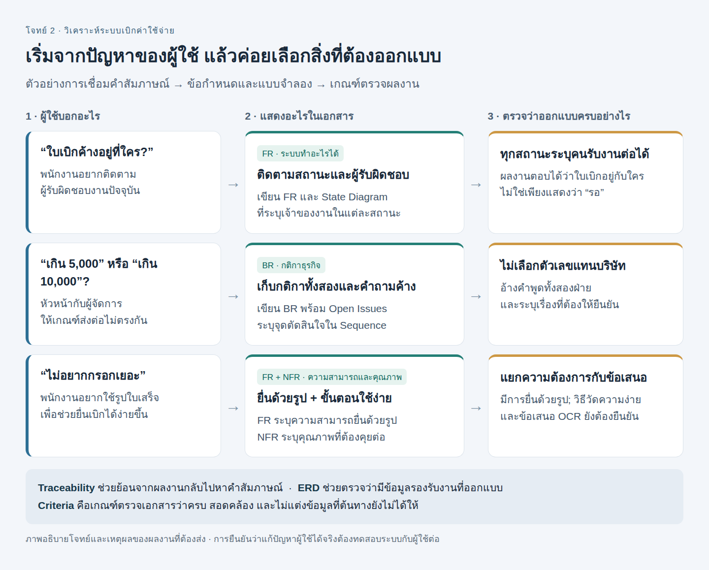

*อ่านภาพจากซ้ายไปขวา: คำสัมภาษณ์หรือปัญหาที่พบ → สิ่งที่ต้องแสดงในเอกสาร → หลักฐานที่ใช้ตรวจ ภาพนี้เป็นภาพอธิบายโจทย์ ส่วนภาพผลงานจากการทดลองจริงอยู่ในข้อ 1.4*

#### ข้อมูลที่ให้: บันทึกสัมภาษณ์ต้นฉบับ

ใช้ข้อความนี้เป็นหลักฐานตั้งต้นในการวิเคราะห์:

```text
[พนักงานฝ่ายขาย] อยากถ่ายรูปใบเสร็จแล้วเบิกได้เลย ไม่อยากกรอกเยอะ
                 ส่วนใหญ่เบิกค่าน้ำมัน ค่าที่พัก ค่ารับรองลูกค้า
[หัวหน้าทีม]     ผมต้องอนุมัติทุกใบ ถ้าเกิน 5,000 บาทต้องให้ผู้จัดการฝ่ายอนุมัติอีกชั้น
[ผู้จัดการฝ่าย]   อะไรเกิน 10,000 ค่อยส่งมาผม ต่ำกว่านั้นหัวหน้าทีมจบได้เลย
[ฝ่ายบัญชี]      ต้องตรวจใบเสร็จซ้ำ เคยมีคนเบิกใบเดียวสองรอบ
                 ต้องเบิกภายใน 30 วันนับจากวันที่ในใบเสร็จ จ่ายเงินรอบวันที่ 25 ของเดือน
[ฝ่ายบัญชี]      ค่ารับรองลูกค้าต้องระบุชื่อลูกค้าและชื่อบริษัท
[HR]             พนักงานแต่ละระดับมีวงเงินค่าที่พักต่อคืนไม่เท่ากัน
[พนักงานฝ่ายขาย] อยากเห็นว่าใบเบิกของเราค้างอยู่ที่ใคร
```

#### เงื่อนไขตรวจรับ: อ่านแล้วรู้ว่าต้องส่งอะไรและผ่านเมื่อใด

**ส่ง 2 ไฟล์:** `output.md` สำหรับข้อกำหนดและแบบจำลอง และ `mockup.html` สำหรับ Web UI Mockup ที่เปิดดูได้ โดยตรวจรับตามรายการต่อไปนี้

1. **เอกสารครบ:** มีผู้เกี่ยวข้อง, FR, NFR, BR, Use Case, ERD, Sequence “ยื่นเบิก → อนุมัติ → จ่ายเงิน”, State, Traceability และ Open Issues
2. **ไม่ตกหล่นคำสัมภาษณ์:** ทุกประโยคเชื่อมไป FR/BR ได้อย่างน้อยหนึ่งรายการ และย้อนดูที่มาได้
3. **ไม่ตัดสินหรือแต่งข้อมูลเอง:** เก็บข้อขัดแย้ง 5,000/10,000 ไว้ให้ยืนยัน และไม่สร้างตัวเลขวงเงินค่าที่พัก
4. **แบบจำลองสอดคล้อง:** Entity/Attribute ที่อ้างใน Sequence และ State มีอยู่ใน ERD และทุกสถานะบอกได้ว่าใบเบิกอยู่กับใคร
5. **แผนภาพตรวจได้:** Mermaid ทุกบล็อก render ได้ หากใช้ทางเลือกตรวจ syntax ตาม Prompt ต้องระบุข้อจำกัดและไม่อ้างว่า render แล้ว
6. **Mockup ครบสามส่วน:** ยื่นเบิก, ติดตามสถานะ และตรวจ/อนุมัติ ใช้ข้อมูลจำลอง โดยไม่บังคับให้ปุ่มหรือธุรกรรมทำงานจริง
7. **หน้าจอตรงกับข้อกำหนด:** มีตาราง Pain Point → FR/BR → หน้าจอ สถานะและผู้รับผิดชอบตรงกับเอกสาร พร้อมป้ายข้อมูลจำลองและนโยบายวงเงินที่รอยืนยัน

ขอบเขต Web UI Mockup อยู่ด้านล่าง

ลองสังเกตสามเรื่องก่อนเริ่ม: พนักงานต้องการยื่นเบิกและติดตามงาน หัวหน้ากับผู้จัดการให้วงเงินส่งต่อไม่ตรงกัน และ HR ยังไม่ได้บอกตัวเลขวงเงินค่าที่พัก เอกสารที่ดีต้องเก็บความต้องการเหล่านี้ไว้ครบ พร้อมชี้ให้เห็นสิ่งที่ยังสรุปไม่ได้

#### Web UI Mockup: ทำให้เห็นหน้าจอที่รองรับ Pain Point

สร้าง `mockup.html` ด้วย HTML/CSS ให้เปิดดูในเบราว์เซอร์ได้ ใช้ข้อมูลจำลองและแสดงครบ 3 หน้าหรือ 3 ส่วนในหน้าเดียวได้:

| หน้าหรือส่วน | สิ่งที่ต้องเห็น | Pain Point ที่รองรับ |
| --- | --- | --- |
| ยื่นเบิก | ช่องข้อมูล ประเภทค่าใช้จ่าย พื้นที่รูปใบเสร็จจำลอง เงื่อนไข 30 วัน และช่องลูกค้า/บริษัทสำหรับค่ารับรอง | อยากยื่นด้วยรูป ลดความสับสนเรื่องข้อมูลที่ต้องกรอก |
| ติดตามใบเบิก | รายการ สถานะ ผู้รับผิดชอบปัจจุบัน และขั้นตอนถัดไป | ไม่รู้ว่าใบเบิกค้างอยู่ที่ใคร |
| ตรวจและอนุมัติ | รายละเอียดใบเบิก ตัวอย่างแจ้งเตือนใบเสร็จอาจซ้ำ และป้ายรอยืนยันนโยบายวงเงิน | บัญชีต้องตรวจซ้ำ และกติกาวงเงินยังไม่ชัดเจน |

**ขอบเขตเป็น Mockup:** ปุ่มและช่องแนบรูปเป็นภาพจำลองได้ ไม่ต้องมี backend, ฐานข้อมูล, login, upload/OCR, การอนุมัติหรือจ่ายเงินจริง ให้ติดป้ายข้อมูลและสถานะว่าจำลอง และแสดงว่านโยบาย 5,000/10,000 กับวงเงินค่าที่พักยังต้องยืนยัน

ในเอกสารเพิ่มตาราง **Pain Point → FR/BR → หน้าหรือส่วนของ Mockup** เพื่อบอกว่าทำไมจึงมีหน้าจอนั้น งานนี้ตรวจว่าออกแบบภาพครบและสอดคล้องกับข้อกำหนด ไม่บังคับให้ปุ่มคลิกทำงานหรือทดสอบธุรกรรมจริง

ขอบเขต Mockup เป็นส่วนที่เพิ่มในโจทย์ฉบับนี้ ผลทดลองเดิมในข้อ 1.4 และตัวอย่าง Prompt เดิมยังเป็นงานเอกสาร จึงยังไม่มีผลทดลองหรือภาพ Mockup ของระบบเบิกค่าใช้จ่ายให้ยืนยันจากรอบเดิม

#### คำศัพท์ประกอบโจทย์

คำศัพท์หลัก 5 คำสำหรับอ่านโจทย์นี้:

| คำ / รหัส | ชื่อเต็ม | ความหมายแบบง่าย | ตัวอย่างในโจทย์นี้ |
| --- | --- | --- | --- |
| FR | Functional Requirement | **ระบบต้องทำอะไรได้** | พนักงานดูสถานะใบเบิกและผู้รับผิดชอบปัจจุบันได้ |
| BR | Business Rule | **ต้องทำตามกติกาธุรกิจอะไร** | ต้องยื่นเบิกภายใน 30 วันนับจากวันที่ในใบเสร็จ |
| NFR | Non-functional Requirement | **ระบบควรมีคุณภาพอย่างไร** เช่น ความง่ายในการใช้ ความปลอดภัย หรือความเร็ว | ความง่ายในการยื่นเบิกเป็นประเด็นที่ควรคุยกับผู้ใช้; เกณฑ์วัดยังต้องยืนยัน ไม่กำหนดจำนวนคลิกหรือเวลาเอง |
| ERD | Entity–Relationship Diagram | แผนภาพสิ่งที่ต้องเก็บข้อมูลและความสัมพันธ์ระหว่างกัน | ผู้เบิกเชื่อมกับใบเบิก และใบเบิกเชื่อมกับใบเสร็จ |
| Mermaid | รูปแบบเขียนแผนภาพด้วยข้อความ | เขียนข้อความตามไวยากรณ์ แล้วใช้เครื่องมือแสดงเป็นภาพ | ERD, Sequence และ State Diagram ในเอกสาร |

<a id="problem-3"></a>
### โจทย์ 3 — ย้ายระบบนัดหมายคลินิกจาก Google Sheet สู่ระบบกลาง

```text
บริบท: คลินิกทันตกรรม 3 สาขา ใช้ Google Sheet แยกสาขา ร่วมกับจองผ่าน LINE ต้องการย้ายมาระบบนัดหมายกลาง

สาขา,วันที่,เวลา,ชื่อคนไข้,เบอร์,หมอ,บริการ,หมายเหตุ
ลาดกระบัง,03/09/2026,10:00,สมชาย ใจดี,081-234-5678,หมอเอ,ขูดหินปูน,
ลาดกระบัง,2026-09-03,10:00,สมชาย ใจดี,0812345678,หมอเอ,ขูดหินปูน,จองซ้ำทางไลน์
บางนา,3 ก.ย. 69,13:30,คุณมาลี,,หมอบี,จัดฟัน,ไม่มีเบอร์ ติดต่อทางไลน์
บางนา,03/09/2026,13:30,วิชัย ศรีสุข,089-111-2222,หมอบี,อุดฟัน,
อ่อนนุช,09/03/2026,09:00,Somchai Jaidee,081 234 5678,หมอเอ,ตรวจฟัน,หมอเอมาช่วยสาขานี้ทุกวันพุธ

งานรอบแรก:
1. As-Is Process (กระบวนการทำงานปัจจุบัน) (Mermaid flowchart)
2. Data Quality Findings (ข้อค้นพบปัญหาคุณภาพข้อมูล) (ปัญหา / แถว / ผลกระทบ)
3. To-Be Process (กระบวนการทำงานที่ต้องการในอนาคต) และ Data Model (แบบจำลองข้อมูล)
4. Data Mapping (การจับคู่ข้อมูลต้นทางกับปลายทาง) + แผน Migration (การย้ายข้อมูลและระบบ) (รวมวิธีจับคู่ตัวตนคนไข้)
5. Gap Analysis (การวิเคราะห์สิ่งที่ยังขาดเพื่อไปสู่ระบบใหม่) + Roll-out Plan (แผนทยอยนำระบบไปใช้งาน)
6. Plan Version Log (บันทึกการเปลี่ยนแปลงแผน)
7. Web UI Mockup (แบบจำลองหน้าจอเว็บไซต์) (mockup.html)
```

**เกณฑ์ตรวจ (Criteria)**

1. ส่งมอบงานรอบแรกครบทั้ง 7 รายการ: เอกสาร output.md และ Web UI Mockup (แบบจำลองหน้าจอเว็บไซต์) ใน mockup.html
2. พบปัญหาข้อมูลอย่างน้อย 5 ประเภท พร้อมระบุแถวและผลกระทบ
3. ระบุข้อมูลที่กำกวม และอ้างหลักฐานประกอบการตีความ
4. มีกลยุทธ์จับคู่ตัวตนคนไข้ รวมการปรับรูปแบบชื่อและเบอร์โทรศัพท์ และกรณีที่ต้องให้คนยืนยัน
5. บันทึกการเปลี่ยนแผนจาก Plan v1 → v2 พร้อมเหตุผลตามเกณฑ์โจทย์เดิม
6. วิเคราะห์ผลกระทบ (Impact Analysis (การวิเคราะห์ผลกระทบ)) ว่าผลงานส่วนใดต้องแก้ และส่วนใดใช้ต่อได้ (Reuse (การนำผลงานเดิมมาใช้ต่อ))
7. แผนภาพ Mermaid ต้อง render ได้ หากเครื่องมือไม่พร้อมและตรวจได้เพียง syntax ตามเงื่อนไข Prompt เดิม ต้องรายงานวิธีตรวจและข้อจำกัดให้ชัดเจน

#### Web UI Mockup (แบบจำลองหน้าจอเว็บไซต์) ของระบบคลินิก

ส่ง `mockup.html` เพิ่มจากเอกสาร `output.md` ใช้ HTML/CSS และข้อมูลจำลอง มี 3 หน้าหรือส่วน:

| หน้าหรือส่วน | สิ่งที่ต้องเห็น |
| --- | --- |
| ตารางนัดหมายกลาง | สาขา วันที่ เวลา หมอ บริการ และสถานะนัดหมาย |
| จองหรือแก้ไขนัดหมาย | ช่องข้อมูลการนัดหมาย และตัวอย่างแจ้งเตือนเวลาชนกัน |
| ตรวจข้อมูลก่อนย้าย | ข้อมูลซ้ำ ข้อมูลขาด วันที่กำกวม และรายการที่ต้องให้คนยืนยัน |

**ตรวจรับ:** เปิดในเบราว์เซอร์ได้ครบทั้งสามส่วน ข้อมูลและสถานะตรงกับ To-Be, Data Model (แบบจำลองข้อมูล) และปัญหาข้อมูลที่วิเคราะห์ไว้ พร้อมภาพหลักฐาน ติดป้ายข้อมูลจำลองและรายการรอยืนยันให้ชัด ปุ่มเป็นภาพจำลองได้ ไม่ต้องมี backend หรือย้ายข้อมูลจริง

เกณฑ์เรื่องเวอร์ชันแผนเป็นเกณฑ์ของโจทย์คลินิก ส่วนบันทึกการทำงานของแต่ละเวิร์กโฟลว์มีรูปแบบต่างกัน เช่น Iteration Log, Execution Trace และ Plan Version Log (บันทึกการเปลี่ยนแปลงแผน) ให้อ่านเนื้อหาการเปลี่ยนงานประกอบกับชื่อเวอร์ชัน

#### ข้อมูลเพิ่มเติมระหว่างทำงาน: Change Request ของโจทย์ 3

หลังได้แผนเริ่มต้นและผลงานเฟสแรก ให้ส่งข้อมูลต่อไปนี้ในบทสนทนาเดิม เพื่อฝึกปรับงานจากสิ่งที่ทำไว้แล้ว:

```text
เจ้าของคลินิกแจ้งเพิ่ม:
1. ต้องเก็บความยินยอมของคนไข้ตาม PDPA
2. คนไข้ต้องจองคิวเองผ่าน LINE OA ได้
```

หลังรับ Change Request ให้ปรับทั้งเอกสารและ Mockup: เพิ่มส่วนบันทึกความยินยอมและหน้าจำลองการจองเองผ่าน LINE OA โดยไม่เชื่อมบริการจริง พร้อมอธิบายส่วนที่เปลี่ยน ส่วนที่ใช้ต่อ และเหตุผล

## วิธีเรียนและเตรียม Prompt

เมื่อจบบทเรียน นักศึกษาควรเขียน Prompt ที่ระบุบทบาท ลำดับงาน เกณฑ์ตรวจ และเงื่อนไขหยุดของแต่ละเวิร์กโฟลว์ได้ รวมถึงเลือกปรับ Template ให้ตรงกับโจทย์และอธิบายกระบวนการจากหลักฐานที่ได้

1. เลือกโจทย์จากด้านบน และอ่านข้อมูลนำเข้า ผลงานที่ต้องส่ง และเกณฑ์ตรวจให้ครบ
2. ศึกษา Template ของเวิร์กโฟลว์ แล้วระบุว่าส่วนใดกำหนดวิธีทำงาน ส่วนใดต้องเติมตามโจทย์
3. ดูตัวอย่างการเติม Prompt เปรียบเทียบกับผลงานและบันทึกการทำงานเดิม
4. เปรียบเทียบโจทย์เดียวกันในทั้งสามเวิร์กโฟลว์ ก่อนเลือกว่าจะใช้แบบใดกับงานใหม่

ใน Loop จะเขียนเกณฑ์ใน CRITERIA โดยตรง ส่วน Graph ต้องถ่ายทอดเกณฑ์ไปสู่งานของแต่ละ Node และการตรวจตอนรวม สำหรับ Dynamic ต้องให้ Planner และ Evaluator ใช้เกณฑ์เดียวกันในการวางแผนและตรวจผล การเปลี่ยนเวิร์กโฟลว์จึงต้องนำเกณฑ์ของโจทย์ติดไปด้วยทุกครั้ง

Template เป็นข้อความสำหรับกำหนดการทำงานของ AI ความสามารถในการเปิดเว็บ ทดสอบ หรือแยกงานจริงขึ้นอยู่กับเครื่องมือที่ใช้ด้วย การระบุหลายบทบาทใน Prompt เพียงอย่างเดียวจึงยังไม่ยืนยันว่ามีผู้ตรวจอิสระหรือมีงานรันพร้อมกัน

### ไฟล์ Prompt สำหรับแล็บ

แยกไฟล์ตามรูปแบบเวิร์กโฟลว์ภายใต้ `labs/prompts/` เพื่อให้เลือก Template ได้ตรงกับบทเรียน

```text
labs/
└── prompts/
    ├── loop/       Template, Prompt พร้อมใช้ และไฟล์ประกอบแล็บ Loop
    ├── graph/      Template, Prompt พร้อมใช้ และไฟล์ประกอบแล็บ Graph
    └── dynamic/    Dynamic Workflow Prompt Template
```

| เวิร์กโฟลว์ | Template | บทที่ใช้ |
| --- | --- | --- |
| Loop | [loop-template.md](labs/prompts/loop/loop-template.md) | 1.2–1.3 |
| Graph | [graph-template.md](labs/prompts/graph/graph-template.md) | 2.2–2.3 |
| Dynamic Workflow | [dynamic-template.md](labs/prompts/dynamic/dynamic-template.md) | 3.2 |

ตัวอย่างทั้งหมดต่อจากนี้อ้างอิงการทดลองเดิม ในแต่ละกรณีมีส่วนที่ต้องเติมใน Template, Prompt ฉบับเต็มในกล่องพับ, ตัวอย่างผลงาน และบันทึกการทำงาน ส่วน RUN HARNESS ใน Prompt เดิมใช้กำหนดไฟล์และการเก็บหลักฐานของการทดลองนั้น

<a id="loop"></a>
## บทที่ 1 เขียน Prompt เพื่อสร้าง Loop

### 1.1 กำหนดวงจรสร้าง–ตรวจ–แก้

Loop ใช้ Prompt กำหนดให้ **Generator** สร้างผลงาน และ **Critic** ตรวจตามเกณฑ์ทีละข้อ หากยังมีข้อที่ไม่ผ่าน ให้นำผลตรวจกลับไปแก้แล้วตรวจอีกครั้ง ผู้เขียน Prompt ต้องบอกทั้งสิ่งที่ต้องตรวจ วิธีรายงานหลักฐาน และขอบเขตการแก้ในรอบถัดไป


ลำดับที่ต้องเขียนให้ครบใน Prompt คือ รับโจทย์และเกณฑ์ → สร้างผลงาน → ตรวจพร้อมหลักฐาน → ส่งงานหรือแก้ตามผลตรวจ เงื่อนไขหยุดมีสองกรณี: ผ่านครบทุกข้อในรอบเดียวกัน หรือถึงขีดจำกัดแล้วยังมีข้อที่ไม่ผ่าน ซึ่งต้องรายงานแยกกัน

Template นี้กำหนดให้ทำได้สูงสุด 3 รอบ และหยุดเมื่อเกณฑ์เดิมไม่ผ่าน 2 ครั้งติดกันโดยไม่ดีขึ้น การระบุขีดจำกัดช่วยให้รู้ว่าต้องส่งต่อปัญหาเมื่อใด

### 1.2 Prompt Template สำหรับ Loop

อ่าน ROLE เพื่อแยกหน้าที่ แล้วอ่าน CRITERIA ควบคู่กับ WORKFLOW และ STOP CONDITION สังเกตว่าผลตรวจของ Critic เป็นข้อมูลที่ Generator ใช้ในรอบถัดไป

[เปิด Template เป็นไฟล์ Markdown](labs/prompts/loop/loop-template.md) เพื่อนำไปทำแล็บในข้อ 1.3

```text
บรรทัดที่ขึ้นต้นด้วย "//" คือคำอธิบายสำหรับผู้เรียน ให้ AI ข้ามบรรทัดเหล่านี้

# ROLE (บทบาท)
คุณสวมบทบาทที่แยกจากกัน 2 บทบาท:
- GENERATOR: สร้างหรือปรับปรุงผลงาน
- CRITIC: ตรวจผลงานตามเกณฑ์อย่างเคร่งครัดและอ้างหลักฐานจากผลงานจริง

# GOAL (เป้าหมาย)
สร้างผลงานที่ผ่านเกณฑ์ทุกข้อ โดยรักษาข้อกำหนด ข้อมูลต้นทาง และประเด็นที่ยังยืนยันไม่ได้

# INPUT PARAMETERS (พารามิเตอร์นำเข้า)

## REQUIREMENT
{{REQUIREMENT}}

## CRITERIA
{{CRITERIA}}
// ผู้เรียก Template ส่งเพียง REQUIREMENT และ CRITERIA ไม่ต้องเขียนขั้นตอนการทำงานซ้ำ

# WORKFLOW (ลำดับการทำงาน)
ทำซ้ำตามวงจรต่อไปนี้:
1. ก่อนสร้างงาน เชื่อมแต่ละข้อกำหนดกับส่วนของผลงานและเกณฑ์ที่ใช้ตรวจ
2. GENERATOR สร้างผลงานใน Iteration 1; รอบถัดไปแก้เฉพาะส่วนที่เกี่ยวข้องกับเกณฑ์ที่ไม่ผ่าน
3. CRITIC ตรวจผลงานล่าสุดทีละเกณฑ์ แล้วระบุ PASS หรือ FAIL พร้อมหลักฐานหรือตำแหน่งที่ตรวจได้
4. เกณฑ์ที่มีหลายเงื่อนไขจะ PASS เมื่อครบทุกเงื่อนไข หากไม่มีหลักฐานให้ FAIL และระบุสิ่งที่ขาด
5. หากทุกเกณฑ์ PASS ให้หยุด หากยังมี FAIL ให้ระบุสาเหตุ สิ่งที่ต้องแก้ และเริ่ม Iteration ถัดไป

# CONSTRAINTS (ข้อห้าม)
- ห้ามเปลี่ยนข้อกำหนดหรือเกณฑ์ที่ผู้เรียกส่งมา
- ห้ามแต่งข้อมูลที่ไม่มีในข้อมูลนำเข้า ให้แยกสมมติฐาน ข้อขัดแย้ง และเรื่องที่ต้องยืนยัน
- ห้ามเปลี่ยนส่วนที่ผ่านแล้ว เว้นแต่จำเป็นต่อการแก้ข้อที่ไม่ผ่าน และต้องตรวจผลกระทบซ้ำ
- ใช้วิธีตรวจสำรองได้เฉพาะเมื่อเกณฑ์อนุญาต และต้องระบุข้อจำกัดตามจริง

# STOP CONDITION (เงื่อนไขหยุด)
หยุดเมื่อ:
- ทุกเกณฑ์เป็น PASS หรือ
- ทำครบ 3 Iteration หรือ
- เกณฑ์เดิมไม่ผ่าน 2 ครั้งติดต่อกันโดยไม่ดีขึ้น ให้รายงานสถานะ blocked พร้อมงานค้างและข้อมูลที่ขาด

# OUTPUT FORMAT (รูปแบบผลลัพธ์)
1. ตารางบันทึก Iteration: | Iteration | สิ่งที่เปลี่ยน | ผลตรวจแต่ละเกณฑ์ |
2. ตารางผลตรวจ: | เกณฑ์ | PASS/FAIL | หลักฐาน/ตำแหน่ง | สิ่งที่ต้องแก้ |
3. ผลงานสุดท้ายตาม REQUIREMENT
4. ประเด็นที่ยังเหลือ สมมติฐาน หรือข้อจำกัด (ถ้ามี)
```

### 1.3 Lab: คัดลอก Prompt แล้วให้ AI ทำงานตาม Loop Template

แล็บนี้ใช้ **Template ในข้อ 1.2 เป็นกลไกกลาง** นักศึกษาเลือกโจทย์แล้วคัดลอก Prompt ของโจทย์นั้นทั้งบล็อกไปวางได้เลย แต่ละบล็อกส่งเพียง 2 พารามิเตอร์คือ `REQUIREMENT` และ `CRITERIA` ส่วนบทบาท ขั้นตอนตรวจ การแก้ไข และเงื่อนไขหยุดใช้จาก Template โดยไม่เขียนซ้ำในแต่ละโจทย์

**เตรียมครั้งเดียว:** ถ้าใช้เครื่องมือ AI ที่อ่านไฟล์ในโปรเจกต์ได้ ให้เปิดโฟลเดอร์ `Basic_AI_WORFLOW` ซึ่งมีไฟล์ `labs/prompts/loop/loop-template.md` อยู่แล้ว ถ้าใช้แชตทั่วไป ให้ดาวน์โหลด [loop-template.md](labs/prompts/loop/loop-template.md) แล้วแนบในบทสนทนาก่อนวาง Prompt การพิมพ์ชื่อไฟล์อย่างเดียวไม่ได้ทำให้แชตเข้าถึงไฟล์บนเครื่องได้

เริ่มบทสนทนาใหม่สำหรับแต่ละโจทย์ จากนั้น **คัดลอกทั้งบล็อก → วางและส่ง → เปิดผลงาน → ตรวจหลักฐาน C1/C2/C3** งานเว็บต้องใช้เครื่องมือที่สร้างไฟล์ เปิดเว็บ และทดสอบด้วย Playwright ได้ เพื่อให้ตรวจตามเกณฑ์ครบ

#### โจทย์ 1: จองห้องประชุม

คัดลอกบล็อกนี้ทั้งหมด หรือเปิด [Prompt สำหรับคัดลอก](labs/prompts/loop/1_meeting_room-run.md)

```text
ใช้ `labs/prompts/loop/loop-template.md` เป็น Template หลัก หากใช้ไฟล์แนบ ให้ใช้ `loop-template.md` ที่แนบไว้

ส่งพารามิเตอร์ด้านล่างเข้า `{{REQUIREMENT}}` และ `{{CRITERIA}}` ตามชื่อ แล้วเริ่มทำงานตาม Template

# PARAMETERS

## REQUIREMENT
สร้างเว็บไซต์สำหรับระบบจองห้องประชุม
ระบบต้องสามารถ: แสดงห้องประชุม, ดูเวลาว่าง, จองห้อง, ยกเลิกการจอง, แสดงสถานะการจอง
Output: Web UI Mock-up ที่เปิดและทดลองใช้งานได้

## CRITERIA
C1. มีทุกฟีเจอร์ที่ระบุไว้ในโจทย์
C2. เปิด output.html ใน headless Chromium ได้โดยไม่มี console error และทดลองใช้ทั้ง 5 ฟีเจอร์ได้ด้วยการคลิกในหน้าเว็บ (แสดงห้องประชุม ดูเวลาว่างของห้อง สร้างการจอง ยกเลิกการจองนั้น และเห็นสถานะการจองเปลี่ยนไป) โดย CRITIC ต้องรันสคริปต์ Python Playwright และยกผลลัพธ์จริงมาเป็นหลักฐาน
C3. จากหน้าจอแรก เข้าถึงแต่ละฟีเจอร์ในทั้ง 5 ฟีเจอร์ได้ภายในไม่เกิน 2 คลิก โดย CRITIC ระบุเส้นทางการคลิกและจำนวนคลิกของแต่ละฟีเจอร์
```

#### โจทย์ 2: เบิกค่าใช้จ่าย

คัดลอกบล็อกนี้ทั้งหมด หรือเปิด [Prompt สำหรับคัดลอก](labs/prompts/loop/2_expense_claim-run.md)

```text
ใช้ `labs/prompts/loop/loop-template.md` เป็น Template หลัก หากใช้ไฟล์แนบ ให้ใช้ `loop-template.md` ที่แนบไว้

ส่งพารามิเตอร์ด้านล่างเข้า `{{REQUIREMENT}}` และ `{{CRITERIA}}` ตามชื่อ แล้วเริ่มทำงานตาม Template

# PARAMETERS

## REQUIREMENT
วิเคราะห์ Requirement และออกแบบ Web UI Mockup สำหรับระบบเบิกค่าใช้จ่ายจากบันทึกสัมภาษณ์ต่อไปนี้ ส่งเอกสารข้อกำหนดและ Mockup ที่สอดคล้องกันเป็นผลงานของโจทย์เดียวกัน

[พนักงานฝ่ายขาย] อยากถ่ายรูปใบเสร็จแล้วเบิกได้เลย ไม่อยากกรอกเยอะ
                 ส่วนใหญ่เบิกค่าน้ำมัน ค่าที่พัก ค่ารับรองลูกค้า
[หัวหน้าทีม]     ผมต้องอนุมัติทุกใบ ถ้าเกิน 5,000 บาทต้องให้ผู้จัดการฝ่ายอนุมัติอีกชั้น
[ผู้จัดการฝ่าย]   อะไรเกิน 10,000 ค่อยส่งมาผม ต่ำกว่านั้นหัวหน้าทีมจบได้เลย
[ฝ่ายบัญชี]      ต้องตรวจใบเสร็จซ้ำ เคยมีคนเบิกใบเดียวสองรอบ
                 ต้องเบิกภายใน 30 วันนับจากวันที่ในใบเสร็จ จ่ายเงินรอบวันที่ 25 ของเดือน
[ฝ่ายบัญชี]      ค่ารับรองลูกค้าต้องระบุชื่อลูกค้าและชื่อบริษัท
[HR]             พนักงานแต่ละระดับมีวงเงินค่าที่พักต่อคืนไม่เท่ากัน
[พนักงานฝ่ายขาย] อยากเห็นว่าใบเบิกของเราค้างอยู่ที่ใคร

Output: ส่ง 2 ไฟล์ร่วมกัน ได้แก่ output.md (เอกสารข้อกำหนดและแผนภาพ Mermaid) และ mockup.html (Web UI Mockup) โดย output.md ประกอบด้วย Actor/Stakeholder · FR-xx และ NFR · BR-xx · Use Case Diagram · ERD · Sequence Diagram "ยื่นเบิก → อนุมัติ → จ่ายเงิน" · State Diagram ของใบเบิก · Traceability Matrix (ประโยคต้นทาง → FR/BR → Use Case → Entity) · Open Issues

สำหรับ mockup.html ให้ใช้ HTML/CSS และข้อมูลตัวอย่างเพื่อสื่อหน้าตาและสถานะตามข้อกำหนดใน output.md ไม่ต้องทำระบบธุรกรรมจริง
มี 3 หน้าหรือ 3 ส่วนที่มองเห็นได้:
1. ยื่นเบิก: ช่องข้อมูลใบเบิก ประเภทค่าใช้จ่าย พื้นที่แนบรูปใบเสร็จจำลอง และข้อความเงื่อนไข 30 วัน; แสดงช่องชื่อลูกค้าและบริษัทสำหรับค่ารับรอง
2. ติดตามใบเบิก: รายการ สถานะ ผู้รับผิดชอบปัจจุบัน และขั้นตอนถัดไป
3. ตรวจและอนุมัติ: รายละเอียดใบเบิก ตัวอย่างจุดแจ้งเตือนใบเสร็จอาจซ้ำ และข้อความรอยืนยันนโยบายวงเงิน 5,000/10,000 รวมถึงวงเงินค่าที่พักที่ยังไม่มีข้อมูล
ไม่ต้องมี backend, ฐานข้อมูล, login, upload/OCR, การตรวจซ้ำ, การอนุมัติ หรือการจ่ายเงินจริง ปุ่มเป็นภาพจำลองได้ ไม่บังคับให้คลิกทำงาน ข้อมูลและสถานะตัวอย่างต้องติดป้ายว่าจำลอง ไม่แต่งนโยบายที่ยังไม่ยืนยัน
ใน output.md เพิ่มตาราง Pain Point → FR/BR → หน้าหรือส่วนของ Mockup พร้อมอธิบายว่าหน้าจอแต่ละส่วนช่วยผู้ใช้อย่างไร

## CRITERIA
C1. ส่ง output.md ที่มีหัวข้อและแผนภาพครบตามรายการ Output พร้อม mockup.html ที่แสดงครบสามส่วน: ยื่นเบิก ติดตามใบเบิก และตรวจ/อนุมัติ โดยเป็นภาพจำลอง ไม่ต้องมีระบบธุรกรรมทำงานจริง
C2. บันทึกสัมภาษณ์ทุกบรรทัดปรากฏใน Traceability Matrix โดยเชื่อมโยงกับ FR-xx หรือ BR-xx อย่างน้อยหนึ่งข้อ หากมีสองบรรทัดที่ให้กติกาต่างกันสำหรับการตัดสินใจเรื่องเดียวกัน ต้องยกทั้งสองบรรทัดไว้ใน Open Issues โดยไม่เลือกข้าง และตัวเลขทุกตัวที่ปรากฏใน FR/BR/Open Issues ต้องตรงตามที่ปรากฏในข้อมูลนำเข้าทุกตัวอักษร
C3. ทุก Entity และ Attribute ที่ระบุชื่อใน Sequence Diagram และ State Diagram ต้องมีอยู่ใน ERD ทุกสถานะใน State Diagram ต้องระบุว่าใบเบิกอยู่กับใครในขณะนั้น และทุกบล็อก Mermaid ต้อง render ได้ (ใช้ renderer ที่ติดตั้งในเครื่องหากมี มิฉะนั้นให้ตรวจ syntax อย่างเคร่งครัด พร้อมระบุว่าใช้วิธีใด) และ mockup.html ต้องเปิดเห็นครบทั้ง 3 หน้าหรือส่วน ข้อความสถานะ ผู้รับผิดชอบ และกติกาต้องสอดคล้องกับเอกสาร มีตารางเชื่อม Pain Point → FR/BR → หน้าจอ แสดงข้อมูลจำลองและนโยบายที่รอยืนยันชัดเจน ตรวจเฉพาะความครบของภาพและความสอดคล้อง ไม่กำหนดให้ปุ่มหรือระบบธุรกรรมทำงานจริง
```

#### โจทย์ 3: คลินิกทันตกรรม

คัดลอกบล็อกนี้ทั้งหมด หรือเปิด [Prompt สำหรับคัดลอก](labs/prompts/loop/3_clinic_migration-run.md)

````text
ใช้ `labs/prompts/loop/loop-template.md` เป็น Template หลัก หากใช้ไฟล์แนบ ให้ใช้ `loop-template.md` ที่แนบไว้

ส่งพารามิเตอร์ด้านล่างเข้า `{{REQUIREMENT}}` และ `{{CRITERIA}}` ตามชื่อ แล้วเริ่มทำงานตาม Template

# PARAMETERS

## REQUIREMENT
ย้ายระบบนัดหมายคลินิกจาก Google Sheet สู่ระบบกลาง (As-Is → To-Be + Migration (การย้ายข้อมูลและระบบ))
บริบท: คลินิกทันตกรรม 3 สาขา ใช้ Google Sheet แยกสาขา ร่วมกับจองผ่าน LINE ต้องการย้ายมาระบบนัดหมายกลาง

ตัวอย่างข้อมูลจาก Google Sheet ของสาขาต่าง ๆ (CSV):
```csv
สาขา,วันที่,เวลา,ชื่อคนไข้,เบอร์,หมอ,บริการ,หมายเหตุ
ลาดกระบัง,03/09/2026,10:00,สมชาย ใจดี,081-234-5678,หมอเอ,ขูดหินปูน,
ลาดกระบัง,2026-09-03,10:00,สมชาย ใจดี,0812345678,หมอเอ,ขูดหินปูน,จองซ้ำทางไลน์
บางนา,3 ก.ย. 69,13:30,คุณมาลี,,หมอบี,จัดฟัน,ไม่มีเบอร์ ติดต่อทางไลน์
บางนา,03/09/2026,13:30,วิชัย ศรีสุข,089-111-2222,หมอบี,อุดฟัน,
อ่อนนุช,09/03/2026,09:00,Somchai Jaidee,081 234 5678,หมอเอ,ตรวจฟัน,หมอเอมาช่วยสาขานี้ทุกวันพุธ
```

งานที่ต้องส่ง: As-Is Process (กระบวนการทำงานปัจจุบัน) (Mermaid flowchart) · Data Quality Findings (ข้อค้นพบปัญหาคุณภาพข้อมูล) (ปัญหา / แถว / ผลกระทบ) · To-Be Process (กระบวนการทำงานที่ต้องการในอนาคต) และ Data Model (แบบจำลองข้อมูล) · Data Mapping (การจับคู่ข้อมูลต้นทางกับปลายทาง) + แผน Migration (การย้ายข้อมูลและระบบ) (รวมวิธีจับคู่ตัวตนคนไข้) · Gap Analysis (การวิเคราะห์สิ่งที่ยังขาดเพื่อไปสู่ระบบใหม่) + Roll-out Plan (แผนทยอยนำระบบไปใช้งาน) · Plan Version Log (บันทึกการเปลี่ยนแปลงแผน)
Output: ส่ง 2 ไฟล์ ได้แก่ output.md สำหรับเอกสารและแผนภาพ Mermaid และ mockup.html สำหรับ Web UI Mockup (แบบจำลองหน้าจอเว็บไซต์) ด้วย HTML/CSS
Mockup เฟสแรกมี 3 หน้าหรือส่วน: (1) ตารางนัดหมายกลาง แสดงสาขา วันที่ เวลา หมอ บริการ และสถานะ (2) ฟอร์มจอง/แก้ไขนัดหมาย พร้อมตัวอย่างคำเตือนเวลาชนกัน (3) ตรวจข้อมูลก่อนย้าย แสดงข้อมูลซ้ำ ข้อมูลขาด วันที่กำกวม และรายการรอคนยืนยัน
ใช้ข้อมูลจำลองพร้อมป้ายกำกับ โดยหน้าจอและชื่อข้อมูลต้องสอดคล้องกับ To-Be, Data Model (แบบจำลองข้อมูล) และ Data Quality Findings (ข้อค้นพบปัญหาคุณภาพข้อมูล) ไม่ตัดสินข้อมูลกำกวมหรือรวมตัวตนเอง ปุ่มเป็นภาพจำลองได้ ไม่ต้องมี backend หรือย้ายข้อมูลจริง
เกณฑ์ตรวจ Mockup: เปิดในเบราว์เซอร์ได้ เห็นครบ 3 ส่วน ข้อมูล/สถานะสอดคล้องกับเอกสาร และแสดงรายการรอยืนยันชัดเจน บันทึกผลตรวจพร้อมภาพหลักฐาน ไม่บังคับทดสอบธุรกรรมจริง

## CRITERIA
C1. ส่ง output.md ครบหกส่วนตามโจทย์ และ mockup.html ครบสามส่วนตามขอบเขต Mockup
C2. Data Quality Findings (ข้อค้นพบปัญหาคุณภาพข้อมูล) ระบุปัญหาที่ต่างประเภทกันอย่างน้อย 5 ประเภท โดยแต่ละประเภทอ้างอิงแถวที่ได้รับผลกระทบอย่างเจาะจงและระบุผลกระทบ ค่าทุกค่าที่ตีความได้มากกว่าหนึ่งแบบต้องระบุว่ากำกวม และการตีความที่เลือกต้องอ้างอิงหลักฐานที่พบในข้อมูล
C3. ส่วน Data Mapping (การจับคู่ข้อมูลต้นทางกับปลายทาง) + Migration (การย้ายข้อมูลและระบบ) มีกลยุทธ์จับคู่ตัวตนคนไข้ที่ระบุวิธีปรับรูปแบบเบอร์โทรศัพท์และชื่อให้เป็นมาตรฐานก่อนจับคู่ พร้อมระบุแถวที่ต้องให้มนุษย์ยืนยัน และทุกบล็อก Mermaid ต้อง render ได้ (ใช้ renderer ที่ติดตั้งในเครื่องหากมี มิฉะนั้นให้ตรวจ syntax อย่างเคร่งครัด พร้อมระบุว่าใช้วิธีใด) รวมถึงเปิด mockup.html ในเบราว์เซอร์ ตรวจความครบทั้งสามส่วน ความสอดคล้องกับเอกสาร ป้ายข้อมูลจำลองและรายการรอยืนยัน พร้อมบันทึกภาพหลักฐาน
````

#### Prompt นี้ช่วยกำกับงานอย่างไร

ก่อนสร้างผลงาน AI ต้องเชื่อมข้อกำหนดกับสิ่งที่จะส่งและวิธีตรวจ ทำให้เห็นงานที่อาจตกหล่น เมื่อ Critic ตรวจไม่ผ่านต้องระบุหลักฐานและสาเหตุเพื่อให้ Generator แก้ได้ตรงจุด แล้วตรวจซ้ำโดยใช้ผลงานล่าสุด ทุกขั้นยังอยู่ภายใต้จำนวนรอบและเงื่อนไขหยุดของ Template 1.2

#### รับ Output แล้วตรวจอะไร

AI ควรส่งทั้งผลงาน ตาราง Iteration และผลตรวจพร้อมหลักฐาน นักศึกษาเปิดผลงานจริงแล้วเทียบกับ C1/C2/C3 ในบล็อกที่ส่ง โดยใช้ [แบบบันทึกตรวจผลงาน](labs/prompts/loop/review-checklist.md) ช่วยจดผลได้

| โจทย์ | C1: ครบตามโจทย์หรือไม่ | C2: หลักฐานที่ต้องดู | C3: หลักฐานที่ต้องดู |
| --- | --- | --- | --- |
| จองห้องประชุม | ฟีเจอร์ทั้งห้าข้อ | ผลทดลอง Playwright และ console error | เส้นทางและจำนวนคลิกของแต่ละฟีเจอร์ |
| เบิกค่าใช้จ่าย | เอกสาร แผนภาพ และ Mockup สามหน้าหรือส่วน | Traceability ข้อขัดแย้งเรื่องวงเงิน และที่มาของตัวเลข | ความสอดคล้องของ Entity/Attribute ผู้ถือใบเบิกแต่ละสถานะ ผลตรวจ Mermaid และ Mockup ที่ตรงกับเอกสาร |
| คลินิกทันตกรรม | เอกสารทั้งหกส่วนและ Web UI Mockup สามส่วน | ปัญหาข้อมูลอย่างน้อยห้าประเภทพร้อมแถวและหลักฐาน | การจับคู่คนไข้ กรณีให้คนยืนยัน ผลตรวจ Mermaid และ Mockup ที่ตรงกับเอกสาร |

C1 ตรวจความครบตามชนิดผลงานของแต่ละโจทย์ โดยโจทย์เบิกค่าใช้จ่ายระบุชัดว่าต้องมีเอกสารและ Mockup ซึ่งไม่ต้องทำธุรกรรมจริง หากหลักฐานไม่พอให้บันทึกว่า **ยังตรวจไม่ได้** พร้อมเหตุผล การตรวจ syntax อย่างเดียวต้องแยกจากการ render จริง อย่าใช้คำว่า PASS ในคำตอบของ AI แทนการเปิดดูผลงาน

**สิ่งที่ส่งท้ายแล็บ:** Prompt ที่ใช้จริง ผลงาน บันทึก Iteration และผลตรวจของนักศึกษาพร้อมหลักฐาน อ่านข้อ 1.4 เพื่อเปรียบเทียบกับผลทดลองเดิม โดยแยกผลรอบใหม่ของตนเองไว้ต่างหาก

สำหรับคลินิก เมื่อจบเฟสแรกแล้วจึงทดลอง Change Request เรื่องความยินยอมและ LINE OA ตามข้อมูลเพิ่มเติมในโจทย์ 3 ในบทสนทนาเดิม และตรวจส่วนที่เปลี่ยน เหตุผล Impact และ Reuse เพิ่มเติม

<details>
<summary>ดูการจับคู่ข้อมูลกับ Template และไฟล์ประกอบสำหรับศึกษาเพิ่มเติม</summary>

| พารามิเตอร์ใน Prompt ที่คัดลอก | ช่องใน Template 1.2 |
| --- | --- |
| REQUIREMENT ทั้งส่วน รวมข้อมูลต้นทางและ Output | `{{REQUIREMENT}}` |
| CRITERIA ทั้งชุด รวม C1–C3 | `{{CRITERIA}}` |

ไฟล์ประกอบด้านล่างใช้ดูวิธีแทนค่าเพิ่มเติม การเริ่มแล็บใช้บล็อกพร้อมคัดลอกด้านบนได้ทันที

| โจทย์ | ข้อมูลแยกส่วน | Template ที่แทนค่าแล้วสำหรับเทียบ |
| --- | --- | --- |
| จองห้องประชุม | [ข้อมูลโจทย์](labs/prompts/loop/1_meeting_room-input.md) | [Template ที่เติมแล้ว](labs/prompts/loop/1_meeting_room-prompt.md) |
| เบิกค่าใช้จ่าย | [ข้อมูลโจทย์](labs/prompts/loop/2_expense_claim-input.md) | [Template ที่เติมแล้ว](labs/prompts/loop/2_expense_claim-prompt.md) |
| คลินิก | [ข้อมูลโจทย์](labs/prompts/loop/3_clinic_migration-input.md) | [Template ที่เติมแล้ว](labs/prompts/loop/3_clinic_migration-prompt.md) |

Prompt สำหรับคัดลอกทำหน้าที่ส่งพารามิเตอร์เข้า Template เท่านั้น ตรรกะการเชื่อมข้อกำหนดกับหลักฐาน การตรวจ การแก้ตามสาเหตุ และเงื่อนไขหยุดอยู่ใน Template กลาง จึงแก้กติกาการทำงานได้จากไฟล์เดียวโดยไม่ต้องตามแก้ทั้งสามโจทย์

</details>

### 1.4 ผลลัพธ์จากการทดลอง Loop: โจทย์ 1 → 2 → 3

หลังทำแล็บในข้อ 1.3 ให้อ่านผลตามลำดับเดียวกับโจทย์: **จองห้องประชุม → เบิกค่าใช้จ่าย → ย้ายระบบคลินิก** แต่ละข้อจัดเหมือนกัน คือ ผลงานที่ได้ → วงจรสร้างและตรวจ → หลักฐาน → ไฟล์สำหรับเปิดดู

ผลด้านล่างทดลองวันที่ **17 กันยายน 2026** จาก `loop-template.md` และพารามิเตอร์ของทั้งสามโจทย์ใน `labs/prompts/loop/` โดย Codex ในบทสนทนาเดียวกันสลับบทบาท GENERATOR และ CRITIC แล้วใช้เครื่องมือบน Remote ตรวจจริง ไม่ใช่ผลจากโมเดลสองตัวที่แยกอิสระกัน โจทย์คลินิกรอบอัปเดตใช้เอกสารเดิมเป็นฐาน เพิ่ม Mockup แล้วตรวจหลักฐานใหม่ทั้งหมดตามรายละเอียดในข้อ 1.4.3

แต่ละกรณีเก็บ `prompt-used.md` ซึ่งแทนพารามิเตอร์แล้ว, ผลงาน, `trace.md`, ผลตรวจ `verification.json` และภาพจากผลงานรอบนี้ไว้ด้วยกัน ผลตรวจมีทั้งการอ่านความหมายโดย CRITIC และการทดสอบด้วยเครื่องมือ ระบุวิธีตรวจแยกไว้ในแต่ละข้อ

| ลำดับ | ผลงานรอบใหม่ | สิ่งที่เกิดขึ้นใน Loop | ผลตาม C1–C3 |
| --- | --- | --- | --- |
| 1. จองห้องประชุม | เว็บ Mock-up ที่จองและยกเลิกได้ | สร้างแล้วทดสอบการคลิกจริง จบ Iteration 1 | ผ่านครบ |
| 2. เบิกค่าใช้จ่าย | เอกสารข้อกำหนด แบบจำลอง และ Mockup สามส่วน | Iteration 1 พบ Sequence render ไม่ผ่าน; แก้และตรวจซ้ำใน Iteration 2 | ผ่านครบหลังแก้ |
| 3. ย้ายระบบคลินิก | แผนย้ายระบบและ Mockup ก่อน/หลัง Change Request | Iteration 1 ผ่านเฟสแรก; เมื่อรับข้อมูลใหม่ C1 ไม่ผ่าน จึงแก้และตรวจใน Iteration 2 | ผ่านครบหลังเพิ่มข้อกำหนดใหม่ |

**เลือกอ่านทีละแล็บ:** [1. จองห้องประชุม](#loop-lab-1) · [2. เบิกค่าใช้จ่าย](#loop-lab-2) · [3. ย้ายระบบคลินิก](#loop-lab-3)

---

<a id="loop-lab-1"></a>

#### 1.4.1 แล็บโจทย์ 1 — เว็บจองห้องประชุม

**ผลงานที่ได้**

เว็บหน้าเดียวมีห้องตัวอย่างสามห้อง ปุ่มดูเวลาว่างตามวันที่ ฟอร์มจอง และตารางสถานะพร้อมปุ่มยกเลิก ผู้เรียนทดลองครบทั้งห้าฟีเจอร์ได้ ข้อมูลเป็นข้อมูลจำลองในหน่วยความจำ รีเฟรชแล้วกลับสู่ข้อมูลตั้งต้น

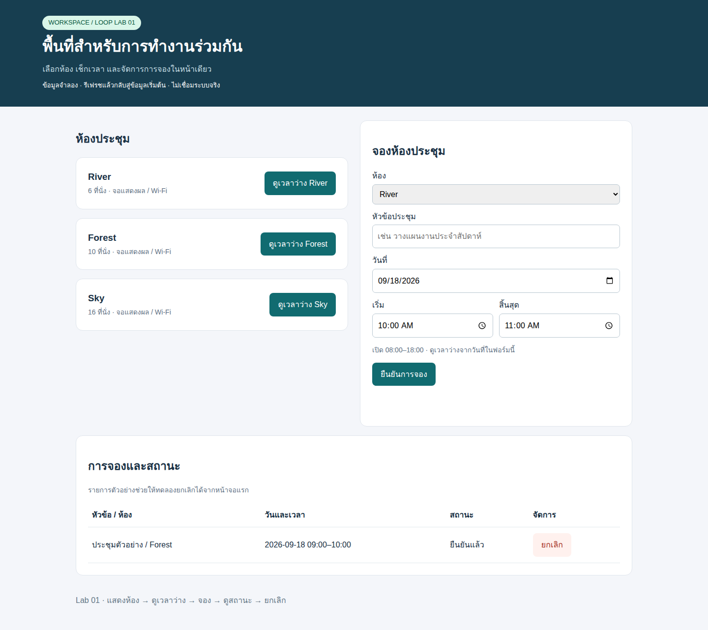

**วงจรสร้างและตรวจ**

| Iteration | GENERATOR | CRITIC และการตัดสินใจ |
| --- | --- | --- |
| 1 | เชื่อมข้อกำหนดกับหน้าจอและสร้างเว็บครบห้าฟีเจอร์ | C1–C3 ผ่านจากการตรวจและ Python Playwright จึงหยุด |

**หลักฐานตามเกณฑ์**

| เกณฑ์ | ผล | หลักฐานที่ตรวจได้ |
| --- | --- | --- |
| C1 ฟีเจอร์ครบ | PASS | แสดงห้อง ดูเวลาว่าง สร้างการจอง ยกเลิก และเห็นสถานะเปลี่ยน |
| C2 เปิดและทดลองจริง | PASS | Python Playwright เปิด headless Chromium แล้วคลิกครบห้าฟีเจอร์; ไม่พบ console/page error; ตรวจเพิ่มว่าป้องกันเวลาซ้อนและคืนเวลาว่างหลังยกเลิก |
| C3 เข้าถึงภายในสองคลิก | PASS | รายการห้อง 0 คลิก; ดูเวลาว่าง 1; ฟอร์มจอง 0; ยกเลิกรายการตัวอย่าง 1; ตารางสถานะ 0 |

จำนวนคลิกใน C3 หมายถึง **การเข้าถึงฟีเจอร์จากหน้าแรก** ไม่ใช่จำนวนคลิกรวมทุกช่องระหว่างกรอกข้อมูล การส่งฟอร์มหลังกรอกใช้ปุ่มยืนยันอีกหนึ่งคลิก

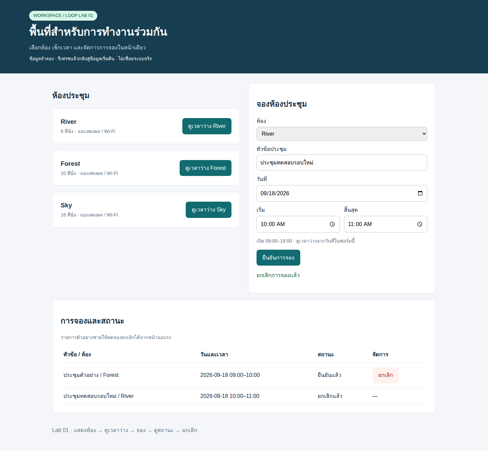

[เปิดเว็บที่ทดลองได้](lab-results/loop/1_meeting_room/run-2026-09-17-074505/output.html) · [อ่าน Trace](lab-results/loop/1_meeting_room/run-2026-09-17-074505/trace.md) · [ดูผลทดสอบจริง](lab-results/loop/1_meeting_room/run-2026-09-17-074505/verification.json) · [ดู Prompt ที่ใช้](lab-results/loop/1_meeting_room/run-2026-09-17-074505/prompt-used.md)

**สิ่งที่เรียนรู้:** Loop หยุดได้ตั้งแต่รอบแรกเมื่อมีหลักฐานว่าผ่านครบ ไม่จำเป็นต้องสร้างรอบแก้ไขให้ครบจำนวนสูงสุด

---

<a id="loop-lab-2"></a>

#### 1.4.2 แล็บโจทย์ 2 — ข้อกำหนดและ Mockup ระบบเบิกค่าใช้จ่าย

**ผลงานที่ได้**

ส่งเอกสารข้อกำหนดพร้อม Actor/Stakeholder, FR, NFR, BR, Use Case, ERD, Sequence, State, Traceability, Pain Point → หน้าจอ และ Open Issues ร่วมกับ Mockup สามส่วน ได้แก่ **ยื่นเบิก → ติดตามใบเบิก → ตรวจและอนุมัติ**

เอกสารแยกข้อความสัมภาษณ์เป็น S01–S10 ตามหน่วยความหมาย ย้อนกลับได้ครบทุกบรรทัด เก็บข้อขัดแย้ง **5,000/10,000** ไว้ทั้งสองฝั่ง และไม่สร้างตัวเลขวงเงินที่พัก ข้อเสนอที่ไม่มีในสัมภาษณ์ระบุว่าต้องยืนยัน

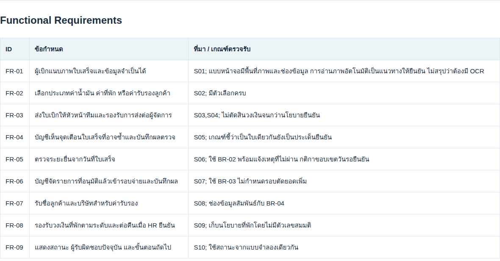

**วงจรสร้างและตรวจ**

| Iteration | สิ่งที่สร้างหรือแก้ | ผลตรวจและการตัดสินใจ |
| --- | --- | --- |
| 1 | สร้างเอกสารและ Mockup ใหม่ | C1, C2 ผ่าน; C3 ไม่ผ่าน เพราะ Sequence มี semicolon ในข้อความที่ renderer ตีความเป็นตัวแบ่งคำสั่ง |
| 2 | เปลี่ยนตัวคั่นข้อความใน Sequence โดยคงข้อกำหนดเดิม | ตรวจ renderer และความสอดคล้องซ้ำ C1–C3 ผ่าน จึงหยุด |

เก็บ [เอกสารก่อนแก้](lab-results/loop/2_expense_claim/run-2026-09-17-074505/output-iteration-1.md) และ [ข้อผิดพลาดจาก renderer รอบแรก](lab-results/loop/2_expense_claim/run-2026-09-17-074505/verification-iteration-1.json) ไว้ให้เห็นว่าเกิดการตรวจพบและแก้จริง

**หลักฐานตามเกณฑ์**

| เกณฑ์ | ผลสุดท้าย | หลักฐานที่ตรวจได้ |
| --- | --- | --- |
| C1 เอกสารและ Mockup ครบ | PASS | อ่านหัวข้อและแบบจำลองครบ; Chromium แสดง Mockup ทั้งสามส่วน |
| C2 ครบต้นทางและไม่แต่งนโยบาย | PASS | CRITIC อ่านเทียบสัมภาษณ์กับ S01–S10 และตารางย้อนกลับ; สคริปต์ตรวจว่าทุกรหัสเชื่อม FR/BR; เก็บตัวเลขและข้อขัดแย้งเดิม |
| C3 แบบจำลองและหน้าจอสอดคล้อง | PASS | Mermaid ทั้ง 4 บล็อก render จริง; ชื่อฟิลด์ที่อ้างตรง ERD; ทุกสถานะมีเจ้าของ; อ่านเทียบสถานะและนโยบายกับ Mockup พร้อมตรวจภาพ ไม่มี console/page error |

**แบบจำลองระบบจากผลรอบนี้**

Use Case ใช้ Mermaid flowchart แสดง actor และงาน ไม่ใช่ UML use-case syntax โดยตรง

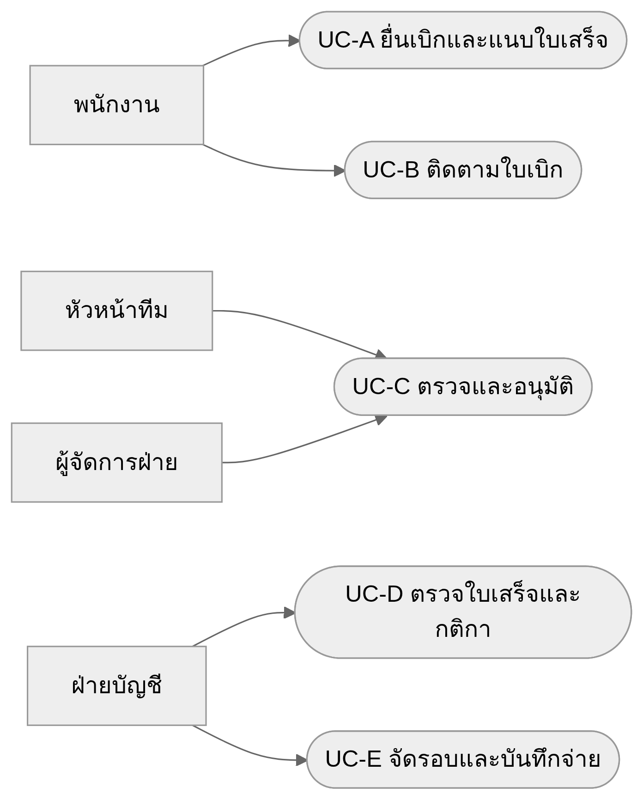

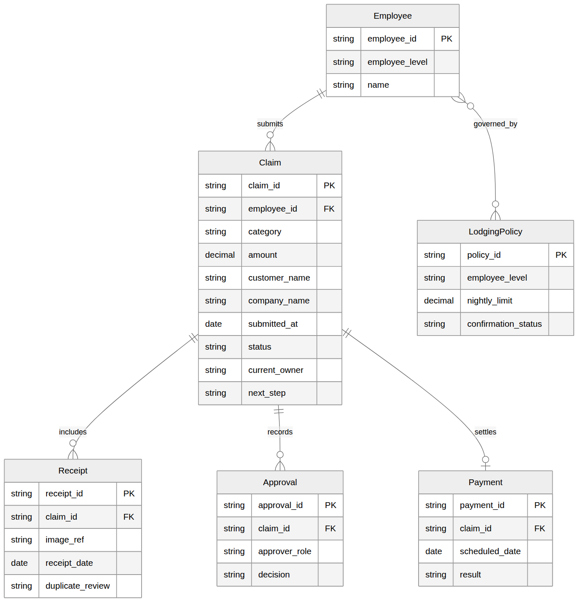

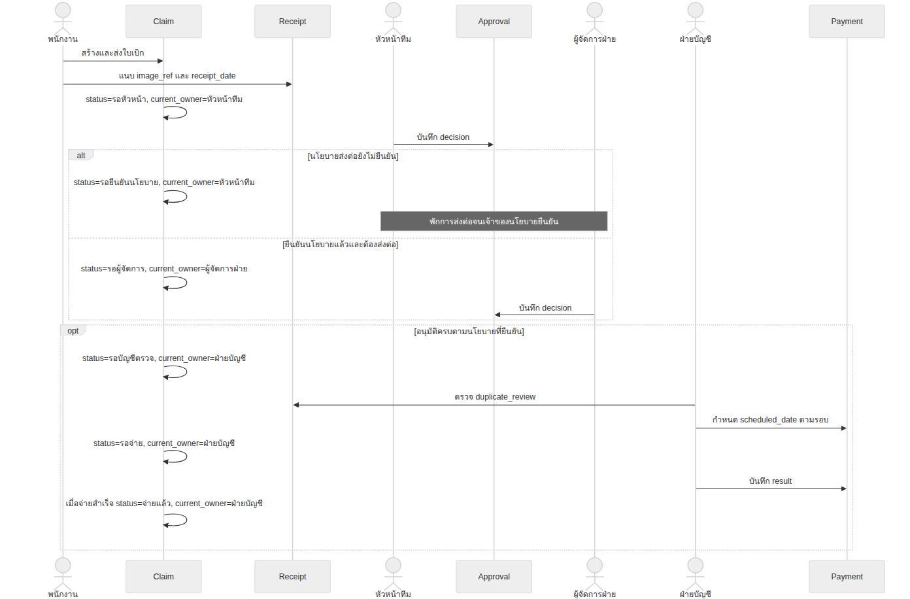

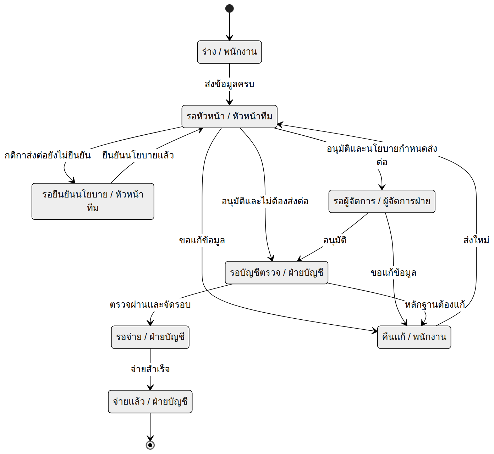

**Mockup เรียงตามงานของผู้ใช้**

1. ยื่นเบิก — รูปใบเสร็จจำลอง ประเภทค่าใช้จ่าย ข้อมูลลูกค้า และเงื่อนไขวันยื่น

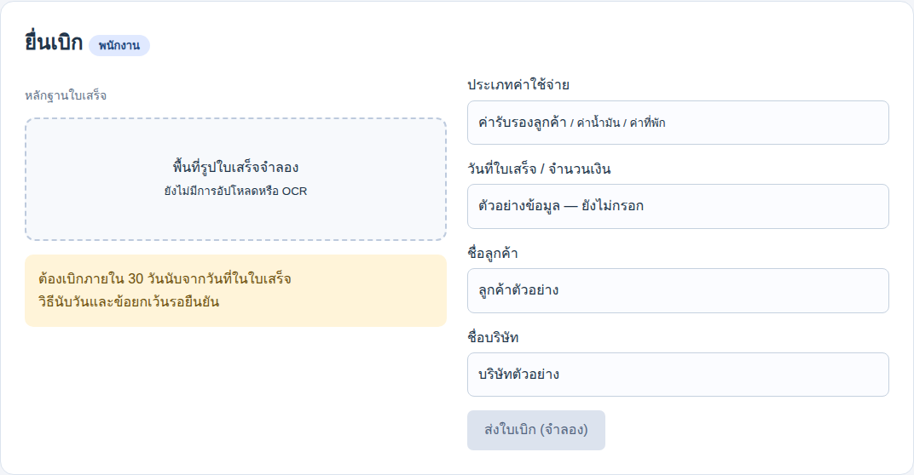

2. ติดตามใบเบิก — สถานะ ผู้รับผิดชอบ และขั้นตอนถัดไป

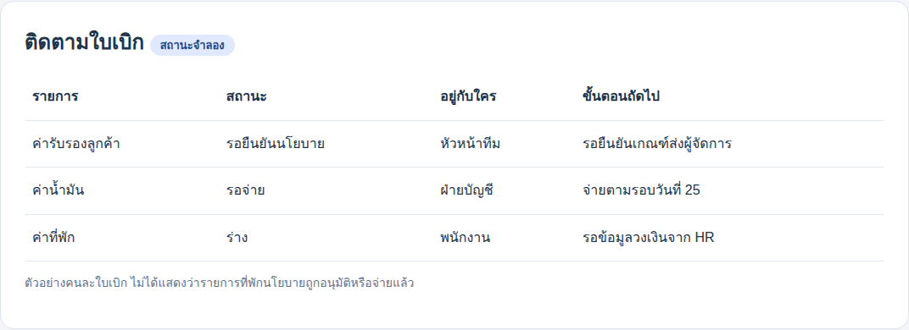

3. ตรวจและอนุมัติ — คำเตือนใบเสร็จอาจซ้ำและนโยบายที่ยังต้องยืนยัน

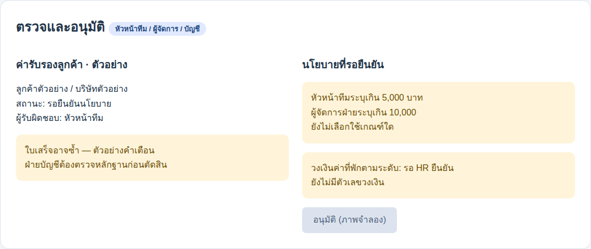

ปุ่มและช่องข้อมูลเป็นภาพจำลองตามขอบเขตโจทย์ ไม่ได้ทดสอบการอนุมัติ จ่ายเงิน หรืออัปโหลดจริง การ render ผ่านเป็นหลักฐานด้านรูปแบบ ส่วนความหมายและความสอดคล้องตรวจอ่านเพิ่มเติมใน Trace

[เปิดเอกสารพร้อมแผนภาพ](lab-results/loop/2_expense_claim/run-2026-09-17-074505/output.render.html) · [อ่าน Markdown](lab-results/loop/2_expense_claim/run-2026-09-17-074505/output.md) · [เปิด Mockup](lab-results/loop/2_expense_claim/run-2026-09-17-074505/mockup.html) · [อ่าน Trace](lab-results/loop/2_expense_claim/run-2026-09-17-074505/trace.md) · [ดูผลตรวจจริง](lab-results/loop/2_expense_claim/run-2026-09-17-074505/verification.json) · [ดู Prompt ที่ใช้](lab-results/loop/2_expense_claim/run-2026-09-17-074505/prompt-used.md)

**สิ่งที่เรียนรู้:** ผลงานดูครบยังไม่เท่ากับผ่านทุกเกณฑ์ รอบนี้ C3 ทำให้ Loop กลับไปแก้ข้อผิดพลาดที่ตรวจได้ โดยไม่เปลี่ยนข้อกำหนดหรือแต่งนโยบายให้ข้อขัดแย้งหายไป

---

<a id="loop-lab-3"></a>

#### 1.4.3 แล็บโจทย์ 3 — แผนย้ายระบบคลินิกและ Web UI Mockup (แบบจำลองหน้าจอเว็บไซต์)

**ผลงานรอบอัปเดต**

ทดลองใหม่หลังเพิ่ม Mockup โดยใช้เอกสารออกแบบเดิมเป็นฐาน ตรวจตามเกณฑ์ปัจจุบัน และสร้างหน้าจอใหม่ Codex ในบทสนทนาเดียวทำบทบาท Generator และ Critic; ผลทดสอบและภาพด้านล่างสร้างใหม่ทั้งหมด ไม่ใช่การนำ PASS เดิมมาใช้

ส่งเอกสาร `output.md` ครบหกส่วนและ `mockup.html` เฟสแรกมีสามส่วน: ตารางนัดหมายกลาง จอง/แก้ไขนัดหมาย และตรวจข้อมูลก่อนย้าย หลังรับ Change Request เพิ่มส่วนความยินยอมและหน้าจองผ่าน LINE OA

**หน้าจอเฟสแรก — อ่านตามลำดับงาน**

1. **ตารางนัดหมายกลาง:** แสดงข้อมูลต้นฉบับ R1–R5 พร้อมสาขา หมอ บริการ และป้ายรอยืนยัน แยกจากนัดที่ยืนยันแล้ว

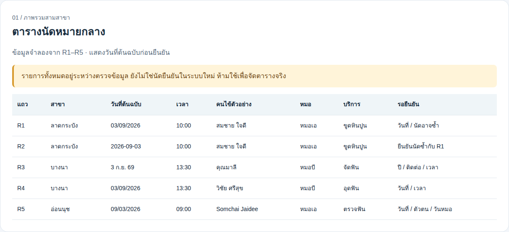

2. **จองหรือแก้ไขนัดหมาย:** เห็นข้อมูลที่ต้องใช้และตัวอย่างคำเตือนเวลาอาจชน โดยยังไม่ตัดสินแทนเจ้าของข้อมูล

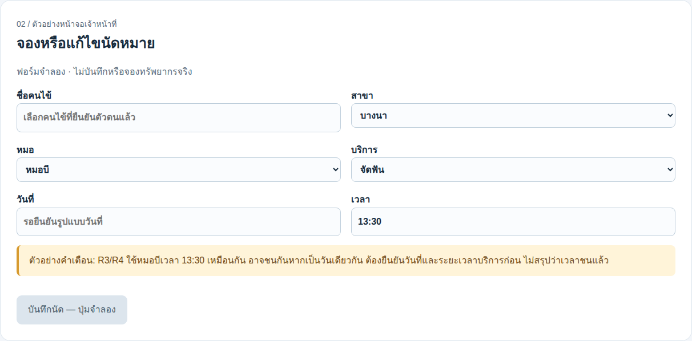

3. **ตรวจข้อมูลก่อนย้าย:** แสดงข้อมูลซ้ำ เบอร์ขาด วันที่กำกวม และรายการที่ต้องให้คนยืนยัน

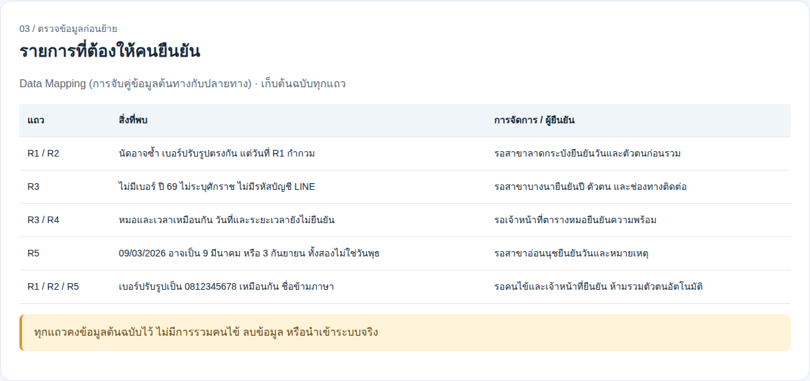

**วงจรสร้าง–ตรวจ–แก้**

| Iteration / ช่วง | สิ่งที่เกิดขึ้น | ผลตรวจ |
| --- | --- | --- |
| 1 / เฟสแรก | ตรวจแผนเดิมและเพิ่ม Mockup สามส่วน แล้วเปิดตรวจจริง | C1–C3 ผ่าน; Mermaid 3 บล็อก render ได้ |
| 2 / ตรวจเมื่อโจทย์เพิ่ม | เพิ่มความยินยอมและ LINE OA เข้า C1 แล้วตรวจ baseline | C1 ไม่ผ่านเพราะยังขาดสองส่วนใหม่; C2–C3 ของขอบเขตเดิมยังผ่าน |
| 2 / หลังแก้ | เพิ่มเอกสารและ Mockup สองส่วน พร้อม Plan v2 และผลกระทบ | C1–C3 ผ่าน; Mermaid 5 บล็อก render ได้ และ Mockup ครบ 5 ส่วน |

**หน้าจอส่วนเพิ่มหลัง Change Request**

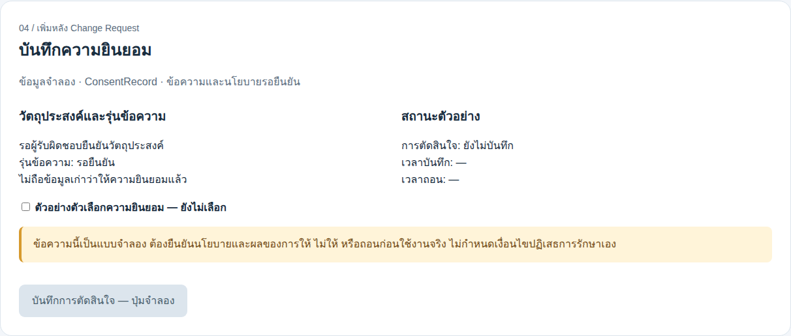

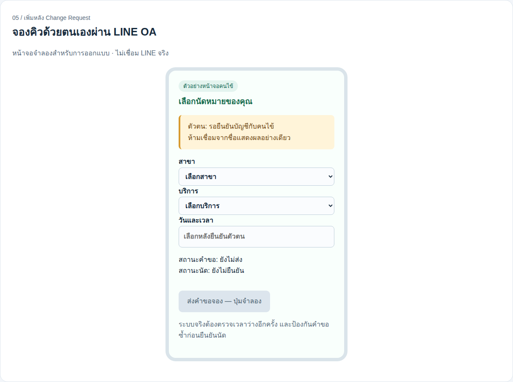

**หลักฐานตามเกณฑ์**

| เกณฑ์ | ผล | หลักฐาน |
| --- | --- | --- |
| C1 ผลงานครบ | PASS | เอกสารหกส่วน + Mockup สามส่วนแรก และสองส่วนเพิ่มตาม Change Request |
| C2 คุณภาพข้อมูล | PASS | อ่านเทียบ CSV R1–R5 กับข้อค้นพบเก้าประเภท; Python ยืนยันว่าวันที่สองแบบของ R5 ไม่ตรงวันพุธ |
| C3 จับคู่ตัวตน แผนภาพ และ Mockup | PASS | ตรวจ normalization และกรณีให้คนยืนยัน; render Mermaid จริง; Playwright เปิดทุกส่วนที่ความกว้าง 1440 และ 390 พิกเซล ไม่พบ console/page error หรือหน้าล้นแนวนอน และตรวจภาพประกอบ |

การตรวจความหมายเป็นการอ่านโดย Critic ในบทสนทนาเดียว ส่วนผลเครื่องมือแยกไว้ใน JSON ปุ่มเป็นภาพจำลอง ไม่ย้ายข้อมูลหรือเชื่อม LINE จริง ประเด็นวันที่ ตัวตน ตารางหมอ และนโยบายยังต้องให้ผู้รับผิดชอบยืนยัน

[เปิด Mockup](lab-results/loop/3_clinic_migration/run-2026-09-17-084350/mockup.html) · [อ่านเอกสาร](lab-results/loop/3_clinic_migration/run-2026-09-17-084350/output.md) · [ดูเฟสแรก](lab-results/loop/3_clinic_migration/run-2026-09-17-084350/mockup-phase1.html) · [อ่าน Trace](lab-results/loop/3_clinic_migration/run-2026-09-17-084350/trace.md) · [ผลตรวจ](lab-results/loop/3_clinic_migration/run-2026-09-17-084350/verification.json) · [Prompt ที่ใช้](lab-results/loop/3_clinic_migration/run-2026-09-17-084350/prompt-used.md) · [สคริปต์และวิธีตรวจ](lab-results/loop/3_clinic_migration/run-2026-09-17-084350/README.md)

<a id="graph"></a>
## บทที่ 2 เขียน Prompt เพื่อสร้าง Graph

### 2.1 กำหนดงานย่อยและข้อมูลที่ส่งต่อ

Graph ใช้ Prompt กำหนด **Node** หรืองานย่อย และ **Dependency** ว่างานใดต้องรอผลจากงานใด ผู้เขียน Prompt จึงต้องออกแบบทั้งงานที่ทำ ผลลัพธ์ที่ส่งต่อ และการตรวจเมื่อรวมงานกลับเป็นผลงานเดียว

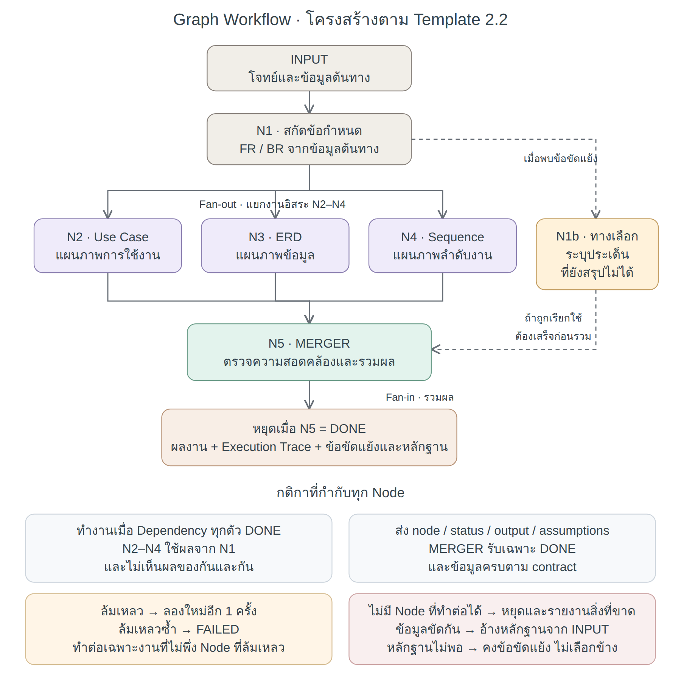

*ภาพตรงกับ Template 2.2: ลูกศรทึบคือ Dependency (งานที่ต้องรอ) และลูกศรประคือทางเลือกเมื่อพบข้อขัดแย้ง N2–N4 เป็นงานอิสระ ส่วนการรันพร้อมกันจริงขึ้นอยู่กับเครื่องมือ*

ใน Template ตัวอย่าง N1 สกัดข้อกำหนด แล้วแยกไป N2 ทำ Use Case, N3 ทำ ERD และ N4 ทำ Sequence ก่อน N5 รวมผล การแยกเรียกว่า Fan-out และการรวมเรียกว่า Fan-in งานแต่ละส่วนต้องยึดข้อมูลตั้งต้นร่วมกันและรายงานสถานะ ผลงาน รวมถึงสมมติฐานให้ผู้รวมตรวจได้

Prompt ต้องกำหนดวิธีจัดการเมื่อแบบจำลองขัดกันด้วย หากข้อมูลต้นทางยังหาข้อสรุปไม่ได้ ให้เก็บเป็น Open Issue ทางเลือก N1b ในตัวอย่างเป็นเส้นทางที่กำหนดล่วงหน้า ส่วนการรันงานพร้อมกันจริงต้องดูความสามารถของเครื่องมือและหลักฐานการรัน

### 2.2 Prompt Template สำหรับ Graph

Template กลางรับโจทย์ เกณฑ์ตรวจ และตารางงานเป็นพารามิเตอร์ แล้วกำกับการทำงานตาม Dependency และตรวจตอนรวมผล ข้อ 2.3 มีบล็อกพร้อมคัดลอกสำหรับทั้งสามโจทย์

[เปิด Template เป็นไฟล์ Markdown](labs/prompts/graph/graph-template.md)

```text
บรรทัดที่ขึ้นต้นด้วย "//" คือคำอธิบายสำหรับผู้เรียน ให้ AI ข้ามบรรทัดเหล่านี้

# ROLE (บทบาท)
คุณเป็นผู้ดำเนินงานตามกราฟ ทำงานแต่ละ Node ตาม Dependency และทำหน้าที่ MERGER ที่ N5 เพื่อตรวจและรวมผล

# GOAL (เป้าหมาย)
ส่งผลงานตาม REQUIREMENT โดยใช้ TASK_GRAPH และตรวจตาม CRITERIA พร้อมหลักฐานจริง

# INPUT PARAMETERS (พารามิเตอร์นำเข้า)

## REQUIREMENT
{{REQUIREMENT}}

## CRITERIA
{{CRITERIA}}

## TASK_GRAPH
{{TASK_GRAPH}}
// REQUIREMENT รวมโจทย์ ข้อมูลต้นทาง และผลงานที่ต้องส่ง
// CRITERIA คือเกณฑ์ตรวจของโจทย์; TASK_GRAPH คือตาราง Node / Task / Depends on / Output
// ใช้ตารางที่ส่งมาแทนตารางตัวอย่าง ไม่สร้างตารางตัวอย่างซ้ำเป็นงานอีกชุด

# EXECUTION RULES (กติกาการทำงาน)
1. ทำ Node เมื่อทุก Dependency มีสถานะ DONE เท่านั้น N1 เริ่มก่อน N2–N4 แล้ว N5 จึงรวมผล
2. N2–N4 ใช้ข้อมูลจาก N1 และ INPUT ร่วมกัน แต่ห้ามเห็นผลของกันและกัน ให้ N1 กำหนดชื่อข้อมูลหรือ interface contract ที่ต้องใช้ร่วมกันก่อนแยกงาน
3. ทุก Node ส่ง data contract: { "node": "N2", "status": "DONE | FAILED", "output": "...", "assumptions": [] }
4. บันทึกสถานะและไฟล์ผลลัพธ์หลังจบแต่ละ Node ตามสิ่งที่เกิดขึ้นจริง การใช้หลายบทบาทไม่ใช่หลักฐานว่ารันขนานหรือมีผู้ทำงานอิสระ หากเครื่องมือแยกบริบทไม่ได้ให้ระบุว่าเป็นการจำลองบทบาท

# CONDITIONAL EDGE (ทางเลือกตามเงื่อนไข)
หาก N1 พบข้อกำหนดขัดแย้ง ให้เพิ่ม N1b เพื่อระบุประเด็นและหลักฐานโดยไม่เลือกข้าง และเพิ่ม N1b เป็น Dependency ของ N5
หากไม่พบข้อขัดแย้ง ไม่ต้องเรียก N1b ข้อมูลที่ยังขาดให้คงเป็นเรื่องรอยืนยัน

# MERGE RULES (N5) (กติกาการรวมผล)
- รับเฉพาะ Node ที่ DONE และส่ง data contract ครบ รวมทั้ง N1b หากถูกเรียกใช้
- ตรวจความสอดคล้องของชื่อข้อมูล กติกา หน้าจอ และแบบจำลองตามชนิดผลงาน หากผลขัดกันให้ใช้หลักฐานจาก INPUT; หลักฐานไม่พอให้คงข้อขัดแย้งโดยไม่แต่งข้อสรุป
- ตรวจผลงานรวมตาม CRITERIA ทีละข้อ ระบุ PASS/FAIL พร้อมหลักฐานหรือตำแหน่งที่ตรวจได้ เกณฑ์ที่มีหลายเงื่อนไขผ่านเมื่อครบทุกเงื่อนไข ไม่มีหลักฐานให้ FAIL
- N5 เป็น DONE เมื่อ Dependency ครบและทุกเกณฑ์ PASS เท่านั้น หากแก้จุดเชื่อมต่อให้ตรวจเกณฑ์ที่ได้รับผลกระทบซ้ำ หากยังไม่ผ่านให้ใช้ FAILURE HANDLING

# FAILURE HANDLING (การจัดการเมื่องานล้มเหลว)
- Node ที่ล้มเหลวลองใหม่ได้อีก 1 ครั้ง รวม N5 โดยต้องระบุสาเหตุและสิ่งที่แก้
- ถ้ายังล้มเหลวให้ FAILED แล้วทำต่อเฉพาะ Node ที่ไม่ขึ้นกับ Node นั้น ห้ามข้าม Dependency เพื่ออ้างว่างานครบ

# CONSTRAINTS (ข้อห้าม)
- ห้ามเปลี่ยนข้อกำหนดหรือเกณฑ์ตรวจที่ผู้เรียกส่งมา
- ห้ามแต่งตัวเลข กติกา หรือข้อมูลยืนยันที่ไม่มีในต้นทาง แยกสมมติฐานและเรื่องรอยืนยันให้ชัด
- ใช้วิธีตรวจสำรองเฉพาะเมื่อ CRITERIA อนุญาต และระบุข้อจำกัดตามจริง

# STOP CONDITION (เงื่อนไขหยุด)
หยุดเมื่อ N5 เป็น DONE หรือเมื่อไม่มี Node ที่ทำต่อได้และสิทธิ์ลองใหม่หมดแล้ว โดยรายงานงานที่ขาดและสาเหตุ

# OUTPUT FORMAT (รูปแบบผลลัพธ์)
1. Execution Trace: | Node | Dependency | สถานะ | ผลลัพธ์/ไฟล์ | หมายเหตุ |
2. ผลตรวจโดย N5: | เกณฑ์ | PASS/FAIL | หลักฐาน/ตำแหน่ง | สิ่งที่ยังขาด |
3. ผลงานตาม REQUIREMENT
4. ข้อขัดแย้ง สมมติฐาน เรื่องรอยืนยัน และข้อจำกัดของเครื่องมือ

# RUN RECORD (การเก็บผลแล็บ)
สร้างโฟลเดอร์ผลรอบใหม่ ไม่เขียนทับตัวอย่างเดิม เก็บ Prompt ที่แทนค่าจริงเป็น prompt-used.md เก็บผลแต่ละ Node และ trace.md พร้อมผลตรวจ/ภาพเมื่อเกณฑ์กำหนด ใช้ชื่อไฟล์ผลงานตาม REQUIREMENT
```

<details>
<summary>ตัวอย่างค่า TASK_GRAPH ที่ใช้ประกอบภาพข้อ 2.1</summary>

| Node | Task | Depends on | Output |
|------|------|------------|--------|
| N1 | สกัดข้อกำหนด (FR/BR) | - | รายการข้อกำหนด |
| N2 | วาด Use Case Diagram | N1 | แผนภาพ Mermaid |
| N3 | วาด ERD | N1 | แผนภาพ Mermaid |
| N4 | วาด Sequence Diagram | N1 | แผนภาพ Mermaid |
| N5 | ตรวจความสอดคล้องและรวมผล | N2, N3, N4 | เอกสารสุดท้าย |

ตารางนี้อธิบายบทบาทในภาพ เมื่อทำแล็บให้ใช้ TASK_GRAPH ของโจทย์ที่เลือกจากข้อ 2.3 แทนตารางนี้ โครงสร้างการส่งงานยังเป็น N1 → N2–N4 → N5 และมี N1b เมื่อพบข้อขัดแย้ง

</details>

### 2.3 Lab: คัดลอก Prompt แล้วให้ AI ทำงานตาม Graph Template

ใช้ **Template ในข้อ 2.2 เป็นกลไกกลาง** เหมือนวิธีทำแล็บ Loop ในข้อ 1.3 นักศึกษาเลือกโจทย์แล้วคัดลอกทั้งบล็อกได้เลย โดยส่ง 3 พารามิเตอร์: **REQUIREMENT** (โจทย์ ข้อมูล และผลงาน), **CRITERIA** (เกณฑ์ตรวจ) และ **TASK_GRAPH** (ตารางงาน) ส่วนกติกา Dependency การรวมผล การลองใหม่ และเงื่อนไขหยุดใช้จาก Template ไม่ต้องเขียนซ้ำ

Graph ต้องส่งตารางงานเพิ่ม เพราะเว็บจองห้อง เอกสารเบิกค่าใช้จ่าย และแผนย้ายคลินิกแบ่งงานต่างกัน ทั้งสามยังใช้โครงสร้าง N1 → N2/N3/N4 → N5 ตามภาพข้อ 2.1 ชื่องานของ Node เปลี่ยนตามโจทย์

**เตรียมครั้งเดียว:** หากเครื่องมืออ่านไฟล์โปรเจกต์ได้ ให้เปิดโฟลเดอร์ `Basic_AI_WORFLOW` หากใช้แชตทั่วไป ให้ดาวน์โหลด [graph-template.md](labs/prompts/graph/graph-template.md) แล้วแนบในบทสนทนา การพิมพ์ชื่อไฟล์อย่างเดียวไม่ทำให้แชตเข้าถึงไฟล์ได้

เริ่มบทสนทนาใหม่สำหรับแต่ละโจทย์ แล้วทำ **แนบ Template → คัดลอกทั้งบล็อก → ส่งให้ AI → เปิดผลงาน → ตรวจ C1/C2/C3 และ Execution Trace** ใช้เครื่องมือที่สร้างไฟล์และตรวจด้วยเบราว์เซอร์ได้เมื่อเกณฑ์กำหนด

#### 2.3.1 โจทย์ 1: จองห้องประชุม

คัดลอกบล็อกนี้ทั้งหมด หรือเปิด [Prompt สำหรับคัดลอก](labs/prompts/graph/1_meeting_room-run.md)

```text
ใช้ `labs/prompts/graph/graph-template.md` เป็น Template หลัก หากใช้ไฟล์แนบ ให้ใช้ `graph-template.md` ที่แนบไว้

ส่งพารามิเตอร์ REQUIREMENT, CRITERIA และ TASK_GRAPH ด้านล่างเข้าช่องชื่อเดียวกันใน Template แล้วเริ่มทำงานตามกติกากลาง ใช้ TASK_GRAPH นี้แทนตารางตัวอย่าง

# PARAMETERS

## REQUIREMENT
สร้างเว็บไซต์สำหรับระบบจองห้องประชุม
ระบบต้องสามารถ: แสดงห้องประชุม, ดูเวลาว่าง, จองห้อง, ยกเลิกการจอง, แสดงสถานะการจอง
Output: output.html เป็น Web UI Mock-up ที่เปิดและทดลองใช้งานได้

## CRITERIA
C1. มีทุกฟีเจอร์ที่ระบุไว้ในโจทย์
C2. เปิด output.html ใน headless Chromium ได้โดยไม่มี console error และทดลองใช้ทั้ง 5 ฟีเจอร์ได้ด้วยการคลิกในหน้าเว็บ (แสดงห้องประชุม ดูเวลาว่างของห้อง สร้างการจอง ยกเลิกการจองนั้น และเห็นสถานะการจองเปลี่ยนไป) โดย MERGER (N5) ต้องรันสคริปต์ Python Playwright และยกผลลัพธ์จริงมาเป็นหลักฐาน
C3. จากหน้าจอแรก เข้าถึงแต่ละฟีเจอร์ในทั้ง 5 ฟีเจอร์ได้ภายในไม่เกิน 2 คลิก โดย MERGER (N5) ระบุเส้นทางการคลิกและจำนวนคลิกของแต่ละฟีเจอร์

## TASK_GRAPH
| Node | Task | Depends on | Output |
| --- | --- | --- | --- |
| N1 | วิเคราะห์ห้าฟีเจอร์ เกณฑ์สองคลิก และกำหนดหน้าจอ DOM ID ชื่อฟังก์ชัน ข้อมูลจำลอง และ interface contract ที่ทุกส่วนใช้ร่วมกัน | - | ข้อกำหนด + contract |
| N2 | เขียน JavaScript แสดงห้อง ตรวจเวลาว่าง จอง ยกเลิก และอ่านสถานะตาม contract จาก N1 | N1 | โค้ด JavaScript |
| N3 | เขียน HTML/CSS ตามหน้าจอและ DOM ID ของ N1 โดยไม่อ่านโค้ด N2 | N1 | โค้ด HTML/CSS |
| N4 | เขียน Python Playwright ทดลองห้าฟีเจอร์ ตรวจ console error และนับคลิกเข้าถึงจากหน้าแรกตาม contract ของ N1 | N1 | สคริปต์ทดสอบ |
| N5 | รวมเว็บเป็น output.html รันสคริปต์ N4 จริง ตรวจ C1–C3 และแก้จุดเชื่อมต่อพร้อมตรวจซ้ำ | N2, N3, N4 | output.html + ผลตรวจและหลักฐาน |
```

---

#### 2.3.2 โจทย์ 2: เบิกค่าใช้จ่าย

คัดลอกบล็อกนี้ทั้งหมด หรือเปิด [Prompt สำหรับคัดลอก](labs/prompts/graph/2_expense_claim-run.md)

```text
ใช้ `labs/prompts/graph/graph-template.md` เป็น Template หลัก หากใช้ไฟล์แนบ ให้ใช้ `graph-template.md` ที่แนบไว้

ส่งพารามิเตอร์ REQUIREMENT, CRITERIA และ TASK_GRAPH ด้านล่างเข้าช่องชื่อเดียวกันใน Template แล้วเริ่มทำงานตามกติกากลาง ใช้ TASK_GRAPH นี้แทนตารางตัวอย่าง

# PARAMETERS

## REQUIREMENT
วิเคราะห์ Requirement และออกแบบ Web UI Mockup สำหรับระบบเบิกค่าใช้จ่ายจากบันทึกสัมภาษณ์ต่อไปนี้ ส่งเอกสารข้อกำหนดและ Mockup ที่สอดคล้องกันเป็นผลงานของโจทย์เดียวกัน

[พนักงานฝ่ายขาย] อยากถ่ายรูปใบเสร็จแล้วเบิกได้เลย ไม่อยากกรอกเยอะ
                 ส่วนใหญ่เบิกค่าน้ำมัน ค่าที่พัก ค่ารับรองลูกค้า
[หัวหน้าทีม]     ผมต้องอนุมัติทุกใบ ถ้าเกิน 5,000 บาทต้องให้ผู้จัดการฝ่ายอนุมัติอีกชั้น
[ผู้จัดการฝ่าย]   อะไรเกิน 10,000 ค่อยส่งมาผม ต่ำกว่านั้นหัวหน้าทีมจบได้เลย
[ฝ่ายบัญชี]      ต้องตรวจใบเสร็จซ้ำ เคยมีคนเบิกใบเดียวสองรอบ
                 ต้องเบิกภายใน 30 วันนับจากวันที่ในใบเสร็จ จ่ายเงินรอบวันที่ 25 ของเดือน
[ฝ่ายบัญชี]      ค่ารับรองลูกค้าต้องระบุชื่อลูกค้าและชื่อบริษัท
[HR]             พนักงานแต่ละระดับมีวงเงินค่าที่พักต่อคืนไม่เท่ากัน
[พนักงานฝ่ายขาย] อยากเห็นว่าใบเบิกของเราค้างอยู่ที่ใคร

Output: ส่ง 2 ไฟล์ร่วมกัน ได้แก่ output.md (เอกสารข้อกำหนดและแผนภาพ Mermaid) และ mockup.html (Web UI Mockup) โดย output.md ประกอบด้วย Actor/Stakeholder · FR-xx และ NFR · BR-xx · Use Case Diagram · ERD · Sequence Diagram "ยื่นเบิก → อนุมัติ → จ่ายเงิน" · State Diagram ของใบเบิก · Traceability Matrix (ประโยคต้นทาง → FR/BR → Use Case → Entity) · Open Issues

สำหรับ mockup.html ให้ใช้ HTML/CSS และข้อมูลตัวอย่างเพื่อสื่อหน้าตาและสถานะตามข้อกำหนดใน output.md ไม่ต้องทำระบบธุรกรรมจริง
มี 3 หน้าหรือ 3 ส่วนที่มองเห็นได้:
1. ยื่นเบิก: ช่องข้อมูลใบเบิก ประเภทค่าใช้จ่าย พื้นที่แนบรูปใบเสร็จจำลอง และข้อความเงื่อนไข 30 วัน; แสดงช่องชื่อลูกค้าและบริษัทสำหรับค่ารับรอง
2. ติดตามใบเบิก: รายการ สถานะ ผู้รับผิดชอบปัจจุบัน และขั้นตอนถัดไป
3. ตรวจและอนุมัติ: รายละเอียดใบเบิก ตัวอย่างจุดแจ้งเตือนใบเสร็จอาจซ้ำ และข้อความรอยืนยันนโยบายวงเงิน 5,000/10,000 รวมถึงวงเงินค่าที่พักที่ยังไม่มีข้อมูล
ไม่ต้องมี backend, ฐานข้อมูล, login, upload/OCR, การตรวจซ้ำ, การอนุมัติ หรือการจ่ายเงินจริง ปุ่มเป็นภาพจำลองได้ ไม่บังคับให้คลิกทำงาน ข้อมูลและสถานะตัวอย่างต้องติดป้ายว่าจำลอง ไม่แต่งนโยบายที่ยังไม่ยืนยัน
ใน output.md เพิ่มตาราง Pain Point → FR/BR → หน้าหรือส่วนของ Mockup พร้อมอธิบายว่าหน้าจอแต่ละส่วนช่วยผู้ใช้อย่างไร

## CRITERIA
C1. ส่ง output.md ที่มีหัวข้อและแผนภาพครบตามรายการ Output พร้อม mockup.html ที่แสดงครบสามส่วน: ยื่นเบิก ติดตามใบเบิก และตรวจ/อนุมัติ โดยเป็นภาพจำลอง ไม่ต้องมีระบบธุรกรรมทำงานจริง
C2. บันทึกสัมภาษณ์ทุกบรรทัดปรากฏใน Traceability Matrix โดยเชื่อมโยงกับ FR-xx หรือ BR-xx อย่างน้อยหนึ่งข้อ หากมีสองบรรทัดที่ให้กติกาต่างกันสำหรับการตัดสินใจเรื่องเดียวกัน ต้องยกทั้งสองบรรทัดไว้ใน Open Issues โดยไม่เลือกข้าง และตัวเลขทุกตัวที่ปรากฏใน FR/BR/Open Issues ต้องตรงตามที่ปรากฏในข้อมูลนำเข้าทุกตัวอักษร
C3. ทุก Entity และ Attribute ที่ระบุชื่อใน Sequence Diagram และ State Diagram ต้องมีอยู่ใน ERD ทุกสถานะใน State Diagram ต้องระบุว่าใบเบิกอยู่กับใครในขณะนั้น และทุกบล็อก Mermaid ต้อง render ได้ (ใช้ renderer ที่ติดตั้งในเครื่องหากมี มิฉะนั้นให้ตรวจ syntax อย่างเคร่งครัด พร้อมระบุว่าใช้วิธีใด) และ mockup.html ต้องเปิดเห็นครบทั้ง 3 หน้าหรือส่วน ข้อความสถานะ ผู้รับผิดชอบ และกติกาต้องสอดคล้องกับเอกสาร มีตารางเชื่อม Pain Point → FR/BR → หน้าจอ แสดงข้อมูลจำลองและนโยบายที่รอยืนยันชัดเจน ตรวจเฉพาะความครบของภาพและความสอดคล้อง ไม่กำหนดให้ปุ่มหรือระบบธุรกรรมทำงานจริง

## TASK_GRAPH
| Node | Task | Depends on | Output |
| --- | --- | --- | --- |
| N1 | สกัด Actors/Stakeholders, FR, NFR, BR และที่มาจากสัมภาษณ์ กำหนด contract ของชื่อ Entity/Attribute สถานะ และผู้รับผิดชอบที่แบบจำลองและ Mockup ต้องใช้ร่วมกัน แยกข้อเสนอที่ยังต้องยืนยัน | - | ข้อกำหนด + contract + หลักฐานต้นทาง |
| N2 | สร้าง Use Case, Sequence ยื่นเบิก–อนุมัติ–จ่ายเงิน และ State ที่ระบุผู้รับผิดชอบ โดยยึด contract จาก N1 | N1 | แผนภาพ Mermaid |
| N3 | สร้าง ERD ตาม Entity/Attribute และความสัมพันธ์ที่ระบุใน contract จาก N1 โดยไม่อ่านผล N2 | N1 | ERD ใน Mermaid |
| N4 | สร้าง Mockup ยื่นเบิก ติดตาม และตรวจ/อนุมัติ พร้อมตาราง Pain Point → FR/BR → หน้าจอ ใช้ข้อมูลจำลองและแสดงนโยบายรอยืนยันตาม N1 | N1 | mockup.html + ตารางเชื่อมหน้าจอ |
| N5 | รวมเอกสารทุกส่วน เพิ่ม Traceability Matrix และ Open Issues ตรวจแบบจำลองกับ ERD และ Mockup แล้วตรวจ C1–C3 | N2, N3, N4 | output.md + mockup.html + ผลตรวจ |
```

---

#### 2.3.3 โจทย์ 3: คลินิกทันตกรรม

คัดลอกบล็อกนี้ทั้งหมด หรือเปิด [Prompt สำหรับคัดลอก](labs/prompts/graph/3_clinic_migration-run.md)

`````text
ใช้ `labs/prompts/graph/graph-template.md` เป็น Template หลัก หากใช้ไฟล์แนบ ให้ใช้ `graph-template.md` ที่แนบไว้

ส่งพารามิเตอร์ REQUIREMENT, CRITERIA และ TASK_GRAPH ด้านล่างเข้าช่องชื่อเดียวกันใน Template แล้วเริ่มทำงานตามกติกากลาง ใช้ TASK_GRAPH นี้แทนตารางตัวอย่าง

# PARAMETERS

## REQUIREMENT
ย้ายระบบนัดหมายคลินิกจาก Google Sheet สู่ระบบกลาง (As-Is → To-Be + Migration (การย้ายข้อมูลและระบบ))
บริบท: คลินิกทันตกรรม 3 สาขา ใช้ Google Sheet แยกสาขา ร่วมกับจองผ่าน LINE ต้องการย้ายมาระบบนัดหมายกลาง

ตัวอย่างข้อมูลจาก Google Sheet ของสาขาต่าง ๆ (CSV):
```csv
สาขา,วันที่,เวลา,ชื่อคนไข้,เบอร์,หมอ,บริการ,หมายเหตุ
ลาดกระบัง,03/09/2026,10:00,สมชาย ใจดี,081-234-5678,หมอเอ,ขูดหินปูน,
ลาดกระบัง,2026-09-03,10:00,สมชาย ใจดี,0812345678,หมอเอ,ขูดหินปูน,จองซ้ำทางไลน์
บางนา,3 ก.ย. 69,13:30,คุณมาลี,,หมอบี,จัดฟัน,ไม่มีเบอร์ ติดต่อทางไลน์
บางนา,03/09/2026,13:30,วิชัย ศรีสุข,089-111-2222,หมอบี,อุดฟัน,
อ่อนนุช,09/03/2026,09:00,Somchai Jaidee,081 234 5678,หมอเอ,ตรวจฟัน,หมอเอมาช่วยสาขานี้ทุกวันพุธ
```

งานที่ต้องส่ง: As-Is Process (กระบวนการทำงานปัจจุบัน) (Mermaid flowchart) · Data Quality Findings (ข้อค้นพบปัญหาคุณภาพข้อมูล) (ปัญหา / แถว / ผลกระทบ) · To-Be Process (กระบวนการทำงานที่ต้องการในอนาคต) และ Data Model (แบบจำลองข้อมูล) · Data Mapping (การจับคู่ข้อมูลต้นทางกับปลายทาง) + แผน Migration (การย้ายข้อมูลและระบบ) (รวมวิธีจับคู่ตัวตนคนไข้) · Gap Analysis (การวิเคราะห์สิ่งที่ยังขาดเพื่อไปสู่ระบบใหม่) + Roll-out Plan (แผนทยอยนำระบบไปใช้งาน) · Plan Version Log (บันทึกการเปลี่ยนแปลงแผน)
Output: ส่ง 2 ไฟล์ ได้แก่ output.md สำหรับเอกสารและแผนภาพ Mermaid และ mockup.html สำหรับ Web UI Mockup (แบบจำลองหน้าจอเว็บไซต์) ด้วย HTML/CSS
Mockup เฟสแรกมี 3 หน้าหรือส่วน: (1) ตารางนัดหมายกลาง แสดงสาขา วันที่ เวลา หมอ บริการ และสถานะ (2) ฟอร์มจอง/แก้ไขนัดหมาย พร้อมตัวอย่างคำเตือนเวลาชนกัน (3) ตรวจข้อมูลก่อนย้าย แสดงข้อมูลซ้ำ ข้อมูลขาด วันที่กำกวม และรายการรอคนยืนยัน
ใช้ข้อมูลจำลองพร้อมป้ายกำกับ โดยหน้าจอและชื่อข้อมูลต้องสอดคล้องกับ To-Be, Data Model (แบบจำลองข้อมูล) และ Data Quality Findings (ข้อค้นพบปัญหาคุณภาพข้อมูล) ไม่ตัดสินข้อมูลกำกวมหรือรวมตัวตนเอง ปุ่มเป็นภาพจำลองได้ ไม่ต้องมี backend หรือย้ายข้อมูลจริง
เกณฑ์ตรวจ Mockup: เปิดในเบราว์เซอร์ได้ เห็นครบ 3 ส่วน ข้อมูล/สถานะสอดคล้องกับเอกสาร และแสดงรายการรอยืนยันชัดเจน บันทึกผลตรวจพร้อมภาพหลักฐาน ไม่บังคับทดสอบธุรกรรมจริง

## CRITERIA
C1. ส่ง output.md ครบหกส่วนตามโจทย์ และ mockup.html ครบสามส่วนตามขอบเขต Mockup
C2. Data Quality Findings (ข้อค้นพบปัญหาคุณภาพข้อมูล) ระบุปัญหาที่ต่างประเภทกันอย่างน้อย 5 ประเภท โดยแต่ละประเภทอ้างอิงแถวที่ได้รับผลกระทบอย่างเจาะจงและระบุผลกระทบ ค่าทุกค่าที่ตีความได้มากกว่าหนึ่งแบบต้องระบุว่ากำกวม และการตีความที่เลือกต้องอ้างอิงหลักฐานที่พบในข้อมูล
C3. ส่วน Data Mapping (การจับคู่ข้อมูลต้นทางกับปลายทาง) + Migration (การย้ายข้อมูลและระบบ) มีกลยุทธ์จับคู่ตัวตนคนไข้ที่ระบุวิธีปรับรูปแบบเบอร์โทรศัพท์และชื่อให้เป็นมาตรฐานก่อนจับคู่ พร้อมระบุแถวที่ต้องให้มนุษย์ยืนยัน และทุกบล็อก Mermaid ต้อง render ได้ (ใช้ renderer ที่ติดตั้งในเครื่องหากมี มิฉะนั้นให้ตรวจ syntax อย่างเคร่งครัด พร้อมระบุว่าใช้วิธีใด) รวมถึงเปิด mockup.html ในเบราว์เซอร์ ตรวจความครบทั้งสามส่วน ความสอดคล้องกับเอกสาร ป้ายข้อมูลจำลองและรายการรอยืนยัน พร้อมบันทึกภาพหลักฐาน

## TASK_GRAPH
| Node | Task | Depends on | Output |
| --- | --- | --- | --- |
| N1 | สำรวจ CSV R1–R5 สร้าง Data Quality Findings (ข้อค้นพบปัญหาคุณภาพข้อมูล) พร้อมแถว ผลกระทบ และความกำกวม กำหนดชื่อข้อมูลกลางและ contract สำหรับระบบใหม่กับแผนย้าย โดยแยกสิ่งที่ต้องยืนยัน | - | ข้อค้นพบ + contract |
| N2 | สร้าง As-Is Process (กระบวนการทำงานปัจจุบัน) ตามบริบทและข้อค้นพบจาก N1 | N1 | แผนภาพ Mermaid |
| N3 | สร้าง To-Be Process (กระบวนการทำงานที่ต้องการในอนาคต), Data Model (แบบจำลองข้อมูล) และ Mockup ตารางนัดหมาย จอง/แก้ไข และตรวจข้อมูลก่อนย้าย ตาม contract และข้อค้นพบจาก N1 | N1 | แผนภาพ Mermaid + mockup.html |
| N4 | สร้าง Data Mapping (การจับคู่ข้อมูลต้นทางกับปลายทาง) และ Migration (การย้ายข้อมูลและระบบ) ตาม contract ของ N1 รวมปรับรูปชื่อ/เบอร์และกรณีให้คนยืนยัน โดยไม่อ่านผล N3 | N1 | ตารางจับคู่ + แผนย้าย |
| N5 | รวมผลงาน จัดทำ Gap Analysis (การวิเคราะห์สิ่งที่ยังขาดเพื่อไปสู่ระบบใหม่), Roll-out Plan (แผนทยอยนำระบบไปใช้งาน) และ Plan Version Log (บันทึกการเปลี่ยนแปลงแผน) ตรวจความสอดคล้องและ C1–C3 ทั้งเอกสารและ Mockup | N2, N3, N4 | output.md + mockup.html + ผลตรวจ |
`````

#### รับ Output แล้วตรวจอะไร

| โจทย์ | ผลงาน | หลักฐานที่ควรเปิดดู |
| --- | --- | --- |
| จองห้องประชุม | output.html | ทดลองห้าฟีเจอร์ ผล Playwright console error และเส้นทางเข้าถึงไม่เกินสองคลิก |
| เบิกค่าใช้จ่าย | output.md และ mockup.html | ข้อกำหนดย้อนถึงสัมภาษณ์ ข้อขัดแย้งวงเงิน แบบจำลองสอดคล้อง แผนภาพ render และ Mockup สามส่วน |
| คลินิก | output.md และ mockup.html | Findings พร้อมแถว/ผลกระทบ ข้อมูลกำกวม การจับคู่ตัวตน แผนภาพ และ Mockup สามส่วน |

ตรวจ Trace ด้วยว่า N1 เสร็จก่อน N2–N4, ทุก Node ส่ง data contract, N5 รอ Dependency ครบ และมีผลตรวจแต่ละเกณฑ์พร้อมหลักฐาน หากเรียก N1b ต้องเสร็จก่อนรวม หาก Node ล้มเหลวต้องเห็นเหตุผลและจำนวนครั้งที่ลองใหม่ งานที่รันเรียงลำดับหรือจำลองบทบาทต้องรายงานตามจริง ไม่อ้างว่าเกิดการรันขนานจากรูปเพียงอย่างเดียว

**สิ่งที่ส่งท้ายแล็บ:** Prompt ที่ใช้จริง ผลงาน ผลแต่ละ Node, Execution Trace และบันทึกตรวจพร้อมหลักฐาน เก็บผลการรันใหม่พร้อมหลักฐานของตนเอง โดยไม่ใช้ผลการทดลองเดิมแทน ดูผลทดลอง Graph รอบใหม่ประกอบได้ในข้อ 2.4

โจทย์คลินิกเริ่มจากเฟสแรกก่อน เมื่อเสร็จจึงทดลอง Change Request ตามโจทย์ 3 ในบทสนทนาเดิม ให้ตรวจผลกระทบผ่าน Dependency และปรับทั้งเอกสารกับ Mockup พร้อมเก็บฉบับก่อนเปลี่ยน

<details>
<summary>ดูการจับคู่พารามิเตอร์และไฟล์ประกอบ</summary>

| พารามิเตอร์ | ช่องใน Template 2.2 | หน้าที่ |
| --- | --- | --- |
| REQUIREMENT | `{{REQUIREMENT}}` | โจทย์ ข้อมูลต้นทาง และรายการผลงาน |
| CRITERIA | `{{CRITERIA}}` | เกณฑ์ที่ N5 ใช้ตรวจผลงานรวม |
| TASK_GRAPH | `{{TASK_GRAPH}}` | งาน Dependency และ Output ของแต่ละ Node |

- จองห้องประชุม: [ข้อมูลแยกส่วน](labs/prompts/graph/1_meeting_room-input.md) · [Template ที่แทนค่าแล้ว](labs/prompts/graph/1_meeting_room-prompt.md)
- เบิกค่าใช้จ่าย: [ข้อมูลแยกส่วน](labs/prompts/graph/2_expense_claim-input.md) · [Template ที่แทนค่าแล้ว](labs/prompts/graph/2_expense_claim-prompt.md)
- คลินิกทันตกรรม: [ข้อมูลแยกส่วน](labs/prompts/graph/3_clinic_migration-input.md) · [Template ที่แทนค่าแล้ว](labs/prompts/graph/3_clinic_migration-prompt.md)

</details>

### 2.4 ผลลัพธ์จากการทดลอง Graph: โจทย์ 1 → 2 → 3

ผลรอบนี้ใช้ **Graph Template ในข้อ 2.2 และพารามิเตอร์จากข้อ 2.3** ครบทั้งสามโจทย์บน Remote เก็บ Prompt ที่ใช้จริง ผลแต่ละ Node, Execution Trace, ผลตรวจ และภาพไว้ด้วยกัน

**วิธีรันและข้อจำกัด:** Codex ในบทสนทนาเดียวจำลองบทบาทและทำตามลำดับ Dependency ไม่ได้แยกบริบทหรือรัน N2–N4 ขนานจริง จึงยังไม่พิสูจน์ความเป็นอิสระของ Node ตามกราฟ งานและหลักฐานเครื่องมือสร้างใหม่ในรอบนี้ ไม่ใช้ผลงานหรือ PASS ของ Loop แทน

| โจทย์ | ผลงาน | กระบวนการที่เห็น | ผลตามเกณฑ์ |
| --- | --- | --- | --- |
| จองห้องประชุม | เว็บที่จองและยกเลิกได้ | N1 กำหนด contract → N2 ตรรกะ / N3 หน้าจอ / N4 ทดสอบ → N5 รวมและรันทดสอบ | C1–C3 ผ่าน |
| เบิกค่าใช้จ่าย | เอกสาร แผนภาพ และ Mockup สามส่วน | เพิ่ม N1b เก็บข้อขัดแย้งวงเงินก่อน N5 รวม | C1–C3 ผ่าน |
| ย้ายระบบคลินิก | แผนย้ายและ Mockup ก่อน/หลัง Change Request | เฟสสองทำใหม่ตามผลกระทบและใช้ N2 เดิม | C1–C3 ผ่านทั้งสองเฟส |

**เลือกอ่านทีละแล็บ:** [1. จองห้องประชุม](#graph-lab-1) · [2. เบิกค่าใช้จ่าย](#graph-lab-2) · [3. คลินิก](#graph-lab-3)

---

<a id="graph-lab-1"></a>

#### 2.4.1 แล็บโจทย์ 1 — เว็บจองห้องประชุม

**ผลงานที่ได้:** เว็บหน้าเดียวมีห้องตัวอย่างสามห้อง ดูเวลาว่าง กรอกการจอง ยกเลิก และดูสถานะ ข้อมูลอยู่ในหน่วยความจำ รีเฟรชแล้วเริ่มจากตัวอย่างเดิม

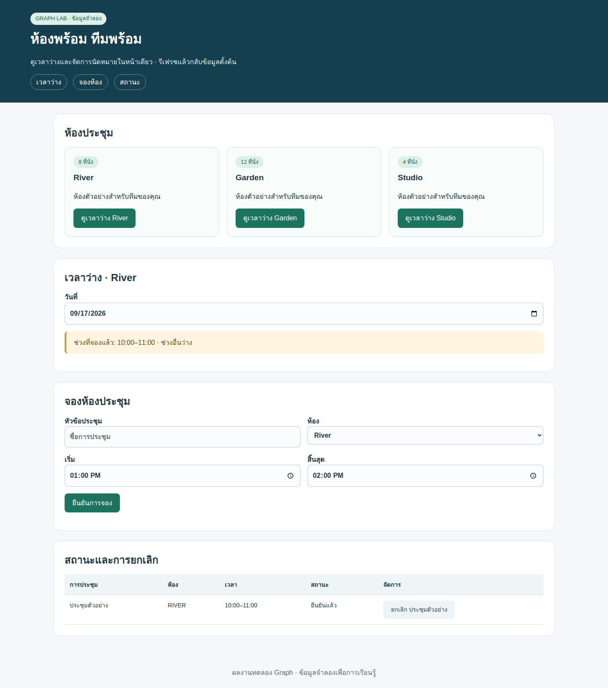

**การส่งงานระหว่าง Node**

| Node | สิ่งที่ส่งต่อ | ผล |
| --- | --- | --- |
| N1 | ห้าฟีเจอร์ ชื่อ DOM/ฟังก์ชัน และข้อมูลที่ทุกส่วนใช้ร่วมกัน | DONE |
| N2 | ตรรกะ JavaScript ตาม contract | DONE |
| N3 | HTML/CSS ตาม contract | DONE |
| N4 | Python Playwright สำหรับคลิกและตรวจผล | DONE |
| N5 | รวม HTML กับ JavaScript แล้วรัน N4 จริง | DONE |

**หลักฐานตามเกณฑ์:** C1 ทดลองครบห้าฟีเจอร์; C2 ไม่พบ console/page error และตรวจเพิ่มว่ากันเวลาซ้อน คืนเวลาว่างหลังยกเลิก และปฏิเสธช่วงเวลาผิด; C3 เข้าถึงรายการห้อง ฟอร์ม และสถานะได้ทันที ส่วนดูเวลาว่างกับยกเลิกรายการตัวอย่างใช้หนึ่งคลิก

การนับคลิกหมายถึงการเข้าถึงฟีเจอร์จากหน้าแรก ไม่รวมการกรอกและส่งฟอร์ม โดยเลื่อนหน้าจอได้

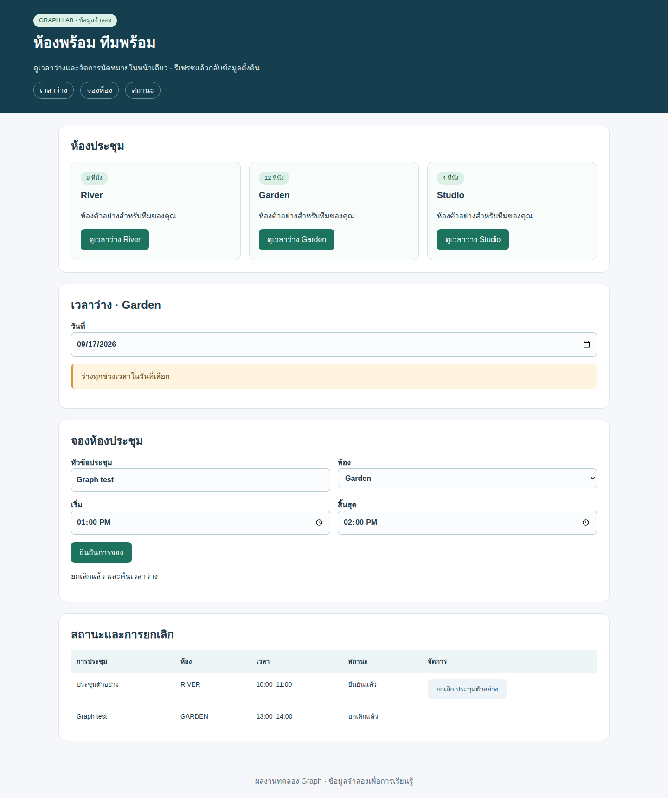

[เปิดเว็บ](lab-results/graph/run-2026-09-17-090820/1_meeting_room/output.html) · [อ่าน Trace](lab-results/graph/run-2026-09-17-090820/1_meeting_room/trace.md) · [ผลทดสอบ](lab-results/graph/run-2026-09-17-090820/1_meeting_room/verification.json) · [สคริปต์ N4](lab-results/graph/run-2026-09-17-090820/1_meeting_room/nodes/N4-test.py) · [Prompt ที่ใช้](lab-results/graph/run-2026-09-17-090820/1_meeting_room/prompt-used.md)

---

<a id="graph-lab-2"></a>

#### 2.4.2 แล็บโจทย์ 2 — ข้อกำหนดและ Mockup ระบบเบิกค่าใช้จ่าย

**ผลงานที่ได้:** เอกสาร Actors/Stakeholders, FR, BR, NFR, Use Case, ERD, Sequence, State, Traceability, Open Issues และ Mockup ยื่นเบิก ติดตาม และตรวจ/อนุมัติ พร้อมตารางเชื่อมปัญหากับหน้าจอ

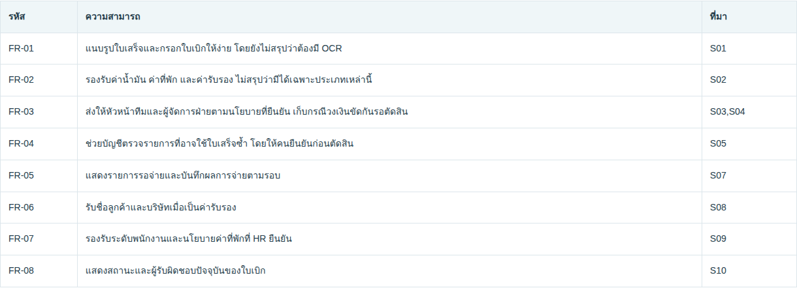

**การส่งงานระหว่าง Node**

| Node | สิ่งที่ทำ | ผล |
| --- | --- | --- |
| N1 | สกัดคำสัมภาษณ์และกำหนดชื่อข้อมูล/สถานะร่วมกัน | DONE |
| N1b | เก็บหลักฐานวงเงิน 5,000/10,000 โดยไม่เลือกข้าง | DONE ก่อนรวม |
| N2 | Use Case, Sequence และ State | DONE |
| N3 | ERD ตาม contract ของ N1 | DONE |
| N4 | Mockup สามส่วนและ Pain Point → FR/BR → หน้าจอ | DONE |
| N5 | รวมเอกสาร ตรวจความสอดคล้องและเกณฑ์ทั้งหมด | DONE |

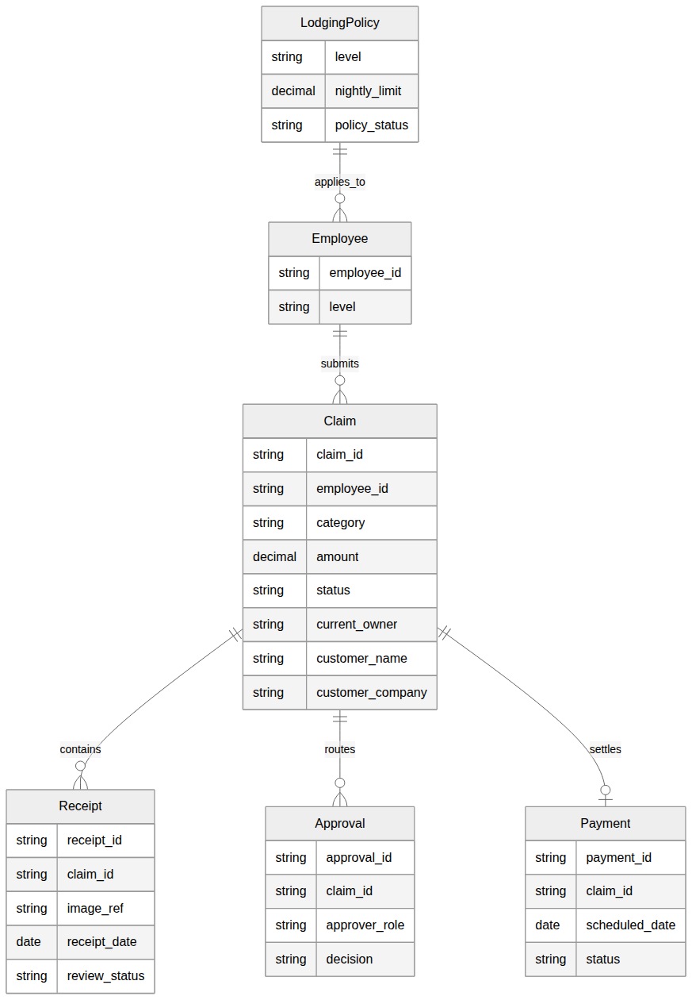

**Mockup ตามงานของผู้ใช้**

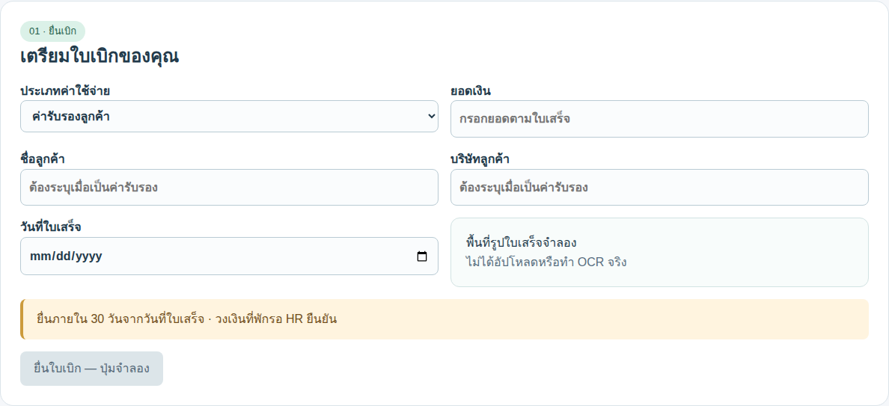

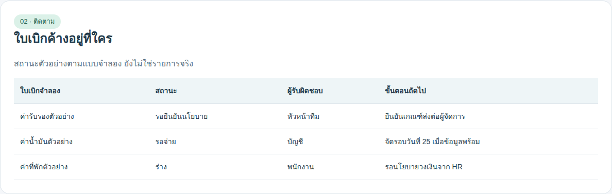

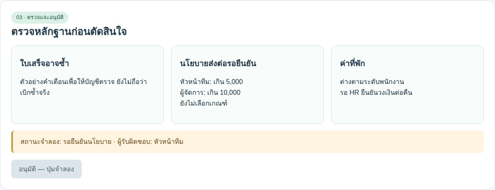

**หลักฐานตามเกณฑ์:** C1 เอกสารและ Mockup ครบ; C2 เชื่อมคำสัมภาษณ์ครบสิบหน่วยความหมายและคงข้อขัดแย้งวงเงิน ไม่สร้างตัวเลขวงเงินที่พัก; C3 แผนภาพทั้งสี่ render จริง ชื่อ Entity/Attribute และผู้รับผิดชอบสอดคล้อง และเปิด Mockup ครบสามส่วนทั้งจอคอมพิวเตอร์และมือถือ

ตัวตรวจ ERD ครั้งแรกอ่านเครื่องหมายความสัมพันธ์ผิดเป็นหัว Entity จึงรายงานไม่พบ Employee ทั้งที่มีอยู่ แก้ตัวตรวจแล้วผ่าน โดยเก็บผลครั้งแรกไว้ การ render และการตรวจโครงสร้างจึงต้องอ่านร่วมกับการตรวจความหมาย ไม่ใช้คะแนนอัตโนมัติอย่างเดียว

[เปิดเอกสารพร้อมแผนภาพ](lab-results/graph/run-2026-09-17-090820/2_expense_claim/output.render.html) · [อ่าน Markdown](lab-results/graph/run-2026-09-17-090820/2_expense_claim/output.md) · [เปิด Mockup](lab-results/graph/run-2026-09-17-090820/2_expense_claim/mockup.html) · [อ่าน Trace](lab-results/graph/run-2026-09-17-090820/2_expense_claim/trace.md) · [ผลตรวจ](lab-results/graph/run-2026-09-17-090820/2_expense_claim/verification.json) · [ผลตัวตรวจครั้งแรก](lab-results/graph/run-2026-09-17-090820/2_expense_claim/verification-parser-attempt1.json) · [Prompt ที่ใช้](lab-results/graph/run-2026-09-17-090820/2_expense_claim/prompt-used.md)

---

<a id="graph-lab-3"></a>

#### 2.4.3 แล็บโจทย์ 3 — ย้ายระบบคลินิกพร้อม Mockup และ Change Request

**ผลงานเฟสแรก:** As-Is Process (กระบวนการปัจจุบัน), Data Quality Findings (ปัญหาคุณภาพข้อมูล), To-Be Process (กระบวนการใหม่) และ Data Model (แบบจำลองข้อมูล), Data Mapping (การจับคู่ข้อมูล) และแผนย้าย, Gap Analysis (สิ่งที่ยังขาด) และแผนทยอยใช้ระบบ, Plan Version Log (บันทึกแผน) พร้อม Mockup สามส่วน

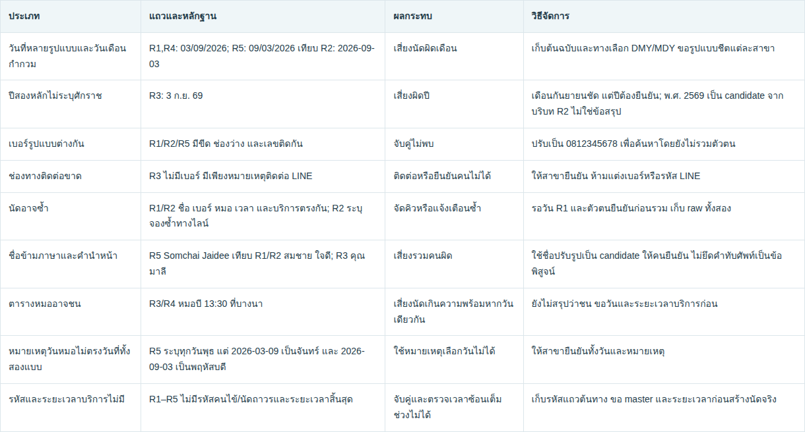

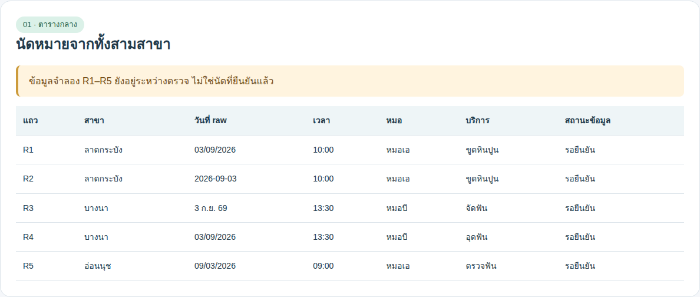

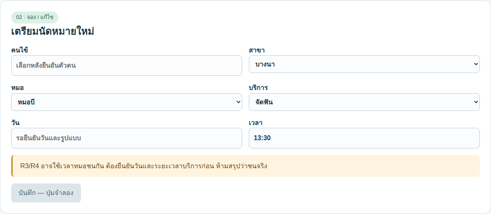

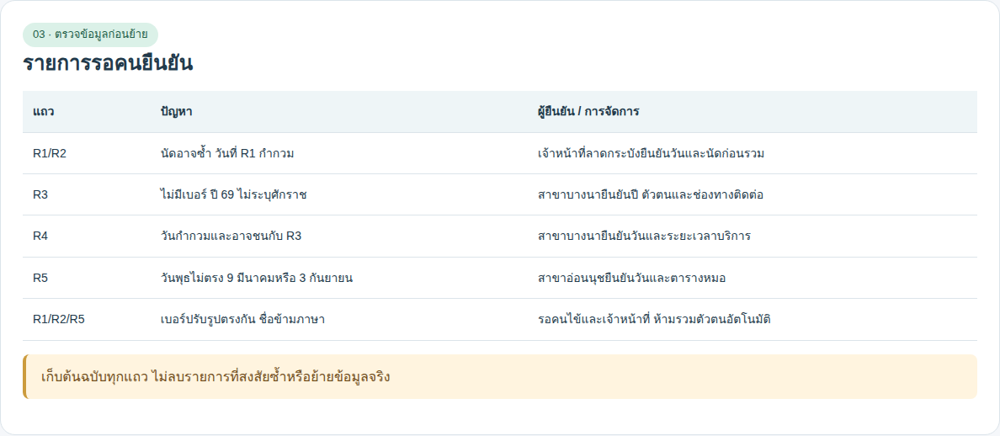

**การส่งงานและการใช้ผลเดิมต่อ**

| Node | เฟสแรก | หลังเพิ่มความยินยอมและ LINE OA |
| --- | --- | --- |
| N1 | Findings และ contract | N1-v2 เพิ่มข้อมูลกลางที่ต้องใช้ |
| N2 | As-Is | ใช้ไฟล์เดิมและ hash เดิม เพราะข้อกำหนดใหม่ไม่เปลี่ยนสภาพปัจจุบัน |
| N3 | To-Be, Data Model และ Mockup | N3-v2 เพิ่มกระบวนการ แบบจำลอง และหน้าจอสองส่วน |
| N4 | Mapping และ Migration | N4-v2 เพิ่มหลักฐานความยินยอมและการเชื่อมบัญชี |
| N5 | รวม Gap/Roll-out/Plan v1 และตรวจ | N5-v2 รอ N2 เดิมกับ N3-v2/N4-v2 แล้วรวมและตรวจ Plan v2 |

ก่อนแก้เฟสสองตรวจพบว่า baseline ยังขาดสองข้อใหม่ใน C1 จึงติดตามส่วนที่ต้องเปลี่ยนผ่าน Dependency คง raw, Findings, normalization และสามส่วน UI เดิมไว้

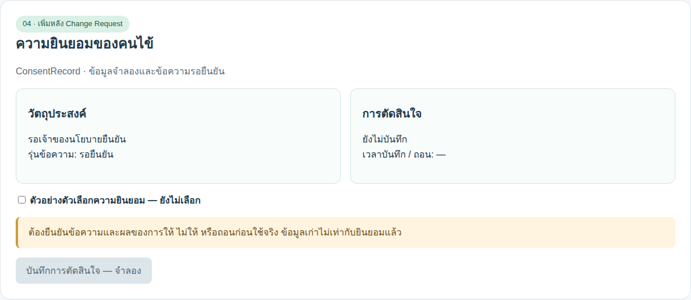

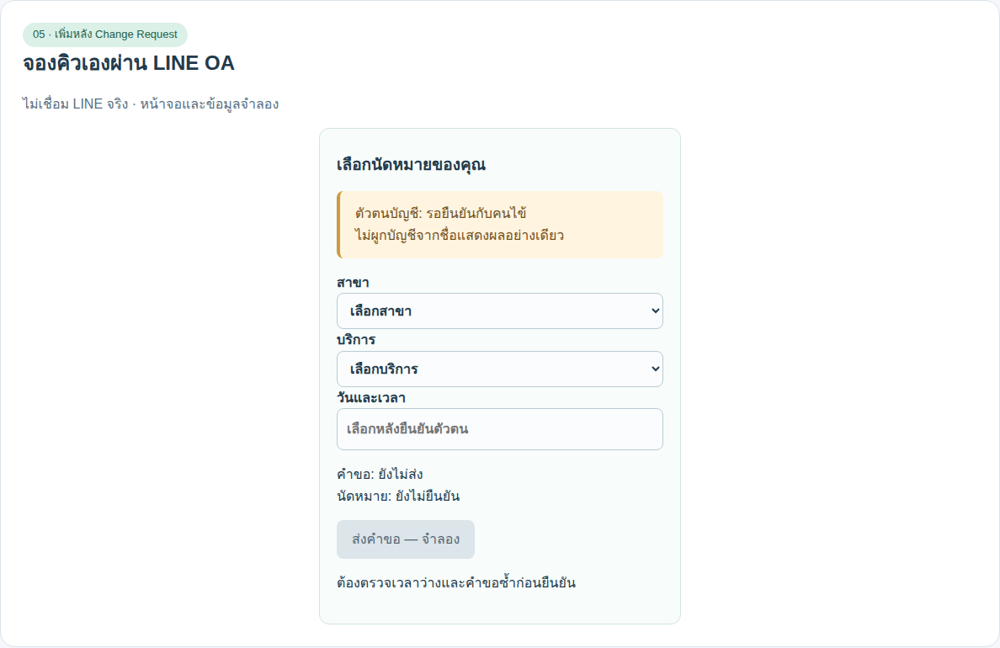

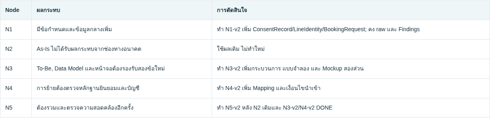

**หลักฐานตามเกณฑ์:** C1 ครบทั้งเอกสารและ Mockup รวมข้อกำหนดใหม่; C2 อ่านเทียบ Findings เก้าประเภทกับ R1–R5 และตรวจวันของ R5 ด้วย Python; C3 มีกติกาปรับชื่อ/เบอร์และกรณีให้คนยืนยัน แผนภาพเฟสแรกสามบล็อกและเฟสสองห้าบล็อก render ได้จริง Mockup เปิดครบทั้งความกว้าง 1440 และ 390 พิกเซล ไม่พบ console/page error หรือหน้าล้นแนวนอน

หน้าจอเป็นข้อมูลจำลอง ไม่ย้ายข้อมูลหรือเชื่อม LINE จริง วันที่ ตัวตน ระยะเวลาบริการ และนโยบายความยินยอมยังต้องยืนยันก่อนใช้จริง

[เปิดเอกสารพร้อมแผนภาพ](lab-results/graph/run-2026-09-17-090820/3_clinic_migration/output.render.html) · [เปิด Mockup สุดท้าย](lab-results/graph/run-2026-09-17-090820/3_clinic_migration/mockup.html) · [ดู Mockup เฟสแรก](lab-results/graph/run-2026-09-17-090820/3_clinic_migration/mockup-phase1.html) · [อ่าน Trace](lab-results/graph/run-2026-09-17-090820/3_clinic_migration/trace.md) · [ผลตรวจเฟสแรก](lab-results/graph/run-2026-09-17-090820/3_clinic_migration/verification-phase1.json) · [ผลตรวจสุดท้าย](lab-results/graph/run-2026-09-17-090820/3_clinic_migration/verification.json) · [Prompt แรก](lab-results/graph/run-2026-09-17-090820/3_clinic_migration/prompt-used.md) · [Change Request](lab-results/graph/run-2026-09-17-090820/3_clinic_migration/prompt-phase2.md)

[วิธีตรวจซ้ำและไฟล์ทั้งรอบ](lab-results/graph/run-2026-09-17-090820/README.md) · [ตรวจลำดับ Dependency และ hash](lab-results/graph/run-2026-09-17-090820/dependency-audit.json)

### สิ่งที่ควรเขียนได้หลังจบบท Graph

เขียนตารางงานที่ระบุ Input ที่ต้องใช้ Dependency และ Output ได้ครบ แล้วกำหนดกติกาตรวจตอนรวมผลงาน ลองไล่หนึ่งเกณฑ์จากโจทย์ว่าถูกดูแลที่ Node ใด และถ้าข้อมูลของเกณฑ์นั้นเปลี่ยน ต้องทำงานส่วนใดซ้ำบ้าง

<a id="dynamic"></a>
## บทที่ 3 เขียน Prompt เพื่อสร้าง Dynamic Workflow

### 3.1 กำหนดให้สร้างแผนและประเมินแผนระหว่างทำ

Dynamic Workflow ใช้ Prompt กำหนดสามหน้าที่: **Planner** สร้างแผน, **Executor** ทำงานตามแผน และ **Evaluator** ตรวจผลพร้อมประเมินว่าแผนยังพาไปถึงเป้าหมายได้หรือไม่ เมื่อพบข้อมูลที่กระทบแผนจึงให้ Planner ปรับรายการงานหรือความสัมพันธ์ระหว่างงาน


ผู้เขียน Prompt ต้องระบุเหตุที่อนุญาตให้ปรับแผน เช่น พบงานที่ยังขาด งานเดิมทำไม่ได้ หรือได้รับข้อกำหนดใหม่ ทุกครั้งที่ปรับต้องแสดงเหตุผล สิ่งที่เปลี่ยน ผลกระทบ และผลงานเดิมที่ใช้ต่อได้ เพื่อให้ตรวจได้ว่าทำไมจึงเปลี่ยนทางเดินของงาน

Template นี้จำกัดการปรับแผนไว้ 3 ครั้ง และให้ทำงานที่เสร็จแล้วซ้ำได้เมื่อมีผลกระทบรองรับ หากแผนแรกยังเหมาะสมก็ทำต่อจนจบได้โดยไม่ต้องสร้างเวอร์ชันใหม่

### 3.2 Prompt Template สำหรับ Dynamic Workflow

อ่าน PLAN FORMAT เพื่อดูองค์ประกอบของแผน จากนั้นเชื่อม RE-PLAN TRIGGERS กับ RE-PLAN RULES ให้เห็นว่าเหตุใดนำไปสู่การเปลี่ยนใด และมีหลักฐานใดที่ต้องบันทึก

[เปิด Template เป็นไฟล์ Markdown](labs/prompts/dynamic/dynamic-template.md)

```text
บรรทัดที่ขึ้นต้นด้วย "//" คือคำอธิบายสำหรับผู้เรียน ให้ AI ข้ามบรรทัดเหล่านี้

# ROLE (บทบาท)
คุณสวมบทบาทที่แยกจากกัน 3 บทบาท:
- PLANNER: สร้างและปรับปรุงแผน
- EXECUTOR: ทำงานทีละงานและรายงานผลลัพธ์
- EVALUATOR: ตรวจผลลัพธ์และตัดสินว่าแผนยังเหมาะสมหรือไม่

# GOAL (เป้าหมาย)
ส่งมอบผลลัพธ์ตามที่ระบุในข้อมูลนำเข้า โดยปรับแผนเมื่อพบข้อเท็จจริงใหม่

# INPUT (ข้อมูลนำเข้า)
{{REQUIREMENT}}

# NEW INFORMATION (ข้อมูลใหม่)
{{CHANGE_REQUEST_OR_NONE}}
// รอบแรกใส่ NONE พอได้ Plan v1 แล้วค่อยส่ง prompt ต่อพร้อม change request (เช่น PDPA + LINE OA ของโจทย์ 3)

# PLAN FORMAT (รูปแบบแผน)
Plan vN
| งาน | คำอธิบาย | Dependency | สถานะ (TODO / DONE / DROPPED) |
// Plan v1 เที่ยว: T1 วัด (-) → T2 ตลาดน้ำ (T1) → T3 คาเฟ่ (T2)

# WORKFLOW (ลำดับการทำงาน)
1. PLANNER เขียน Plan v1
2. EXECUTOR ทำงานถัดไปที่มีสถานะ TODO และงานที่เป็น Dependency มีสถานะ DONE แล้ว
3. EVALUATOR ตรวจผลลัพธ์แล้วตอบว่า "แผนยังเหมาะสมอยู่หรือไม่?"
4. หากใช่ ให้กลับไปขั้นตอนที่ 2
5. หากไม่ใช่ ให้ PLANNER สร้างแผนเวอร์ชันถัดไป (ดู RE-PLAN RULES) แล้วกลับไปขั้นตอนที่ 2

# RE-PLAN TRIGGERS (เงื่อนไขที่ทำให้ปรับแผน)
ให้ Re-plan เฉพาะเมื่อ:
- ผลลัพธ์ทำให้พบงานที่ยังไม่มีในแผน (เช่น ข้อมูลสกปรกที่ต้องทำความสะอาด) หรือ
- งานหนึ่งไม่สามารถทำได้ตามแผน หรือ
- NEW INFORMATION ทำให้ข้อกำหนดเปลี่ยนไป

# RE-PLAN RULES (กติกาการปรับแผน)
สำหรับแผนเวอร์ชันใหม่ทุกครั้ง ให้เขียน:
- เหตุผลที่เปลี่ยนแผน: เกิดเงื่อนไขใดที่ทำให้ต้องปรับแผน
- สิ่งที่เปลี่ยน: เพิ่ม / ตัด / แยก / รวม / จัดลำดับงานใหม่ หรือเปลี่ยน Dependency
- Impact analysis: งานและผลลัพธ์ใดได้รับผลกระทบ
- Reuse: ผลลัพธ์ใดที่มีสถานะ DONE ยังใช้ได้และเก็บไว้ใช้ต่อ
// Plan v2 เที่ยว: Reason ฝนตก · Changes DROP T2, ADD T2b พิพิธภัณฑ์ (T1), T3 ขึ้นกับ T2b · Impact T3 เลื่อนเวลา · Reuse T1 เก็บไว้

# CONSTRAINTS (ข้อห้าม)
- ห้ามทำงานที่มีสถานะ DONE ซ้ำ เว้นแต่ Impact analysis ระบุว่างานนั้นได้รับผลกระทบ
- ห้ามตัดข้อกำหนดทิ้งโดยไม่แจ้ง งานที่ตัดทิ้งต้องระบุเหตุผล
- ให้ Re-plan ได้สูงสุด 3 ครั้ง หลังจากนั้นให้รายงานสิ่งที่ยังตัดสินใจไม่ได้

# STOP CONDITION (เงื่อนไขหยุด)
หยุดเมื่อทุกงานมีสถานะ DONE หรือ DROPPED และ EVALUATOR ยืนยันว่าบรรลุเป้าหมายแล้ว
หรือเมื่อถึงขีดจำกัดจำนวนครั้งของ Re-plan

# OUTPUT FORMAT (รูปแบบผลลัพธ์)
1. บันทึกเวอร์ชันแผน: v1, v2, ... โดยแต่ละเวอร์ชันระบุเหตุผล สิ่งที่เปลี่ยน ผลกระทบ และ Reuse
2. บันทึกการทำงาน: | ขั้นตอน | งาน | ผลลัพธ์ | การตัดสินของ EVALUATOR |
3. ผลงานส่งมอบสุดท้าย
```

### 3.3 ให้ Planner และ Evaluator ใช้เกณฑ์ของโจทย์

ใส่โจทย์ ข้อมูล ผลงานที่ต้องส่ง และเกณฑ์ตรวจไว้ใน INPUT ให้ครบ เพื่อให้ Planner วางงานรองรับเกณฑ์ และ Evaluator ใช้เกณฑ์นั้นตรวจผล เฟสแรกกำหนด NEW INFORMATION เป็น NONE

สำหรับโจทย์คลินิก หลังได้แผนและผลงานเฟสแรก ให้ส่ง Change Request ที่อยู่ด้านบนในบทสนทนาเดิม แล้วตรวจว่าแผนใหม่ระบุทั้งงานที่ได้รับผลกระทบและงานที่ยังใช้ต่อได้ ตัวอย่างจากการทดลองเดิมด้านล่างช่วยให้เทียบกรณีที่แผนแรกเพียงพอกับกรณีที่ต้องปรับแผนจริง

### 3.4 เติม Prompt สำหรับโจทย์ 1: จองห้องประชุม

ใช้ข้อมูลและเกณฑ์จาก [โจทย์ 1 ด้านบน](#problem-1) ใส่ใน INPUT ให้ครบ ให้ Planner วางงานสร้างและทดสอบเว็บตามเกณฑ์ทั้งสามข้อ แล้วให้ Evaluator ตรวจว่าแผนต้องปรับหรือทำต่อได้

<details>
<summary>ดู Prompt ที่เติมโจทย์แล้ว — Dynamic × ระบบจองห้องประชุม</summary>

คัดข้อความเต็มจาก [prompt.md ของการทดลองนี้](experiments/1_meeting_room/dynamic/prompt.md) ส่วน RUN HARNESS ท้าย Prompt กำหนดชื่อไฟล์ผลงานและวิธีเก็บร่องรอยของการรันเดิม

```text
บรรทัดที่ขึ้นต้นด้วย "//" คือคำอธิบายสำหรับผู้เรียน ให้ AI ข้ามบรรทัดเหล่านี้

# ROLE (บทบาท)
คุณสวมบทบาทที่แยกจากกัน 3 บทบาท:
- PLANNER: สร้างและปรับปรุงแผน
- EXECUTOR: ทำงานทีละงานและรายงานผลลัพธ์
- EVALUATOR: ตรวจผลลัพธ์และตัดสินว่าแผนยังเหมาะสมหรือไม่

# GOAL (เป้าหมาย)
ส่งมอบผลลัพธ์ตามที่ระบุในข้อมูลนำเข้า โดยปรับแผนเมื่อพบข้อเท็จจริงใหม่

# INPUT (ข้อมูลนำเข้า)
สร้างเว็บไซต์สำหรับระบบจองห้องประชุม
ระบบต้องสามารถ: แสดงห้องประชุม, ดูเวลาว่าง, จองห้อง, ยกเลิกการจอง, แสดงสถานะการจอง
Output: Web UI Mock-up ที่เปิดและทดลองใช้งานได้

# NEW INFORMATION (ข้อมูลใหม่)
NONE
// รอบแรกใส่ NONE พอได้ Plan v1 แล้วค่อยส่ง prompt ต่อพร้อม change request ถ้ามี

# PLAN FORMAT (รูปแบบแผน)
Plan vN
| งาน | คำอธิบาย | Dependency | สถานะ (TODO / DONE / DROPPED) |
// Plan v1 เที่ยว: T1 วัด (-) → T2 ตลาดน้ำ (T1) → T3 คาเฟ่ (T2)

# WORKFLOW (ลำดับการทำงาน)
1. PLANNER เขียน Plan v1
2. EXECUTOR ทำงานถัดไปที่มีสถานะ TODO และงานที่เป็น Dependency มีสถานะ DONE แล้ว
3. EVALUATOR ตรวจผลลัพธ์แล้วตอบว่า "แผนยังเหมาะสมอยู่หรือไม่?"
4. หากใช่ ให้กลับไปขั้นตอนที่ 2
5. หากไม่ใช่ ให้ PLANNER สร้างแผนเวอร์ชันถัดไป (ดู RE-PLAN RULES) แล้วกลับไปขั้นตอนที่ 2

# RE-PLAN TRIGGERS (เงื่อนไขที่ทำให้ปรับแผน)
ให้ Re-plan เฉพาะเมื่อ:
- ผลลัพธ์ทำให้พบงานที่ยังไม่มีในแผน (เช่น ข้อมูลสกปรกที่ต้องทำความสะอาด) หรือ
- งานหนึ่งไม่สามารถทำได้ตามแผน หรือ
- NEW INFORMATION ทำให้ข้อกำหนดเปลี่ยนไป

# RE-PLAN RULES (กติกาการปรับแผน)
สำหรับแผนเวอร์ชันใหม่ทุกครั้ง ให้เขียน:
- เหตุผลที่เปลี่ยนแผน: เกิดเงื่อนไขใดที่ทำให้ต้องปรับแผน
- สิ่งที่เปลี่ยน: เพิ่ม / ตัด / แยก / รวม / จัดลำดับงานใหม่ หรือเปลี่ยน Dependency
- Impact analysis: งานและผลลัพธ์ใดได้รับผลกระทบ
- Reuse: ผลลัพธ์ใดที่มีสถานะ DONE ยังใช้ได้และเก็บไว้ใช้ต่อ
// Plan v2 เที่ยว: Reason ฝนตก · Changes DROP T2, ADD T2b พิพิธภัณฑ์ (T1), T3 ขึ้นกับ T2b · Impact T3 เลื่อนเวลา · Reuse T1 เก็บไว้

# CONSTRAINTS (ข้อห้าม)
- ห้ามทำงานที่มีสถานะ DONE ซ้ำ เว้นแต่ Impact analysis ระบุว่างานนั้นได้รับผลกระทบ
- ห้ามตัดข้อกำหนดทิ้งโดยไม่แจ้ง งานที่ตัดทิ้งต้องระบุเหตุผล
- ให้ Re-plan ได้สูงสุด 3 ครั้ง หลังจากนั้นให้รายงานสิ่งที่ยังตัดสินใจไม่ได้

# STOP CONDITION (เงื่อนไขหยุด)
หยุดเมื่อทุกงานมีสถานะ DONE หรือ DROPPED และ EVALUATOR ยืนยันว่าบรรลุเป้าหมายแล้ว
หรือเมื่อถึงขีดจำกัดจำนวนครั้งของ Re-plan

# OUTPUT FORMAT (รูปแบบผลลัพธ์)
1. บันทึกเวอร์ชันแผน: v1, v2, ... โดยแต่ละเวอร์ชันระบุเหตุผล สิ่งที่เปลี่ยน ผลกระทบ และ Reuse
2. บันทึกการทำงาน: | ขั้นตอน | งาน | ผลลัพธ์ | การตัดสินของ EVALUATOR |
3. ผลงานส่งมอบสุดท้าย

# RUN HARNESS (คำสั่งควบคุมการรัน)
- ทำงานเฉพาะในโฟลเดอร์ปัจจุบัน ห้ามถามคำถามผู้ใช้ หากมีสิ่งใดไม่ชัดเจน ให้เขียนสมมติฐานแล้วทำงานต่อ
- บันทึกผลงานส่งมอบสุดท้ายเป็น `output.html`: ไฟล์เดียวที่มีทุกอย่างในตัว โดยใส่ CSS และ JavaScript แบบ inline ห้ามใช้ URL ภายนอก ห้ามใช้ CDN และห้ามเรียกเครือข่าย ต้องใช้งานได้เมื่อเปิดจากดิสก์โดยตรง
- บันทึกร่องรอยกระบวนการใน `trace.md`: เพิ่มบันทึกท้ายไฟล์ 1 รายการทันทีหลังสร้างแผนแต่ละเวอร์ชัน (เหตุผล สิ่งที่เปลี่ยน ผลกระทบ และ Reuse) และทันทีหลังทำงานแต่ละงาน (ผลลัพธ์ + การตัดสินของ EVALUATOR) ให้เพิ่มท้ายไฟล์เท่านั้น ห้ามเขียนทับหรือลบบันทึกก่อนหน้า
- สามารถทดสอบ `output.html` ด้วยไลบรารี Python Playwright ที่ติดตั้งไว้แล้ว (headless Chromium, `from playwright.sync_api import sync_playwright`) และอ้างอิงผลจริงเป็นหลักฐานได้ ห้ามติดตั้งแพ็กเกจหรือใช้เครือข่าย
- ข้อความตอบสุดท้ายต้องตรงตาม OUTPUT FORMAT ทุกประการ โดยจะบันทึกเป็น `response.md`
```

</details>

**Output ที่ได้จากการทดลองเดิม**

ข้อความหัวข้อที่ปรากฏในหน้าเว็บเดิม:

> พื้นที่สำหรับไอเดียดี ๆ
>
> ห้องประชุม
>
> การจองของฉัน
>
> จองห้องประชุม
>
> ยกเลิกการจองนี้?
>
> ${r.name}
>
> ไม่พบห้องที่ตรงกับการค้นหา
>
> เวลาว่าง · ${fmt(date)}
>
> ${escape(b.title)}${b.sample?' ข้อมูลตัวอย่าง ':''}
>
> ยังไม่มีการจองในสถานะนี้
>

[เปิดผลงานฉบับเต็ม](experiments/1_meeting_room/dynamic/output.html) · [อ่านกระบวนการที่บันทึกไว้](experiments/1_meeting_room/dynamic/trace.md)

**อ่านผลนี้อย่างไร:** Planner กำหนด T1–T4 ตั้งแต่ตรวจข้อมูล สร้างเว็บ ทดสอบ และบันทึกผล Evaluator เห็นว่าแผนยังเหมาะสมตลอด จึงมีเพียง Plan v1 การใช้ Dynamic ไม่ได้บังคับให้ต้องปรับแผนเมื่อไม่มีเหตุ

ตารางสรุปกระบวนการจากเอกสารเดิม:

| Version | Reason | Changes | Reuse |
| --- | --- | --- | --- |
| v1 | แผนเริ่มต้น NEW INFORMATION = NONE | สร้าง T1–T4 | – |

### 3.5 เติม Prompt สำหรับโจทย์ 2: เบิกค่าใช้จ่าย

ตัวอย่างนี้มาจากโจทย์รุ่นเดิมที่ส่งเฉพาะเอกสาร ยังไม่มี Web UI Mockup ซึ่งเพิ่มในโจทย์ปัจจุบัน

ใช้ข้อมูลและเกณฑ์จาก [โจทย์ 2 ด้านบน](#problem-2) ใส่ใน INPUT ให้ครบ ให้ Planner จัดงานวิเคราะห์ต้นทาง สร้างข้อกำหนดและแบบจำลอง และตรวจเอกสาร โดยรักษาข้อขัดแย้งที่ยังต้องยืนยันไว้

<details>
<summary>ดู Prompt ที่เติมโจทย์แล้ว — Dynamic × วิเคราะห์ระบบเบิกค่าใช้จ่าย</summary>

คัดข้อความเต็มจาก [prompt.md ของการทดลองนี้](experiments/2_expense_claim/dynamic/prompt.md) ส่วน RUN HARNESS ท้าย Prompt กำหนดชื่อไฟล์ผลงานและวิธีเก็บร่องรอยของการรันเดิม

```text
บรรทัดที่ขึ้นต้นด้วย "//" คือคำอธิบายสำหรับผู้เรียน ให้ AI ข้ามบรรทัดเหล่านี้

# ROLE (บทบาท)
คุณสวมบทบาทที่แยกจากกัน 3 บทบาท:
- PLANNER: สร้างและปรับปรุงแผน
- EXECUTOR: ทำงานทีละงานและรายงานผลลัพธ์
- EVALUATOR: ตรวจผลลัพธ์และตัดสินว่าแผนยังเหมาะสมหรือไม่

# GOAL (เป้าหมาย)
ส่งมอบผลลัพธ์ตามที่ระบุในข้อมูลนำเข้า โดยปรับแผนเมื่อพบข้อเท็จจริงใหม่

# INPUT (ข้อมูลนำเข้า)
วิเคราะห์ Requirement ระบบเบิกค่าใช้จ่าย จากบันทึกสัมภาษณ์ต่อไปนี้

[พนักงานฝ่ายขาย] อยากถ่ายรูปใบเสร็จแล้วเบิกได้เลย ไม่อยากกรอกเยอะ
                 ส่วนใหญ่เบิกค่าน้ำมัน ค่าที่พัก ค่ารับรองลูกค้า
[หัวหน้าทีม]     ผมต้องอนุมัติทุกใบ ถ้าเกิน 5,000 บาทต้องให้ผู้จัดการฝ่ายอนุมัติอีกชั้น
[ผู้จัดการฝ่าย]   อะไรเกิน 10,000 ค่อยส่งมาผม ต่ำกว่านั้นหัวหน้าทีมจบได้เลย
[ฝ่ายบัญชี]      ต้องตรวจใบเสร็จซ้ำ เคยมีคนเบิกใบเดียวสองรอบ
                 ต้องเบิกภายใน 30 วันนับจากวันที่ในใบเสร็จ จ่ายเงินรอบวันที่ 25 ของเดือน
[ฝ่ายบัญชี]      ค่ารับรองลูกค้าต้องระบุชื่อลูกค้าและชื่อบริษัท
[HR]             พนักงานแต่ละระดับมีวงเงินค่าที่พักต่อคืนไม่เท่ากัน
[พนักงานฝ่ายขาย] อยากเห็นว่าใบเบิกของเราค้างอยู่ที่ใคร

Output: Markdown ไฟล์เดียว (diagram เป็น Mermaid) ประกอบด้วย Actor/Stakeholder · FR-xx และ NFR · BR-xx · Use Case Diagram · ERD · Sequence Diagram "ยื่นเบิก → อนุมัติ → จ่ายเงิน" · State Diagram ของใบเบิก · Traceability Matrix (ประโยคต้นทาง → FR/BR → Use Case → Entity) · Open Issues

# NEW INFORMATION (ข้อมูลใหม่)
NONE
// รอบแรกใส่ NONE พอได้ Plan v1 แล้วค่อยส่ง prompt ต่อพร้อม change request ถ้ามี

# PLAN FORMAT (รูปแบบแผน)
Plan vN
| งาน | คำอธิบาย | Dependency | สถานะ (TODO / DONE / DROPPED) |
// Plan v1 เที่ยว: T1 วัด (-) → T2 ตลาดน้ำ (T1) → T3 คาเฟ่ (T2)

# WORKFLOW (ลำดับการทำงาน)
1. PLANNER เขียน Plan v1
2. EXECUTOR ทำงานถัดไปที่มีสถานะ TODO และงานที่เป็น Dependency มีสถานะ DONE แล้ว
3. EVALUATOR ตรวจผลลัพธ์แล้วตอบว่า "แผนยังเหมาะสมอยู่หรือไม่?"
4. หากใช่ ให้กลับไปขั้นตอนที่ 2
5. หากไม่ใช่ ให้ PLANNER สร้างแผนเวอร์ชันถัดไป (ดู RE-PLAN RULES) แล้วกลับไปขั้นตอนที่ 2

# RE-PLAN TRIGGERS (เงื่อนไขที่ทำให้ปรับแผน)
ให้ Re-plan เฉพาะเมื่อ:
- ผลลัพธ์ทำให้พบงานที่ยังไม่มีในแผน (เช่น ข้อมูลสกปรกที่ต้องทำความสะอาด) หรือ
- งานหนึ่งไม่สามารถทำได้ตามแผน หรือ
- NEW INFORMATION ทำให้ข้อกำหนดเปลี่ยนไป

# RE-PLAN RULES (กติกาการปรับแผน)
สำหรับแผนเวอร์ชันใหม่ทุกครั้ง ให้เขียน:
- เหตุผลที่เปลี่ยนแผน: เกิดเงื่อนไขใดที่ทำให้ต้องปรับแผน
- สิ่งที่เปลี่ยน: เพิ่ม / ตัด / แยก / รวม / จัดลำดับงานใหม่ หรือเปลี่ยน Dependency
- Impact analysis: งานและผลลัพธ์ใดได้รับผลกระทบ
- Reuse: ผลลัพธ์ใดที่มีสถานะ DONE ยังใช้ได้และเก็บไว้ใช้ต่อ
// Plan v2 เที่ยว: Reason ฝนตก · Changes DROP T2, ADD T2b พิพิธภัณฑ์ (T1), T3 ขึ้นกับ T2b · Impact T3 เลื่อนเวลา · Reuse T1 เก็บไว้

# CONSTRAINTS (ข้อห้าม)
- ห้ามทำงานที่มีสถานะ DONE ซ้ำ เว้นแต่ Impact analysis ระบุว่างานนั้นได้รับผลกระทบ
- ห้ามตัดข้อกำหนดทิ้งโดยไม่แจ้ง งานที่ตัดทิ้งต้องระบุเหตุผล
- ให้ Re-plan ได้สูงสุด 3 ครั้ง หลังจากนั้นให้รายงานสิ่งที่ยังตัดสินใจไม่ได้

# STOP CONDITION (เงื่อนไขหยุด)
หยุดเมื่อทุกงานมีสถานะ DONE หรือ DROPPED และ EVALUATOR ยืนยันว่าบรรลุเป้าหมายแล้ว
หรือเมื่อถึงขีดจำกัดจำนวนครั้งของ Re-plan

# OUTPUT FORMAT (รูปแบบผลลัพธ์)
1. บันทึกเวอร์ชันแผน: v1, v2, ... โดยแต่ละเวอร์ชันระบุเหตุผล สิ่งที่เปลี่ยน ผลกระทบ และ Reuse
2. บันทึกการทำงาน: | ขั้นตอน | งาน | ผลลัพธ์ | การตัดสินของ EVALUATOR |
3. ผลงานส่งมอบสุดท้าย

# RUN HARNESS (คำสั่งควบคุมการรัน)
- ทำงานเฉพาะในโฟลเดอร์ปัจจุบัน ห้ามถามคำถามผู้ใช้ หากมีสิ่งใดไม่ชัดเจน ให้เขียนสมมติฐานแล้วทำงานต่อ
- บันทึกผลงานส่งมอบสุดท้ายเป็น `output.md`: ไฟล์ Markdown เดียว โดยใส่ทุก diagram ใน fenced block ที่ขึ้นต้นด้วย ```mermaid ไม่จำเป็นต้องมีลิงก์ภายนอก
- บันทึกร่องรอยกระบวนการใน `trace.md`: เพิ่มบันทึกท้ายไฟล์ 1 รายการทันทีหลังสร้างแผนแต่ละเวอร์ชัน (เหตุผล สิ่งที่เปลี่ยน ผลกระทบ และ Reuse) และทันทีหลังทำงานแต่ละงาน (ผลลัพธ์ + การตัดสินของ EVALUATOR) ให้เพิ่มท้ายไฟล์เท่านั้น ห้ามเขียนทับหรือลบบันทึกก่อนหน้า
- สามารถใช้เครื่องมือใดก็ได้ที่ติดตั้งอยู่แล้วในเครื่องนี้เพื่อตรวจ syntax ของ Mermaid ห้ามติดตั้งแพ็กเกจหรือใช้เครือข่าย
- ข้อความตอบสุดท้ายต้องตรงตาม OUTPUT FORMAT ทุกประการ โดยจะบันทึกเป็น `response.md`
```

</details>

**Output ที่ได้จากการทดลองเดิม**

คัดจากหัวข้อ **4. Functional Requirements** ของผลงานเดิม (แสดงบางแถว):

| ID | ความสามารถและเงื่อนไขตรวจรับ | ต้นทาง / กฎ |
| --- | --- | --- |
| FR-01 | ผู้เบิกถ่ายหรือแนบภาพใบเสร็จ ระบบเสนอวันที่ เลขใบเสร็จ ผู้ขาย และยอดจาก OCR ให้ตรวจแก้ก่อนยื่น; อ่านไม่สำเร็จยังกรอกเองและเก็บร่างได้ | S01; A06 |
| FR-02 | สร้างร่าง เลือกค่าน้ำมัน/ค่าที่พัก/ค่ารับรอง และยื่นเมื่อข้อมูลครบ; ค่ารับรองบังคับชื่อลูกค้าและบริษัท; ที่พักต้องมีวันที่และยอดรายคืน | S02,S09,S10; BR-01,BR-02,BR-06 |

[เปิดผลงานฉบับเต็ม](experiments/2_expense_claim/dynamic/output.render.html) · [อ่านกระบวนการที่บันทึกไว้](experiments/2_expense_claim/dynamic/trace.md)

**อ่านผลนี้อย่างไร:** Plan v1 แบ่งการวิเคราะห์ต้นทาง การจัดทำข้อกำหนดและ Use Case การทำแบบจำลอง/Traceability และการตรวจเอกสาร ผลเดิมไม่เกิด Re-plan และยังเก็บข้อขัดแย้งเรื่องวงเงินไว้ โดยแยกข้อสมมติออกจากข้อมูลยืนยัน

ไฟล์ผลงานที่เปิดได้ในชุดปัจจุบันเป็น HTML ที่ render จากเอกสารเดิม จึงลิงก์ไปไฟล์นี้แทนต้นฉบับ Markdown ที่ไม่มีอยู่แล้ว

ตารางสรุปกระบวนการจากเอกสารเดิม:

| Version | Reason | Changes | Reuse |
| --- | --- | --- | --- |
| v1 | แผนเริ่มต้น NEW INFORMATION = NONE | สร้าง T1–T4 | – |

### 3.6 เติม Prompt สำหรับโจทย์ 3: ย้ายระบบคลินิก

ใช้ข้อมูลและเกณฑ์จาก [โจทย์ 3 ด้านบน](#problem-3) ใส่ใน INPUT ให้ครบ ให้ Planner เริ่มจากข้อมูลคลินิกที่ให้มา แล้วประเมินแผนอีกครั้งเมื่อการสำรวจพบงานเพิ่มและเมื่อได้รับ Change Request

<details>
<summary>ดู Prompt ที่เติมโจทย์แล้ว — Dynamic × ย้ายระบบนัดหมายคลินิก</summary>

คัดข้อความเต็มจาก [prompt.md ของการทดลองนี้](experiments/3_clinic_migration/dynamic/prompt.md) ส่วน RUN HARNESS ท้าย Prompt กำหนดชื่อไฟล์ผลงานและวิธีเก็บร่องรอยของการรันเดิม

```text
บรรทัดที่ขึ้นต้นด้วย "//" คือคำอธิบายสำหรับผู้เรียน ให้ AI ข้ามบรรทัดเหล่านี้

# ROLE (บทบาท)
คุณสวมบทบาทที่แยกจากกัน 3 บทบาท:
- PLANNER: สร้างและปรับปรุงแผน
- EXECUTOR: ทำงานทีละงานและรายงานผลลัพธ์
- EVALUATOR: ตรวจผลลัพธ์และตัดสินว่าแผนยังเหมาะสมหรือไม่

# GOAL (เป้าหมาย)
ส่งมอบผลลัพธ์ตามที่ระบุในข้อมูลนำเข้า โดยปรับแผนเมื่อพบข้อเท็จจริงใหม่

# INPUT (ข้อมูลนำเข้า)
ย้ายระบบนัดหมายคลินิกจาก Google Sheet สู่ระบบกลาง (As-Is → To-Be + Migration (การย้ายข้อมูลและระบบ))
บริบท: คลินิกทันตกรรม 3 สาขา ใช้ Google Sheet แยกสาขา ร่วมกับจองผ่าน LINE ต้องการย้ายมาระบบนัดหมายกลาง

ตัวอย่างข้อมูลจาก Google Sheet ของสาขาต่าง ๆ (CSV):
```csv
สาขา,วันที่,เวลา,ชื่อคนไข้,เบอร์,หมอ,บริการ,หมายเหตุ
ลาดกระบัง,03/09/2026,10:00,สมชาย ใจดี,081-234-5678,หมอเอ,ขูดหินปูน,
ลาดกระบัง,2026-09-03,10:00,สมชาย ใจดี,0812345678,หมอเอ,ขูดหินปูน,จองซ้ำทางไลน์
บางนา,3 ก.ย. 69,13:30,คุณมาลี,,หมอบี,จัดฟัน,ไม่มีเบอร์ ติดต่อทางไลน์
บางนา,03/09/2026,13:30,วิชัย ศรีสุข,089-111-2222,หมอบี,อุดฟัน,
อ่อนนุช,09/03/2026,09:00,Somchai Jaidee,081 234 5678,หมอเอ,ตรวจฟัน,หมอเอมาช่วยสาขานี้ทุกวันพุธ
```

งานที่ต้องส่ง: As-Is Process (กระบวนการทำงานปัจจุบัน) (Mermaid flowchart) · Data Quality Findings (ข้อค้นพบปัญหาคุณภาพข้อมูล) (ปัญหา / แถว / ผลกระทบ) · To-Be Process (กระบวนการทำงานที่ต้องการในอนาคต) และ Data Model (แบบจำลองข้อมูล) · Data Mapping (การจับคู่ข้อมูลต้นทางกับปลายทาง) + แผน Migration (การย้ายข้อมูลและระบบ) (รวมวิธีจับคู่ตัวตนคนไข้) · Gap Analysis (การวิเคราะห์สิ่งที่ยังขาดเพื่อไปสู่ระบบใหม่) + Roll-out Plan (แผนทยอยนำระบบไปใช้งาน) · Plan Version Log (บันทึกการเปลี่ยนแปลงแผน)
Output: ส่ง 2 ไฟล์ ได้แก่ output.md สำหรับเอกสารและแผนภาพ Mermaid และ mockup.html สำหรับ Web UI Mockup (แบบจำลองหน้าจอเว็บไซต์) ด้วย HTML/CSS
Mockup เฟสแรกมี 3 หน้าหรือส่วน: (1) ตารางนัดหมายกลาง แสดงสาขา วันที่ เวลา หมอ บริการ และสถานะ (2) ฟอร์มจอง/แก้ไขนัดหมาย พร้อมตัวอย่างคำเตือนเวลาชนกัน (3) ตรวจข้อมูลก่อนย้าย แสดงข้อมูลซ้ำ ข้อมูลขาด วันที่กำกวม และรายการรอคนยืนยัน
ใช้ข้อมูลจำลองพร้อมป้ายกำกับ โดยหน้าจอและชื่อข้อมูลต้องสอดคล้องกับ To-Be, Data Model (แบบจำลองข้อมูล) และ Data Quality Findings (ข้อค้นพบปัญหาคุณภาพข้อมูล) ไม่ตัดสินข้อมูลกำกวมหรือรวมตัวตนเอง ปุ่มเป็นภาพจำลองได้ ไม่ต้องมี backend หรือย้ายข้อมูลจริง
เกณฑ์ตรวจ Mockup: เปิดในเบราว์เซอร์ได้ เห็นครบ 3 ส่วน ข้อมูล/สถานะสอดคล้องกับเอกสาร และแสดงรายการรอยืนยันชัดเจน บันทึกผลตรวจพร้อมภาพหลักฐาน ไม่บังคับทดสอบธุรกรรมจริง

# NEW INFORMATION (ข้อมูลใหม่)
NONE
// รอบแรกใส่ NONE พอได้ Plan v1 แล้วค่อยส่ง prompt ต่อพร้อม change request ถ้ามี

# PLAN FORMAT (รูปแบบแผน)
แผนต้องมีงานสร้าง mockup.html หลังออกแบบ To-Be และ Data Model (แบบจำลองข้อมูล) และมีงานเปิดตรวจทั้งสามส่วนเทียบเอกสารพร้อมเก็บภาพหลักฐาน
Plan vN
| งาน | คำอธิบาย | Dependency | สถานะ (TODO / DONE / DROPPED) |
// Plan v1 เที่ยว: T1 วัด (-) → T2 ตลาดน้ำ (T1) → T3 คาเฟ่ (T2)

# WORKFLOW (ลำดับการทำงาน)
1. PLANNER เขียน Plan v1
2. EXECUTOR ทำงานถัดไปที่มีสถานะ TODO และงานที่เป็น Dependency มีสถานะ DONE แล้ว
3. EVALUATOR ตรวจผลลัพธ์แล้วตอบว่า "แผนยังเหมาะสมอยู่หรือไม่?"
4. หากใช่ ให้กลับไปขั้นตอนที่ 2
5. หากไม่ใช่ ให้ PLANNER สร้างแผนเวอร์ชันถัดไป (ดู RE-PLAN RULES) แล้วกลับไปขั้นตอนที่ 2

# RE-PLAN TRIGGERS (เงื่อนไขที่ทำให้ปรับแผน)
ให้ Re-plan เฉพาะเมื่อ:
- ผลลัพธ์ทำให้พบงานที่ยังไม่มีในแผน (เช่น ข้อมูลสกปรกที่ต้องทำความสะอาด) หรือ
- งานหนึ่งไม่สามารถทำได้ตามแผน หรือ
- NEW INFORMATION ทำให้ข้อกำหนดเปลี่ยนไป

# RE-PLAN RULES (กติกาการปรับแผน)
สำหรับแผนเวอร์ชันใหม่ทุกครั้ง ให้เขียน:
- เหตุผลที่เปลี่ยนแผน: เกิดเงื่อนไขใดที่ทำให้ต้องปรับแผน
- สิ่งที่เปลี่ยน: เพิ่ม / ตัด / แยก / รวม / จัดลำดับงานใหม่ หรือเปลี่ยน Dependency
- Impact analysis: งานและผลลัพธ์ใดได้รับผลกระทบ
- Reuse (การนำผลงานเดิมมาใช้ต่อ): ผลลัพธ์ใดที่มีสถานะ DONE ยังใช้ได้และเก็บไว้ใช้ต่อ
// Plan v2 เที่ยว: Reason ฝนตก · Changes DROP T2, ADD T2b พิพิธภัณฑ์ (T1), T3 ขึ้นกับ T2b · Impact T3 เลื่อนเวลา · Reuse (การนำผลงานเดิมมาใช้ต่อ) T1 เก็บไว้

# CONSTRAINTS (ข้อห้าม)
- ห้ามทำงานที่มีสถานะ DONE ซ้ำ เว้นแต่ Impact analysis ระบุว่างานนั้นได้รับผลกระทบ
- ห้ามตัดข้อกำหนดทิ้งโดยไม่แจ้ง งานที่ตัดทิ้งต้องระบุเหตุผล
- ให้ Re-plan ได้สูงสุด 3 ครั้ง หลังจากนั้นให้รายงานสิ่งที่ยังตัดสินใจไม่ได้

# STOP CONDITION (เงื่อนไขหยุด)
หยุดเมื่อทุกงานมีสถานะ DONE หรือ DROPPED และ EVALUATOR ยืนยันว่าบรรลุเป้าหมายแล้ว
หรือเมื่อถึงขีดจำกัดจำนวนครั้งของ Re-plan

# OUTPUT FORMAT (รูปแบบผลลัพธ์)
1. บันทึกเวอร์ชันแผน: v1, v2, ... โดยแต่ละเวอร์ชันระบุเหตุผล สิ่งที่เปลี่ยน ผลกระทบ และ Reuse (การนำผลงานเดิมมาใช้ต่อ)
2. บันทึกการทำงาน: | ขั้นตอน | งาน | ผลลัพธ์ | การตัดสินของ EVALUATOR |
3. ผลงานส่งมอบสุดท้าย

# RUN HARNESS (คำสั่งควบคุมการรัน)
- ทำงานเฉพาะในโฟลเดอร์ปัจจุบัน ห้ามถามคำถามผู้ใช้ หากมีสิ่งใดไม่ชัดเจน ให้เขียนสมมติฐานแล้วทำงานต่อ
- บันทึกเอกสารและแผนภาพ Mermaid ใน `output.md` และ Web UI Mockup (แบบจำลองหน้าจอเว็บไซต์) ใน `mockup.html` ตรวจตามเกณฑ์ Mockup ใน INPUT พร้อมบันทึกภาพหลักฐาน
- บันทึกร่องรอยกระบวนการใน `trace.md`: เพิ่มบันทึกท้ายไฟล์ 1 รายการทันทีหลังสร้างแผนแต่ละเวอร์ชัน (เหตุผล สิ่งที่เปลี่ยน ผลกระทบ และ Reuse (การนำผลงานเดิมมาใช้ต่อ)) และทันทีหลังทำงานแต่ละงาน (ผลลัพธ์ + การตัดสินของ EVALUATOR) ให้เพิ่มท้ายไฟล์เท่านั้น ห้ามเขียนทับหรือลบบันทึกก่อนหน้า
- สามารถใช้เครื่องมือใดก็ได้ที่ติดตั้งอยู่แล้วในเครื่องนี้เพื่อตรวจ syntax ของ Mermaid ห้ามติดตั้งแพ็กเกจหรือใช้เครือข่าย
- ข้อความตอบสุดท้ายต้องตรงตาม OUTPUT FORMAT ทุกประการ โดยจะบันทึกเป็น `response.md`
```

</details>

**Output ที่ได้จากการทดลองเดิม**

> ผลเดิมยังไม่มี Web UI Mockup (แบบจำลองหน้าจอเว็บไซต์) ตามขอบเขตใหม่ ต้องรันและตรวจส่วนนี้เพิ่มเติม

คัดจากหัวข้อ **3.3 Data Quality Findings (ข้อค้นพบปัญหาคุณภาพข้อมูล) (T2 → T7) (updated: change request)** ของผลงานเดิม (แสดงบางแถว):

| ปัญหา | แถว / หลักฐาน | ผลกระทบ | การจัดการที่ต้องมี |
| --- | --- | --- | --- |
| รูปแบบวันที่ผสมและกำกวม | R1, R4 = 03/09/2026 ; R2 = 2026-09-03 ; R3 = 3 ก.ย. 69 ; R5 = 09/03/2026 | นัดอาจเลื่อนไปคนละเดือน หรือผิดปี | แยก parser ตาม source metadata; เก็บ raw และทางเลือก; ส่งกรณีไม่ชัดให้เจ้าของข้อมูลยืนยัน |
| ปีสองหลักภาษาไทย | R3 ระบุ 69 แต่ไม่ระบุศักราช | ค.ศ. 2069 กับ พ.ศ. 2569 ให้คนละผล | เสนอ 2569 → 2026 เป็น candidate ตามบริบทเท่านั้น; ยืนยันศักราชและกติกาของชีต |

[เปิดผลงานฉบับเต็ม](experiments/3_clinic_migration/dynamic/output.render.html) · [อ่านกระบวนการที่บันทึกไว้](experiments/3_clinic_migration/dynamic/trace.md)

**อ่านผลนี้อย่างไร:** ผลสำรวจในเฟสแรกทำให้เพิ่มงาน T2a และเปลี่ยน Dependency ของ T3 เป็น Plan v2 เมื่อรับ Change Request จึงได้ Plan v3 เพิ่ม T7–T11 พร้อม Impact และ Reuse (การนำผลงานเดิมมาใช้ต่อ) งานเดิม มีสามเวอร์ชันแผนแต่ปรับแผนสองครั้ง เพราะ v1 คือแผนตั้งต้น

ไฟล์ผลงานที่เปิดได้ในชุดปัจจุบันเป็น HTML ที่ render จากเอกสารเดิม จึงลิงก์ไปไฟล์นี้แทนต้นฉบับ Markdown ที่ไม่มีอยู่แล้ว

ตารางสรุปกระบวนการจากเอกสารเดิม:

| Version | Reason | Changes | Reuse (การนำผลงานเดิมมาใช้ต่อ) |
| --- | --- | --- | --- |
| v1 | เฟส 1: แผนเริ่มต้น | T1–T6 | – |
| v2 | เฟส 1: พบงานที่ยังไม่มีในแผน จากผล T2 | ADD T2a; T3 → T2a | T1, T2 |
| v3 | เฟส 2: NEW INFORMATION: PDPA + LINE OA | ADD T7–T11 | As-Is / findings / ทะเบียนเดิม |

<details>
<summary>ดู Prompt สำหรับ Change Request และคำตอบเฟสสอง</summary>

ผลงานที่ลิงก์ด้านบนเป็นฉบับหลังเฟสสอง ส่วน [คำตอบเฟสแรก](experiments/3_clinic_migration/dynamic/response.md) ช่วยให้เทียบก่อนเพิ่มข้อกำหนดได้

```text
บรรทัดที่ขึ้นต้นด้วย "//" คือคำอธิบายสำหรับผู้เรียน ให้ AI ข้ามบรรทัดเหล่านี้

# NEW INFORMATION (ข้อมูลใหม่)
เจ้าของคลินิกแจ้งเพิ่ม:
1. ต้องเก็บความยินยอมของคนไข้ตาม PDPA
2. คนไข้ต้องจองคิวเองผ่าน LINE OA ได้
ปรับ mockup.html เพิ่มส่วนความยินยอมและหน้าจำลองจองผ่าน LINE OA ให้ตรงกับเอกสาร โดยไม่เชื่อมบริการจริง พร้อมตรวจและเก็บภาพใหม่

ข้อมูลนี้คือเงื่อนไข NEW INFORMATION ใน RE-PLAN TRIGGERS ให้ใช้ RE-PLAN RULES โดย PLANNER เขียนแผนเวอร์ชันถัดไป (เหตุผลที่เปลี่ยนแผน สิ่งที่เปลี่ยน Impact analysis และ Reuse (การนำผลงานเดิมมาใช้ต่อ)) จากนั้น EXECUTOR และ EVALUATOR ทำ WORKFLOW ต่อจนถึง STOP CONDITION โดย CONSTRAINTS ยังคงใช้บังคับ (ห้ามทำงานที่มีสถานะ DONE ซ้ำ เว้นแต่ Impact analysis ระบุว่างานนั้นได้รับผลกระทบ)

# RUN HARNESS (เฟส 2 — คำสั่งควบคุมการรัน)
- เพิ่มแผนเวอร์ชันใหม่และทุกขั้นตอนที่ทำต่อท้าย `trace.md` ห้ามเขียนทับบันทึกก่อนหน้า
- แก้ไข `output.md` ในไฟล์เดิมให้ยังคงเป็นผลงานส่งมอบที่ครบถ้วน ทำเครื่องหมายทุกส่วนที่เปลี่ยนด้วย "(updated: change request)"
- ข้อความตอบสุดท้ายใช้ OUTPUT FORMAT เดิม (บันทึกเวอร์ชันแผนทุกเวอร์ชันที่มีจนถึงขณะนี้ บันทึกการทำงานของเฟสนี้ และผลงานส่งมอบสุดท้าย) โดยจะบันทึกเป็น `response-phase2.md`
```

[อ่านคำตอบเฟสสอง](experiments/3_clinic_migration/dynamic/response-phase2.md)

</details>

### สิ่งที่ควรเขียนได้หลังจบบท Dynamic Workflow

เขียน Prompt ที่กำหนดเหตุให้ปรับแผนและสิ่งที่ต้องบันทึกทุกครั้งได้ แยกให้ออกว่าการแก้ผลงานกับการเปลี่ยนรายการงานต่างกันอย่างไร ตัวอย่างเว็บและเบิกค่าใช้จ่ายจบด้วยแผนแรก ส่วนคลินิกแสดงการเปลี่ยนแผนจากผลสำรวจและจากข้อกำหนดใหม่

<a id="comparison"></a>
## บทที่ 4 เปรียบเทียบและฝึกออกแบบ Prompt

### เลือกกลไกให้ตรงกับวิธีทำงานที่ต้องการ

| ประเด็น | Loop | Graph | Dynamic Workflow |
| --- | --- | --- | --- |
| สิ่งที่ผู้เรียนออกแบบใน Prompt | วงจรสร้าง ตรวจ และแก้ | งานย่อย การส่งต่อ และการรวม | การวางแผน ประเมิน และปรับแผน |
| ส่วนที่ต้องเขียนให้ชัด | เกณฑ์ หลักฐาน และเงื่อนไขหยุด | Dependency, Output และกติการวมงาน | เหตุให้ปรับแผน Impact และ Reuse |
| บันทึกที่ใช้ตรวจวิธีทำงาน | Iteration Log | Execution Trace | Plan Version Log และบันทึกการทำงาน |
| เหมาะเมื่อ | ต้องตรวจและปรับผลงานตามเกณฑ์ | มีหลายส่วนที่ต้องประกอบอย่างสอดคล้อง | รายการงานอาจเปลี่ยนตามสิ่งที่ค้นพบ |

ทั้งสามรูปแบบใช้กับโจทย์ทั้งสามข้อได้ การเลือกเริ่มจากลักษณะงานและสิ่งที่ต้องควบคุม และสามารถใช้ร่วมกันได้ เช่น ให้ Node หนึ่งของ Graph ใช้ Loop ตรวจผลงาน หรือให้ Dynamic ปรับแผนที่มี Dependency ระหว่างงาน

### เทียบโจทย์เดียวกันผ่านหลักฐานในบทเรียน

| โจทย์ | Loop | Graph | Dynamic Workflow |
| --- | --- | --- | --- |
| จองห้องประชุม | Critic รายงานผ่านในรอบแรก | แยกตรรกะ หน้าจอ และการทดสอบก่อนรวม | ทำตามงาน T1–T4 ในแผนแรก |
| เบิกค่าใช้จ่าย | ตรวจเอกสารย้อนกับข้อมูลสัมภาษณ์ | ใช้ N1b เก็บข้อขัดแย้งและรวมเอกสารกับ Mockup | วางงานวิเคราะห์ สร้างแบบจำลอง และตรวจผล |
| คลินิกหลัง Change Request | ตรวจพบส่วนที่ขาด แล้วแก้ตามเกณฑ์ | ทำ N1/N3/N4/N5 รุ่นใหม่และใช้ N2 เดิม | เพิ่ม Plan v3 พร้อมอธิบาย Impact และ Reuse |

ให้อ่านทั้งผลงานและบันทึกกระบวนการ เพื่อดูว่า Prompt ทำให้ AI ตัดสินใจทำงานต่ออย่างไร จำนวนรอบ จำนวน Node และจำนวนเวอร์ชันแผนเป็นคนละหน่วย จึงใช้เทียบปริมาณงานโดยตรงไม่ได้

### ฝึกเขียน Prompt ด้วยตนเอง

1. เลือกหนึ่งโจทย์ คัดข้อมูล ผลงานที่ต้องส่ง และเกณฑ์ไว้ให้ครบ แล้วเติม Template ทั้งสามแบบ
2. สำหรับ Loop ระบุว่าแต่ละเกณฑ์ต้องใช้หลักฐานใด และเมื่อไม่ผ่านจะให้แก้อะไร
3. สำหรับ Graph ระบุผู้รับผิดชอบแต่ละเกณฑ์ในตารางงาน และตรวจว่ากติกาตอนรวมป้องกันความไม่สอดคล้องได้อย่างไร
4. สำหรับ Dynamic ระบุเหตุที่ต้องปรับแผน และรูปแบบที่ใช้รายงานผลกระทบกับงานเดิม
5. ใช้ Change Request ของคลินิกเปรียบเทียบว่าทั้งสาม Prompt กำหนดให้ทำงานซ้ำและใช้ผลเดิมต่อแตกต่างกันอย่างไร

ก่อนนำ Prompt ไปใช้ ตรวจว่าเติมช่องว่างครบ เกณฑ์ครอบคลุมโจทย์ เครื่องมือรองรับวิธีตรวจที่ขอ และมีเงื่อนไขหยุดที่รายงานงานค้างได้ หากทดลองใหม่ให้เก็บหลักฐานของรอบใหม่แยกจากผลเดิม

<a id="evidence"></a>
## หลักฐานและข้อจำกัดของผลทดลอง

บทที่ 1 ข้อ 1.4 ใช้ผลรันใหม่ของ Loop ครบทั้งสามโจทย์จาก Template แบบพารามิเตอร์ รวม Change Request ของคลินิก ส่วนบท Graph ข้อ 2.4 ใช้ผลทดลองรอบใหม่ครบสามโจทย์ รวม Mockup และ Change Request ของคลินิก โดยเป็นการจำลองบทบาทในบทสนทนาเดียวและตรวจเครื่องมือจริง ส่วนบท Dynamic ยังเป็นบันทึกเดิมและต้องปรับลิงก์เมื่อมีผลรันใหม่ คำว่า Critic หรือ Evaluator ให้ผ่านจึงต้องอ่านคู่กับ Trace และหลักฐานของแต่ละรอบ ส่วนคะแนนด้านล่างมาจากตัวตรวจภายหลังของการทดลองเดิม ไม่ใช่คะแนนรอบใหม่ในข้อ 1.4

| โจทย์ | Loop | Graph | Dynamic |
| --- | --- | --- | --- |
| จองห้องประชุม | ผ่าน 4/4 | ผ่าน 4/4 | ผ่าน 4/4 |
| เบิกค่าใช้จ่าย | ผ่าน 5/6 | ผ่าน 5/6 | ผ่าน 5/6 |
| ย้ายระบบนัดหมายคลินิก | ผ่าน 4/6 | ผ่าน 5/6 | ผ่าน 6/6 |

อ่านคะแนนร่วมกับวิธีตรวจ: ตัวตรวจเว็บบางข้ออาศัยการพบข้อความ ตัวตรวจ Entity เทียบชื่อแบบ literal และตัวตรวจเวอร์ชันไม่ถือ v1.1 เป็น v2 แม้มีการแก้งานแล้ว คะแนนจึงยังไม่อธิบายคุณภาพหรือความเหมาะสมของเวิร์กโฟลว์ทั้งหมด

การอ่านหลักฐานให้แยก **Prompt** ที่กำหนดงาน, **Trace/คำตอบ** ที่ AI รายงาน และ **Log/ผลทดสอบ** ที่ใช้ตรวจสอบการทำงาน คำว่า PASS ใน Trace ต้องอ่านคู่กับหลักฐานที่อ้างถึง

- C1–C3 เป็นเกณฑ์ใน Loop Prompt ส่วน F/E/M ในรายงานเดิมเป็นเกณฑ์ตรวจภายหลังของแต่ละโจทย์
- การตรวจ syntax ของ Mermaid ยังไม่ใช่การ render จริง และภาพที่ render ได้ยังต้องตรวจความหมายของแบบจำลอง
- ตัวตรวจ Impact/Reuse เดิมตรวจคำ จึงต้องอ่านเหตุผลประกอบด้วย
- เวลาและโทเคนเป็นผลของการทดลองเดิม ต้องอ่านนิยาม input/cached ก่อนเปรียบเทียบ และไม่ใช่ยอดค่าใช้จ่ายทั้งบัญชี

[อ่านเอกสารอ้างอิงและตารางผลทดลองเดิม](readme-reference.md) · [เปิดสไลด์เดิม](AI_Workflow_Engineering.html)

ลิงก์ผลงานในบทเรียนใช้ไฟล์ที่มีอยู่ในชุดปัจจุบัน บางกรณีมี HTML ที่ render จากเอกสารเดิมแทน Markdown ต้นฉบับ รายการหลักฐานบางส่วนในเอกสารอ้างอิงอาจไม่มีไฟล์แล้ว ส่วนสไลด์ยังเป็นฉบับเดิม
