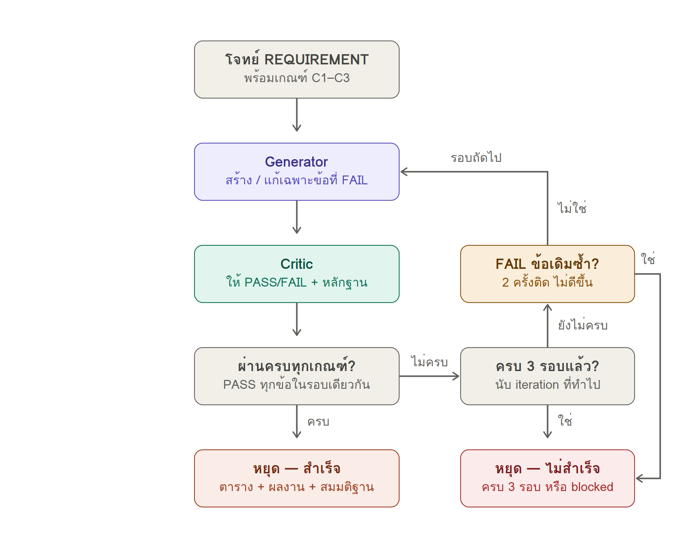
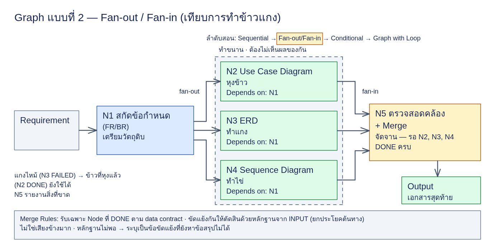
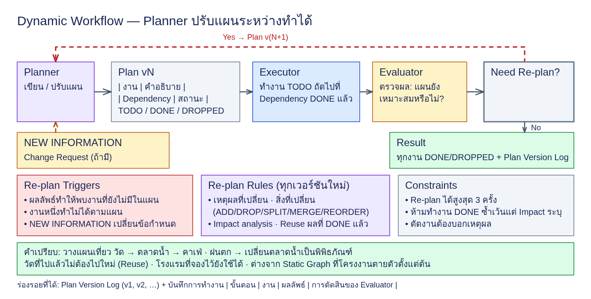

# เรียนรู้การเขียน Prompt เพื่อสร้าง Loop, Graph และ Dynamic Workflow

บทเรียนนี้ให้นักศึกษาเรียนรู้ **การเขียน Prompt เพื่อให้ AI ทำงานเป็นเวิร์กโฟลว์ 3 รูปแบบ ได้แก่ Loop, Graph และ Dynamic Workflow** ผ่าน Prompt Template ของแต่ละรูปแบบ แล้วนำไปใช้กับโจทย์เดียวกันทั้งสามข้อ เพื่อดูว่าการกำหนดวิธีทำงานต่างกันส่งผลต่อกระบวนการและผลงานอย่างไร

**Prompt Template** คือแม่แบบข้อความที่กำหนดบทบาท ขั้นตอน กติกา และเงื่อนไขหยุดของเวิร์กโฟลว์ ผู้เรียนเติมโจทย์ ข้อมูลนำเข้า เกณฑ์ตรวจ และผลลัพธ์ที่ต้องการลงในแม่แบบก่อนใช้งาน บทเรียนนี้จึงมี Template แยกสำหรับ Loop, Graph และ Dynamic Workflow

เริ่มจากอ่านโจทย์เต็มและเกณฑ์ด้านล่าง จากนั้นเรียนวิธีเขียน Prompt ของแต่ละรูปแบบ โดยมีตัวอย่าง Prompt ที่เติมแล้วและผลงานจากการทดลองเดิมประกอบ

<a id="three-problems"></a>
## โจทย์และเกณฑ์ตรวจทั้ง 3 ข้อ

ใช้โจทย์ทั้งสามข้อนี้กับ **ทุกเวิร์กโฟลว์** รวมเป็น 9 กรณี เป้าหมายและเกณฑ์ของแต่ละโจทย์เป็นจุดตั้งต้นร่วมกัน ส่วนวิธีแบ่งงาน ตรวจงาน และปรับแผนจะเปลี่ยนไปตาม Prompt ที่เลือก

| โจทย์ | ข้อมูลนำเข้า | ผลงานที่ต้องส่ง |
| --- | --- | --- |
| 1. จองห้องประชุม | รายการความสามารถของระบบ | เว็บ Mock-up ที่เปิดและทดลองใช้งานได้ |
| 2. เบิกค่าใช้จ่าย | บันทึกสัมภาษณ์ผู้เกี่ยวข้อง | ข้อกำหนดและแบบจำลองระบบ |
| 3. ย้ายระบบนัดหมายคลินิก | บริบทคลินิกและข้อมูลนัดหมายตัวอย่าง | ผลวิเคราะห์และแผนย้ายระบบ พร้อมรับความต้องการใหม่ |

<a id="problem-1"></a>
### โจทย์ 1 — ระบบจองห้องประชุม

```text
สร้างเว็บไซต์สำหรับระบบจองห้องประชุม
ระบบต้องสามารถ: แสดงห้องประชุม, ดูเวลาว่าง, จองห้อง, ยกเลิกการจอง, แสดงสถานะการจอง
Output: Web UI Mock-up ที่เปิดและทดลองใช้งานได้
```

**เกณฑ์ตรวจ (Criteria)**

1. มีครบทั้ง 5 ฟีเจอร์ตามโจทย์
2. เปิดเว็บใน Chromium โดยไม่มี console error และทดลองทั้ง 5 ฟีเจอร์ด้วย Playwright พร้อมแสดงผลจริงเป็นหลักฐาน
3. เข้าถึงแต่ละฟีเจอร์จากหน้าจอแรกภายในไม่เกิน 2 คลิก

<a id="problem-2"></a>
### โจทย์ 2 — วิเคราะห์ Requirement ระบบเบิกค่าใช้จ่าย

**ข้อมูลนำเข้า (Input):** วิเคราะห์ข้อกำหนดระบบเบิกค่าใช้จ่ายจากบันทึกสัมภาษณ์ต่อไปนี้ ซึ่งมีทั้งข้อขัดแย้งและข้อมูลที่ยังไม่ครบ

```text
[พนักงานฝ่ายขาย] อยากถ่ายรูปใบเสร็จแล้วเบิกได้เลย ไม่อยากกรอกเยอะ
                 ส่วนใหญ่เบิกค่าน้ำมัน ค่าที่พัก ค่ารับรองลูกค้า
[หัวหน้าทีม]     ผมต้องอนุมัติทุกใบ ถ้าเกิน 5,000 บาทต้องให้ผู้จัดการฝ่ายอนุมัติอีกชั้น
[ผู้จัดการฝ่าย]   อะไรเกิน 10,000 ค่อยส่งมาผม ต่ำกว่านั้นหัวหน้าทีมจบได้เลย
[ฝ่ายบัญชี]      ต้องตรวจใบเสร็จซ้ำ เคยมีคนเบิกใบเดียวสองรอบ
                 ต้องเบิกภายใน 30 วันนับจากวันที่ในใบเสร็จ จ่ายเงินรอบวันที่ 25 ของเดือน
[ฝ่ายบัญชี]      ค่ารับรองลูกค้าต้องระบุชื่อลูกค้าและชื่อบริษัท
[HR]             พนักงานแต่ละระดับมีวงเงินค่าที่พักต่อคืนไม่เท่ากัน
[พนักงานฝ่ายขาย] อยากเห็นว่าใบเบิกของเราค้างอยู่ที่ใคร
```

**ผลงานที่ต้องส่ง (Output):** Markdown ไฟล์เดียว ใช้ Mermaid สำหรับแผนภาพ และมีองค์ประกอบครบดังนี้

- Actor/Stakeholder, ข้อกำหนดการทำงาน (FR-xx), ข้อกำหนดที่ไม่ใช่ฟังก์ชัน (NFR) และกฎธุรกิจ (BR-xx)
- Use Case Diagram, ERD, Sequence Diagram “ยื่นเบิก → อนุมัติ → จ่ายเงิน” และ State Diagram ของใบเบิก
- Traceability Matrix เชื่อมประโยคต้นทาง → FR/BR → Use Case → Entity
- Open Issues สำหรับประเด็นที่ต้องยืนยันเพิ่มเติม

**เกณฑ์ตรวจ (Criteria)**

- ทุกประโยคในบันทึก trace ไป FR/BR ได้อย่างน้อย 1 รายการ
- ตรวจพบข้อขัดแย้ง 5,000 vs 10,000 และส่งเป็น Open Issue โดยไม่ตัดสินเอง
- ไม่แต่งตัวเลขวงเงินค่าที่พัก
- Entity/Attribute ใน Sequence และ State ตรงกับ ERD
- State ตอบได้ว่า “ค้างอยู่ที่ใคร”
- Mermaid ทุกบล็อก render ได้

ข้อขัดแย้งเรื่องวงเงินและข้อมูลค่าที่พักที่ขาดเป็นส่วนหนึ่งของโจทย์ ทุกเวิร์กโฟลว์ต้องแสดงประเด็นเหล่านี้ให้ตรวจสอบได้ และแยกข้อมูลต้นทางออกจากสมมติฐาน

<a id="problem-3"></a>
### โจทย์ 3 — ย้ายระบบนัดหมายคลินิกจาก Google Sheet สู่ระบบกลาง

```text
บริบท: คลินิกทันตกรรม 3 สาขา ใช้ Google Sheet แยกสาขา ร่วมกับจองผ่าน LINE ต้องการย้ายมาระบบนัดหมายกลาง

สาขา,วันที่,เวลา,ชื่อคนไข้,เบอร์,หมอ,บริการ,หมายเหตุ
ลาดกระบัง,03/09/2026,10:00,สมชาย ใจดี,081-234-5678,หมอเอ,ขูดหินปูน,
ลาดกระบัง,2026-09-03,10:00,สมชาย ใจดี,0812345678,หมอเอ,ขูดหินปูน,จองซ้ำทางไลน์
บางนา,3 ก.ย. 69,13:30,คุณมาลี,,หมอบี,จัดฟัน,ไม่มีเบอร์ ติดต่อทางไลน์
บางนา,03/09/2026,13:30,วิชัย ศรีสุข,089-111-2222,หมอบี,อุดฟัน,
อ่อนนุช,09/03/2026,09:00,Somchai Jaidee,081 234 5678,หมอเอ,ตรวจฟัน,หมอเอมาช่วยสาขานี้ทุกวันพุธ

งานรอบแรก:
1. As-Is Process (Mermaid flowchart)
2. Data Quality Findings (ปัญหา / แถว / ผลกระทบ)
3. To-Be Process และ Data Model
4. Data Mapping + แผน Migration (รวมวิธีจับคู่ตัวตนคนไข้)
5. Gap Analysis + Roll-out Plan
6. Plan Version Log
```

**เกณฑ์ตรวจ (Criteria)**

1. ส่งมอบงานรอบแรกครบทั้ง 6 รายการที่ระบุในโจทย์
2. พบปัญหาข้อมูลอย่างน้อย 5 ประเภท พร้อมระบุแถวและผลกระทบ
3. ระบุข้อมูลที่กำกวม และอ้างหลักฐานประกอบการตีความ
4. มีกลยุทธ์จับคู่ตัวตนคนไข้ รวมการปรับรูปแบบชื่อและเบอร์โทรศัพท์ และกรณีที่ต้องให้คนยืนยัน
5. บันทึกการเปลี่ยนแผนจาก Plan v1 → v2 พร้อมเหตุผลตามเกณฑ์โจทย์เดิม
6. วิเคราะห์ผลกระทบ (Impact Analysis) ว่าผลงานส่วนใดต้องแก้ และส่วนใดใช้ต่อได้ (Reuse)
7. แผนภาพ Mermaid ต้อง render ได้ หากเครื่องมือไม่พร้อมและตรวจได้เพียง syntax ตามเงื่อนไข Prompt เดิม ต้องรายงานวิธีตรวจและข้อจำกัดให้ชัดเจน

เกณฑ์เรื่องเวอร์ชันแผนเป็นเกณฑ์ของโจทย์คลินิก ส่วนบันทึกการทำงานของแต่ละเวิร์กโฟลว์มีรูปแบบต่างกัน เช่น Iteration Log, Execution Trace และ Plan Version Log ให้อ่านเนื้อหาการเปลี่ยนงานประกอบกับชื่อเวอร์ชัน

#### ข้อมูลเพิ่มเติมระหว่างทำงาน: Change Request ของโจทย์ 3

หลังได้แผนเริ่มต้นและผลงานเฟสแรก ให้ส่งข้อมูลต่อไปนี้ในบทสนทนาเดิม เพื่อฝึกปรับงานจากสิ่งที่ทำไว้แล้ว:

```text
เจ้าของคลินิกแจ้งเพิ่ม:
1. ต้องเก็บความยินยอมของคนไข้ตาม PDPA
2. คนไข้ต้องจองคิวเองผ่าน LINE OA ได้
```

หลังรับ Change Request ผลงานต้องครอบคลุมข้อกำหนดใหม่ทั้งสองข้อ และอธิบายได้ว่าส่วนใดเปลี่ยน ส่วนใดใช้ต่อ และเพราะอะไร

## วิธีเรียนและเตรียม Prompt

เมื่อจบบทเรียน นักศึกษาควรเขียน Prompt ที่ระบุบทบาท ลำดับงาน เกณฑ์ตรวจ และเงื่อนไขหยุดของแต่ละเวิร์กโฟลว์ได้ รวมถึงเลือกปรับ Template ให้ตรงกับโจทย์และอธิบายกระบวนการจากหลักฐานที่ได้

1. เลือกโจทย์จากด้านบน และอ่านข้อมูลนำเข้า ผลงานที่ต้องส่ง และเกณฑ์ตรวจให้ครบ
2. ศึกษา Template ของเวิร์กโฟลว์ แล้วระบุว่าส่วนใดกำหนดวิธีทำงาน ส่วนใดต้องเติมตามโจทย์
3. ดูตัวอย่างการเติม Prompt เปรียบเทียบกับผลงานและบันทึกการทำงานเดิม
4. เปรียบเทียบโจทย์เดียวกันในทั้งสามเวิร์กโฟลว์ ก่อนเลือกว่าจะใช้แบบใดกับงานใหม่

| ส่วนของ Prompt | สิ่งที่ต้องกำหนด |
| --- | --- |
| ROLE และ GOAL | ใครทำหน้าที่อะไร และต้องบรรลุผลใด |
| INPUT | โจทย์ ข้อมูลต้นทาง และรายการผลงานที่ต้องส่ง |
| CRITERIA / กติกาตรวจ | เงื่อนไขที่ใช้ตัดสินผลงาน และหลักฐานที่ต้องแสดง |
| WORKFLOW / TASK GRAPH / PLAN | ลำดับงาน การส่งต่อข้อมูล หรือวิธีสร้างและปรับแผน |
| CONSTRAINTS | ข้อจำกัด เช่น ห้ามแต่งข้อมูลและห้ามเลือกข้อขัดแย้งเอง |
| STOP CONDITION | เมื่อใดส่งงานได้ และเมื่อใดต้องหยุดพร้อมรายงานสิ่งที่ยังติดขัด |
| OUTPUT FORMAT | รูปแบบผลงานและบันทึกที่ใช้ตรวจย้อนกลับ |

ใน Loop จะเขียนเกณฑ์ใน CRITERIA โดยตรง ส่วน Graph ต้องถ่ายทอดเกณฑ์ไปสู่งานของแต่ละ Node และการตรวจตอนรวม สำหรับ Dynamic ต้องให้ Planner และ Evaluator ใช้เกณฑ์เดียวกันในการวางแผนและตรวจผล การเปลี่ยนเวิร์กโฟลว์จึงต้องนำเกณฑ์ของโจทย์ติดไปด้วยทุกครั้ง

Template เป็นข้อความสำหรับกำหนดการทำงานของ AI ความสามารถในการเปิดเว็บ ทดสอบ หรือแยกงานจริงขึ้นอยู่กับเครื่องมือที่ใช้ด้วย การระบุหลายบทบาทใน Prompt เพียงอย่างเดียวจึงยังไม่ยืนยันว่ามีผู้ตรวจอิสระหรือมีงานรันพร้อมกัน

### เลือกอ่านแต่ละบท

- [บทที่ 1 เขียน Prompt เพื่อสร้าง Loop](#loop)
- [บทที่ 2 เขียน Prompt เพื่อสร้าง Graph](#graph)
- [บทที่ 3 เขียน Prompt เพื่อสร้าง Dynamic Workflow](#dynamic)
- [บทที่ 4 เปรียบเทียบและฝึกออกแบบ Prompt](#comparison)
- [หลักฐานและข้อจำกัดของผลทดลอง](#evidence)

ตัวอย่างทั้งหมดต่อจากนี้อ้างอิงการทดลองเดิม ในแต่ละกรณีมีส่วนที่ต้องเติมใน Template, Prompt ฉบับเต็มในกล่องพับ, ตัวอย่างผลงาน และบันทึกการทำงาน ส่วน RUN HARNESS ใน Prompt เดิมใช้กำหนดไฟล์และการเก็บหลักฐานของการทดลองนั้น

<a id="loop"></a>
## บทที่ 1 เขียน Prompt เพื่อสร้าง Loop

### 1.1 กำหนดวงจรสร้าง–ตรวจ–แก้

Loop ใช้ Prompt กำหนดให้ **Generator** สร้างผลงาน และ **Critic** ตรวจตามเกณฑ์ทีละข้อ หากยังมีข้อที่ไม่ผ่าน ให้นำผลตรวจกลับไปแก้แล้วตรวจอีกครั้ง ผู้เขียน Prompt ต้องบอกทั้งสิ่งที่ต้องตรวจ วิธีรายงานหลักฐาน และขอบเขตการแก้ในรอบถัดไป



ลำดับที่ต้องเขียนให้ครบใน Prompt คือ รับโจทย์และเกณฑ์ → สร้างผลงาน → ตรวจพร้อมหลักฐาน → ส่งงานหรือแก้ตามผลตรวจ เงื่อนไขหยุดมีสองกรณี: ผ่านครบทุกข้อในรอบเดียวกัน หรือถึงขีดจำกัดแล้วยังมีข้อที่ไม่ผ่าน ซึ่งต้องรายงานแยกกัน

Template นี้กำหนดให้ทำได้สูงสุด 3 รอบ และหยุดเมื่อเกณฑ์เดิมไม่ผ่าน 2 ครั้งติดกันโดยไม่ดีขึ้น การระบุขีดจำกัดช่วยให้รู้ว่าต้องส่งต่อปัญหาเมื่อใด

### 1.2 Prompt Template สำหรับ Loop

อ่าน ROLE เพื่อแยกหน้าที่ แล้วอ่าน CRITERIA ควบคู่กับ WORKFLOW และ STOP CONDITION สังเกตว่าผลตรวจของ Critic เป็นข้อมูลที่ Generator ใช้ในรอบถัดไป

[เปิด Template เป็นไฟล์ข้อความ](labs/loop/loop-template.txt) เพื่อนำไปทำแล็บในข้อ 1.3

```text
บรรทัดที่ขึ้นต้นด้วย "//" คือคำอธิบายสำหรับผู้เรียน ให้ AI ข้ามบรรทัดเหล่านี้

# ROLE (บทบาท)
คุณสวมบทบาทที่แยกจากกัน 2 บทบาท:
- GENERATOR: สร้างหรือปรับปรุงผลงาน
- CRITIC: ตรวจผลงานตามเกณฑ์อย่างเคร่งครัด ผู้ตรวจต้องไม่ผ่อนปรน

# GOAL (เป้าหมาย)
สร้างผลงานที่ผ่านเกณฑ์ทุกข้อด้านล่าง

# INPUT (ข้อมูลนำเข้า)
{{REQUIREMENT}}

# CRITERIA (เกณฑ์ตรวจ — ทุกข้อต้องตอบได้ว่า PASS หรือ FAIL)
C1. มีทุกฟีเจอร์ที่ระบุไว้ในโจทย์
C2. {{CRITERION_2}}
C3. {{CRITERION_3}}
// ตัวอย่าง "คำโปรยสินค้า": C1 มีชื่อสินค้า  C2 มีราคา  C3 ไม่เกิน 30 คำ — ทุกข้อตอบผ่าน/ไม่ผ่านได้

# WORKFLOW (ลำดับการทำงาน)
ทำซ้ำตามวงจรต่อไปนี้:
1. GENERATOR: สร้างผลงาน (Iteration 1) หรือแก้เฉพาะเกณฑ์ที่ไม่ผ่านเท่านั้น (Iteration ถัดไป)
2. CRITIC: ระบุผลแต่ละเกณฑ์เป็น PASS หรือ FAIL พร้อมหลักฐานข้อละหนึ่งบรรทัด
3. หากทุกเกณฑ์เป็น PASS ให้หยุด
4. หากยังไม่ผ่านครบ ให้ระบุเกณฑ์ที่ไม่ผ่านแล้วเริ่ม Iteration ถัดไป
// รอบ 1: "หูฟังเสียงใส ใส่สบาย" → C2 ไม่ผ่าน (ไม่มีราคา)  รอบ 2: เติม "ราคา 990 บาท" → ผ่านครบ

# CONSTRAINTS (ข้อห้าม)
- ห้ามเปลี่ยนส่วนที่ผ่านแล้ว
- ห้ามแต่งข้อมูลที่ไม่มีในข้อมูลนำเข้า ให้ระบุว่าเป็นสมมติฐานแทน

# STOP CONDITION (เงื่อนไขหยุด)
หยุดเมื่อ:
- ทุกเกณฑ์เป็น PASS หรือ
- ทำครบ 3 Iteration หรือ
- เกณฑ์เดิมไม่ผ่าน 2 ครั้งติดต่อกันโดยไม่ดีขึ้น (รายงานว่าติดขัด โดยระบุสถานะ blocked)

# OUTPUT FORMAT (รูปแบบผลลัพธ์)
1. ตารางบันทึก Iteration: | Iteration | สิ่งที่เปลี่ยน | C1 | C2 | C3 |
2. ผลงานสุดท้าย
3. ประเด็นที่ยังเหลือหรือสมมติฐาน (ถ้ามี)
```

### 1.3 Lab: คัดลอก Prompt แล้วให้ AI ทำงานตาม Loop Template

แล็บนี้ใช้ **Template ในข้อ 1.2 เป็นแม่แบบกลาง** นักศึกษาเลือกโจทย์แล้วคัดลอก Prompt ของโจทย์นั้นทั้งบล็อกไปวางได้เลย ในแต่ละบล็อกมีคำสั่งอ่าน Template พร้อม Requirement และ Criteria ครบแล้ว AI จะเติมข้อมูลลงใน Template เชื่อมข้อกำหนดกับวิธีตรวจ แล้วดำเนินวงจรสร้าง–ตรวจ–แก้โดยใช้หลักฐานจากผลงาน

**เตรียมครั้งเดียว:** ถ้าใช้เครื่องมือ AI ที่อ่านไฟล์ในโปรเจกต์ได้ ให้เปิดโฟลเดอร์ `Basic_AI_WORFLOW` ซึ่งมีไฟล์ `labs/loop/loop-template.txt` อยู่แล้ว ถ้าใช้แชตทั่วไป ให้ดาวน์โหลด [loop-template.txt](labs/loop/loop-template.txt) แล้วแนบในบทสนทนาก่อนวาง Prompt การพิมพ์ชื่อไฟล์อย่างเดียวไม่ได้ทำให้แชตเข้าถึงไฟล์บนเครื่องได้

เริ่มบทสนทนาใหม่สำหรับแต่ละโจทย์ จากนั้น **คัดลอกทั้งบล็อก → วางและส่ง → เปิดผลงาน → ตรวจหลักฐาน C1/C2/C3** งานเว็บต้องใช้เครื่องมือที่สร้างไฟล์ เปิดเว็บ และทดสอบด้วย Playwright ได้ เพื่อให้ตรวจตามเกณฑ์ครบ

#### โจทย์ 1: จองห้องประชุม

คัดลอกบล็อกนี้ทั้งหมด หรือเปิด [Prompt สำหรับคัดลอก](labs/loop/1_meeting_room-run.txt)

```text
แก้โจทย์ด้านล่างโดยใช้ Loop Template จาก labs/loop/loop-template.txt หรือไฟล์แนบ loop-template.txt อ่านไฟล์ก่อนเริ่ม หากไม่มีให้ขอไฟล์นี้

เติม Template: REQUIREMENT → {{REQUIREMENT}}, C1 → บรรทัด C1, C2 → {{CRITERION_2}}, C3 → {{CRITERION_3}} แล้วลงมือทำตามบทบาท วงจร และเงื่อนไขหยุดเดิมทันที

แนวทางทำงาน:
1. ก่อนสร้างงาน จับคู่ข้อกำหนดแต่ละข้อกับส่วนของผลงานและวิธีตรวจใน C1–C3 ใน trace ไม่เพิ่มขอบเขตหรือเปลี่ยนเกณฑ์
2. GENERATOR สร้างผลงานตามรายการนั้น แยกข้อมูลต้นทาง สมมติฐาน และข้อขัดแย้งที่ต้องยืนยัน ข้อมูลขาดให้บันทึกแล้วทำส่วนที่ทำได้ต่อ ห้ามแต่งข้อเท็จจริง
3. CRITIC ตรวจจากผลงานล่าสุดและผลทดสอบจริง แสดง | เกณฑ์ | PASS/FAIL | หลักฐาน/ตำแหน่ง | สิ่งที่ต้องแก้ | เกณฑ์ที่มีหลายเงื่อนไขต้องครบทุกเงื่อนไขจึง PASS ถ้าไม่มีหลักฐานให้ FAIL พร้อมระบุว่ายังตรวจไม่ได้; ใช้วิธีสำรองได้เฉพาะที่เกณฑ์อนุญาต
4. เมื่อ FAIL ให้ระบุสาเหตุจากหลักฐาน แก้เฉพาะส่วนที่เกี่ยวข้องกับข้อที่ไม่ผ่าน แล้วตรวจซ้ำรวมถึงพฤติกรรมที่การแก้อาจกระทบ คงส่วนที่ผ่านแล้วตามกติกา Template
5. ใช้ขีดจำกัดและเงื่อนไขหยุดจาก Template ไม่เริ่มนับรอบใหม่เอง ถ้าติดขัดให้ระบุงานค้างและสิ่งที่ขาด แยก “ผ่านครบ” ออกจาก “หยุดทั้งที่ยังไม่ผ่าน”

ส่งมอบใน lab-results/loop/1_meeting_room/ (สร้างโฟลเดอร์รอบใหม่ถ้ามีงานเดิม): output.html, trace.md และ prompt-used.txt ที่เติมแล้ว ตอบตาม OUTPUT FORMAT พร้อมลิงก์ไฟล์ หากเขียนไฟล์ไม่ได้ให้แสดงเนื้อหาแยกตามชื่อไฟล์ และรายงานข้อจำกัดตามจริง

# REQUIREMENT
สร้างเว็บไซต์สำหรับระบบจองห้องประชุม
ระบบต้องสามารถ: แสดงห้องประชุม, ดูเวลาว่าง, จองห้อง, ยกเลิกการจอง, แสดงสถานะการจอง
Output: Web UI Mock-up ที่เปิดและทดลองใช้งานได้

# CRITERIA
C1. มีทุกฟีเจอร์ที่ระบุไว้ในโจทย์
C2. เปิด output.html ใน headless Chromium ได้โดยไม่มี console error และทดลองใช้ทั้ง 5 ฟีเจอร์ได้ด้วยการคลิกในหน้าเว็บ (แสดงห้องประชุม ดูเวลาว่างของห้อง สร้างการจอง ยกเลิกการจองนั้น และเห็นสถานะการจองเปลี่ยนไป) โดย CRITIC ต้องรันสคริปต์ Python Playwright และยกผลลัพธ์จริงมาเป็นหลักฐาน
C3. จากหน้าจอแรก เข้าถึงแต่ละฟีเจอร์ในทั้ง 5 ฟีเจอร์ได้ภายในไม่เกิน 2 คลิก โดย CRITIC ระบุเส้นทางการคลิกและจำนวนคลิกของแต่ละฟีเจอร์
```

#### โจทย์ 2: เบิกค่าใช้จ่าย

คัดลอกบล็อกนี้ทั้งหมด หรือเปิด [Prompt สำหรับคัดลอก](labs/loop/2_expense_claim-run.txt)

```text
แก้โจทย์ด้านล่างโดยใช้ Loop Template จาก labs/loop/loop-template.txt หรือไฟล์แนบ loop-template.txt อ่านไฟล์ก่อนเริ่ม หากไม่มีให้ขอไฟล์นี้

เติม Template: REQUIREMENT → {{REQUIREMENT}}, C1 → บรรทัด C1, C2 → {{CRITERION_2}}, C3 → {{CRITERION_3}} แล้วลงมือทำตามบทบาท วงจร และเงื่อนไขหยุดเดิมทันที

แนวทางทำงาน:
1. ก่อนสร้างงาน จับคู่ข้อกำหนดแต่ละข้อกับส่วนของผลงานและวิธีตรวจใน C1–C3 ใน trace ไม่เพิ่มขอบเขตหรือเปลี่ยนเกณฑ์
2. GENERATOR สร้างผลงานตามรายการนั้น แยกข้อมูลต้นทาง สมมติฐาน และข้อขัดแย้งที่ต้องยืนยัน ข้อมูลขาดให้บันทึกแล้วทำส่วนที่ทำได้ต่อ ห้ามแต่งข้อเท็จจริง
3. CRITIC ตรวจจากผลงานล่าสุดและผลทดสอบจริง แสดง | เกณฑ์ | PASS/FAIL | หลักฐาน/ตำแหน่ง | สิ่งที่ต้องแก้ | เกณฑ์ที่มีหลายเงื่อนไขต้องครบทุกเงื่อนไขจึง PASS ถ้าไม่มีหลักฐานให้ FAIL พร้อมระบุว่ายังตรวจไม่ได้; ใช้วิธีสำรองได้เฉพาะที่เกณฑ์อนุญาต
4. เมื่อ FAIL ให้ระบุสาเหตุจากหลักฐาน แก้เฉพาะส่วนที่เกี่ยวข้องกับข้อที่ไม่ผ่าน แล้วตรวจซ้ำรวมถึงพฤติกรรมที่การแก้อาจกระทบ คงส่วนที่ผ่านแล้วตามกติกา Template
5. ใช้ขีดจำกัดและเงื่อนไขหยุดจาก Template ไม่เริ่มนับรอบใหม่เอง ถ้าติดขัดให้ระบุงานค้างและสิ่งที่ขาด แยก “ผ่านครบ” ออกจาก “หยุดทั้งที่ยังไม่ผ่าน”

ส่งมอบใน lab-results/loop/2_expense_claim/ (สร้างโฟลเดอร์รอบใหม่ถ้ามีงานเดิม): output.md, trace.md และ prompt-used.txt ที่เติมแล้ว ตอบตาม OUTPUT FORMAT พร้อมลิงก์ไฟล์ หากเขียนไฟล์ไม่ได้ให้แสดงเนื้อหาแยกตามชื่อไฟล์ และรายงานข้อจำกัดตามจริง

# REQUIREMENT
วิเคราะห์ Requirement ระบบเบิกค่าใช้จ่าย จากบันทึกสัมภาษณ์ต่อไปนี้

[พนักงานฝ่ายขาย] อยากถ่ายรูปใบเสร็จแล้วเบิกได้เลย ไม่อยากกรอกเยอะ
                 ส่วนใหญ่เบิกค่าน้ำมัน ค่าที่พัก ค่ารับรองลูกค้า
[หัวหน้าทีม]     ผมต้องอนุมัติทุกใบ ถ้าเกิน 5,000 บาทต้องให้ผู้จัดการฝ่ายอนุมัติอีกชั้น
[ผู้จัดการฝ่าย]   อะไรเกิน 10,000 ค่อยส่งมาผม ต่ำกว่านั้นหัวหน้าทีมจบได้เลย
[ฝ่ายบัญชี]      ต้องตรวจใบเสร็จซ้ำ เคยมีคนเบิกใบเดียวสองรอบ
                 ต้องเบิกภายใน 30 วันนับจากวันที่ในใบเสร็จ จ่ายเงินรอบวันที่ 25 ของเดือน
[ฝ่ายบัญชี]      ค่ารับรองลูกค้าต้องระบุชื่อลูกค้าและชื่อบริษัท
[HR]             พนักงานแต่ละระดับมีวงเงินค่าที่พักต่อคืนไม่เท่ากัน
[พนักงานฝ่ายขาย] อยากเห็นว่าใบเบิกของเราค้างอยู่ที่ใคร

Output: Markdown ไฟล์เดียว (diagram เป็น Mermaid) ประกอบด้วย Actor/Stakeholder · FR-xx และ NFR · BR-xx · Use Case Diagram · ERD · Sequence Diagram "ยื่นเบิก → อนุมัติ → จ่ายเงิน" · State Diagram ของใบเบิก · Traceability Matrix (ประโยคต้นทาง → FR/BR → Use Case → Entity) · Open Issues

# CRITERIA
C1. มีทุกฟีเจอร์ที่ระบุไว้ในโจทย์
C2. บันทึกสัมภาษณ์ทุกบรรทัดปรากฏใน Traceability Matrix โดยเชื่อมโยงกับ FR-xx หรือ BR-xx อย่างน้อยหนึ่งข้อ หากมีสองบรรทัดที่ให้กติกาต่างกันสำหรับการตัดสินใจเรื่องเดียวกัน ต้องยกทั้งสองบรรทัดไว้ใน Open Issues โดยไม่เลือกข้าง และตัวเลขทุกตัวที่ปรากฏใน FR/BR/Open Issues ต้องตรงตามที่ปรากฏในข้อมูลนำเข้าทุกตัวอักษร
C3. ทุก Entity และ Attribute ที่ระบุชื่อใน Sequence Diagram และ State Diagram ต้องมีอยู่ใน ERD ทุกสถานะใน State Diagram ต้องระบุว่าใบเบิกอยู่กับใครในขณะนั้น และทุกบล็อก Mermaid ต้อง render ได้ (ใช้ renderer ที่ติดตั้งในเครื่องหากมี มิฉะนั้นให้ตรวจ syntax อย่างเคร่งครัด พร้อมระบุว่าใช้วิธีใด)
```

#### โจทย์ 3: คลินิกทันตกรรม

คัดลอกบล็อกนี้ทั้งหมด หรือเปิด [Prompt สำหรับคัดลอก](labs/loop/3_clinic_migration-run.txt)

````text
แก้โจทย์ด้านล่างโดยใช้ Loop Template จาก labs/loop/loop-template.txt หรือไฟล์แนบ loop-template.txt อ่านไฟล์ก่อนเริ่ม หากไม่มีให้ขอไฟล์นี้

เติม Template: REQUIREMENT → {{REQUIREMENT}}, C1 → บรรทัด C1, C2 → {{CRITERION_2}}, C3 → {{CRITERION_3}} แล้วลงมือทำตามบทบาท วงจร และเงื่อนไขหยุดเดิมทันที

แนวทางทำงาน:
1. ก่อนสร้างงาน จับคู่ข้อกำหนดแต่ละข้อกับส่วนของผลงานและวิธีตรวจใน C1–C3 ใน trace ไม่เพิ่มขอบเขตหรือเปลี่ยนเกณฑ์
2. GENERATOR สร้างผลงานตามรายการนั้น แยกข้อมูลต้นทาง สมมติฐาน และข้อขัดแย้งที่ต้องยืนยัน ข้อมูลขาดให้บันทึกแล้วทำส่วนที่ทำได้ต่อ ห้ามแต่งข้อเท็จจริง
3. CRITIC ตรวจจากผลงานล่าสุดและผลทดสอบจริง แสดง | เกณฑ์ | PASS/FAIL | หลักฐาน/ตำแหน่ง | สิ่งที่ต้องแก้ | เกณฑ์ที่มีหลายเงื่อนไขต้องครบทุกเงื่อนไขจึง PASS ถ้าไม่มีหลักฐานให้ FAIL พร้อมระบุว่ายังตรวจไม่ได้; ใช้วิธีสำรองได้เฉพาะที่เกณฑ์อนุญาต
4. เมื่อ FAIL ให้ระบุสาเหตุจากหลักฐาน แก้เฉพาะส่วนที่เกี่ยวข้องกับข้อที่ไม่ผ่าน แล้วตรวจซ้ำรวมถึงพฤติกรรมที่การแก้อาจกระทบ คงส่วนที่ผ่านแล้วตามกติกา Template
5. ใช้ขีดจำกัดและเงื่อนไขหยุดจาก Template ไม่เริ่มนับรอบใหม่เอง ถ้าติดขัดให้ระบุงานค้างและสิ่งที่ขาด แยก “ผ่านครบ” ออกจาก “หยุดทั้งที่ยังไม่ผ่าน”

ส่งมอบใน lab-results/loop/3_clinic_migration/ (สร้างโฟลเดอร์รอบใหม่ถ้ามีงานเดิม): output.md, trace.md และ prompt-used.txt ที่เติมแล้ว ตอบตาม OUTPUT FORMAT พร้อมลิงก์ไฟล์ หากเขียนไฟล์ไม่ได้ให้แสดงเนื้อหาแยกตามชื่อไฟล์ และรายงานข้อจำกัดตามจริง

# REQUIREMENT
ย้ายระบบนัดหมายคลินิกจาก Google Sheet สู่ระบบกลาง (As-Is → To-Be + Migration)
บริบท: คลินิกทันตกรรม 3 สาขา ใช้ Google Sheet แยกสาขา ร่วมกับจองผ่าน LINE ต้องการย้ายมาระบบนัดหมายกลาง

ตัวอย่างข้อมูลจาก Google Sheet ของสาขาต่าง ๆ (CSV):
```csv
สาขา,วันที่,เวลา,ชื่อคนไข้,เบอร์,หมอ,บริการ,หมายเหตุ
ลาดกระบัง,03/09/2026,10:00,สมชาย ใจดี,081-234-5678,หมอเอ,ขูดหินปูน,
ลาดกระบัง,2026-09-03,10:00,สมชาย ใจดี,0812345678,หมอเอ,ขูดหินปูน,จองซ้ำทางไลน์
บางนา,3 ก.ย. 69,13:30,คุณมาลี,,หมอบี,จัดฟัน,ไม่มีเบอร์ ติดต่อทางไลน์
บางนา,03/09/2026,13:30,วิชัย ศรีสุข,089-111-2222,หมอบี,อุดฟัน,
อ่อนนุช,09/03/2026,09:00,Somchai Jaidee,081 234 5678,หมอเอ,ตรวจฟัน,หมอเอมาช่วยสาขานี้ทุกวันพุธ
```

งานที่ต้องส่ง: As-Is Process (Mermaid flowchart) · Data Quality Findings (ปัญหา / แถว / ผลกระทบ) · To-Be Process และ Data Model · Data Mapping + แผน Migration (รวมวิธีจับคู่ตัวตนคนไข้) · Gap Analysis + Roll-out Plan · Plan Version Log
Output: Markdown ไฟล์เดียว (diagram เป็น Mermaid)

# CRITERIA
C1. มีทุกฟีเจอร์ที่ระบุไว้ในโจทย์
C2. Data Quality Findings ระบุปัญหาที่ต่างประเภทกันอย่างน้อย 5 ประเภท โดยแต่ละประเภทอ้างอิงแถวที่ได้รับผลกระทบอย่างเจาะจงและระบุผลกระทบ ค่าทุกค่าที่ตีความได้มากกว่าหนึ่งแบบต้องระบุว่ากำกวม และการตีความที่เลือกต้องอ้างอิงหลักฐานที่พบในข้อมูล
C3. ส่วน Data Mapping + Migration มีกลยุทธ์จับคู่ตัวตนคนไข้ที่ระบุวิธีปรับรูปแบบเบอร์โทรศัพท์และชื่อให้เป็นมาตรฐานก่อนจับคู่ พร้อมระบุแถวที่ต้องให้มนุษย์ยืนยัน และทุกบล็อก Mermaid ต้อง render ได้ (ใช้ renderer ที่ติดตั้งในเครื่องหากมี มิฉะนั้นให้ตรวจ syntax อย่างเคร่งครัด พร้อมระบุว่าใช้วิธีใด)
````

#### Prompt นี้ช่วยกำกับงานอย่างไร

ก่อนสร้างผลงาน AI ต้องเชื่อมข้อกำหนดกับสิ่งที่จะส่งและวิธีตรวจ ทำให้เห็นงานที่อาจตกหล่น เมื่อ Critic ตรวจไม่ผ่านต้องระบุหลักฐานและสาเหตุเพื่อให้ Generator แก้ได้ตรงจุด แล้วตรวจซ้ำโดยใช้ผลงานล่าสุด ทุกขั้นยังอยู่ภายใต้จำนวนรอบและเงื่อนไขหยุดของ Template 1.2

การแก้ Prompt ครั้งนี้เพิ่มความชัดเจนของวิธีทำงาน ยังไม่ได้ทดลองเปรียบเทียบคุณภาพกับฉบับก่อน ผู้เรียนจึงต้องตรวจหลักฐานจากการรันจริงตามขั้นตอนถัดไป

#### รับ Output แล้วตรวจอะไร

AI ควรส่งทั้งผลงาน ตาราง Iteration และผลตรวจพร้อมหลักฐาน นักศึกษาเปิดผลงานจริงแล้วเทียบกับ C1/C2/C3 ในบล็อกที่ส่ง โดยใช้ [แบบบันทึกตรวจผลงาน](labs/loop/review-checklist.txt) ช่วยจดผลได้

| โจทย์ | C1: ครบตามโจทย์หรือไม่ | C2: หลักฐานที่ต้องดู | C3: หลักฐานที่ต้องดู |
| --- | --- | --- | --- |
| จองห้องประชุม | ฟีเจอร์ทั้งห้าข้อ | ผลทดลอง Playwright และ console error | เส้นทางและจำนวนคลิกของแต่ละฟีเจอร์ |
| เบิกค่าใช้จ่าย | หัวข้อเอกสารและแผนภาพที่ขอ | Traceability ข้อขัดแย้งเรื่องวงเงิน และที่มาของตัวเลข | ความสอดคล้องของ Entity/Attribute ผู้ถือใบเบิกแต่ละสถานะ และผลตรวจ Mermaid |
| คลินิกทันตกรรม | งานที่ต้องส่งทั้งหกส่วน | ปัญหาข้อมูลอย่างน้อยห้าประเภทพร้อมแถวและหลักฐาน | การจับคู่คนไข้ กรณีให้คนยืนยัน และผลตรวจ Mermaid |

ใน C1 คำว่า “ทุกฟีเจอร์” ครอบคลุมองค์ประกอบและงานที่โจทย์ขอด้วย เช่น หัวข้อเอกสารและแผนภาพ หากหลักฐานไม่พอให้บันทึกว่า **ยังตรวจไม่ได้** พร้อมเหตุผล การตรวจ syntax อย่างเดียวต้องแยกจากการ render จริง อย่าใช้คำว่า PASS ในคำตอบของ AI แทนการเปิดดูผลงาน

**สิ่งที่ส่งท้ายแล็บ:** Prompt ที่ใช้จริง ผลงาน บันทึก Iteration และผลตรวจของนักศึกษาพร้อมหลักฐาน อ่านข้อ 1.4–1.6 เพื่อเปรียบเทียบกับผลทดลองเดิม โดยแยกผลรอบใหม่ของตนเองไว้ต่างหาก

สำหรับคลินิก เมื่อจบเฟสแรกแล้วจึงทดลอง Change Request เรื่องความยินยอมและ LINE OA ตาม Prompt ต่อเนื่องในข้อ 1.6 ในบทสนทนาเดิม และตรวจส่วนที่เปลี่ยน เหตุผล Impact และ Reuse เพิ่มเติม

<details>
<summary>ดูการจับคู่ข้อมูลกับ Template และไฟล์ประกอบสำหรับศึกษาเพิ่มเติม</summary>

| ข้อมูลใน Prompt ที่คัดลอก | ส่วนที่เติมใน Template 1.2 |
| --- | --- |
| REQUIREMENT ทั้งส่วน รวมข้อมูลต้นทางและ Output | `{{REQUIREMENT}}` |
| C1 | บรรทัด C1 ที่มีข้อความอยู่แล้ว |
| C2 | `{{CRITERION_2}}` |
| C3 | `{{CRITERION_3}}` |

ไฟล์ประกอบด้านล่างใช้ดูวิธีแทนค่าเพิ่มเติม การเริ่มแล็บใช้บล็อกพร้อมคัดลอกด้านบนได้ทันที

| โจทย์ | ข้อมูลแยกส่วน | Template ที่แทนค่าแล้วสำหรับเทียบ |
| --- | --- | --- |
| จองห้องประชุม | [ข้อมูลโจทย์](labs/loop/1_meeting_room-input.txt) | [Template ที่เติมแล้ว](labs/loop/1_meeting_room-prompt.txt) |
| เบิกค่าใช้จ่าย | [ข้อมูลโจทย์](labs/loop/2_expense_claim-input.txt) | [Template ที่เติมแล้ว](labs/loop/2_expense_claim-prompt.txt) |
| คลินิก | [ข้อมูลโจทย์](labs/loop/3_clinic_migration-input.txt) | [Template ที่เติมแล้ว](labs/loop/3_clinic_migration-prompt.txt) |

Prompt สำหรับคัดลอกเพิ่มคำสั่งอ่าน Template การเชื่อมข้อกำหนดกับหลักฐาน การตรวจและแก้ตามสาเหตุ และการบันทึกไฟล์ ส่วนวงจร Loop และเกณฑ์ใช้ตาม Template กับข้อมูลโจทย์เดิม ไฟล์เหล่านี้เป็นสื่อแล็บที่เตรียมไว้ ยังไม่มีผลทดลอง AI รอบใหม่

</details>

### 1.4 เติม Prompt สำหรับโจทย์ 1: จองห้องประชุม

ใช้ข้อมูลและเกณฑ์จาก [โจทย์ 1 ด้านบน](#problem-1) ใส่ใน INPUT ให้ครบ ถ่ายทอดเกณฑ์เรื่องฟังก์ชัน การทดลองใช้งาน และจำนวนคลิกให้ Critic ตรวจได้ พร้อมกำหนดให้แสดงผลการทดสอบเป็นหลักฐาน

**เกณฑ์ที่เติมใน Template จริง:**

- C1. มีทุกฟีเจอร์ที่ระบุไว้ในโจทย์
- C2. เปิด output.html ใน headless Chromium ได้โดยไม่มี console error และทดลองใช้ทั้ง 5 ฟีเจอร์ได้ด้วยการคลิกในหน้าเว็บ (แสดงห้องประชุม ดูเวลาว่างของห้อง สร้างการจอง ยกเลิกการจองนั้น และเห็นสถานะการจองเปลี่ยนไป) โดย CRITIC ต้องรันสคริปต์ Python Playwright และยกผลลัพธ์จริงมาเป็นหลักฐาน
- C3. จากหน้าจอแรก เข้าถึงแต่ละฟีเจอร์ในทั้ง 5 ฟีเจอร์ได้ภายในไม่เกิน 2 คลิก โดย CRITIC ระบุเส้นทางการคลิกและจำนวนคลิกของแต่ละฟีเจอร์

<details>
<summary>ดู Prompt ที่เติมโจทย์แล้ว — Loop × ระบบจองห้องประชุม</summary>

คัดข้อความเต็มจาก [prompt.md ของการทดลองนี้](experiments/1_meeting_room/loop/prompt.md) ส่วน RUN HARNESS ท้าย Prompt กำหนดชื่อไฟล์ผลงานและวิธีเก็บร่องรอยของการรันเดิม

```text
บรรทัดที่ขึ้นต้นด้วย "//" คือคำอธิบายสำหรับผู้เรียน ให้ AI ข้ามบรรทัดเหล่านี้

# ROLE (บทบาท)
คุณสวมบทบาทที่แยกจากกัน 2 บทบาท:
- GENERATOR: สร้างหรือปรับปรุงผลงาน
- CRITIC: ตรวจผลงานตามเกณฑ์อย่างเคร่งครัด ผู้ตรวจต้องไม่ผ่อนปรน

# GOAL (เป้าหมาย)
สร้างผลงานที่ผ่านเกณฑ์ทุกข้อด้านล่าง

# INPUT (ข้อมูลนำเข้า)
สร้างเว็บไซต์สำหรับระบบจองห้องประชุม
ระบบต้องสามารถ: แสดงห้องประชุม, ดูเวลาว่าง, จองห้อง, ยกเลิกการจอง, แสดงสถานะการจอง
Output: Web UI Mock-up ที่เปิดและทดลองใช้งานได้

# CRITERIA (เกณฑ์ตรวจ — ทุกข้อต้องตอบได้ว่า PASS หรือ FAIL)
C1. มีทุกฟีเจอร์ที่ระบุไว้ในโจทย์
C2. เปิด output.html ใน headless Chromium ได้โดยไม่มี console error และทดลองใช้ทั้ง 5 ฟีเจอร์ได้ด้วยการคลิกในหน้าเว็บ (แสดงห้องประชุม ดูเวลาว่างของห้อง สร้างการจอง ยกเลิกการจองนั้น และเห็นสถานะการจองเปลี่ยนไป) โดย CRITIC ต้องรันสคริปต์ Python Playwright และยกผลลัพธ์จริงมาเป็นหลักฐาน
C3. จากหน้าจอแรก เข้าถึงแต่ละฟีเจอร์ในทั้ง 5 ฟีเจอร์ได้ภายในไม่เกิน 2 คลิก โดย CRITIC ระบุเส้นทางการคลิกและจำนวนคลิกของแต่ละฟีเจอร์
// ตัวอย่าง "คำโปรยสินค้า": C1 มีชื่อสินค้า  C2 มีราคา  C3 ไม่เกิน 30 คำ — ทุกข้อตอบผ่าน/ไม่ผ่านได้

# WORKFLOW (ลำดับการทำงาน)
ทำซ้ำตามวงจรต่อไปนี้:
1. GENERATOR: สร้างผลงาน (Iteration 1) หรือแก้เฉพาะเกณฑ์ที่ไม่ผ่านเท่านั้น (Iteration ถัดไป)
2. CRITIC: ระบุผลแต่ละเกณฑ์เป็น PASS หรือ FAIL พร้อมหลักฐานข้อละหนึ่งบรรทัด
3. หากทุกเกณฑ์เป็น PASS ให้หยุด
4. หากยังไม่ผ่านครบ ให้ระบุเกณฑ์ที่ไม่ผ่านแล้วเริ่ม Iteration ถัดไป
// รอบ 1: "หูฟังเสียงใส ใส่สบาย" → C2 ไม่ผ่าน (ไม่มีราคา)  รอบ 2: เติม "ราคา 990 บาท" → ผ่านครบ

# CONSTRAINTS (ข้อห้าม)
- ห้ามเปลี่ยนส่วนที่ผ่านแล้ว
- ห้ามแต่งข้อมูลที่ไม่มีในข้อมูลนำเข้า ให้ระบุว่าเป็นสมมติฐานแทน

# STOP CONDITION (เงื่อนไขหยุด)
หยุดเมื่อ:
- ทุกเกณฑ์เป็น PASS หรือ
- ทำครบ 3 Iteration หรือ
- เกณฑ์เดิมไม่ผ่าน 2 ครั้งติดต่อกันโดยไม่ดีขึ้น (รายงานว่าติดขัด โดยระบุสถานะ blocked)

# OUTPUT FORMAT (รูปแบบผลลัพธ์)
1. ตารางบันทึก Iteration: | Iteration | สิ่งที่เปลี่ยน | C1 | C2 | C3 |
2. ผลงานสุดท้าย
3. ประเด็นที่ยังเหลือหรือสมมติฐาน (ถ้ามี)

# RUN HARNESS (คำสั่งควบคุมการรัน)
- ทำงานเฉพาะในโฟลเดอร์ปัจจุบัน ห้ามถามคำถามผู้ใช้ หากมีสิ่งใดไม่ชัดเจน ให้เขียนสมมติฐานแล้วทำงานต่อ
- บันทึกผลงานส่งมอบสุดท้ายเป็น `output.html`: ไฟล์เดียวที่มีทุกอย่างในตัว โดยใส่ CSS และ JavaScript แบบ inline ห้ามใช้ URL ภายนอก ห้ามใช้ CDN และห้ามเรียกเครือข่าย ต้องใช้งานได้เมื่อเปิดจากดิสก์โดยตรง
- บันทึกร่องรอยกระบวนการใน `trace.md`: เพิ่มบันทึกท้ายไฟล์ 1 รายการทันทีหลังจบแต่ละ Iteration (สิ่งที่เปลี่ยน + ผลตัดสิน C1–C3 ของ CRITIC พร้อมหลักฐาน) ให้เพิ่มท้ายไฟล์เท่านั้น ห้ามเขียนทับหรือลบบันทึกก่อนหน้า
- สามารถทดสอบ `output.html` ด้วยไลบรารี Python Playwright ที่ติดตั้งไว้แล้ว (headless Chromium, `from playwright.sync_api import sync_playwright`) และอ้างอิงผลจริงเป็นหลักฐานได้ ห้ามติดตั้งแพ็กเกจหรือใช้เครือข่าย
- ข้อความตอบสุดท้ายต้องตรงตาม OUTPUT FORMAT ทุกประการ โดยจะบันทึกเป็น `response.md`
```

</details>

**Output ที่ได้จากการทดลองเดิม**

ข้อความหัวข้อที่ปรากฏในหน้าเว็บเดิม:

> ห้องพร้อม ไอเดียก็พร้อม
>
> เลือกห้องและเวลาว่าง
>
> การจองของฉัน
>

[เปิดผลงานฉบับเต็ม](experiments/1_meeting_room/loop/output.html) · [อ่านกระบวนการที่บันทึกไว้](experiments/1_meeting_room/loop/trace.md)

**อ่านผลนี้อย่างไร:** Loop ชุดนี้จบในรอบแรก เพราะ Critic รายงานว่าผ่าน C1–C3 ครบ ตาม trace มีการทดลองจองและยกเลิกด้วย Playwright ผู้เรียนจึงเห็นว่า Loop ไม่จำเป็นต้องวนหลายรอบเสมอไป หากเกณฑ์ผ่านตั้งแต่รอบแรกก็หยุดได้

ตารางสรุปกระบวนการจากเอกสารเดิม:

| Iteration | สิ่งที่เปลี่ยน | C1 | C2 | C3 |
| --- | --- | --- | --- | --- |
| 1 | สร้างเว็บไฟล์เดียว พร้อมจอง/ยกเลิกและสถานะ | PASS ทดลองครบ 5 ฟีเจอร์ | PASS Playwright: errors=0 / requests=0 | PASS แต่ละฟีเจอร์ 1–2 คลิก |

### 1.5 เติม Prompt สำหรับโจทย์ 2: เบิกค่าใช้จ่าย

ใช้ข้อมูลและเกณฑ์จาก [โจทย์ 2 ด้านบน](#problem-2) ใส่ใน INPUT ให้ครบ เขียนเกณฑ์ให้ Critic ตรวจย้อนกลับไปยังบทสัมภาษณ์ได้ โดยตรวจทั้งข้อขัดแย้งเรื่องวงเงิน ข้อมูลที่ขาด และความสอดคล้องระหว่างแผนภาพ

**เกณฑ์ที่เติมใน Template จริง:**

- C1. มีทุกฟีเจอร์ที่ระบุไว้ในโจทย์
- C2. บันทึกสัมภาษณ์ทุกบรรทัดปรากฏใน Traceability Matrix โดยเชื่อมโยงกับ FR-xx หรือ BR-xx อย่างน้อยหนึ่งข้อ หากมีสองบรรทัดที่ให้กติกาต่างกันสำหรับการตัดสินใจเรื่องเดียวกัน ต้องยกทั้งสองบรรทัดไว้ใน Open Issues โดยไม่เลือกข้าง และตัวเลขทุกตัวที่ปรากฏใน FR/BR/Open Issues ต้องตรงตามที่ปรากฏในข้อมูลนำเข้าทุกตัวอักษร
- C3. ทุก Entity และ Attribute ที่ระบุชื่อใน Sequence Diagram และ State Diagram ต้องมีอยู่ใน ERD ทุกสถานะใน State Diagram ต้องระบุว่าใบเบิกอยู่กับใครในขณะนั้น และทุกบล็อก Mermaid ต้อง render ได้ (ใช้ renderer ที่ติดตั้งในเครื่องหากมี มิฉะนั้นให้ตรวจ syntax อย่างเคร่งครัด พร้อมระบุว่าใช้วิธีใด)

<details>
<summary>ดู Prompt ที่เติมโจทย์แล้ว — Loop × วิเคราะห์ระบบเบิกค่าใช้จ่าย</summary>

คัดข้อความเต็มจาก [prompt.md ของการทดลองนี้](experiments/2_expense_claim/loop/prompt.md) ส่วน RUN HARNESS ท้าย Prompt กำหนดชื่อไฟล์ผลงานและวิธีเก็บร่องรอยของการรันเดิม

```text
บรรทัดที่ขึ้นต้นด้วย "//" คือคำอธิบายสำหรับผู้เรียน ให้ AI ข้ามบรรทัดเหล่านี้

# ROLE (บทบาท)
คุณสวมบทบาทที่แยกจากกัน 2 บทบาท:
- GENERATOR: สร้างหรือปรับปรุงผลงาน
- CRITIC: ตรวจผลงานตามเกณฑ์อย่างเคร่งครัด ผู้ตรวจต้องไม่ผ่อนปรน

# GOAL (เป้าหมาย)
สร้างผลงานที่ผ่านเกณฑ์ทุกข้อด้านล่าง

# INPUT (ข้อมูลนำเข้า)
วิเคราะห์ Requirement ระบบเบิกค่าใช้จ่าย จากบันทึกสัมภาษณ์ต่อไปนี้

[พนักงานฝ่ายขาย] อยากถ่ายรูปใบเสร็จแล้วเบิกได้เลย ไม่อยากกรอกเยอะ
                 ส่วนใหญ่เบิกค่าน้ำมัน ค่าที่พัก ค่ารับรองลูกค้า
[หัวหน้าทีม]     ผมต้องอนุมัติทุกใบ ถ้าเกิน 5,000 บาทต้องให้ผู้จัดการฝ่ายอนุมัติอีกชั้น
[ผู้จัดการฝ่าย]   อะไรเกิน 10,000 ค่อยส่งมาผม ต่ำกว่านั้นหัวหน้าทีมจบได้เลย
[ฝ่ายบัญชี]      ต้องตรวจใบเสร็จซ้ำ เคยมีคนเบิกใบเดียวสองรอบ
                 ต้องเบิกภายใน 30 วันนับจากวันที่ในใบเสร็จ จ่ายเงินรอบวันที่ 25 ของเดือน
[ฝ่ายบัญชี]      ค่ารับรองลูกค้าต้องระบุชื่อลูกค้าและชื่อบริษัท
[HR]             พนักงานแต่ละระดับมีวงเงินค่าที่พักต่อคืนไม่เท่ากัน
[พนักงานฝ่ายขาย] อยากเห็นว่าใบเบิกของเราค้างอยู่ที่ใคร

Output: Markdown ไฟล์เดียว (diagram เป็น Mermaid) ประกอบด้วย Actor/Stakeholder · FR-xx และ NFR · BR-xx · Use Case Diagram · ERD · Sequence Diagram "ยื่นเบิก → อนุมัติ → จ่ายเงิน" · State Diagram ของใบเบิก · Traceability Matrix (ประโยคต้นทาง → FR/BR → Use Case → Entity) · Open Issues

# CRITERIA (เกณฑ์ตรวจ — ทุกข้อต้องตอบได้ว่า PASS หรือ FAIL)
C1. มีทุกฟีเจอร์ที่ระบุไว้ในโจทย์
C2. บันทึกสัมภาษณ์ทุกบรรทัดปรากฏใน Traceability Matrix โดยเชื่อมโยงกับ FR-xx หรือ BR-xx อย่างน้อยหนึ่งข้อ หากมีสองบรรทัดที่ให้กติกาต่างกันสำหรับการตัดสินใจเรื่องเดียวกัน ต้องยกทั้งสองบรรทัดไว้ใน Open Issues โดยไม่เลือกข้าง และตัวเลขทุกตัวที่ปรากฏใน FR/BR/Open Issues ต้องตรงตามที่ปรากฏในข้อมูลนำเข้าทุกตัวอักษร
C3. ทุก Entity และ Attribute ที่ระบุชื่อใน Sequence Diagram และ State Diagram ต้องมีอยู่ใน ERD ทุกสถานะใน State Diagram ต้องระบุว่าใบเบิกอยู่กับใครในขณะนั้น และทุกบล็อก Mermaid ต้อง render ได้ (ใช้ renderer ที่ติดตั้งในเครื่องหากมี มิฉะนั้นให้ตรวจ syntax อย่างเคร่งครัด พร้อมระบุว่าใช้วิธีใด)
// ตัวอย่าง "คำโปรยสินค้า": C1 มีชื่อสินค้า  C2 มีราคา  C3 ไม่เกิน 30 คำ — ทุกข้อตอบผ่าน/ไม่ผ่านได้

# WORKFLOW (ลำดับการทำงาน)
ทำซ้ำตามวงจรต่อไปนี้:
1. GENERATOR: สร้างผลงาน (Iteration 1) หรือแก้เฉพาะเกณฑ์ที่ไม่ผ่านเท่านั้น (Iteration ถัดไป)
2. CRITIC: ระบุผลแต่ละเกณฑ์เป็น PASS หรือ FAIL พร้อมหลักฐานข้อละหนึ่งบรรทัด
3. หากทุกเกณฑ์เป็น PASS ให้หยุด
4. หากยังไม่ผ่านครบ ให้ระบุเกณฑ์ที่ไม่ผ่านแล้วเริ่ม Iteration ถัดไป
// รอบ 1: "หูฟังเสียงใส ใส่สบาย" → C2 ไม่ผ่าน (ไม่มีราคา)  รอบ 2: เติม "ราคา 990 บาท" → ผ่านครบ

# CONSTRAINTS (ข้อห้าม)
- ห้ามเปลี่ยนส่วนที่ผ่านแล้ว
- ห้ามแต่งข้อมูลที่ไม่มีในข้อมูลนำเข้า ให้ระบุว่าเป็นสมมติฐานแทน

# STOP CONDITION (เงื่อนไขหยุด)
หยุดเมื่อ:
- ทุกเกณฑ์เป็น PASS หรือ
- ทำครบ 3 Iteration หรือ
- เกณฑ์เดิมไม่ผ่าน 2 ครั้งติดต่อกันโดยไม่ดีขึ้น (รายงานว่าติดขัด โดยระบุสถานะ blocked)

# OUTPUT FORMAT (รูปแบบผลลัพธ์)
1. ตารางบันทึก Iteration: | Iteration | สิ่งที่เปลี่ยน | C1 | C2 | C3 |
2. ผลงานสุดท้าย
3. ประเด็นที่ยังเหลือหรือสมมติฐาน (ถ้ามี)

# RUN HARNESS (คำสั่งควบคุมการรัน)
- ทำงานเฉพาะในโฟลเดอร์ปัจจุบัน ห้ามถามคำถามผู้ใช้ หากมีสิ่งใดไม่ชัดเจน ให้เขียนสมมติฐานแล้วทำงานต่อ
- บันทึกผลงานส่งมอบสุดท้ายเป็น `output.md`: ไฟล์ Markdown เดียว โดยใส่ทุก diagram ใน fenced block ที่ขึ้นต้นด้วย ```mermaid ไม่จำเป็นต้องมีลิงก์ภายนอก
- บันทึกร่องรอยกระบวนการใน `trace.md`: เพิ่มบันทึกท้ายไฟล์ 1 รายการทันทีหลังจบแต่ละ Iteration (สิ่งที่เปลี่ยน + ผลตัดสิน C1–C3 ของ CRITIC พร้อมหลักฐาน) ให้เพิ่มท้ายไฟล์เท่านั้น ห้ามเขียนทับหรือลบบันทึกก่อนหน้า
- สามารถใช้เครื่องมือใดก็ได้ที่ติดตั้งอยู่แล้วในเครื่องนี้เพื่อตรวจ syntax ของ Mermaid ห้ามติดตั้งแพ็กเกจหรือใช้เครือข่าย
- ข้อความตอบสุดท้ายต้องตรงตาม OUTPUT FORMAT ทุกประการ โดยจะบันทึกเป็น `response.md`
```

</details>

**Output ที่ได้จากการทดลองเดิม**

คัดจากหัวข้อ **Functional Requirements** ของผลงานเดิม (แสดงบางแถว):

| รหัส | ข้อกำหนด | ที่มา / ขอบเขตการอนุมาน |
| --- | --- | --- |
| FR-01 | พนักงานถ่ายรูปหรือแนบรูปใบเสร็จเพื่อสร้างและยื่นใบเบิกได้ โดยลดข้อมูลที่ต้องกรอกเอง | S-A; การแนบรูปเป็นทางเลือกที่เสนอใน A-CAPTURE |
| FR-02 | เสนอการอ่านวันที่ ยอดเงิน และผู้ออกใบเสร็จจากรูป พร้อมให้พนักงานตรวจและแก้ก่อนยื่น | สมมติฐาน A-CAPTURE เพื่อรองรับ S-A; ผู้ให้สัมภาษณ์ไม่ได้ระบุ OCR โดยตรง |

[เปิดผลงานฉบับเต็ม](experiments/2_expense_claim/loop/output.render.html) · [อ่านกระบวนการที่บันทึกไว้](experiments/2_expense_claim/loop/trace.md)

**อ่านผลนี้อย่างไร:** ผลเป็นเอกสารแทนหน้าเว็บ แต่ยังใช้ Generator สร้างและ Critic ตรวจเหมือนเดิม เอกสารมี FR-01–FR-10, แผนภาพ, Traceability และ Open Issues เรื่องวงเงิน ตาม trace จบในรอบแรก การตรวจ Mermaid ในรอบนั้นเป็นการตรวจ syntax แบบสถิต ไม่ได้ render จริง

ไฟล์ผลงานที่เปิดได้ในชุดปัจจุบันเป็น HTML ที่ render จากเอกสารเดิม จึงลิงก์ไปไฟล์นี้แทนต้นฉบับ Markdown ที่ไม่มีอยู่แล้ว

ตารางสรุปกระบวนการจากเอกสารเดิม:

| Iteration | สิ่งที่เปลี่ยน | C1 | C2 | C3 |
| --- | --- | --- | --- | --- |
| 1 | สร้างเอกสารครบ แยกสมมติฐานและ Open Issues | PASS FR-01–FR-10 และหัวข้อครบ | PASS trace ต้นทาง 9 บรรทัด | PASS Mermaid 4 บล็อก ตรวจแบบสถิต |

### 1.6 เติม Prompt สำหรับโจทย์ 3: ย้ายระบบคลินิก

ใช้ข้อมูลและเกณฑ์จาก [โจทย์ 3 ด้านบน](#problem-3) ใส่ใน INPUT ให้ครบ เขียนเกณฑ์ให้ Critic ตรวจปัญหาข้อมูลและการจับคู่คนไข้โดยอ้างแถวต้นทาง แล้วใช้ Change Request ทดสอบการตรวจและแก้งานที่มีอยู่

**เกณฑ์ที่เติมใน Template จริง:**

- C1. มีทุกฟีเจอร์ที่ระบุไว้ในโจทย์
- C2. Data Quality Findings ระบุปัญหาที่ต่างประเภทกันอย่างน้อย 5 ประเภท โดยแต่ละประเภทอ้างอิงแถวที่ได้รับผลกระทบอย่างเจาะจงและระบุผลกระทบ ค่าทุกค่าที่ตีความได้มากกว่าหนึ่งแบบต้องระบุว่ากำกวม และการตีความที่เลือกต้องอ้างอิงหลักฐานที่พบในข้อมูล
- C3. ส่วน Data Mapping + Migration มีกลยุทธ์จับคู่ตัวตนคนไข้ที่ระบุวิธีปรับรูปแบบเบอร์โทรศัพท์และชื่อให้เป็นมาตรฐานก่อนจับคู่ พร้อมระบุแถวที่ต้องให้มนุษย์ยืนยัน และทุกบล็อก Mermaid ต้อง render ได้ (ใช้ renderer ที่ติดตั้งในเครื่องหากมี มิฉะนั้นให้ตรวจ syntax อย่างเคร่งครัด พร้อมระบุว่าใช้วิธีใด)

<details>
<summary>ดู Prompt ที่เติมโจทย์แล้ว — Loop × ย้ายระบบนัดหมายคลินิก</summary>

คัดข้อความเต็มจาก [prompt.md ของการทดลองนี้](experiments/3_clinic_migration/loop/prompt.md) ส่วน RUN HARNESS ท้าย Prompt กำหนดชื่อไฟล์ผลงานและวิธีเก็บร่องรอยของการรันเดิม

```text
บรรทัดที่ขึ้นต้นด้วย "//" คือคำอธิบายสำหรับผู้เรียน ให้ AI ข้ามบรรทัดเหล่านี้

# ROLE (บทบาท)
คุณสวมบทบาทที่แยกจากกัน 2 บทบาท:
- GENERATOR: สร้างหรือปรับปรุงผลงาน
- CRITIC: ตรวจผลงานตามเกณฑ์อย่างเคร่งครัด ผู้ตรวจต้องไม่ผ่อนปรน

# GOAL (เป้าหมาย)
สร้างผลงานที่ผ่านเกณฑ์ทุกข้อด้านล่าง

# INPUT (ข้อมูลนำเข้า)
ย้ายระบบนัดหมายคลินิกจาก Google Sheet สู่ระบบกลาง (As-Is → To-Be + Migration)
บริบท: คลินิกทันตกรรม 3 สาขา ใช้ Google Sheet แยกสาขา ร่วมกับจองผ่าน LINE ต้องการย้ายมาระบบนัดหมายกลาง

ตัวอย่างข้อมูลจาก Google Sheet ของสาขาต่าง ๆ (CSV):
```csv
สาขา,วันที่,เวลา,ชื่อคนไข้,เบอร์,หมอ,บริการ,หมายเหตุ
ลาดกระบัง,03/09/2026,10:00,สมชาย ใจดี,081-234-5678,หมอเอ,ขูดหินปูน,
ลาดกระบัง,2026-09-03,10:00,สมชาย ใจดี,0812345678,หมอเอ,ขูดหินปูน,จองซ้ำทางไลน์
บางนา,3 ก.ย. 69,13:30,คุณมาลี,,หมอบี,จัดฟัน,ไม่มีเบอร์ ติดต่อทางไลน์
บางนา,03/09/2026,13:30,วิชัย ศรีสุข,089-111-2222,หมอบี,อุดฟัน,
อ่อนนุช,09/03/2026,09:00,Somchai Jaidee,081 234 5678,หมอเอ,ตรวจฟัน,หมอเอมาช่วยสาขานี้ทุกวันพุธ
```

งานที่ต้องส่ง: As-Is Process (Mermaid flowchart) · Data Quality Findings (ปัญหา / แถว / ผลกระทบ) · To-Be Process และ Data Model · Data Mapping + แผน Migration (รวมวิธีจับคู่ตัวตนคนไข้) · Gap Analysis + Roll-out Plan · Plan Version Log
Output: Markdown ไฟล์เดียว (diagram เป็น Mermaid)

# CRITERIA (เกณฑ์ตรวจ — ทุกข้อต้องตอบได้ว่า PASS หรือ FAIL)
C1. มีทุกฟีเจอร์ที่ระบุไว้ในโจทย์
C2. Data Quality Findings ระบุปัญหาที่ต่างประเภทกันอย่างน้อย 5 ประเภท โดยแต่ละประเภทอ้างอิงแถวที่ได้รับผลกระทบอย่างเจาะจงและระบุผลกระทบ ค่าทุกค่าที่ตีความได้มากกว่าหนึ่งแบบต้องระบุว่ากำกวม และการตีความที่เลือกต้องอ้างอิงหลักฐานที่พบในข้อมูล
C3. ส่วน Data Mapping + Migration มีกลยุทธ์จับคู่ตัวตนคนไข้ที่ระบุวิธีปรับรูปแบบเบอร์โทรศัพท์และชื่อให้เป็นมาตรฐานก่อนจับคู่ พร้อมระบุแถวที่ต้องให้มนุษย์ยืนยัน และทุกบล็อก Mermaid ต้อง render ได้ (ใช้ renderer ที่ติดตั้งในเครื่องหากมี มิฉะนั้นให้ตรวจ syntax อย่างเคร่งครัด พร้อมระบุว่าใช้วิธีใด)
// ตัวอย่าง "คำโปรยสินค้า": C1 มีชื่อสินค้า  C2 มีราคา  C3 ไม่เกิน 30 คำ — ทุกข้อตอบผ่าน/ไม่ผ่านได้

# WORKFLOW (ลำดับการทำงาน)
ทำซ้ำตามวงจรต่อไปนี้:
1. GENERATOR: สร้างผลงาน (Iteration 1) หรือแก้เฉพาะเกณฑ์ที่ไม่ผ่านเท่านั้น (Iteration ถัดไป)
2. CRITIC: ระบุผลแต่ละเกณฑ์เป็น PASS หรือ FAIL พร้อมหลักฐานข้อละหนึ่งบรรทัด
3. หากทุกเกณฑ์เป็น PASS ให้หยุด
4. หากยังไม่ผ่านครบ ให้ระบุเกณฑ์ที่ไม่ผ่านแล้วเริ่ม Iteration ถัดไป
// รอบ 1: "หูฟังเสียงใส ใส่สบาย" → C2 ไม่ผ่าน (ไม่มีราคา)  รอบ 2: เติม "ราคา 990 บาท" → ผ่านครบ

# CONSTRAINTS (ข้อห้าม)
- ห้ามเปลี่ยนส่วนที่ผ่านแล้ว
- ห้ามแต่งข้อมูลที่ไม่มีในข้อมูลนำเข้า ให้ระบุว่าเป็นสมมติฐานแทน

# STOP CONDITION (เงื่อนไขหยุด)
หยุดเมื่อ:
- ทุกเกณฑ์เป็น PASS หรือ
- ทำครบ 3 Iteration หรือ
- เกณฑ์เดิมไม่ผ่าน 2 ครั้งติดต่อกันโดยไม่ดีขึ้น (รายงานว่าติดขัด โดยระบุสถานะ blocked)

# OUTPUT FORMAT (รูปแบบผลลัพธ์)
1. ตารางบันทึก Iteration: | Iteration | สิ่งที่เปลี่ยน | C1 | C2 | C3 |
2. ผลงานสุดท้าย
3. ประเด็นที่ยังเหลือหรือสมมติฐาน (ถ้ามี)

# RUN HARNESS (คำสั่งควบคุมการรัน)
- ทำงานเฉพาะในโฟลเดอร์ปัจจุบัน ห้ามถามคำถามผู้ใช้ หากมีสิ่งใดไม่ชัดเจน ให้เขียนสมมติฐานแล้วทำงานต่อ
- บันทึกผลงานส่งมอบสุดท้ายเป็น `output.md`: ไฟล์ Markdown เดียว โดยใส่ทุก diagram ใน fenced block ที่ขึ้นต้นด้วย ```mermaid ไม่จำเป็นต้องมีลิงก์ภายนอก
- บันทึกร่องรอยกระบวนการใน `trace.md`: เพิ่มบันทึกท้ายไฟล์ 1 รายการทันทีหลังจบแต่ละ Iteration (สิ่งที่เปลี่ยน + ผลตัดสิน C1–C3 ของ CRITIC พร้อมหลักฐาน) ให้เพิ่มท้ายไฟล์เท่านั้น ห้ามเขียนทับหรือลบบันทึกก่อนหน้า
- สามารถใช้เครื่องมือใดก็ได้ที่ติดตั้งอยู่แล้วในเครื่องนี้เพื่อตรวจ syntax ของ Mermaid ห้ามติดตั้งแพ็กเกจหรือใช้เครือข่าย
- ข้อความตอบสุดท้ายต้องตรงตาม OUTPUT FORMAT ทุกประการ โดยจะบันทึกเป็น `response.md`
```

</details>

**Output ที่ได้จากการทดลองเดิม**

คัดจากหัวข้อ **2.2 Data Quality Findings** ของผลงานเดิม (แสดงบางแถว):

| ประเภทปัญหา | แถวและค่าที่ได้รับผลกระทบ | ความกำกวม หลักฐาน และการตีความ | ผลกระทบ / การจัดการ |
| --- | --- | --- | --- |
| 1. รูปแบบและลำดับวันเดือน | R1, R4 03/09/2026 ; R2 2026-09-03 ; R5 09/03/2026 | R1/R4 กำกวมระหว่าง 3 ก.ย. กับ 9 มี.ค.; R5 กำกวมระหว่าง 9 มี.ค. กับ 3 ก.ย. R2 เป็น ISO ชัดเจนว่า 3 ก.ย. 2026 และตรงกับ R1 ในชื่อ เบอร์ที่ปรับรูปแบบ เวลา หมอ บริการ สาขา จึงเสนอ R1 = 2026-09-03 แต่รอยืนยัน R4 เสนอ 3 ก.ย. โดยอาศัย R3 ที่เขียนเดือน ก.ย. ชัดเจนและอยู่สาขา/เวลา/หมอเดียวกัน หลักฐานนี้อ่อนและไม่พิสูจน์ว่าเป็นวันเดียวกัน R5 ไม่เลือกวันที่ | ลงนัดผิดวัน; R1/R4 ต้องยืนยันรูปแบบวันที่ของแหล่งต้นทาง, R5 กักรายการไว้; ห้ามตั้ง locale เดียวแล้ว parse ทุกแถว |
| 2. ปีสองหลักและระบบศักราช | R3 3 ก.ย. 69 | เดือนและวันที่ชัดเจน แต่ 69 กำกวมทั้งศตวรรษและศักราช อาจเป็น พ.ศ. 2569 = ค.ศ. 2026 หรือ ค.ศ. 2069 เป็นต้น เสนอ 2026-09-03 เพราะ R1/R2/R4/R5 ระบุปี 2026 แต่ไม่ได้พิสูจน์ศักราชของ R3 | อาจคลาดเคลื่อนหลายสิบปี; ให้สาขายืนยันปีและข้อตกลงการเขียนวันที่ก่อนแปลง |

[เปิดผลงานฉบับเต็ม](experiments/3_clinic_migration/loop/output.render.html) · [อ่านกระบวนการที่บันทึกไว้](experiments/3_clinic_migration/loop/trace.md)

**อ่านผลนี้อย่างไร:** ผลเป็นแผนย้ายระบบ เมื่อส่ง Change Request เพิ่ม รอบที่สองพบว่า C1 ยังขาดเรื่องความยินยอมและ LINE OA จึงไม่ผ่าน รอบที่สามเพิ่มส่วนที่ขาดและ Critic รายงานผ่าน ผลหลังเฟสสองใช้ชื่อรุ่น v1.1 เป็นตัวอย่างที่เห็นการแก้ตามข้อที่ FAIL ชัดเจน

ไฟล์ผลงานที่เปิดได้ในชุดปัจจุบันเป็น HTML ที่ render จากเอกสารเดิม จึงลิงก์ไปไฟล์นี้แทนต้นฉบับ Markdown ที่ไม่มีอยู่แล้ว

ตารางสรุปกระบวนการจากเอกสารเดิม:

| Iteration | สิ่งที่เปลี่ยน | C1 | C2 | C3 |
| --- | --- | --- | --- | --- |
| 1 | เฟส 1: สร้างแผน v1.0 ครบทุกส่วน | PASS §2.1–2.6 ครบ | PASS Findings 10 ประเภท | PASS normalization + syntax 3 บล็อก |
| 2 | เฟส 2: ตรวจ v1.0 ตาม C1 ใหม่ ยังไม่แก้ | FAIL ขาด consent / จองเองผ่าน OA | PASS Findings เดิม | PASS ตรวจส่วนเดิมซ้ำ |
| 3 | เฟส 2: เพิ่ม §2.8 และแก้จุดเชื่อมตาม C1 | PASS consent / OA พร้อมส่วนเชื่อม | PASS §2.2 คงเดิม | PASS §2.4 คงเดิม + syntax รวม 4 บล็อก |

<details>
<summary>ดู Prompt สำหรับ Change Request และคำตอบเฟสสอง</summary>

ผลงานที่ลิงก์ด้านบนเป็นฉบับหลังเฟสสอง ส่วน [คำตอบเฟสแรก](experiments/3_clinic_migration/loop/response.md) ช่วยให้เทียบก่อนเพิ่มข้อกำหนดได้

```text
บรรทัดที่ขึ้นต้นด้วย "//" คือคำอธิบายสำหรับผู้เรียน ให้ AI ข้ามบรรทัดเหล่านี้

# NEW REQUIREMENT (ข้อกำหนดใหม่)
เจ้าของคลินิกแจ้งเพิ่ม:
1. ต้องเก็บความยินยอมของคนไข้ตาม PDPA
2. คนไข้ต้องจองคิวเองผ่าน LINE OA ได้

จากนี้ให้ถือว่าทั้งสองข้อเป็นส่วนหนึ่งของโจทย์ (C1 รวมสองข้อนี้ด้วย) ทำ Loop ต่อจาก output.md ปัจจุบัน โดยให้ CRITIC ตรวจผลงานปัจจุบันก่อนและระบุผล C1–C3 เป็น PASS หรือ FAIL พร้อมหลักฐาน จากนั้น GENERATOR แก้เฉพาะเกณฑ์ที่ไม่ผ่านเท่านั้น ห้ามเปลี่ยนส่วนที่ผ่านแล้ว ให้ใช้ STOP CONDITION อีกครั้ง (เพิ่มได้ไม่เกิน 3 Iteration)

# RUN HARNESS (เฟส 2 — คำสั่งควบคุมการรัน)
- เพิ่มบันทึก Iteration ใหม่ต่อท้าย `trace.md` โดยนับหมายเลขต่อจาก Iteration สุดท้ายของเฟส 1 ห้ามเขียนทับบันทึกก่อนหน้า
- แก้ไข `output.md` ในไฟล์เดิมให้ยังคงเป็นผลงานส่งมอบที่ครบถ้วน ทำเครื่องหมายทุกส่วนที่เปลี่ยนด้วย "(updated: change request)"
- ข้อความตอบสุดท้ายใช้ OUTPUT FORMAT เดิม (บันทึก Iteration เฉพาะรอบใหม่ ผลงานสุดท้าย และประเด็นที่ยังเหลือ) โดยจะบันทึกเป็น `response-phase2.md`
```

[อ่านคำตอบเฟสสอง](experiments/3_clinic_migration/loop/response-phase2.md)

</details>

### สิ่งที่ควรเขียนได้หลังจบบท Loop

เขียน Prompt ที่เชื่อมผลตรวจกลับไปสู่การแก้งานได้ ระบุหลักฐานของแต่ละเกณฑ์ และแยกการหยุดเพราะผ่านออกจากการหยุดเพราะถึงขีดจำกัด ลองตรวจตัวอย่างทั้งสามว่า Critic ได้รับเกณฑ์จากโจทย์ครบหรือไม่ และแต่ละรอบเปลี่ยนผลงานส่วนใด

<a id="graph"></a>
## บทที่ 2 เขียน Prompt เพื่อสร้าง Graph

### 2.1 กำหนดงานย่อยและข้อมูลที่ส่งต่อ

Graph ใช้ Prompt กำหนด **Node** หรืองานย่อย และ **Dependency** ว่างานใดต้องรอผลจากงานใด ผู้เขียน Prompt จึงต้องออกแบบทั้งงานที่ทำ ผลลัพธ์ที่ส่งต่อ และการตรวจเมื่อรวมงานกลับเป็นผลงานเดียว



ใน Template ตัวอย่าง N1 สกัดข้อกำหนด แล้วแยกไป N2 ทำ Use Case, N3 ทำ ERD และ N4 ทำ Sequence ก่อน N5 รวมผล การแยกเรียกว่า Fan-out และการรวมเรียกว่า Fan-in งานแต่ละส่วนต้องยึดข้อมูลตั้งต้นร่วมกันและรายงานสถานะ ผลงาน รวมถึงสมมติฐานให้ผู้รวมตรวจได้

Prompt ต้องกำหนดวิธีจัดการเมื่อแบบจำลองขัดกันด้วย หากข้อมูลต้นทางยังหาข้อสรุปไม่ได้ ให้เก็บเป็น Open Issue ทางเลือก N1b ในตัวอย่างเป็นเส้นทางที่กำหนดล่วงหน้า ส่วนการรันงานพร้อมกันจริงต้องดูความสามารถของเครื่องมือและหลักฐานการรัน

### 2.2 Prompt Template สำหรับ Graph

เริ่มออกแบบ TASK GRAPH แล้วตรวจว่า EXECUTION RULES บอกลำดับการทำงานชัดเจน และ MERGE RULES ตรวจความครบกับความสอดคล้องได้ Template นี้มีตัวอย่างงานแบบจำลองระบบ จึงต้องปรับตารางงานเมื่อเปลี่ยนประเภทผลงาน

```text
บรรทัดที่ขึ้นต้นด้วย "//" คือคำอธิบายสำหรับผู้เรียน ให้ AI ข้ามบรรทัดเหล่านี้

# ROLE (บทบาท)
คุณเป็นผู้ดำเนินงานตามกราฟ โดยทำงานของแต่ละ Node ในบทบาทผู้ทำงานที่เป็นอิสระจากกัน
จากนั้นทำหน้าที่ MERGER รวมผลลัพธ์ของแต่ละ Node

# GOAL (เป้าหมาย)
สร้างผลงานส่งมอบสุดท้ายโดยทำงานตามกราฟงานด้านล่าง

# INPUT (ข้อมูลนำเข้า)
{{REQUIREMENT}}

# TASK GRAPH (กราฟงาน)
| Node | Task | Depends on | Output |
|------|------|------------|--------|
| N1 | สกัดข้อกำหนด (FR/BR) | - | รายการข้อกำหนด |
| N2 | วาด Use Case Diagram | N1 | แผนภาพ Mermaid |
| N3 | วาด ERD | N1 | แผนภาพ Mermaid |
| N4 | วาด Sequence Diagram | N1 | แผนภาพ Mermaid |
| N5 | ตรวจความสอดคล้องและรวมผล | N2, N3, N4 | เอกสารสุดท้าย |
// N1 ก่อน → N2–N4 พร้อมกัน (fan-out) → N5 รวม (fan-in) — เทียบข้าวแกง: เตรียมวัตถุดิบ / หุงข้าว-ทำแกง-ทำไข่ / จัดจาน

# EXECUTION RULES (กติกาการทำงาน)
1. ทำงานของ Node ได้ก็ต่อเมื่อทุก Node ที่เป็น Dependency ของมันมีสถานะ DONE แล้ว
2. Node ที่อยู่ระดับเดียวกัน (N2, N3, N4) ต้องทำงานเป็นอิสระจากกัน
   ห้ามให้ Node เหล่านี้เห็นผลลัพธ์ของกันและกัน
3. ทุก Node ต้องส่งผลลัพธ์ตาม data contract นี้:
   { "node": "N2", "status": "DONE | FAILED", "output": "...", "assumptions": [] }

# CONDITIONAL EDGE (ทางเลือกตามเงื่อนไข — ไม่บังคับ)
หาก N1 พบข้อกำหนดที่ขัดแย้งกัน ให้ทำงานของ Node N1b "ระบุประเด็นที่ยังหาข้อสรุปไม่ได้" ก่อน N5
// เช่น เจอ 5,000 กับ 10,000 ขัดกัน ให้แตกไป N1b ก่อน

# MERGE RULES (N5) (กติกาการรวมผล)
- รับผลลัพธ์ของ Node เฉพาะเมื่อมีสถานะ DONE และเป็นไปตาม data contract
- หากผลลัพธ์ของแต่ละ Node ขัดแย้งกัน (เช่น มี Entity ใน Sequence Diagram แต่ไม่มีใน ERD)
  ให้ตัดสินโดยใช้หลักฐานจาก INPUT และยกประโยคต้นทางมาอ้างอิง
- หากหลักฐานไม่เพียงพอให้ตัดสิน ห้ามเลือกข้าง ให้ระบุเป็นข้อขัดแย้งที่ยังหาข้อสรุปไม่ได้

# FAILURE HANDLING (การจัดการเมื่องานล้มเหลว)
- หาก Node ทำงานล้มเหลว ให้ลองทำใหม่อีก 1 ครั้ง
- หากล้มเหลวอีก ให้ระบุสถานะ FAILED แล้วทำงานต่อใน Node ที่ไม่ได้ขึ้นกับ Node นั้น
  พร้อมรายงานสิ่งที่ขาดหายไป

# CONSTRAINTS (ข้อห้าม)
- ห้ามแต่งตัวเลขหรือกติกาที่ไม่มีในข้อมูลนำเข้า

# STOP CONDITION (เงื่อนไขหยุด)
หยุดเมื่อ N5 มีสถานะ DONE หรือเมื่อไม่มี Node ที่เหลือสามารถทำงานต่อได้

# OUTPUT FORMAT (รูปแบบผลลัพธ์)
1. Execution trace: | Node | สถานะ | หมายเหตุ |
2. ผลงานส่งมอบสุดท้ายที่รวมแล้ว
3. ข้อขัดแย้งที่พบและวิธีหาข้อสรุปของแต่ละข้อ (พร้อมหลักฐาน)
```

### 2.3 แปลงโจทย์และเกณฑ์เป็นตารางงาน

นำโจทย์เต็มใส่ INPUT แล้วกำหนด Node ให้ครอบคลุมผลงานที่ต้องส่งทั้งหมด ระบุ Dependency และ Output ของทุก Node พร้อมมอบหมายให้มีผู้ตรวจเกณฑ์ของโจทย์ตอนรวมผล

| โจทย์ | แนวทางแบ่งงาน | จุดตรวจเมื่อรวม |
| --- | --- | --- |
| จองห้องประชุม | วิเคราะห์ → ตรรกะ / หน้าจอ / สคริปต์ทดสอบ → รวมเว็บ | ส่วนประกอบเชื่อมกันได้และผ่านการทดลองใช้งาน |
| เบิกค่าใช้จ่าย | สกัดข้อกำหนด → แบบจำลองแต่ละด้าน → รวมเอกสาร | ชื่อข้อมูล สถานะ กฎ และ Traceability สอดคล้องกัน |
| คลินิก | วิเคราะห์ข้อมูล → สภาพเดิม / ระบบใหม่ / การย้ายข้อมูล → รวมแผน | แผนครอบคลุมปัญหาที่พบและข้อกำหนดทั้งหมด |

ตรวจด้วยว่างานใดทำต่อได้หากมี Node ล้มเหลว และเมื่อข้อมูลเปลี่ยนต้องรันส่วนใดซ้ำ ตารางที่กำหนด Dependency ละเอียดพอจะช่วยอธิบายการใช้ผลงานเดิมต่อได้

### 2.4 เติม Prompt สำหรับโจทย์ 1: จองห้องประชุม

ใช้ข้อมูลและเกณฑ์จาก [โจทย์ 1 ด้านบน](#problem-1) ใส่ใน INPUT ให้ครบ กำหนดข้อตกลงการเชื่อมต่อก่อนแยกงานเขียนตรรกะ หน้าจอ และการทดสอบ เพื่อให้ส่วนประกอบนำมารวมเป็นเว็บที่ตรวจได้

**ตารางงานที่ใช้จริง:**

| Node | Task | Depends on | Output |
|------|------|------------|--------|
| N1 | วิเคราะห์โจทย์: ระบุทั้ง 5 ฟีเจอร์ หน้าจอ แผนผังการนำทาง (ทุกฟีเจอร์เข้าถึงได้ภายใน 2 คลิกจากหน้าจอแรก) และ interface contract (ID ของหน้าจอ, ID ของ element, ชื่อฟังก์ชัน JavaScript) ที่ N2–N4 ต้องปฏิบัติตาม | - | รายการฟีเจอร์ + แผนผังการนำทาง + interface contract |
| N2 | เขียน Data Model และตรรกะการจองด้วย JavaScript ล้วน (ห้อง ช่วงเวลา การจองพร้อมสถานะ และฟังก์ชันแสดงห้อง ตรวจเวลาว่าง สร้างการจอง ยกเลิก และอ่านสถานะ) โดยใช้ contract จาก N1 | N1 | โค้ด JavaScript |
| N3 | เขียนโครงสร้าง HTML และ CSS ของทุกหน้าจอในแผนผังการนำทาง (ไม่ใส่ตรรกะการทำงาน) โดยใช้ contract จาก N1 | N1 | โค้ด HTML/CSS |
| N4 | เขียนสคริปต์ทดสอบด้วย Python Playwright ที่เปิด output.html ทดลองทั้ง 5 ฟีเจอร์ด้วยการคลิก และนับจำนวนคลิกจากหน้าจอแรกไปยังแต่ละฟีเจอร์ โดยใช้ contract จาก N1 | N1 | สคริปต์ทดสอบ |
| N5 | รวม N2 และ N3 เป็น output.html ไฟล์เดียวที่มีทุกอย่างในตัว รันการทดสอบของ N4 แก้จุดเชื่อมต่อที่ไม่ตรงกัน และรายงานผลทดสอบจริง | N2, N3, N4 | output.html + ผลทดสอบ |

<details>
<summary>ดู Prompt ที่เติมโจทย์แล้ว — Graph × ระบบจองห้องประชุม</summary>

คัดข้อความเต็มจาก [prompt.md ของการทดลองนี้](experiments/1_meeting_room/graph/prompt.md) ส่วน RUN HARNESS ท้าย Prompt กำหนดชื่อไฟล์ผลงานและวิธีเก็บร่องรอยของการรันเดิม

```text
บรรทัดที่ขึ้นต้นด้วย "//" คือคำอธิบายสำหรับผู้เรียน ให้ AI ข้ามบรรทัดเหล่านี้

# ROLE (บทบาท)
คุณเป็นผู้ดำเนินงานตามกราฟ โดยทำงานของแต่ละ Node ในบทบาทผู้ทำงานที่เป็นอิสระจากกัน
จากนั้นทำหน้าที่ MERGER รวมผลลัพธ์ของแต่ละ Node

# GOAL (เป้าหมาย)
สร้างผลงานส่งมอบสุดท้ายโดยทำงานตามกราฟงานด้านล่าง

# INPUT (ข้อมูลนำเข้า)
สร้างเว็บไซต์สำหรับระบบจองห้องประชุม
ระบบต้องสามารถ: แสดงห้องประชุม, ดูเวลาว่าง, จองห้อง, ยกเลิกการจอง, แสดงสถานะการจอง
Output: Web UI Mock-up ที่เปิดและทดลองใช้งานได้

# TASK GRAPH (กราฟงาน)
| Node | Task | Depends on | Output |
|------|------|------------|--------|
| N1 | วิเคราะห์โจทย์: ระบุทั้ง 5 ฟีเจอร์ หน้าจอ แผนผังการนำทาง (ทุกฟีเจอร์เข้าถึงได้ภายใน 2 คลิกจากหน้าจอแรก) และ interface contract (ID ของหน้าจอ, ID ของ element, ชื่อฟังก์ชัน JavaScript) ที่ N2–N4 ต้องปฏิบัติตาม | - | รายการฟีเจอร์ + แผนผังการนำทาง + interface contract |
| N2 | เขียน Data Model และตรรกะการจองด้วย JavaScript ล้วน (ห้อง ช่วงเวลา การจองพร้อมสถานะ และฟังก์ชันแสดงห้อง ตรวจเวลาว่าง สร้างการจอง ยกเลิก และอ่านสถานะ) โดยใช้ contract จาก N1 | N1 | โค้ด JavaScript |
| N3 | เขียนโครงสร้าง HTML และ CSS ของทุกหน้าจอในแผนผังการนำทาง (ไม่ใส่ตรรกะการทำงาน) โดยใช้ contract จาก N1 | N1 | โค้ด HTML/CSS |
| N4 | เขียนสคริปต์ทดสอบด้วย Python Playwright ที่เปิด output.html ทดลองทั้ง 5 ฟีเจอร์ด้วยการคลิก และนับจำนวนคลิกจากหน้าจอแรกไปยังแต่ละฟีเจอร์ โดยใช้ contract จาก N1 | N1 | สคริปต์ทดสอบ |
| N5 | รวม N2 และ N3 เป็น output.html ไฟล์เดียวที่มีทุกอย่างในตัว รันการทดสอบของ N4 แก้จุดเชื่อมต่อที่ไม่ตรงกัน และรายงานผลทดสอบจริง | N2, N3, N4 | output.html + ผลทดสอบ |
// N1 ก่อน → N2–N4 พร้อมกัน (fan-out) → N5 รวม (fan-in) — เทียบข้าวแกง: เตรียมวัตถุดิบ / หุงข้าว-ทำแกง-ทำไข่ / จัดจาน

# EXECUTION RULES (กติกาการทำงาน)
1. ทำงานของ Node ได้ก็ต่อเมื่อทุก Node ที่เป็น Dependency ของมันมีสถานะ DONE แล้ว
2. Node ที่อยู่ระดับเดียวกัน (N2, N3, N4) ต้องทำงานเป็นอิสระจากกัน
   ห้ามให้ Node เหล่านี้เห็นผลลัพธ์ของกันและกัน
3. ทุก Node ต้องส่งผลลัพธ์ตาม data contract นี้:
   { "node": "N2", "status": "DONE | FAILED", "output": "...", "assumptions": [] }

# CONDITIONAL EDGE (ทางเลือกตามเงื่อนไข — ไม่บังคับ)
หาก N1 พบฟีเจอร์ที่โจทย์ไม่ได้กำหนดพฤติกรรมที่คาดหวัง ให้ทำงานของ Node N1b "ระบุสมมติฐานและเลือกค่าเริ่มต้นสำหรับแต่ละข้อ" ก่อน N2–N4 โดย N2–N4 ต้องทำตามการตัดสินของ N1b
// เช่น เตรียมวัตถุดิบแล้วพบว่าสูตรสองใบบอกไม่ตรงกัน ให้แตกไป N1b จดประเด็นไว้ก่อน แล้วค่อยไปต่อ

# MERGE RULES (N5) (กติกาการรวมผล)
- รับผลลัพธ์ของ Node เฉพาะเมื่อมีสถานะ DONE และเป็นไปตาม data contract
- หากผลลัพธ์ของแต่ละ Node ขัดแย้งกัน (เช่น มี Entity ใน Sequence Diagram แต่ไม่มีใน ERD)
  ให้ตัดสินโดยใช้หลักฐานจาก INPUT และยกประโยคต้นทางมาอ้างอิง
- หากหลักฐานไม่เพียงพอให้ตัดสิน ห้ามเลือกข้าง ให้ระบุเป็นข้อขัดแย้งที่ยังหาข้อสรุปไม่ได้

# FAILURE HANDLING (การจัดการเมื่องานล้มเหลว)
- หาก Node ทำงานล้มเหลว ให้ลองทำใหม่อีก 1 ครั้ง
- หากล้มเหลวอีก ให้ระบุสถานะ FAILED แล้วทำงานต่อใน Node ที่ไม่ได้ขึ้นกับ Node นั้น
  พร้อมรายงานสิ่งที่ขาดหายไป

# CONSTRAINTS (ข้อห้าม)
- ห้ามแต่งตัวเลขหรือกติกาที่ไม่มีในข้อมูลนำเข้า

# STOP CONDITION (เงื่อนไขหยุด)
หยุดเมื่อ N5 มีสถานะ DONE หรือเมื่อไม่มี Node ที่เหลือสามารถทำงานต่อได้

# OUTPUT FORMAT (รูปแบบผลลัพธ์)
1. Execution trace: | Node | สถานะ | หมายเหตุ |
2. ผลงานส่งมอบสุดท้ายที่รวมแล้ว
3. ข้อขัดแย้งที่พบและวิธีหาข้อสรุปของแต่ละข้อ (พร้อมหลักฐาน)

# RUN HARNESS (คำสั่งควบคุมการรัน)
- ทำงานเฉพาะในโฟลเดอร์ปัจจุบัน ห้ามถามคำถามผู้ใช้ หากมีสิ่งใดไม่ชัดเจน ให้เขียนสมมติฐานแล้วทำงานต่อ
- บันทึกผลงานส่งมอบสุดท้ายเป็น `output.html`: ไฟล์เดียวที่มีทุกอย่างในตัว โดยใส่ CSS และ JavaScript แบบ inline ห้ามใช้ URL ภายนอก ห้ามใช้ CDN และห้ามเรียกเครือข่าย ต้องใช้งานได้เมื่อเปิดจากดิสก์โดยตรง
- บันทึกร่องรอยกระบวนการใน `trace.md`: เพิ่มบันทึกท้ายไฟล์ 1 รายการทันทีหลังจบแต่ละ Node (JSON ตาม data contract และสถานะ) และอีก 1 รายการทันทีหลังรวมผล (ข้อขัดแย้งและวิธีหาข้อสรุปแต่ละข้อ) ให้เพิ่มท้ายไฟล์เท่านั้น ห้ามเขียนทับหรือลบบันทึกก่อนหน้า
- สามารถทดสอบ `output.html` ด้วยไลบรารี Python Playwright ที่ติดตั้งไว้แล้ว (headless Chromium, `from playwright.sync_api import sync_playwright`) และอ้างอิงผลจริงเป็นหลักฐานได้ ห้ามติดตั้งแพ็กเกจหรือใช้เครือข่าย
- ข้อความตอบสุดท้ายต้องตรงตาม OUTPUT FORMAT ทุกประการ โดยจะบันทึกเป็น `response.md`
```

</details>

**Output ที่ได้จากการทดลองเดิม**

ข้อความหัวข้อที่ปรากฏในหน้าเว็บเดิม:

> พื้นที่สำหรับไอเดียของคุณ
>
> รวมทีมให้พร้อม แล้วปล่อยให้ไอเดียเริ่มต้น
>
> ห้องประชุมทั้งหมด
>
> ดูเวลาว่างของห้อง
>
> ช่วงเวลาที่ต้องการ
>
> รายการจองในวันที่เลือก
>
> หาช่วงเวลาที่ใช่ สำหรับทุกคน
>
> จองห้องประชุม
>
> รายละเอียดการจอง
>
> นัดหมายให้พร้อม ก่อนเริ่มประชุม
>
> รายการจองของคุณ
>

[เปิดผลงานฉบับเต็ม](experiments/1_meeting_room/graph/output.html) · [อ่านกระบวนการที่บันทึกไว้](experiments/1_meeting_room/graph/trace.md)

**อ่านผลนี้อย่างไร:** Prompt แบ่งงานเป็นข้อกำหนด ตรรกะ JavaScript หน้าตา HTML/CSS และการทดสอบ ก่อนรวมเป็นเว็บหนึ่งไฟล์ ผลสุดท้ายยังเป็นเว็บจองห้องประชุมเหมือนโจทย์ Loop แต่เปลี่ยนวิธีจัดงานและตรวจการประกอบส่วนต่าง ๆ

ตารางสรุปกระบวนการจากเอกสารเดิม:

| Node | สถานะ | หมายเหตุ |
| --- | --- | --- |
| N1 | DONE | N1-contract.md: 5 ฟีเจอร์, 4 หน้าจอ, navigation และ DOM/JS contract; assumptions ว่าง |
| N1b | DONE | N1b-assumptions.md: ห้องตัวอย่าง, สถานะเริ่มต้น, local storage และนิยามคลิกเข้าถึง |
| N2 | DONE | nodes/N2.js; assumptions ว่าง |
| N4 | DONE | nodes/N4-test.py; บันทึกก่อน N3; assumptions ว่าง |
| N3 | DONE | nodes/N3.html; assumptions ว่าง |
| N5_MERGE | MERGED | output.html: รับ N2/N3/N4; ไม่พบ structural conflict; ยังรอตรวจ runtime |
| N5 | DONE | output.html + test-report.md + results.json + response.md; mock-up เก็บในเบราว์เซอร์; ยกเลิกต้องมีรายการก่อน |

### 2.5 เติม Prompt สำหรับโจทย์ 2: เบิกค่าใช้จ่าย

ใช้ข้อมูลและเกณฑ์จาก [โจทย์ 2 ด้านบน](#problem-2) ใส่ใน INPUT ให้ครบ ใช้ข้อกำหนดต้นทางเป็นข้อมูลร่วมของงานสร้างแบบจำลอง แล้วกำหนดให้ผู้รวมตรวจชื่อข้อมูล กฎ และข้อขัดแย้งข้ามส่วน

**ตารางงานที่ใช้จริง:**

| Node | Task | Depends on | Output |
|------|------|------------|--------|
| N1 | สกัดข้อกำหนด: Actors/Stakeholders, FR-xx, NFR, BR-xx โดยแต่ละข้อยกประโยคต้นทางมาอ้างอิง | - | รายการข้อกำหนด |
| N2 | วาด Use Case Diagram | N1 | แผนภาพ Mermaid |
| N3 | วาด ERD | N1 | แผนภาพ Mermaid |
| N4 | วาด Sequence Diagram "ยื่นเบิก → อนุมัติ → จ่ายเงิน" และ State Diagram ของใบเบิก (แต่ละสถานะระบุว่าใบเบิกอยู่กับใคร) | N1 | แผนภาพ Mermaid |
| N5 | ตรวจความสอดคล้องและรวมผล: Traceability Matrix (ประโยคต้นทาง → FR/BR → Use Case → Entity), Open Issues และเอกสารสุดท้าย | N2, N3, N4 | เอกสารสุดท้าย |

<details>
<summary>ดู Prompt ที่เติมโจทย์แล้ว — Graph × วิเคราะห์ระบบเบิกค่าใช้จ่าย</summary>

คัดข้อความเต็มจาก [prompt.md ของการทดลองนี้](experiments/2_expense_claim/graph/prompt.md) ส่วน RUN HARNESS ท้าย Prompt กำหนดชื่อไฟล์ผลงานและวิธีเก็บร่องรอยของการรันเดิม

```text
บรรทัดที่ขึ้นต้นด้วย "//" คือคำอธิบายสำหรับผู้เรียน ให้ AI ข้ามบรรทัดเหล่านี้

# ROLE (บทบาท)
คุณเป็นผู้ดำเนินงานตามกราฟ โดยทำงานของแต่ละ Node ในบทบาทผู้ทำงานที่เป็นอิสระจากกัน
จากนั้นทำหน้าที่ MERGER รวมผลลัพธ์ของแต่ละ Node

# GOAL (เป้าหมาย)
สร้างผลงานส่งมอบสุดท้ายโดยทำงานตามกราฟงานด้านล่าง

# INPUT (ข้อมูลนำเข้า)
วิเคราะห์ Requirement ระบบเบิกค่าใช้จ่าย จากบันทึกสัมภาษณ์ต่อไปนี้

[พนักงานฝ่ายขาย] อยากถ่ายรูปใบเสร็จแล้วเบิกได้เลย ไม่อยากกรอกเยอะ
                 ส่วนใหญ่เบิกค่าน้ำมัน ค่าที่พัก ค่ารับรองลูกค้า
[หัวหน้าทีม]     ผมต้องอนุมัติทุกใบ ถ้าเกิน 5,000 บาทต้องให้ผู้จัดการฝ่ายอนุมัติอีกชั้น
[ผู้จัดการฝ่าย]   อะไรเกิน 10,000 ค่อยส่งมาผม ต่ำกว่านั้นหัวหน้าทีมจบได้เลย
[ฝ่ายบัญชี]      ต้องตรวจใบเสร็จซ้ำ เคยมีคนเบิกใบเดียวสองรอบ
                 ต้องเบิกภายใน 30 วันนับจากวันที่ในใบเสร็จ จ่ายเงินรอบวันที่ 25 ของเดือน
[ฝ่ายบัญชี]      ค่ารับรองลูกค้าต้องระบุชื่อลูกค้าและชื่อบริษัท
[HR]             พนักงานแต่ละระดับมีวงเงินค่าที่พักต่อคืนไม่เท่ากัน
[พนักงานฝ่ายขาย] อยากเห็นว่าใบเบิกของเราค้างอยู่ที่ใคร

Output: Markdown ไฟล์เดียว (diagram เป็น Mermaid) ประกอบด้วย Actor/Stakeholder · FR-xx และ NFR · BR-xx · Use Case Diagram · ERD · Sequence Diagram "ยื่นเบิก → อนุมัติ → จ่ายเงิน" · State Diagram ของใบเบิก · Traceability Matrix (ประโยคต้นทาง → FR/BR → Use Case → Entity) · Open Issues

# TASK GRAPH (กราฟงาน)
| Node | Task | Depends on | Output |
|------|------|------------|--------|
| N1 | สกัดข้อกำหนด: Actors/Stakeholders, FR-xx, NFR, BR-xx โดยแต่ละข้อยกประโยคต้นทางมาอ้างอิง | - | รายการข้อกำหนด |
| N2 | วาด Use Case Diagram | N1 | แผนภาพ Mermaid |
| N3 | วาด ERD | N1 | แผนภาพ Mermaid |
| N4 | วาด Sequence Diagram "ยื่นเบิก → อนุมัติ → จ่ายเงิน" และ State Diagram ของใบเบิก (แต่ละสถานะระบุว่าใบเบิกอยู่กับใคร) | N1 | แผนภาพ Mermaid |
| N5 | ตรวจความสอดคล้องและรวมผล: Traceability Matrix (ประโยคต้นทาง → FR/BR → Use Case → Entity), Open Issues และเอกสารสุดท้าย | N2, N3, N4 | เอกสารสุดท้าย |
// N1 ก่อน → N2–N4 พร้อมกัน (fan-out) → N5 รวม (fan-in) — เทียบข้าวแกง: เตรียมวัตถุดิบ / หุงข้าว-ทำแกง-ทำไข่ / จัดจาน

# EXECUTION RULES (กติกาการทำงาน)
1. ทำงานของ Node ได้ก็ต่อเมื่อทุก Node ที่เป็น Dependency ของมันมีสถานะ DONE แล้ว
2. Node ที่อยู่ระดับเดียวกัน (N2, N3, N4) ต้องทำงานเป็นอิสระจากกัน
   ห้ามให้ Node เหล่านี้เห็นผลลัพธ์ของกันและกัน
3. ทุก Node ต้องส่งผลลัพธ์ตาม data contract นี้:
   { "node": "N2", "status": "DONE | FAILED", "output": "...", "assumptions": [] }

# CONDITIONAL EDGE (ทางเลือกตามเงื่อนไข — ไม่บังคับ)
หาก N1 พบข้อกำหนดที่ขัดแย้งกัน ให้ทำงานของ Node N1b "ระบุประเด็นที่ยังหาข้อสรุปไม่ได้" ก่อน N5
// เช่น เตรียมวัตถุดิบแล้วพบว่าสูตรสองใบบอกไม่ตรงกัน ให้แตกไป N1b จดประเด็นไว้ก่อน แล้วค่อยไปต่อ

# MERGE RULES (N5) (กติกาการรวมผล)
- รับผลลัพธ์ของ Node เฉพาะเมื่อมีสถานะ DONE และเป็นไปตาม data contract
- หากผลลัพธ์ของแต่ละ Node ขัดแย้งกัน (เช่น มี Entity ใน Sequence Diagram แต่ไม่มีใน ERD)
  ให้ตัดสินโดยใช้หลักฐานจาก INPUT และยกประโยคต้นทางมาอ้างอิง
- หากหลักฐานไม่เพียงพอให้ตัดสิน ห้ามเลือกข้าง ให้ระบุเป็นข้อขัดแย้งที่ยังหาข้อสรุปไม่ได้

# FAILURE HANDLING (การจัดการเมื่องานล้มเหลว)
- หาก Node ทำงานล้มเหลว ให้ลองทำใหม่อีก 1 ครั้ง
- หากล้มเหลวอีก ให้ระบุสถานะ FAILED แล้วทำงานต่อใน Node ที่ไม่ได้ขึ้นกับ Node นั้น
  พร้อมรายงานสิ่งที่ขาดหายไป

# CONSTRAINTS (ข้อห้าม)
- ห้ามแต่งตัวเลขหรือกติกาที่ไม่มีในข้อมูลนำเข้า

# STOP CONDITION (เงื่อนไขหยุด)
หยุดเมื่อ N5 มีสถานะ DONE หรือเมื่อไม่มี Node ที่เหลือสามารถทำงานต่อได้

# OUTPUT FORMAT (รูปแบบผลลัพธ์)
1. Execution trace: | Node | สถานะ | หมายเหตุ |
2. ผลงานส่งมอบสุดท้ายที่รวมแล้ว
3. ข้อขัดแย้งที่พบและวิธีหาข้อสรุปของแต่ละข้อ (พร้อมหลักฐาน)

# RUN HARNESS (คำสั่งควบคุมการรัน)
- ทำงานเฉพาะในโฟลเดอร์ปัจจุบัน ห้ามถามคำถามผู้ใช้ หากมีสิ่งใดไม่ชัดเจน ให้เขียนสมมติฐานแล้วทำงานต่อ
- บันทึกผลงานส่งมอบสุดท้ายเป็น `output.md`: ไฟล์ Markdown เดียว โดยใส่ทุก diagram ใน fenced block ที่ขึ้นต้นด้วย ```mermaid ไม่จำเป็นต้องมีลิงก์ภายนอก
- บันทึกร่องรอยกระบวนการใน `trace.md`: เพิ่มบันทึกท้ายไฟล์ 1 รายการทันทีหลังจบแต่ละ Node (JSON ตาม data contract และสถานะ) และอีก 1 รายการทันทีหลังรวมผล (ข้อขัดแย้งและวิธีหาข้อสรุปแต่ละข้อ) ให้เพิ่มท้ายไฟล์เท่านั้น ห้ามเขียนทับหรือลบบันทึกก่อนหน้า
- สามารถใช้เครื่องมือใดก็ได้ที่ติดตั้งอยู่แล้วในเครื่องนี้เพื่อตรวจ syntax ของ Mermaid ห้ามติดตั้งแพ็กเกจหรือใช้เครือข่าย
- ข้อความตอบสุดท้ายต้องตรงตาม OUTPUT FORMAT ทุกประการ โดยจะบันทึกเป็น `response.md`
```

</details>

**Output ที่ได้จากการทดลองเดิม**

คัดจากหัวข้อ **Functional Requirements** ของผลงานเดิม (แสดงบางแถว):

| ID | ข้อกำหนด | หลักฐานโดยตรง / สถานะ |
| --- | --- | --- |
| FR-01 | ให้พนักงานถ่ายรูปหรือแนบรูปใบเสร็จเพื่อเริ่มใบเบิก และลดการกรอกด้วยมือ; วิธีอ่านข้อมูลอัตโนมัติยังไม่ตกลง | S01 “อยากถ่ายรูปใบเสร็จแล้วเบิกได้เลย ไม่อยากกรอกเยอะ” |
| FR-02 | ให้ยื่นใบเบิกที่รองรับค่าน้ำมัน ค่าที่พัก และค่ารับรองลูกค้า โดยไม่สรุปว่ามีได้เพียงสามประเภท | S02 “ส่วนใหญ่เบิกค่าน้ำมัน ค่าที่พัก ค่ารับรองลูกค้า” |

[เปิดผลงานฉบับเต็ม](experiments/2_expense_claim/graph/output.render.html) · [อ่านกระบวนการที่บันทึกไว้](experiments/2_expense_claim/graph/trace.md)

**อ่านผลนี้อย่างไร:** N1 สกัดข้อกำหนดและ N1b บันทึกข้อขัดแย้ง จากนั้น N2 ทำ Use Case, N3 ทำ ERD, N4 ทำ Sequence/State และ N5 รวมเอกสาร จุดที่ควรอ่านคือแต่ละส่วนอ้างข้อกำหนดเดียวกันหรือไม่ และเมื่อรวมแล้วยังคง Open Issue เรื่องวงเงินไว้หรือไม่

ไฟล์ผลงานที่เปิดได้ในชุดปัจจุบันเป็น HTML ที่ render จากเอกสารเดิม จึงลิงก์ไปไฟล์นี้แทนต้นฉบับ Markdown ที่ไม่มีอยู่แล้ว

ตารางสรุปกระบวนการจากเอกสารเดิม:

| Node | สถานะ | หมายเหตุ |
| --- | --- | --- |
| N1 | DONE | สกัด Actors, FR/NFR, BR และประโยคต้นทาง S01–S11 |
| N1b | DONE | C-01: เกณฑ์ 5,000/10,000 ขัดกัน; ไม่เลือกข้าง; เสร็จก่อน N5 |
| N2 | DONE | Use Case จาก N1 เท่านั้น; ใช้ flowchart แทน UML Use Case |
| N3 | DONE | ERD จาก N1; Entity/FK/cardinality เป็นข้อเสนอ |
| N4 | DONE | Sequence + State จาก N1; บัญชีตรวจเอกสารก่อนอนุมัติเป็นสมมติฐาน |
| N5 | DONE | รับ contract ที่ครบและ DONE; ตรวจสอดคล้อง รวม Matrix/Open Issues |

### 2.6 เติม Prompt สำหรับโจทย์ 3: ย้ายระบบคลินิก

ใช้ข้อมูลและเกณฑ์จาก [โจทย์ 3 ด้านบน](#problem-3) ใส่ใน INPUT ให้ครบ แบ่งงานวิเคราะห์และออกแบบแผนคลินิกโดยระบุข้อมูลที่แต่ละส่วนต้องใช้ หลังรับ Change Request ให้ติดตามผลกระทบผ่าน Dependency

**ตารางงานที่ใช้จริง:**

| Node | Task | Depends on | Output |
|------|------|------------|--------|
| N1 | สำรวจ CSV: ระบุปัญหาคุณภาพข้อมูลทุกประเภท พร้อมแถวที่ได้รับผลกระทบและผลกระทบ (Data Quality Findings) ทำเครื่องหมายทุกแถวที่มีค่าซึ่งตีความได้มากกว่าหนึ่งแบบ | - | ตารางข้อค้นพบ |
| N2 | วาดกระบวนการ As-Is (Mermaid flowchart) จากบริบทและข้อค้นพบ | N1 | แผนภาพ Mermaid |
| N3 | ออกแบบกระบวนการ To-Be และ Data Model (Mermaid flowchart + erDiagram) ที่แก้ปัญหาที่พบ | N1 | แผนภาพ Mermaid |
| N4 | เขียน Data Mapping (คอลัมน์ใน Sheet → ฟิลด์ใน To-Be) และแผน Migration รวมถึงกลยุทธ์จับคู่ตัวตนคนไข้ (วิธีปรับรูปแบบเบอร์โทรศัพท์และชื่อให้เป็นมาตรฐาน และแถวที่ต้องให้มนุษย์ยืนยัน) | N1 | ตารางจับคู่ข้อมูล + แผน Migration |
| N5 | จัดทำ Gap Analysis + Roll-out Plan ตรวจความสอดคล้องระหว่าง N2–N4 จัดทำ Plan Version Log และรวมเป็นเอกสารสุดท้าย | N2, N3, N4 | เอกสารสุดท้าย |

<details>
<summary>ดู Prompt ที่เติมโจทย์แล้ว — Graph × ย้ายระบบนัดหมายคลินิก</summary>

คัดข้อความเต็มจาก [prompt.md ของการทดลองนี้](experiments/3_clinic_migration/graph/prompt.md) ส่วน RUN HARNESS ท้าย Prompt กำหนดชื่อไฟล์ผลงานและวิธีเก็บร่องรอยของการรันเดิม

```text
บรรทัดที่ขึ้นต้นด้วย "//" คือคำอธิบายสำหรับผู้เรียน ให้ AI ข้ามบรรทัดเหล่านี้

# ROLE (บทบาท)
คุณเป็นผู้ดำเนินงานตามกราฟ โดยทำงานของแต่ละ Node ในบทบาทผู้ทำงานที่เป็นอิสระจากกัน
จากนั้นทำหน้าที่ MERGER รวมผลลัพธ์ของแต่ละ Node

# GOAL (เป้าหมาย)
สร้างผลงานส่งมอบสุดท้ายโดยทำงานตามกราฟงานด้านล่าง

# INPUT (ข้อมูลนำเข้า)
ย้ายระบบนัดหมายคลินิกจาก Google Sheet สู่ระบบกลาง (As-Is → To-Be + Migration)
บริบท: คลินิกทันตกรรม 3 สาขา ใช้ Google Sheet แยกสาขา ร่วมกับจองผ่าน LINE ต้องการย้ายมาระบบนัดหมายกลาง

ตัวอย่างข้อมูลจาก Google Sheet ของสาขาต่าง ๆ (CSV):
```csv
สาขา,วันที่,เวลา,ชื่อคนไข้,เบอร์,หมอ,บริการ,หมายเหตุ
ลาดกระบัง,03/09/2026,10:00,สมชาย ใจดี,081-234-5678,หมอเอ,ขูดหินปูน,
ลาดกระบัง,2026-09-03,10:00,สมชาย ใจดี,0812345678,หมอเอ,ขูดหินปูน,จองซ้ำทางไลน์
บางนา,3 ก.ย. 69,13:30,คุณมาลี,,หมอบี,จัดฟัน,ไม่มีเบอร์ ติดต่อทางไลน์
บางนา,03/09/2026,13:30,วิชัย ศรีสุข,089-111-2222,หมอบี,อุดฟัน,
อ่อนนุช,09/03/2026,09:00,Somchai Jaidee,081 234 5678,หมอเอ,ตรวจฟัน,หมอเอมาช่วยสาขานี้ทุกวันพุธ
```

งานที่ต้องส่ง: As-Is Process (Mermaid flowchart) · Data Quality Findings (ปัญหา / แถว / ผลกระทบ) · To-Be Process และ Data Model · Data Mapping + แผน Migration (รวมวิธีจับคู่ตัวตนคนไข้) · Gap Analysis + Roll-out Plan · Plan Version Log
Output: Markdown ไฟล์เดียว (diagram เป็น Mermaid)

# TASK GRAPH (กราฟงาน)
| Node | Task | Depends on | Output |
|------|------|------------|--------|
| N1 | สำรวจ CSV: ระบุปัญหาคุณภาพข้อมูลทุกประเภท พร้อมแถวที่ได้รับผลกระทบและผลกระทบ (Data Quality Findings) ทำเครื่องหมายทุกแถวที่มีค่าซึ่งตีความได้มากกว่าหนึ่งแบบ | - | ตารางข้อค้นพบ |
| N2 | วาดกระบวนการ As-Is (Mermaid flowchart) จากบริบทและข้อค้นพบ | N1 | แผนภาพ Mermaid |
| N3 | ออกแบบกระบวนการ To-Be และ Data Model (Mermaid flowchart + erDiagram) ที่แก้ปัญหาที่พบ | N1 | แผนภาพ Mermaid |
| N4 | เขียน Data Mapping (คอลัมน์ใน Sheet → ฟิลด์ใน To-Be) และแผน Migration รวมถึงกลยุทธ์จับคู่ตัวตนคนไข้ (วิธีปรับรูปแบบเบอร์โทรศัพท์และชื่อให้เป็นมาตรฐาน และแถวที่ต้องให้มนุษย์ยืนยัน) | N1 | ตารางจับคู่ข้อมูล + แผน Migration |
| N5 | จัดทำ Gap Analysis + Roll-out Plan ตรวจความสอดคล้องระหว่าง N2–N4 จัดทำ Plan Version Log และรวมเป็นเอกสารสุดท้าย | N2, N3, N4 | เอกสารสุดท้าย |
// N1 ก่อน → N2–N4 พร้อมกัน (fan-out) → N5 รวม (fan-in) — เทียบข้าวแกง: เตรียมวัตถุดิบ / หุงข้าว-ทำแกง-ทำไข่ / จัดจาน

# EXECUTION RULES (กติกาการทำงาน)
1. ทำงานของ Node ได้ก็ต่อเมื่อทุก Node ที่เป็น Dependency ของมันมีสถานะ DONE แล้ว
2. Node ที่อยู่ระดับเดียวกัน (N2, N3, N4) ต้องทำงานเป็นอิสระจากกัน
   ห้ามให้ Node เหล่านี้เห็นผลลัพธ์ของกันและกัน
3. ทุก Node ต้องส่งผลลัพธ์ตาม data contract นี้:
   { "node": "N2", "status": "DONE | FAILED", "output": "...", "assumptions": [] }

# CONDITIONAL EDGE (ทางเลือกตามเงื่อนไข — ไม่บังคับ)
หาก N1 ทำเครื่องหมายแถวที่ตีความได้มากกว่าหนึ่งแบบ ให้ทำงานของ Node N1b "หาข้อสรุปของแถวที่กำกวมโดยใช้หลักฐานที่พบในข้อมูล" ก่อน N2–N4 โดย N1b ต้องยกหลักฐานประกอบการตัดสินใจแต่ละข้อ และระบุแถวที่หาข้อสรุปไม่ได้ว่า "ต้องให้มนุษย์ยืนยัน"
// เช่น เตรียมวัตถุดิบแล้วพบว่าสูตรสองใบบอกไม่ตรงกัน ให้แตกไป N1b จดประเด็นไว้ก่อน แล้วค่อยไปต่อ

# MERGE RULES (N5) (กติกาการรวมผล)
- รับผลลัพธ์ของ Node เฉพาะเมื่อมีสถานะ DONE และเป็นไปตาม data contract
- หากผลลัพธ์ของแต่ละ Node ขัดแย้งกัน (เช่น มี Entity ใน Sequence Diagram แต่ไม่มีใน ERD)
  ให้ตัดสินโดยใช้หลักฐานจาก INPUT และยกประโยคต้นทางมาอ้างอิง
- หากหลักฐานไม่เพียงพอให้ตัดสิน ห้ามเลือกข้าง ให้ระบุเป็นข้อขัดแย้งที่ยังหาข้อสรุปไม่ได้

# FAILURE HANDLING (การจัดการเมื่องานล้มเหลว)
- หาก Node ทำงานล้มเหลว ให้ลองทำใหม่อีก 1 ครั้ง
- หากล้มเหลวอีก ให้ระบุสถานะ FAILED แล้วทำงานต่อใน Node ที่ไม่ได้ขึ้นกับ Node นั้น
  พร้อมรายงานสิ่งที่ขาดหายไป

# CONSTRAINTS (ข้อห้าม)
- ห้ามแต่งตัวเลขหรือกติกาที่ไม่มีในข้อมูลนำเข้า

# STOP CONDITION (เงื่อนไขหยุด)
หยุดเมื่อ N5 มีสถานะ DONE หรือเมื่อไม่มี Node ที่เหลือสามารถทำงานต่อได้

# OUTPUT FORMAT (รูปแบบผลลัพธ์)
1. Execution trace: | Node | สถานะ | หมายเหตุ |
2. ผลงานส่งมอบสุดท้ายที่รวมแล้ว
3. ข้อขัดแย้งที่พบและวิธีหาข้อสรุปของแต่ละข้อ (พร้อมหลักฐาน)

# RUN HARNESS (คำสั่งควบคุมการรัน)
- ทำงานเฉพาะในโฟลเดอร์ปัจจุบัน ห้ามถามคำถามผู้ใช้ หากมีสิ่งใดไม่ชัดเจน ให้เขียนสมมติฐานแล้วทำงานต่อ
- บันทึกผลงานส่งมอบสุดท้ายเป็น `output.md`: ไฟล์ Markdown เดียว โดยใส่ทุก diagram ใน fenced block ที่ขึ้นต้นด้วย ```mermaid ไม่จำเป็นต้องมีลิงก์ภายนอก
- บันทึกร่องรอยกระบวนการใน `trace.md`: เพิ่มบันทึกท้ายไฟล์ 1 รายการทันทีหลังจบแต่ละ Node (JSON ตาม data contract และสถานะ) และอีก 1 รายการทันทีหลังรวมผล (ข้อขัดแย้งและวิธีหาข้อสรุปแต่ละข้อ) ให้เพิ่มท้ายไฟล์เท่านั้น ห้ามเขียนทับหรือลบบันทึกก่อนหน้า
- สามารถใช้เครื่องมือใดก็ได้ที่ติดตั้งอยู่แล้วในเครื่องนี้เพื่อตรวจ syntax ของ Mermaid ห้ามติดตั้งแพ็กเกจหรือใช้เครือข่าย
- ข้อความตอบสุดท้ายต้องตรงตาม OUTPUT FORMAT ทุกประการ โดยจะบันทึกเป็น `response.md`
```

</details>

**Output ที่ได้จากการทดลองเดิม**

คัดจากหัวข้อ **Data Quality Findings — N1 (updated: change request)** ของผลงานเดิม (แสดงบางแถว):

| ปัญหา | แถว | หลักฐานและผลกระทบ |
| --- | --- | --- |
| รูปแบบวันที่และลำดับวัน/เดือนต่างกัน | 1, 3, 4, 5 (เทียบ 2) | 1/4 เป็น 03/09/2026, 5 เป็น 09/03/2026 จึงอาจสลับวันเดือน; 2 เป็น ISO 2026-09-03; 3 เป็น 3 ก.ย. 69 ต้องตีความปีและศักราช ทำให้นัดผิดวันได้ |
| ปีสองหลักและศักราชไม่ระบุ | 3 | 69 อาจหมายถึง พ.ศ. 2569 หรือ ค.ศ. 2069 หรือปีอื่นตาม convention; ห้ามแปลงโดยไม่มีการยืนยัน |

[เปิดผลงานฉบับเต็ม](experiments/3_clinic_migration/graph/output.render.html) · [อ่านกระบวนการที่บันทึกไว้](experiments/3_clinic_migration/graph/trace.md)

**อ่านผลนี้อย่างไร:** Prompt แบ่ง As-Is, To-Be/Data Model และ Mapping/Migration ก่อนรวมแผน หลัง Change Request บันทึกเดิมระบุว่ารันทุก Node ซ้ำ โดย N1b และ N2 ได้ผลเหมือนเดิมทุกไบต์ กรณีนี้ชี้ว่าการออกแบบ Dependency มีผลต่อความสามารถในการใช้ผลงานเดิมต่อ

ไฟล์ผลงานที่เปิดได้ในชุดปัจจุบันเป็น HTML ที่ render จากเอกสารเดิม จึงลิงก์ไปไฟล์นี้แทนต้นฉบับ Markdown ที่ไม่มีอยู่แล้ว

ตารางสรุปกระบวนการจากเอกสารเดิม:

| Node | สถานะ | หมายเหตุ |
| --- | --- | --- |
| N1 | DONE | สำรวจ CSV และจัดทำ Data Quality Findings |
| N1b | DONE | ตรวจหลักฐาน ระบุประเด็นที่ต้องให้มนุษย์ยืนยัน |
| N2 | DONE | As-Is; ทำอิสระจาก N3/N4 |
| N3 | DONE | To-Be + Data Model; ทำอิสระจาก N2/N4 |
| N4 | DONE | Data Mapping + Migration; ทำอิสระจาก N2/N3 |
| N5 | DONE | ตรวจสอดคล้อง รวม Gap, Roll-out และ Plan Version Log |

<details>
<summary>ดู Prompt สำหรับ Change Request และคำตอบเฟสสอง</summary>

ผลงานที่ลิงก์ด้านบนเป็นฉบับหลังเฟสสอง ส่วน [คำตอบเฟสแรก](experiments/3_clinic_migration/graph/response.md) ช่วยให้เทียบก่อนเพิ่มข้อกำหนดได้

```text
บรรทัดที่ขึ้นต้นด้วย "//" คือคำอธิบายสำหรับผู้เรียน ให้ AI ข้ามบรรทัดเหล่านี้

# NEW REQUIREMENT (ข้อกำหนดใหม่)
เจ้าของคลินิกแจ้งเพิ่ม:
1. ต้องเก็บความยินยอมของคนไข้ตาม PDPA
2. คนไข้ต้องจองคิวเองผ่าน LINE OA ได้

รันกราฟงานใหม่ด้วยข้อมูลนำเข้าใหม่นี้ เริ่มจากเขียนตารางการรันซ้ำ | Node | รันซ้ำหรือไม่? (yes/no) | เหตุผล | โดยให้รัน Node ซ้ำเฉพาะเมื่อข้อมูลนำเข้าของมันเปลี่ยนไป (INPUT ของ N1 เปลี่ยน ส่วน Node อื่นให้รันซ้ำเฉพาะเมื่อผลลัพธ์ต้นทางที่เป็น Dependency ของมันเปลี่ยนไป) ให้ Reuse ผลลัพธ์ที่มีสถานะ DONE ของ Node ที่ไม่รันซ้ำตามเดิมทุกประการ จากนั้นรัน Node ที่ระบุ yes ตามลำดับ Dependency และรัน N5 อีกครั้งตาม MERGE RULES

# RUN HARNESS (เฟส 2 — คำสั่งควบคุมการรัน)
- เพิ่มตารางการรันซ้ำและ Execution trace ใหม่ต่อท้าย `trace.md` ห้ามเขียนทับบันทึกก่อนหน้า
- แก้ไข `output.md` ในไฟล์เดิมให้ยังคงเป็นผลงานส่งมอบที่ครบถ้วน ทำเครื่องหมายทุกส่วนที่เปลี่ยนด้วย "(updated: change request)"
- ข้อความตอบสุดท้ายใช้ OUTPUT FORMAT เดิม (Execution trace ของการรันซ้ำครั้งนี้ ผลงานส่งมอบสุดท้ายที่รวมแล้ว และข้อขัดแย้งที่พบ) โดยจะบันทึกเป็น `response-phase2.md`
```

[อ่านคำตอบเฟสสอง](experiments/3_clinic_migration/graph/response-phase2.md)

</details>

### สิ่งที่ควรเขียนได้หลังจบบท Graph

เขียนตารางงานที่ระบุ Input ที่ต้องใช้ Dependency และ Output ได้ครบ แล้วกำหนดกติกาตรวจตอนรวมผลงาน ลองไล่หนึ่งเกณฑ์จากโจทย์ว่าถูกดูแลที่ Node ใด และถ้าข้อมูลของเกณฑ์นั้นเปลี่ยน ต้องทำงานส่วนใดซ้ำบ้าง

<a id="dynamic"></a>
## บทที่ 3 เขียน Prompt เพื่อสร้าง Dynamic Workflow

### 3.1 กำหนดให้สร้างแผนและประเมินแผนระหว่างทำ

Dynamic Workflow ใช้ Prompt กำหนดสามหน้าที่: **Planner** สร้างแผน, **Executor** ทำงานตามแผน และ **Evaluator** ตรวจผลพร้อมประเมินว่าแผนยังพาไปถึงเป้าหมายได้หรือไม่ เมื่อพบข้อมูลที่กระทบแผนจึงให้ Planner ปรับรายการงานหรือความสัมพันธ์ระหว่างงาน



ผู้เขียน Prompt ต้องระบุเหตุที่อนุญาตให้ปรับแผน เช่น พบงานที่ยังขาด งานเดิมทำไม่ได้ หรือได้รับข้อกำหนดใหม่ ทุกครั้งที่ปรับต้องแสดงเหตุผล สิ่งที่เปลี่ยน ผลกระทบ และผลงานเดิมที่ใช้ต่อได้ เพื่อให้ตรวจได้ว่าทำไมจึงเปลี่ยนทางเดินของงาน

Template นี้จำกัดการปรับแผนไว้ 3 ครั้ง และให้ทำงานที่เสร็จแล้วซ้ำได้เมื่อมีผลกระทบรองรับ หากแผนแรกยังเหมาะสมก็ทำต่อจนจบได้โดยไม่ต้องสร้างเวอร์ชันใหม่

### 3.2 Prompt Template สำหรับ Dynamic Workflow

อ่าน PLAN FORMAT เพื่อดูองค์ประกอบของแผน จากนั้นเชื่อม RE-PLAN TRIGGERS กับ RE-PLAN RULES ให้เห็นว่าเหตุใดนำไปสู่การเปลี่ยนใด และมีหลักฐานใดที่ต้องบันทึก

```text
บรรทัดที่ขึ้นต้นด้วย "//" คือคำอธิบายสำหรับผู้เรียน ให้ AI ข้ามบรรทัดเหล่านี้

# ROLE (บทบาท)
คุณสวมบทบาทที่แยกจากกัน 3 บทบาท:
- PLANNER: สร้างและปรับปรุงแผน
- EXECUTOR: ทำงานทีละงานและรายงานผลลัพธ์
- EVALUATOR: ตรวจผลลัพธ์และตัดสินว่าแผนยังเหมาะสมหรือไม่

# GOAL (เป้าหมาย)
ส่งมอบผลลัพธ์ตามที่ระบุในข้อมูลนำเข้า โดยปรับแผนเมื่อพบข้อเท็จจริงใหม่

# INPUT (ข้อมูลนำเข้า)
{{REQUIREMENT}}

# NEW INFORMATION (ข้อมูลใหม่)
{{CHANGE_REQUEST_OR_NONE}}
// รอบแรกใส่ NONE พอได้ Plan v1 แล้วค่อยส่ง prompt ต่อพร้อม change request (เช่น PDPA + LINE OA ของโจทย์ 3)

# PLAN FORMAT (รูปแบบแผน)
Plan vN
| งาน | คำอธิบาย | Dependency | สถานะ (TODO / DONE / DROPPED) |
// Plan v1 เที่ยว: T1 วัด (-) → T2 ตลาดน้ำ (T1) → T3 คาเฟ่ (T2)

# WORKFLOW (ลำดับการทำงาน)
1. PLANNER เขียน Plan v1
2. EXECUTOR ทำงานถัดไปที่มีสถานะ TODO และงานที่เป็น Dependency มีสถานะ DONE แล้ว
3. EVALUATOR ตรวจผลลัพธ์แล้วตอบว่า "แผนยังเหมาะสมอยู่หรือไม่?"
4. หากใช่ ให้กลับไปขั้นตอนที่ 2
5. หากไม่ใช่ ให้ PLANNER สร้างแผนเวอร์ชันถัดไป (ดู RE-PLAN RULES) แล้วกลับไปขั้นตอนที่ 2

# RE-PLAN TRIGGERS (เงื่อนไขที่ทำให้ปรับแผน)
ให้ Re-plan เฉพาะเมื่อ:
- ผลลัพธ์ทำให้พบงานที่ยังไม่มีในแผน (เช่น ข้อมูลสกปรกที่ต้องทำความสะอาด) หรือ
- งานหนึ่งไม่สามารถทำได้ตามแผน หรือ
- NEW INFORMATION ทำให้ข้อกำหนดเปลี่ยนไป

# RE-PLAN RULES (กติกาการปรับแผน)
สำหรับแผนเวอร์ชันใหม่ทุกครั้ง ให้เขียน:
- เหตุผลที่เปลี่ยนแผน: เกิดเงื่อนไขใดที่ทำให้ต้องปรับแผน
- สิ่งที่เปลี่ยน: เพิ่ม / ตัด / แยก / รวม / จัดลำดับงานใหม่ หรือเปลี่ยน Dependency
- Impact analysis: งานและผลลัพธ์ใดได้รับผลกระทบ
- Reuse: ผลลัพธ์ใดที่มีสถานะ DONE ยังใช้ได้และเก็บไว้ใช้ต่อ
// Plan v2 เที่ยว: Reason ฝนตก · Changes DROP T2, ADD T2b พิพิธภัณฑ์ (T1), T3 ขึ้นกับ T2b · Impact T3 เลื่อนเวลา · Reuse T1 เก็บไว้

# CONSTRAINTS (ข้อห้าม)
- ห้ามทำงานที่มีสถานะ DONE ซ้ำ เว้นแต่ Impact analysis ระบุว่างานนั้นได้รับผลกระทบ
- ห้ามตัดข้อกำหนดทิ้งโดยไม่แจ้ง งานที่ตัดทิ้งต้องระบุเหตุผล
- ให้ Re-plan ได้สูงสุด 3 ครั้ง หลังจากนั้นให้รายงานสิ่งที่ยังตัดสินใจไม่ได้

# STOP CONDITION (เงื่อนไขหยุด)
หยุดเมื่อทุกงานมีสถานะ DONE หรือ DROPPED และ EVALUATOR ยืนยันว่าบรรลุเป้าหมายแล้ว
หรือเมื่อถึงขีดจำกัดจำนวนครั้งของ Re-plan

# OUTPUT FORMAT (รูปแบบผลลัพธ์)
1. บันทึกเวอร์ชันแผน: v1, v2, ... โดยแต่ละเวอร์ชันระบุเหตุผล สิ่งที่เปลี่ยน ผลกระทบ และ Reuse
2. บันทึกการทำงาน: | ขั้นตอน | งาน | ผลลัพธ์ | การตัดสินของ EVALUATOR |
3. ผลงานส่งมอบสุดท้าย
```

### 3.3 ให้ Planner และ Evaluator ใช้เกณฑ์ของโจทย์

ใส่โจทย์ ข้อมูล ผลงานที่ต้องส่ง และเกณฑ์ตรวจไว้ใน INPUT ให้ครบ เพื่อให้ Planner วางงานรองรับเกณฑ์ และ Evaluator ใช้เกณฑ์นั้นตรวจผล เฟสแรกกำหนด NEW INFORMATION เป็น NONE

สำหรับโจทย์คลินิก หลังได้แผนและผลงานเฟสแรก ให้ส่ง Change Request ที่อยู่ด้านบนในบทสนทนาเดิม แล้วตรวจว่าแผนใหม่ระบุทั้งงานที่ได้รับผลกระทบและงานที่ยังใช้ต่อได้ ตัวอย่างจากการทดลองเดิมด้านล่างช่วยให้เทียบกรณีที่แผนแรกเพียงพอกับกรณีที่ต้องปรับแผนจริง

### 3.4 เติม Prompt สำหรับโจทย์ 1: จองห้องประชุม

ใช้ข้อมูลและเกณฑ์จาก [โจทย์ 1 ด้านบน](#problem-1) ใส่ใน INPUT ให้ครบ ให้ Planner วางงานสร้างและทดสอบเว็บตามเกณฑ์ทั้งสามข้อ แล้วให้ Evaluator ตรวจว่าแผนต้องปรับหรือทำต่อได้

<details>
<summary>ดู Prompt ที่เติมโจทย์แล้ว — Dynamic × ระบบจองห้องประชุม</summary>

คัดข้อความเต็มจาก [prompt.md ของการทดลองนี้](experiments/1_meeting_room/dynamic/prompt.md) ส่วน RUN HARNESS ท้าย Prompt กำหนดชื่อไฟล์ผลงานและวิธีเก็บร่องรอยของการรันเดิม

```text
บรรทัดที่ขึ้นต้นด้วย "//" คือคำอธิบายสำหรับผู้เรียน ให้ AI ข้ามบรรทัดเหล่านี้

# ROLE (บทบาท)
คุณสวมบทบาทที่แยกจากกัน 3 บทบาท:
- PLANNER: สร้างและปรับปรุงแผน
- EXECUTOR: ทำงานทีละงานและรายงานผลลัพธ์
- EVALUATOR: ตรวจผลลัพธ์และตัดสินว่าแผนยังเหมาะสมหรือไม่

# GOAL (เป้าหมาย)
ส่งมอบผลลัพธ์ตามที่ระบุในข้อมูลนำเข้า โดยปรับแผนเมื่อพบข้อเท็จจริงใหม่

# INPUT (ข้อมูลนำเข้า)
สร้างเว็บไซต์สำหรับระบบจองห้องประชุม
ระบบต้องสามารถ: แสดงห้องประชุม, ดูเวลาว่าง, จองห้อง, ยกเลิกการจอง, แสดงสถานะการจอง
Output: Web UI Mock-up ที่เปิดและทดลองใช้งานได้

# NEW INFORMATION (ข้อมูลใหม่)
NONE
// รอบแรกใส่ NONE พอได้ Plan v1 แล้วค่อยส่ง prompt ต่อพร้อม change request ถ้ามี

# PLAN FORMAT (รูปแบบแผน)
Plan vN
| งาน | คำอธิบาย | Dependency | สถานะ (TODO / DONE / DROPPED) |
// Plan v1 เที่ยว: T1 วัด (-) → T2 ตลาดน้ำ (T1) → T3 คาเฟ่ (T2)

# WORKFLOW (ลำดับการทำงาน)
1. PLANNER เขียน Plan v1
2. EXECUTOR ทำงานถัดไปที่มีสถานะ TODO และงานที่เป็น Dependency มีสถานะ DONE แล้ว
3. EVALUATOR ตรวจผลลัพธ์แล้วตอบว่า "แผนยังเหมาะสมอยู่หรือไม่?"
4. หากใช่ ให้กลับไปขั้นตอนที่ 2
5. หากไม่ใช่ ให้ PLANNER สร้างแผนเวอร์ชันถัดไป (ดู RE-PLAN RULES) แล้วกลับไปขั้นตอนที่ 2

# RE-PLAN TRIGGERS (เงื่อนไขที่ทำให้ปรับแผน)
ให้ Re-plan เฉพาะเมื่อ:
- ผลลัพธ์ทำให้พบงานที่ยังไม่มีในแผน (เช่น ข้อมูลสกปรกที่ต้องทำความสะอาด) หรือ
- งานหนึ่งไม่สามารถทำได้ตามแผน หรือ
- NEW INFORMATION ทำให้ข้อกำหนดเปลี่ยนไป

# RE-PLAN RULES (กติกาการปรับแผน)
สำหรับแผนเวอร์ชันใหม่ทุกครั้ง ให้เขียน:
- เหตุผลที่เปลี่ยนแผน: เกิดเงื่อนไขใดที่ทำให้ต้องปรับแผน
- สิ่งที่เปลี่ยน: เพิ่ม / ตัด / แยก / รวม / จัดลำดับงานใหม่ หรือเปลี่ยน Dependency
- Impact analysis: งานและผลลัพธ์ใดได้รับผลกระทบ
- Reuse: ผลลัพธ์ใดที่มีสถานะ DONE ยังใช้ได้และเก็บไว้ใช้ต่อ
// Plan v2 เที่ยว: Reason ฝนตก · Changes DROP T2, ADD T2b พิพิธภัณฑ์ (T1), T3 ขึ้นกับ T2b · Impact T3 เลื่อนเวลา · Reuse T1 เก็บไว้

# CONSTRAINTS (ข้อห้าม)
- ห้ามทำงานที่มีสถานะ DONE ซ้ำ เว้นแต่ Impact analysis ระบุว่างานนั้นได้รับผลกระทบ
- ห้ามตัดข้อกำหนดทิ้งโดยไม่แจ้ง งานที่ตัดทิ้งต้องระบุเหตุผล
- ให้ Re-plan ได้สูงสุด 3 ครั้ง หลังจากนั้นให้รายงานสิ่งที่ยังตัดสินใจไม่ได้

# STOP CONDITION (เงื่อนไขหยุด)
หยุดเมื่อทุกงานมีสถานะ DONE หรือ DROPPED และ EVALUATOR ยืนยันว่าบรรลุเป้าหมายแล้ว
หรือเมื่อถึงขีดจำกัดจำนวนครั้งของ Re-plan

# OUTPUT FORMAT (รูปแบบผลลัพธ์)
1. บันทึกเวอร์ชันแผน: v1, v2, ... โดยแต่ละเวอร์ชันระบุเหตุผล สิ่งที่เปลี่ยน ผลกระทบ และ Reuse
2. บันทึกการทำงาน: | ขั้นตอน | งาน | ผลลัพธ์ | การตัดสินของ EVALUATOR |
3. ผลงานส่งมอบสุดท้าย

# RUN HARNESS (คำสั่งควบคุมการรัน)
- ทำงานเฉพาะในโฟลเดอร์ปัจจุบัน ห้ามถามคำถามผู้ใช้ หากมีสิ่งใดไม่ชัดเจน ให้เขียนสมมติฐานแล้วทำงานต่อ
- บันทึกผลงานส่งมอบสุดท้ายเป็น `output.html`: ไฟล์เดียวที่มีทุกอย่างในตัว โดยใส่ CSS และ JavaScript แบบ inline ห้ามใช้ URL ภายนอก ห้ามใช้ CDN และห้ามเรียกเครือข่าย ต้องใช้งานได้เมื่อเปิดจากดิสก์โดยตรง
- บันทึกร่องรอยกระบวนการใน `trace.md`: เพิ่มบันทึกท้ายไฟล์ 1 รายการทันทีหลังสร้างแผนแต่ละเวอร์ชัน (เหตุผล สิ่งที่เปลี่ยน ผลกระทบ และ Reuse) และทันทีหลังทำงานแต่ละงาน (ผลลัพธ์ + การตัดสินของ EVALUATOR) ให้เพิ่มท้ายไฟล์เท่านั้น ห้ามเขียนทับหรือลบบันทึกก่อนหน้า
- สามารถทดสอบ `output.html` ด้วยไลบรารี Python Playwright ที่ติดตั้งไว้แล้ว (headless Chromium, `from playwright.sync_api import sync_playwright`) และอ้างอิงผลจริงเป็นหลักฐานได้ ห้ามติดตั้งแพ็กเกจหรือใช้เครือข่าย
- ข้อความตอบสุดท้ายต้องตรงตาม OUTPUT FORMAT ทุกประการ โดยจะบันทึกเป็น `response.md`
```

</details>

**Output ที่ได้จากการทดลองเดิม**

ข้อความหัวข้อที่ปรากฏในหน้าเว็บเดิม:

> พื้นที่สำหรับไอเดียดี ๆ
>
> ห้องประชุม
>
> การจองของฉัน
>
> จองห้องประชุม
>
> ยกเลิกการจองนี้?
>
> ${r.name}
>
> ไม่พบห้องที่ตรงกับการค้นหา
>
> เวลาว่าง · ${fmt(date)}
>
> ${escape(b.title)}${b.sample?' ข้อมูลตัวอย่าง ':''}
>
> ยังไม่มีการจองในสถานะนี้
>

[เปิดผลงานฉบับเต็ม](experiments/1_meeting_room/dynamic/output.html) · [อ่านกระบวนการที่บันทึกไว้](experiments/1_meeting_room/dynamic/trace.md)

**อ่านผลนี้อย่างไร:** Planner กำหนด T1–T4 ตั้งแต่ตรวจข้อมูล สร้างเว็บ ทดสอบ และบันทึกผล Evaluator เห็นว่าแผนยังเหมาะสมตลอด จึงมีเพียง Plan v1 การใช้ Dynamic ไม่ได้บังคับให้ต้องปรับแผนเมื่อไม่มีเหตุ

ตารางสรุปกระบวนการจากเอกสารเดิม:

| Version | Reason | Changes | Reuse |
| --- | --- | --- | --- |
| v1 | แผนเริ่มต้น NEW INFORMATION = NONE | สร้าง T1–T4 | – |

### 3.5 เติม Prompt สำหรับโจทย์ 2: เบิกค่าใช้จ่าย

ใช้ข้อมูลและเกณฑ์จาก [โจทย์ 2 ด้านบน](#problem-2) ใส่ใน INPUT ให้ครบ ให้ Planner จัดงานวิเคราะห์ต้นทาง สร้างข้อกำหนดและแบบจำลอง และตรวจเอกสาร โดยรักษาข้อขัดแย้งที่ยังต้องยืนยันไว้

<details>
<summary>ดู Prompt ที่เติมโจทย์แล้ว — Dynamic × วิเคราะห์ระบบเบิกค่าใช้จ่าย</summary>

คัดข้อความเต็มจาก [prompt.md ของการทดลองนี้](experiments/2_expense_claim/dynamic/prompt.md) ส่วน RUN HARNESS ท้าย Prompt กำหนดชื่อไฟล์ผลงานและวิธีเก็บร่องรอยของการรันเดิม

```text
บรรทัดที่ขึ้นต้นด้วย "//" คือคำอธิบายสำหรับผู้เรียน ให้ AI ข้ามบรรทัดเหล่านี้

# ROLE (บทบาท)
คุณสวมบทบาทที่แยกจากกัน 3 บทบาท:
- PLANNER: สร้างและปรับปรุงแผน
- EXECUTOR: ทำงานทีละงานและรายงานผลลัพธ์
- EVALUATOR: ตรวจผลลัพธ์และตัดสินว่าแผนยังเหมาะสมหรือไม่

# GOAL (เป้าหมาย)
ส่งมอบผลลัพธ์ตามที่ระบุในข้อมูลนำเข้า โดยปรับแผนเมื่อพบข้อเท็จจริงใหม่

# INPUT (ข้อมูลนำเข้า)
วิเคราะห์ Requirement ระบบเบิกค่าใช้จ่าย จากบันทึกสัมภาษณ์ต่อไปนี้

[พนักงานฝ่ายขาย] อยากถ่ายรูปใบเสร็จแล้วเบิกได้เลย ไม่อยากกรอกเยอะ
                 ส่วนใหญ่เบิกค่าน้ำมัน ค่าที่พัก ค่ารับรองลูกค้า
[หัวหน้าทีม]     ผมต้องอนุมัติทุกใบ ถ้าเกิน 5,000 บาทต้องให้ผู้จัดการฝ่ายอนุมัติอีกชั้น
[ผู้จัดการฝ่าย]   อะไรเกิน 10,000 ค่อยส่งมาผม ต่ำกว่านั้นหัวหน้าทีมจบได้เลย
[ฝ่ายบัญชี]      ต้องตรวจใบเสร็จซ้ำ เคยมีคนเบิกใบเดียวสองรอบ
                 ต้องเบิกภายใน 30 วันนับจากวันที่ในใบเสร็จ จ่ายเงินรอบวันที่ 25 ของเดือน
[ฝ่ายบัญชี]      ค่ารับรองลูกค้าต้องระบุชื่อลูกค้าและชื่อบริษัท
[HR]             พนักงานแต่ละระดับมีวงเงินค่าที่พักต่อคืนไม่เท่ากัน
[พนักงานฝ่ายขาย] อยากเห็นว่าใบเบิกของเราค้างอยู่ที่ใคร

Output: Markdown ไฟล์เดียว (diagram เป็น Mermaid) ประกอบด้วย Actor/Stakeholder · FR-xx และ NFR · BR-xx · Use Case Diagram · ERD · Sequence Diagram "ยื่นเบิก → อนุมัติ → จ่ายเงิน" · State Diagram ของใบเบิก · Traceability Matrix (ประโยคต้นทาง → FR/BR → Use Case → Entity) · Open Issues

# NEW INFORMATION (ข้อมูลใหม่)
NONE
// รอบแรกใส่ NONE พอได้ Plan v1 แล้วค่อยส่ง prompt ต่อพร้อม change request ถ้ามี

# PLAN FORMAT (รูปแบบแผน)
Plan vN
| งาน | คำอธิบาย | Dependency | สถานะ (TODO / DONE / DROPPED) |
// Plan v1 เที่ยว: T1 วัด (-) → T2 ตลาดน้ำ (T1) → T3 คาเฟ่ (T2)

# WORKFLOW (ลำดับการทำงาน)
1. PLANNER เขียน Plan v1
2. EXECUTOR ทำงานถัดไปที่มีสถานะ TODO และงานที่เป็น Dependency มีสถานะ DONE แล้ว
3. EVALUATOR ตรวจผลลัพธ์แล้วตอบว่า "แผนยังเหมาะสมอยู่หรือไม่?"
4. หากใช่ ให้กลับไปขั้นตอนที่ 2
5. หากไม่ใช่ ให้ PLANNER สร้างแผนเวอร์ชันถัดไป (ดู RE-PLAN RULES) แล้วกลับไปขั้นตอนที่ 2

# RE-PLAN TRIGGERS (เงื่อนไขที่ทำให้ปรับแผน)
ให้ Re-plan เฉพาะเมื่อ:
- ผลลัพธ์ทำให้พบงานที่ยังไม่มีในแผน (เช่น ข้อมูลสกปรกที่ต้องทำความสะอาด) หรือ
- งานหนึ่งไม่สามารถทำได้ตามแผน หรือ
- NEW INFORMATION ทำให้ข้อกำหนดเปลี่ยนไป

# RE-PLAN RULES (กติกาการปรับแผน)
สำหรับแผนเวอร์ชันใหม่ทุกครั้ง ให้เขียน:
- เหตุผลที่เปลี่ยนแผน: เกิดเงื่อนไขใดที่ทำให้ต้องปรับแผน
- สิ่งที่เปลี่ยน: เพิ่ม / ตัด / แยก / รวม / จัดลำดับงานใหม่ หรือเปลี่ยน Dependency
- Impact analysis: งานและผลลัพธ์ใดได้รับผลกระทบ
- Reuse: ผลลัพธ์ใดที่มีสถานะ DONE ยังใช้ได้และเก็บไว้ใช้ต่อ
// Plan v2 เที่ยว: Reason ฝนตก · Changes DROP T2, ADD T2b พิพิธภัณฑ์ (T1), T3 ขึ้นกับ T2b · Impact T3 เลื่อนเวลา · Reuse T1 เก็บไว้

# CONSTRAINTS (ข้อห้าม)
- ห้ามทำงานที่มีสถานะ DONE ซ้ำ เว้นแต่ Impact analysis ระบุว่างานนั้นได้รับผลกระทบ
- ห้ามตัดข้อกำหนดทิ้งโดยไม่แจ้ง งานที่ตัดทิ้งต้องระบุเหตุผล
- ให้ Re-plan ได้สูงสุด 3 ครั้ง หลังจากนั้นให้รายงานสิ่งที่ยังตัดสินใจไม่ได้

# STOP CONDITION (เงื่อนไขหยุด)
หยุดเมื่อทุกงานมีสถานะ DONE หรือ DROPPED และ EVALUATOR ยืนยันว่าบรรลุเป้าหมายแล้ว
หรือเมื่อถึงขีดจำกัดจำนวนครั้งของ Re-plan

# OUTPUT FORMAT (รูปแบบผลลัพธ์)
1. บันทึกเวอร์ชันแผน: v1, v2, ... โดยแต่ละเวอร์ชันระบุเหตุผล สิ่งที่เปลี่ยน ผลกระทบ และ Reuse
2. บันทึกการทำงาน: | ขั้นตอน | งาน | ผลลัพธ์ | การตัดสินของ EVALUATOR |
3. ผลงานส่งมอบสุดท้าย

# RUN HARNESS (คำสั่งควบคุมการรัน)
- ทำงานเฉพาะในโฟลเดอร์ปัจจุบัน ห้ามถามคำถามผู้ใช้ หากมีสิ่งใดไม่ชัดเจน ให้เขียนสมมติฐานแล้วทำงานต่อ
- บันทึกผลงานส่งมอบสุดท้ายเป็น `output.md`: ไฟล์ Markdown เดียว โดยใส่ทุก diagram ใน fenced block ที่ขึ้นต้นด้วย ```mermaid ไม่จำเป็นต้องมีลิงก์ภายนอก
- บันทึกร่องรอยกระบวนการใน `trace.md`: เพิ่มบันทึกท้ายไฟล์ 1 รายการทันทีหลังสร้างแผนแต่ละเวอร์ชัน (เหตุผล สิ่งที่เปลี่ยน ผลกระทบ และ Reuse) และทันทีหลังทำงานแต่ละงาน (ผลลัพธ์ + การตัดสินของ EVALUATOR) ให้เพิ่มท้ายไฟล์เท่านั้น ห้ามเขียนทับหรือลบบันทึกก่อนหน้า
- สามารถใช้เครื่องมือใดก็ได้ที่ติดตั้งอยู่แล้วในเครื่องนี้เพื่อตรวจ syntax ของ Mermaid ห้ามติดตั้งแพ็กเกจหรือใช้เครือข่าย
- ข้อความตอบสุดท้ายต้องตรงตาม OUTPUT FORMAT ทุกประการ โดยจะบันทึกเป็น `response.md`
```

</details>

**Output ที่ได้จากการทดลองเดิม**

คัดจากหัวข้อ **4. Functional Requirements** ของผลงานเดิม (แสดงบางแถว):

| ID | ความสามารถและเงื่อนไขตรวจรับ | ต้นทาง / กฎ |
| --- | --- | --- |
| FR-01 | ผู้เบิกถ่ายหรือแนบภาพใบเสร็จ ระบบเสนอวันที่ เลขใบเสร็จ ผู้ขาย และยอดจาก OCR ให้ตรวจแก้ก่อนยื่น; อ่านไม่สำเร็จยังกรอกเองและเก็บร่างได้ | S01; A06 |
| FR-02 | สร้างร่าง เลือกค่าน้ำมัน/ค่าที่พัก/ค่ารับรอง และยื่นเมื่อข้อมูลครบ; ค่ารับรองบังคับชื่อลูกค้าและบริษัท; ที่พักต้องมีวันที่และยอดรายคืน | S02,S09,S10; BR-01,BR-02,BR-06 |

[เปิดผลงานฉบับเต็ม](experiments/2_expense_claim/dynamic/output.render.html) · [อ่านกระบวนการที่บันทึกไว้](experiments/2_expense_claim/dynamic/trace.md)

**อ่านผลนี้อย่างไร:** Plan v1 แบ่งการวิเคราะห์ต้นทาง การจัดทำข้อกำหนดและ Use Case การทำแบบจำลอง/Traceability และการตรวจเอกสาร ผลเดิมไม่เกิด Re-plan และยังเก็บข้อขัดแย้งเรื่องวงเงินไว้ โดยแยกข้อสมมติออกจากข้อมูลยืนยัน

ไฟล์ผลงานที่เปิดได้ในชุดปัจจุบันเป็น HTML ที่ render จากเอกสารเดิม จึงลิงก์ไปไฟล์นี้แทนต้นฉบับ Markdown ที่ไม่มีอยู่แล้ว

ตารางสรุปกระบวนการจากเอกสารเดิม:

| Version | Reason | Changes | Reuse |
| --- | --- | --- | --- |
| v1 | แผนเริ่มต้น NEW INFORMATION = NONE | สร้าง T1–T4 | – |

### 3.6 เติม Prompt สำหรับโจทย์ 3: ย้ายระบบคลินิก

ใช้ข้อมูลและเกณฑ์จาก [โจทย์ 3 ด้านบน](#problem-3) ใส่ใน INPUT ให้ครบ ให้ Planner เริ่มจากข้อมูลคลินิกที่ให้มา แล้วประเมินแผนอีกครั้งเมื่อการสำรวจพบงานเพิ่มและเมื่อได้รับ Change Request

<details>
<summary>ดู Prompt ที่เติมโจทย์แล้ว — Dynamic × ย้ายระบบนัดหมายคลินิก</summary>

คัดข้อความเต็มจาก [prompt.md ของการทดลองนี้](experiments/3_clinic_migration/dynamic/prompt.md) ส่วน RUN HARNESS ท้าย Prompt กำหนดชื่อไฟล์ผลงานและวิธีเก็บร่องรอยของการรันเดิม

```text
บรรทัดที่ขึ้นต้นด้วย "//" คือคำอธิบายสำหรับผู้เรียน ให้ AI ข้ามบรรทัดเหล่านี้

# ROLE (บทบาท)
คุณสวมบทบาทที่แยกจากกัน 3 บทบาท:
- PLANNER: สร้างและปรับปรุงแผน
- EXECUTOR: ทำงานทีละงานและรายงานผลลัพธ์
- EVALUATOR: ตรวจผลลัพธ์และตัดสินว่าแผนยังเหมาะสมหรือไม่

# GOAL (เป้าหมาย)
ส่งมอบผลลัพธ์ตามที่ระบุในข้อมูลนำเข้า โดยปรับแผนเมื่อพบข้อเท็จจริงใหม่

# INPUT (ข้อมูลนำเข้า)
ย้ายระบบนัดหมายคลินิกจาก Google Sheet สู่ระบบกลาง (As-Is → To-Be + Migration)
บริบท: คลินิกทันตกรรม 3 สาขา ใช้ Google Sheet แยกสาขา ร่วมกับจองผ่าน LINE ต้องการย้ายมาระบบนัดหมายกลาง

ตัวอย่างข้อมูลจาก Google Sheet ของสาขาต่าง ๆ (CSV):
```csv
สาขา,วันที่,เวลา,ชื่อคนไข้,เบอร์,หมอ,บริการ,หมายเหตุ
ลาดกระบัง,03/09/2026,10:00,สมชาย ใจดี,081-234-5678,หมอเอ,ขูดหินปูน,
ลาดกระบัง,2026-09-03,10:00,สมชาย ใจดี,0812345678,หมอเอ,ขูดหินปูน,จองซ้ำทางไลน์
บางนา,3 ก.ย. 69,13:30,คุณมาลี,,หมอบี,จัดฟัน,ไม่มีเบอร์ ติดต่อทางไลน์
บางนา,03/09/2026,13:30,วิชัย ศรีสุข,089-111-2222,หมอบี,อุดฟัน,
อ่อนนุช,09/03/2026,09:00,Somchai Jaidee,081 234 5678,หมอเอ,ตรวจฟัน,หมอเอมาช่วยสาขานี้ทุกวันพุธ
```

งานที่ต้องส่ง: As-Is Process (Mermaid flowchart) · Data Quality Findings (ปัญหา / แถว / ผลกระทบ) · To-Be Process และ Data Model · Data Mapping + แผน Migration (รวมวิธีจับคู่ตัวตนคนไข้) · Gap Analysis + Roll-out Plan · Plan Version Log
Output: Markdown ไฟล์เดียว (diagram เป็น Mermaid)

# NEW INFORMATION (ข้อมูลใหม่)
NONE
// รอบแรกใส่ NONE พอได้ Plan v1 แล้วค่อยส่ง prompt ต่อพร้อม change request ถ้ามี

# PLAN FORMAT (รูปแบบแผน)
Plan vN
| งาน | คำอธิบาย | Dependency | สถานะ (TODO / DONE / DROPPED) |
// Plan v1 เที่ยว: T1 วัด (-) → T2 ตลาดน้ำ (T1) → T3 คาเฟ่ (T2)

# WORKFLOW (ลำดับการทำงาน)
1. PLANNER เขียน Plan v1
2. EXECUTOR ทำงานถัดไปที่มีสถานะ TODO และงานที่เป็น Dependency มีสถานะ DONE แล้ว
3. EVALUATOR ตรวจผลลัพธ์แล้วตอบว่า "แผนยังเหมาะสมอยู่หรือไม่?"
4. หากใช่ ให้กลับไปขั้นตอนที่ 2
5. หากไม่ใช่ ให้ PLANNER สร้างแผนเวอร์ชันถัดไป (ดู RE-PLAN RULES) แล้วกลับไปขั้นตอนที่ 2

# RE-PLAN TRIGGERS (เงื่อนไขที่ทำให้ปรับแผน)
ให้ Re-plan เฉพาะเมื่อ:
- ผลลัพธ์ทำให้พบงานที่ยังไม่มีในแผน (เช่น ข้อมูลสกปรกที่ต้องทำความสะอาด) หรือ
- งานหนึ่งไม่สามารถทำได้ตามแผน หรือ
- NEW INFORMATION ทำให้ข้อกำหนดเปลี่ยนไป

# RE-PLAN RULES (กติกาการปรับแผน)
สำหรับแผนเวอร์ชันใหม่ทุกครั้ง ให้เขียน:
- เหตุผลที่เปลี่ยนแผน: เกิดเงื่อนไขใดที่ทำให้ต้องปรับแผน
- สิ่งที่เปลี่ยน: เพิ่ม / ตัด / แยก / รวม / จัดลำดับงานใหม่ หรือเปลี่ยน Dependency
- Impact analysis: งานและผลลัพธ์ใดได้รับผลกระทบ
- Reuse: ผลลัพธ์ใดที่มีสถานะ DONE ยังใช้ได้และเก็บไว้ใช้ต่อ
// Plan v2 เที่ยว: Reason ฝนตก · Changes DROP T2, ADD T2b พิพิธภัณฑ์ (T1), T3 ขึ้นกับ T2b · Impact T3 เลื่อนเวลา · Reuse T1 เก็บไว้

# CONSTRAINTS (ข้อห้าม)
- ห้ามทำงานที่มีสถานะ DONE ซ้ำ เว้นแต่ Impact analysis ระบุว่างานนั้นได้รับผลกระทบ
- ห้ามตัดข้อกำหนดทิ้งโดยไม่แจ้ง งานที่ตัดทิ้งต้องระบุเหตุผล
- ให้ Re-plan ได้สูงสุด 3 ครั้ง หลังจากนั้นให้รายงานสิ่งที่ยังตัดสินใจไม่ได้

# STOP CONDITION (เงื่อนไขหยุด)
หยุดเมื่อทุกงานมีสถานะ DONE หรือ DROPPED และ EVALUATOR ยืนยันว่าบรรลุเป้าหมายแล้ว
หรือเมื่อถึงขีดจำกัดจำนวนครั้งของ Re-plan

# OUTPUT FORMAT (รูปแบบผลลัพธ์)
1. บันทึกเวอร์ชันแผน: v1, v2, ... โดยแต่ละเวอร์ชันระบุเหตุผล สิ่งที่เปลี่ยน ผลกระทบ และ Reuse
2. บันทึกการทำงาน: | ขั้นตอน | งาน | ผลลัพธ์ | การตัดสินของ EVALUATOR |
3. ผลงานส่งมอบสุดท้าย

# RUN HARNESS (คำสั่งควบคุมการรัน)
- ทำงานเฉพาะในโฟลเดอร์ปัจจุบัน ห้ามถามคำถามผู้ใช้ หากมีสิ่งใดไม่ชัดเจน ให้เขียนสมมติฐานแล้วทำงานต่อ
- บันทึกผลงานส่งมอบสุดท้ายเป็น `output.md`: ไฟล์ Markdown เดียว โดยใส่ทุก diagram ใน fenced block ที่ขึ้นต้นด้วย ```mermaid ไม่จำเป็นต้องมีลิงก์ภายนอก
- บันทึกร่องรอยกระบวนการใน `trace.md`: เพิ่มบันทึกท้ายไฟล์ 1 รายการทันทีหลังสร้างแผนแต่ละเวอร์ชัน (เหตุผล สิ่งที่เปลี่ยน ผลกระทบ และ Reuse) และทันทีหลังทำงานแต่ละงาน (ผลลัพธ์ + การตัดสินของ EVALUATOR) ให้เพิ่มท้ายไฟล์เท่านั้น ห้ามเขียนทับหรือลบบันทึกก่อนหน้า
- สามารถใช้เครื่องมือใดก็ได้ที่ติดตั้งอยู่แล้วในเครื่องนี้เพื่อตรวจ syntax ของ Mermaid ห้ามติดตั้งแพ็กเกจหรือใช้เครือข่าย
- ข้อความตอบสุดท้ายต้องตรงตาม OUTPUT FORMAT ทุกประการ โดยจะบันทึกเป็น `response.md`
```

</details>

**Output ที่ได้จากการทดลองเดิม**

คัดจากหัวข้อ **3.3 Data Quality Findings (T2 → T7) (updated: change request)** ของผลงานเดิม (แสดงบางแถว):

| ปัญหา | แถว / หลักฐาน | ผลกระทบ | การจัดการที่ต้องมี |
| --- | --- | --- | --- |
| รูปแบบวันที่ผสมและกำกวม | R1, R4 = 03/09/2026 ; R2 = 2026-09-03 ; R3 = 3 ก.ย. 69 ; R5 = 09/03/2026 | นัดอาจเลื่อนไปคนละเดือน หรือผิดปี | แยก parser ตาม source metadata; เก็บ raw และทางเลือก; ส่งกรณีไม่ชัดให้เจ้าของข้อมูลยืนยัน |
| ปีสองหลักภาษาไทย | R3 ระบุ 69 แต่ไม่ระบุศักราช | ค.ศ. 2069 กับ พ.ศ. 2569 ให้คนละผล | เสนอ 2569 → 2026 เป็น candidate ตามบริบทเท่านั้น; ยืนยันศักราชและกติกาของชีต |

[เปิดผลงานฉบับเต็ม](experiments/3_clinic_migration/dynamic/output.render.html) · [อ่านกระบวนการที่บันทึกไว้](experiments/3_clinic_migration/dynamic/trace.md)

**อ่านผลนี้อย่างไร:** ผลสำรวจในเฟสแรกทำให้เพิ่มงาน T2a และเปลี่ยน Dependency ของ T3 เป็น Plan v2 เมื่อรับ Change Request จึงได้ Plan v3 เพิ่ม T7–T11 พร้อม Impact และ Reuse งานเดิม มีสามเวอร์ชันแผนแต่ปรับแผนสองครั้ง เพราะ v1 คือแผนตั้งต้น

ไฟล์ผลงานที่เปิดได้ในชุดปัจจุบันเป็น HTML ที่ render จากเอกสารเดิม จึงลิงก์ไปไฟล์นี้แทนต้นฉบับ Markdown ที่ไม่มีอยู่แล้ว

ตารางสรุปกระบวนการจากเอกสารเดิม:

| Version | Reason | Changes | Reuse |
| --- | --- | --- | --- |
| v1 | เฟส 1: แผนเริ่มต้น | T1–T6 | – |
| v2 | เฟส 1: พบงานที่ยังไม่มีในแผน จากผล T2 | ADD T2a; T3 → T2a | T1, T2 |
| v3 | เฟส 2: NEW INFORMATION: PDPA + LINE OA | ADD T7–T11 | As-Is / findings / ทะเบียนเดิม |

<details>
<summary>ดู Prompt สำหรับ Change Request และคำตอบเฟสสอง</summary>

ผลงานที่ลิงก์ด้านบนเป็นฉบับหลังเฟสสอง ส่วน [คำตอบเฟสแรก](experiments/3_clinic_migration/dynamic/response.md) ช่วยให้เทียบก่อนเพิ่มข้อกำหนดได้

```text
บรรทัดที่ขึ้นต้นด้วย "//" คือคำอธิบายสำหรับผู้เรียน ให้ AI ข้ามบรรทัดเหล่านี้

# NEW INFORMATION (ข้อมูลใหม่)
เจ้าของคลินิกแจ้งเพิ่ม:
1. ต้องเก็บความยินยอมของคนไข้ตาม PDPA
2. คนไข้ต้องจองคิวเองผ่าน LINE OA ได้

ข้อมูลนี้คือเงื่อนไข NEW INFORMATION ใน RE-PLAN TRIGGERS ให้ใช้ RE-PLAN RULES โดย PLANNER เขียนแผนเวอร์ชันถัดไป (เหตุผลที่เปลี่ยนแผน สิ่งที่เปลี่ยน Impact analysis และ Reuse) จากนั้น EXECUTOR และ EVALUATOR ทำ WORKFLOW ต่อจนถึง STOP CONDITION โดย CONSTRAINTS ยังคงใช้บังคับ (ห้ามทำงานที่มีสถานะ DONE ซ้ำ เว้นแต่ Impact analysis ระบุว่างานนั้นได้รับผลกระทบ)

# RUN HARNESS (เฟส 2 — คำสั่งควบคุมการรัน)
- เพิ่มแผนเวอร์ชันใหม่และทุกขั้นตอนที่ทำต่อท้าย `trace.md` ห้ามเขียนทับบันทึกก่อนหน้า
- แก้ไข `output.md` ในไฟล์เดิมให้ยังคงเป็นผลงานส่งมอบที่ครบถ้วน ทำเครื่องหมายทุกส่วนที่เปลี่ยนด้วย "(updated: change request)"
- ข้อความตอบสุดท้ายใช้ OUTPUT FORMAT เดิม (บันทึกเวอร์ชันแผนทุกเวอร์ชันที่มีจนถึงขณะนี้ บันทึกการทำงานของเฟสนี้ และผลงานส่งมอบสุดท้าย) โดยจะบันทึกเป็น `response-phase2.md`
```

[อ่านคำตอบเฟสสอง](experiments/3_clinic_migration/dynamic/response-phase2.md)

</details>

### สิ่งที่ควรเขียนได้หลังจบบท Dynamic Workflow

เขียน Prompt ที่กำหนดเหตุให้ปรับแผนและสิ่งที่ต้องบันทึกทุกครั้งได้ แยกให้ออกว่าการแก้ผลงานกับการเปลี่ยนรายการงานต่างกันอย่างไร ตัวอย่างเว็บและเบิกค่าใช้จ่ายจบด้วยแผนแรก ส่วนคลินิกแสดงการเปลี่ยนแผนจากผลสำรวจและจากข้อกำหนดใหม่

<a id="comparison"></a>
## บทที่ 4 เปรียบเทียบและฝึกออกแบบ Prompt

### เลือกกลไกให้ตรงกับวิธีทำงานที่ต้องการ

| ประเด็น | Loop | Graph | Dynamic Workflow |
| --- | --- | --- | --- |
| สิ่งที่ผู้เรียนออกแบบใน Prompt | วงจรสร้าง ตรวจ และแก้ | งานย่อย การส่งต่อ และการรวม | การวางแผน ประเมิน และปรับแผน |
| ส่วนที่ต้องเขียนให้ชัด | เกณฑ์ หลักฐาน และเงื่อนไขหยุด | Dependency, Output และกติการวมงาน | เหตุให้ปรับแผน Impact และ Reuse |
| บันทึกที่ใช้ตรวจวิธีทำงาน | Iteration Log | Execution Trace | Plan Version Log และบันทึกการทำงาน |
| เหมาะเมื่อ | ต้องตรวจและปรับผลงานตามเกณฑ์ | มีหลายส่วนที่ต้องประกอบอย่างสอดคล้อง | รายการงานอาจเปลี่ยนตามสิ่งที่ค้นพบ |

ทั้งสามรูปแบบใช้กับโจทย์ทั้งสามข้อได้ การเลือกเริ่มจากลักษณะงานและสิ่งที่ต้องควบคุม และสามารถใช้ร่วมกันได้ เช่น ให้ Node หนึ่งของ Graph ใช้ Loop ตรวจผลงาน หรือให้ Dynamic ปรับแผนที่มี Dependency ระหว่างงาน

### เทียบโจทย์เดียวกันผ่านหลักฐานเดิม

| โจทย์ | Loop | Graph | Dynamic Workflow |
| --- | --- | --- | --- |
| จองห้องประชุม | Critic รายงานผ่านในรอบแรก | แยกตรรกะ หน้าจอ และการทดสอบก่อนรวม | ทำตามงาน T1–T4 ในแผนแรก |
| เบิกค่าใช้จ่าย | ตรวจเอกสารย้อนกับข้อมูลสัมภาษณ์ | ตรวจความสอดคล้องของแบบจำลองตอนรวม | วางงานวิเคราะห์ สร้างแบบจำลอง และตรวจผล |
| คลินิกหลัง Change Request | ตรวจพบส่วนที่ขาด แล้วแก้ตามเกณฑ์ | ระบุ Node ที่ต้องรันซ้ำตามข้อมูลที่เปลี่ยน | เพิ่ม Plan v3 พร้อมอธิบาย Impact และ Reuse |

ให้อ่านทั้งผลงานและบันทึกกระบวนการ เพื่อดูว่า Prompt ทำให้ AI ตัดสินใจทำงานต่ออย่างไร จำนวนรอบ จำนวน Node และจำนวนเวอร์ชันแผนเป็นคนละหน่วย จึงใช้เทียบปริมาณงานโดยตรงไม่ได้

### ฝึกเขียน Prompt ด้วยตนเอง

1. เลือกหนึ่งโจทย์ คัดข้อมูล ผลงานที่ต้องส่ง และเกณฑ์ไว้ให้ครบ แล้วเติม Template ทั้งสามแบบ
2. สำหรับ Loop ระบุว่าแต่ละเกณฑ์ต้องใช้หลักฐานใด และเมื่อไม่ผ่านจะให้แก้อะไร
3. สำหรับ Graph ระบุผู้รับผิดชอบแต่ละเกณฑ์ในตารางงาน และตรวจว่ากติกาตอนรวมป้องกันความไม่สอดคล้องได้อย่างไร
4. สำหรับ Dynamic ระบุเหตุที่ต้องปรับแผน และรูปแบบที่ใช้รายงานผลกระทบกับงานเดิม
5. ใช้ Change Request ของคลินิกเปรียบเทียบว่าทั้งสาม Prompt กำหนดให้ทำงานซ้ำและใช้ผลเดิมต่อแตกต่างกันอย่างไร

ก่อนนำ Prompt ไปใช้ ตรวจว่าเติมช่องว่างครบ เกณฑ์ครอบคลุมโจทย์ เครื่องมือรองรับวิธีตรวจที่ขอ และมีเงื่อนไขหยุดที่รายงานงานค้างได้ หากทดลองใหม่ให้เก็บหลักฐานของรอบใหม่แยกจากผลเดิม

<a id="evidence"></a>
## หลักฐานและข้อจำกัดของผลทดลอง

บทเรียนฉบับนี้เรียบเรียงจาก Prompt และผลงานเดิม ไม่มีการรันการทดลองใหม่ ผลที่ระบุว่า Critic หรือ Evaluator ให้ผ่านคือข้อความที่บันทึกในการทดลองนั้น ส่วนคะแนนด้านล่างมาจากตัวตรวจภายหลัง

| โจทย์ | Loop | Graph | Dynamic |
| --- | --- | --- | --- |
| จองห้องประชุม | ผ่าน 4/4 | ผ่าน 4/4 | ผ่าน 4/4 |
| เบิกค่าใช้จ่าย | ผ่าน 5/6 | ผ่าน 5/6 | ผ่าน 5/6 |
| ย้ายระบบนัดหมายคลินิก | ผ่าน 4/6 | ผ่าน 5/6 | ผ่าน 6/6 |

อ่านคะแนนร่วมกับวิธีตรวจ: ตัวตรวจเว็บบางข้ออาศัยการพบข้อความ ตัวตรวจ Entity เทียบชื่อแบบ literal และตัวตรวจเวอร์ชันไม่ถือ v1.1 เป็น v2 แม้มีการแก้งานแล้ว คะแนนจึงยังไม่อธิบายคุณภาพหรือความเหมาะสมของเวิร์กโฟลว์ทั้งหมด

การอ่านหลักฐานให้แยก **Prompt** ที่กำหนดงาน, **Trace/คำตอบ** ที่ AI รายงาน และ **Log/ผลทดสอบ** ที่ใช้ตรวจสอบการทำงาน คำว่า PASS ใน Trace ต้องอ่านคู่กับหลักฐานที่อ้างถึง

- C1–C3 เป็นเกณฑ์ใน Loop Prompt ส่วน F/E/M ในรายงานเดิมเป็นเกณฑ์ตรวจภายหลังของแต่ละโจทย์
- การตรวจ syntax ของ Mermaid ยังไม่ใช่การ render จริง และภาพที่ render ได้ยังต้องตรวจความหมายของแบบจำลอง
- ตัวตรวจ Impact/Reuse เดิมตรวจคำ จึงต้องอ่านเหตุผลประกอบด้วย
- เวลาและโทเคนเป็นผลของการทดลองเดิม ต้องอ่านนิยาม input/cached ก่อนเปรียบเทียบ และไม่ใช่ยอดค่าใช้จ่ายทั้งบัญชี

[อ่านเอกสารอ้างอิงและตารางผลทดลองเดิม](readme-reference.md) · [เปิดสไลด์เดิม](AI_Workflow_Engineering.html)

ลิงก์ผลงานในบทเรียนใช้ไฟล์ที่มีอยู่ในชุดปัจจุบัน บางกรณีมี HTML ที่ render จากเอกสารเดิมแทน Markdown ต้นฉบับ รายการหลักฐานบางส่วนในเอกสารอ้างอิงอาจไม่มีไฟล์แล้ว ส่วนสไลด์ยังเป็นฉบับเดิม
