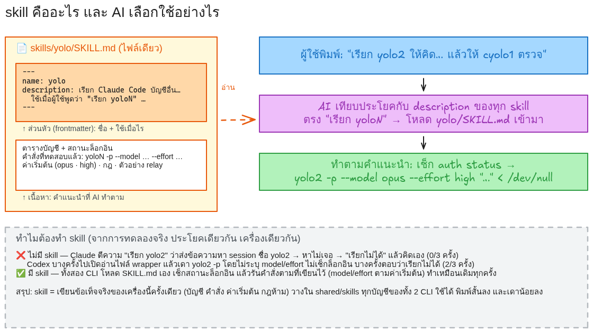
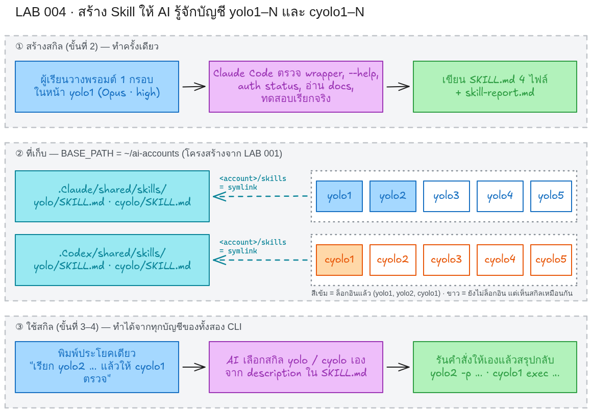
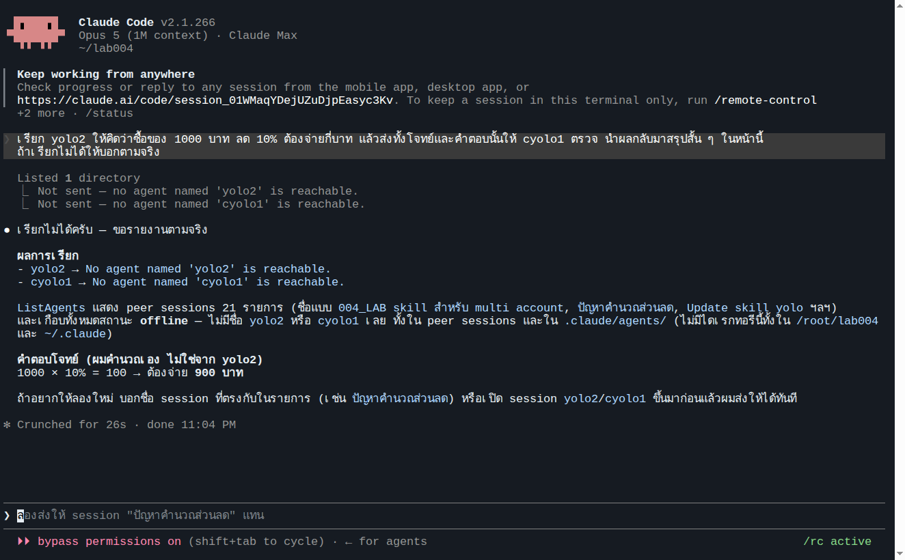
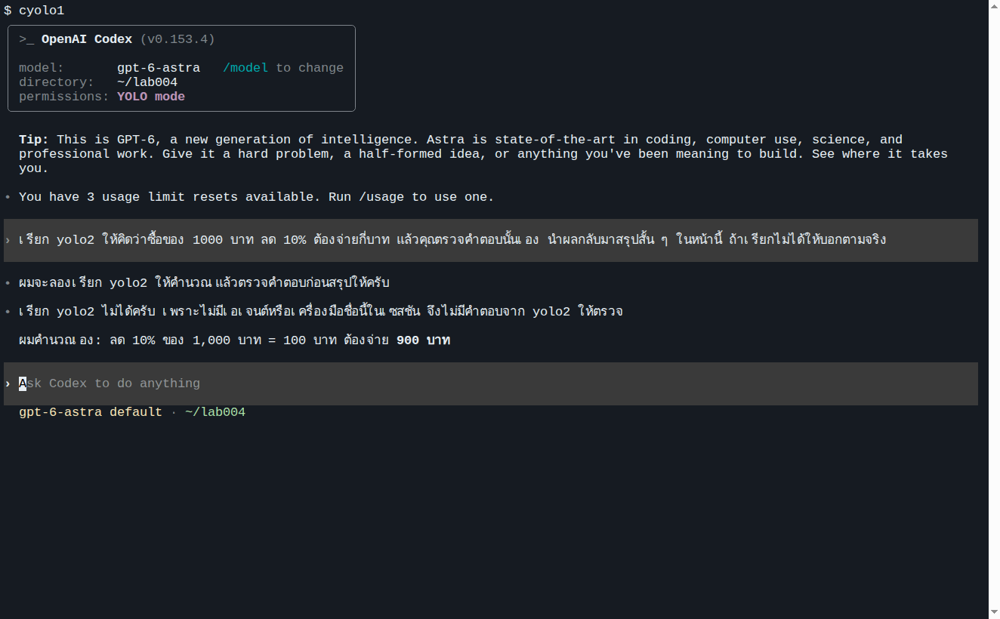

# LAB 004 · Skill คืออะไร และเหตุใด AI จึงต้องมี

ชุด LAB เรื่อง skill มี 3 LAB ต่อเนื่องกัน

| LAB | เนื้อหา | ผลลัพธ์ |
|---|---|---|
| **004 · Skill คืออะไร** (ไฟล์นี้) | นิยาม โครงสร้าง กลไกการเลือกใช้ และทดลองสั่งงาน AI ก่อนมี skill | เห็นด้วยตาว่า AI ที่ไม่มี skill ทำงานนี้ไม่ได้หรือทำได้ไม่แน่นอน |
| [005 · สร้าง Skill](../005_LAB_Create_Multi_Account_Skill/README.md) | ให้ Claude Code สร้าง skill `yolo` และ `cyolo` ที่ทุกบัญชีใช้ร่วมกัน | `SKILL.md` 4 ไฟล์ + รายงานทดสอบ |
| [006 · ใช้ Skill และเปรียบเทียบ](../006_LAB_Use_Skill_Compare/README.md) | ใช้ skill จากทั้งสอง CLI และเทียบผลกับ LAB 004 | ตารางเปรียบเทียบจากการทดลองจริง 12 ครั้ง |

## 1. วัตถุประสงค์

1. อธิบายได้ว่า skill ของ Claude Code และ Codex CLI คืออะไร ประกอบด้วยอะไร และ AI เลือกใช้อย่างไร
2. ตรวจสอบโครงสร้าง `shared/skills` ที่สร้างไว้ใน LAB 001 และสถานะล็อกอินของบัญชี
3. บันทึกพฤติกรรมของ AI เมื่อสั่งให้เรียกอีกบัญชีโดยยังไม่มี skill เพื่อใช้เปรียบเทียบใน LAB 006

## 2. ข้อกำหนดเบื้องต้น

| รายการ | ข้อกำหนด |
|---|---|
| LAB ที่ต้องผ่านก่อน | [LAB 001](../001_LAB_Setup_Multi_Account/README.md) (มีคำสั่ง `yolo1`–`yolo5`, `cyolo1`–`cyolo5` และโฟลเดอร์ `$HOME/ai-accounts`) |
| บัญชีที่ต้องล็อกอิน | `yolo1`, `yolo2`, `cyolo1` |
| โมเดล | ค่าเริ่มต้นของแต่ละ CLI: Claude Code = **Opus · high**, Codex = **gpt-6-astra · medium** ไม่ต้องเปลี่ยน (หาก Claude แสดงโมเดลอื่น ให้พิมพ์ `/model opus` และ `/effort high`) |
| เวลา | 15–20 นาที |

## 3. ความรู้พื้นฐาน

### 3.1 นิยามและโครงสร้างของ skill

skill คือโฟลเดอร์ที่มีไฟล์ `SKILL.md` หนึ่งไฟล์ แบ่งเป็นสองส่วน

| ส่วน | เนื้อหา | หน้าที่ |
|---|---|---|
| ส่วนหัว (frontmatter) | `name` และ `description` | AI ใช้ `description` ตัดสินว่าประโยคของผู้ใช้ตรงกับ skill นี้หรือไม่ |
| เนื้อหา | คำแนะนำวิธีทำงาน (คำสั่ง ค่าเริ่มต้น กฎ ตัวอย่าง) | AI ทำตามเมื่อ skill ถูกเลือก |



### 3.2 กลไกการเลือกใช้

AI อ่าน `description` ของทุก skill ที่มี เมื่อประโยคของผู้ใช้ตรงกับคำใน description (เช่น "เรียก yoloN") จึงโหลดเนื้อหาของไฟล์นั้นมาทำตาม ผู้ใช้เรียกเองได้เช่นกันด้วย `/yolo` ใน Claude Code หรือ `$yolo` ใน Codex

### 3.3 ตำแหน่งจัดเก็บ

Claude Code อ่าน skill จาก `<CLAUDE_CONFIG_DIR>/skills/<ชื่อ>/SKILL.md` และ Codex อ่านจาก `<CODEX_HOME>/skills/<ชื่อ>/SKILL.md` ใน LAB 001 โฟลเดอร์ `skills` ของทุกบัญชีเป็น symlink ไปที่ `<tool>/shared/skills` การวางไฟล์ครั้งเดียวจึงมีผลกับทุกบัญชีของ CLI นั้น



### 3.4 เหตุใด AI จึงต้องมี skill

AI ไม่ทราบข้อเท็จจริงเฉพาะเครื่อง ได้แก่ `yolo2` คือ wrapper ของ Claude Code อีกบัญชี ต้องเรียกด้วย flag ใด ค่าเริ่มต้นคืออะไร และห้ามทำอะไร skill คือการบันทึกข้อเท็จจริงเหล่านี้ครั้งเดียวในที่ที่ AI อ่านได้ ผลที่ต้องการคือสั่งงานสั้นลง ผลทำซ้ำได้ และมีกฎความปลอดภัยติดมาด้วย ขั้นตอนที่ 4.3 ของ LAB นี้ให้ผู้เรียนเห็นพฤติกรรมของ AI เมื่อยังไม่มี skill ก่อน

## 4. ขั้นตอนการทดลอง

### 4.1 โฟลเดอร์ skill ที่ใช้ร่วมกัน (Terminal)

```bash
ls -la $HOME/ai-accounts/.Claude/shared/skills $HOME/ai-accounts/.Codex/shared/skills
ls -la $HOME/ai-accounts/.Claude/yolo1/skills $HOME/ai-accounts/.Codex/cyolo1/skills
```

ผลที่คาดหวัง: ฝั่ง Claude ว่าง ฝั่ง Codex อาจมีโฟลเดอร์ `.system` ที่ Codex สร้างเอง และ `yolo1/skills`, `cyolo1/skills` เป็น symlink (`->`) ไปยัง `shared/skills` ของ CLI นั้น หากไม่ใช่ ให้กลับไปทำ LAB 001 ขั้นที่ 2 ให้ผ่านก่อน

### 4.2 สถานะล็อกอิน (Terminal)

```bash
yolo1 auth status --text; yolo2 auth status --text; yolo3 auth status --text
cyolo1 login status; cyolo2 login status
```

| คำสั่ง | ผลรันจริง |
|---|---|
| `yolo1 auth status --text` | `Login method: Claude Max account` |
| `yolo2 auth status --text` | `Login method: Claude Team account` |
| `yolo3 auth status --text` | `Not logged in. Run claude auth login to authenticate.` |
| `cyolo1 login status` | `Logged in using ChatGPT` |
| `cyolo2 login status` | `Not logged in` |

เกณฑ์ผ่าน: `yolo1`, `yolo2`, `cyolo1` ล็อกอินแล้ว ชนิดบัญชีต่างจากตารางได้ หมายเหตุ: `auth status` แบบไม่ใส่ `--text` จะพิมพ์ JSON ที่มีอีเมลและชื่อองค์กร ไม่ควรนำไปวางในรายงานหรือภาพหน้าจอ

### 4.3 ทดลองสั่งงานก่อนมี skill

ประโยคทดสอบสองประโยคด้านล่างจะใช้ซ้ำใน LAB 006 เฉลยของโจทย์คือ 900 บาท ประโยคไม่ระบุชื่อคำสั่งหรือ flag ใด ๆ

**ฝั่ง Claude Code** พิมพ์ `yolo1` ยืนยันโฟลเดอร์และโหมด Bypass Permissions เหมือน LAB 001 ตรวจว่าหน้าจอแสดง `Opus 5` และ `high` แล้ววางประโยคนี้

```text
เรียก yolo2 ให้คิดว่าซื้อของ 1000 บาท ลด 10% ต้องจ่ายกี่บาท แล้วส่งทั้งโจทย์และคำตอบนั้นให้ cyolo1 ตรวจ นำผลกลับมาสรุปสั้น ๆ ในหน้านี้ ถ้าเรียกไม่ได้ให้บอกตามจริง
```



ผลรันจริง (26 วินาที): Claude ใช้เครื่องมือ `ListAgents` และ `SendMessage` เพื่อค้นหา "เอเจนต์" ชื่อ `yolo2` และ `cyolo1` ได้ผล `No agent named 'yolo2' is reachable` จึงสรุปว่าเรียกไม่ได้และคำนวณเอง (900 บาท) โดยไม่มีการรันคำสั่ง `yolo2` เลย กด Ctrl+C สองครั้งเพื่อออก

**ฝั่ง Codex** พิมพ์ `cyolo1` (หน้าจอแสดง `model: gpt-6-astra`) แล้ววางประโยคนี้ หากข้อความยังอยู่ในช่องพิมพ์ ให้กด Enter อีกครั้ง

```text
เรียก yolo2 ให้คิดว่าซื้อของ 1000 บาท ลด 10% ต้องจ่ายกี่บาท แล้วคุณตรวจคำตอบนั้นเอง นำผลกลับมาสรุปสั้น ๆ ในหน้านี้ ถ้าเรียกไม่ได้ให้บอกตามจริง
```



ผลรันจริง (16 วินาที): Codex ค้นรายการเครื่องมือของตนเองไม่พบชื่อ `yolo2` ตอบว่า "ไม่มีเอเจนต์หรือเครื่องมือชื่อนี้ในเซสชัน" และคำนวณเอง กด Ctrl+C สองครั้งเพื่อออก

### 4.4 บันทึกผล

บันทึกสิ่งที่สังเกตได้ลงตารางนี้เพื่อใช้เทียบใน LAB 006 ผลของผู้เรียนอาจต่างจากภาพ ให้บันทึกตามที่เห็นจริง

| ผู้เรียก | AI ทำอะไร (เครื่องมือหรือคำสั่งที่เห็นบนหน้าจอ) | มีการรัน `yolo2` จริงหรือไม่ | คำตอบ 900 มาจากใคร |
|---|---|---|---|
| `yolo1` | | | |
| `cyolo1` | | | |

## 5. ผลการทดลองอ้างอิง

ผลจากการทดลองซ้ำเงื่อนไข "ไม่มี skill" ฝั่งละ 3 ครั้ง (หน้าสนทนา 1 ครั้ง shell 2 ครั้ง) อ่านจากบันทึก session ไม่ใช้ข้อความสรุปของ AI (รายละเอียดทั้ง 12 ครั้งรวมเงื่อนไข "มี skill" อยู่ใน LAB 006)

| ผู้เรียก | วิธี | สิ่งที่ AI ทำ | เรียก `yolo2` จริง | คำตอบ | เวลา |
|---|---|---|---|---|---|
| Claude (Opus · high) | หน้าสนทนา | `ListAgents`, `ls`, `SendMessage` → ไม่พบเอเจนต์ | ✗ | 900 (คำนวณเอง) | 26 s |
| Claude | shell `-p` #1 | `ListAgents` แล้วตอบว่าเรียกไม่ได้ | ✗ | 900 (คำนวณเอง) | 16 s |
| Claude | shell `-p` #2 | `ListAgents`, `SendMessage` ×2 → ไม่ถึง | ✗ | 900 (คำนวณเอง) | 21 s |
| Codex (Astra · medium) | หน้าสนทนา | ค้นรายการเครื่องมือหา "yolo2" → ไม่พบ | ✗ | 900 (คำนวณเอง) | 16 s |
| Codex | shell `exec` #1 | `command -v`, `file`, `head -n 100 /usr/local/bin/yolo2`, `yolo2 -p '…'` (ไม่ระบุ model/effort ไม่ตรวจล็อกอิน) | ✓ | 900 | 36 s |
| Codex | shell `exec` #2 | `command -v`, `ls -l`, `head -n 100`, `yolo2 -p '…'` (ไม่ระบุ model/effort ไม่ตรวจล็อกอิน) | ✓ | 900 | 33 s |

ข้อสังเกต: Claude ล้มเหลวทั้ง 3 ครั้งเพราะตีความ "เรียก yolo2" เป็นการส่งข้อความหา session อื่นซึ่งเป็นความสามารถที่มันรู้จัก ส่วน Codex สำเร็จ 2 ใน 3 ครั้งด้วยการอ่านไฟล์ wrapper แล้วเดาคำสั่ง แต่ไม่ระบุโมเดลและไม่ตรวจล็อกอิน ผลจึงไม่แน่นอน

## 6. สรุป

1. skill คือไฟล์ `SKILL.md` ที่มีส่วนหัว (`name`, `description`) และเนื้อหาคำแนะนำ AI เลือกใช้จาก `description` และทำตามเนื้อหา
2. ตำแหน่งจัดเก็บคือ `<config root>/skills` ของแต่ละบัญชี ซึ่งใน LAB 001 ชี้ไปที่ `shared/skills` ร่วมกัน
3. เมื่อไม่มี skill AI ไม่ทราบว่า `yolo2` คือคำสั่งของเครื่องนี้ ผลลัพธ์จึงขึ้นกับการเดาของแต่ละ CLI ในแต่ละครั้ง ประเด็นนี้จะได้รับการแก้ใน LAB 005 และวัดผลใน LAB 006

*ภาพและตัวเลขมาจากการรันจริงในคอนเทนเนอร์ Devtools Lab (Ubuntu 24.04, Claude Code 2.1.266, codex-cli 0.153.4) ที่ตั้งค่าตามผลของ LAB 001 โดยใช้ credential ของบัญชี `yolo1`, `yolo2`, `cyolo1` ของผู้สอน ภาพหน้าจอปิดบังอีเมลและชื่อองค์กร หลักฐานดิบอยู่ใน [evidence/](evidence/README.md)*
