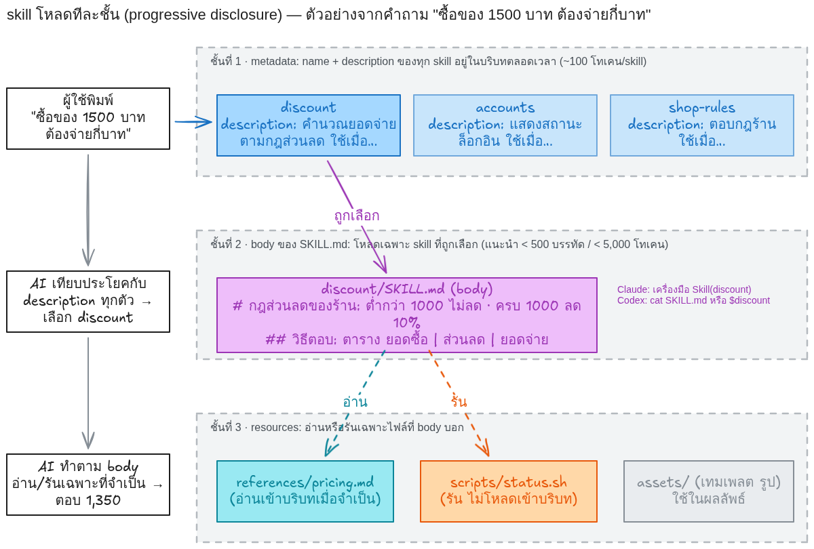
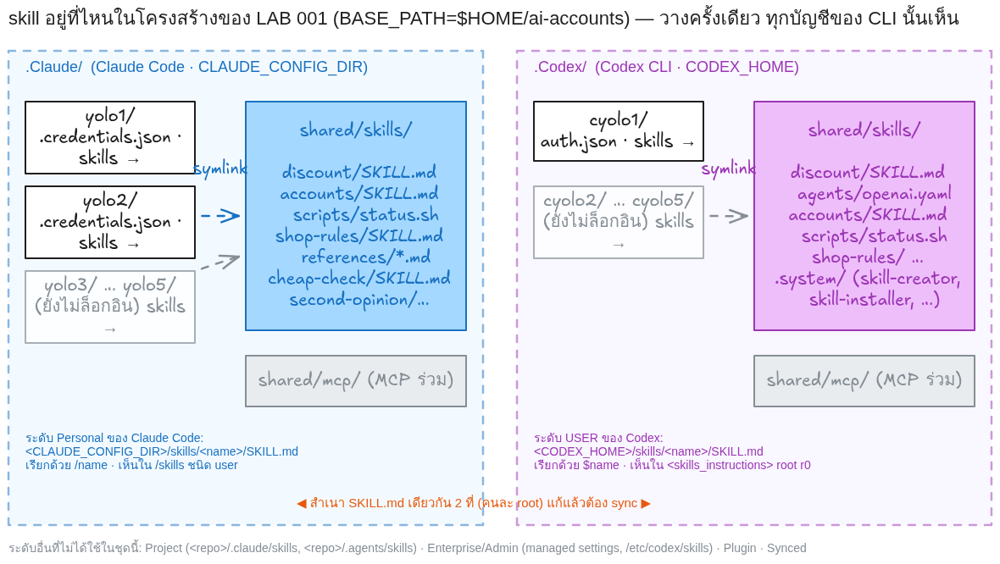
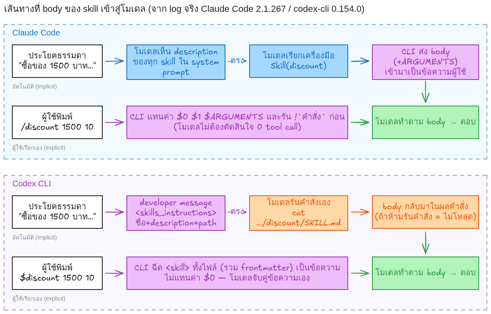

# Skill_LAB 000 · ทฤษฎี: Skill ของ Claude Code และ Codex CLI

เอกสารนี้คือ **ภาคทฤษฎี** ของชุดบทเรียน Skill_LAB 001–007 อ่านให้จบก่อนลงมือทำ LAB แต่ละหัวข้อจะบอกว่าไปฝึกจริงใน LAB ไหน
ตัวเลขและพฤติกรรมทุกอย่างในเอกสารนี้มาจาก official docs ของแต่ละ CLI (อ้างอิงท้ายเอกสาร) และจากการรันจริงในคอนเทนเนอร์ทดลองของชุดบทเรียนนี้ (ระบุที่มาไว้ทุกจุด)

ก่อนหน้านี้ผู้เรียนได้ **ใช้** skill ไปแล้วใน [LAB 004](../004_LAB_Multi_Account_Skill/README.md) (ให้ AI สร้าง skill `yolo` และ `cyolo`) ชุดนี้จะย้อนกลับไปทำความเข้าใจตั้งแต่ไฟล์เดียว แล้วค่อย ๆ เพิ่มความสามารถทีละอย่างจนสร้าง skill ที่ประสานหลายบัญชีได้เอง

## สารบัญ

1. [ทำไมต้องมี skill](#1-ทำไมต้องมี-skill)
2. [นิยามและกายวิภาคของ skill](#2-นิยามและกายวิภาคของ-skill)
3. [Progressive disclosure: โหลดทีละชั้น](#3-progressive-disclosure-โหลดทีละชั้น)
4. [กลไกการเลือกใช้ (invocation)](#4-กลไกการเลือกใช้-invocation)
5. [ตำแหน่งจัดเก็บและลำดับความสำคัญ](#5-ตำแหน่งจัดเก็บและลำดับความสำคัญ)
6. [วงจรชีวิตของ skill ในบริบทสนทนา](#6-วงจรชีวิตของ-skill-ในบริบทสนทนา)
7. [อาร์กิวเมนต์และตัวแปรแทนค่า](#7-อาร์กิวเมนต์และตัวแปรแทนค่า)
8. [บริบทสด: ฝังผลคำสั่งลงใน skill](#8-บริบทสด-ฝังผลคำสั่งลงใน-skill)
9. [สิทธิ์เครื่องมือของ skill](#9-สิทธิ์เครื่องมือของ-skill)
10. [บริบทแยกและการเปลี่ยนโมเดล](#10-บริบทแยกและการเปลี่ยนโมเดล)
11. [ตารางเทียบ Claude Code กับ Codex CLI](#11-ตารางเทียบ-claude-code-กับ-codex-cli)
12. [หลักการออกแบบ skill ที่ดี](#12-หลักการออกแบบ-skill-ที่ดี)
13. [ความปลอดภัย](#13-ความปลอดภัย)
14. [เครื่องมือช่วยตรวจและสร้าง skill](#14-เครื่องมือช่วยตรวจและสร้าง-skill)
15. [skill เทียบกับกลไกอื่น (CLAUDE.md, AGENTS.md, subagent, MCP, hooks)](#15-skill-เทียบกับกลไกอื่น)
16. [แผนที่ชุดบทเรียน Skill_LAB 001–007](#16-แผนที่ชุดบทเรียน-skill_lab-001007)
17. [อ้างอิง](#17-อ้างอิง)

---

## 1. ทำไมต้องมี skill

โมเดลภาษาเก่งเรื่องทั่วไป แต่ **ไม่รู้ข้อเท็จจริงเฉพาะที่** ของเครื่อง ทีม หรือธุรกิจของเรา เช่น

- ร้านของเราลดราคาเมื่อไร (กฎธุรกิจ)
- คำสั่ง `yolo2` บนเครื่องนี้คืออะไร ต้องเรียกด้วย flag ไหน (ข้อเท็จจริงของเครื่อง)
- รายงานต้องมีรูปแบบอย่างไร ห้ามทำอะไร (ข้อตกลงของทีม)

ถ้าไม่บอก AI จะ **เดา** และแต่ละครั้งเดาไม่เหมือนกัน ผลจากการรันจริงในชุดบทเรียนนี้ (Skill_LAB 001 ก่อนมี skill, `evidence/lab001/noskill-*`):

| ถาม "ซื้อของ 1500 บาท ต้องจ่ายกี่บาท" | คำตอบ |
|---|---|
| Claude Code (Opus · high) ครั้งที่ 1 | "ถ้ารวม VAT 7% → **1,605 บาท**" |
| Claude Code ครั้งที่ 2 | "ถ้ายังไม่รวม VAT → 1,605 / ถ้ารวมแล้ว → 1,500" |
| Codex (gpt-6-astra · medium) 2 ครั้ง | "ต้องจ่าย 1,500 บาท" |
| **คำตอบตามกฎร้าน** (ลด 10% เมื่อครบ 1000) | **1,350 บาท** |

ไม่มีใครตอบ 1,350 เพราะไม่มีใครรู้กฎ และ Claude ถึงกับสมมติเรื่องภาษีขึ้นมาเอง

วิธีแก้แบบเดิมคือพิมพ์กฎซ้ำทุกครั้งในพรอมต์ (LAB 003 ทำแบบนี้: ผู้เรียนต้องพิมพ์ชื่อคำสั่ง `yolo1 -p` เอง) ปัญหาคือ

1. ลืมพิมพ์ = ผลผิด และแต่ละคนพิมพ์ไม่เหมือนกัน
2. ความรู้ยาว ๆ กินพื้นที่บริบท (context) ทุกครั้งแม้ไม่ได้ใช้
3. แก้กฎแล้วต้องไล่แก้ทุกพรอมต์

**skill** คือการเขียนความรู้นั้นลงไฟล์ครั้งเดียว ให้ AI **เลือกหยิบมาใช้เองเมื่อเกี่ยวข้อง** และแก้ที่เดียวมีผลทุกที่ ใน LAB 004 ผลวัดจริงคือ ประโยคเดียวกัน ไม่มี skill เรียกบัญชีอื่นได้ 2/6 ครั้ง มี skill เรียกได้ 6/6 พร้อมตรวจล็อกอินและระบุโมเดลถูกต้องทุกครั้ง

> **ฝึกใน LAB 001**: สร้าง skill แรกด้วยมือ แล้วเห็นคำตอบเปลี่ยนจาก 1,605/1,500 เป็น 1,350 ด้วยประโยคถามเดิม

## 2. นิยามและกายวิภาคของ skill

**skill = โฟลเดอร์หนึ่งโฟลเดอร์ที่มีไฟล์ `SKILL.md`** ทั้ง Claude Code และ Codex ใช้มาตรฐานเปิดเดียวกันชื่อ [Agent Skills](https://agentskills.io/specification) จึงเขียนไฟล์เดียวใช้ได้ทั้งสอง CLI (ส่วนที่ต่างกันดูหัวข้อ 11)

```text
discount/                      ← ชื่อโฟลเดอร์ = ชื่อ skill
├── SKILL.md                   ← บังคับ: frontmatter + คำแนะนำ
├── scripts/                   ← ทางเลือก: สคริปต์ที่ให้ AI "รัน" (ไม่ต้องอ่านเข้าบริบท)
├── references/                ← ทางเลือก: เอกสารที่ให้ AI "อ่านเมื่อจำเป็น"
├── assets/                    ← ทางเลือก: เทมเพลต รูป ไฟล์ตั้งต้นที่ใช้ในผลลัพธ์
└── agents/openai.yaml         ← ทางเลือก (Codex เท่านั้น): ชื่อที่แสดง ไอคอน นโยบายการเรียก
```

`SKILL.md` มีสองส่วน

```markdown
---
name: discount
description: คำนวณยอดจ่ายของร้านค้าตามกฎส่วนลดของร้าน ใช้เมื่อผู้ใช้ถามว่าซื้อของ X บาทต้องจ่ายเท่าไร ได้ส่วนลดไหม ยอดเท่าไรถึงได้ลด หรือขอตารางยอดจ่าย
---

# กฎส่วนลดของร้าน

- ยอดซื้อต่ำกว่า 1000 บาท: ไม่มีส่วนลด
- ยอดซื้อตั้งแต่ 1000 บาทขึ้นไป: ลด 10% ของยอดซื้อทั้งหมด
...
```

| ส่วน | อยู่ตรงไหน | ใครอ่าน เมื่อไร | หน้าที่ |
|---|---|---|---|
| **frontmatter** (YAML ระหว่าง `---` สองบรรทัด) | บรรทัดแรกของไฟล์ **ต้องเป็น `---`** | AI เห็น `name` + `description` **ตลอดเวลา** ทุก skill | ให้ AI ตัดสินว่าประโยคของผู้ใช้เกี่ยวกับ skill นี้หรือไม่ |
| **body** (Markdown หลัง frontmatter) | ที่เหลือทั้งไฟล์ | โหลดเข้าบริบท **เฉพาะเมื่อ skill ถูกเลือก** | คำแนะนำ กฎ ขั้นตอน ตัวอย่าง ที่ AI ทำตาม |

### ฟิลด์ใน frontmatter

ฟิลด์ตามมาตรฐาน Agent Skills (ใช้ได้ทั้งสอง CLI):

| ฟิลด์ | บังคับ? | กติกา |
|---|---|---|
| `name` | Codex: บังคับ · Claude: ไม่บังคับ (ใช้ชื่อโฟลเดอร์) | 1–64 ตัวอักษร ตัวพิมพ์เล็ก ตัวเลข และ `-` เท่านั้น ห้ามขึ้นต้น/ลงท้ายด้วย `-` ห้าม `--` และควรตรงกับชื่อโฟลเดอร์ |
| `description` | Codex: บังคับ · Claude: แนะนำอย่างยิ่ง | 1–1,024 ตัวอักษร บอกว่า **ทำอะไร** และ **ใช้เมื่อไร** ใส่คำที่ผู้ใช้น่าจะพิมพ์ |
| `license`, `compatibility`, `metadata` | ไม่ | ข้อมูลประกอบ AI ไม่ใช้ตัดสินใจ |
| `allowed-tools` | ไม่ | เครื่องมือที่อนุญาตล่วงหน้า (ทดลอง; Claude รองรับ Codex ไม่ใช้) |

ฟิลด์ที่ **Claude Code เพิ่มเอง** (Codex มองข้าม และถ้าอัปโหลดไป claude.ai หรือ package เป็น plugin จะถูกปฏิเสธ):

| ฟิลด์ | ค่าเริ่มต้น | ความหมาย | ฝึกใน |
|---|---|---|---|
| `when_to_use` | ไม่มี | ข้อความเพิ่มต่อท้าย `description` สำหรับการเลือกอัตโนมัติ | LAB 002 |
| `disable-model-invocation` | `false` | `true` = AI เรียกเองไม่ได้ ผู้ใช้พิมพ์ `/name` ได้อย่างเดียว และ description **ไม่ถูกใส่ในบริบท** | LAB 002 |
| `user-invocable` | `true` | `false` = ซ่อนจากเมนู `/` ผู้ใช้เรียกเองไม่ได้ AI เรียกได้ | LAB 002 |
| `argument-hint` | ไม่มี | คำใบ้ตอน autocomplete เช่น `[ยอดซื้อ] [อัตรา]` | LAB 003 |
| `arguments` | ไม่มี | ชื่ออาร์กิวเมนต์ตามตำแหน่ง เช่น `[amount, rate]` → ใช้ `$amount` `$rate` ใน body | LAB 003 |
| `allowed-tools` / `disallowed-tools` | ไม่มี | เครื่องมือที่อนุญาต/ตัดออก **เฉพาะรอบ (turn) ที่ skill ถูกเรียก** | LAB 004 |
| `shell` | `bash` | shell สำหรับคำสั่งฝัง (`bash` หรือ `powershell`) | LAB 004 |
| `paths` | ไม่มี | glob ของไฟล์ที่ต้องกำลังทำงานด้วย skill จึงจะถูกโหลดอัตโนมัติ เช่น `src/**/*.py` | ทฤษฎี |
| `context` | ไม่มี | `fork` = รันในบริบทแยก (subagent) | LAB 006 |
| `agent` | `general-purpose` | ชนิด subagent เมื่อ `context: fork` (`Explore`, `Plan`, หรือ agent ที่กำหนดเอง) | LAB 006 |
| `background` | `true` | เมื่อ fork ให้รันเบื้องหลัง; `false` = รอผลในรอบเดียวกัน | LAB 006 |
| `model`, `effort` | สืบทอดจาก session | บังคับโมเดล/ระดับ effort ขณะ skill ทำงาน | LAB 006 |
| `hooks` | ไม่มี | ลงทะเบียน hook เมื่อ skill ถูกเรียก และคงอยู่ตลอด session | ทฤษฎี |

ค่า boolean รับ `true/false/yes/no/on/off/1/0` (Claude Code 2.1.218 ขึ้นไป)

ฝั่ง **Codex** มีไฟล์เสริม `agents/openai.yaml` (ไม่บังคับ):

```yaml
interface:
  display_name: "Discount"            # ชื่อที่แสดงในเมนู
  short_description: "คำนวณยอดจ่ายตามกฎส่วนลดของร้าน"
  default_prompt: "..."               # ข้อความที่แนะนำให้พิมพ์คู่กับ skill
policy:
  allow_implicit_invocation: false    # false = ห้าม Codex เลือกเองจาก description ต้องพิมพ์ $discount
```

### สิ่งที่มักผิดตั้งแต่ไฟล์แรก

- **`---` ไม่ได้อยู่บรรทัดแรก** (เช่น ใส่หัวข้อ `# ...` ไว้ก่อน) Claude Code จะถือทั้งไฟล์เป็น body และเอา **ย่อหน้าแรก** มาเป็น description แทน ส่วน Codex จะ **ไม่เห็น skill นั้นเลย** (ผลรันจริงใน LAB 001 ขั้นที่ 5)
- ชื่อโฟลเดอร์กับ `name` ไม่ตรงกัน หรือใช้ตัวพิมพ์ใหญ่/ช่องว่าง
- ใส่ **เฉลย** ไว้ใน description (เช่น "ลด 10% เมื่อครบ 1000") ทำให้ AI ตอบได้โดยไม่โหลด body จึงไม่ทำตามรูปแบบที่ body สั่ง และวัดไม่ได้ว่า skill ถูกใช้จริงหรือไม่ (ผลรันจริง LAB 002 กล่องข้าง "description รั่วเฉลย")

## 3. Progressive disclosure: โหลดทีละชั้น

skill ถูกออกแบบให้ **ประหยัดบริบท** โดยเปิดเผยข้อมูลเป็น 3 ชั้น



| ชั้น | อะไรถูกโหลด | เมื่อไร | ขนาดที่ควรเป็น |
|---|---|---|---|
| 1 · Metadata | `name` + `description` ของ **ทุก** skill | ตอนเริ่ม session ตลอดเวลา | ~100 โทเคนต่อ skill |
| 2 · Instructions | body ทั้งไฟล์ `SKILL.md` ของ skill ที่ถูกเลือก | เมื่อ skill ถูกเลือก/เรียก | < 500 บรรทัด, < 5,000 โทเคน (แนะนำ) |
| 3 · Resources | ไฟล์ใน `references/`, `scripts/`, `assets/` | เมื่อ body บอกให้อ่าน/รัน | อ่านเฉพาะไฟล์ที่เกี่ยว |

ตัวเลขจำกัดที่แต่ละ CLI ใช้จริง (จาก docs):

- **Claude Code**: `description` + `when_to_use` รวมกันถูกตัดที่ **1,536 ตัวอักษร** ในรายการ skill (จึงควรเอาประโยคสำคัญไว้ต้น) หลัง compaction จะแนบ skill ที่เรียกล่าสุดกลับมาไม่เกิน **5,000 โทเคนต่อ skill** และรวมกันไม่เกิน **25,000 โทเคน**
- **Codex**: รายการ name + description ของทุก skill รวมกันไม่เกิน **8,000 ตัวอักษร หรือ 2% ของ context window** (แล้วแต่ค่าไหนถึงก่อน) skill ที่เกินโควตาจะไม่ถูกแสดงให้โมเดล

ผลเชิงปฏิบัติ: **ยิ่งมี skill มาก ยิ่งต้องเขียน description ให้สั้นและตรง** และ **body ยาว ๆ ควรแตกเป็น references/** เพื่อให้โหลดเฉพาะส่วนที่ใช้ ไฟล์อ้างอิงควรลึกแค่ชั้นเดียวจาก `SKILL.md` (ไม่ให้ references อ้าง references ต่อกันเป็นโซ่)

> **ฝึกใน LAB 005**: แตกกฎร้านเป็น 3 ไฟล์ แล้วดูจาก session log ว่า AI อ่านเฉพาะไฟล์ที่ตรงคำถาม และวัดโทเคนเทียบกับไฟล์เดียวใหญ่

## 4. กลไกการเลือกใช้ (invocation)

มี 3 ทางที่ skill จะเข้ามาทำงาน

| ทาง | Claude Code | Codex CLI | ใครตัดสินใจ |
|---|---|---|---|
| **อัตโนมัติ (implicit)** | AI อ่าน description ของทุก skill แล้วเรียก `Skill(name)` เองเมื่อเห็นว่าตรง | Codex เห็นรายการ skill ในข้อความระบบ `<skills_instructions>` แล้วเปิดอ่านไฟล์เองเมื่อเห็นว่าตรง | โมเดล |
| **ผู้ใช้เรียกเอง (explicit)** | พิมพ์ `/discount ...` | พิมพ์ `$discount ...` (หรือ `/skills` → เลือก) | ผู้ใช้ |
| **โปรแกรมเรียก** | `claude -p "/discount 1500"` หรือใน skill อื่นผ่านเครื่องมือ `Skill` | `codex exec '$discount 1500'` | สคริปต์/skill อื่น |

สวิตช์ควบคุมว่าใครเรียกได้บ้าง:

| ต้องการ | Claude Code | Codex |
|---|---|---|
| ค่าเริ่มต้น: ทั้ง AI และผู้ใช้เรียกได้ | (ไม่ต้องใส่อะไร) | (ไม่ต้องใส่อะไร) |
| ให้ผู้ใช้เรียกเองเท่านั้น (งานที่มีผลข้างเคียง เช่น deploy, ส่งข้อความ) | `disable-model-invocation: true` — description หายจากบริบทของ AI ด้วย | `agents/openai.yaml` → `policy.allow_implicit_invocation: false` |
| ให้ AI เรียกเองเท่านั้น (ความรู้พื้นหลัง ไม่ใช่คำสั่ง) | `user-invocable: false` — ซ่อนจากเมนู `/` | ไม่มี |
| โหลดเฉพาะเมื่อทำงานกับไฟล์บางชนิด | `paths: "**/*.sql"` | ไม่มี |

Claude Code ยังเรียกหลาย skill ซ้อนกันในบรรทัดเดียวได้ (`/write-tests /fix-issue 123`, เวอร์ชัน 2.1.199 ขึ้นไป) ข้อความท้ายสุดถูกส่งเป็น `$ARGUMENTS` ให้ทุก skill

**สิ่งที่ตัดสินการเลือกอัตโนมัติคือ description เท่านั้น** AI ไม่ได้อ่าน body ก่อนตัดสินใจ ดังนั้น description ที่ดีต้องมี (1) กริยาบอกว่าทำอะไร (2) วลีที่ผู้ใช้น่าจะพิมพ์ (3) ขอบเขตว่าไม่ใช้เมื่อไร ถ้าเขียนว่า "ช่วยเรื่องราคา" AI จะเลือกไม่ตรง (วัดจริงใน LAB 002)

> **ฝึกใน LAB 002**: เขียน description 3 แบบ วัดอัตราถูกเลือกด้วยประโยคเดียวกัน 2 CLI แล้วลองสวิตช์ทั้ง 3 ตัว

## 5. ตำแหน่งจัดเก็บและลำดับความสำคัญ

### Claude Code (ค้นหาจากบนลงล่าง ชื่อซ้ำกันตัวบนชนะ)

| ระดับ | ตำแหน่ง | มีผลกับ |
|---|---|---|
| 1 Enterprise | `.claude/skills/<name>/SKILL.md` ใน managed settings | ทุกคนในองค์กร |
| 2 Personal | `~/.claude/skills/<name>/SKILL.md` — **ถ้าตั้ง `CLAUDE_CONFIG_DIR` จะกลายเป็น `<CLAUDE_CONFIG_DIR>/skills/`** | ทุกโปรเจกต์บนเครื่อง (ของบัญชีนั้น) |
| 3 Project | `.claude/skills/<name>/SKILL.md` ที่ root ของ repo | session ใน repo นี้ (แชร์ผ่าน git ได้) |
| 4 Nested | `<subdir>/.claude/skills/...` | เมื่อทำงานกับไฟล์ใต้ `<subdir>` (ชื่อจะเป็น `/subdir:name`) |
| 5 Additional dir / Plugin | โฟลเดอร์ที่ให้ด้วย `--add-dir`, หรือ `<plugin>/skills/` (`/plugin:name`) | session นั้น |
| 6 Synced | `~/.claude/skills/synced/` (ห้ามตั้งชื่อโฟลเดอร์ว่า `synced`) | ซิงก์จาก claude.ai |

ไฟล์เก่าแบบ `.claude/commands/deploy.md` ยังใช้ได้ (เป็น `/deploy`) แต่ skill ชนะเมื่อชื่อซ้ำ และ skill รองรับไฟล์ประกอบ/frontmatter มากกว่า จึงควรใช้ skill กับงานใหม่

### Codex CLI (ค้นหาจากบนลงล่าง)

| ระดับ | ตำแหน่ง | หมายเหตุ |
|---|---|---|
| REPO | `$CWD/.agents/skills`, `$CWD/../.agents/skills`, `$REPO_ROOT/.agents/skills` | แชร์ผ่าน git |
| USER | `$HOME/.agents/skills` และ **`$CODEX_HOME/skills`** (ค่าเริ่มต้น `~/.codex/skills`) | ผลรันจริง: Codex 0.154 แสดง root `r0 = <CODEX_HOME>/skills` ในข้อความระบบ |
| ADMIN | `/etc/codex/skills` | ทั้งเครื่อง |
| SYSTEM | ติดมากับ CLI (`<CODEX_HOME>/skills/.system/`: `skill-creator`, `skill-installer`, `openai-docs`, `imagegen`, `plugin-creator`, `review-agent`) | แก้ไม่ได้ |

Codex ตาม symlink ของโฟลเดอร์ skill ได้ และ **ไม่รวม** skill ชื่อซ้ำ (จะเห็นทั้งสองตัวในเมนู) ปิด skill รายตัวได้ใน `config.toml`:

```toml
[[skills.config]]
path = "/path/to/skill/SKILL.md"
enabled = false
```

### โครงสร้างของ LAB 001 อยู่ระดับไหน



LAB 001 ตั้ง `CLAUDE_CONFIG_DIR=$BASE_PATH/.Claude/yoloN` และ `CODEX_HOME=$BASE_PATH/.Codex/cyoloN` แล้วทำ `<account>/skills` เป็น symlink ไป `<tool>/shared/skills` ดังนั้น skill ในชุดบทเรียนนี้อยู่ระดับ **Personal/USER** ของแต่ละบัญชี วางไฟล์ครั้งเดียวทุกบัญชีของ CLI นั้นเห็นทันที (ไม่ต้องเปิด CLI ใหม่ ทั้งสอง CLI สแกนไฟล์ทุกครั้งที่เริ่มรอบใหม่) แต่ **ต้องวางสำเนาสองที่** (ฝั่ง `.Claude` และ `.Codex`) เพราะสอง CLI อ่านคนละ root

> **ฝึกใน LAB 001** ขั้นที่ 2: วางไฟล์ แล้วตรวจด้วย `find` และ `ls -la <account>/skills`

## 6. วงจรชีวิตของ skill ในบริบทสนทนา

เข้าใจข้อนี้แล้วจะอ่าน session log และ debug ได้



**Claude Code**

1. เริ่ม session: รายการ `name`/`description` (ตัดที่ 1,536 ตัวอักษร) ถูกใส่ในบริบท
2. เมื่อถูกเรียก: body ที่ **แทนค่าอาร์กิวเมนต์และคำสั่งฝังแล้ว** ถูกส่งเข้าบริบทเป็นข้อความเดียว (เห็นใน log เป็น `Skill(discount)` แล้วตามด้วยเนื้อหา)
3. เนื้อหานั้น **คงอยู่** ในบริบทรอบถัด ๆ ไป Claude Code **ไม่อ่านไฟล์ซ้ำ** ถ้าแก้ไฟล์ระหว่าง session ต้องเรียก skill ใหม่
4. เรียกซ้ำด้วยเนื้อหาเดิม → บันทึกว่า "โหลดแล้ว" ไม่ส่งซ้ำ; ถ้าอาร์กิวเมนต์หรือผลคำสั่งฝังเปลี่ยน → ส่งเนื้อหาเต็มอีกครั้ง
5. หลัง compaction: แนบการเรียกล่าสุดของแต่ละ skill กลับมา (5,000 โทเคนต่อ skill รวม 25,000) ถ้า skill ดูเหมือนหยุดทำงานหลัง compaction ให้เรียกใหม่

**Codex CLI** (ผลสังเกตจาก rollout จริงของ codex-cli 0.154.0 ใน LAB 001–002)

1. เริ่ม turn: Codex ฉีดข้อความ developer `<skills_instructions>` ที่มี "skill roots" และรายการ `name: description` ของทุก skill
2. ผู้ใช้พิมพ์ `$discount ...`: Codex ฉีด **เนื้อหา SKILL.md ทั้งไฟล์** เข้ามาเป็นส่วนหนึ่งของข้อความผู้ใช้ (ไม่ต้องรันคำสั่งอ่านไฟล์)
3. การเลือกอัตโนมัติ: โมเดลต้อง **เปิดอ่านไฟล์เอง** ด้วยเครื่องมือ (เช่น `cat .../SKILL.md`) จึงเห็นการอ่านใน log; ถ้า description บอกคำตอบพออยู่แล้ว โมเดลอาจตอบเลยโดยไม่อ่าน body
4. Codex ตรวจโฟลเดอร์ skill ใหม่ทุก turn จึงเพิ่มไฟล์แล้วใช้ได้ทันที (ยกเว้นแก้ `config.toml` ต้องเปิดใหม่)

## 7. อาร์กิวเมนต์และตัวแปรแทนค่า

**Claude Code เท่านั้น** (Codex ไม่มีการแทนค่า ข้อความหลัง `$skill` เป็นแค่ข้อความผู้ใช้ตามปกติ)

| ตัวแปร | ขยายเป็น | ตัวอย่าง `/discount 1500 10` |
|---|---|---|
| `$ARGUMENTS` | ข้อความทั้งหมดหลังชื่อ skill | `1500 10` |
| `$0`, `$1`, … หรือ `$ARGUMENTS[0]` | อาร์กิวเมนต์ตามตำแหน่ง (แยกด้วยช่องว่าง รองรับ `"..."`) | `$0`=`1500`, `$1`=`10` |
| `$amount`, `$rate` (ประกาศ `arguments: [amount, rate]`) | อาร์กิวเมนต์ตามชื่อ | `$amount`=`1500` |
| `${CLAUDE_SKILL_DIR}` | โฟลเดอร์ที่มี `SKILL.md` นี้ | ใช้ชี้ `scripts/` ของ skill |
| `${CLAUDE_PROJECT_DIR}` | root ของโปรเจกต์ | |
| `${CLAUDE_SESSION_ID}`, `${CLAUDE_EFFORT}` | id ของ session, ระดับ effort ปัจจุบัน | |
| `${CLAUDE_PLUGIN_ROOT}`, `${CLAUDE_PLUGIN_DATA}` | เฉพาะ skill ใน plugin | |

กติกาสำคัญ

- ถ้า body **ไม่มี** ตัวแปรใดเลยแต่ผู้ใช้ส่งอาร์กิวเมนต์มา Claude Code จะ **ต่อท้าย** `ARGUMENTS: <ค่า>` ให้เอง
- `$1` ที่ไม่มีค่า → คงเป็นข้อความ `$1` ตามเดิม; `$rate` ที่ไม่มีค่า → กลายเป็นข้อความว่าง
- ต้องการเครื่องหมาย `$` จริง ๆ หน้าตัวเลข ให้เขียน `\$1.00`
- การแทนค่าเกิด **ครั้งเดียวตอนโหลด** (render) ไม่ใช่ทุกรอบ

> **ฝึกใน LAB 003**: ทำทั้ง 3 แบบ (ต่อท้ายอัตโนมัติ / `$0 $1` / ตั้งชื่อ) และดูว่า Codex รับข้อความหลัง `$discount` อย่างไร

## 8. บริบทสด: ฝังผลคำสั่งลงใน skill

**Claude Code เท่านั้น** เขียน `` !`คำสั่ง` `` (หรือบล็อกหลายบรรทัด ```` ```! ````) ใน body แล้ว Claude Code จะ **รันคำสั่งก่อน** และเอาผลลัพธ์แทนที่ลงไปก่อนที่โมเดลจะเห็นเนื้อหา skill โมเดลจึงได้ข้อมูลสด (เช่น `git diff`, สถานะบัญชี) โดยไม่ต้องเรียกเครื่องมือเอง

กติกาที่ต้องรู้ (จาก docs และผลรันจริงใน LAB 004)

| กติกา | รายละเอียด |
|---|---|
| ตำแหน่ง `!` | ต้องอยู่ต้นบรรทัดหรือหลังช่องว่าง |
| เวลา | หมดเวลา 2 นาทีต่อคำสั่ง |
| ผลลัพธ์ | stdout + stderr รวมกัน และไม่ถูกสแกนหา `` !` `` ซ้อนอีก |
| **exit code ≠ 0** | **ยกเลิกการเรียก skill ทั้งหมด** พร้อมข้อความ `Shell command failed for pattern "..."` ยกเว้น exit 1 จากคำสั่งค้นหา/เทียบ (grep, diff) ที่ถือว่าปกติ → ต่อท้าย `\|\| true` ถ้าคำสั่งอาจล้ม |
| โฟลเดอร์ทำงาน | ของ shell ปัจจุบัน ใช้ `${CLAUDE_SKILL_DIR}` สำหรับ path ของ skill |
| การรัน | ผ่านเครื่องมือ Bash (หรือ PowerShell) และผ่านการตรวจสิทธิ์เหมือนคำสั่งทั่วไป ถ้าถูก deny จะยกเลิก skill |
| ปิดทั้งระบบ | `"disableSkillShellExecution": true` ใน settings → แทนที่ด้วย `[shell command execution disabled by policy]` |

Codex ไม่มีกลไกนี้ ทำได้ใกล้เคียงโดยเขียนใน body ว่า "รัน `scripts/status.sh` ก่อน" แล้วโมเดลจะเรียกเครื่องมือ 1 ครั้ง (ต่างกันตรงที่โมเดลเป็นผู้ตัดสินใจรันและเสียเวลาไป 1 รอบ)

> **ฝึกใน LAB 004**: skill `accounts` ที่ตรวจสถานะล็อกอินสดทั้ง 10 บัญชี รวมทั้งทำให้มัน "พัง" ด้วยคำสั่งที่ exit 1 แล้วแก้

## 9. สิทธิ์เครื่องมือของ skill

- **Claude Code** `allowed-tools: Bash(git add *) Bash(git commit *)` = อนุญาตเครื่องมือเหล่านี้ **เฉพาะรอบที่ skill ถูกเรียก** โดยไม่ถามผู้ใช้ (หมดผลเมื่อผู้ใช้พิมพ์ข้อความถัดไป) `disallowed-tools` ตัดเครื่องมือออกชั่วคราวในทางกลับกัน รูปแบบ `Bash(<คำสั่ง> *)` ตรงกับ permission rules ทั่วไป และใช้ `${CLAUDE_SKILL_DIR}` ในกฎได้ (เช่น `Bash(${CLAUDE_SKILL_DIR}/scripts/render.sh *)`)
- ในบทเรียนนี้ wrapper `yoloN` รันด้วย `--dangerously-skip-permissions` อยู่แล้ว จึง **ไม่เห็นผล** ของ `allowed-tools` ในเชิงการถามอนุญาต แต่ยังควรใส่ไว้เพื่อให้ skill ใช้ได้กับผู้ใช้ที่เปิดโหมดปกติ
- **Codex** ไม่มีสิทธิ์ระดับ skill การอนุญาตเป็นเรื่องของ sandbox/approval ของ session (`--sandbox`, `--ask-for-approval`) `cyoloN` รันแบบ bypass ทั้งหมด
- การอนุญาตให้ Claude เรียก skill ก็ควบคุมได้ด้วย permission rules: `Skill(commit)`, `Skill(review-pr *)`, หรือ deny `Skill(deploy *)`

## 10. บริบทแยกและการเปลี่ยนโมเดล

**Claude Code เท่านั้น**

```yaml
---
name: cheap-check
description: ...
context: fork          # รันใน subagent แยก ไม่เห็นประวัติสนทนา
agent: general-purpose # หรือ Explore (อ่านอย่างเดียว), Plan, หรือ agent ที่กำหนดเอง
model: haiku           # เปลี่ยนโมเดลเฉพาะตอน skill นี้ทำงาน
effort: low
background: false      # true (ค่าเริ่มต้น 2.1.218+) = รันเบื้องหลัง ผู้ใช้ทำอย่างอื่นต่อได้
---
```

- เมื่อ `context: fork` body ของ skill กลายเป็น **พรอมต์งาน** ของ subagent จึงต้องเขียนเป็นคำสั่งงานที่ทำได้จริง (ไม่ใช่แค่แนวทาง) ผลลัพธ์ที่ subagent สรุปกลับมาเข้าบริบทหลัก
- subagent **ไม่เห็นประวัติสนทนา** ทำให้บริบทหลักไม่บวม เหมาะกับงานอ่านไฟล์เยอะ งานตรวจ หรืองานที่อยากใช้โมเดลถูกกว่า
- ในโหมด `-p`, เมื่อตั้ง `CLAUDE_CODE_DISABLE_BACKGROUND_TASKS=1`, หรือเรียก skill เดิมซ้ำขณะยังทำงาน จะรอผลเสมอแม้ `background: true`
- subagent เบื้องหลังมีเครื่องมือจำกัด (ไม่มีผลข้างเคียง) และแก้ไฟล์นอก checkpoint ของ session ให้ใช้ git ย้อนกลับ
- ต่างจาก "subagent ที่ประกาศ `skills:`" ตรงที่ skill แบบ fork ใช้ system prompt ของชนิด agent + body เป็นงาน ส่วน subagent ใช้ไฟล์ agent ของตัวเองแล้ว preload skill

Codex ไม่มีฟิลด์เหล่านี้ ทำได้ใกล้เคียงโดยให้ skill สั่งเรียก `codex exec -m <โมเดลถูก>` เป็นโปรเซสแยก (แนวเดียวกับ skill `cyolo` ใน LAB 004) หรือใช้ sub-agent ของ Codex เมื่อคำสั่งใน skill ขอ

> **ฝึกใน LAB 006**: วัดว่า `model: haiku` ทำให้ `modelUsage` และ `total_cost_usd` เปลี่ยนจริง และ subagent ไม่เห็นข้อมูลที่บอกไว้ก่อนหน้า

## 11. ตารางเทียบ Claude Code กับ Codex CLI

| หัวข้อ | Claude Code (2.1.267) | Codex CLI (0.154.0) |
|---|---|---|
| ไฟล์หลัก | `SKILL.md` (frontmatter ไม่บังคับแต่แนะนำ) | `SKILL.md` (`name`, `description` บังคับ) |
| ไฟล์เสริมเฉพาะ | ไม่มี | `agents/openai.yaml` |
| ตำแหน่งระดับผู้ใช้ | `<CLAUDE_CONFIG_DIR>/skills/` | `<CODEX_HOME>/skills/`, `~/.agents/skills/` |
| ตำแหน่งระดับ repo | `.claude/skills/` | `.agents/skills/` |
| เรียกเอง | `/name args` | `$name` + ข้อความ |
| เลือกอัตโนมัติ | จาก description (+`when_to_use`) | จาก description |
| ปิดการเลือกอัตโนมัติ | `disable-model-invocation: true` | `policy.allow_implicit_invocation: false` |
| ซ่อนจากผู้ใช้ | `user-invocable: false` | ไม่มี |
| อาร์กิวเมนต์ | `$ARGUMENTS`, `$0`, `$name` | ไม่มี |
| บริบทสด | `` !`cmd` `` | ไม่มี (สั่งให้รันสคริปต์แทน) |
| สิทธิ์เครื่องมือ | `allowed-tools`/`disallowed-tools` | ไม่มี (ระดับ session) |
| บริบทแยก/โมเดล | `context: fork`, `agent`, `model`, `effort` | ไม่มี |
| hooks | `hooks:` ใน frontmatter | ไม่มี |
| จำกัดตามไฟล์ | `paths:` | ไม่มี |
| งบ description | 1,536 ตัวอักษร/skill | 8,000 ตัวอักษรหรือ 2% context รวมทุก skill |
| body เข้าบริบทอย่างไร | ผ่านเครื่องมือ `Skill` (log เห็น `Skill(name)`) | `$name` → ฉีดในข้อความผู้ใช้; อัตโนมัติ → โมเดลอ่านไฟล์เอง |
| เครื่องมือช่วย | `/skills`, `/skill-doctor` (2.1.252+) | `/skills`, `$skill-creator`, `$skill-installer`, `scripts/quick_validate.py` |
| แจกจ่าย | plugin (`<plugin>/skills/`), synced จาก claude.ai | plugin, `$skill-installer` จาก GitHub |

ไฟล์เดียวใช้ได้ทั้งสอง CLI ถ้า (1) มี `name`+`description` (2) ไม่พึ่งการแทนค่า `$...` และ `` !` `` เป็นหลัก หรือมีคำอธิบายสำรองให้ Codex (3) ไม่ใช้ `allowed-tools` เป็นเงื่อนไขความถูกต้อง ฟิลด์เฉพาะของ Claude Code Codex จะมองข้ามเงียบ ๆ

## 12. หลักการออกแบบ skill ที่ดี

สรุปจาก docs ของทั้งสองค่ายและ skill `skill-creator` ที่ติดมากับ Codex

1. **ถือว่า AI เก่งอยู่แล้ว** ใส่เฉพาะสิ่งที่ "เปลี่ยนการตัดสินใจ" ของมัน: ข้อเท็จจริงเฉพาะที่ ค่าเริ่มต้น ข้อห้าม รูปแบบผลลัพธ์ ตัดคำแนะนำทั่วไป ตัวอย่างซ้ำ และกรณีที่คิดเอาเอง
2. **ระดับความละเอียดตามความเสี่ยง** งานปลายเปิดให้บอกผลลัพธ์ที่ต้องการและเกณฑ์ตัดสิน งานที่พลาดแล้วเสียหาย (ลบไฟล์ จ่ายเงิน ส่งข้อความ) ถึงใช้ขั้นตอนตายตัวหรือสคริปต์
3. **description ต้องถูกและราคาถูก** บอกความสามารถจริง + เมื่อไรใช้ + (ถ้าจำเป็น) เมื่อไรไม่ใช้ ห้ามเป็น catch-all ที่ดึงคำถามไม่เกี่ยวมา และ **ห้ามใส่เฉลย** ที่ทำให้ตอบได้โดยไม่โหลด body
4. **โหลดทีละชั้น** `SKILL.md` เป็นตัวชี้ทาง ใส่รายละเอียดเฉพาะโหมดไว้ใน `references/` และบอกชัดว่าอ่านไฟล์ไหนเมื่อไร อย่าซ้ำเนื้อหาสองที่
5. **สคริปต์เมื่อคุ้ม** ใช้ `scripts/` เมื่อลอจิกเดิมถูกเขียนซ้ำ หรือต้องการผลแน่นอน (deterministic) สคริปต์ถูก "รัน" ไม่ถูกโหลดเข้าบริบท จึงประหยัดกว่าให้โมเดลคิดเอง (ผลวัดใน skill `yolo` ของผู้สอน: สั่งให้ worker ใช้เชลล์คำนวณเร็วกว่าและถูกกว่าให้คิดเอง ~8 เท่าในโทเคน)
6. **รักษาขอบเขตของผู้ใช้** skill ไม่ขยายงาน ไม่เปลี่ยนเครื่องมือที่ผู้ใช้เลือก ไม่สลับบัญชีเอง ไม่ล็อกอินแทน (กฎเดียวกับ skill `yolo`/`cyolo` ใน LAB 004)
7. **ทดสอบด้วยพฤติกรรม ไม่ใช่ถ้อยคำ** วัดว่า skill ถูกเลือกไหม ผลถูกไหม ใช้เวลา/โทเคนเท่าไร จาก log จริง อย่าเชื่อข้อความสรุปของ AI และเมื่อพบข้อผิดพลาดให้แก้แบบเจาะจง ไม่เพิ่มกฎครอบจักรวาล
8. **ชื่อ**: ตัวพิมพ์เล็ก-ขีด สั้น เป็นกริยาหรือสิ่งที่ทำ ตรงกับชื่อโฟลเดอร์

เช็กลิสต์ description ที่ดี

| ✅ ควร | ❌ ไม่ควร |
|---|---|
| "คำนวณยอดจ่ายตามกฎส่วนลดของร้าน ใช้เมื่อผู้ใช้ถามว่าซื้อ X บาทต้องจ่ายเท่าไร ได้ส่วนลดไหม" | "ช่วยเรื่องราคา" |
| ขึ้นต้นด้วยกริยา + วลีที่ผู้ใช้จะพิมพ์ | "skill อเนกประสงค์ของฉัน" |
| ระบุขอบเขต: "ไม่ใช้กับโจทย์เลขทั่วไป" | ใส่กฎ/เฉลยทั้งหมดไว้ใน description |

### สิ่งที่ค้นพบจากการรันจริงในชุดนี้ (สรุปข้ามบท)

| ข้อค้นพบ | หลักฐาน |
|---|---|
| ไม่มี skill AI เดากฎเอง: Claude บวก VAT 7% เป็น 1,605 บาท Codex ตอบ 1,500 ทั้งที่กฎร้านคือ 1,350 | Skill_LAB 001 ขั้นที่ 1 |
| description ที่มีเฉลยทำให้ Codex ตอบถูกโดยไม่โหลด body จึงไม่ทำตามรูปแบบที่ body สั่ง | Skill_LAB 001 กล่อง "description รั่วเฉลย" |
| frontmatter ที่ `---` ไม่อยู่บรรทัดแรก: Claude ยังใช้ได้ (description = ย่อหน้าแรก) Codex ไม่เห็น skill เลย | Skill_LAB 001 ขั้นที่ 5 |
| skill ตัวเดียว description แย่ก็ถูกเลือก 30/30 แต่เมื่อมี skill คู่แข่ง description แย่แพ้ 4/4 ทั้งสอง CLI | Skill_LAB 002 ขั้นที่ 1–2 |
| Codex โหลด skill ด้วยการรันคำสั่ง `cat` พรอมต์ที่ห้ามรันคำสั่งทำให้โหลดไม่ได้ (6/18 → 18/18 เมื่อเอาข้อห้ามออก) | Skill_LAB 002 ขั้นที่ 1 |
| `disable-model-invocation` ซ่อน description จากโมเดลจริง; `user-invocable: false` ถูก CLI ปฏิเสธที่ `/name`; Codex มองข้ามฟิลด์ของ Claude | Skill_LAB 002 ขั้นที่ 3–4 |
| Claude แทนค่า `$0`/`$name` ก่อนส่ง; Codex ฉีดไฟล์ทั้งไฟล์ใน `<skill>` และไม่แทนค่า | Skill_LAB 003 |
| คำสั่งฝัง 1 ตัว exit 1 ทำให้ skill ล้มทั้งตัว โมเดลจะซ่อมเองช้ากว่า 3 เท่าและดึงอีเมลเข้าบริบท | Skill_LAB 004 ขั้นที่ 4 |
| skill เล็ก (~1,000 ตัวอักษร) แตกไฟล์แล้ว **แพงกว่า** (การอ่าน 1 รอบส่งบริบทซ้ำ ~15k โทเคน) เริ่มคุ้มที่ ~17,000 ตัวอักษรเมื่อคำถามใช้หมวดเดียว | Skill_LAB 005 |
| `context: fork` + `model: haiku` ทำให้ Opus ไม่ถูกใช้เลย ถูกลง 4–12 เท่า และ subagent ไม่เห็นประวัติ | Skill_LAB 006 |
| skill ที่ AI สร้างจากสเปกเดียวกันผ่านทุกเกณฑ์ 6/6 เท่าคนเขียน และตัดสินใจถูกว่าไม่ต้องแยกไฟล์ | Skill_LAB 007 |

## 13. ความปลอดภัย

- **skill คือคำสั่งที่ AI จะทำตาม** ไฟล์ที่ใครก็แก้ได้ (โฟลเดอร์ shared, repo ที่รับ PR จากภายนอก, skill ที่ติดตั้งจาก GitHub) จึงเป็นช่องทาง prompt injection อ่านทุกบรรทัดก่อนติดตั้ง และตรวจ `scripts/` เหมือนตรวจโค้ดที่จะรัน
- **wrapper ในบทเรียนนี้ข้ามการขออนุญาตทั้งหมด** (`--dangerously-skip-permissions`, `--dangerously-bypass-approvals-and-sandbox`) skill ที่สั่งรันคำสั่งจึงถูกรันจริงทันที เขียนขอบเขตให้ชัด และอย่าให้ skill รับข้อความจากโมเดลอื่นมารันเป็นคำสั่ง (relay = ข้อมูล ไม่ใช่คำสั่ง)
- **ห้ามใส่ความลับใน skill** (token, รหัสผ่าน, อีเมล) skill ถูกโหลดเข้าบริบทและถูกบันทึกใน session log ให้ skill "ชี้" ไปที่คำสั่งตรวจสถานะ (`auth status`, `login status`) แทนการอ่านไฟล์ credential ตามที่ LAB 004 กำหนด
- **คำสั่งฝัง `` !` ``** รันโดยไม่ผ่านโมเดล ถ้า skill มาจากคนอื่นให้ดูว่ามีคำสั่งฝังอะไรบ้าง องค์กรปิดได้ด้วย `disableSkillShellExecution`
- **`disable-model-invocation: true`** สำหรับงานที่มีผลข้างเคียง (deploy, ส่งข้อความ, จ่ายเงิน) เพื่อให้ผู้ใช้เป็นคนกดเสมอ
- **ผลลัพธ์ต้องตรวจสอบย้อนหลังได้** session log ของ Claude (`<CLAUDE_CONFIG_DIR>/projects/<cwd>/*.jsonl`) และ rollout ของ Codex (`<CODEX_HOME>/sessions/YYYY/MM/DD/*.jsonl`) บันทึกทุกการเรียก skill และคำสั่ง ใช้สองไฟล์นี้เป็นหลักฐาน ไม่ใช่ข้อความสรุปของ AI (ระวัง: log มีอีเมล/ชื่อองค์กร ปิดบังก่อนเผยแพร่)

## 14. เครื่องมือช่วยตรวจและสร้าง skill

| เครื่องมือ | ฝั่ง | ใช้ทำอะไร |
|---|---|---|
| `/skills` | ทั้งสอง | ดูรายการ skill ที่ session เห็น (Claude: ชนิด user/project/plugin, สถานะ on/off; Codex: เลือกเพื่อแทรก `$name`) |
| `/skill-doctor` | Claude 2.1.252+ (เฉพาะ terminal แบบโต้ตอบ; ใน 2.1.267 เปิดแท็บ Stats ของ `/plugins`) | รายงานต้นทุนบริบทของแต่ละ skill (ผลรันจริง ~60 โทเคนต่อ skill ต่อรอบ) โทเคนที่ใช้ใน 7 วัน ความถี่ที่ถูกเรียก และ skill ที่ไม่เคยถูกเรียก |
| `skillOverrides` ใน settings | Claude | ซ่อน/แสดง skill รายตัวโดยไม่ลบไฟล์ |
| `$skill-creator` | Codex (system skill) | ให้ Codex สร้าง/ปรับ skill ตามหลักในหัวข้อ 12 มีสคริปต์ `init_skill.py`, `generate_openai_yaml.py`, `quick_validate.py` |
| `$skill-installer` | Codex | ติดตั้ง skill จาก `openai/skills` หรือ repo อื่นลง `<CODEX_HOME>/skills` |
| `skills-ref validate ./my-skill` | มาตรฐาน Agent Skills | ตรวจ frontmatter และชื่อตามสเปก |
| session log / rollout | ทั้งสอง | หลักฐานว่า skill ถูกเรียกจริง (ดูหัวข้อ 13) |

ให้ AI สร้าง skill ได้ (LAB 004 ทำแล้ว) แต่ผู้ที่เข้าใจหัวข้อ 2–13 จะ **ตรวจ** ผลงานของ AI ได้ว่าใส่ description ดีไหม รั่วความลับไหม โหลดทีละชั้นไหม LAB 007 จะเทียบ skill ที่เขียนเองกับที่ AI สร้างด้วยเกณฑ์เดียวกัน

## 15. skill เทียบกับกลไกอื่น

| กลไก | โหลดเมื่อไร | เหมาะกับ | ต่างจาก skill |
|---|---|---|---|
| `CLAUDE.md` / `AGENTS.md` | ทุก session ตลอดเวลา | กติกาสั้น ๆ ที่ใช้ทุกงานในโปรเจกต์ | โหลดเสมอ ไม่ประหยัดบริบท ไม่มีอาร์กิวเมนต์ |
| **skill** | เมื่อเกี่ยวข้อง/ถูกเรียก | ความรู้หรือขั้นตอนเฉพาะเรื่องที่ใช้บางครั้ง | โหลดทีละชั้น เรียกเองได้ |
| subagent (`.claude/agents/`) | เมื่อถูกมอบหมายงาน | งานที่ต้องการบริบทแยกและเครื่องมือเฉพาะ | มี system prompt ของตัวเอง; skill แบบ `context: fork` คือทางลัดของสิ่งนี้ |
| MCP server | ทุก session (ค่าเริ่มต้น) | เชื่อมต่อระบบภายนอกผ่านเครื่องมือ | ให้ "เครื่องมือ" ไม่ใช่ "วิธีทำ"; skill มักบอกวิธีใช้เครื่องมือ MCP อีกที |
| hooks | เมื่อเกิดเหตุการณ์ (ก่อน/หลัง tool call) | บังคับกติกาแบบ deterministic | ไม่ผ่านการตัดสินใจของโมเดล; skill ลงทะเบียน hooks ได้ |
| การพิมพ์ในพรอมต์ (LAB 002–003) | ครั้งนั้นครั้งเดียว | ทดลองครั้งแรก | ไม่ทำซ้ำได้ |

## 16. แผนที่ชุดบทเรียน Skill_LAB 001–007

| LAB | ระดับ | สร้างอะไร | แนวคิดหลัก | เวลา |
|---|---|---|---|---|
| [001 · Hello Skill](../Skill_LAB_001_Hello_Skill/README.md) | ★ | `discount` ไฟล์เดียว | กายวิภาค, วางใน shared/skills, เรียกเอง/อัตโนมัติ, ก่อน-หลัง, frontmatter พัง | 30 นาที |
| [002 · Trigger Control](../Skill_LAB_002_Trigger_Control/README.md) | ★★ | `discount` 3 ฉบับ description + สวิตช์ 3 ตัว | description คือสวิตช์; วัดอัตราถูกเลือก; `disable-model-invocation`, `user-invocable`, `allow_implicit_invocation`; `/skill-doctor` | 45 นาที |
| [003 · Arguments](../Skill_LAB_003_Arguments/README.md) | ★★ | `discount` รับ `/discount 1500 10` | `$ARGUMENTS`, `$0/$1`, `arguments:`, `argument-hint`; Codex รับข้อความอย่างไร | 30 นาที |
| [004 · Live Context](../Skill_LAB_004_Live_Context/README.md) | ★★★ | `accounts` + `scripts/status.sh` | `` !`cmd` ``, exit code, `${CLAUDE_SKILL_DIR}`, `allowed-tools`, ทางเลือกฝั่ง Codex | 45 นาที |
| [005 · Reference Files](../Skill_LAB_005_Reference_Files/README.md) | ★★★ | `shop-rules` + `references/` 3 ไฟล์ | progressive disclosure วัดจาก log และโทเคน; ไฟล์เดียว vs แยกไฟล์ | 40 นาที |
| [006 · Fork and Model](../Skill_LAB_006_Fork_and_Model/README.md) | ★★★★ | `cheap-check` (fork + haiku/low) | บริบทแยก, เปลี่ยนโมเดล/effort, ต้นทุนและเวลา, subagent ไม่เห็นประวัติ | 40 นาที |
| [007 · Second Opinion](../Skill_LAB_007_Second_Opinion/README.md) | ★★★★★ | `second-opinion` เรียก yolo2 + cyolo1 ขนาน | รวมทุกอย่าง + fan-out หลายบัญชี; เขียนเอง vs ให้ AI สร้าง; วัดผล A/B | 60 นาที |

ทุก LAB ใช้กฎธุรกิจเดียวกัน (ลด 10% เมื่อซื้อครบ 1000 บาท) และบัญชี `yolo1`, `yolo2`, `cyolo1` จาก LAB 001 ผู้เรียกคือ Claude = Opus · high และ Codex = gpt-6-astra · medium (ค่าเริ่มต้นของ CLI) เว้นแต่ LAB ระบุ

## 17. อ้างอิง

- Claude Code · Skills: https://code.claude.com/docs/en/skills
- Codex · Build skills: https://developers.openai.com/codex/skills (redirect ไป learn.chatgpt.com/docs/build-skills)
- Agent Skills specification: https://agentskills.io/specification
- ตัวอย่าง skill ของ OpenAI: https://github.com/openai/skills
- skill `skill-creator` ที่ติดมากับ Codex: `<CODEX_HOME>/skills/.system/skill-creator/SKILL.md`
- ผลรันจริงของชุดบทเรียนนี้: โฟลเดอร์ `evidence/` ของแต่ละ LAB และ [design-spec.md](design-spec.md) (สเปกการออกแบบสำหรับผู้สอน)
