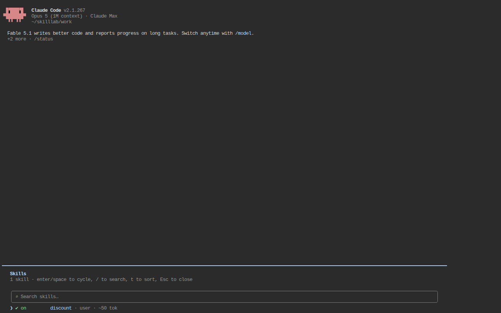
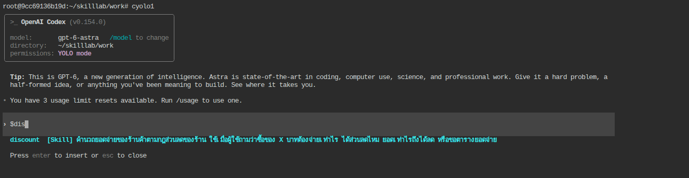
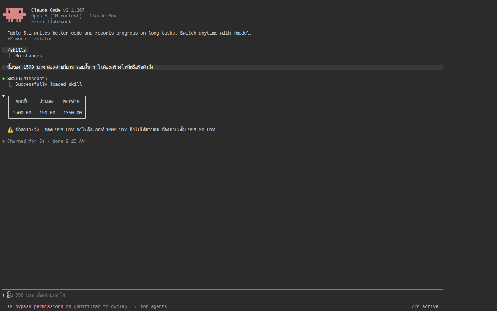
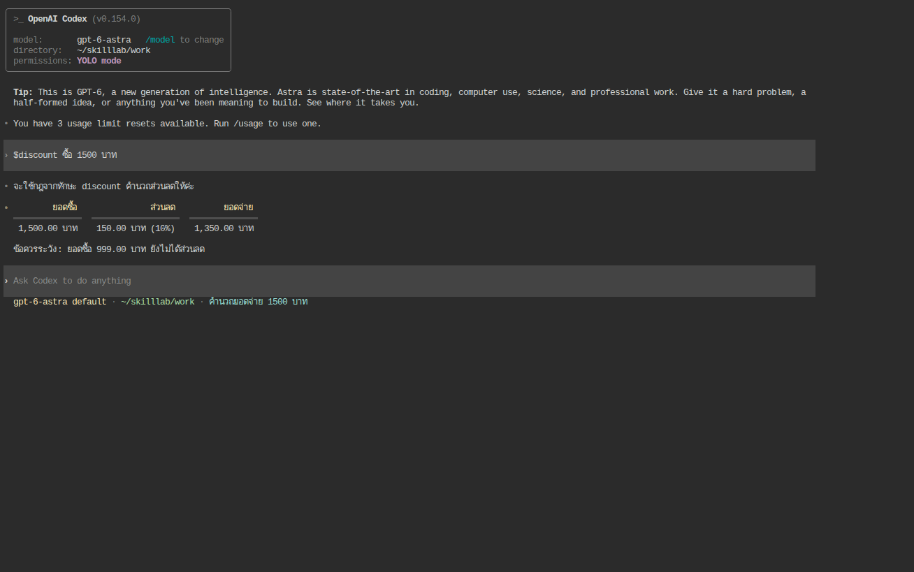

# Skill_LAB 001 · Hello Skill: เขียน SKILL.md ไฟล์แรกด้วยมือ (★)

## 1. วัตถุประสงค์

1. เขียน skill หนึ่งตัวด้วยมือ (ไม่ใช้ AI ช่วย) จากไฟล์ `SKILL.md` เพียงไฟล์เดียว และวางให้ทุกบัญชีของทั้ง Claude Code และ Codex CLI มองเห็น
2. เห็นด้วยตาว่า **ประโยคถามเดิม** ให้คำตอบต่างกันเมื่อไม่มีและมี skill และอ่านจาก session log ได้ว่า AI โหลด skill จริงหรือไม่
3. แยกให้ออกระหว่างการเรียกใช้ 2 แบบ (AI เลือกเองจาก description กับผู้ใช้พิมพ์ `/discount` หรือ `$discount`) และรู้ว่า frontmatter ที่ผิดรูปแบบมีผลอย่างไรในแต่ละ CLI

## 2. ข้อกำหนดเบื้องต้น

| รายการ | ข้อกำหนด |
|---|---|
| ต้องผ่านก่อน | [LAB 001](../001_LAB_Setup_Multi_Account/README.md) (มี `yolo1`–`yolo5`, `cyolo1`–`cyolo5`, โฟลเดอร์ `$HOME/ai-accounts`) และอ่าน [Skill_LAB 000 · ทฤษฎี](../Skill_LAB_000_Theory/README.md) หัวข้อ 1–5 |
| บัญชีที่ต้องล็อกอิน | `yolo1`, `cyolo1` |
| โมเดล | ค่าเริ่มต้นของ CLI: Claude Code = **Opus · high**, Codex = **gpt-6-astra · medium** |
| เวลา | 30 นาที |
| ค่าใช้จ่าย | ทุกขั้นเรียก AI จริง (Claude list price ต่อครั้ง $0.04–0.09 ตามที่ CLI รายงาน; บัญชี subscription ไม่ถูกเรียกเก็บตามตัวเลขนี้) |

ต่างจาก [LAB 004](../004_LAB_Multi_Account_Skill/README.md): ที่นั่นให้ AI สร้าง skill 4 ไฟล์ ที่นี่ผู้เรียนเขียนเองไฟล์เดียว เพื่อให้เห็นทุกบรรทัดว่าทำหน้าที่อะไร

## 3. ความรู้พื้นฐาน (สรุปจากภาคทฤษฎี)

- skill = โฟลเดอร์ที่มี `SKILL.md` ไฟล์แบ่งเป็น **frontmatter** (`name`, `description` ระหว่าง `---` โดย `---` ต้องเป็นบรรทัดแรก) กับ **body** (คำแนะนำที่ AI ทำตาม)
- AI เห็น `description` ของทุก skill ตลอดเวลา แต่ **body ถูกโหลดเมื่อ skill ถูกเลือกเท่านั้น** ดังนั้น description มีหน้าที่ "บอกว่าใช้เมื่อไร" ไม่ใช่ "ใส่กฎทั้งหมด"
- Claude Code อ่านจาก `<CLAUDE_CONFIG_DIR>/skills/<ชื่อ>/SKILL.md` และ Codex อ่านจาก `<CODEX_HOME>/skills/<ชื่อ>/SKILL.md` ใน LAB 001 ทั้งสองที่เป็น symlink ไป `shared/skills` ของ CLI นั้น จึงต้องวาง **สำเนา 2 ที่** (ฝั่ง `.Claude` และ `.Codex`) แล้วทุกบัญชีของ CLI นั้นเห็นพร้อมกัน

โจทย์ธุรกิจของ LAB นี้คือกฎเดิมจาก LAB 001: **ร้านลด 10% เมื่อยอดซื้อครบ 1000 บาท** ประโยคทดสอบที่ใช้ทุกขั้น (ไม่บอกกฎ ไม่บอกชื่อ skill):

```text
ซื้อของ 1500 บาท ต้องจ่ายกี่บาท ตอบสั้น ๆ ไม่ต้องสร้างไฟล์หรือรันคำสั่ง
```

เฉลยตามกฎร้านคือ **1,350 บาท** (ลด 150)

## 4. ขั้นตอนการทดลอง

| ขั้น | เนื้อหา | เครื่องมือ |
|---|---|---|
| 1 | ถามก่อนมี skill | shell: `yolo1 -p`, `cyolo1 exec` |
| 2 | เขียน `SKILL.md` และวางใน `shared/skills` ทั้งสองฝั่ง | Terminal |
| 3 | ตรวจว่าทั้งสอง CLI มองเห็น | หน้าสนทนา `/skills`, `$`, และ shell |
| 4 | ใช้ skill: AI เลือกเอง และผู้ใช้เรียกเอง | หน้าสนทนา + shell |
| 5 | ทำให้พัง: ย้าย `---` ออกจากบรรทัดแรก | Terminal + shell |

ทุกคำสั่ง shell ในเอกสารนี้รันจากโฟลเดอร์งานเดียวกัน (เช่น `mkdir -p ~/skilllab && cd ~/skilllab`)

### ขั้นที่ 1 · ถามก่อนมี skill (~3 นาที)

รันทีละบรรทัด รอให้จบ

```bash
yolo1 -p --model opus --effort high 'ซื้อของ 1500 บาท ต้องจ่ายกี่บาท ตอบสั้น ๆ ไม่ต้องสร้างไฟล์หรือรันคำสั่ง'
cyolo1 exec --skip-git-repo-check -m gpt-6-astra -c model_reasoning_effort=medium 'ซื้อของ 1500 บาท ต้องจ่ายกี่บาท ตอบสั้น ๆ ไม่ต้องสร้างไฟล์หรือรันคำสั่ง'
```

**ผลรันจริง** (ฝั่งละ 2 ครั้ง [evidence/noskill-claude.summary.jsonl](evidence/noskill-claude.summary.jsonl), [evidence/noskill-codex.summary.jsonl](evidence/noskill-codex.summary.jsonl)):

| ผู้ตอบ | ครั้งที่ 1 | ครั้งที่ 2 | เวลา |
|---|---|---|---|
| Claude (Opus · high) | "ถ้ารวม VAT 7% → **1,605 บาท** (1500 + 105) ถ้าไม่มีภาษีหรือส่วนลด ก็จ่าย 1,500 บาท" | "ถ้ายังไม่รวม VAT 7% → จ่าย **1,605 บาท** … ถ้ารวม VAT แล้ว → 1,500 บาท" | 4.9 s / 7.9 s |
| Codex (Astra · medium) | "ต้องจ่าย 1,500 บาท" | "ต้องจ่าย 1,500 บาท" | 7.1 s / 6.4 s |

ไม่มีครั้งใดตอบ 1,350 ทั้งสองไม่รู้กฎร้าน และ Claude สมมติเรื่อง VAT ขึ้นมาเอง นี่คือ "ช่องว่างความรู้" ที่ skill จะมาเติม

### ขั้นที่ 2 · เขียน SKILL.md และวางให้ทุกบัญชีเห็น (~7 นาที)

คัดลอกทั้งกรอบไปวางใน Terminal (สร้างไฟล์เดียวกัน 2 ที่)

```bash
BASE_PATH="$HOME/ai-accounts"
for ROOT in "$BASE_PATH/.Claude/shared/skills" "$BASE_PATH/.Codex/shared/skills"; do
  mkdir -p "$ROOT/discount"
  cat > "$ROOT/discount/SKILL.md" <<'EOF'
---
name: discount
description: คำนวณยอดจ่ายของร้านค้าตามกฎส่วนลดของร้าน ใช้เมื่อผู้ใช้ถามว่าซื้อของ X บาทต้องจ่ายเท่าไร ได้ส่วนลดไหม ยอดเท่าไรถึงได้ลด หรือขอตารางยอดจ่าย
---

# กฎส่วนลดของร้าน

- ยอดซื้อต่ำกว่า 1000 บาท: ไม่มีส่วนลด
- ยอดซื้อตั้งแต่ 1000 บาทขึ้นไป: ลด 10% ของยอดซื้อทั้งหมด
- แสดงทศนิยม 2 ตำแหน่ง

## วิธีตอบ

ตอบเป็นตาราง 3 คอลัมน์: ยอดซื้อ | ส่วนลด | ยอดจ่าย แล้วปิดท้ายด้วยข้อควรระวัง 1 ข้อ (ยอด 999 ยังไม่ได้ลด)
ไม่ต้องสร้างไฟล์หรือรันคำสั่งใด ๆ
EOF
done
```

อ่านไฟล์ทีละบรรทัด

| บรรทัด | หน้าที่ |
|---|---|
| `---` (บรรทัดที่ 1) | เปิด frontmatter **ต้องเป็นบรรทัดแรกของไฟล์** |
| `name: discount` | ชื่อ skill = ชื่อโฟลเดอร์ ตัวพิมพ์เล็ก ใช้เป็นคำสั่ง `/discount` และ `$discount` |
| `description: …` | สิ่งเดียวที่ AI ใช้ตัดสินว่าจะหยิบ skill นี้ไหม จึงเขียนเป็น "ทำอะไร + ใช้เมื่อผู้ใช้ถามว่า…" และ **ไม่ใส่กฎ 10%/1000 ไว้ตรงนี้** (เหตุผลดูกล่องท้ายขั้นที่ 4) |
| `---` (ปิด) | จบ frontmatter |
| `# กฎส่วนลดของร้าน` … | body: ข้อเท็จจริงที่ AI ไม่รู้ (กฎ) และรูปแบบคำตอบที่ต้องการ |

**ตรวจสอบ (Terminal)** — ผลรันจริงอยู่ใน [evidence/10-skill-installed.txt](evidence/10-skill-installed.txt)

```bash
find $HOME/ai-accounts -path '*/shared/skills/*' -name SKILL.md -not -path '*/.system/*'
diff $HOME/ai-accounts/.Claude/shared/skills/discount/SKILL.md $HOME/ai-accounts/.Codex/shared/skills/discount/SKILL.md && echo SAME
ls -la $HOME/ai-accounts/.Claude/yolo2/skills/ $HOME/ai-accounts/.Codex/cyolo2/skills/
```

- [ ] `find` ได้ 2 ไฟล์ (`.Claude/shared/skills/discount/SKILL.md` และ `.Codex/shared/skills/discount/SKILL.md`)
- [ ] `diff` พิมพ์ `SAME`
- [ ] `yolo2/skills/` และ `cyolo2/skills/` (บัญชีที่ **ยังไม่ล็อกอิน**) ก็เห็นโฟลเดอร์ `discount` เพราะเป็น symlink ไป `shared/skills` (ฝั่ง Codex จะเห็น `.system` ที่ CLI สร้างเองด้วย)

### ขั้นที่ 3 · ตรวจว่าทั้งสอง CLI มองเห็น (~5 นาที)

**3.1 Claude Code (หน้าสนทนา)** พิมพ์ `yolo1` แล้วพิมพ์ `/skills` จะเห็น `discount` ชนิด `user` สถานะ `on` กด Esc



**3.2 Codex (หน้าสนทนา)** พิมพ์ `cyolo1` แล้วพิมพ์ `$dis` จะเห็นเมนูขึ้น `discount` ให้เลือก กด Esc



**3.3 ถามผ่าน shell** (ใช้ตรวจแบบไม่ต้องเปิดหน้าจอ)

```bash
yolo1 -p 'มี skill อะไรให้ใช้บ้างในเซสชันนี้ ตอบเป็นรายการชื่อ skill กับคำอธิบายสั้น ๆ ไม่ต้องรันคำสั่ง'
cyolo1 exec --skip-git-repo-check 'มี skill อะไรให้ใช้บ้างในเซสชันนี้ ตอบเป็นรายการชื่อ skill กับคำอธิบายสั้น ๆ ไม่ต้องรันคำสั่ง'
```

ผลรันจริง: Claude ตอบ "**discount** — คำนวณยอดจ่ายตามกฎส่วนลดของร้าน (ซื้อ X บาทจ่ายเท่าไร, ได้ลดไหม, ขอตารางยอดจ่าย)" ตามด้วย skill ที่ติดมากับ CLI (`code-review`, `simplify`, …) ([evidence/list-claude.transcript.txt](evidence/list-claude.transcript.txt)) ส่วน Codex ตอบรายการ skill ระบบ 5 ตัว (`imagegen`, `openai-docs`, `plugin-creator`, `skill-creator`, `skill-installer`) แล้วปิดท้ายด้วย "**discount** — คำนวณยอดจ่ายตามกฎส่วนลดของร้าน …" ([evidence/list-codex.out](evidence/list-codex.out))

สิ่งที่ Codex เห็นจริงคือข้อความระบบที่ CLI ฉีดให้ทุกรอบ (ตัดมาจาก [evidence/list-codex.rollout.jsonl](evidence/list-codex.rollout.jsonl)):

```text
<skills_instructions>
## Skills
A skill is a set of local instructions to follow that is stored in a `SKILL.md` file. ...
### Skill roots
- `r0` = `/root/ai-accounts/.Codex/shared/skills`
- `r1` = `/root/ai-accounts/.Codex/shared/skills/.system`
### Available skills
- imagegen: ... (file: r1/imagegen/SKILL.md)
...
- discount: คำนวณยอดจ่ายของร้านค้าตามกฎส่วนลดของร้าน ใช้เมื่อผู้ใช้ถามว่า... (file: r0/discount/SKILL.md)
```

นี่คือ "ชั้นที่ 1" ของ progressive disclosure: มีแค่ชื่อ คำอธิบาย และ path ยังไม่มี body

### ขั้นที่ 4 · ใช้ skill (~10 นาที)

#### 4.1 ให้ AI เลือกเอง (implicit) — ประโยคเดิมจากขั้นที่ 1

รันคำสั่งเดิม 2 บรรทัดจากขั้นที่ 1 อีกครั้ง (ไม่แก้อะไร)

**ผลรันจริง** (ฝั่งละ 2 ครั้ง):

| ผู้ตอบ | สิ่งที่ AI ทำ (จาก log) | คำตอบ | เวลา |
|---|---|---|---|
| Claude | เรียกเครื่องมือ `Skill(discount)` → body ถูกส่งเข้าบริบท → ตอบ | ตาราง `1500.00 \| 150.00 \| 1350.00` + ข้อควรระวังเรื่องยอด 999 (ทั้ง 2 ครั้ง) | 9.7 s / 8.6 s |
| Codex | ตอบว่า "จะใช้กฎจากทักษะ discount" → รัน `cat …/discount/SKILL.md` เอง 1 ครั้ง → ตอบ | "จ่าย **1,350.00 บาท** (ลด 10% = 150.00 บาท)" (ทั้ง 2 ครั้ง) | 18.8 s / 20.6 s |

ทั้งคู่เปลี่ยนจาก 1,605/1,500 เป็น **1,350** ด้วยประโยคถามเดิม ต่างกันที่ Codex ไม่ทำตาราง (ผู้ใช้สั่ง "ตอบสั้น ๆ" และ Codex ให้น้ำหนักคำสั่งผู้ใช้มากกว่ารูปแบบใน body) และ Codex ใช้เวลาเพิ่มขึ้นราว 2 เท่าเพราะต้องเปิดอ่านไฟล์เอง (โทเคนอินพุตเพิ่มจาก 15,192 เป็น 48,360–65,907 ส่วนใหญ่เป็น cache)

ดูจาก log ว่า Claude โหลด skill อย่างไร ([evidence/skill-claude-1.transcript.txt](evidence/skill-claude-1.transcript.txt)):

```text
USER: ซื้อของ 1500 บาท ต้องจ่ายกี่บาท ตอบสั้น ๆ ไม่ต้องสร้างไฟล์หรือรันคำสั่ง
TOOL 1 Skill: {"skill": "discount", "args": "ซื้อของ 1500 บาท ต้องจ่ายกี่บาท"}
  RESULT: Launching skill: discount
USER: Base directory for this skill: /root/ai-accounts/.Claude/yolo1/skills/discount

# กฎส่วนลดของร้าน
- ยอดซื้อต่ำกว่า 1000 บาท: ไม่มีส่วนลด
...
ARGUMENTS: ซื้อของ 1500 บาท ต้องจ่ายกี่บาท
ASSISTANT: | ยอดซื้อ | ส่วนลด | ยอดจ่าย | ...
```

body ทั้งไฟล์ถูกส่งเข้ามาเป็น "ข้อความผู้ใช้" หนึ่งก้อน (ชั้นที่ 2) และ Claude Code ต่อท้าย `ARGUMENTS: …` ให้เองเพราะ body ไม่มีตัวแปร `$ARGUMENTS` (จะใช้ประโยชน์จากตรงนี้ใน Skill_LAB 003)

ฝั่ง Codex ([evidence/skill-codex-1.jsonl](evidence/skill-codex-1.jsonl) แปลงด้วย `codex-transcript.py`):

```text
ASSISTANT: จะใช้กฎจากทักษะ discount คำนวณยอดให้ค่ะ
CMD 1: /bin/bash -lc 'cat /root/ai-accounts/.Codex/shared/skills/discount/SKILL.md'
  OUT: --- | name: discount | description: ... | # กฎส่วนลดของร้าน | - ยอดซื้อต่ำกว่า 1000 บาท: ไม่มีส่วนลด ...
ASSISTANT: จ่าย **1,350.00 บาท** (ลด 10% = 150.00 บาท)
```

**หน้าสนทนา** ทำซ้ำใน `yolo1` และ `cyolo1` ด้วยประโยคเดียวกัน จะเห็นบรรทัด `Skill(discount)` ในหน้า Claude และคำสั่ง `cat …/SKILL.md` ในหน้า Codex



#### 4.2 ผู้ใช้เรียกเอง (explicit)

```bash
yolo1 -p '/discount ซื้อ 1500 บาท'
cyolo1 exec --skip-git-repo-check '$discount ซื้อ 1500 บาท'
```

| ผู้ตอบ | สิ่งที่เกิดขึ้น (จาก log) | คำตอบ | เวลา |
|---|---|---|---|
| Claude | **ไม่มี** การเรียกเครื่องมือ `Skill` — CLI แปลง `/discount` เป็น body + `ARGUMENTS: ซื้อ 1500 บาท` ให้ก่อนส่งถึงโมเดล (1 turn) | ตาราง 1350.00 + ข้อควรระวัง | 8.8 s |
| Codex | **ไม่มี** คำสั่ง `cat` — CLI ฉีดเนื้อหา `SKILL.md` ทั้งไฟล์เข้าไปในข้อความให้โมเดลเลย (0 คำสั่ง) | ตาราง `1,500.00 \| 150.00 (10%) \| 1,350.00` + ข้อควรระวัง | 9.0 s |

สังเกตว่าเมื่อผู้ใช้เรียกเอง Codex **ทำตาราง** ตาม body และเร็วกว่าแบบให้เลือกเอง (9.0 s เทียบ 18.8–20.6 s) เพราะไม่ต้องเสียรอบไปอ่านไฟล์ ([evidence/manual-codex.rollout.jsonl](evidence/manual-codex.rollout.jsonl) จะเห็น body ทั้งไฟล์อยู่ในบล็อก `<skill>` ของข้อความ role `user` ถัดจากข้อความที่ผู้ใช้พิมพ์)



> **กล่อง: description รั่วเฉลย** — ฉบับแรกของ LAB นี้เขียน description ว่า "คำนวณยอดจ่ายของร้านค้าตามกฎส่วนลด **(ลด 10% เมื่อยอดซื้อครบ 1000 บาท)** …" ผลคือ Codex ตอบ 1,350 ถูก **โดยไม่เปิดอ่าน body เลย** (0 คำสั่ง โทเคนเท่าตอนไม่มี skill) จึงไม่ทำตารางตามที่ body สั่ง และเราวัดไม่ได้ว่า skill "ถูกใช้" หรือแค่ "ถูกอ่านผ่าน ๆ" ส่วน Claude ยังเรียก `Skill(discount)` ตามปกติ ดูผลชุดแรกใน [evidence/v0-desc-with-rule/](evidence/v0-desc-with-rule/) และไฟล์ [skills/discount-desc-with-rule/SKILL.md](skills/discount-desc-with-rule/SKILL.md) บทเรียน: description บอก "เมื่อไรใช้" ส่วนกฎอยู่ใน body

### ขั้นที่ 5 · ทำให้พัง: `---` ไม่อยู่บรรทัดแรก (~5 นาที)

เติมหัวข้อไว้บนสุดของทั้ง 2 ไฟล์ (ทำให้ frontmatter ไม่ถูกอ่าน)

```bash
for ROOT in "$HOME/ai-accounts/.Claude/shared/skills" "$HOME/ai-accounts/.Codex/shared/skills"; do
  sed -i '1i # กฎส่วนลด' "$ROOT/discount/SKILL.md"; head -3 "$ROOT/discount/SKILL.md"
done
```

รันประโยคทดสอบและคำถาม "มี skill อะไรบ้าง" อีกครั้งทั้งสองฝั่ง

| ผู้ตอบ | รายการ skill | ประโยคทดสอบ | อธิบาย |
|---|---|---|---|
| Claude | ยังเห็น `discount` แต่คำอธิบายกลายเป็น "**กฎส่วนลด** (skill เฉพาะของโปรเจกต์นี้)" | ยังเรียก `Skill(discount)` และตอบ 1,350 | Claude Code ถือทั้งไฟล์เป็น body และใช้ **ย่อหน้าแรก** (`# กฎส่วนลด`) เป็น description แทน จึงยังทำงานได้ แต่ description แย่ลงมาก (ถ้าประโยคถามไม่มีคำว่า "ส่วนลด" อาจไม่ถูกเลือก) |
| Codex | **ไม่มี** `discount` ในรายการ (เหลือ skill ระบบ 5 ตัว) | ตอบ "ต้องจ่าย 1,500 บาท" เหมือนไม่มี skill | Codex ต้องการ `name`/`description` ใน frontmatter ที่ถูกต้อง ไม่เช่นนั้นไม่โหลด skill นั้นเลย |

หลักฐาน: [evidence/broken-list-claude.transcript.txt](evidence/broken-list-claude.transcript.txt), [evidence/broken-codex.summary.jsonl](evidence/broken-codex.summary.jsonl), [evidence/broken-list-codex.out](evidence/broken-list-codex.out)

แก้กลับ:

```bash
for ROOT in "$HOME/ai-accounts/.Claude/shared/skills" "$HOME/ai-accounts/.Codex/shared/skills"; do sed -i '1d' "$ROOT/discount/SKILL.md"; head -1 "$ROOT/discount/SKILL.md"; done
```

- [ ] `head -1` ทั้งสองไฟล์พิมพ์ `---`

## 5. ผลการทดลองเปรียบเทียบ

ประโยคทดสอบเดียวกัน 1 ประโยค บนเครื่องเดียวกัน (สรุปจาก `evidence/*.summary.jsonl`)

| เงื่อนไข | Claude: เรียก skill? | Claude: คำตอบ | Codex: โหลด body? | Codex: คำตอบ |
|---|---|---|---|---|
| ไม่มี skill (2 ครั้ง) | – | 1,605 (VAT) ×2 | – | 1,500 ×2 |
| มี skill, AI เลือกเอง (2 ครั้ง) | `Skill(discount)` 2/2 | 1,350 ตาราง ×2 | `cat SKILL.md` 2/2 | 1,350.00 (ไม่มีตาราง) ×2 |
| มี skill, ผู้ใช้เรียกเอง (1 ครั้ง) | CLI ใส่ body ให้ก่อน | 1,350 ตาราง | CLI ฉีด body ให้ก่อน | 1,350.00 ตาราง |
| frontmatter พัง (1 ครั้ง) | ยังเรียก (description = ย่อหน้าแรก) | 1,350 ตาราง | ไม่เห็น skill | 1,500 |
| description มีเฉลย (ชุดแรก, 2 ครั้ง) | `Skill(discount)` 2/2 | 1,350 ตาราง | **ไม่โหลด** 0/2 | 1,350 (ไม่มีตาราง) |

เวลาต่อครั้ง (wall clock ในคอนเทนเนอร์): Claude 4.9–9.7 s ทุกเงื่อนไข; Codex 6.4–9.6 s เมื่อไม่ต้องอ่านไฟล์ และ 18.8–20.6 s เมื่อต้องเปิดอ่าน `SKILL.md` เอง

## 6. สรุป

1. skill ที่ใช้งานได้จริงมีแค่ `SKILL.md` ไฟล์เดียว: frontmatter (`---` บรรทัดแรก, `name`, `description`) + body (กฎและรูปแบบคำตอบ)
2. วางใน `shared/skills` ของ **ทั้งสอง** CLI (คนละ root) ทุกบัญชีรวมถึงบัญชีที่ยังไม่ล็อกอินก็เห็นผ่าน symlink และไม่ต้องเปิด CLI ใหม่
3. AI ใช้ description เลือก skill: Claude เรียกผ่านเครื่องมือ `Skill` (log เห็น `Skill(discount)`) ส่วน Codex เปิดอ่านไฟล์เองด้วย `cat` เมื่อผู้ใช้เรียกเอง (`/discount`, `$discount`) ทั้งสอง CLI ใส่ body ให้โมเดลโดยไม่ต้องเสียรอบ
4. ผลของ skill ต้องดูจาก log ไม่ใช่จากคำตอบอย่างเดียว: คำตอบ 1,350 อาจมาจาก description ที่รั่วเฉลว (ชุดแรก) หรือจาก body จริง (ชุดที่สอง)
5. frontmatter ผิดรูปแบบ: Claude ยังใช้ได้แต่ description เพี้ยน Codex ไม่เห็น skill เลย ให้ตรวจ `head -1 SKILL.md` เป็นบรรทัด `---` เสมอ

## 7. หมายเหตุวิธีการทดลอง

ผลทั้งหมดรันในคอนเทนเนอร์ Devtools Lab (Ubuntu 24.04, Claude Code 2.1.267, codex-cli 0.154.0) ที่ตั้งค่าตามผลของ LAB 001 (`evidence/common/01-lab001-layout.txt`, `02-versions.txt`, `03-auth-status.txt`) โดยยืมไฟล์ credential ของ `yolo1`, `yolo2`, `cyolo1` ของผู้สอน ไม่ล็อกอินใหม่ คำสั่งที่ใช้รันและเก็บ log คือ `evidence/common/run-claude.sh` (Claude `-p --output-format json` + สำเนา session `.jsonl` + transcript) และ `run-codex.sh` (Codex `exec --json -o` + สำเนา rollout) ทุกไฟล์ปิดบังอีเมลและชื่อองค์กรเป็น `<email>`/`<ORG>` ภาพหน้าจอถ่ายจากหน้า ttyd ของคอนเทนเนอร์ผ่าน Playwright (1324×820) คอนเทนเนอร์ถูกลบหลังจบชุดการทดลอง
