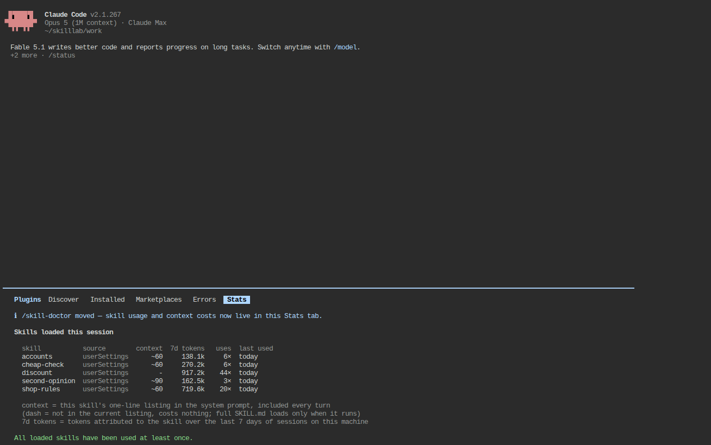

# Skill_LAB 002 · Trigger Control: description คือสวิตช์ (★★)

## 1. วัตถุประสงค์

1. วัดด้วยตัวเลขว่า AI เลือก skill `discount` จาก description อย่างไร: ประโยคที่ควรถูกเลือก 3 แบบ ประโยคที่ไม่ควรถูกเลือก 2 แบบ × description 3 ฉบับ × 2 CLI
2. เห็นว่า description ที่ "แย่" ยังทำงานได้เมื่อมี skill ตัวเดียว แต่ **แพ้ทันทีเมื่อมี skill คู่แข่ง** และเห็นข้อจำกัดฝั่ง Codex ที่ต้องรันคำสั่งเพื่ออ่าน skill
3. ใช้สวิตช์ควบคุมว่าใครเรียก skill ได้: `disable-model-invocation`, `user-invocable` (Claude) และ `allow_implicit_invocation` (Codex) พร้อมตรวจต้นทุนบริบทด้วย `/skill-doctor`

## 2. ข้อกำหนดเบื้องต้น

| รายการ | ข้อกำหนด |
|---|---|
| ต้องผ่านก่อน | [Skill_LAB 001](../Skill_LAB_001_Hello_Skill/README.md) และทฤษฎีหัวข้อ 3–4 |
| บัญชี | `yolo1`, `cyolo1` |
| โมเดล | Claude = Opus · high, Codex = gpt-6-astra · medium |
| เวลา | 45 นาที (ถ้ารันครบทุกเงื่อนไขเหมือนผู้สอน ~25 นาทีเป็นเวลารอ AI) |

## 3. ความรู้พื้นฐาน

AI ตัดสินใจเลือก skill จาก **description เท่านั้น** (ยังไม่เห็น body) description จึงควรบอก (1) ทำอะไร (2) ใช้เมื่อผู้ใช้พูดว่าอะไร (3) ไม่ใช้เมื่อไร Claude Code มีฟิลด์ `when_to_use` เพิ่มข้อ (2) ได้ (รวมกับ description ไม่เกิน 1,536 ตัวอักษร) Codex ไม่มีฟิลด์นี้และจำกัดรายการรวมไม่เกิน 8,000 ตัวอักษร

สวิตช์ควบคุมผู้เรียก (ทฤษฎีหัวข้อ 4):

| ต้องการ | Claude Code | Codex |
|---|---|---|
| AI ห้ามเรียกเอง ผู้ใช้พิมพ์ `/name` เท่านั้น | `disable-model-invocation: true` | `agents/openai.yaml` → `policy.allow_implicit_invocation: false` |
| ผู้ใช้ห้ามเรียก AI เรียกเองเท่านั้น | `user-invocable: false` | ไม่มี |

## 4. ขั้นตอนการทดลอง

ทุกขั้นใช้ body เดียวกับ Skill_LAB 001 เปลี่ยนเฉพาะ frontmatter ไฟล์ทุกฉบับอยู่ใน [skills/](skills/) วิธีสลับฉบับ:

```bash
BASE_PATH="$HOME/ai-accounts"
put() { for ROOT in "$BASE_PATH/.Claude/shared/skills" "$BASE_PATH/.Codex/shared/skills"; do rm -rf "$ROOT/discount"; cp -r "$1" "$ROOT/discount"; done; }
```

### ขั้นที่ 1 · description 3 ฉบับ × ประโยคทดสอบ 5 ประโยค (~15 นาที)

| ฉบับ | frontmatter |
|---|---|
| `desc-poor` | `description: ช่วยเรื่องราคา` |
| `desc-good` | `description: คำนวณยอดจ่ายของร้านค้าตามกฎส่วนลดของร้าน ใช้เมื่อผู้ใช้ถามว่าซื้อของ X บาทต้องจ่ายเท่าไร ได้ส่วนลดไหม ยอดเท่าไรถึงได้ลด หรือขอตารางยอดจ่าย` |
| `desc-when` | `description: คำนวณยอดจ่ายของร้านค้าตามกฎส่วนลดของร้าน` + `when_to_use: ใช้เมื่อผู้ใช้ถามว่า… ไม่ใช้กับโจทย์เลขทั่วไปหรือคำถามเรื่องภาษา` |

ประโยคทดสอบ (ไม่มีชื่อ skill ไม่บอกกฎ):

| รหัส | ประโยค | ควรถูกเลือก? |
|---|---|---|
| P1 | ซื้อของ 1500 บาท ต้องจ่ายกี่บาท | ✅ |
| P2 | ยอด 999 กับ 1000 บาท ได้ส่วนลดไหม ต้องจ่ายเท่าไร | ✅ |
| P3 | ขอตารางยอดจ่ายสำหรับยอดซื้อ 800 1200 และ 2000 บาท | ✅ |
| N1 | ตอบเป็นตัวเลขล้วนอย่างเดียว: 12*12 | ❌ |
| N2 | คำว่า ส่วนลด ภาษาอังกฤษคืออะไร (มีคำว่า "ส่วนลด" แต่ไม่ใช่คำถามราคา) | ❌ |

รันแต่ละประโยค 2 ครั้งต่อ CLI ต่อฉบับ (`put skills/desc-poor` → 10 ครั้ง → `put skills/desc-good` → …) ตัดสิน "ถูกเลือก" จาก log เท่านั้น: Claude = มีการเรียกเครื่องมือ `Skill(discount)`; Codex = มีคำสั่ง `cat …/discount/SKILL.md` หรือ body ถูกฉีดเข้าบริบท ([evidence/analyze-trigger.py](evidence/analyze-trigger.py))

**ผลรันจริง ฝั่ง Claude** (ประโยคลงท้ายด้วย "ไม่ต้องสร้างไฟล์หรือรันคำสั่ง" [evidence/desc-*-claude.summary.jsonl](evidence/)):

| ฉบับ | P1 | P2 | P3 | N1 | N2 | รวมถูกต้อง |
|---|---|---|---|---|---|---|
| desc-poor | 2/2 | 2/2 | 2/2 | 0/2 | 0/2 | 10/10 |
| desc-good | 2/2 | 2/2 | 2/2 | 0/2 | 0/2 | 10/10 |
| desc-when | 2/2 | 2/2 | 2/2 | 0/2 | 0/2 | 10/10 |

Claude เลือกถูกทุกครั้ง **แม้ description จะเป็นแค่ "ช่วยเรื่องราคา"** เพราะเป็น skill ผู้ใช้ตัวเดียวในเครื่องและทุกประโยคบวกมีคำว่า "จ่าย/ส่วนลด/ยอด" ส่วน N2 ที่มีคำว่า "ส่วนลด" ก็ไม่ถูกเลือก (โมเดลดูความหมาย ไม่ใช่คำ) ต้นทุนเฉลี่ยต่อประโยคบวก: poor $0.040 · good $0.073 · when $0.081 (list price) เวลา 9–10 s

**ผลรันจริง ฝั่ง Codex รอบแรก** (ประโยคเดียวกัน [evidence/desc-*-codex.summary.jsonl](evidence/)):

| ฉบับ | P1 | P2 | P3 | N1 | N2 |
|---|---|---|---|---|---|
| desc-poor | 0/2 | 2/2 | 0/2 | 0/2 | 0/2 |
| desc-good | 1/2 | 2/2 | 0/2 | 0/2 | 0/2 |
| desc-when | 0/2 | 1/2 | 0/2 | 0/2 | 0/2 |

ดูเหมือน Codex เลือก skill ได้แย่มาก แต่เมื่ออ่านคำตอบพบสาเหตุจริง: "**ไม่สามารถอ่านสกิล discount ด้วยเครื่องมือที่มีโดยไม่รันคำสั่งได้**" (P3 ทั้ง 4 ครั้ง) — Codex ต้อง `cat` ไฟล์เพื่อโหลด body แต่ประโยคของเราสั่งว่า "ไม่ต้องรันคำสั่ง" มันจึงเคารพผู้ใช้และไม่โหลด skill ส่วน Claude โหลดผ่านเครื่องมือ `Skill` ที่ไม่ใช่ "คำสั่ง" จึงไม่ติดข้อห้ามนี้

**ผลรันจริง ฝั่ง Codex รอบสอง** (ตัด "ไม่ต้องรันคำสั่ง" ออก [evidence/partB/desc-*-codex.summary.jsonl](evidence/partB/)):

| ฉบับ | P1 | P2 | P3 | N1 | N2 | รวมถูกต้อง |
|---|---|---|---|---|---|---|
| desc-poor | 2/2 | 2/2 | 2/2 | 0/2 | 0/2 | 10/10 |
| desc-good | 2/2 | 2/2 | 2/2 | 0/2 | 0/2 | 10/10 |
| desc-when | 2/2 | 2/2 | 2/2 | 0/2 | 0/2 | 10/10 |

เท่ากับ Claude ทุกช่อง (เวลาเฉลี่ยประโยคบวก 15–18 s, ~31k input tokens) ฟิลด์ `when_to_use` ที่ Codex ไม่รู้จักไม่ทำให้พัง (ถูกมองข้าม)

ข้อสรุปขั้นที่ 1: **เมื่อมี skill ตัวเดียว คุณภาพ description แทบไม่มีผลต่ออัตราถูกเลือก** สิ่งที่มีผลมากกว่าคือถ้อยคำในพรอมต์ที่ห้าม Codex รันคำสั่ง — ข้อควรจำเวลาเขียนพรอมต์ให้ Codex ที่ต้องใช้ skill

### ขั้นที่ 2 · เมื่อมี skill คู่แข่ง (~8 นาที)

เพิ่ม skill `vat` ([skills/vat/SKILL.md](skills/vat/SKILL.md)) ที่ description ว่า "คำนวณราคารวมภาษีมูลค่าเพิ่ม (VAT 7%) ใช้เมื่อผู้ใช้ถามว่าซื้อของ X บาทต้องจ่ายเท่าไรเมื่อรวมภาษี…" แล้วถาม P1 อีก 2 ครั้งต่อ CLI กับ `discount` ฉบับ poor และ good

```bash
for ROOT in "$BASE_PATH/.Claude/shared/skills" "$BASE_PATH/.Codex/shared/skills"; do cp -r skills/vat "$ROOT/vat"; done
put skills/desc-poor;  yolo1 -p 'ซื้อของ 1500 บาท ต้องจ่ายกี่บาท ตอบสั้น ๆ ไม่ต้องสร้างไฟล์'
put skills/desc-good;  yolo1 -p 'ซื้อของ 1500 บาท ต้องจ่ายกี่บาท ตอบสั้น ๆ ไม่ต้องสร้างไฟล์'
```

**ผลรันจริง** ([evidence/partB/dis-*.summary.jsonl](evidence/partB/)):

| `discount` ฉบับ | Claude เลือก | Claude ตอบ | Codex เลือก | Codex ตอบ |
|---|---|---|---|---|
| desc-poor ("ช่วยเรื่องราคา") | `Skill(vat)` 2/2 | **1,605** (VAT) ×2 ✗ | `cat vat/SKILL.md` 2/2 | **1,605** ×2 ✗ |
| desc-good | `Skill(discount)` 2/2 (ครั้งที่ 1 เรียก `vat` ต่อด้วย → 1,444.50; ครั้งที่ 2 เปิดอ่านทั้งสองไฟล์แล้วตอบ 1,350 พร้อมหมายเหตุเรื่อง VAT) | 1,350 ✓ (มีหมายเหตุ VAT) | `cat discount/SKILL.md` 2/2 | **1,350.00** ×2 ✓ |

นี่คือที่ที่ description แสดงผล: เมื่อมีคู่แข่งที่ description ตรงกับประโยค ("ซื้อของ X บาทต้องจ่ายเท่าไร") skill ที่ description กำกวมจะ **แพ้ทั้งสอง CLI ทุกครั้ง** และแม้ description ดี Claude ก็ยังลังเลระหว่างสอง skill ที่ทับซ้อนกัน ทางแก้คือ description ของแต่ละ skill ต้องบอกขอบเขตให้ไม่ทับกัน (เช่น `vat` ระบุ "เฉพาะเมื่อผู้ใช้พูดถึงภาษีหรือ VAT") — เป็นหลัก "discriminating description" ของ `skill-creator`

ลบ `vat` ออกก่อนไปขั้นถัดไป: `for ROOT in …; do rm -rf "$ROOT/vat"; done`

### ขั้นที่ 3 · สวิตช์ฝั่ง Claude (~8 นาที)

**3.1 `disable-model-invocation: true`** ([skills/no-model/SKILL.md](skills/no-model/SKILL.md))

```bash
put skills/no-model
yolo1 -p 'ซื้อของ 1500 บาท ต้องจ่ายกี่บาท ตอบสั้น ๆ ไม่ต้องสร้างไฟล์หรือรันคำสั่ง'
yolo1 -p '/discount ซื้อ 1500 บาท'
yolo1 -p 'มี skill อะไรให้ใช้บ้างในเซสชันนี้ ตอบเป็นรายการชื่อ skill กับคำอธิบายสั้น ๆ ไม่ต้องรันคำสั่ง'
```

| คำสั่ง | ผลรันจริง |
|---|---|
| ประโยคธรรมดา (2 ครั้ง) | **ไม่เรียก** skill ตอบ 1,605 (VAT) เหมือนไม่มี skill 2/2 |
| `/discount ซื้อ 1500 บาท` | ทำงานปกติ ตาราง 1,350 |
| รายการ skill | "เซสชันนี้มี skill ให้ใช้ 14 ตัว" **ไม่มี `discount`** — description ถูกถอดออกจากบริบทของโมเดลจริง |

**3.2 `user-invocable: false`** ([skills/no-user/SKILL.md](skills/no-user/SKILL.md))

```bash
put skills/no-user
yolo1 -p 'ซื้อของ 1500 บาท ต้องจ่ายกี่บาท ตอบสั้น ๆ ไม่ต้องสร้างไฟล์หรือรันคำสั่ง'
yolo1 -p '/discount ซื้อ 1500 บาท'
```

| คำสั่ง | ผลรันจริง |
|---|---|
| ประโยคธรรมดา (2 ครั้ง) | เรียก `Skill(discount)` ตอบ 1,350 ตาราง 2/2 |
| `/discount ซื้อ 1500 บาท` | CLI ตอบทันทีโดยไม่ถึงโมเดล (0 turn, $0): `This skill can only be invoked by Claude, not directly by users. Ask Claude to use the "discount" skill for you.` |
| รายการ skill | ยังมี `discount` (description อยู่ในบริบท) |

หลักฐาน: [evidence/no-model-claude.summary.jsonl](evidence/no-model-claude.summary.jsonl), [evidence/no-user-MANUAL-claude.transcript.txt](evidence/no-user-MANUAL-claude.transcript.txt)

### ขั้นที่ 4 · สวิตช์ฝั่ง Codex: `agents/openai.yaml` (~5 นาที)

ใช้ `discount` ฉบับ good แล้วเพิ่มไฟล์ ([skills/codex-explicit/agents/openai.yaml](skills/codex-explicit/agents/openai.yaml)):

```yaml
interface:
  display_name: "Discount"
  short_description: "คำนวณยอดจ่ายตามกฎส่วนลดของร้าน"
policy:
  allow_implicit_invocation: false
```

```bash
mkdir -p "$BASE_PATH/.Codex/shared/skills/discount/agents" && cp skills/codex-explicit/agents/openai.yaml "$BASE_PATH/.Codex/shared/skills/discount/agents/"
cyolo1 exec --skip-git-repo-check 'ซื้อของ 1500 บาท ต้องจ่ายกี่บาท ตอบสั้น ๆ ไม่ต้องสร้างไฟล์'
cyolo1 exec --skip-git-repo-check '$discount ซื้อ 1500 บาท'
```

| คำสั่ง | ผลรันจริง |
|---|---|
| ประโยคธรรมดา (2 ครั้ง) | ไม่โหลด skill ตอบ 1,500 2/2 |
| `$discount ซื้อ 1500 บาท` | body ถูกฉีดเข้าบริบท ตาราง 1,350 |
| รายการ skill | ไม่มี `discount` — ถูกถอดออกจาก `<skills_instructions>` |

ผลเหมือน `disable-model-invocation: true` ของ Claude ([evidence/explicit-codex.summary.jsonl](evidence/explicit-codex.summary.jsonl))

ในทางกลับกัน ถ้าใส่ `disable-model-invocation: true` (ฟิลด์ของ Claude) ในไฟล์ฝั่ง Codex Codex จะ **มองข้าม** และยังเลือก skill เองตามปกติ (2/2 ครั้ง อ่าน `cat …/discount/SKILL.md` ตอบตาราง 1,350 [evidence/partC/](evidence/partC/)) สวิตช์ของแต่ละ CLI จึงต้องตั้งแยกกัน

### ขั้นที่ 5 · ต้นทุนบริบทของ skill: `/skill-doctor` (~5 นาที)

เปิด `yolo1` (หน้าสนทนา) พิมพ์ `/skill-doctor` (Claude Code 2.1.252 ขึ้นไป ใช้ได้เฉพาะหน้าสนทนา) ในเวอร์ชัน 2.1.267 คำสั่งนี้เปิดแท็บ **Stats** ของหน้า `/plugins` พร้อมข้อความ "/skill-doctor moved — skill usage and context costs now live in this Stats tab" ตารางบอกว่าแต่ละ skill กินบริบทกี่โทเคนต่อรอบ (`context`) ใช้โทเคนไปเท่าไรใน 7 วัน ถูกเรียกกี่ครั้ง และใช้ล่าสุดเมื่อไร



ผลรันจริงหลังทำชุดบทเรียนนี้ครบ: skill ที่มี description ในรายการกินบริบท **~60 โทเคนต่อรอบ** (`second-opinion` ~90) ส่วน `discount` ฉบับที่ตั้ง `disable-model-invocation: true` แสดงเป็นขีด (`-`) = "not in the current listing, costs nothing; full SKILL.md loads only when it runs" ตรงกับที่ขั้นที่ 3 พบว่ามันหายจากรายการ ถ้ามี skill 50 ตัวจะกิน ~3,000 โทเคนทุกรอบแม้ไม่ได้ใช้ — นี่คือเหตุผลของ `disable-model-invocation`, `paths` และการรวม skill ที่คล้ายกัน

## 5. ผลการทดลองเปรียบเทียบ

| คำถาม | คำตอบจากผลรันจริง |
|---|---|
| description แย่ทำให้ skill ไม่ถูกเลือกไหม | ไม่ เมื่อเป็น skill ตัวเดียว (Claude 30/30, Codex 30/30 เมื่อรันคำสั่งได้) |
| description แย่มีผลเมื่อไร | เมื่อมี skill คู่แข่ง: แพ้ 4/4 ทั้งสอง CLI ตอบผิด (1,605) |
| `when_to_use` | Claude ใช้ได้ (ผลเท่ากับ description ยาว) Codex มองข้ามโดยไม่พัง |
| ประโยคที่ห้ามรันคำสั่ง | Claude ไม่กระทบ Codex โหลด skill ไม่ได้ (6/18 → 18/18 เมื่อเอาออก) |
| `disable-model-invocation` / `allow_implicit_invocation: false` | AI ไม่เลือกเอง 0/2, ผู้ใช้เรียกเองได้, หายจากรายการ skill |
| `user-invocable: false` | AI เลือกเอง 2/2, ผู้ใช้เรียก `/discount` ถูกปฏิเสธที่ CLI |

## 6. สรุป

1. วัดการเลือก skill จาก log (Skill tool / `cat SKILL.md`) ไม่ใช่จากคำตอบ และรันซ้ำอย่างน้อย 2 ครั้ง
2. description ต้อง **แยกแยะ** (discriminating) ระหว่าง skill ที่คล้ายกัน ไม่ใช่แค่ "ตรงกับคำถาม" ทดสอบด้วยการใส่ skill คู่แข่งเสมอ
3. ฝั่ง Codex การโหลด skill = การรันคำสั่ง อย่าเขียนพรอมต์ที่ห้ามรันคำสั่งถ้าต้องการให้ Codex ใช้ skill
4. งานที่มีผลข้างเคียงใช้ `disable-model-invocation: true` (Claude) / `allow_implicit_invocation: false` (Codex) ความรู้พื้นหลังใช้ `user-invocable: false`
5. ยิ่งมี skill มาก description ยิ่งต้องสั้นและตรง ตรวจต้นทุนด้วย `/skill-doctor`

## 7. หมายเหตุวิธีการทดลอง

รอบแรกรันด้วย [evidence/lab002-driver.sh](evidence/lab002-driver.sh) (60 ครั้ง + สวิตช์) รอบสองด้วย [evidence/partB/lab002b-driver.sh](evidence/partB/lab002b-driver.sh) (Codex 30 ครั้งแบบอนุญาตรันคำสั่ง + คู่แข่ง 8 ครั้ง) ในคอนเทนเนอร์เดียวกับ Skill_LAB 001 (Claude Code 2.1.267, codex-cli 0.154.0) ตารางสรุปคำนวณจาก [evidence/analyze-trigger.py](evidence/analyze-trigger.py) ทุกไฟล์ปิดบังอีเมล/องค์กร รอบแรกที่ถูกยกเลิกกลางคัน (description ยังมีเฉลย) ไม่ได้นำมานับ
