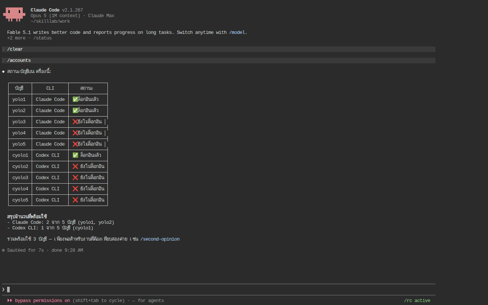

# Skill_LAB 004 · Live Context: ฝังผลคำสั่งสดและสคริปต์ลงใน skill (★★★)

## 1. วัตถุประสงค์

1. สร้าง skill `accounts` ที่ตอบว่า "บัญชีไหนล็อกอินอยู่" ด้วยข้อมูล **สด** ทุกครั้ง โดย Claude Code รันสคริปต์ให้ก่อนที่โมเดลจะเห็นเนื้อหา (`` !`command` ``) ส่วน Codex ให้โมเดลรันสคริปต์เอง
2. เข้าใจกติกาของคำสั่งฝัง: exit code ≠ 0 ทำให้ skill ล้มทั้งตัว, `${CLAUDE_SKILL_DIR}` ชี้ไปที่ `scripts/` ของ skill, `allowed-tools` อนุญาตสคริปต์ล่วงหน้า และ `disableSkillShellExecution` ปิดกลไกนี้ทั้งระบบ
3. วัดจาก log ว่าการฝังข้อมูลล่วงหน้าลดจำนวนรอบเรียกเครื่องมือและเวลาได้เท่าไรเทียบกับให้โมเดลหาเอง

## 2. ข้อกำหนดเบื้องต้น

| รายการ | ข้อกำหนด |
|---|---|
| ต้องผ่านก่อน | Skill_LAB 001–003 และทฤษฎีหัวข้อ 8–9 |
| บัญชี | `yolo1`, `cyolo1` ล็อกอิน (บัญชีอื่นไม่ต้อง — LAB นี้ต้องการให้มีบัญชีที่ **ยังไม่ล็อกอิน** อยู่ด้วย) |
| โมเดล | Claude = Opus · high, Codex = gpt-6-astra · medium |
| เวลา | 45 นาที |

## 3. ความรู้พื้นฐาน

skill ปกติเป็นข้อความคงที่ แต่บางความรู้เปลี่ยนตลอด (สถานะล็อกอิน, `git diff`, วันที่) Claude Code จึงให้เขียน `` !`คำสั่ง` `` ใน body แล้ว CLI จะรันคำสั่งนั้น **ตอนโหลด skill** และเอาผลลัพธ์แทนที่ลงไป โมเดลได้ข้อมูลสดโดยไม่ต้องตัดสินใจเรียกเครื่องมือเอง

กติกาที่จะพิสูจน์ใน LAB นี้:

- คำสั่งฝังที่ exit ≠ 0 → skill **ถูกยกเลิกทั้งตัว** (ข้อความ `Shell command failed for pattern …`) ยกเว้น exit 1 จากคำสั่งค้นหา/เทียบ (grep, diff)
- `${CLAUDE_SKILL_DIR}` = โฟลเดอร์ของ skill ใช้ชี้ `scripts/status.sh` ได้ทั้งใน body และใน `allowed-tools`
- `"disableSkillShellExecution": true` ใน settings → ตำแหน่งคำสั่งถูกแทนด้วย `[shell command execution disabled by policy]`
- Codex ไม่มีคำสั่งฝัง แต่มี `scripts/` ตามมาตรฐาน Agent Skills ให้โมเดล "รัน" ได้

`yolo3` ในเครื่องทดลองยังไม่ล็อกอิน คำสั่ง `yolo3 auth status --text` จึง **exit 1** — นี่คือกับดักที่ LAB นี้ตั้งใจให้เจอ

## 4. ขั้นตอนการทดลอง

### ขั้นที่ 1 · เขียนสคริปต์ที่ exit 0 เสมอ (~10 นาที)

สร้าง skill พร้อมโฟลเดอร์ `scripts/` (ไฟล์เต็มอยู่ใน [skills/accounts/](skills/accounts/))

```bash
BASE_PATH="$HOME/ai-accounts"
mkdir -p "$BASE_PATH/.Claude/shared/skills/accounts/scripts"
cat > "$BASE_PATH/.Claude/shared/skills/accounts/scripts/status.sh" <<'EOF'
#!/bin/bash
# Print login status of every account as a table row. Always exits 0 (a skill's !`command` aborts on non-zero exit).
export PATH="$HOME/.local/bin:$PATH"
for n in 1 2 3 4 5; do
  if "yolo$n" auth status --text </dev/null >/dev/null 2>&1; then s="ล็อกอินแล้ว"; else s="ยังไม่ล็อกอิน"; fi
  echo "| yolo$n | Claude Code | $s |"
done
for n in 1 2 3 4 5; do
  if "cyolo$n" login status </dev/null 2>&1 | grep -q '^Logged in'; then s="ล็อกอินแล้ว"; else s="ยังไม่ล็อกอิน"; fi
  echo "| cyolo$n | Codex CLI | $s |"
done
exit 0
EOF
chmod +x "$BASE_PATH/.Claude/shared/skills/accounts/scripts/status.sh"
"$BASE_PATH/.Claude/shared/skills/accounts/scripts/status.sh"
```

สคริปต์นี้ (1) ใช้ exit code ของ `auth status` / ข้อความ `Logged in` ตัดสิน ไม่เปิดไฟล์ credential (2) พิมพ์แถวตารางที่วางต่อใน Markdown ได้ทันที (3) **`exit 0` เสมอ** ผลรันจริงใช้เวลา 0.9 วินาที ([evidence/00-status-script-output.txt](evidence/00-status-script-output.txt)):

```text
| yolo1 | Claude Code | ล็อกอินแล้ว |
| yolo2 | Claude Code | ล็อกอินแล้ว |
| yolo3 | Claude Code | ยังไม่ล็อกอิน |
...
| cyolo1 | Codex CLI | ล็อกอินแล้ว |
| cyolo2 | Codex CLI | ยังไม่ล็อกอิน |
```

### ขั้นที่ 2 · SKILL.md ฝั่ง Claude: ฝังผลสคริปต์ (~10 นาที)

```bash
cat > "$BASE_PATH/.Claude/shared/skills/accounts/SKILL.md" <<'EOF'
---
name: accounts
description: แสดงสถานะล็อกอินของบัญชี yolo1–yolo5 (Claude Code) และ cyolo1–cyolo5 (Codex CLI) บนเครื่องนี้ ใช้เมื่อผู้ใช้ถามว่าบัญชีไหนล็อกอินอยู่ บัญชีไหนใช้ได้ หรือก่อนเลือกบัญชีไปทำงาน
allowed-tools: Bash(${CLAUDE_SKILL_DIR}/scripts/status.sh *)
---

# สถานะบัญชี ณ ตอนนี้ (ตรวจสดตอนโหลด skill)

| บัญชี | CLI | สถานะ |
|---|---|---|
!`${CLAUDE_SKILL_DIR}/scripts/status.sh`

## วิธีตอบ

ข้อมูลด้านบนถูกตรวจสดแล้วตอนโหลด skill นี้ ให้สรุปเป็นตารางเดิมและบอกจำนวนบัญชีที่พร้อมใช้ของแต่ละ CLI
ไม่ต้องรันคำสั่งตรวจซ้ำ ห้ามอ่านไฟล์ credential ใด ๆ และห้ามล็อกอินแทนผู้ใช้
EOF
```

ทดสอบทั้งแบบให้ AI เลือกเองและเรียกเอง

```bash
yolo1 -p 'บัญชีไหนล็อกอินอยู่บ้างตอนนี้ ตอบเป็นตาราง'
yolo1 -p '/accounts'
```

ผลรันจริง ([evidence/inject-Q-claude-1.transcript.txt](evidence/inject-Q-claude-1.transcript.txt)):

```text
USER: บัญชีไหนล็อกอินอยู่บ้างตอนนี้ ตอบเป็นตาราง
TOOL 1 Skill: {"skill": "accounts"}
USER: Base directory for this skill: /root/ai-accounts/.Claude/yolo1/skills/accounts

# สถานะบัญชี ณ ตอนนี้ (ตรวจสดตอนโหลด skill)
| บัญชี | CLI | สถานะ |
|---|---|---|
| yolo1 | Claude Code | ล็อกอินแล้ว |
| yolo2 | Claude Code | ล็อกอินแล้ว |
| yolo3 | Claude Code | ยังไม่ล็อกอิน |
...
ASSISTANT: ## สถานะบัญชีที่ล็อกอินอยู่ ... Claude Code 2 จาก 5, Codex CLI 1 จาก 5
```

บรรทัด `` !`…status.sh` `` หายไป และ **ตาราง 10 แถวอยู่ในข้อความที่โมเดลได้รับแล้ว** โมเดลจึงตอบโดยไม่เรียก Bash เลย

| วิธีเรียก | เครื่องมือที่โมเดลเรียก | turn | เวลา | list price |
|---|---|---|---|---|
| ประโยคธรรมดา (2 ครั้ง) | `Skill(accounts)` อย่างเดียว | 3 | 12.1 s / 11.8 s | $0.096 / $0.049 |
| `/accounts` | ไม่มี (body ถูกใส่ให้ก่อน) | 1 | 10.6 s | $0.074 |



### ขั้นที่ 3 · ฝั่ง Codex: ให้โมเดลรันสคริปต์เอง (~5 นาที)

Codex ไม่รู้จัก `` !` `` และ `${CLAUDE_SKILL_DIR}` จึงเขียน body เป็นคำสั่งงานแทน (ไฟล์เต็ม [skills/accounts-codex/](skills/accounts-codex/) ใช้ `status.sh` ตัวเดียวกัน)

```bash
mkdir -p "$BASE_PATH/.Codex/shared/skills/accounts/scripts"
cp "$BASE_PATH/.Claude/shared/skills/accounts/scripts/status.sh" "$BASE_PATH/.Codex/shared/skills/accounts/scripts/"
cat > "$BASE_PATH/.Codex/shared/skills/accounts/SKILL.md" <<'EOF'
---
name: accounts
description: แสดงสถานะล็อกอินของบัญชี yolo1–yolo5 (Claude Code) และ cyolo1–cyolo5 (Codex CLI) บนเครื่องนี้ ใช้เมื่อผู้ใช้ถามว่าบัญชีไหนล็อกอินอยู่ บัญชีไหนใช้ได้ หรือก่อนเลือกบัญชีไปทำงาน
---

# สถานะบัญชี

รันสคริปต์ `scripts/status.sh` ในโฟลเดอร์ของ skill นี้ (path เต็มคือโฟลเดอร์ที่มีไฟล์ SKILL.md นี้) หนึ่งครั้ง
สคริปต์พิมพ์แถวตาราง `| บัญชี | CLI | สถานะ |` ของทั้ง 10 บัญชี และ exit 0 เสมอ

## วิธีตอบ

สรุปผลของสคริปต์เป็นตาราง บัญชี | CLI | สถานะ และบอกจำนวนบัญชีที่พร้อมใช้ของแต่ละ CLI
ห้ามอ่านไฟล์ credential ใด ๆ และห้ามล็อกอินแทนผู้ใช้
EOF
cyolo1 exec --skip-git-repo-check 'บัญชีไหนล็อกอินอยู่บ้างตอนนี้ ตอบเป็นตาราง'
```

ผลรันจริง (2 ครั้ง + `$accounts` 1 ครั้ง [evidence/script-codex.summary.jsonl](evidence/script-codex.summary.jsonl)): ทุกครั้ง Codex รัน 2 คำสั่ง `cat …/accounts/SKILL.md` แล้ว `bash …/scripts/status.sh` และตอบตาราง 10 แถวถูกต้อง ใช้เวลา 20.7 s / 20.8 s / 25.1 s (โทเคนอินพุต ~47k ส่วนใหญ่เป็น cache)

เทียบกัน: ข้อมูลเดียวกัน Claude ได้มา "ฟรี" ตอนโหลด skill (0 tool call) ส่วน Codex ต้องตัดสินใจรัน 2 คำสั่ง (เวลาเกือบ 2 เท่า) แต่ผลลัพธ์เท่ากันเพราะสคริปต์เป็นตัวเดียวกัน — นี่คือเหตุผลที่ควรใส่ลอจิกไว้ใน `scripts/` ไม่ใช่ใน body

### ขั้นที่ 4 · ทำให้พัง: คำสั่งฝังที่ exit 1 (~5 นาที)

เขียนแบบ "มักง่าย" ฝังคำสั่งดิบโดยตรง ([skills/accounts-naive/SKILL.md](skills/accounts-naive/SKILL.md)):

```markdown
# สถานะบัญชี

yolo1: !`yolo1 auth status --text`
yolo3: !`yolo3 auth status --text`
```

```bash
cp skills/accounts-naive/SKILL.md "$BASE_PATH/.Claude/shared/skills/accounts/SKILL.md"
yolo1 -p '/accounts'
yolo1 -p 'บัญชีไหนล็อกอินอยู่บ้างตอนนี้ ตอบเป็นตาราง'
```

ผลรันจริง:

| คำสั่ง | สิ่งที่เกิดขึ้น | เวลา / list price |
|---|---|---|
| `/accounts` | skill ถูกยกเลิกทันที ผลลัพธ์ว่าง 0 turn ข้อความใน log: `Shell command failed for pattern "!`yolo3 auth status --text`": [stderr] Not logged in. Run claude auth login to authenticate.` | 1.3 s / $0 |
| ประโยคธรรมดา | โมเดลเรียก `Skill(accounts)` → ได้ข้อความล้มเหลวเดียวกัน → โมเดลตัดสินใจ "run the checks directly" เรียก Bash เอง **4 ครั้ง** (รวมอ่านไฟล์ SKILL.md 2 ครั้ง) จนได้ตาราง แต่ผลของ `auth status --text` ที่มันรันเองมี **อีเมลของบัญชี** ติดมาในบริบทด้วย | 38.5 s / $0.22 |

หลักฐาน: [evidence/naive-M-claude.transcript.txt](evidence/naive-M-claude.transcript.txt), [evidence/naive-Q-claude.transcript.txt](evidence/naive-Q-claude.transcript.txt)

บทเรียน 3 ข้อ: (1) คำสั่งฝัง 1 ตัวที่ล้มทำให้ทั้ง skill ล้ม แม้ตัวแรกจะสำเร็จ (2) โมเดลจะพยายามแก้ปัญหาเอง ซึ่งช้ากว่า 3 เท่า แพงกว่า 2–4 เท่า และอาจดึงข้อมูลที่เราไม่อยากให้เข้าบริบท (3) ทางแก้คือห่อคำสั่งในสคริปต์ที่ `exit 0` เสมอ (ขั้นที่ 1) หรืออย่างน้อยต่อท้าย `|| true`

### ขั้นที่ 5 · ปิดคำสั่งฝังทั้งระบบ (~5 นาที)

องค์กรอาจไม่อนุญาตให้ skill รันคำสั่งเองตอนโหลด ทดลองด้วยการใส่ใน `settings.json` ของบัญชี `yolo1`

```bash
cp skills/accounts/SKILL.md "$BASE_PATH/.Claude/shared/skills/accounts/SKILL.md"
printf '{"disableSkillShellExecution": true}\n' > "$BASE_PATH/.Claude/yolo1/settings.json"
yolo1 -p '/accounts'
rm "$BASE_PATH/.Claude/yolo1/settings.json"
```

ผลรันจริง ([evidence/disabled-M-claude.transcript.txt](evidence/disabled-M-claude.transcript.txt)): ตำแหน่งคำสั่งใน body กลายเป็น

```text
| บัญชี | CLI | สถานะ |
|---|---|---|
[shell command execution disabled by policy]
```

โมเดลอ่านเจอข้อความนี้ แล้วรัน `scripts/status.sh` เองผ่าน Bash (3 tool call, 4 turn, 26.6 s) จึงยังได้ตารางถูกต้อง สรุป: นโยบายนี้ไม่ได้ห้ามโมเดลรันคำสั่ง แต่ห้าม "รันโดยไม่ผ่านการตัดสินใจของโมเดล" ซึ่งยังอยู่ภายใต้ permission ปกติ

## 5. ผลการทดลองเปรียบเทียบ

คำถามเดียวกัน "บัญชีไหนล็อกอินอยู่บ้าง" ข้อมูลเดียวกัน 10 บัญชี

| วิธี | tool call ของโมเดล | turn | เวลา | ผล |
|---|---|---|---|---|
| Claude ฝังผลสคริปต์ (`` !` `` + `exit 0`) | 0 (Skill อย่างเดียว) | 3 | 11.8–12.1 s | ตารางถูกต้อง |
| Claude `/accounts` (ฝัง) | 0 | 1 | 10.6 s | ตารางถูกต้อง |
| Claude ฝังคำสั่งดิบ (exit 1) | skill ล้ม → Bash 4 ครั้ง | 6 | 38.5 s | ตารางถูกต้องแต่มีอีเมลเข้าบริบท |
| Claude ปิดด้วย policy | Bash 3 ครั้ง | 4 | 26.6 s | ตารางถูกต้อง |
| Codex รันสคริปต์เอง | 2 (cat + bash) | – | 20.7–25.1 s | ตารางถูกต้อง |

## 6. สรุป

1. `` !`คำสั่ง` `` ให้โมเดลได้ข้อมูลสดตั้งแต่ก่อนคิด ประหยัดทั้งรอบ เวลา และความเสี่ยงที่โมเดลจะไปหาข้อมูลด้วยวิธีที่เราไม่ต้องการ
2. ทุกคำสั่งฝังต้อง exit 0: ห่อไว้ในสคริปต์ที่จัดการ error เอง หรือ `|| true` ไม่เช่นนั้น skill ล้มทั้งตัวและโมเดลจะ "ซ่อม" เองแบบแพง
3. ใส่ลอจิกใน `scripts/` แล้วอ้างด้วย `${CLAUDE_SKILL_DIR}` ทั้งใน body และ `allowed-tools` สคริปต์เดียวกันใช้ได้กับ Codex โดยเปลี่ยนแค่ body ให้ "สั่งรัน" แทน "ฝัง"
4. สคริปต์ควรพิมพ์เฉพาะสิ่งที่อยากให้เข้าบริบท (สถานะ ไม่ใช่อีเมล/องค์กร) เพราะผลลัพธ์ทั้งหมดถูกบันทึกใน session log
5. `disableSkillShellExecution` ปิดการฝัง แต่โมเดลยังรันคำสั่งได้ตาม permission ปกติ

## 7. หมายเหตุวิธีการทดลอง

รันด้วย [evidence/lab004-driver.sh](evidence/lab004-driver.sh) ในคอนเทนเนอร์เดียวกับ Skill_LAB 001 (Claude Code 2.1.267, codex-cli 0.154.0) บัญชีที่ล็อกอิน: `yolo1`, `yolo2`, `cyolo1` log ทั้งหมดใน `evidence/` ปิดบังอีเมล/องค์กรเป็น `<email>`/`<ORG>`
