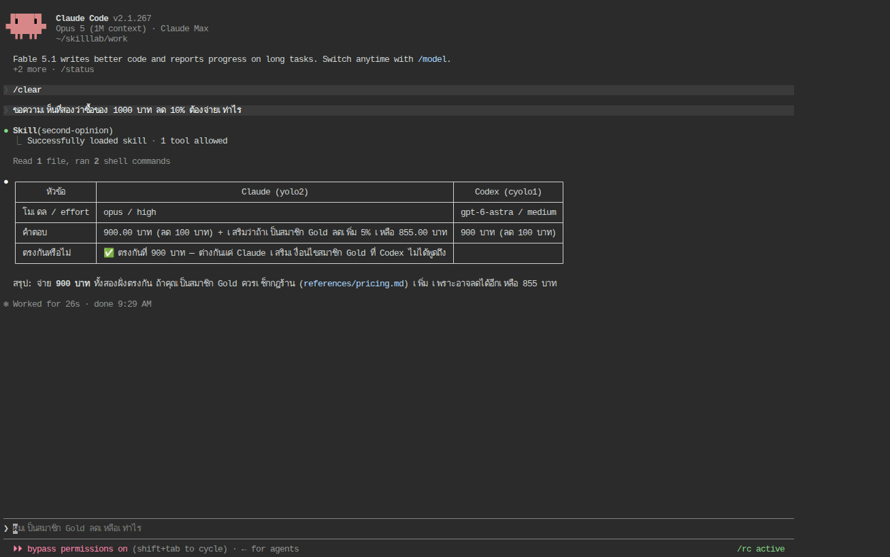

# Skill_LAB 007 · Second Opinion: skill ที่เรียกสองบัญชีขนานกัน และให้ AI สร้าง skill แข่งกับเรา (★★★★★)

## 1. วัตถุประสงค์

1. รวมทุกอย่างจาก Skill_LAB 001–006 เป็น skill เดียว `second-opinion`: description ที่แยกแยะได้ (002), อาร์กิวเมนต์ (003), สคริปต์ที่ exit 0 เสมอ (004), ไฟล์อ้างอิงรูปแบบรายงาน (005), การเลือกโมเดล/effort ของแต่ละบัญชี (006) และการเรียก `yolo2` + `cyolo1` **ขนานกัน** (LAB 004)
2. ให้ AI สร้าง skill เดียวกันจากสเปกเดียวกัน (Claude Code เขียนเอง, Codex ใช้ `$skill-creator`) แล้ว **ประเมินด้วยเกณฑ์เดียวกัน** ทั้งของเราและของ AI จาก log จริง 3 รอบต่อ CLI
3. ฝึกอ่านและวิจารณ์ skill ที่ AI สร้าง: อะไรดีกว่าที่เราเขียน อะไรเกินจำเป็น อะไรผิดสเปก

## 2. ข้อกำหนดเบื้องต้น

| รายการ | ข้อกำหนด |
|---|---|
| ต้องผ่านก่อน | Skill_LAB 001–006 และ [LAB 004](../004_LAB_Multi_Account_Skill/README.md) |
| บัญชี | `yolo1` (ผู้เรียก), `yolo2` และ `cyolo1` (ผู้ตอบ) ล็อกอินครบ |
| โมเดล | ผู้เรียก: Claude = Opus · high, Codex = gpt-6-astra · medium; ผู้ตอบตามค่าเริ่มต้นใน skill |
| เวลา | 60 นาที (ให้ AI สร้าง skill ฝั่งละ 2–3 นาที; ทุกการเรียก skill ใช้เวลา 20–60 วินาที เพราะเรียก AI อีก 2 ตัวจริง) |
| ค่าใช้จ่าย | สูงสุดในชุด: การให้ Claude สร้าง skill 1 ครั้ง list price $0.68 |

## 3. ความรู้พื้นฐาน

skill นี้ทำ **fan-out**: ส่งคำถามเดียวกันให้ 2 บัญชีคนละค่ายพร้อมกัน แล้วให้ผู้เรียก (session หลัก) เป็นผู้เทียบ ไม่ใช่ผู้ตอบ หลักออกแบบที่นำมาจากบทก่อน:

| หลัก | นำมาใช้อย่างไร |
|---|---|
| ลอจิกที่ต้องแน่นอนอยู่ในสคริปต์ (004) | `scripts/ask-both.sh` ตรวจล็อกอิน เรียกขนาน รอผล พิมพ์คำตอบทั้งสองฝั่ง `exit 0` เสมอ |
| body บอก "ทำอะไร ห้ามอะไร" ไม่ใช่ "ทำอย่างไร" (ทฤษฎี 12) | body สั่ง "รันสคริปต์ 1 ครั้ง → อ่าน → เขียนรายงานตาม references/report.md" และห้ามเรียกบัญชีเองซ้ำ ห้ามคำนวณเอง |
| description แยกแยะได้ (002) | ใส่วลี "ขอความเห็นที่สอง", "ให้ทั้ง Claude และ Codex ตอบ", "เทียบคำตอบสองค่าย" |
| อาร์กิวเมนต์ (003) | `$ARGUMENTS` = คำถาม พร้อม fallback "ใช้คำถามล่าสุด" สำหรับ Codex ที่ไม่แทนค่า |
| กฎความปลอดภัยของ LAB 004 | ห้ามล็อกอินแทน ห้ามสลับบัญชี ห้ามอ่าน credential บัญชีที่ไม่พร้อม = "ข้าม" |

## 4. ขั้นตอนการทดลอง

### ขั้นที่ 1 · เขียน skill ด้วยมือ (~15 นาที)

ไฟล์ทั้งหมดใน [skills/second-opinion/](skills/second-opinion/) (ฉบับ Claude) และ [skills/second-opinion-codex/](skills/second-opinion-codex/) (ฉบับ Codex ต่างกันเฉพาะ body ที่ไม่ใช้ `${CLAUDE_SKILL_DIR}`/`$ARGUMENTS`)

`SKILL.md` ฉบับ Claude (16 บรรทัด):

```markdown
---
name: second-opinion
description: ขอความเห็นที่สองโดยส่งคำถามเดียวกันให้ Claude อีกบัญชี (yolo2) และ Codex (cyolo1) พร้อมกัน แล้วเทียบคำตอบเป็นตาราง ใช้เมื่อผู้ใช้พูดว่า "ขอความเห็นที่สอง", "ให้ทั้ง Claude และ Codex ตอบ", "เทียบคำตอบสองค่าย" หรือพิมพ์ /second-opinion ตามด้วยคำถาม
argument-hint: "<คำถาม>"
allowed-tools: Bash(${CLAUDE_SKILL_DIR}/scripts/ask-both.sh *)
---

# ความเห็นที่สองจากสองค่าย

คำถาม: $ARGUMENTS (ถ้าว่าง ให้ใช้คำถามล่าสุดของผู้ใช้ในบทสนทนา)

## ขั้นตอน

1. รันหนึ่งครั้ง: `${CLAUDE_SKILL_DIR}/scripts/ask-both.sh "<คำถาม>"` (สคริปต์ตรวจล็อกอินเอง เรียกสองบัญชีขนานกัน และพิมพ์คำตอบทั้งสองฝั่ง; ตั้งค่า `CLAUDE_MODEL`, `CLAUDE_EFFORT`, `CODEX_MODEL`, `CODEX_EFFORT` ได้ถ้าผู้ใช้ระบุ ค่าเริ่มต้น opus/high และ gpt-6-astra/medium)
2. อ่านผลทั้งสองฝั่ง แล้วเขียนรายงานตามรูปแบบใน [references/report.md](references/report.md)
3. ห้ามเรียก yolo2 หรือ cyolo1 เองซ้ำนอกสคริปต์ ห้ามอ่านไฟล์ credential ห้ามล็อกอินแทนผู้ใช้ และไม่ต้องคำนวณคำตอบเอง หน้าที่ของคุณคือเทียบและสรุป
```

หัวใจคือ `scripts/ask-both.sh` (25 บรรทัด): ตรวจ `yolo2 auth status` / `cyolo1 login status` → เรียกสองฝั่งด้วย `&` แล้ว `wait` → พิมพ์ `=== Claude (yolo2, opus/high) ===` และ `=== Codex (cyolo1, gpt-6-astra/medium) ===` → `exit 0` (อ่านคำตอบ Codex จากไฟล์ `-o` ตามที่ LAB 004 สอน)

ติดตั้ง:

```bash
BASE_PATH="$HOME/ai-accounts"
rm -rf "$BASE_PATH/.Claude/shared/skills/second-opinion" "$BASE_PATH/.Codex/shared/skills/second-opinion"
cp -r skills/second-opinion       "$BASE_PATH/.Claude/shared/skills/second-opinion"
cp -r skills/second-opinion-codex "$BASE_PATH/.Codex/shared/skills/second-opinion"
"$BASE_PATH/.Claude/shared/skills/second-opinion/scripts/ask-both.sh" "ตอบเป็นตัวเลขล้วนอย่างเดียว: 12*12"
```

- [ ] สคริปต์พิมพ์ 144 ทั้งสองฝั่ง และ `echo $?` เป็น 0

### ขั้นที่ 2 · ใช้จริง 3 รอบต่อ CLI (~5 นาที)

```bash
yolo1 -p 'ขอความเห็นที่สองว่าซื้อของ 1000 บาท ลด 10% ต้องจ่ายเท่าไร'
cyolo1 exec --skip-git-repo-check 'ขอความเห็นที่สองว่าซื้อของ 1000 บาท ลด 10% ต้องจ่ายเท่าไร'
```

**ผลรันจริง** ([evidence/hand-claude.summary.jsonl](evidence/hand-claude.summary.jsonl), [evidence/hand-codex.summary.jsonl](evidence/hand-codex.summary.jsonl)):

| ผู้เรียก | รอบ | สิ่งที่ AI ทำ (จาก log) | รายงานตาราง 900 บาท ตรงกัน | เวลา | ต้นทุน/โทเคน |
|---|---|---|---|---|---|
| Claude | 1–3 | `Skill(second-opinion)` → Bash `ask-both.sh` → Bash `cat references/report.md` → รายงาน (5 turn ทุกรอบ) | ✅ 3/3 | 21.9 / 26.3 / 22.9 s | $0.130 / 0.136 / 0.077 |
| Codex | 1–3 | `cat SKILL.md` → `cat references/report.md` → `bash ask-both.sh` → รายงาน (3 คำสั่งทุกรอบ) | ✅ 3/3 | 30.0 / 29.4 / 56.9 s | ~63.8k input tokens |

ตัวอย่างรายงานที่ Codex ผลิต ([evidence/hand-Q-codex-1.out](evidence/hand-Q-codex-1.out)):

```text
| หัวข้อ | Claude (yolo2) | Codex (cyolo1) |
|---|---|---|
| โมเดล / effort | opus / high | gpt-6-astra / medium |
| คำตอบ | 900 บาท | 900 บาท |
| ตรงกันหรือไม่ | ✅ ตรงกัน | ✅ ตรงกัน |
สรุป: ต้องจ่าย **900 บาท**
```

ทั้ง 6 รอบเรียกครบ 2 บัญชี ตรวจล็อกอินก่อน (อยู่ในสคริปต์) ระบุโมเดล/effort ถูกต้อง และไม่มีรอบไหนที่ผู้เรียกเรียกบัญชีเองนอกสคริปต์



### ขั้นที่ 3 · ให้ AI สร้าง skill จากสเปกเดียวกัน (~10 นาที)

ลบ skill ที่เขียนเองออกก่อน แล้วให้แต่ละ CLI สร้าง `second-opinion-ai` ด้วยสเปกเดียวกัน ([evidence/prompts](skills/prompts/) — `spec-common.txt` เหมือนกันทุกตัวอักษร ต่างเฉพาะบรรทัดแรกที่บอกตำแหน่งวางไฟล์)

```bash
rm -rf "$BASE_PATH/.Claude/shared/skills/second-opinion" "$BASE_PATH/.Codex/shared/skills/second-opinion"
yolo1 -p "$(cat skills/prompts/spec-claude.txt)"
cyolo1 exec --skip-git-repo-check "$(cat skills/prompts/spec-codex.txt)"
```

สเปกกำหนด: ใช้เมื่อพูดว่า "ขอความเห็นที่สอง"…, เรียก yolo2 + cyolo1 ขนาน, ตารางเทียบ, ตรวจล็อกอิน, สคริปต์ `scripts/ask-both.sh` exit 0 ไม่พิมพ์ข้อมูลลับ, description ไม่เกิน 3 บรรทัดและไม่ใส่ขั้นตอน, ทดสอบจริงด้วย `12*12`, ห้ามอ่าน README/ล็อกอินแทน/แตะ credential

**ผลรันจริงของการสร้าง** ([evidence/gen-claude.transcript.txt](evidence/gen-claude.transcript.txt), [evidence/gen-codex.jsonl](evidence/gen-codex.jsonl)):

| | Claude Code (Opus · high) | Codex `$skill-creator` (Astra · medium) |
|---|---|---|
| เวลา / รอบ | 189 s · 17 turn · 15 tool call | 134 s · 4 คำสั่ง |
| สิ่งที่ทำก่อนเขียน | `WebFetch` docs ของ skill, อ่าน wrapper `yolo2`/`cyolo1`, ตรวจ `auth status`/`login status`, **ลองเรียกจริง** ทั้งสองบัญชีจับเวลา | อ่าน `skill-creator/SKILL.md`, ตรวจ `CODEX_HOME` และล็อกอินด้วย python |
| ทดสอบ `12*12` | ผ่าน (เรียก `Skill(second-opinion-ai)` เองแล้วได้ 144 ทั้งสองฝั่ง) | ผ่าน ("PASS — ทั้งสองฝั่งตอบ 144") |
| ผลลัพธ์ | `SKILL.md` 50 บรรทัด + `ask-both.sh` 101 บรรทัด | `SKILL.md` 20 บรรทัด + `ask-both.sh` 87 บรรทัด |
| ต้นทุน | list price $0.68 | 138.8k input / 3.7k output tokens |

ไฟล์ที่ AI สร้างเก็บไว้ครบใน [evidence/generated/](evidence/generated/)

### ขั้นที่ 4 · อ่านและวิจารณ์ skill ของ AI (~10 นาที)

เทียบ 3 ฉบับด้วยเกณฑ์จากภาคทฤษฎี (หัวข้อ 12–13):

| เกณฑ์ | เขียนเอง | Claude สร้าง | Codex สร้าง |
|---|---|---|---|
| description บอกทำอะไร + เมื่อไร ไม่มีขั้นตอน | ✅ 1 บรรทัดยาว | ✅ 3 บรรทัด (บล็อก `\|`) เพิ่ม "cross-check" | ✅ สั้นสุด |
| ผ่าน `quick_validate.py` (สเปก Agent Skills) | ❌ ฉบับ Claude ถูกเตือน `Unexpected key(s): argument-hint` (ฟิลด์เฉพาะ Claude) · ✅ ฉบับ Codex | ✅ | ✅ |
| ตรวจล็อกอิน / exit 0 เสมอ | ✅ | ✅ + `timeout` กันค้าง + `status: ok/skipped/error` + `reason:` | ✅ + `timeout` + JSON status + `set +x; exec 2>/dev/null` กัน stderr รั่ว |
| ปรับโมเดล/effort ได้ | env var 4 ตัว | flag `--claude-model …` | argument ตามลำดับ 4 ตัว |
| ไม่รั่วข้อมูลลับ | ทิ้ง output ของ auth ทั้งหมด | ทิ้ง output + คอมเมนต์อธิบายว่า `login status` พิมพ์ลง stderr | `exec 2>/dev/null`, `umask 077`, `mktemp` + `trap` |
| รูปแบบรายงาน | แยกไว้ใน `references/report.md` (ต้องอ่านเพิ่ม 1 รอบ) | ฝังตารางตัวอย่างใน body | ฝังคำอธิบายใน body |
| สิ่งที่เกินสเปก | – | บรรทัด `__COST__` ไม่มี แต่มีขนาด body 50 บรรทัด | JSON output ที่โมเดลต้องแปลงเอง |
| ข้อสังเกต | สั้นที่สุด อ่านง่ายที่สุด แต่ต้องอ่าน references เพิ่ม | ครบและระวังที่สุด แพงที่สุด (17 turn) | เน้นความปลอดภัยของสคริปต์ตามหลัก skill-creator ("match specificity to the risk") |

ข้อสังเกตสำคัญ: **AI ทั้งสองค่ายเลือกฝังรูปแบบรายงานไว้ใน body แทนแยกไฟล์** ซึ่งตรงกับผลของ Skill_LAB 005 (skill เล็กไม่ควรแตกไฟล์) และตรงกับผลรันขั้นที่ 5 ที่ฉบับ AI ใช้ tool call น้อยกว่าฉบับเราหนึ่งรอบ

### ขั้นที่ 5 · ประเมินฉบับ AI ด้วยประโยคเดิม 3 รอบต่อ CLI (~5 นาที)

```bash
yolo1 -p 'ขอความเห็นที่สองว่าซื้อของ 1000 บาท ลด 10% ต้องจ่ายเท่าไร'
cyolo1 exec --skip-git-repo-check 'ขอความเห็นที่สองว่าซื้อของ 1000 บาท ลด 10% ต้องจ่ายเท่าไร'
```

**ผลรันจริง** ([evidence/ai-claude.summary.jsonl](evidence/ai-claude.summary.jsonl), [evidence/ai-codex.summary.jsonl](evidence/ai-codex.summary.jsonl)):

| ผู้เรียก | skill ที่ใช้ | ถูกเลือกอัตโนมัติ | เรียกครบ 2 บัญชี | ตาราง 900 ตรงกัน | turn / คำสั่ง | เวลา | ต้นทุน |
|---|---|---|---|---|---|---|---|
| Claude | เขียนเอง | 3/3 | 3/3 | 3/3 | 5 turn (Skill + Bash ×2) | 21.9–26.3 s | $0.077–0.136 |
| Claude | Claude สร้าง | 3/3 | 3/3 | 3/3 | **4 turn** (Skill + Bash ×1) | 20.8–26.3 s | $0.076–0.123 |
| Codex | เขียนเอง | 3/3 | 3/3 | 3/3 | 3 คำสั่ง | 29.4–56.9 s | ~63.8k in |
| Codex | Codex สร้าง | 3/3 | 3/3 | 3/3 | **2 คำสั่ง** | 26.5–29.3 s | ~63.6k in |

ทุกฉบับผ่านทุกเกณฑ์ ต่างกันที่ฉบับ AI ประหยัด 1 รอบเพราะไม่ต้องอ่าน `references/report.md` เวลาและต้นทุนจึงต่ำกว่าเล็กน้อย

## 5. ผลการทดลองเปรียบเทียบ

| ตัวชี้วัด (12 รอบ) | เขียนเอง (6) | AI สร้าง (6) |
|---|---|---|
| ถูกเลือกจาก description | 6/6 | 6/6 |
| เรียก yolo2 + cyolo1 ผ่านสคริปต์ | 6/6 | 6/6 |
| ตรวจล็อกอินก่อน / ระบุโมเดล-effort | 6/6 (ในสคริปต์) | 6/6 (ในสคริปต์) |
| รายงาน 900 บาท ตรงกัน | 6/6 | 6/6 |
| ผู้เรียกเรียกบัญชีเองนอกสคริปต์ | 0/6 | 0/6 |
| tool call เฉลี่ยต่อรอบ | Claude 3 · Codex 3 | Claude 2 · Codex 2 |
| ผ่านตัวตรวจสเปก | 1/2 ฉบับ | 2/2 ฉบับ |
| ต้นทุนการสร้าง | เวลาคน ~15 นาที | $0.68 / 139k tokens + 2–3 นาที |

## 6. สรุป

1. skill ที่ประสานหลายบัญชีควรมี 3 ชั้นชัดเจน: description (เมื่อไรใช้) → body (ทำอะไร ห้ามอะไร) → สคริปต์ (ทำอย่างไร แน่นอน exit 0) ผลคือทั้งสอง CLI ใช้ skill เดียวกันได้ 12/12 รอบ
2. AI สร้าง skill ได้ทัดเทียมหรือดีกว่าคนในรายละเอียดเชิงป้องกัน (timeout, status, ไม่รั่ว stderr) และตัดสินใจถูกว่า skill เล็กไม่ต้องแยกไฟล์ แต่ผู้ตรวจต้องเข้าใจทฤษฎีจึงจะเห็นว่าอะไรเกินจำเป็น (JSON ที่โมเดลต้องแปลงเอง, body 50 บรรทัด)
3. ตัวตรวจสเปกจับได้ว่าฟิลด์เฉพาะ Claude (`argument-hint`) ทำให้ skill ไม่ตรงมาตรฐาน Agent Skills — ถ้าต้องการ skill ที่ย้ายค่ายได้ ให้ใช้เฉพาะฟิลด์มาตรฐาน
4. การประเมิน skill ทำแบบเดียวกับ LAB 004: ประโยคเดิม หลายรอบ หลาย CLI อ่านจาก log (tool call, คำสั่ง, โทเคน, เวลา) ไม่ใช่จากคำอธิบายของ AI ว่า "ทดสอบผ่านแล้ว"

## 7. หมายเหตุวิธีการทดลอง

รันด้วย [evidence/lab007-driver.sh](evidence/lab007-driver.sh) ในคอนเทนเนอร์เดียวกับ Skill_LAB 001 (Claude Code 2.1.267, codex-cli 0.154.0) บัญชีที่ล็อกอิน `yolo1`, `yolo2`, `cyolo1` ตัวตรวจสเปกคือ `quick_validate.py` ของ skill `skill-creator` ที่ติดมากับ Codex (ต้องติดตั้ง `pyyaml` ก่อน ผลใน [evidence/quick-validate.txt](evidence/quick-validate.txt)) ทุกไฟล์ปิดบังอีเมล/องค์กร
